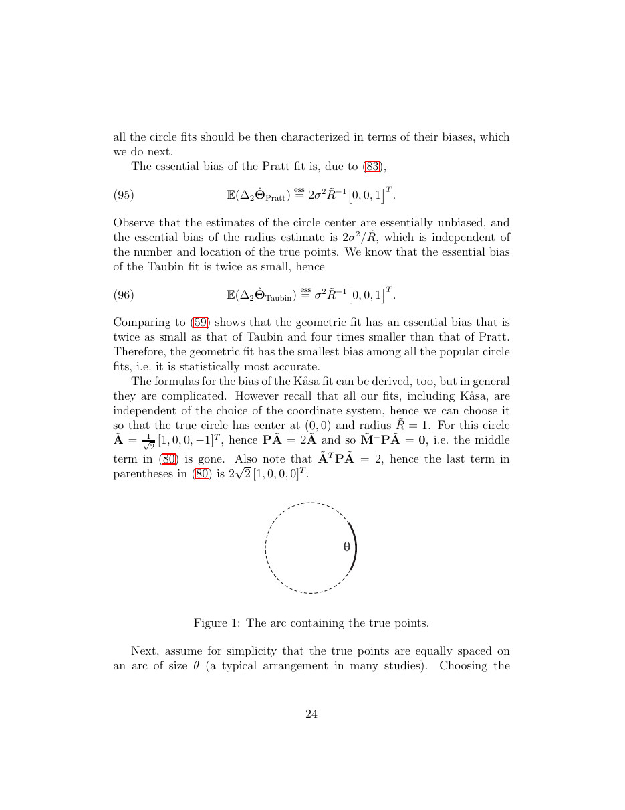
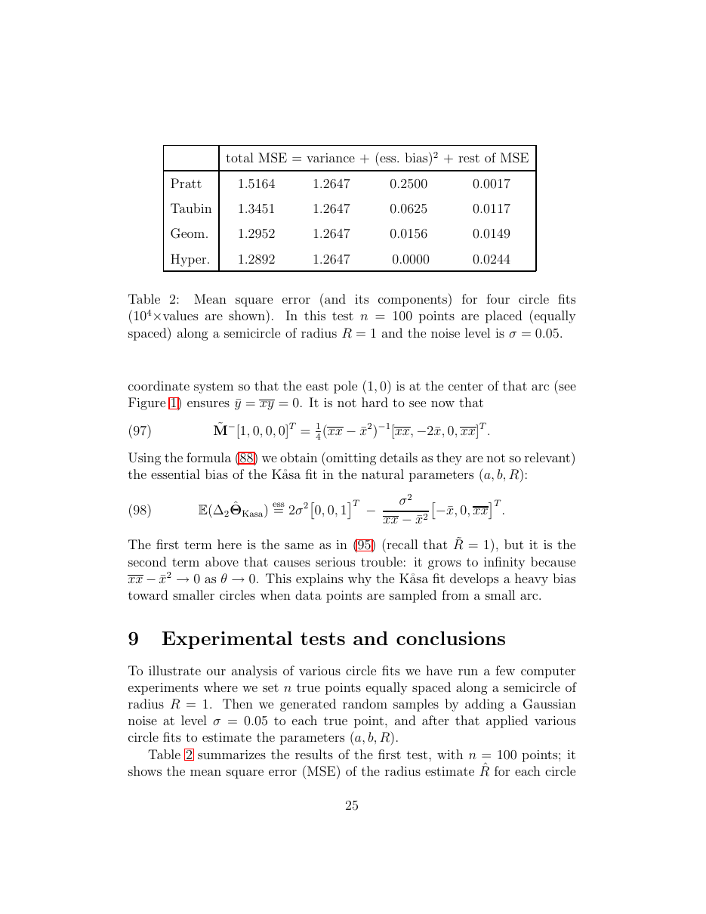
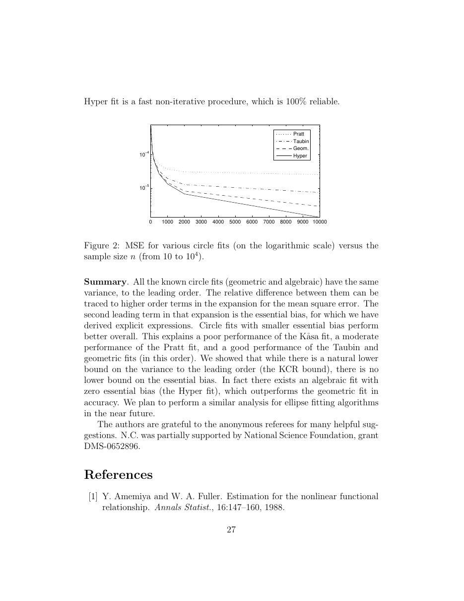

# 원 맞춤 알고리즘의 오차 분석 (번역)

- 원제: Error analysis for circle fitting algorithms
- 저자: A. Al-Sharadqah, N. Chernov (University of Alabama at Birmingham, 수학과)
- 원문: 같은 폴더의 `AlSharadqah2009_EJS_circle_fitting_error.pdf` (arXiv:0907.0421v1, 2009-07-02, 30쪽)
- 게재: Electronic Journal of Statistics 3, pp. 886-911, 2009. DOI 10.1214/09-EJS419 (Crossref로 확인)
- 번역 범위: 전문 (초록, 본문 1~9절, 표와 그림 캡션). 참고문헌은 원문 그대로 둔다.
- 번역 메모
  - 수식은 원문 기호를 그대로 쓴다. 물결표(~)는 참값, 모자(^)는 추정값이다.
  - pdftotext로 뽑은 글에서 수식이 깨진 곳은 원문 PDF 쪽 그림과 맞춰 다시 적었다.
  - essential bias는 "본질 편향", hyperaccurate fit은 "Hyper 맞춤"으로 옮겼다.

---

## 초록

오차가 두 변수 모두에 들어간 점들에 원(또는 원호)을 맞추는 문제를 다룬다.
널리 쓰는 원 맞춤 방법 모두에 대해 자세한 오차 분석을 한다.
대상은 기하 맞춤, Kåsa 맞춤, Pratt 맞춤, Taubin 맞춤이다.
우리 분석은 흔히 하는 첫째 차수 전개보다 더 깊이 들어간다.
더 높은 차수 항을 구해서, 원 맞춤 방법들이 왜, 얼마나 서로 다른지 정확히 보인다.
이 분석으로 새로운 대수적(반복 없는) 원 맞춤 알고리즘을 만든다.
이 방법은 기존 방법 전부보다 낫고, 지금까지 이길 수 없다고 여겨진 기하 맞춤보다도 낫다.

핵심어: 최소제곱 맞춤, 곡선 맞춤, 원 맞춤, 대수 맞춤, 오차 분석, 분산, 편향, 함수 모형.

## 1. 서론

관측한 점에 원과 원호를 맞추는 일은 패턴 인식, 컴퓨터 비전, 핵물리 같은 분야의 기본 과제다 [5, 9, 11, 23, 24, 27, 30, 32].
자료에 원을 맞추는 알고리즘은 많이 나와 있다.
어떤 것은 원에서 자료 점까지의 기하 거리를 최소화한다(기하 맞춤이라 부른다).
다른 것은 여러 근사 거리('대수' 거리)를 최소화하며, 대수 맞춤이라 부른다.
가장 많이 쓰는 알고리즘은 3~4절에서 정리한다.

기하 맞춤은 보통 가장 정확하다고 여긴다.
하지만 반복 계산으로만 구현할 수 있어 계산량이 크고, 가끔 발산한다.
대수 맞춤은 빠르지만 덜 정확하다고 여겨진다.
그런데 이들의 정확도 평가는 오로지 실무 경험에 기대고 있다.
여러 원 맞춤의 정확도를 이론으로 자세히 비교한 사람은 없었다.
[8]에서는 잡음이 작은 극한에서, 첫째 차수까지 보면 모든 원 맞춤의 공분산 행렬이 같다는 것을 보였다.
따라서 방법들의 차이는 더 높은 차수의 오차 분석으로만 드러난다.

이 논문의 목적이 바로 그것이다.
더 높은 차수의 오차 분석을 써서(더 일반적인 2차 모형에서 Kanatani [22]가 비슷한 분석을 했다) 기하 원 맞춤이 대수 원 맞춤보다 왜, 얼마나 정확한지 정확히 보인다.
대수 맞춤들끼리의 정밀도도 비교한다.
5절은 오차 분석을 일반 형태로 제시하므로 다른 곡선 맞춤 문제에도 바로 쓸 수 있다.

끝으로, 이 분석으로 기하 맞춤보다 정확한 새 대수 맞춤을 만든다.
수치 실험으로 그 우수성을 보인다.

## 2. 통계 모형

표준 함수 모형(functional model)을 쓴다.
자료 점 $(x_1,y_1),\dots,(x_n,y_n)$은 참 점 $(\tilde x_1,\tilde y_1),\dots,(\tilde x_n,\tilde y_n)$에 잡음이 더해진 관측이다.

(1) $x_i=\tilde x_i+\delta_i,\quad y_i=\tilde y_i+\varepsilon_i,\quad i=1,\dots,n$

여기서 $(\delta_i,\varepsilon_i)$는 등방성 가우스 잡음이다.
정확히는 $\delta_i$와 $\varepsilon_i$가 평균 0, 분산 $\sigma^2$인 서로 독립이고 같은 분포를 따르는 정규 확률변수다.

참 점 $(\tilde x_i,\tilde y_i)$는 '참 원' 위에 있다고 가정한다.

(2) $(\tilde x_i-\tilde a)^2+(\tilde y_i-\tilde b)^2=\tilde R^2,\quad i=1,\dots,n$

$(\tilde a,\tilde b,\tilde R)$는 '참'(모르는) 모수다. 따라서

(3) $\tilde x_i=\tilde a+\tilde R\cos\varphi_i,\quad \tilde y_i=\tilde b+\tilde R\sin\varphi_i$

이고, $\varphi_1,\dots,\varphi_n$은 참 원 위 참 점의 위치를 정한다.
각 $\varphi_1,\dots,\varphi_n$은 고정된 미지수로 보고 모형의 추가 모수(부수 모수, 잠재 모수)로 다룬다.
간단히 쓰려고 다음과 같이 둔다.

(4) $\tilde u_i=\cos\varphi_i=(\tilde x_i-\tilde a)/\tilde R,\quad \tilde v_i=\sin\varphi_i=(\tilde y_i-\tilde b)/\tilde R$

모든 $i$에서 $\tilde u_i^2+\tilde v_i^2=1$이다.

참고. 이 논문에서 $\delta_i$와 $\varepsilon_i$는 같은 분산 $\sigma^2$을 가진다. 즉 잡음이 등분산이다.
많은 연구에서는 잡음이 이분산이다 [25, 35].
즉 정규 벡터 $(\delta_i,\varepsilon_i)$의 공분산이 점마다 다른 $\sigma^2 C_i$이고, $C_i$는 알려져 있으며 $i$에 따라 달라지고, $\sigma^2$은 모르는 배수다.
우리 분석은 이 경우로도 넓힐 수 있지만 식이 좀 더 복잡해지므로 다루지 않는다.

## 3. 기하 원 맞춤

2차원 자료에 원을 맞추는 표준 방법은 직교 최소제곱이다.
기하 맞춤, 또는 직교 거리 회귀(ODR)라고도 한다. 다음 함수를 최소화한다.

(5) $F(a,b,R)=\sum d_i^2$

$d_i$는 $(x_i,y_i)$에서 원까지의 거리다.

(6) $d_i=r_i-R,\quad r_i=\sqrt{(x_i-a)^2+(y_i-b)^2}$

$(a,b)$는 원의 중심, $R$은 반지름이다.

함수 모형에서 기하 맞춤은 원 모수의 최대우도 추정(MLE)을 준다 [6].

(7) $(\hat a_{MLE},\hat b_{MLE},\hat R_{MLE})=\arg\min F(a,b,R)$

기하 맞춤의 큰 걱정거리는 이 최소화 문제에 닫힌 해가 없다는 점이다.
$F$를 최소화하는 실용 알고리즘은 모두 반복형이다.
일반 Gauss-Newton [6, 15]이나 Levenberg-Marquardt [9]를 쓰는 것도 있고, Landau [24]와 Späth [30]가 제안한 원 전용 방법을 쓰는 것도 있다.
반복 알고리즘의 성능은 초기값에 크게 좌우된다.
수렴까지 수십, 수백 번 반복하는 일이 흔하고, $F$의 국소 최소에 갇히거나 아예 발산할 가능성이 늘 있다.
이 문제는 [9]에서 다룬다.

원 모수의 최대우도 추정 $(\hat a,\hat b,\hat R)$에는 특이한 성질이 있다. 적률이 무한대다 [7].

(8) $E(|\hat a|)=E(|\hat b|)=E(\hat R)=\infty$

이는 어떤 참값 $(\tilde a,\tilde b,\tilde R)$에서도 성립한다. $E$는 평균이다.
추정값 분포의 꼬리가 다소 두껍기 때문이다.
하지만 이 꼬리는 MLE의 실제 성능에는 거의 영향을 주지 않는다(두 변수 모두에 오차가 있는 자료에 직선을 맞출 때도 같은 일이 생긴다 [2, 3]).

적률이 존재하게 하려면 다른 모수화를 쓸 수 있다.
Pratt [27]와 다른 이들 [13]이 깔끔한 방식을 제안했다. 원을 다음 대수 방정식으로 쓴다.

(9) $A(x^2+y^2)+Bx+Cy+D=0$

여기에는 분명한 제약 $A\neq0$(아니면 직선이 된다)과, 덜 분명한 제약 $B^2+C^2-4AD>0$이 붙는다.
뒤의 제약이 왜 필요한지는 (9)를 다음처럼 고쳐 쓰면 보인다.

(10) $\left(x-\dfrac{B}{2A}\right)^2+\left(y-\dfrac{C}{2A}\right)^2-\dfrac{B^2+C^2-4AD}{4A^2}=0$

이제 (9)가 원을 나타낼 필요충분조건이 $B^2+C^2-4AD>0$임이 분명하다.

모수 $(A,B,C,D)$는 상수배까지만 정하면 되므로, 다음 제약을 거는 것이 자연스럽다.

(11) $B^2+C^2-4AD=1$

이렇게 하면 $B^2+C^2-4AD>0$이 저절로 성립한다.
제약 (11)은 Pratt [27]가 처음 제안했다.
이 제약 아래에서 모수 $A,B,C,D$는 사실상 유계이고 [9], 그 최대우도 추정의 적률이 유한함을 보일 수 있다.

제약 (11) 아래의 방정식 (9)는 모든 원과 직선($A=0$일 때)을 편리하게 나타낸다.
최소제곱 해가 존재하려면 직선을 포함해야 한다 [9, 26, 37].

대수 원 모수 $A,B,C,D$를 추정한 다음에는 자연 모수로 바꿀 수 있다.

(12) $a=-\dfrac{B}{2A},\quad b=-\dfrac{C}{2A},\quad R^2=\dfrac{B^2+C^2-4AD}{4A^2}$

## 4. 대수 원 맞춤

복잡한 기하 맞춤의 대안은 대수 맞춤이라는 빠르고 반복 없는 절차다.
가장 많이 쓰는 대수 원 맞춤 셋을 아래에 적는다.

**Kåsa 맞춤.** 다음 함수를 최소화해서 원을 찾을 수 있다.

(13) $F_K=\sum(r_i^2-R^2)^2=\sum(x_i^2+y_i^2-2ax_i-2by_i+a^2+b^2-R^2)^2$

즉 $F_K=\sum f_i^2$을 최소화한다. $f_i=r_i^2-R^2$은 점 $(x_i,y_i)$에서 원까지의 이른바 대수 거리다.
모수를 $B=-2a$, $C=-2b$, $D=a^2+b^2-R^2$으로 바꾸면 (13)은 다음을 최소화하는 선형 최소제곱 문제가 된다.

(14) $F_K=\sum(z_i+Bx_i+Cy_i+D)^2$

간단히 $z_i=x_i^2+y_i^2$로 썼다(뒤의 식과 맞추려고 여기서는 일부러 $A$를 뺐다).
이제 문제는 $B,C,D$에 대한 연립 일차방정식(정규방정식)이 되어 쉽게 풀리고, (12)로 자연 모수 $a,b,R$을 되찾는다.

이 방법은 1970년대에 Delogne [11]와 Kåsa [23]가 내놓았고, 그 뒤 많은 저자가 따로 다시 발견해 발표했다([9]의 참고문헌 참조).
지금도 실무에서 널리 쓴다. 우리는 이를 Kåsa 맞춤이라 부른다.

Kåsa 방법은 아마 가장 빠른 원 맞춤이다.
하지만 완전하지 않은 원호(일부가 가려진 원)를 관측하면 정확도가 떨어진다.
이때 Kåsa 맞춤은 작은 원 쪽으로 심하게 치우친다고 알려져 있다 [9].
치우침의 이유는 대수 거리 $f_i$가 기하 거리 $d_i$를 잘 근사하지 못하기 때문이다. 실제로

(15) $f_i=(r_i-R)(r_i+R)=d_i(2R+d_i)\approx2Rd_i$

이므로 Kåsa 맞춤은 $F_K\approx 4R^2\sum d_i^2$을 최소화한다(원문 식은 $2R^2\sum d_i^2$으로 인쇄됨).
그래서 거리 $d_i$보다 $R^2$을 줄이는 작은 원을 자주 고른다.

**Pratt 맞춤.** Kåsa 방법을 개선하려면 $\sum d_i^2$을 더 잘 근사하는 다른 함수 $F=\frac{1}{4R^2}F_K$를 최소화할 수 있다.
이 함수를 $A,B,C,D$로 쓰면 (12) 덕분에 다음과 같다.

(16) $F_P=\dfrac{\sum[Az_i+Bx_i+Cy_i+D]^2}{B^2+C^2-4AD}$

같은 말로, 다음을

(17) $F(A,B,C,D)=\sum[Az_i+Bx_i+Cy_i+D]^2$

제약 (11) 아래에서 최소화해도 된다. 이 방법은 Pratt [27]가 제안했다.

**Taubin 맞춤.** Taubin [32]은 조금 다른 방법을 제안했다. 다음 함수를 최소화한다.

(18) $F_T=\dfrac{\sum\left[(x_i-a)^2+(y_i-b)^2-R^2\right]^2}{4n^{-1}\sum\left[(x_i-a)^2+(y_i-b)^2\right]}$

$A,B,C,D$로 쓰면

(19) $F_T=\dfrac{\sum[Az_i+Bx_i+Cy_i+D]^2}{n^{-1}\sum[4A^2z_i+4ABx_i+4ACy_i+B^2+C^2]}$

이다. 같은 말로, (17)을 새 제약

(20) $4A^2\bar z+4AB\bar x+4AC\bar y+B^2+C^2=1$

아래에서 최소화해도 된다. 여기서는 표준 '표본 평균' 기호 $\bar x=\frac1n\sum x_i$ 등을 쓴다.

**일반 사항.** (17)을 최소화할 때는 자명한 해 $A=B=C=D=0$을 피하려고 반드시 어떤 제약을 걸어야 한다.
Pratt와 Taubin 맞춤은 각각 제약 (11)과 (20)을 쓴다.
Kåsa 맞춤도 (17)을 최소화하지만 제약은 $A=1$이다.

Pratt와 Taubin의 $A,B,C,D$ 추정은 적률이 유한하지만, 그에 대응하는 $a,b,R$ 추정은 MLE (8)처럼 적률이 무한하다.
반면 Kåsa의 $a,b,R$ 추정은 $n\ge4$이면 적률이 유한하다 [37].

위의 원 맞춤은 모두 중요한 성질이 있다. 좌표계 선택과 무관하다.
즉 결과가 평행이동과 회전에 불변이다. 증명은 [14]에 있다.

실무 경험으로는 Pratt와 Taubin 맞춤이 Kåsa 맞춤보다 안정되고 정확하며, 둘은 거의 같은 성능을 낸다 [9].
Taubin [32]은 자기 방법을 Pratt 방법과 이론으로 비교하려 했지만, 그런 분석은 발표되지 않았다.
아래에서 그 비교를 한다.

현대 문헌에는 원 맞춤 문제에 대한 다른 접근도 많다 [4, 10, 35, 28, 29, 31, 33, 36, 38].
하지만 대부분 꽤 느리거나, 대수 맞춤 가운데 하나로 귀결된다 [14, 8장].

**행렬 표현.** 위 세 대수 맞춤을 행렬로 쓸 수 있다.
$\mathbf A=(A,B,C,D)^T$를 모수 벡터라 하자. 그리고

(21) $\mathbf Z=\begin{pmatrix}z_1&x_1&y_1&1\\ \vdots&\vdots&\vdots&\vdots\\ z_n&x_n&y_n&1\end{pmatrix}$

를 '자료 행렬'(여기서 $z_i=x_i^2+y_i^2$),

(22) $\mathbf M=\frac1n\mathbf Z^T\mathbf Z=\begin{pmatrix}\overline{zz}&\overline{zx}&\overline{zy}&\bar z\\ \overline{zx}&\overline{xx}&\overline{xy}&\bar x\\ \overline{zy}&\overline{xy}&\overline{yy}&\bar y\\ \bar z&\bar x&\bar y&1\end{pmatrix}$

를 '적률 행렬'이라 하자.
모든 대수 원 맞춤은 같은 목적함수 $F(\mathbf A)=\mathbf A^T\mathbf M\mathbf A$((17) 참조)를 제약 $\mathbf A^T\mathbf N\mathbf A=1$ 아래에서 최소화한다. 행렬 $\mathbf N$이 방법마다 다르다.
Pratt 맞춤은

(23) $\mathbf N=\mathbf P=\begin{pmatrix}0&0&0&-2\\0&1&0&0\\0&0&1&0\\-2&0&0&0\end{pmatrix}$

Taubin 맞춤은

(24) $\mathbf N=\mathbf T=\begin{pmatrix}4\bar z&2\bar x&2\bar y&0\\2\bar x&1&0&0\\2\bar y&0&1&0\\0&0&0&0\end{pmatrix}$

를 쓰고, Kåsa는 $\mathbf N=\mathbf K=\mathbf e_1\mathbf e_1^T$, $\mathbf e_1=(1,0,0,0)^T$를 쓴다.

이 제약 최소화 문제를 풀려면 라그랑주 승수 $\eta$를 써서 다음 함수의 제약 없는 최소화로 바꾼다.

(25) $\mathcal G(\mathbf A,\eta)=\mathbf A^T\mathbf M\mathbf A-\eta(\mathbf A^T\mathbf N\mathbf A-1)$

$\mathbf A$로 미분하면

(26) $\mathbf M\mathbf A=\eta\mathbf N\mathbf A$

이므로 $\mathbf A$는 행렬 쌍 $(\mathbf M,\mathbf N)$의 일반화 고유벡터여야 한다.
뒤의 분석에는 이 사실로 충분하다. 이것이 $\mathbf A$를 상수배까지 정하고, $\mathbf A$에 상수를 곱해도 나타내는 원은 바뀌지 않으므로 $\|\mathbf A\|=1$로 둘 수 있다.

참고. 일반화 고유값 문제 (26)은 해가 여럿일 수 있다.
맞는 해를 고르려면 각 해 $(\eta,\mathbf A)$에서 $\mathbf A^T\mathbf M\mathbf A=\eta\mathbf A^T\mathbf N\mathbf A=\eta$임을 쓴다.
따라서 $\mathbf A^T\mathbf M\mathbf A$를 최소화하려면 (26)의 해 가운데 가장 작은 양의 $\eta$를 골라야 한다.

## 5. 오차 분석: 일반 틀

'작은 잡음' 가정에 바탕한 오차 분석 틀을 쓴다.
즉 2절의 오차 $\delta_i$, $\varepsilon_i$가 작다고 보고, 그 표준편차 $\sigma$를 작은 모수로 다룬다.
표본 크기 $n$은 고정이지만 아주 작지는 않다.

이 접근은 Kadane [16]까지 거슬러 올라가며, Anderson [2]과 다른 통계학자들 [3]이 썼다.
최근에는 Kanatani [19, 22]가 영상 처리에 썼다.
그는 $n$을 고정한 채 $\sigma\to0$으로 보내는 '작은 잡음' 모형이, $\sigma>0$을 고정한 채 $n\to\infty$로 보내는 전통적인 '큰 표본' 접근보다 더 알맞다고 주장했다.
우리는 두 모형을 섞어 쓴다. 주 가정은 $\sigma\to0$이지만, $n$은 천천히 커지는 모수로 본다.
정확히는 $n\ll\sigma^{-2}$로 가정한다.

음함수 방정식으로 정의되는 곡선을 맞춘다고 하자.

(27) $P(x,y;\Theta)=0$

$\Theta=(\theta_1,\dots,\theta_k)^T$는 추정할 미지 모수 벡터다.
$\tilde\Theta=(\tilde\theta_1,\dots,\tilde\theta_k)^T$는 '참' 곡선 $P(x,y;\tilde\Theta)=0$에 대응하는 '참' 모수 벡터다.
2절처럼 $(\tilde x_i,\tilde y_i)$는 참 곡선 위의 참 점, $(x_i,y_i)$는 (1)을 만족하는 관측 점이다.
$\hat\Theta(x_1,y_1,\dots,x_n,y_n)$을 추정량이라 하자.
$\hat\Theta$는 관측 $(x_i,y_i)$의 정칙 함수(적어도 네 번 미분 가능)라고 가정한다.
$\hat\Theta$의 도함수는 참 점 $(x_i,y_i)=(\tilde x_i,\tilde y_i)$에서만 있으면 된다.
이는 (27)의 $P(x,y;\Theta)$가 미분 가능하면(대부분 $P$는 모든 변수의 다항식이다) 일반 가정 아래 음함수 정리에서 따라 나온다. 증명은 생략한다.

간단히 $\mathbf X=(x_1,y_1,\dots,x_n,y_n)^T$를 모든 관측의 벡터라 하자.
그러면 $\mathbf X=\tilde{\mathbf X}+\mathbf E$이다.
$\tilde{\mathbf X}=(\tilde x_1,\tilde y_1,\dots,\tilde x_n,\tilde y_n)^T$는 참 좌표 벡터, $\mathbf E=(\delta_1,\varepsilon_1,\dots,\delta_n,\varepsilon_n)^T$는 '잡음 벡터'다.
$\mathbf E$의 성분은 평균 0, 분산 $\sigma^2$인 독립 동일분포 정규 확률변수다.

테일러 전개를 2차 항까지 쓴다.
기호를 간단히 하려고 벡터 $\Theta$의 스칼라 모수 $\theta_m$을 하나씩 다룬다.

(28) $\hat\theta_m(\mathbf X)=\hat\theta_m(\tilde{\mathbf X})+\mathbf G_m^T\mathbf E+\tfrac12\mathbf E^T\mathbf H_m\mathbf E+O_P(\sigma^3)$

$\mathbf G_m=\nabla\hat\theta_m$과 $\mathbf H_m=\nabla^2\hat\theta_m$은 각각 $\hat\theta_m$의 기울기(1차 편미분 벡터)와 헤세 행렬(2차 편미분 행렬)이며, 참 벡터 $\tilde{\mathbf X}$에서 구한다.
(28)의 나머지 항 $O_P(\sigma^3)$는 $\sigma^{-3}R$이 확률적으로 유계인 확률변수 $R$이다.

전개 (28)은 $\sigma\to0$일 때 $\hat\Theta(\mathbf X)\to\hat\Theta(\tilde{\mathbf X})$로 확률 수렴함을 보인다. 다음을 가정하면 편하다.

(29) $\hat\Theta(\tilde{\mathbf X})=\tilde\Theta$

정확히 말해 (29)는 $\sigma=0$일 때, 곧 참 점을 잡음 없이 관측하면 추정량이 참 모수 벡터를 돌려준다는 뜻이다. 즉 참 곡선을 찾는다.
기하로 말하면, 자료 점을 지나는 모형 곡선이 있으면 알고리즘이 그것을 찾는다는 뜻이다.

다소 느슨하게 말하면, (29)가 성립할 때마다 추정 $\hat\Theta$는 $\sigma\to0$ 극한에서 일치성을 가진다.
이는 어떤 합리적인 맞춤 알고리즘에도 요구되는 최소 조건이다.
예를 들어 관측 점이 한 원 위에 있으면 모든 원 맞춤 알고리즘은 그 원을 유일하게 찾는다.
Kanatani [20]는 이 성질을 지키지 않는 알고리즘은 "고려할 가치가 없다"고 말한다.

가정 (29) 아래에서 (28)을 다시 쓰면

(30) $\Delta\hat\theta_m(\mathbf X)=\mathbf G_m^T\mathbf E+\tfrac12\mathbf E^T\mathbf H_m\mathbf E+O_P(\sigma^3)$

이고, $\Delta\hat\theta_m(\mathbf X)=\hat\theta_m(\mathbf X)-\tilde\theta_m$은 모수 추정의 통계 오차다.

통계에서 추정량 $\hat\theta$의 정확도는 평균제곱오차(MSE)로 나타낸다.

(31) $E\left[(\hat\theta-\tilde\theta)^2\right]=\mathrm{Var}(\hat\theta)+\left[\mathrm{bias}(\hat\theta)\right]^2$

여기서 $\mathrm{bias}(\hat\theta)=E(\hat\theta)-\tilde\theta$이다.
그런데 $\hat\theta$의 확률분포가 지나치게 복잡해서 $E(\hat\theta)$와 $\mathrm{Var}(\hat\theta)$의 정확한 값(심지어 근삿값)을 구할 수 없는 일이 흔하다.
직선을 맞추는 문제조차 그렇다 [2, 3].
또 꼬리가 다소 두꺼워서 추정값의 적률이 이론상 무한인 경우도 있는데, 이 꼬리는 실제 성능에는 거의 영향이 없다.
그러므로 두꺼운 꼬리에 휘둘리는 이론 적률로 정확도를 나타내면 안 된다([2]도 참조).
이런 경우에는 보통 $\hat\theta$에 대해 좋은 근사 확률분포를 만들고, 그 분포의 적률로 $\hat\theta$의 품질을 판단한다.

$\hat\theta$에 정규 근사를 만들고 그 분산을 $\hat\theta$의 '근사' MSE로 다루는 것이 표준이다 [1, 2, 3, 12, 34].
정규 근사는 보통 (30)의 $\mathbf G_m^T\mathbf E$처럼 테일러 전개의 첫 항에 기댄다.
원 맞춤 알고리즘에서는 이렇게 얻은 분산(아래 참조)이 알려진 모든 방법에서 같다.
그래서 한 걸음 더 나아가 2차 항을 쓴다.
이렇게 하면 더 나은 근사 분포를 얻고 원 맞춤 방법들을 비교할 수 있다.
우리 식에서 $E(\hat\theta_m)$과 $\mathrm{Var}(\hat\theta_m)$은 이렇게 얻은 근사 분포의 평균과 분산을 뜻한다.

(30)의 첫 항은 평균이 0인 독립 동일분포 정규 변수의 일차결합이므로, 그 자체로 평균 0인 정규 변수다.
둘째 항은 독립 동일분포 정규 변수의 이차형식이다.
$\mathbf H_m$이 대칭 행렬이므로 $\mathbf H_m=\mathbf Q_m^T\mathbf D_m\mathbf Q_m$으로 쓸 수 있다. $\mathbf Q_m$은 직교 행렬, $\mathbf D_m=\mathrm{diag}\{d_1,\dots,d_{2n}\}$은 대각 행렬이다.
벡터 $\mathbf E_m=\mathbf Q_m\mathbf E$는 $\mathbf E$와 분포가 같다. 즉 성분이 평균 0, 분산 $\sigma^2$인 독립 동일분포 정규 변수다. 따라서

(32) $\mathbf E^T\mathbf H_m\mathbf E=\mathbf E_m^T\mathbf D_m\mathbf E_m=\sigma^2\sum d_iZ_i^2$

이고, $Z_i$는 독립 표준정규 변수다. (32)의 평균은

(33) $E\left(\mathbf E^T\mathbf H_m\mathbf E\right)=\sigma^2\,\mathrm{tr}\,\mathbf D_m=\sigma^2\,\mathrm{tr}\,\mathbf H_m$

이다. 그러므로 (30)의 평균을 취하면

(34) $\mathrm{bias}(\hat\theta_m)=E(\Delta\hat\theta_m)=\tfrac12\sigma^2\,\mathrm{tr}\,\mathbf H_m+O(\sigma^4)$

이다.
3차 항의 기댓값은 모두 0이다. $\mathbf E$의 성분이 독립이고 1차, 3차 적률이 0이기 때문이다. 그래서 나머지 항은 $\sigma^4$ 차수다.

(30)을 제곱하고 다시 (32)를 쓰면 평균제곱오차(MSE)가 나온다.

(35) $E\left([\Delta\hat\theta_m]^2\right)=\sigma^2\mathbf G_m^T\mathbf G_m+\tfrac14\sigma^4\left([\mathrm{tr}\,\mathbf H_m]^2+2\|\mathbf H_m\|_F^2\right)+\mathcal R$

$\|\mathbf H_m\|_F^2=\mathrm{tr}\,\mathbf H_m^2$은 프로베니우스 노름이다($\|\mathbf H_m\|_F^2=\|\mathbf D_m\|_F^2=\mathrm{tr}\,\mathbf D_m^2$임에 유의).
나머지 $\mathcal R$에는 $\sigma^6$ 차수 항과, $\partial^3\hat\theta_m/\partial x_i^3$이나 $\partial^3\hat\theta_m/\partial x_i^2\partial x_j$ 같은 3차 편미분을 담은 $\sigma^4$ 차수 항 일부가 들어 있다.
$m\neq m'$에 대한 $E(\Delta\hat\theta_m\Delta\hat\theta_{m'})$도 비슷한 식으로 유도할 수 있다. 여기서는 생략하고 아래에 최종 식만 준다.

**고차 항의 분류.** MSE 전개 (35)에서 첫 항 $\sigma^2\mathbf G_m^T\mathbf G_m$이 가장 중요하다.
$\sigma^4$ 차수 항은 대개 길고 복잡한 식이다.
편향 식 (34)에도 아래에서 보듯 $\sigma^2$ 차수 항이 여럿 있을 수 있다.
다행히 이들을 가려서 가장 중요한 것만 남길 수 있다. 다음과 같다.

Kanatani [22]는 최근 몇몇 타원 맞춤 알고리즘의 편향 식을 유도했다.
그는 먼저 $\sigma^2$ 차수 항을 모두 구했는데, 결국 어떤 항은 $\sigma^2$ 차수($n$과 무관)이고 다른 항은 $\sigma^2/n$ 차수임을 알아챘다.
앞의 것이 뒤의 것보다 분명히 컸고, Kanatani는 결론을 낼 때 $\sigma^2/n$ 차수 항을 무시했다.
여기서는 Kanatani의 고차 항 분류를 다음처럼 정식화한다.

- 편향 식 (34)에서는 $\sigma^2$ 차수 항($n$과 무관)을 남기고 $\sigma^2/n$ 차수 항은 버린다.
- 평균제곱오차 식 (35)에서는 $\sigma^4$ 차수 항($n$과 무관)을 남기고 $\sigma^4/n$ 차수 항은 버린다.

이 규칙은 $\sigma\to0$일 뿐 아니라 $n\to\infty$이되 $n$이 꽤 천천히 커진다($n\ll1/\sigma^2$)는 우리 가정과 맞는다.
Amemiya, Fuller, Wolter [1, 34]는 이런 모형을 연구했는데, 어떤 $0<a<2$에 대해 $n\sim\sigma^{-a}$라는 더 엄격한 가정을 했다.

이제 다음이 밝혀진다(자세한 증명은 생략, [14] 참조).
우리 MSE 식 (35)의 주 항 $\sigma^2\mathbf G_m^T\mathbf G_m$은 $\sigma^2/n$ 차수다. 그러므로 결코 무시되지 않는다.
4차 항 가운데 $\frac12\sigma^4\|\mathbf H_m\|_F^2$은 $\sigma^4/n$ 차수이므로 버린다. 앞에서 말한 3차 편미분이 든 항도 모두 마찬가지다.

(34)의 편향 $\sigma^2\mathrm{tr}\,\mathbf H_m$은 일반적으로 $\sigma^2$ 차수($n$과 무관)이므로 평균제곱오차 (35)에 대한 기여가 크다.
하지만 편향의 전체 식에는 $\sigma^2$ 차수 항과 $\sigma^2/n$ 차수 항이 함께 있을 수 있고, 뒤의 것은 버린다. 아래를 보라.

이제 (35)의 항들은 다음 크기 차수를 가진다.

(36) $E\left([\Delta\hat\theta_m]^2\right)=O(\sigma^2/n)+O(\sigma^4)+O(\sigma^4/n)+O(\sigma^6)$

각 big-O는 (35)의 해당 항의 차수를 나타낼 뿐이다.
이 값들을 대략 수치로 비교해 보면 흥미롭다.
전형적인 컴퓨터 비전 응용에서 $\sigma$는 0.05를 넘지 않는다 [5].
자료 점 수는 보통 10~20(작은 쪽)에서 수백(큰 쪽) 사이다.
간단히 작은 표본은 $n\sim1/\sigma$, 큰 표본은 $n\sim1/\sigma^2$으로 둘 수 있다.
그러면 표 1이 (35)의 네 항의 전형적 크기를 보여 준다.

| | $\sigma^2/n$ | $\sigma^4$ | $\sigma^4/n$ | $\sigma^6$ |
|---|---|---|---|---|
| 작은 표본 ($n\sim1/\sigma$) | $\sigma^3$ | $\sigma^4$ | $\sigma^5$ | $\sigma^6$ |
| 큰 표본 ($n\sim1/\sigma^2$) | $\sigma^4$ | $\sigma^4$ | $\sigma^6$ | $\sigma^6$ |

표 1: (35)의 네 항의 크기 차수.

큰 표본에서는 편향에서 오는 4차 항이 주된 2차 항만큼 클 수 있으므로, 이를 무시하는 것은 현명하지 않다.
앞선 연구들(예: [5, 8, 17])은 보통 주 항, 곧 2차 항에만 집중하고 4차 항은 모두 버렸다. 이 점에서 우리 분석이 다르다.
우리는 한 걸음 더 나아가 $O(\sigma^2/n)$과 $O(\sigma^4)$ 차수 항을 모두 남긴다.
덜 중요한 $O(\sigma^4/n)$과 $O(\sigma^6)$ 차수 항은 버린다.

이제 결과를 모두 합치면 (전체) 평균제곱오차의 행렬 식을 얻는다.

(37) $E\left[(\Delta\hat\Theta)(\Delta\hat\Theta)^T\right]=\sigma^2\mathbf G\mathbf G^T+\sigma^4\mathbf B\mathbf B^T+\cdots$

$\mathbf G$는 $\hat\Theta(\mathbf X)$의 1차 편미분으로 된 $k\times2n$ 행렬이며, 행이 $\mathbf G_m^T$($1\le m\le k$)이다.
$\mathbf B=\frac12[\mathrm{tr}\,\mathbf H_1,\dots,\mathrm{tr}\,\mathbf H_k]^T$는 $\hat\Theta$의 편향 주 항을 나타내는 $k$차원 벡터다((34) 참조).
(37)의 뒤쪽 점은 중요하지 않은 항($\sigma^4/n$과 $\sigma^6$ 차수) 전부다.

(37)의 첫(주) 항 $\sigma^2\mathbf G\mathbf G^T$를 분산 항이라 부른다. 주 차수에서 추정량 $\hat\Theta$의 분산(정확히는 공분산 행렬)을 나타낸다.
간단히 $\mathbf V=\mathbf G\mathbf G^T$로 쓴다.
둘째 항 $\sigma^4\mathbf B\mathbf B^T$는 역시 주 차수에서 추정량 편향 $\sigma^2\mathbf B$의 '텐서 제곱'이다.
다음 절들에서 구체적인 추정량을 다루면, 편향의 실제 식이 두 종류 항의 합임을 보게 된다. 일부는 $O(\sigma^2)$ 차수이고 다른 일부는 $O(\sigma^2/n)$ 차수다. 즉

(38) $E(\Delta\hat\Theta)=\sigma^2\mathbf B+O(\sigma^4)=\sigma^2\mathbf B_1+\sigma^2\mathbf B_2+O(\sigma^4)$

이고, $\mathbf B_1=O(1)$, $\mathbf B_2=O(1/n)$이다.
$\sigma^2\mathbf B_1$을 추정량 $\hat\Theta$의 **본질 편향**이라 부른다. 주 차수 $\sigma^2$에서의 편향이다.
나머지 항 $\sigma^2\mathbf B_2$와 $O(\sigma^4)$는 비본질 편향이며 버릴 수 있다. 이제 (37)은

(39) $E\left[(\Delta\hat\Theta)(\Delta\hat\Theta)^T\right]=\sigma^2\mathbf V+\sigma^4\mathbf B_1\mathbf B_1^T+\cdots$

로 쓸 수 있다. 여기서는 $\sigma^2/n$과 $\sigma^4$ 차수의 중요한 항만 남기고 나머지는 버린다.

**KCR 하한.** 분산의 주 항을 나타내는 행렬 $\mathbf V$에는 자연스러운 하한(Cramér-Rao 한계의 대응물)이 있다.
모든 곡선족 (27)에는 대칭이고 양의 준정부호인 행렬 $\mathbf V_{\min}$이 있어서, (29)를 만족하는 모든 추정량에 대해

(40) $\mathbf V\ge\mathbf V_{\min}=\left(\sum\dfrac{\mathbf P_{\Theta i}\mathbf P_{\Theta i}^T}{\|\mathbf P_{\mathbf xi}\|^2}\right)^{-1}$

가 성립한다. $\mathbf V-\mathbf V_{\min}$이 양의 준정부호 행렬이라는 뜻이다. 여기서

(41) $\mathbf P_{\Theta i}=\left(\partial P(\tilde{\mathbf x}_i;\tilde\Theta)/\partial\theta_1,\dots,\partial P(\tilde{\mathbf x}_i;\tilde\Theta)/\partial\theta_k\right)^T$

는 모형 모수 $\theta_1,\dots,\theta_k$에 대한 $P$의 기울기,

(42) $\mathbf P_{\mathbf xi}=\left(\partial P(\tilde{\mathbf x}_i;\tilde\Theta)/\partial x,\ \partial P(\tilde{\mathbf x}_i;\tilde\Theta)/\partial y\right)^T$

는 평면 변수 $x$, $y$에 대한 기울기다. 둘 다 참 점 $\tilde{\mathbf x}_i=(\tilde x_i,\tilde y_i)$에서 구한다.
예를 들어 $P=(x-a)^2+(y-b)^2-R^2$으로 정의한 원을 맞출 때는

(43) $\mathbf P_{\Theta i}=-2\left((\tilde x_i-\tilde a),(\tilde y_i-\tilde b),\tilde R\right)^T,\quad \mathbf P_{\mathbf xi}=2\left((\tilde x_i-\tilde a),(\tilde y_i-\tilde b)\right)^T$

이다. 따라서

(44) $\mathbf V_{\min}=(\mathbf W^T\mathbf W)^{-1}$

이고, 여기서

(45) $\mathbf W=\begin{pmatrix}\tilde u_1&\tilde v_1&1\\ \vdots&\vdots&\vdots\\ \tilde u_n&\tilde v_n&1\end{pmatrix}$

이며 $\tilde u_i$, $\tilde v_i$는 (4)로 주어진다.

일반 부등식 (40)은 Kanatani [17, 18]가 불편 추정량 $\hat\Theta$에 대해 증명했고, Chernov와 Lesort [8]가 (29)를 만족하는 모든 추정량으로 넓혔다.
기하 맞춤(직교 거리 최소화)은 늘 (29)를 만족하고 하한 $\mathbf V_{\min}$에 도달한다.
이는 Fuller([12]의 정리 3.2.1)와, 따로 Chernov와 Lesort [8]가 증명했으며, 이들은 부등식 (40)을 Kanatani-Cramér-Rao(KCR) 하한이라 불렀다.
이분산 잡음의 더 일반적인 경우는 개관 [25]도 보라.

**추정량 품질 평가.** 우리 분석은 추정량 $\hat\Theta$의 품질을 다음 전략으로 평가하라고 말한다.
먼저 정확도는 행렬 $\mathbf V$로 나타내고, 이를 KCR 하한 $\mathbf V_{\min}$과 비교해야 한다.
모든 원 맞춤 알고리즘에서 행렬 $\mathbf V$가 실제로 하한 $\mathbf V_{\min}$에 도달함을, 곧 $\mathbf V=\mathbf V_{\min}$임을 보게 된다. 따라서 이 알고리즘들은 주 차수에서 최적이다.

다음으로, 인자 $\mathbf V$가 이미 자연 최솟값에 있으면, 추정량의 정확도는 본질 편향을 나타내는 벡터 $\mathbf B_1$로 따져야 한다. 본질 편향이 작을수록 좋은 추정이다.
$\|\mathbf B_1\|$에는 자연스러운 최솟값이 없는 것으로 보인다.
실제로 최소 분산 $\mathbf V=\mathbf V_{\min}$과 0인 본질 편향, 곧 $\mathbf B_1=0$을 함께 갖는 추정량이 존재한다.
7절에서 그런 추정량을 만든다.

## 6. 기하 원 맞춤의 오차 분석

앞 절의 일반 방법을 기하 원 맞춤에 적용한다.
즉 자료 점에서 맞춘 원까지의 직교(기하) 거리 제곱합 $\sum d_i^2$을 최소화하는 원 모수 추정량 $\hat\Theta=(\hat a,\hat b,\hat R)$에 적용한다.

**기하 원 맞춤의 분산.** 오차 분석의 주된 부분, 곧 (39)의 $\sigma^2\mathbf V$로 나타나는 분산 항부터 시작한다.
거리 $d_i=r_i-R$은 다음처럼 전개할 수 있다.

(46)
$d_i=\sqrt{[(\tilde x_i+\delta_i)-(\tilde a+\Delta a)]^2+[(\tilde y_i+\varepsilon_i)-(\tilde b+\Delta b)]^2}-\tilde R-\Delta R$
$=\sqrt{\tilde R^2+2\tilde R\tilde u_i(\delta_i-\Delta a)+2\tilde R\tilde v_i(\varepsilon_i-\Delta b)+O_P(\sigma^2)}-\tilde R-\Delta R$
$=\tilde u_i(\delta_i-\Delta a)+\tilde v_i(\varepsilon_i-\Delta b)-\Delta R+O_P(\sigma^2)$

(4) 참조. 1차까지 $\sum d_i^2$을 최소화하는 것은 다음을 최소화하는 것과 같다.

(47) $\sum(\tilde u_i\Delta a+\tilde v_i\Delta b+\Delta R-\tilde u_i\delta_i-\tilde v_i\varepsilon_i)^2$

이는 고전적인 최소제곱 문제이고 다음처럼 쓸 수 있다.

(48) $\mathbf W\Delta\Theta\approx\tilde{\mathbf U}\boldsymbol\delta+\tilde{\mathbf V}\boldsymbol\varepsilon$

$\mathbf W$는 (45), $\Theta=(a,b,R)^T$, $\boldsymbol\delta=(\delta_1,\dots,\delta_n)^T$, $\boldsymbol\varepsilon=(\varepsilon_1,\dots,\varepsilon_n)^T$이고, $\tilde{\mathbf U}=\mathrm{diag}(\tilde u_1,\dots,\tilde u_n)$, $\tilde{\mathbf V}=\mathrm{diag}(\tilde v_1,\dots,\tilde v_n)$이다.
최소제곱 문제 (48)의 해는

(49) $\Delta\hat\Theta=(\mathbf W^T\mathbf W)^{-1}\mathbf W^T(\tilde{\mathbf U}\boldsymbol\delta+\tilde{\mathbf V}\boldsymbol\varepsilon)$

이다. 물론 여기에는 $O_P(\sigma^2)$ 항이 들어 있지 않다. 따라서 주 차수에서 추정량의 분산은

(50) $E\left[(\Delta\hat\Theta)(\Delta\hat\Theta)^T\right]=(\mathbf W^T\mathbf W)^{-1}\mathbf W^TE\left[(\tilde{\mathbf U}\boldsymbol\delta+\tilde{\mathbf V}\boldsymbol\varepsilon)(\boldsymbol\delta^T\tilde{\mathbf U}+\boldsymbol\varepsilon^T\tilde{\mathbf V})\right]\mathbf W(\mathbf W^T\mathbf W)^{-1}$

이다. 이제 $E(\boldsymbol\delta\boldsymbol\varepsilon^T)=E(\boldsymbol\varepsilon\boldsymbol\delta^T)=0$, $E(\boldsymbol\delta\boldsymbol\delta^T)=E(\boldsymbol\varepsilon\boldsymbol\varepsilon^T)=\sigma^2\mathbf I$, 그리고 $\tilde{\mathbf U}^2+\tilde{\mathbf V}^2=\mathbf I$임을 보자. 그러면 주 차수에서

(51) $E\left[(\Delta\hat\Theta)(\Delta\hat\Theta)^T\right]=\sigma^2(\mathbf W^T\mathbf W)^{-1}\mathbf W^T\mathbf W(\mathbf W^T\mathbf W)^{-1}=\sigma^2(\mathbf W^T\mathbf W)^{-1}$

이다. 더 높은 차수($\sigma^4$) 항은 넣지 않았다.
이를 (44)와 비교하면 기하 맞춤이 가능한 최소 공분산 행렬 $\mathbf V$에 도달함이 확인된다.

**기하 원 맞춤의 편향.** 이제 2차 오차 분석을 한다. 이는 지금까지 문헌에서 한 적이 없다.
일반 식 (28)에 따라 다음처럼 둔다.

(52)
$a=\tilde a+\Delta_1a+\Delta_2a+O_P(\sigma^3)$
$b=\tilde b+\Delta_1b+\Delta_2b+O_P(\sigma^3)$
$R=\tilde R+\Delta_1R+\Delta_2R+O_P(\sigma^3)$

$\Delta_1a$, $\Delta_1b$, $\Delta_1R$은 $\varepsilon_i$와 $\delta_i$의 일차결합으로, 위의 (49)에서 이미 구했다.
$\Delta_2a$, $\Delta_2b$, $\Delta_2R$은 $\varepsilon_i$와 $\delta_i$의 이차형식이며, 이제 구한다.

거리 $d_i$를 2차 항까지 전개하면

(53)
$d_i=\tilde u_i(\delta_i-\Delta_1a)+\tilde v_i(\varepsilon_i-\Delta_1b)-\Delta_1R-\tilde u_i\Delta_2a-\tilde v_i\Delta_2b-\Delta_2R$
$+\dfrac{\tilde v_i^2}{2\tilde R}(\delta_i-\Delta_1a)^2+\dfrac{\tilde u_i^2}{2\tilde R}(\varepsilon_i-\Delta_1b)^2-\dfrac{\tilde u_i\tilde v_i}{\tilde R}(\delta_i-\Delta_1a)(\varepsilon_i-\Delta_1b)$

이다. $\Delta_1a$, $\Delta_1b$, $\Delta_1R$은 이미 구했으므로 미지수는 $\Delta_2a$, $\Delta_2b$, $\Delta_2R$뿐이다.
이제 $\sum d_i^2$을 최소화하는 것은 다음을 최소화하는 것과 같다.

(54) $\sum(\tilde u_i\Delta_2a+\tilde v_i\Delta_2b+\Delta_2R-f_i)^2$

여기서

(55)
$f_i=\tilde u_i(\delta_i-\Delta_1a)+\tilde v_i(\varepsilon_i-\Delta_1b)-\Delta_1R$
$+\dfrac{\tilde v_i^2}{2R}(\delta_i-\Delta_1a)^2+\dfrac{\tilde u_i^2}{2R}(\varepsilon_i-\Delta_1b)^2-\dfrac{\tilde u_i\tilde v_i}{R}(\delta_i-\Delta_1a)(\varepsilon_i-\Delta_1b)$

이다. 이것도 최소제곱 문제이고, 해는

(56) $\Delta_2\hat\Theta=(\mathbf W^T\mathbf W)^{-1}\mathbf W^T\mathbf F$

이다. $\mathbf F=(f_1,\dots,f_n)^T$이다. 물론 이는 $O_P(\sigma^3)$ 항을 넣지 않은 2차 근사다.
실제로 (55)의 처음 세 (일차) 항의 기여는 예상대로 사라진다. 그래서 마지막 두 (이차) 항만 중요하다.

평균을 취하면 주 차수에서

(57) $E(\Delta\hat\Theta)=E(\Delta_2\hat\Theta)=\dfrac{\sigma^2}{2R}\left[(\mathbf W^T\mathbf W)^{-1}\mathbf W^T\mathbf 1+(\mathbf W^T\mathbf W)^{-1}\mathbf W^T\mathbf S\right]$

이다. $\mathbf 1=(1,1,\dots,1)^T$, $\mathbf S=(s_1,\dots,s_n)^T$이고, $s_i$는 다음 스칼라다.

(58) $s_i=[-\tilde v_i,\tilde u_i,0](\mathbf W^T\mathbf W)^{-1}[-\tilde v_i,\tilde u_i,0]^T$

(57)의 둘째 항은 $O(\sigma^2/n)$ 차수이므로, 본질 편향은 첫 항으로만 주어지며 이를 간단히 할 수 있다.
행렬 $\mathbf W^T\mathbf W$의 마지막 열이 벡터 $\mathbf W^T\mathbf 1$과 같으므로 $(\mathbf W^T\mathbf W)^{-1}\mathbf W^T\mathbf 1=[0,0,1]^T$이다. 따라서 기하 원 맞춤의 본질 편향은

(59) $E(\Delta\hat\Theta)\overset{\text{ess}}{=}\dfrac{\sigma^2}{2\tilde R}[0,0,1]^T$

이다. 그러므로 원 중심 추정 $\hat a$, $\hat b$에는 본질 편향이 없고, 반지름 추정의 본질 편향은

(60) $E(\Delta\hat R)\overset{\text{ess}}{=}\dfrac{\sigma^2}{2\tilde R}$

로 참 점의 개수와 위치에 무관하다.
이 사실은 $\sigma>0$을 고정하고 $n\to\infty$로 보낸 가정 아래 Berman [5]이 얻은 결과와 맞는다.

## 7. 대수 원 맞춤의 오차 분석

이 절에서는 대수 원 맞춤을 그 행렬 표현으로 분석한다.

**행렬 섭동 방법.** 모든 확률변수, 행렬, 벡터 $\mathbf L$에 대해 다음처럼 쓴다.

(61) $\mathbf L=\tilde{\mathbf L}+\Delta_1\mathbf L+\Delta_2\mathbf L+O_P(\sigma^3)$

$\tilde{\mathbf L}$은 그 '참' 값($\sigma=0$일 때 얻는 확정값), $\Delta_1\mathbf L$은 $\delta_i$와 $\varepsilon_i$의 일차결합, $\Delta_2\mathbf L$은 $\delta_i$와 $\varepsilon_i$의 이차형식이다. 더 높은 차수 항(3차 등)은 모두 $O_P(\sigma^3)$로 나타낸다.
간단히 하려고 식에서 $O_P(\sigma^3)$ 항은 뺀다.
따라서 $\mathbf A=\tilde{\mathbf A}+\Delta_1\mathbf A+\Delta_2\mathbf A$, $\mathbf M=\tilde{\mathbf M}+\Delta_1\mathbf M+\Delta_2\mathbf M$이며, (22)에서

(62) $\Delta_1\mathbf M=n^{-1}(\tilde{\mathbf Z}^T\Delta_1\mathbf Z+\Delta_1\mathbf Z^T\tilde{\mathbf Z})$

(63) $\Delta_2\mathbf M=n^{-1}(\Delta_1\mathbf Z^T\Delta_1\mathbf Z+\tilde{\mathbf Z}^T\Delta_2\mathbf Z+\Delta_2\mathbf Z^T\tilde{\mathbf Z})$

가 나온다.
참 점이 참 원 위에 있으므로 $\tilde{\mathbf Z}\tilde{\mathbf A}=0$이고, $\tilde{\mathbf M}\tilde{\mathbf A}=0$이다(따라서 $\tilde{\mathbf M}$은 특이 행렬이다). 그러므로

(64) $\tilde{\mathbf A}^T\Delta_1\mathbf M\tilde{\mathbf A}=n^{-1}\tilde{\mathbf A}^T(\tilde{\mathbf Z}^T\Delta_1\mathbf Z+\Delta_1\mathbf Z^T\tilde{\mathbf Z})\tilde{\mathbf A}=0$

이고, 따라서 $\mathbf A^T\mathbf M\mathbf A=O_P(\sigma^2)$이다. (26)의 양변 앞에 $\mathbf A^T$를 곱하면 $\eta=O_P(\sigma^2)$이 된다.
다음으로 $\mathbf M$, $\mathbf A$, $\mathbf N$의 전개를 (26)에 넣으면

(65) $(\tilde{\mathbf M}+\Delta_1\mathbf M+\Delta_2\mathbf M)(\tilde{\mathbf A}+\Delta_1\mathbf A+\Delta_2\mathbf A)=\eta\tilde{\mathbf N}\tilde{\mathbf A}$

이다(Taubin 방법에서는 $\mathbf N$이 자료에 의존하지만, $\eta=O_P(\sigma^2)$이므로 그 '참' 값 $\tilde{\mathbf N}$만 중요하다. 관측값을 써도 더 높은 차수 항만 더해진다). 이제 $\tilde{\mathbf M}\tilde{\mathbf A}=0$을 쓰면

(66) $(\tilde{\mathbf M}\Delta_1\mathbf A+\Delta_1\mathbf M\tilde{\mathbf A})+(\tilde{\mathbf M}\Delta_2\mathbf A+\Delta_1\mathbf M\Delta_1\mathbf A+\Delta_2\mathbf M\tilde{\mathbf A})=\eta\tilde{\mathbf N}\tilde{\mathbf A}$

를 얻는다.
(66)의 좌변은 일차 부분 $(\tilde{\mathbf M}\Delta_1\mathbf A+\Delta_1\mathbf M\tilde{\mathbf A})$와 이차 부분 $(\tilde{\mathbf M}\Delta_2\mathbf A+\Delta_1\mathbf M\Delta_1\mathbf A+\Delta_2\mathbf M\tilde{\mathbf A})$로 이루어진다. 이를 나누면

(67) $\tilde{\mathbf M}\Delta_1\mathbf A+n^{-1}\tilde{\mathbf Z}^T\Delta_1\mathbf Z\tilde{\mathbf A}=0$

((62)와 $\tilde{\mathbf Z}\tilde{\mathbf A}=0$을 썼다)과

(68) $\tilde{\mathbf M}\Delta_2\mathbf A+\Delta_1\mathbf M\Delta_1\mathbf A+\Delta_2\mathbf M\tilde{\mathbf A}=\eta\tilde{\mathbf N}\tilde{\mathbf A}$

를 얻는다.
$\tilde{\mathbf M}$은 특이 행렬이다($\tilde{\mathbf M}\tilde{\mathbf A}=0$이므로).
하지만 서로 다른 참 점이 적어도 셋 있으면 그것들이 유일한 참 원을 정하므로, $\tilde{\mathbf M}$의 핵은 1차원이고 $\mathrm{span}(\tilde{\mathbf A})$와 같다.
또 $\|\mathbf A\|=1$로 두었으므로 $\Delta_1\mathbf A$는 $\tilde{\mathbf A}$와 직교하고, 다음처럼 쓸 수 있다.

(69) $\Delta_1\mathbf A=-n^{-1}\tilde{\mathbf M}^-\tilde{\mathbf Z}^T\Delta_1\mathbf Z\tilde{\mathbf A}$

$\tilde{\mathbf M}^-$는 무어-펜로즈 유사역행렬이다.
이제 $E(\Delta_1\mathbf M\Delta_1\mathbf A)=O(\sigma^2/n)$이고 $E(\Delta_1\mathbf A)=0$임을 쉽게 확인할 수 있다. 이 사실은 뒤의 분석에 쓸모 있다.

**대수 원 맞춤의 분산.** (69)에서

(70) $E\left[(\Delta_1\mathbf A)(\Delta_1\mathbf A)^T\right]=n^{-2}\tilde{\mathbf M}^-E(\tilde{\mathbf Z}^T\Delta_1\mathbf Z\tilde{\mathbf A}\tilde{\mathbf A}^T\Delta_1\mathbf Z^T\tilde{\mathbf Z})\tilde{\mathbf M}^-=n^{-2}\tilde{\mathbf M}^-E\left[\sum_i\tilde{\mathbf Z}_i\Delta_1\mathbf Z_i^T\tilde{\mathbf A}\tilde{\mathbf A}^T\sum_j\Delta_1\mathbf Z_j\tilde{\mathbf Z}_j^T\right]\tilde{\mathbf M}^-$

을 얻는다. 여기서

(71) $\tilde{\mathbf Z}_i=\begin{pmatrix}\tilde z_i\\ \tilde x_i\\ \tilde y_i\\ 1\end{pmatrix},\quad \Delta_1\mathbf Z_i=\begin{pmatrix}2\tilde x_i\delta_i+2\tilde y_i\varepsilon_i\\ \delta_i\\ \varepsilon_i\\ 0\end{pmatrix}$

는 각각 행렬 $\tilde{\mathbf Z}^T$와 $\Delta_1\mathbf Z^T$의 열이다. 다음으로

(72) $E\left[(\Delta_1\mathbf Z_i)(\Delta_1\mathbf Z_j)^T\right]=\begin{cases}0 & i\neq j\\ \sigma^2\tilde{\mathbf T}_i & i=j\end{cases}$

이고, 여기서

(73) $\tilde{\mathbf T}_i=\begin{pmatrix}4\tilde z_i&2\tilde x_i&2\tilde y_i&0\\2\tilde x_i&1&0&0\\2\tilde y_i&0&1&0\\0&0&0&0\end{pmatrix}$

이다. $n^{-1}\sum\tilde{\mathbf T}_i=\tilde{\mathbf T}$이고, 모든 $i$에서 $\tilde{\mathbf A}^T\tilde{\mathbf T}_i\tilde{\mathbf A}=\tilde{\mathbf A}^T\mathbf P\tilde{\mathbf A}=\tilde B^2+\tilde C^2-4\tilde A\tilde D$임에 유의한다((23)과 (24) 참조). 따라서

(74) $\sum\tilde{\mathbf Z}_i\tilde{\mathbf A}^T\tilde{\mathbf T}_i\tilde{\mathbf A}\tilde{\mathbf Z}_i^T=\sum(\tilde{\mathbf A}^T\mathbf P\tilde{\mathbf A})\tilde{\mathbf Z}_i\tilde{\mathbf Z}_i^T=n(\tilde{\mathbf A}^T\mathbf P\tilde{\mathbf A})\tilde{\mathbf M}$

이다. 위 식들을 합치면

(75) $E\left[(\Delta_1\mathbf A)(\Delta_1\mathbf A)^T\right]=n^{-2}\tilde{\mathbf M}^-\left[\sum_{i,j}\tilde{\mathbf Z}_i\tilde{\mathbf A}^TE(\Delta_1\mathbf Z_i\Delta_1\mathbf Z_j^T)\tilde{\mathbf A}\tilde{\mathbf Z}_j^T\right]\tilde{\mathbf M}^-=n^{-2}\sigma^2\tilde{\mathbf M}^-\left[\sum_i\tilde{\mathbf Z}_i\tilde{\mathbf A}^T\tilde{\mathbf T}_i\tilde{\mathbf A}\tilde{\mathbf Z}_i^T\right]\tilde{\mathbf M}^-=n^{-1}\sigma^2\tilde{\mathbf M}^-(\tilde{\mathbf A}^T\mathbf P\tilde{\mathbf A})$

를 얻는다.
놀랍게도 대수 맞춤의 분산은 제약 행렬 $\mathbf N$에 의존하지 않는다. 따라서 모든 대수 맞춤은 (주 차수에서) 분산이 같다.
다음 절에서 대수 맞춤의 분산을 자연 원 모수 $(a,b,R)$로 유도하고, 그것이 기하 맞춤의 분산 (51)과 같음을 본다.

**대수 원 맞춤의 편향.** $E(\Delta_1\mathbf A)=0$이므로 $E(\Delta_2\mathbf A)$만 구하면 된다. (68)의 앞에 $\tilde{\mathbf A}^T$를 곱하면

(76) $\eta=\dfrac{\tilde{\mathbf A}^T\mathbf M\mathbf A}{\tilde{\mathbf A}^T\mathbf N\mathbf A}=\dfrac{\tilde{\mathbf A}^T\Delta_2\mathbf M\tilde{\mathbf A}+\tilde{\mathbf A}^T\Delta_1\mathbf M\Delta_1\mathbf A}{\tilde{\mathbf A}^T\tilde{\mathbf N}\tilde{\mathbf A}}+O_P(\sigma^2/n)$

이다. $E(\Delta_1\mathbf M\Delta_1\mathbf A)=O(\sigma^2/n)$이었으므로 이 항은 본질 편향에 영향을 주지 않으며 버린다. 평균을 취하고 (69)를 쓰면

(77) $E(\eta)=\dfrac{\tilde{\mathbf A}^TE(\Delta_2\mathbf M)\tilde{\mathbf A}}{\tilde{\mathbf A}^T\tilde{\mathbf N}\tilde{\mathbf A}}+O(\sigma^2/n)$

이다. (63)을 (76)에 넣고 $\tilde{\mathbf Z}\tilde{\mathbf A}=0$을 쓴 다음

(78) $E(\Delta_1\mathbf Z^T\Delta_1\mathbf Z\tilde{\mathbf A})=\sigma^2\sum\tilde{\mathbf T}_i\tilde{\mathbf A}=2\tilde A\sigma^2\sum\tilde{\mathbf Z}_i+n\sigma^2\mathbf P\tilde{\mathbf A}$

임을 본다(여기서 $\tilde A$는 벡터 $\tilde{\mathbf A}$의 첫 성분이다). 그리고 $\Delta_2\mathbf Z_i=(\delta_i^2+\varepsilon_i^2,0,0,0)^T$이므로

(79) $E(\tilde{\mathbf Z}^T\Delta_2\mathbf Z)\tilde{\mathbf A}=2\tilde A\sigma^2\sum\tilde{\mathbf Z}_i$

이다. 따라서 본질 편향은

(80) $E(\Delta_2\mathbf A)\overset{\text{ess}}{=}-\sigma^2\tilde{\mathbf M}^-\left[4\tilde An^{-1}\sum\tilde{\mathbf Z}_i+\mathbf P\tilde{\mathbf A}-\dfrac{\tilde{\mathbf A}^T\mathbf P\tilde{\mathbf A}}{\tilde{\mathbf A}^T\tilde{\mathbf N}\tilde{\mathbf A}}\tilde{\mathbf N}\tilde{\mathbf A}\right]$

로 주어진다. 더 자세한 분석(생략)을 하면 $O(\sigma^2)$과 $O(\sigma^2/n)$ 항을 모두 담은 다음 식을 얻는다.

(81) $E(\Delta_2\mathbf A)=-\sigma^2\tilde{\mathbf M}^-\left[4\tilde An^{-1}\sum\tilde{\mathbf Z}_i+\left(1-\tfrac4n\right)\mathbf P\tilde{\mathbf A}-\dfrac{\left(1-\tfrac3n\right)(\tilde{\mathbf A}^T\mathbf P\tilde{\mathbf A})}{\tilde{\mathbf A}^T\tilde{\mathbf N}\tilde{\mathbf A}}\tilde{\mathbf N}\tilde{\mathbf A}-4\tilde An^{-2}\sum(\tilde{\mathbf Z}_i^T\tilde{\mathbf M}^-\tilde{\mathbf Z}_i)\tilde{\mathbf Z}_i\right]+O(\sigma^4)$

이 식은 $\sigma^2/n$ 차수 항(비본질 편향)이 작은 보정만 더하며, $n$이 크면 무시할 수 있음을 보여 준다.

식 (80)과 (81)은 간단히 할 수 있다. 벡터 $n^{-1}\sum\tilde{\mathbf Z}_i$는 행렬 $\tilde{\mathbf M}$의 마지막 열과 같으므로

(82) $-\sigma^2\tilde{\mathbf M}^-\left[4\tilde An^{-1}\sum\tilde{\mathbf Z}_i\right]=-4\sigma^2\tilde A\,[0,0,0,1]^T$

이다. 사실 이 항이 이어지는 분석에서 핵심 역할을 한다.

## 8. 여러 원 맞춤의 비교

**Pratt와 Taubin 맞춤의 편향.** 모든 대수 맞춤은 주 특성인 분산 (75)가 주 차수에서 같음을 보았다.
아래에서 그 분산이 기하 원 맞춤의 분산과도 같음을 보게 된다.
따라서 원 맞춤들 사이의 차이는 더 높은 차수 항, 특히 본질 편향에서 찾아야 한다.

먼저 Pratt와 Taubin 맞춤을 비교한다. Pratt 맞춤은 제약 행렬이 $\mathbf N=\tilde{\mathbf N}=\mathbf P$이므로 본질 편향 (80)이

(83) $E(\Delta_2\mathbf A_{\text{Pratt}})\overset{\text{ess}}{=}-4\sigma^2\tilde A\,[0,0,0,1]^T$

가 된다. 즉 Pratt 제약 $\mathbf N=\mathbf P$는 (80)의 둘째(가운데) 항을 없애고 첫 항은 그대로 둔다.

Taubin 맞춤은 제약 행렬이 $\mathbf N=\mathbf T$이고 그 '참' 값은 $\tilde{\mathbf N}=\tilde{\mathbf T}=\frac1n\sum\tilde{\mathbf T}_i$이다. 또 모든 $i$에서 $\tilde{\mathbf T}_i\tilde{\mathbf A}=2\tilde A\tilde{\mathbf Z}_i+\mathbf P\tilde{\mathbf A}$임에 유의한다. 그러므로 Taubin의 편향은

(84) $E(\Delta_2\mathbf A_{\text{Taubin}})\overset{\text{ess}}{=}-2\sigma^2\tilde A\,[0,0,0,1]^T$

이다. 즉 Taubin 제약 $\mathbf N=\mathbf T$는 (80)의 둘째 항과 첫 항의 절반을 없애고, 첫 항의 절반만 남긴다.

결과적으로 Taubin 맞춤의 본질 편향은 Pratt 맞춤의 절반이다.
두 방법의 주 항(분산)이 같으므로 Taubin 맞춤이 Pratt보다 통계적으로 더 정확하다.
우리 분석이 Taubin [32]이 자기 방법을 Pratt와 비교하려 했던 물음에 답한다고 본다.

**'초정밀(Hyper)' 대수 맞춤.** 우리 오차 분석은 또 하나의 놀라운 발견으로 이어진다. 본질 편향이 전혀 없는 대수 맞춤이다.
우리가 아는 한, 곡선 맞춤 문제에서 이런 알고리즘은 처음이다.

제약 행렬을 다음처럼 두자.

(85) $\mathbf N=\mathbf H=2\mathbf T-\mathbf P=\begin{pmatrix}8\bar z&4\bar x&4\bar y&2\\4\bar x&1&0&0\\4\bar y&0&1&0\\2&0&0&0\end{pmatrix}$

그러면 $\mathbf H\tilde{\mathbf A}=4\tilde A\frac1n\sum\tilde{\mathbf Z}_i+\mathbf P\tilde{\mathbf A}$이고 $\tilde{\mathbf A}^T\mathbf H\tilde{\mathbf A}=\tilde{\mathbf A}^T\mathbf P\tilde{\mathbf A}$임을 쉽게 알 수 있다. 따라서 (80)의 모든 항이 서로 지워진다! 본질 편향이 사라진다.

(86) $E(\Delta_2\mathbf A_{\text{Hyper}})\overset{\text{ess}}{=}0$

이 맞춤을 초정밀(hyperaccurate), 줄여서 'Hyper'라 부른다.
초정밀(hyperaccuracy)이라는 말은 Kanatani [21, 22]가 처음 썼다. 그는 여러 대수 맞춤을 비교하고 더 나은 맞춤을 설계하려고 테일러 전개를 $\sigma^4$ 차수 항까지 처음 쓴 사람이다.

Hyper 맞춤은 평행이동과 회전에 불변이다. 그 제약 행렬 $\mathbf H$가 불변성 조건을 만족하는 두 행렬 $\mathbf T$와 $\mathbf P$의 일차결합이기 때문이다. 증명은 [14]에 있다.

다른 대수 원 맞춤처럼 Hyper 맞춤도 제약 $\mathbf A^T\mathbf N\mathbf A=1$($\mathbf N=\mathbf H$) 아래 함수 $F(\mathbf A)=\mathbf A^T\mathbf M\mathbf A$를 최소화한다.
따라서 일반화 고유값 문제 $\mathbf M\mathbf A=\eta\mathbf H\mathbf A$를 풀고 가장 작은 양의 고유값 $\eta$의 해를 골라야 한다(4절 끝 참조).

행렬 $\mathbf H$는 특이 행렬이 아니다. 고유값 셋은 양수이고 하나는 음수다.
이는 다음의 간단한 관찰에서 쉽게 나온다. $\det\mathbf H=-4$, $\mathrm{trace}\,\mathbf H=8\bar z+2>1$이고, $\lambda=1$이 고유값 하나다.
$\mathbf M$이 양의 정부호라고 하자. 그러면 실베스터 관성 법칙에 따라 행렬 $\mathbf H^{-1}\mathbf M$은 $\mathbf H$와 부호 구성이 같다.
즉 $\mathbf H^{-1}\mathbf M$의 고유값 $\eta$는 모두 실수이고, 정확히 셋은 양수, 하나는 음수다.
음의 고유값 $\eta$를 가진 고유쌍 $(\eta,\mathbf A)$는 어떤 원도 나타내지 않으므로 [14] 쓸모가 없다.
(Pratt 맞춤도 $\det\mathbf P=-4$이므로 비슷한 성질을 가진다.)
가장 작은 양의 $\eta$를 가진 고유쌍이 가장 좋은 맞춤을 준다.
끝으로, 행렬 $\mathbf M$은 관측 점이 한 원(또는 직선) 위에 있을 때, 그리고 그때만 특이하다. 이 경우 $\eta=0$에 대응하는 고유벡터 $\mathbf A$가 점을 지나는 원(직선)을 준다.

Hyper 맞춤은 특잇값 분해(SVD)를 쓰는 수치적으로 안정한 절차로 계산할 수 있다.
먼저 행렬 $\mathbf Z$의 (짧은) SVD $\mathbf Z=\mathbf U\Sigma\mathbf V^T$를 구한다.
가장 작은 특잇값 $\sigma_4$가 미리 정한 허용값 $\varepsilon$보다 작으면(우리는 $\varepsilon=10^{-12}$을 권한다) $\mathbf A$는 그에 대응하는 오른쪽 특이벡터, 곧 $\mathbf V$ 행렬의 넷째 열이다.
정칙한 경우($\sigma_4\ge\varepsilon$)에는 $\mathbf Y=\mathbf V\Sigma\mathbf V^T$를 만들고 대칭 행렬 $\mathbf Y\mathbf H^{-1}\mathbf Y$의 고유쌍을 구한다.
가장 작은 양의 고유값을 가진 고유쌍 $(\eta,\mathbf A_*)$를 고르고 $\mathbf A=\mathbf Y^{-1}\mathbf A_*$를 계산하면 끝난다.
미리 좌표계를 자료 무게중심으로 옮기면($\bar x=\bar y=0$이 된다) $\mathbf H^{-1}$ 계산이 특히 간단해진다.
해당 MATLAB 코드는 우리 웹 페이지 [14]에서 받을 수 있다.

**모수 체계 사이의 변환.** 다음 목표는 대수 원 맞춤의 공분산과 본질 편향을 자연 모수 $\Theta=(a,b,R)^T$로 나타내는 것이다.
(12)를 편미분하면 $3\times4$ '야코비' 행렬을 얻는다.

(87) $\mathbf J=\begin{pmatrix}\dfrac{B}{2A^2}&-\dfrac{1}{2A}&0&0\\[4pt] \dfrac{C}{2A^2}&0&-\dfrac{1}{2A}&0\\[4pt] -\dfrac RA-\dfrac{D}{2A^2R}&\dfrac{B}{4A^2R}&\dfrac{C}{4A^2R}&-\dfrac{1}{2AR}\end{pmatrix}$

따라서

(88) $\Delta_1\Theta=\tilde{\mathbf J}\Delta_1\mathbf A,\quad \Delta_2\Theta=\tilde{\mathbf J}\Delta_2\mathbf A+O_P(\sigma^2/n)$

이다. $\tilde{\mathbf J}$는 참 모수 $(\tilde A,\tilde B,\tilde C,\tilde D)$에서의 행렬 $\mathbf J$다.
나머지 항 $O_P(\sigma^2/n)$은 2차 편미분에서 온다. 예를 들어

(89) $\Delta_2a=(\nabla a)^T(\Delta_2\mathbf A)+\tfrac12(\Delta_1\mathbf A)^T(\nabla^2a)(\Delta_1\mathbf A)$

이고, $\nabla^2a$는 $(A,B,C,D)$에 대한 $a$의 2차 편미분 헤세 행렬이다.
(89)의 마지막 항은 사실 버릴 수 있다. $\Delta_1\mathbf A=O_P(\sigma/\sqrt n)$이므로 $O_P(\sigma^2/n)$ 차수이기 때문이다.
이런 항은 모두 (88)의 나머지 항 $O_P(\sigma^2/n)$에 모은다.

다음으로 쓸모 있는 사실 하나가 필요하다. 점 $(x_0,y_0)$이 참 원 $(\tilde a,\tilde b,\tilde R)$ 위에 있다고 하자. 즉

(90) $(x_0-\tilde a)^2+(y_0-\tilde b)^2=\tilde R^2$

이다. 앞의 기호에 맞춰 $z_0=x_0^2+y_0^2$, $\mathbf Z_0=(z_0,x_0,y_0,1)^T$로 둔다.
또 $u_0=(x_0-\tilde a)/\tilde R$, $v_0=(y_0-\tilde b)/\tilde R$로 두고 벡터 $\mathbf W_0=(u_0,v_0,1)^T$를 생각한다. 다음 식이 쓸모 있다.

(91) $2\tilde A\tilde R\tilde{\mathbf J}\tilde{\mathbf M}^-\mathbf Z_0=-n(\mathbf W^T\mathbf W)^{-1}\mathbf W_0$

행렬 $(\mathbf W^T\mathbf W)^{-1}$은 (57)에, 행렬 $\tilde{\mathbf M}^-$는 (75)에 나온다.
식 (91)은 단위원 $\tilde a=\tilde b=0$, $\tilde R=1$에서 직접 쉽게 확인할 수 있고, 평행이동과 닮음 변환 아래에서도 성립함을 확인할 수 있다.

식 (91)에서 모든 참 점 $(\tilde x_i,\tilde y_i)$에 대해

(92) $4\tilde A^2\tilde R^2\tilde{\mathbf J}\tilde{\mathbf M}^-\tilde{\mathbf Z}_i\tilde{\mathbf Z}_i^T\tilde{\mathbf M}^-\tilde{\mathbf J}^T=n^2(\mathbf W^T\mathbf W)^{-1}\mathbf W_i\mathbf W_i^T(\mathbf W^T\mathbf W)^{-1}$

이 나온다. $\mathbf W_i=(\tilde u_i,\tilde v_i,1)^T$는 행렬 $\mathbf W$의 열이다((45) 참조). $i$에 대해 더하면

(93) $4\tilde A^2\tilde R^2\tilde{\mathbf J}\tilde{\mathbf M}^-\tilde{\mathbf J}^T=n(\mathbf W^T\mathbf W)^{-1}$

이다.

**자연 모수로 본 대수 원 맞춤의 분산과 편향.** 이제 대수 맞춤의 분산(주 차수)을 자연 기하 모수로 계산할 수 있다.
(12)의 셋째 관계에서 $\tilde{\mathbf A}^T\mathbf P\tilde{\mathbf A}=\tilde B^2+\tilde C^2-4\tilde A\tilde D=4\tilde A^2\tilde R^2$임을 본다. 그러므로 (93)을 쓰면

(94) $E\left[(\Delta_1\Theta)(\Delta_1\Theta)^T\right]=E\left[\mathbf J(\Delta_1\mathbf A)(\Delta_1\mathbf A)^T\mathbf J^T\right]=n^{-1}\sigma^2(\tilde{\mathbf A}^T\mathbf P\tilde{\mathbf A})(\mathbf J\tilde{\mathbf M}^-\mathbf J^T)=\sigma^2(4\tilde A^2\tilde R^2n^{-1}\mathbf J\tilde{\mathbf M}^-\mathbf J^T)=\sigma^2(\mathbf W^T\mathbf W)^{-1}$

이다.
따라서 모든 대수 원 맞춤의 분산(주 차수)은 기하 원 맞춤의 분산과 같다((51) 참조).
그러므로 모든 원 맞춤 사이의 차이는 편향으로 나타내야 하며, 이를 다음에 한다.

(83)에 따라 Pratt 맞춤의 본질 편향은

(95) $E(\Delta_2\hat\Theta_{\text{Pratt}})\overset{\text{ess}}{=}2\sigma^2\tilde R^{-1}[0,0,1]^T$

이다.
원 중심 추정은 본질적으로 편향이 없고, 반지름 추정의 본질 편향은 $2\sigma^2/\tilde R$로 참 점의 개수와 위치에 무관하다.
Taubin 맞춤의 본질 편향은 그 절반임을 안다. 따라서

(96) $E(\Delta_2\hat\Theta_{\text{Taubin}})\overset{\text{ess}}{=}\sigma^2\tilde R^{-1}[0,0,1]^T$

이다.
(59)와 비교하면 기하 맞춤의 본질 편향은 Taubin의 절반이고 Pratt의 4분의 1이다.
그러므로 기하 맞춤은 널리 쓰는 원 맞춤 가운데 편향이 가장 작다. 즉 통계적으로 가장 정확하다.

Kåsa 맞춤의 편향 식도 유도할 수 있지만 일반적으로 복잡하다.
하지만 Kåsa를 포함한 모든 맞춤이 좌표계 선택과 무관하다는 점을 떠올리자.
그래서 참 원의 중심이 $(0,0)$이고 반지름이 $\tilde R=1$이 되도록 좌표계를 고를 수 있다.
이 원에서는 $\tilde{\mathbf A}=\frac{1}{\sqrt2}[1,0,0,-1]^T$이므로 $\mathbf P\tilde{\mathbf A}=2\tilde{\mathbf A}$, 따라서 $\tilde{\mathbf M}^-\mathbf P\tilde{\mathbf A}=0$이다. 즉 (80)의 가운데 항이 사라진다.
또 $\tilde{\mathbf A}^T\mathbf P\tilde{\mathbf A}=2$이므로 (80)의 괄호 안 마지막 항은 $2\sqrt2\,[1,0,0,0]^T$이다.

그림 1: 참 점들이 놓인 호. (원문 24쪽. 호의 크기 $\theta$를 표시한 그림이다.)

다음으로 간단히 하려고 참 점이 크기 $\theta$인 호 위에 같은 간격으로 놓인다고 하자(많은 연구에서 흔한 배치다).
좌표계를 동쪽 극점 $(1,0)$이 그 호의 가운데에 오도록 고르면(그림 1) $\bar y=\overline{xy}=0$이 된다. 이제 다음을 어렵지 않게 볼 수 있다.

(97) $\tilde{\mathbf M}^-[1,0,0,0]^T=\tfrac14(\overline{xx}-\bar x^2)^{-1}[\overline{xx},-2\bar x,0,\overline{xx}]^T$

식 (88)을 써서 자연 모수 $(a,b,R)$로 Kåsa 맞춤의 본질 편향을 얻는다(자세한 과정은 그리 중요하지 않으므로 생략).

(98) $E(\Delta_2\hat\Theta_{\text{Kasa}})\overset{\text{ess}}{=}2\sigma^2[0,0,1]^T-\dfrac{\sigma^2}{\overline{xx}-\bar x^2}[-\bar x,0,\overline{xx}]^T$

첫 항은 (95)와 같다($\tilde R=1$임을 기억하자).
하지만 심각한 문제를 일으키는 것은 위의 둘째 항이다. $\theta\to0$이면 $\overline{xx}-\bar x^2\to0$이므로 이 항은 무한대로 커진다.
이것이 자료 점을 작은 호에서 뽑을 때 Kåsa 맞춤이 작은 원 쪽으로 심하게 치우치는 이유를 설명한다.

## 9. 실험 검증과 결론

여러 원 맞춤에 대한 분석을 보이려고 컴퓨터 실험 몇 가지를 했다.
반지름 $R=1$인 반원 위에 참 점 $n$개를 같은 간격으로 두었다.
그다음 각 참 점에 $\sigma=0.05$ 수준의 가우스 잡음을 더해 무작위 표본을 만들고, 여러 원 맞춤으로 모수 $(a,b,R)$를 추정했다.

표 2는 $n=100$점인 첫 실험의 결과를 정리한다. 각 원 맞춤의 반지름 추정 $\hat R$의 평균제곱오차(MSE)를 보여 준다($10^7$개 무작위 표본의 평균).

| | 전체 MSE | = 분산 | + (본질 편향)² | + 나머지 MSE |
|---|---|---|---|---|
| Pratt | 1.5164 | 1.2647 | 0.2500 | 0.0017 |
| Taubin | 1.3451 | 1.2647 | 0.0625 | 0.0117 |
| Geom. | 1.2952 | 1.2647 | 0.0156 | 0.0149 |
| Hyper. | 1.2892 | 1.2647 | 0.0000 | 0.0244 |

표 2: 네 원 맞춤의 평균제곱오차(와 그 성분). 값은 $10^4$배 해서 보였다. 이 시험에서는 반지름 $R=1$인 반원을 따라 $n=100$점을 같은 간격으로 두고 잡음 수준은 $\sigma=0.05$이다.

표는 MSE를 세 성분으로 나눈 것도 보여 준다.
처음 둘은 분산(주 차수)과 본질 편향의 제곱이며, 둘 다 우리 이론 식으로 계산했다.
이 두 성분이 평균제곱오차 전체를 설명하지는 못한다. 우리 분석이 버린 더 높은 차수 항이 있기 때문이다.
남은 부분은 마지막 열에 보였고, 비교적 작다.
(실제로 관측할 수 있는 것은 전체 MSE뿐이고, 표의 다른 열은 모두 우리 이론 분석의 결과다.)

모든 원 맞춤의 (주 차수) 분산이 같고, 이것이 MSE의 '대부분'을 차지한다.
본질 편향은 서로 다르다. Pratt 맞춤이 가장 크고 Hyper 맞춤이 가장 작다(0).
본질 편향이 작은 알고리즘이 전체적으로 더 좋다. 즉 평균제곱오차가 더 작다.
이 실험에서는 Hyper 맞춤이 가장 좋고, (보통 이길 수 없는) 기하 맞춤보다도 낫다.

Hyper 맞춤의 우수성을 부각하려고 표본을 $n=10000$까지 늘려 실험을 되풀이했다. 표 3과 그림 2를 보라.

| | 전체 MSE | = 분산 | + (본질 편향)² | + 나머지 MSE |
|---|---|---|---|---|
| Pratt | 25.5520 | 1.3197 | 25.0000 | -0.76784 |
| Taubin | 7.4385 | 1.3197 | 6.2500 | -0.13126 |
| Geom. | 2.8635 | 1.3197 | 1.5625 | -0.01876 |
| Hyper. | 1.3482 | 1.3197 | 0.0000 | -0.02844 |

표 3: 네 원 맞춤의 평균제곱오차(와 그 성분). 값은 $10^6$배 해서 보였다. 이 시험에서는 반지름 $R=1$인 반원을 따라 $n=10000$점을 같은 간격으로 두고 잡음 수준은 $\sigma=0.05$이다.

점 수가 많으면 Hyper 맞춤이 기하 맞춤보다 몇 배 더 정확해짐을 본다.
따라서 우리 분석은 직교 거리를 최소화하는 것보다 나은 방법은 없다는 통계학계의 널리 퍼진 믿음을 반박한다.

말할 것도 없이, 기하 맞춤은 반복 근사가 들어가 계산량이 크고 가끔 발산한다.
반면 우리 Hyper 맞춤은 빠르고 반복이 없는 절차이며 100% 믿을 수 있다.

그림 2: 여러 원 맞춤의 MSE(로그 눈금)와 표본 크기 $n$(10부터 $10^4$까지)의 관계.

**요약.** 알려진 모든 원 맞춤(기하와 대수)은 주 차수에서 분산이 같다.
그들 사이의 상대적 차이는 평균제곱오차 전개의 더 높은 차수 항에서 비롯한다.
그 전개의 둘째 주요 항은 본질 편향이며, 우리는 그 명시적 식을 유도했다.
본질 편향이 작은 원 맞춤이 전체적으로 더 좋다.
이것이 Kåsa 맞춤의 나쁜 성능, Pratt 맞춤의 보통 성능, Taubin과 기하 맞춤의 좋은 성능(이 순서로)을 설명한다.
주 차수 분산에는 자연 하한(KCR 한계)이 있지만, 본질 편향에는 하한이 없음을 보였다.
실제로 본질 편향이 0인 대수 맞춤(Hyper 맞춤)이 있고, 이것은 정확도에서 기하 맞춤보다 낫다.
가까운 시일 안에 타원 맞춤 알고리즘에도 비슷한 분석을 할 계획이다.

저자들은 여러 유익한 제안을 준 익명 심사자들께 감사한다. N.C.는 미국 국립과학재단(NSF) 과제 DMS-0652896의 일부 지원을 받았다.

## 참고문헌 (원문 그대로)

[1] Y. Amemiya and W. A. Fuller. Estimation for the nonlinear functional relationship. Annals Statist., 16:147–160, 1988.

[2] T. W. Anderson. Estimation of linear functional relationships: Approximate distributions and connections with simultaneous equations in econometrics. J. R. Statist. Soc. B, 38:1–36, 1976.

[3] T. W. Anderson and T. Sawa. Exact and approximate distributions of the maximum likelihood estimator of a slope coefficient. J. R. Statist. Soc. B, 44:52–62, 1982.

[4] A. Atieg and G. A. Watson. Fitting circular arcs by orthogonal distance regression. Appl. Numer. Anal. Comput. Math., 1:66–76.

[5] M. Berman. Large sample bias in least squares estimators of a circular arc center and its radius. CVGIP: Image Understanding, 45:126–128, 1989.

[6] N. N. Chan. On circular functional relationships. J. R. Statist. Soc. B, 27:45–56, 1965.

[7] N. Chernov. Fitting circles to scattered data: parameter estimates have no moments. Manuscript, see http://www.math.uab.edu/∼chernov/cl.

[8] N. Chernov and C. Lesort. Statistical efficiency of curve fitting algorithms. Comp. Stat. Data Anal., 47:713–728, 2004.

[9] N. Chernov and C. Lesort. Least squares fitting of circles. J. Math. Imag. Vision, 23:239–251, 2005.

[10] N. Chernov and P. Sapirstein. Fitting circles to data with correlated noise. Comput. Statist. Data Anal., 52:5328–5337, 2008.

[11] P. Delogne. Computer optimization of Deschamps' method and error cancellation in reflectometry. In Proc. IMEKO-Symp. Microwave Measurement (Budapest), pages 117–123, 1972.

[12] W. A. Fuller. Measurement Error Models. L. Wiley & Son, New York, 1987.

[13] W. Gander, G. H. Golub, and R. Strebel. Least squares fitting of circles and ellipses. BIT, 34:558–578, 1994.

[14] http://www.math.uab.edu/ chernov/cl.

[15] S. H. Joseph. Unbiased least-squares fitting of circular arcs. Graph. Mod. Image Process., 56:424–432, 1994.

[16] J. B. Kadane. Testing overidentifying restrictions when the disturbances are small. J. Amer. Statist. Assoc., 65:182–185, 1970.

[17] K. Kanatani. Statistical Optimization for Geometric Computation: Theory and Practice. Elsevier Science, Amsterdam, Netherlands, 1996.

[18] K. Kanatani. Cramer-Rao lower bounds for curve fitting. Graph. Mod. Image Process., 60:93–99, 1998.

[19] K. Kanatani. For geometric inference from images, what kind of statistical model is necessary? Syst. Comp. Japan, 35:1–9, 2004.

[20] K. Kanatani. Optimality of maximum likelihood estimation for geometric fitting and the KCR lower bound. Memoirs Fac. Engin. Okayama Univ., 39:63–70, 2005.

[21] K. Kanatani. Ellipse fitting with hyperaccuracy. IEICE Trans. Inform. Syst., E89-D:2653–2660, 2006.

[22] K. Kanatani. Statistical optimization for geometric fitting: Theoretical accuracy bound and high order error analysis. Int. J. Computer Vision, 80:167–188, 2008.

[23] I. Kåsa. A curve fitting procedure and its error analysis. IEEE Trans. Inst. Meas., 25:8–14, 1976.

[24] U. M. Landau. Estimation of a circular arc center and its radius. CVGIP: Image Understanding, 38:317–326, 1987.

[25] P. Meer. Robust techniques for computer vision. In G. Medioni and S. B. Kang, editors, Emerging Topics in Computer Vision, pages 107–190. Prentice Hall, 2004.

[26] Y. Nievergelt. A finite algorithm to fit geometrically all midrange lines, circles, planes, spheres, hyperplanes, and hyperspheres. J. Numerische Math., 91:257–303, 2002.

[27] V. Pratt. Direct least-squares fitting of algebraic surfaces. Computer Graphics, 21:145–152, 1987.

[28] C. Rusu, M. Tico, P. Kuosmanen, and E. J. Delp. Classical geometrical approach to circle fitting – review and new developments. J. Electron. Imaging, 12:179–193, 2003.

[29] B. Sarkar, L. K. Singh, and D. Sarkar. Approximation of digital curves with line segments and circular arcs using genetic algorithms. Pattern Recogn. Letters, 24:2585–2595, 2003.

[30] H. Späth. Least-squares fitting by circles. Computing, 57:179–185, 1996.

[31] A. Strandlie, J. Wroldsen, R. Frühwirth, and B. Lillekjendlie. Particle tracks fitted on the Riemann sphere. Computer Physics Commun., 131:95–108, 2000.

[32] G. Taubin. Estimation of planar curves, surfaces and nonplanar space curves defined by implicit equations, with applications to edge and range image segmentation. IEEE Trans. Pattern Analysis Machine Intelligence, 13:1115–1138, 1991.

[33] D. Umbach and K. N. Jones. A few methods for fitting circles to data. IEEE Trans. Instrument. Measur., 52:1181–1885, 2003.

[34] K. M. Wolter and W. A. Fuller. Estimation of nonlinear errors-in-variables models. Annals Statist., 10:539–548, 1982.

[35] S. J. Yin and S. G. Wang. Estimating the parameters of a circle by heteroscedastic regression models. J. Statist. Planning Infer., 124:439–451, 2004.

[36] E. Zelniker and V. Clarkson. Maximum-likelihood estimation of circle parameters via convolution. IEEE Trans. Image Proc., 15:865–876, 2006.

[37] E. Zelniker and V. Clarkson. A statistical analysis of the Delogne-Kåsa method for fitting circles. Digital Signal Proc., 16:498–522, 2006.

[38] S. Zhang, L. Xie, and M. D. Adams. Feature extraction for outdoor mobile robot navigation based on a modified gaussnewton optimization approach. Robotics Autonom. Syst., 54:277–287, 2006.
