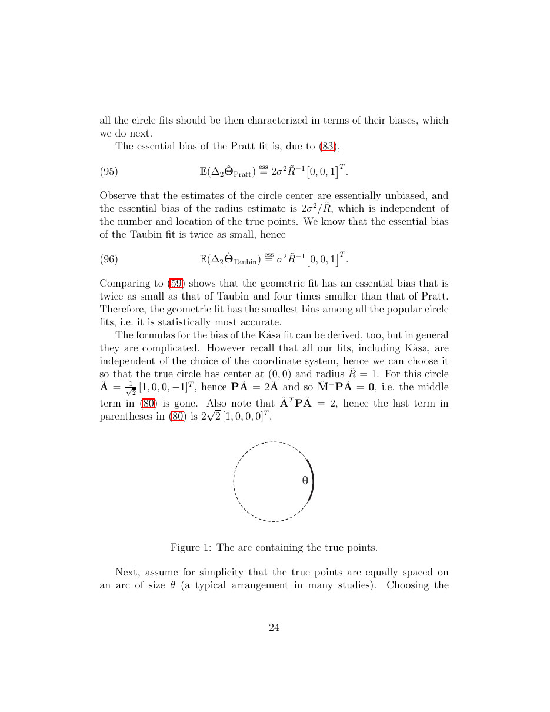
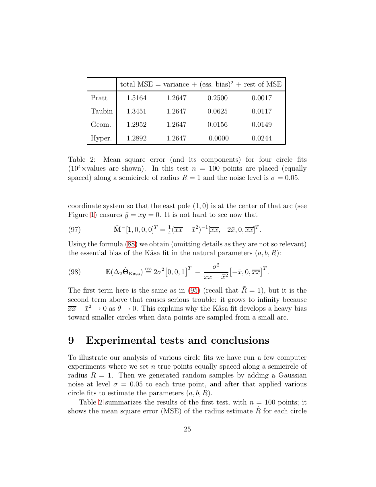
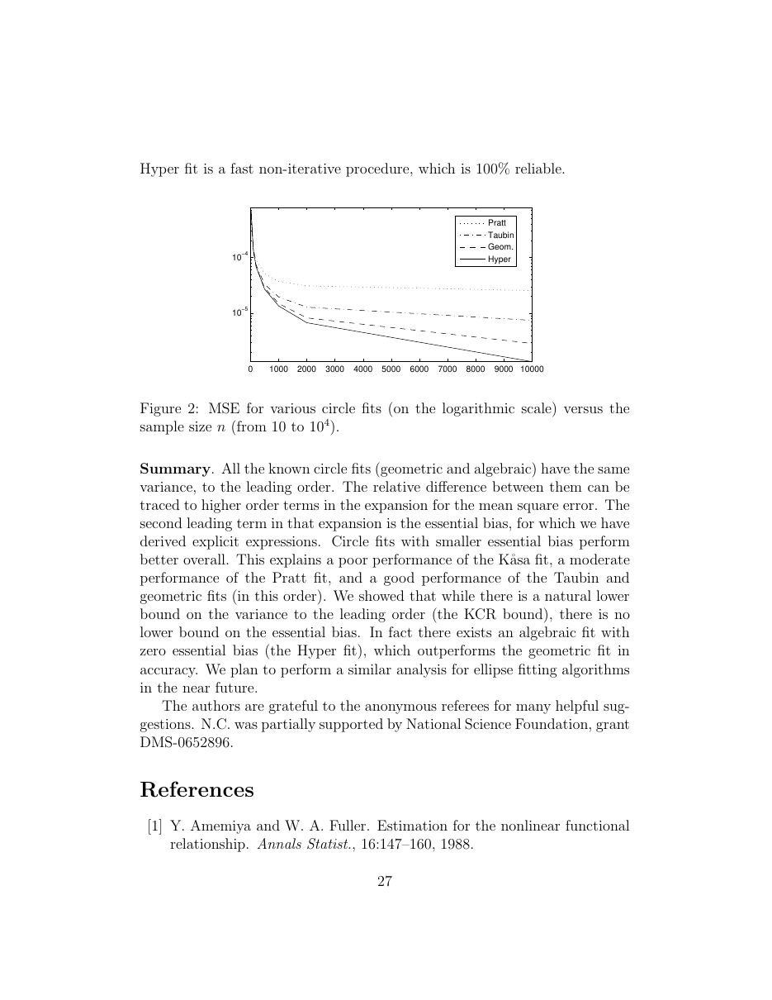

# Al-Sharadqah & Chernov 2009, 원 맞춤 알고리즘의 오차 분석 (Electronic Journal of Statistics)

- 원제: Error analysis for circle fitting algorithms
- 원문 파일: 같은 폴더의 `AlSharadqah2009_EJS_circle_fitting_error.pdf` (arXiv:0907.0421v1, 2009-07-02, 30쪽, 2026-11-04 `https://arxiv.org/pdf/0907.0421`에서 내려받음). 전문 번역은 [번역.md](번역.md).
- 저자: A. Al-Sharadqah, N. Chernov (University of Alabama at Birmingham, 수학과)
- 서지: Electronic Journal of Statistics, 3, pp. 886-911, 2009. DOI 10.1214/09-EJS419. 제목, 저자, 권, 쪽은 2026-11-04 Crossref API로 확인했다.
- 근거 상태: **원문 확인** (arXiv 판 PDF 전문을 읽고 번역함. 학술지 판과 쪽 번호가 다를 수 있다)

## 핵심 (원문 확인)

- 문제 설정 (2절)
  - 점 n개가 참 원 위의 참 점에 잡음을 더한 값이다. 잡음은 x, y에 같은 분산 σ²인 독립 가우스 잡음(등방성, 등분산)이다.
  - 각 점의 각도 φᵢ는 모르는 부수 모수로 둔다(함수 모형).
- 비교한 방법 (3, 4절)
  - 기하 맞춤: 점에서 원까지 직교 거리 제곱합을 최소화. 반복 계산(LM 등)이 필요하고 가끔 발산한다.
  - 대수 맞춤: Kåsa, Pratt, Taubin. 모두 $A z + B x + C y + D = 0$ 꼴의 대수 거리를 최소화하고, 제약 행렬 N만 다르다. 일반화 고유값 문제 하나로 풀린다. 반복이 없다.
- 오차 분석의 틀 (5절)
  - 잡음이 작은 극한에서 추정 오차를 σ의 차수별로 전개한다. 평균제곱오차는 $\sigma^2\mathbf V + \sigma^4\mathbf B_1\mathbf B_1^T + \dots$ 이다.
  - 첫 항(분산)에는 하한이 있다(KCR 하한). 원에서는 $\mathbf V_{\min} = (\mathbf W^T\mathbf W)^{-1}$, $\mathbf W$의 행은 $(\cos\varphi_i, \sin\varphi_i, 1)$ 이다. 식 (44), (45).
  - 둘째 항의 $\sigma^2\mathbf B_1$을 **본질 편향**이라 부른다. 점 수 n을 늘려도 줄지 않는 편향이다.
- 주요 결과 (6~8절)
  - **모든 원 맞춤(기하, Kåsa, Pratt, Taubin, Hyper)의 분산은 주 차수에서 같고, KCR 하한과 같다.** 식 (51), (94). 차이는 편향에서만 난다.
  - 본질 편향은 중심 (a, b)에는 없고 반지름 R에만 있다. 기하 맞춤 $\sigma^2/(2R)$, Taubin $\sigma^2/R$, Pratt $2\sigma^2/R$. 식 (59), (95), (96).
  - **Kåsa 맞춤은 짧은 호에서 망가진다.** 식 (98)의 둘째 항 $\sigma^2/(\overline{xx} - \bar x^2)$는 호 크기 θ가 0으로 가면 무한대로 커진다. 그래서 짧은 호에서 Kåsa는 작은 원 쪽으로 심하게 치우친다. 그림 1.
  - **Hyper 맞춤**: 제약 행렬 $\mathbf H = 2\mathbf T - \mathbf P$를 쓰면 본질 편향이 0이 된다. 식 (85), (86). 반복 없는 SVD 절차로 계산하고, 평행이동과 회전에 불변이다.
- 저자가 밝힌 한계
  - 등방성, 등분산 잡음만 다룬다. 점마다 공분산이 다른 경우는 넓힐 수 있다고만 했다.
  - 실험은 반원(호 180°)에서만 했다. 짧은 호의 수치 실험은 없다.
  - 계산 시간은 재지 않았다.

## 정량 수치 (원문)

| 항목 | 값 | 출처 |
|---|---|---|
| 실험 조건 | R = 1 반원, 같은 간격 n점, σ = 0.05, 표본 10⁷개(n=100) | 9절 |
| n = 100, R의 MSE (×10⁴) | Pratt 1.5164, Taubin 1.3451, 기하 1.2952, Hyper 1.2892 | 표 2 |
| n = 100, 분산 (×10⁴) | 네 방법 모두 1.2647 | 표 2 |
| n = 100, 본질 편향² (×10⁴) | Pratt 0.2500, Taubin 0.0625, 기하 0.0156, Hyper 0 | 표 2 |
| n = 10000, R의 MSE (×10⁶) | Pratt 25.552, Taubin 7.4385, 기하 2.8635, Hyper 1.3482 | 표 3 |
| n = 10000, 분산 (×10⁶) | 네 방법 모두 1.3197 | 표 3 |
| 편향 비 | 기하 : Taubin : Pratt = 1 : 2 : 4 (본질 편향) | 8절 |
| Hyper SVD 허용값 | ε = 10⁻¹² 권장 | 8절 |
| 계산 시간 | 보고 없음 | |

## 우리 계산: 짧은 호의 중심 오차 (원문 식 (44), (45), (98)에 우리 조건을 넣음)

아래는 논문 수치가 아니다. 논문의 KCR 하한 식 $\sigma^2(\mathbf W^T\mathbf W)^{-1}$를 같은 간격 n점, 호 반각 h로 계산한 값이다(2026-11-04, 순수 파이썬 3×3 역행렬).
표의 값은 "잡음 σ의 몇 배인가"다. a는 반지름 방향 중심 좌표, b는 접선 방향 중심 좌표다.

| 호 반각 h | n | 중심 a 표준편차 | 중심 b 표준편차 | R 표준편차 |
|---|---|---|---|---|
| ±1.0187° (지금 T ±1단위) | 21 | 4224 σ | 20.3 σ | 4224 σ |
| ±1.0187° | 201 | 1482 σ | 6.8 σ | 1482 σ |
| ±2° | 21 | 1096 σ | 10.3 σ | 1096 σ |
| ±5° | 21 | 175 σ | 4.1 σ | 175 σ |
| ±11.25° (전체 22.5°, Hou 2020 범위) | 21 | 34.7 σ | 1.8 σ | 34.5 σ |
| ±22.5° | 21 | 8.8 σ | 0.9 σ | 8.5 σ |
| ±90° (논문 실험의 반원) | 21 | 0.7 σ | 0.3 σ | 0.5 σ |

- 반지름 방향 중심 오차는 대략 1/h²로 줄어든다. ±1°에서 ±5°로 넓히면 약 24배 준다.
- 짧은 호에서는 중심 a와 반지름 R의 오차가 거의 같다. 즉 "축 위치"와 "반지름"이 거의 완전히 묶여서, 따로 정해지지 않는다.
- Kåsa 편향 계수 $1/(\overline{xx} - \bar x^2)$ (R = 1로 정규화, n = 201): ±1.0187°에서 4.4 × 10⁸, ±5°에서 7.6 × 10⁵, ±22.5°에서 1.9 × 10³, ±90°에서 10.4.

우리 장비에 넣은 예 (가정이 많은 대략값*)

- 회전축이 광학 중심에서 d만큼 떨어져 있으면, 카메라 기준으로 QR 판은 반지름 약 (315 mm − d)인 원 위를 돈다.
- 판의 접선 방향 위치 잡음: 0.01 px × 315 mm / 4492 px ≈ 7.0 × 10⁻⁴ mm (점 하나). 536점의 유효 독립 정보 19를 쓰면 약 1.6 × 10⁻⁴ mm.
- 판의 깊이 방향 위치 잡음: 배율로 읽는다. 판 반폭 약 350 px에서 배율 잡음 ≈ 0.01 / 350 / √19 ≈ 6.6 × 10⁻⁶, 깊이로 315 mm × 6.6 × 10⁻⁶ ≈ 2.1 × 10⁻³ mm.
- 짧은 호에서 반지름 방향 중심(곧 d)은 깊이 잡음이 정한다. 그래서 d의 표준편차는
  - ±1단위, 21장: 4224 × 2.1 × 10⁻³ ≈ **8.9 mm**
  - ±1단위, 201장: 약 3.1 mm
  - ±5단위, 21장: 약 0.37 mm
  - ±11단위, 21장: 약 0.07 mm
- 같은 조건에서 Kåsa 맞춤의 반지름 본질 편향은 $(\sigma^2/R) \times 4.4\times10^8 ≈ (2.1\times10^{-3})^2/315 \times 4.4\times10^8 ≈$ **6 mm**다. 사진을 늘려도 줄지 않는다.
- 교차 확인: d = 10 mm가 바꾸는 호의 처짐은 d × θ²/2 ≈ 10 × 1.58 × 10⁻⁴ ≈ 1.6 × 10⁻³ mm다. 판 가장자리 영상으로는 약 0.002 px다. 점 하나 잡음(0.01 px)보다 작고, 평균한 잡음(약 0.002 px)과 같은 크기다. 위 8.9 mm와 맞는다.
- 이 계산은 논문의 전제(독립, 등방성 잡음)를 따른다. 우리 오차에는 하루 안 가로 드리프트 최대 0.84 px(판 위 약 0.059 mm), 백래시 β −0.34 px가 있다. 이 계통 오차는 잡음 1.6 × 10⁻⁴ mm보다 수백 배 크고, 평균으로 줄지 않는다. 실제 d 오차는 위 값보다 클 것이다(확인 필요).

## 우리와의 관계

- 관련도: ◎ (질문 7), △ (질문 9, 10)
- 답하는 질문
  - **질문 7** (회전축 위치 d와 회전 중심을 ±1단위의 짧은 호에서 식별할 수 있는가, 잡음 0.01 px일 때 중심 오차는, 자극을 얼마나 넓혀야 하는가)
    - 답: **지금 자극(±1단위)으로는 d를 식별할 수 없다.** 가장 좋은 맞춤(KCR 하한에 닿는 기하, Hyper)으로도 d의 표준편차가 수 mm(21장 약 9 mm, 201장 약 3 mm)다. 판까지 거리 315 mm에 비하면 작지만, d를 0으로 둘지 말지 가를 수준은 아니다.
    - 원인은 방법이 아니라 기하다. 논문이 보인 대로 모든 원 맞춤의 분산은 같고, 분산은 호가 짧을수록 약 1/h²로 커진다. 방법을 바꿔서는 못 줄인다.
    - 쉬운 방법(Kåsa, 원 방정식을 선형으로 풀기)은 짧은 호에서 반지름을 수 mm 작게 치우치게 낼 수 있다. 쓰면 안 된다.
    - 자극을 넓히는 효과: ±5단위면 0.4 mm, ±11단위면 0.07 mm 수준까지 준다(우리 계산). Hou 2020의 22.5° 범위가 왜 필요한지 수치로 설명된다.
  - **질문 9** (보정 자료를 어디서 찍어야 효율적인가): 식 (44)의 $\mathbf W^T\mathbf W$를 키우는 자리가 좋다. 원에서는 호 양 끝에 점을 모으는 것이 반지름 방향 정보를 가장 많이 준다(우리 추론, Nahvi & Hollerbach 1996의 잡음 증폭 지수와 같은 생각).
  - **질문 10** (계산 시간): 논문은 시간을 재지 않았다. 대수 맞춤과 Hyper는 4×4 고유값 문제 하나, 기하 맞춤은 반복이다.
- 문헌 결과와 우리 추론의 구분
  - 문헌 결과: 분산 동일, 본질 편향 식, Kåsa의 짧은 호 붕괴, Hyper의 편향 0, 표 2와 3.
  - 우리 계산: 위 "짧은 호의 중심 오차" 표와 장비 대입값. 잡음 모형이 단순하므로 하한으로만 본다.
  - 우리 추론 1 (d가 Y와 T 분리에 주는 영향): d가 0이 아니면 T를 1° 돌릴 때 카메라가 옆으로 약 d × 0.0178 만큼 움직인다. d = 10 mm면 0.18 mm, Y 환산 약 2.6 px다. 허용(Y 0.65 px)보다 크다. 그런데 이 성분은 영상에서 Y와 같은 방향(cos 0.99999)이라, 지금의 "T 1단위 ≈ 80.3 px" 반응 계수 안에 이미 섞여 있다. 회귀(GLS)는 이것을 자동으로 흡수한다. 물리식으로 각도(1.0187°)를 따로 낼 때만 d가 문제가 된다. 즉 d를 몰라도 Y, T 명령 단위의 추정은 되지만, A13의 도 단위 환산과 질문 8의 깊이 시차 분리는 d에 걸린다.
  - 우리 추론 2: QR 판(315 mm)과 뒷벽 가로선은 깊이가 다르다. d가 만드는 옆 이동은 두 평면에서 영상 이동이 다르게 나타나고(시차), 순수 회전은 같게 나타난다. 원 맞춤보다 이 시차가 d를 더 잘 드러낼 수 있다. 뒷벽 거리를 모르므로 검증 전이다.

## 리뷰 카드

- **어떻게 해결했나**: 원 맞춤 방법마다 추정 오차를 잡음 σ의 높은 차수까지 전개했다. 첫째 차수(분산)는 모든 방법이 같고 KCR 하한 $\sigma^2(\mathbf W^T\mathbf W)^{-1}$에 닿음을 보였다. 그래서 차이는 둘째 차수의 본질 편향에서만 난다고 정리했다. 편향 식을 방법별로 구하고, 편향이 0이 되도록 제약 행렬을 고른 Hyper 맞춤을 만들었다. 반원 실험(n = 100, 10000)으로 이론 분해가 MSE를 거의 다 설명함을 확인했다.
- **같은 점**: 우리도 T 회전 중심(축 위치 d)을 회전 자극에서 찍은 점의 궤적으로 찾아야 한다. 회전 중심을 원 맞춤으로 찾는 것은 하현철 2008, Cognex US9247684, Kawasaki US11749547이 쓰는 방식과 같다. 잡음이 작은 상황(점 잡음 0.009~0.015 px)이라 논문의 "작은 잡음 전개"가 잘 맞는다.
- **다른 점**:
  - 호 길이가 다르다. 논문 실험은 반원(180°)이고, 우리는 ±1.0187°(전체 약 2°)다. 호가 짧으면 중심 오차가 약 1/h²로 커지므로, 논문의 "기하와 Hyper 차이"보다 "분산 자체"가 문제다.
  - 우리 궤적은 영상 평면의 원이 아니다. 카메라가 돌므로 판의 궤적은 카메라 기준 3D 원이고, 반지름 방향은 깊이(배율)로만 보인다. 접선과 반지름 방향 잡음이 약 13배 다르다(2.1 × 10⁻³ 대 1.6 × 10⁻⁴ mm). 논문은 등방성 잡음만 다룬다.
  - 우리 오차는 독립 잡음보다 계통 오차(드리프트 0.84 px, 백래시 −0.34 px, 날짜 간 세로 +0.44 px)가 크다. 논문은 계통 오차를 다루지 않는다.
  - 우리는 정지 사진만 있고, 자극 범위 밖(±1단위 바깥) 자료가 없다.
- **가져올 해결책**:
  1. **±1단위 자료로 d를 맞추지 않는다.** A13의 d = 0 가정은 "검증된 값"이 아니라 "이 자료로는 정할 수 없어서 둔 가정"으로 적는다. d를 확인하려면 T 자극을 넓힌 별도 촬영이 필요하다. 목표 오차 1 mm면 ±3~5단위, 0.1 mm면 ±10단위 안팎(우리 계산, 계통 오차 빼고).
  2. **넓힌 촬영은 호 양 끝에 모은다.** 예: T = −5, −4, +4, +5단위에서 각 5장, 센터에서 5장. 같은 장수로 $\mathbf W^T\mathbf W$의 반지름 방향 성분이 커진다. 드리프트를 줄이려고 끝점과 센터를 번갈아 찍는다.
  3. **원 맞춤이 필요하면 Kåsa를 쓰지 않는다.** Hyper(반복 없음, 편향 0) 또는 기하 맞춤을 쓰고, 초기값은 Hyper로 둔다. 4×4 고유값 문제 하나라서 시간 부담은 없다.
  4. **원 맞춤 대신 물리식 안에서 d를 직접 추정한다.** 판 점의 3D 자세(Sturm, IPPE)에서 낸 회전과 평행이동을 $\mathbf t = (\mathbf I - \mathbf R)\mathbf c$ 꼴로 묶어 축 위치 c를 GLS로 맞춘다. 이때 깊이 방향과 접선 방향 잡음의 차이를 가중치에 넣는다. 논문의 등방성 가정을 넘는 부분이므로, 넓힌 자료에서 모의 실험으로 하한(위 표)과 비교해 확인한다.
  5. **d가 Y, T 명령 추정에 꼭 필요한지 먼저 따진다.** 회귀 계수(T 1단위 ≈ 80.3 px)는 d의 효과를 이미 담고 있다. d는 도 단위 환산과 두 평면 시차 모형(질문 8)에서만 필요하다. 그 모형을 실제로 쓸 때만 넓힌 촬영을 한다.

## 이 단계 후보 방법으로서

- **방법 이름**: 짧은 호 회전 중심 추정 (Hyper 또는 기하 원 맞춤, KCR 하한으로 자극 범위 설계)
- **전제 조건**
  - 회전 자극마다 같은 점(판 중심 또는 판 자세)의 위치를 잴 수 있다.
  - 잡음이 작고 대략 독립이다. 계통 오차(드리프트, 백래시)는 따로 줄인다.
  - 호가 충분히 길다. 지금 ±1단위는 부족하다.
- **장점**
  - 닫힌 식이다(Hyper). 반복이 없고 발산하지 않는다.
  - 분산 하한을 미리 계산할 수 있다. 촬영 전에 "몇 단위, 몇 장이면 d가 몇 mm로 정해지는가"를 표로 정할 수 있다.
  - 편향이 0(Hyper)이거나 아주 작다(기하).
- **단점**
  - 짧은 호에서 분산이 1/h²로 커진다. 방법으로는 못 줄인다.
  - 등방성 잡음 가정이다. 우리 3D 궤적은 깊이 방향 잡음이 약 13배 크다.
  - 계통 오차를 다루지 않는다.
  - Y, T 명령 추정 자체에는 직접 쓰이지 않는다. 상수(d, 도 단위) 교정용이다.
- **우리 적용 조건**
  - 지금 자료(±1단위, 정지 사진)로는 적용하지 않는다. 적용하면 d 오차가 수 mm이고 Kåsa면 수 mm 편향까지 더해진다.
  - 적용하려면 T ±5단위 이상 넓힌 촬영을 새로 하고, 끝점과 센터를 번갈아 찍어 드리프트를 뺀다.
  - 결과(d와 그 표준편차)는 A13의 1.0187°와 질문 8의 두 평면 시차 모형에 넣는 상수로만 쓴다. 매 턴 Y, T 계산에는 넣지 않는다.

## 링크

- arXiv: https://arxiv.org/abs/0907.0421
- PDF: https://arxiv.org/pdf/0907.0421
- DOI: https://doi.org/10.1214/09-EJS419
- 저자 MATLAB 코드(원문 참고문헌 [14]): http://www.math.uab.edu/~chernov/cl (2026-11-04 접속 확인 안 함)
- 관련 기존 문헌: [Hou 외 2020 회전축 정렬](../../../../../../문헌연구/03_Y_T_분리/논문/11_Hou2020_AppSci_회전축정렬_카메라보정/요약.md), [하현철 외 2008 회전 중심 자동 보정](../../../../../../문헌연구/03_Y_T_분리/논문/03_Ha2008_KSPE_비전얼라이너_회전중심_자동보정/요약.md), [Nahvi & Hollerbach 1996 잡음 증폭 지수](../../../../../../문헌연구/03_Y_T_분리/논문/08_Nahvi1996_ICRA_잡음증폭지수_보정자세선택/요약.md)
