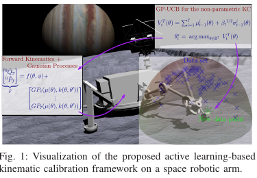
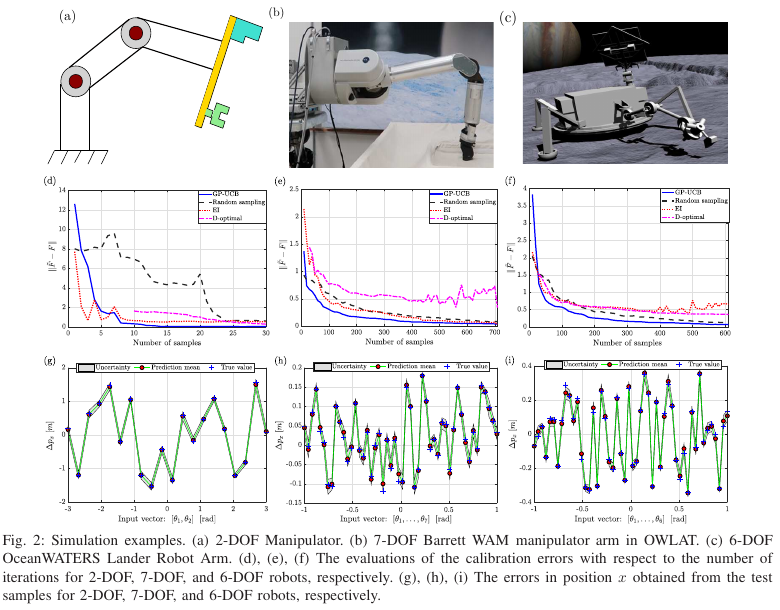
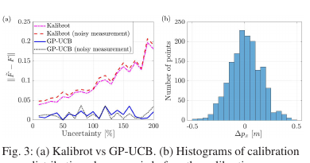

# 가우스 과정을 쓴 능동 학습 기반 로봇 기구학 보정 틀 (번역)

- 원제: An Active Learning Based Robot Kinematic Calibration Framework Using Gaussian Processes
- 저자: Ersin Daş, Joel W. Burdick (California Institute of Technology, 기계토목공학과)
- 출처: arXiv:2303.03658v1 [cs.RO], 2023년 3월 7일
- 원문 파일: [Das2023_arXiv_active_learning_GP_kinematic_calibration.pdf](Das2023_arXiv_active_learning_GP_kinematic_calibration.pdf) (7쪽)
- 번역 범위: 전문 (초록, 본문, 그림 캡션, 표. 참고문헌은 원문 그대로)
- 수식은 pdftotext로 뽑은 글자를 바탕으로 옮겼다. 첨자 위치는 원문 PDF를 함께 본다.

---

## 초록

앞으로 얼음 위성에 내릴 NASA 착륙선 임무에는, 착륙선 주변의 얼음 지형에서 시료를 채취하는 로봇 팔을 완전히 자동으로, 정확하게, 적은 자료로 보정하는 방법이 필요하다. 이를 위해 이 논문은 고전적인 매니퓰레이터 기구학 보정 과정에 가우스 과정(Gaussian Process, GP) 방식을 도입한다. 보정된 Denavit-Hartenberg(D-H) 기구 파라미터 묶음을 찾는 대신, 여러 개의 GP로 작업 공간 전체에서 팔의 **남은 기구 오차(잔차)**를 모델링한다. 더 중요한 점은, 이 모델링 틀 덕분에 가우스 과정 상한 신뢰 경계(GP-UCB) 알고리즘이 보정용 측정 지점을 효율적이고 적응적으로 고를 수 있다는 것이다. 그 결과 실험 횟수를 줄이고 재보정에 드는 시간을 줄인다. 이 방법을 간단한 2자유도 팔, 향후 NASA 임무 후보 형상인 6자유도 팔, 7자유도 Barrett WAM 팔의 시뮬레이션에서 보였다.



그림 1: 제안하는 능동 학습 기반 기구학 보정 틀을 우주 로봇 팔에 적용한 모습.

## I. 서론

매니퓰레이터의 기구학 보정(Kinematic Calibration, KC)은 고전적인 문제다 [1]-[3]. 보정은 원래 공장 로봇의 공구와 말단 장치를 정밀하게 위치시키려는 필요에서 나왔다. 실시간 감지가 적은 공장 로봇은 복잡한 작업을 믿을 만하게 하려면 개루프 위치 정밀도에 기대야 한다. 아래에서 더 다루듯이, 기구학 보정에는 여러 방식이 있고, 여러 상황에 보정을 적용하는 방법과, 보정 과정을 더 자동화하는 방법이 있다.

이 논문은 유로파와 엔셀라두스 같은 얼음 위성 탐사 임무 제안 때문에 보정 문제를 새로운 방법으로 다시 본다. 이 위성들에는 지하 바다가 있을 수 있다. 얼음 화산 활동이 지하 바다의 물이나 얼음을 표면 균열로 올려 보낼 수 있다. 유로파 착륙선 임무 [4]의 일부로, 로봇 팔이 이 균열 근처에서 표면 물질 시료를 모으고, 여러 공구(삽, 드릴, 관입계, 베보미터)로 주변 지형을 분석한다. 얼음 퇴적물에는 지하 바다에 생명이 있음을 알려 주는 분자가 들어 있을 수 있다.

이런 임무는 배터리로 움직일 가능성이 높아서 임무 기간이 크게 제한된다. 왕복 통신 지연 때문에 원격 조작도 현실적이지 않다. 그래서 고도로 자율적이고 효율적인 과학 작업이 중요하다. 유로파는 공장이 아니지만, 시료 채취 로봇 팔의 기구 정확도는 여전히 중요하다. 시료를 과학적으로 바르게 해석하려면 시료가 나온 위치를 정확히 알아야 하기 때문이다. 또 심우주 임무는 질량을 엄격히 줄여야 하므로, 시료 채취 팔과 공구는 매우 가벼울 가능성이 높고, 그만큼 공장 로봇보다 잘 변형된다.

따라서 자료를 적게 쓰는 팔 자기 보정 과정이 얼음 위성 시료 채취의 신뢰성과 임무 효율에 꼭 필요하다. 최소한, 착륙하여 처음 전개할 때 시료 채취 팔은 여러 해에 걸친 우주 비행 동안 생긴 변형을 반영하도록 현장에서 보정되어야 한다. 또 이런 고도 자동화 임무는 지형과의 예상 밖의 강한 상호작용, 표면 온도 50 K에서의 관절 결빙, 시료 채취 공구의 잘못된 장착으로 생기는 로봇과 공구 형상 변형에도 견뎌야 한다. 실제로 얼음 위성 임무에는 다음 조건을 갖춘 자동 보정 과정이 필요하다.

1. 특히 중요한 과학 작업이 일어나는 작업 공간 영역에서 충분한 정확도를 준다.
2. 높은 재보정 정확도에 이르기까지 팔 자료가 아주 적게 필요하다. 현장 재보정은 원래 과학 작업에 써야 할 귀한 임무 시간을 쓰기 때문이다.
3. 산업용 로봇이 보통 겪는 것보다 큰 보정 오차를 다룰 수 있다.

이 논문은 가우스 과정(GP) [5]에 기반한 매니퓰레이터 기구학 보정 방식을 개발한다. 가우스 과정 회귀(GPR)는 기구의 남은 오차를 학습하는 데 쓸 수 있고, 팔이 크게 변형된 뒤에도 재보정을 할 수 있게 한다. 더 중요한 점은, 가우스 과정 최적화 [6]가 정확한 재보정을 주는 작은 팔 자세 묶음을 적응적이고 자율적으로 고른다는 것이다. 이 방법의 쓸모를 2자유도 평면 매니퓰레이터, 7자유도 Barrett WAM 로봇 팔, OceanWATERS 시험대 [7]에서 쓰는 6자유도 로봇 팔에서 보인다.

이 논문의 구성은 다음과 같다. II절에서 기초 내용을 정리한 뒤, III절에서 능동 학습 기반 기구학 보정 틀을 소개한다. IV절에 시뮬레이션을 싣고, V절에서 결론을 맺는다.

**관련 연구:** 로봇 매니퓰레이터의 기구학 보정은 널리 연구되었다. 보통 보정 과정에는 실험 설계에 전문가의 판단이 필요하고, 관측성 지수를 최적화하려면 많은 측정이 필요하다. 자료를 얻은 뒤에는 선형화한 기구식에 반복 최소제곱 회귀 [8], 2차 계획법(QP) [9], Levenberg-Marquardt 알고리즘 [10] 같은 오프라인 최적화 기법으로 기구 파라미터를 식별한다. 이 방법들은 로봇 위치 정확도를 높이지만, 자료를 효율적으로 쓰지 못하고 완전 자율로 돌릴 수도 없다. 심우주 응용에는 두 특성이 모두 필요하다.

기계 학습 기반 틀은 관절 탄성이나 백래시처럼 보정 정확도에 영향을 주는 문제를 고려해 위치 오차를 줄일 수 있다. 지수곱(Product-Of-Exponential) 기구 모델 [11]을 GP와 결합해 남은 처짐을 보상한 연구가 있다 [12]. [13]에서는 인공 신경망이 명목 정기구식 없이 로봇의 위치와 자세를 직접 학습한다. 이런 방법의 보정 후 정확도는 입력 자료의 질에 크게 달려 있고, 자료 선택은 보정 작업자의 지식에 기댄다. 매니퓰레이터 시각 서보를 위해 기구 파라미터도 최적화하는 비지도 학습 기반 재보정이 [14]에서 제안되었다.

많은 선행 연구가 측정 위치를 고르는 데 관측성 지수 [8]를 최적화한다. 여러 지수를 실험으로 비교한 연구가 [15]에 있다. 선형화 기반 기법에 가장 효율적인 보정 자세 묶음을 찾는 능동 보정 알고리즘이 [16]에서 개발되었다. 후보 자료점 집합에서 자세를 고르는 볼록 최적화 방식이 [17]에서 제안되었다. 부분 자세 측정에 기반한 [18], [19]의 보정 실험 설계 방법은 실험 전에 수행된다. 이 방법들은 선형화 기반 보정에는 효율적이지만, 부정확도가 더 클 때 측정점을 어떻게 고를지는 고려하지 않는다. [20]에서는 무향 칼만 필터와 반복 입자 필터를 확률적 표본 추출 전략과 결합한 온라인 보정 방식을 제시한다. [21]에는 다리 로봇을 위한 칼만 필터 기반 온라인 보정 방법이 있다.

## II. 기초

표준 표기를 쓴다. R과 R+는 각각 실수와 양의 실수 집합이다. 행렬의 유클리드 노름은 ‖ ‖로 쓴다. f ∼ GP(µ, k)는 함수 f( )가 가우스 과정에서 뽑혔다는 뜻이다(II-D절에서 다시 정리한다).

### A. 정기구학

정기구 함수는 로봇의 관절 공간을 작업 공간으로 옮기며, 폐루프 기구 운동 해석의 핵심이다. 로봇 링크와 말단 장치의 상대 위치와 자세를 네 파라미터로 나타내는 널리 쓰는 D-H 규약을 따른다.¹ n개 관절 로봇과, i번째 링크의 D-H 파라미터(관절각 θi, 비틀림각 αi, 링크 길이 ai, 링크 오프셋 di)가 주어지면, 이웃한 링크 i−1과 링크 i 사이의 변환 행렬 ^{i−1}T_i ∈ SE(3)를 정의한다. 이 행렬은 회전 행렬 ^{i−1}R_i ∈ SO(3)와 평행이동 벡터 ^{i−1}P_i ∈ R³로 이루어진다.

```
^{i-1}T_i = [ ^{i-1}R_i  ^{i-1}P_i ; 0 0 0 1 ]
          = [ cosθi  -sinθi cosαi   sinθi sinαi   ai cosθi
              sinθi   cosθi cosαi  -cosθi sinαi   ai sinθi
              0       sinαi         cosαi         di
              0       0             0             1        ]          (1)
```

i = 1, 2, …, n이다. 회전 관절이면 θi가, 직선 관절이면 di가 변수다. 그러면 정기구 함수는 다음과 같다.

```
^0T_T = ^0T_1(θ1, φ1) ^1T_2(θ2, φ2) … ^{n-1}T_n(θn, φn) ^nT_T          (2)
```

여기서 θ = [θ1 … θn]^T ∈ R^n, φ = [αi di ai]^T ∈ R^{3n}이고, T는 공구 좌표계를 뜻한다. 이 함수는 기저 좌표계에 대한 공구 좌표계의 자세와 위치, 곧 ^0R_T ∈ SO(3), ^0P_T ∈ R³를 주며, 다음처럼 간단히 쓸 수 있다.

```
F = [ ^0Q_T  ^0P_T ]^T = f(θ, φ)          (3)
```

여기서 ^0Q_T는 회전 행렬의 네 파라미터 사원수 표현이다 [22]. 회전 행렬에서 사원수로의 변환은 불연속일 수 있어서 가우스 과정으로 모델링하기 어렵다는 점에 주의한다 [23]. 이 문제를 피하려고 [24]에서 제안한 연속 사원수 변환 틀을 쓴다.

¹ 이 논문의 방법은 매니퓰레이터 기구학의 지수곱 표현에도 쉽게 맞출 수 있다.

### B. 기구학 보정 문제

기구 불확실성의 구조에 따라 두 가지 보정 문제를 정식화한다. 아래 정의에서 F̃ = [^0Q̃_T ^0P̃_T]^T는 실제(불확실하고, 변형된 뒤의) 기구 함수를 나타낸다.

**파라미터 보정 문제:** 섭동된 D-H 파라미터 묶음을 생각한다.

```
[θ φ]^T = [θi + ∆θi   αi + ∆αi   di + ∆di   ai + ∆ai]^T          (4)
∆ = [∆θi ∆αi ∆di ∆ai]^T ∈ R^{4n}          (5)
```

∆는 명목(이상화한) D-H 파라미터와 실제 D-H 파라미터의 차이다. 파라미터 보정 문제는 다음과 같다.

```
[φ*]^T = arg min_{[φ]^T ∈ R^{4n}} ‖F̃ − F‖²          (6)
```

**비파라미터 보정 문제:** 명목 정기구 함수 f_n(θ, φ)에 구조가 정해지지 않은 덧셈 불확실성 항 ∆f(θ, φ)가 붙어 f(θ, φ) = f_n(θ, φ) + ∆f(θ, φ)라고 하자. 그러면 비파라미터 보정 문제는 다음과 같다.

```
∆f*(θ) = arg min_{∆f(θ)} ‖F̃ − F‖²          (7)
```

곧, 이상화한 D-H 파라미터를 쓰는 정기구 함수에 대해 보정 오차를 가장 작게 만드는 잔차 함수 ∆f*(θ)를 찾는다.

기구학 보정 방법은 측정한 말단 장치 자료와 계산한 정기구 자료의 차이로 움직인다. 그래서 전문가가 입력 관절각 θ와 측정값 F̃의 묶음을 충분히 주는 실험을 제안하고, 주어진 최적 오차 감소 문제를 푼다. 그러면 최적화 문제 (6), (7)의 목적 함수는 이산 자료 위에서 다음처럼 다시 정의된다.

```
∆F̂ = [F̃1 − F1 … F̃m − Fm]^T ∈ R^{7m}          (8)
```

m은 측정 개수다.

### C. 고전적 선형화 재보정

(6)의 보정 비용 함수는 로봇 기구 구조에 따라 대체로 비선형이고 비볼록이다. 그래서 대부분의 고전 재보정 기법은 파라미터 보정 문제를 선형화한 형태에 기반한다. 파라미터 변형이 비교적 작다고 가정하면, 보정 함수 (3)을 다음처럼 선형화할 수 있다.

```
F̃ − F = [∂f/∂αi  ∂f/∂di  ∂f/∂ai] [∆αi ∆di ∆ai]^T          (9)
 ∆F∈R⁷      Jφ ∈ R^{7×3n}          ∆φ ∈ R^{3n}
```

Jφ는 야코비 행렬이다. 따라서 명목 D-H 파라미터와 그 가능한 하한 ∆φ_lb ∈ R^{3n}, 상한 ∆φ_ub ∈ R^{3n}이 주어지면, 선형화 기반 KC 문제는 다음의 제약 있는 QP로 풀 수 있다.

```
∆φ* = arg min_{∆φ ∈ R^{3n}} ‖F̃ − F − Jφ ∆φ‖²
      s.t. ∆φ_lb ≤ ∆φ ≤ ∆φ_ub          (QP)
```

그 뒤 φ* = φ + ∆φ*를 얻는다. 받아들일 만한 오차 수렴에 이를 때까지 이 QP를 반복해서 푼다 [9].

### D. 가우스 과정(GP)

가우스 과정은 베이즈 추론으로 매끄러운 함수의 입력과 출력 자료 사이 관계를 정하는, 확률적이고 자료 기반인 지도 기계 학습 방법이다 [5]. 자료 영역 X 위에 정의된 GP 함수 f(x): X → R은 평균 함수 µ(x): X → R과 공분산(커널) 함수 k(x, x′): X × X → R로 완전히 정해진다.

```
µ(x) ≜ E[f(x)]          (10)
k(x, x′) ≜ E[(f(x) − µ(x))(f(x′) − µ(x′))]          (11)
```

f( )가 다음 분포를 따른다고 말한다.

```
f(x) ∼ GP(µ(x), k(x, x′))          (12)
```

학습 자료 D = {X_N, Y_N}이 주어졌다고 하자. 입력은 X_N = [x1, …, xN] ∈ X, 출력은 Y_N = [f(x1) + ε1, …, f(xN) + εN]^T이고, εi ∼ N(0, σε²)는 서로 독립이고 같은 분포를 따르는 평균 0 가우스 잡음이다. GP는 시험 입력 묶음 X̃ = [x̃1, …, x̃M] ∈ X에 대한 출력 묶음을 예측한다. 관측 위의 GP 사후 분포 f̃ | X̃, D도 GP 분포이며, 평균 µ̃와 분산 σ̃²는 다음과 같다.

```
f̃ | X̃, D ∼ N(µ̃, σ̃²)          (13)
µ̃ = K_{X̃X_N} (K_{X_N X_N} + σε² I)^{-1} Y_N          (14)
σ̃² = K_{X̃X̃} − K_{X̃X_N} (K_{X_N X_N} + σε² I)^{-1} K_{X_N X̃}          (15)
```

I는 단위 행렬이고, K_{X_N X_N} ∈ R^{N×N}, K_{X̃X̃} ∈ R^{M×M}, K_{X̃X_N} ∈ R^{M×N}, K_{X_N X̃} ∈ R^{N×M}은 점 묶음 사이의 상관을 재는 공분산 행렬이다. 각 원소는 [K_{X_N X_N}]_{i,j} = k(xi, xj), [K_{X̃X̃}]_{i,j} = k(x̃i, x̃j), [K_{X̃X_N}]_{i,j} = k(x̃i, xj), [K_{X_N X̃}]_{i,j} = k(xi, x̃j)이다.

간단히 말해 커널 함수는 매끄러움이나 입력 사이 상관처럼 학습할 함수의 성질을 반영한다. 이 논문의 실험은 흔히 쓰는 제곱 지수(SE) 커널을 쓴다.

```
k(xi, xj) = σf² exp( −‖xi − xj‖² / (2 l²) ) + σn² δ(xi, xj)          (16)
```

θh = [l σf σn]^T는 조정할 초파라미터이고, δ(xi, xj)는 크로네커 델타 함수다. 최적 초파라미터는 음의 로그 주변 우도를 최소화해 찾을 수 있다 [5]. 자료 D에 대해 이 함수는 다음과 같다.

```
log p(Y_N | X_N, θh) = −(1/2) Y_N^T (K_{X_N X_N}(θh) + σε² I)^{-1} Y_N
                       −(1/2) log |K_{X_N X_N}(θh) + σε² I| − (N/2) log 2π          (17)
```

끝으로 최적 초파라미터 θh*와 σε*는, 보통 비볼록인 다음 최적화 문제를 경사 하강 기반으로 풀어 구한다.

```
[θh* σε*]^T = arg min_{θh, σε} − log p(Y_N | X_N, θh)          (18)
```

## III. 능동 학습 기반 기구학 보정 방식

### A. 비파라미터 보정을 위한 GP

이 절에서는 정기구학의 부정확함을 나타내는 잔차를 GP로 모델링한다. 그 결과 잡음 있는 센서 측정으로 확률적 틀 안에서 효과적인 비파라미터 로봇 기구 학습과 보정을 할 수 있다.

기구의 남은 오차는 자세와 평행이동의 각 방향마다 하나씩, 일곱 개의 GP로 잡을 수 있다. 구체적으로, (3)의 행렬 F의 각 성분을 평균과 커널 함수를 가진 단일 출력 GP로 모델링한다.

```
F̃ = [ ^0Q̃_T ; ^0P̃_T ] = f(θ, φ) + [ GP1(µ(θ), k(θ, θ′)) ; … ; GP7(µ(θ), k(θ, θ′)) ]          (19)
```

θ는 관절각 벡터이고, F̃는 측정한 공구 좌표계 자세다. 회귀한 GP 함수는 새 질의 입력 θ*에서 각 운동 방향의 잔차 오차와 그 분산을 (14)와 (15)로 예측할 수 있다.

각 운동 방향의 잔차 오차를 GP로 따로 모델링하는 것은 단순화다. 방향 사이에 오차가 얽혀 있을 것으로 예상해야 한다. 다중 출력 가우스 과정(MOGP) [25]과 벡터값 GP [26]가 이 문제에 맞는 해법이다. 하지만 이 방법들의 계산량 증가 때문에 단일 출력 GP를 가정한다. IV절에서 보이듯, 우리 응용에서는 가우스 분포 성질이 성립한다. 따라서 분리한 GP 가정은 타당하고 계산도 효율적이다.

### B. 파라미터 보정을 위한 GP

GP 회귀를 파라미터 보정에도 쓸 수 있다는 점을 짧게 적는다. (3)의 기구 함수의 모든 입력 파라미터를 단일 출력 GP로 모델링할 수 있다. 이를 위해 (3)을 다음처럼 바꾼다.

```
[θ φ]^T = f^{-1}(^0Q_T, ^0P_T)          (20)
```

여기서는 관절각을 포함한 D-H 파라미터가 출력이고, 공구 좌표계 자세가 입력이다. [θ φ]^T ∈ R^{4n}의 각 성분을 GP로 모델링할 수 있다고 가정하면, 파라미터 보정 문제는 다음처럼 쓸 수 있다.

```
[θ̃ ; φ̃] = [θ0 ; φ0] + [ GP1(µ(F), k(F, F′)) ; … ; GP_{4n}(µ(F), k(F, F′)) ]          (21)
```

θ̃, φ̃, F는 측정값이고 θ0, φ0는 D-H 파라미터의 명목값이다.

(19)의 비파라미터 방식과 비교하면, 여기서는 관절각 벡터도 불확실하다고 가정한다. 그래서 (21)은 관절각 오프셋도 모델링할 수 있다. 하지만 이 방식에 필요한 GP 개수는 로봇 관절 수에 따라 늘어난다. 예를 들어 7자유도 로봇이면 서로 다른 GP 28개를 정의해야 한다. 이런 단점 때문에 파라미터 방식은 향후 연구로 남긴다.

### C. 비파라미터 실험 설계를 위한 GP-UCB

우리는 보정 자료에 GP 모델을 맞추는 것뿐 아니라, 표본 수를 최소로 하는 보정 실험을 설계하는 데에도 관심이 있다. 이런 최적화는 가장 좋은 측정점 묶음을 찾는 고전적 실험 설계 문제다 [27], [28]. GP 회귀 기반 보정만 쓰면 사용자가 학습 자료점과 시험 자료점을 골라야 하며, 이 선택이 방법의 정확도에 결정적이다. 이 절에서는 가우스 과정 상한 신뢰 경계(GP-UCB) [6] 능동 학습 알고리즘을 채택해, 정보가 많은 측정의 순서를 적응적으로 골라 잔차 오차를 최소화한다.

III-A절처럼 남은 기구 오차를 GP로 모델링하면 실험 설계에 큰 이점이 있다. 신뢰 경계 안에 잔차 함수의 불확실성이 담기기 때문이다 [29]. 이 특징으로, GP-UCB 알고리즘은 지금까지의 측정과 잔차 함수 신뢰 경계를 써서, 다음 효용 함수 Vt(x): X → R을 최적화하는 다음 시험점을 정한다.

```
Vt(x) = µ_{t−1}(x) + βt^{1/2} σ_{t−1}(x)          (22)
x*_t = arg max_{x ∈ X} Vt(x)          (23)
```

βt ∈ R+는 반복마다 바뀌는 파라미터 [6]로, 다음 표본점을 고를 때 잔차 함수 불확실성에 주는 가중치다. σ_{t−1}(x)는 분산의 제곱근이고, µ_{t−1}(x)는 입력 x에서 평균 함수의 예측값이다. 따라서 GP-UCB는 보정 성능이 높은 관절 공간 영역의 활용과, 잔차 함수가 불확실한 영역의 탐색 사이에서 균형을 잡는 표본점을 고른다.

GP-UCB 알고리즘에는 좋은 무후회(no regret) 성질이 있다 [6]. 곧, 예시가 충분하면 전역 최적 잔차 함수를 찾는 것이 보장된다. 아래 실험은 다른 보정 실험 설계 방식 일부가 국소 최솟값에 갇힌다는 것을 보인다. 또 순간 후회는 T^{−1/2}에 비례한다. 여기서 T는 실험 횟수다. 이 성질은 표본이 하나씩 늘 때마다 보정 오차가 꾸준히 줄어든다는 뜻이다. 이 논문은 순차 표본 선택에 집중하지만, GP-BUCB [30]라는 변형은 무후회 성질과 비슷한 순간 후회 성능을 유지하면서 실험을 묶음으로 제안한다.

입력 벡터가 같은 GP가 일곱 개이므로, 효용 함수를 UCB의 합으로 바꾼다.

```
Vt^T(x) = Σ_{i=1}^{7} [ µ^i_{t−1}(x) + βt^{1/2} σ^i_{t−1}(x) ]          (24)
```

µ^i_{t−1}(x), σ^i_{t−1}(x)는 (19)에서 i번째 출력의 평균과 분산이다. 따라서 새로 얻는, 최적일 것으로 보이는 표본점은 모든 GP를 동시에 고려해 정해진다. [31]의 저자들은 이 근사가 가벼운 조건에서 UCB 알고리즘의 무후회 성질을 해치지 않음을 보였다.

제안하는 GP-UCB 기반 보정 방식의 기본 의사 코드를 알고리즘 1에 보인다. 가지고 있는 아무 GP 사전 분포로 시작하고, 효용 함수 (24)를 최대로 하는 다음 측정을 고른다. 새 측정으로 GP 잔차를 갱신한다((14)와 (15) 사용). 정지 조건을 만족할 때까지 이 반복을 계속한다. [6]의 정리 2에 정의된 알고리즘 파라미터 βt에는 [6]에서 제안한 다음 전략을 쓴다.

```
βt = 2 log( t² 2π² / (3 δβ) ) + 2 dβ log( t² dβ aβ bβ sqrt( rβ log(4 dβ / δβ) ) )          (25)
```

**알고리즘 1** 비파라미터 팔 보정을 위한 GP-UCB

```
입력: 입력 집합 θ ∈ X
      GP 사전 분포 µ0, σ0, k
      커널 함수 k( , )
      파라미터 βt
출력: θ*
for t = 1, 2, … do
    θ*_t = arg max_{θ∈X} Vt^T(θ) 를 고른다
    식 (15)로 σt 를 계산한다
    ∆Ft = (F̃(θt) − F(θt)) + εt 를 얻는다
    식 (14)로 µt 를 계산한다
end for
```

## IV. 실험

GP 기반 잔차 회귀와 GP-UCB 기반 표본 선택의 성능을, 기구 파라미터를 섭동시킨 세 가지 로봇 팔 시뮬레이션에서 평가한다. 결과를 다른 세 기법과 비교한다.

1. [17]에서 제안한, 볼록 근사를 쓴 격자 기반 D-최적 설계 알고리즘. 이 알고리즘은 가능한 관절각 묶음의 후보 집합을 쓴다. 그런 다음 (9)의 야코비 행렬 Jφ와 이 후보 집합으로 D-최적성 기준을 적용한다. [17]은 D-최적 실험 설계가 무작위 표본 추출과 DEMAX 알고리즘보다 좋은 성능을 낸다고 보였다.
2. 기대 향상(EI) 기반 표본 추출 알고리즘 [32]. (24)의 UCB 효용 함수처럼, EI 알고리즘의 효용을 각 방향의 기대 향상의 합으로 바꾼다.
3. 무작위 표본 추출.

### A. 2자유도 매니퓰레이터

이해하기 쉬운 2R 평면 로봇의 보정 시뮬레이션부터 시작한다(그림 2-(a)). 적은 표본점 묶음을 고르면서 정기구 잔차를 학습하려 한다. 팔의 불확실한 D-H 파라미터는 d1 = d2 = 0 ± 0.1 m, a1 = a2 = 1 ± 0.2 m, α1 = α2 = 0 ± 0.1 rad, θ1, θ2 ∈ [−3, 3] rad이다. 이 간단한 예에서도, 덧셈 불확실성이 있으면 선형화 기반 방법은 정확한 보정을 내지 못할 수 있다. 이 방식들은 주로 일정한 부정확함, 곧 φ = φ0 + eφ를 다루도록 정식화되었기 때문이다.

관절각 (θ1, θ2)과 공구 좌표계의 자세와 위치(F ∈ R⁷)를 정밀하게 측정한다고 가정한다(예: 보정된 고해상도 카메라). 알고리즘 1을 t = 1, 2, …, 30번 반복하고, 모든 시뮬레이션 예에서 (25)의 βt와, 초파라미터를 (18)로 최적화한 SE 커널 (16)을 쓴다.



그림 2: 시뮬레이션 예. (a) 2자유도 매니퓰레이터. (b) OWLAT의 7자유도 Barrett WAM 매니퓰레이터 팔. (c) 6자유도 OceanWATERS 착륙선 로봇 팔. (d), (e), (f) 각각 2자유도, 7자유도, 6자유도 로봇에서 반복 횟수에 따른 보정 오차 평가. (g), (h), (i) 각각 2자유도, 7자유도, 6자유도 로봇의 시험 표본에서 얻은 x 위치 오차.

그림 2-(d)는 GP-UCB가 고른 표본 수에 따른 보정 오차 ‖F̃ − F‖를 그린다. 표본이 모일수록 보정 오차 노름이 0으로 수렴하며, 이 방식의 무후회 성질을 확인해 준다. EI 기반 표본 추출은 처음에는 보정 오차 함수의 탐색에 집중한다. 하지만 10단계 뒤에는 국소 최솟값을 만나 더 탐색하지 않는다. D-최적 표본 추출은 미지수 개수만큼 자료점이 필요하므로, 무작위로 고른 10개 자료점으로 시작한다. 이 방법은 처음에는 더 좋은 성능을 내지만 수렴 속도가 느리다. 무작위 표본 추출도 기구 오차를 높은 정밀도로 모델링하지만, 그림 2-(d)에서 보이듯 능동 학습 방식보다 훨씬 많은 표본점이 필요하다. 이는 GP-UCB가 실험을 영리하게 고르고 있음을 확인해 준다. GP-UCB의 보정 후 성능을 x 위치 오차에 대해 그림 2-(g)에 보인다.

더 큰 기구 오차와 잡음 있는 측정을 다루는 능력을 보이려고, 평면 로봇의 D-H 파라미터를 평균 수준 10%부터 200%까지 섭동시킨다. 그리고 각 출력에 분산 0.01인 정규 분포 잡음을 더한다. 비교 대상으로 고전적 선형화 재보정에 기반한 Kalibrot 도구 [9]를 썼다. 그림 3-(a)는 우리 방법이 커지는 기구 불확실성을 학습하고 견디며, 센서 잡음에도 충분히 강건함을 보여 준다. Kalibrot는 센서 잡음에는 강건하지만, 보정 오차가 파라미터 불확실성에 대략 비례해 커진다.



그림 3: (a) Kalibrot 대 GP-UCB. (b) 보정 과정 전, x축 방향 보정 오차 분포의 히스토그램.

### B. 7자유도 Barrett WAM 로봇 팔

OWLAT 시험대는 해양 세계(얼음 위성) 착륙선 임무를 위한 자율 기법을 평가하려고 개발되었다 [33]. 7자유도 Barrett WAM 매니퓰레이터가 얼음 위성 임무에서 일어날 수 있는 로봇 시료 채취 작업을 모사한다(그림 2-(b)). 팔의 기구 파라미터와 덧셈 불확실성 범위를 표 I에 보인다.

그림 2-(e)는 GP-UCB 표본 수에 따른 정기구 오차 추정의 시뮬레이션 수렴을 보인다. 이 그림의 결과는, 이 7자유도 팔에서 우리 틀의 보정 성능과 자료 효율이 다른 표본 추출 방법보다 좋으며, 특히 표본 수가 적을 때 그렇다는 것을 시사한다. 이 로봇 팔에서는 EI 알고리즘이 두 번째로 좋은 결과를 냈지만, 설계 파라미터가 없다는 점이 이 방법의 약점이다. 격자 기반 D-최적 알고리즘은 이 시뮬레이션에서 실패한다. 그림 2-(h)는 x 위치를 따라 선형 간격으로 놓은 시험점 50개에서 보정 후 기구 정확도를 보인다.

### C. 6자유도 OceanWATERS 착륙선 로봇 팔

제안 알고리즘을 오픈 소스 OceanWATERS 시뮬레이션 시험대 [7]에서도 시연한다(그림 2-(c)와 그림 1 참조). 이 시험대는 향후 착륙선 임무의 유력한 설계다. 팔의 명목 기구 파라미터와 시험한 불확실성 범위를 표 I에 보인다.

우리 목표는 잔차에 GP를 맞추는 것이므로, GP-UCB 알고리즘이 고른 표본점 1500개에서의 정기구 오차 분포를 그림 3-(b)에 보인다. 그림은 기구 오차가 평균 0인 정규 분포에 가깝다는 것을 보여 준다. 이 결과는 가우스 과정 틀을 쓰는 것이 타당함을 확인해 준다.

그림 2-(f)는 600번의 표본 반복에 걸쳐 GP-UCB와 다른 방식의 보정 성능을 비교한다. 그림은 정확한 재보정에 필요한 자료점이 더 적으므로 GP-UCB가 이 로봇에 효율적인 표본 추출 방법임을 보인다. EI와 D-최적 알고리즘도 보정 오차 노름을 줄이지만, 약 300개 표본 뒤에는 한 표본점에 "갇힌다". GP 모델의 보정 후 정확도를 x축 위 선형 간격 시험 표본점 50개에서 그림 2-(i)에 보인다.

**표 I: 7자유도 Barrett WAM 로봇과 6자유도 OceanWATERS 착륙선 로봇 팔의 D-H 파라미터**

7자유도 Barrett WAM 로봇 팔

| 관절 | 1 | 2 | 3 | 4 | 5 | 6 | 7 |
|---|---|---|---|---|---|---|---|
| d | 0 ± 0.01 | 0 ± 0.02 | 0.55 ± 0.2 | 0 ± 0.03 | 0.3 ± 0.2 | 0 ± 0.04 | 0.06 ± 0.06 |
| a | 0 ± 0.01 | 0 ± 0.03 | 0.045 ± 0.01 | −0.045 ± 0.01 | 0 ± 0.07 | 0 ± 0.1 | 0 ± 0.01 |
| α | −π/2 ± 0.2 | π/2 ± 0.2 | −π/2 ± 0.3 | π/2 ± 0.2 | −π/2 ± 0.1 | π/2 ± 0.1 | 0 ± 0.3 |
| θ | θ1 | θ2 | θ3 | θ4 | θ5 | θ6 | θ7 |

6자유도 OceanWATERS 착륙선 로봇 팔

| 관절 | 1 | 2 | 3 | 4 | 5 | 6 |
|---|---|---|---|---|---|---|
| d | 0 ± 0.01 | 0 ± 0.02 | 0 ± 0.06 | −0.15 ± 0.01 | 0 ± 0.04 | 0 ± 0.06 |
| a | 0.16 ± 0.1 | 0.37 ± 0.1 | 0.05 ± 0.02 | 0.463 ± 0.1 | −0.238 ± 0.1 | 0.225 ± 0.02 |
| α | π/2 ± 0.2 | 0 ± 0.2 | π ± 0.3 | 0 ± 0.2 | 0 ± 0.1 | π/2 ± 0.1 |
| θ | θ1 | θ2 | θ3 | θ4 | θ5 | θ6 |

## V. 결론과 향후 연구

향후 얼음 위성 시료 채취 임무에 매니퓰레이터를 쓰자는 제안에서 출발해, 이 연구는 매니퓰레이터 정기구 오차 잔차를 온라인으로, 비파라미터로, 자료 효율적으로 정확히 학습하는 것을 목표로 했다. GP 회귀는 기구의 부정확함과 그 신뢰도를 모델링하고, 온라인 순차 GP-UCB 알고리즘은 로봇이 겪는 구체적인 오차에 맞춰 최적의 측정을 효율적으로 고른다. 세 가지 팔 형상에 대한 수치 연구에서, 이 틀은 보정 실험 수가 적은 범위에서 다른 방법보다 대체로 나았다. 이는 심우주 임무에 매우 중요하다. 향후 연구로, 매니퓰레이터 기구학의 불확실성 성질을 더 잘 잡는 특정 GP 커널을 조사하고, GP와 고전 보정 틀에서 측정 잡음이 보정 정확도에 주는 영향을 연구할 것이다. 또 결합된 다변량 가우스 과정 모델 [26], [34], [35]이 보정 정확도와 표본 효율을 더 높일 수 있는지 평가할 것이다.

감사의 글(원문 각주): "This work was supported by NASA Grant 80NSSC21K1032."

## 참고문헌 (원문 그대로)

[1] J. M. Hollerbach, "A survey of kinematic calibration," in The robotics review 1, 1989, pp. 207–242.
[2] W. Khalil and E. Dombre, Modeling identification and control of robots. CRC Press, 2002.
[3] A. Nubiola and I. A. Bonev, "Absolute calibration of an ABB IRB 1600 robot using a laser tracker," Robotics and Computer-Integrated Manufacturing, vol. 29, no. 1, pp. 236–245, 2013.
[4] K. P. Hand, C. B. Phillips, A. Murray, J. Garvin, E. Maize, R. Gibbs, G. Reeves, A. San Martin, G. Tan-Wang, J. Krajewski, et al., "Science goals and mission architecture of the Europa lander mission concept," The Planetary Science Journal, vol. 3, no. 1, p. 22, 2022.
[5] C. R. Rasmussen and C. K. Williams, Gaussian processes for machine learning. The MIT Press, 2006.
[6] N. Srinivas, A. Krause, S. M. Kakade, and M. Seeger, "Gaussian process optimization in the bandit setting: No regret and experimental design," arXiv preprint arXiv:0912.3995, 2009.
[7] D. Catanoso, A. Chakrabarty, J. Fugate, U. Naal, T. M. Welsh, and L. J. Edwards, "OceanWATERS lander robotic arm operation," in 2021 IEEE Aerospace Conference (50100). IEEE, 2021, pp. 1–11.
[8] J. M. Hollerbach and C. W. Wampler, "The calibration index and taxonomy for robot kinematic calibration methods," The international journal of robotics research, vol. 15, no. 6, pp. 573–591, 1996.
[9] F. Cursi, W. Bai, and P. Kormushev, "Kalibrot: A simple-to-use MATLAB package for robot kinematic calibration," in 2021 IEEE/RSJ International Conference on Intelligent Robots and Systems (IROS). IEEE, 2021, pp. 8852–8859.
[10] T. S. Lembono, F. Suárez-Ruiz, and Q.-C. Pham, "SCALAR: Simultaneous calibration of 2-D laser and robot kinematic parameters using planarity and distance constraints," IEEE Transactions on Automation Science and Engineering, vol. 16, no. 4, pp. 1971–1979, 2019.
[11] F. C. Park, "Computational aspects of the product-of-exponentials formula for robot kinematics," IEEE Transactions on Automatic Control, vol. 39, no. 3, pp. 643–647, 1994.
[12] W. Jing, P. Y. Tao, G. Yang, and K. Shimada, "Calibration of industry robots with consideration of loading effects using Product-Of-Exponential (POE) and Gaussian Process (GP)," in 2016 IEEE International Conference on Robotics and Automation (ICRA). IEEE, 2016, pp. 4380–4385.
[13] F. Cursi, W. Bai, W. Li, E. M. Yeatman, and P. Kormushev, "Augmented neural network for full robot kinematic modelling in SE(3)," IEEE Robotics and Automation Letters, vol. 7, no. 3, pp. 7140–7147, 2022.
[14] N. Gothoskar, M. Lázaro-Gredilla, Y. Bekiroglu, A. Agarwal, J. B. Tenenbaum, V. K. Mansinghka, and D. George, "DURableVS: Data-efficient Unsupervised Recalibrating Visual Servoing via online learning in a structured generative model," arXiv preprint arXiv:2202.03697, 2022.
[15] A. Joubair and I. A. Bonev, "Comparison of the efficiency of five observability indices for robot calibration," Mechanism and Machine Theory, vol. 70, pp. 254–265, 2013.
[16] Y. Sun and J. M. Hollerbach, "Observability index selection for robot calibration," in 2008 IEEE international conference on robotics and automation. IEEE, 2008, pp. 831–836.
[17] K. Kamali and I. A. Bonev, "Optimal experiment design for elasto-geometrical calibration of industrial robots," IEEE/ASME Transactions on Mechatronics, vol. 24, no. 6, pp. 2733–2744, 2019.
[18] Y. Wu, A. Klimchik, S. Caro, B. Furet, and A. Pashkevich, "Geometric calibration of industrial robots using enhanced partial pose measurements and design of experiments," Robotics and Computer-Integrated Manufacturing, vol. 35, pp. 151–168, 2015.
[19] H. Wang, T. Gao, J. Kinugawa, and K. Kosuge, "Finding measurement configurations for accurate robot calibration: Validation with a cable-driven robot," IEEE Transactions on Robotics, vol. 33, no. 5, pp. 1156–1169, 2017.
[20] G. Du, Y. Liang, C. Li, P. X. Liu, and D. Li, "Online robot kinematic calibration using hybrid filter with multiple sensors," IEEE Transactions on Instrumentation and Measurement, vol. 69, no. 9, pp. 7092–7107, 2020.
[21] S. Yang, H. Choset, and Z. Manchester, "Online kinematic calibration for legged robots," IEEE Robotics and Automation Letters, vol. 7, no. 3, pp. 8178–8185, 2022.
[22] R. M. Murray, Z. Li, and S. S. Sastry, A mathematical introduction to robotic manipulation. CRC press, 2017.
[23] Y. Zhou, C. Barnes, J. Lu, J. Yang, and H. Li, "On the continuity of rotation representations in neural networks," in Proceedings of the IEEE/CVF Conference on Computer Vision and Pattern Recognition, 2019, pp. 5745–5753.
[24] J. Wu, "Optimal continuous unit quaternions from rotation matrices," Journal of Guidance, Control, and Dynamics, vol. 42, no. 4, pp. 919–922, 2019.
[25] W. Bruinsma, E. Perim, W. Tebbutt, S. Hosking, A. Solin, and R. Turner, "Scalable exact inference in multi-output Gaussian processes," in International Conference on Machine Learning. PMLR, 2020, pp. 1190–1201.
[26] M. Hutchinson, A. Terenin, V. Borovitskiy, S. Takao, Y. Teh, and M. Deisenroth, "Vector-valued Gaussian processes on Riemannian manifolds via gauge independent projected kernels," Advances in Neural Information Processing Systems, vol. 34, pp. 17160–17169, 2021.
[27] Y. Sun and J. M. Hollerbach, "Active robot calibration algorithm," in 2008 IEEE international conference on robotics and automation. IEEE, 2008, pp. 1276–1281.
[28] J. Hollerbach, W. Khalil, and M. Gautier, "Model identification," in Springer handbook of robotics. Springer, 2016, pp. 113–138.
[29] E. Schulz, M. Speekenbrink, and A. Krause, "A tutorial on Gaussian process regression: Modelling, exploring, and exploiting functions," Journal of Mathematical Psychology, vol. 85, pp. 1–16, 2018.
[30] T. Desautels, A. Krause, and J. W. Burdick, "Parallelizing exploration-exploitation tradeoffs in Gaussian process bandit optimization," Journal of Machine Learning Research, vol. 15, pp. 3873–3923, 2014.
[31] B. Shen, R. Gnanasambandam, R. Wang, and Z. J. Kong, "Multi-task Gaussian process upper confidence bound for hyperparameter tuning and its application for simulation studies of additive manufacturing," IISE Transactions, pp. 1–13, 2022.
[32] B. Shahriari, K. Swersky, Z. Wang, R. P. Adams, and N. De Freitas, "Taking the human out of the loop: A review of Bayesian optimization," Proceedings of the IEEE, vol. 104, no. 1, pp. 148–175, 2015.
[33] H. Nayar, A. Goel, A. Boettcher, M. Hans, J. Sawoniewicz, A. Gaut, S. Higa, H. Ono, A. Jain, C. Lim, et al., "Development of a lander autonomy testbed for ocean worlds missions," in Earth and Space 2021, 2021, pp. 531–540.
[34] T. de Wolff, A. Cuevas, and F. Tobar, "MOGPTK: The multi-output Gaussian process toolkit," Neurocomputing, vol. 424, pp. 49–53, 2021.
[35] R. Moriconi, M. P. Deisenroth, and K. Sesh Kumar, "High-dimensional Bayesian optimization using low-dimensional feature spaces," Machine Learning, vol. 109, no. 9, pp. 1925–1943, 2020.
