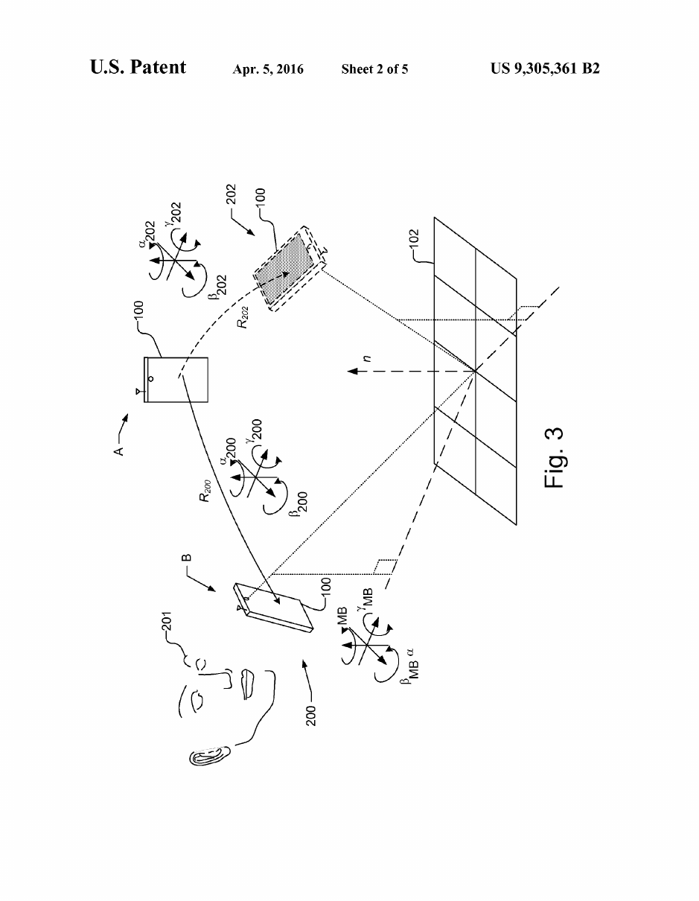
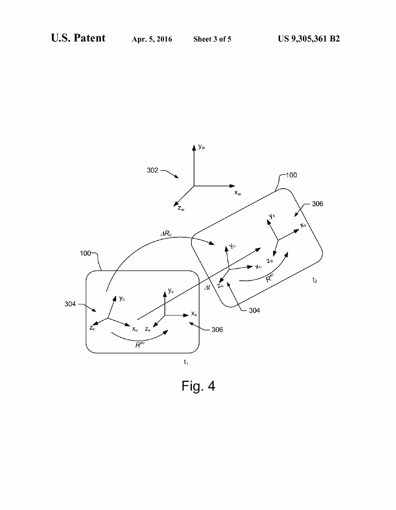
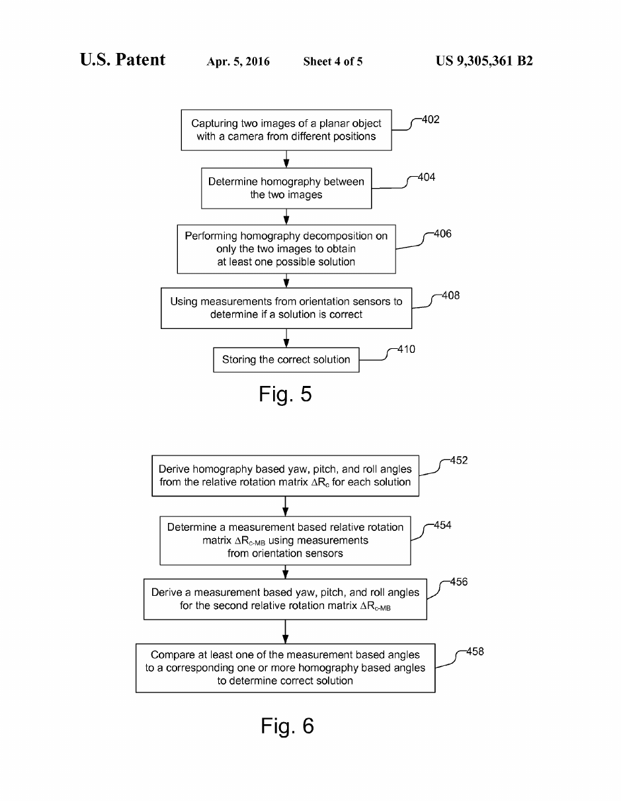

# US 9,305,361 B2 번역: 방향 센서를 이용한 호모그래피 분해 모호성 해소

번역 범위: 전문(서지, 초록, 본문, 도면 설명, 청구항 24항). 인용 문헌 목록은 원문 그대로 둔다.
원문: [US9305361B2.pdf](US9305361B2.pdf) (Google Patents 공보 PDF, 13쪽). 본문 텍스트는 PDF의 pdftotext 결과와 Google Patents 본문 텍스트를 대조해 옮겼다.

## 서지

- (12) 미국 특허, Jiang 외
- (10) 특허 번호: US 9,305,361 B2
- (45) 등록일: 2016-04-05
- (54) 발명의 명칭: Resolving Homography Decomposition Ambiguity Based on Orientation Sensors (방향 센서를 이용한 호모그래피 분해 모호성 해소)
- (75) 발명자: Bolan Jiang, Dheeraj Ahuja, Christopher Brunner (모두 미국 캘리포니아주 샌디에이고)
- (73) 권리자: QUALCOMM Incorporated, 샌디에이고
- (*) 존속 기간이 35 U.S.C. 154(b)에 따라 395일 연장됨
- (21) 출원 번호: 13/310,204
- (22) 출원일: 2011-12-02
- (65) 공개: US 2013/0063589 A1, 2013-03-14
- (60) 가출원: 61/533,733, 2011-09-12
- (51) 국제 분류: G01B 11/03, G01B 11/26, G06T 7/20, G01B 11/02
- (52) CPC: G06T 7/20, G06T 7/2033, G01B 11/022, G06T 2207/10016, G06T 2207/30244
- 심사관: Mohammed Jebari. 대리인: Silicon Valley Patent Group LLP
- 청구항 24항, 도면 5장

## 요약 (Abstract)

평면 물체를 찍은 두 영상 사이의 호모그래피를 분해하면 적어도 하나의 가능한 해가 나오고, 보통은 서로 구별되지 않는 해가 적어도 두 개 나온다.
방향 센서의 측정값으로 두 해 사이의 모호성을 없애거나, 해가 하나일 때 그 해를 검증한다.
방향 센서 측정값은 다음처럼 쓴다.
하나 이상의 해에 대해 상대 회전 행렬에서 요(yaw), 피치(pitch), 롤(roll) 각 가운데 적어도 하나를 구한다.
이를 방향 센서 측정값에서 구한 같은 종류의 각과 비교한다.

## 관련 출원

이 출원은 2011-09-12에 낸 미국 가출원 61/533,733 "Resolving Homography Decomposition Ambiguity"의 우선권을 35 USC 119에 따라 주장한다. 가출원은 이 출원의 권리자에게 양도되어 있고, 참조로 여기에 포함한다.

## 배경

영상 기반 추적은 이동 플랫폼이 찍은 영상으로, 주변 물체에 대한 플랫폼의 위치와 방향(자세, pose)을 구한다.
추적은 길 안내, 증강 현실처럼 실제 장면에 가상 물체를 넣는 응용에 쓰인다.

영상 기반 추적의 한 방식은 주변에서 평면을 찾아 기준 패치를 초기화한다.
보통 같은 평면을 여러 장 찍고, 두 영상 사이의 호모그래피를 계산해, 평면 위 점들의 3차원 위치를 추정한다.
같은 평면을 찍은 어떤 두 카메라 영상도 3x3 호모그래피 행렬 h로 이어진다.
호모그래피 h는 두 영상 사이의 회전 R과 병진 t로 분해할 수 있다.
그 자세 정보 [R|t]를 길 안내, 증강 현실 같은 응용에 쓴다.

그런데 대부분 h를 분해하면 가능한 해가 여러 개 나온다.
그중 하나만 실제 평면을 나타낸다.
따라서 h의 분해에는 풀어야 할 모호성이 있다.
알려진 방법은 맞는 해를 고르려고 추가 정보를 쓴다. 예를 들어 영상을 더 쓰거나, 평면에 대한 사전 지식을 쓴다.

예를 들어 Georg Klein과 David Murray의 "Parallel Tracking and Mapping on a Camera Phone"(ISMAR, 2009, 4쪽, 이하 PTAM) 같은 추적 기술은 호모그래피 분해 뒤 자세를 고르는 데 모호성을 겪는다.
PTAM은 모호성을 풀려고 비디오 프레임, 즉 영상을 더 쓴다.
가능한 해마다 3차원 카메라 자세를 계산하고, 이어지는 여러 프레임에서 자세 재투영 오차를 비교한다.
한 해의 평균 재투영 오차가 다른 해보다 크면(예를 들어 2배), 오차가 큰 해를 버린다.
하지만 재투영으로 모호성을 풀면 수렴에 오래 걸리고, 때로 틀린 결과를 낸다.

다른 방법은 카메라의 처음 방향에 가장 가까운 법선을 가진 해를 고르는 것이다.
하지만 이 방법은 사용자가 늘 정면에 가까운 방향에서 시작해 그 자리에서 멀어지도록 제한한다.

D. Santosh Kumar와 C. V. Jawahar의 "Robust Homography-Based Control for Camera Positioning in Piecewise Planar Environments"(ICVGIP, 906-918, 2006)는 공간에 다른 평면이 하나 더 있거나, 평면에 대한 사전 지식이 있어야 맞는 해를 고른다.
그래서 실제로 쓸 곳이 제한된다.

## 요약 (Summary)

평면 물체를 찍은 두 영상 사이의 호모그래피를 분해하면 적어도 하나의 가능한 해가 나오고, 보통은 모호한 해가 적어도 두 개 나온다.
방향 센서의 측정값으로 두 해 사이의 모호성을 없애거나, 해가 하나일 때 그 해를 검증한다.
하나 이상의 해의 상대 회전 행렬에서 구한 요, 피치, 롤 각 가운데 적어도 하나를, 방향 센서 측정값에서 구한 같은 각과 비교한다.

한 실시예의 방법은 다음을 포함한다.

- 평면 물체를 서로 다른 위치에서 두 장 찍는다.
- 두 영상 사이의 호모그래피를 구한다.
- 호모그래피를 분해해 적어도 하나의 가능한 해를 얻는다.
- 방향 센서 측정값으로 그 해가 맞는지 판정한다.
- 맞는 해를 저장한다.

다른 실시예의 장치는 다음을 포함한다.

- 평면 물체를 찍는 카메라
- 카메라 방향을 재는 방향 센서
- 프로세서. 서로 다른 위치에서 찍은 두 영상과, 두 영상을 찍을 때의 방향 센서 측정값을 받는다. 두 영상 사이의 호모그래피를 구하고, 분해해 가능한 해를 얻고, 방향 센서 측정값으로 해가 맞는지 판정하고, 맞는 해를 메모리에 저장한다.

또 다른 실시예의 장치는 위 각 단계를 수행하는 수단(means)으로 이루어진다.
또 다른 실시예는 위 각 단계를 수행하는 프로그램 코드를 담은 비일시적 컴퓨터 판독 매체다.

## 도면의 간단한 설명

- 도 1: 이동 플랫폼이 서로 다른 두 위치에서 평면 물체를 찍는 모습
- 도 2: 평면 물체 위 3차원 점이 서로 다른 위치에서 찍은 두 영상에 투영되는 모습
- 도 3: 호모그래피 분해 해의 모호성
- 도 4: 이동 플랫폼에 대한 여러 좌표계(세계 좌표계, 카메라 좌표계, 센서 좌표계)
- 도 5: 방향 센서 측정값으로 호모그래피 분해의 모호성을 푸는 과정의 흐름도
- 도 6: 방향 센서 측정값으로 가능한 해 가운데 적어도 하나를 지우는 과정의 흐름도
- 도 7: 평면 물체의 두 영상만으로, 평면에 대한 사전 지식 없이, 호모그래피 분해의 모호성을 푸는 이동 플랫폼의 블록도

## 상세한 설명

도 1은 카메라 112를 가진 이동 플랫폼 100이 서로 다른 두 위치 A와 B에서 평면 물체 102를 찍는 모습이다.
위치 A는 첫(처음) 영상 102A, 위치 B는 두 번째(현재) 영상 102B에 해당한다.
찍은 영상 102A, 102B는 디스플레이 114에 보인다.
실제로는 한 플랫폼 100이 위치 A에서 B로 움직이면서(도 1의 점선 화살표) 실시간 비디오에서 여러 프레임을 찍을 수 있다.
또는 서로 다른 두 플랫폼이 위치 A와 B에서 평면 물체 102를 찍을 수도 있다.
플랫폼 100에는 방향 센서 116도 있다. 가속도계, 자력계, 자이로스코프 등이다.
가속도계는 직선 운동을 재고 자이로스코프는 각운동을 재지만, 이런 센서로 두 위치 사이의 상대 방향을 구할 수 있으므로 여기서는 모두 방향 센서 116이라 부른다.

도 2처럼 평면 π 위의 3차원 점을 두 영상 I′와 I에서 보면, 영상 I′의 2차원 투영 q′=(x′, y′, 1)과 영상 I의 투영 q=(x, y, 1)은 호모그래피 h로 이어진다.

> q′ ≅ h q  (식 1)

같은 평면을 찍은 두 영상의 호모그래피 h는 회전 행렬 R, 병진 t, 법선 n으로 분해할 수 있다.
분해 절차는 Faugeras, O., Lustman, F.의 "Motion and structure from motion in a piecewise planar environment"(International Journal of Pattern Recognition and Artificial Intelligence 2 (1988) 485-508)에 나온 잘 알려진 방법이며, 참조로 여기에 포함한다.
가장 일반적인 경우 h를 분해하면 가능한 해가 네 개 나온다. 즉 회전 R과 병진 t의 조합이 네 벌이다.
이 가운데 두 해는 비교차 제약과 가시성 제약으로 지울 수 있다.
비교차 제약은 두 영상을 평면의 같은 쪽에서 찍었다는 조건이다. 예를 들어 두 영상 모두 평면 위쪽에서 찍었다.
가시성 제약은 영상을 찍을 때 평면 위 모든 3차원 점이 카메라 앞에 있어야 한다는 조건이다.
하지만 남은 두 해 사이의 모호성은 그대로 남는다.



도 3은 처음 위치 A와 현재 위치 B(사용자 201과 함께)에 있는 플랫폼 100과 평면 물체 102를 다시 그린 것이다.
위치 A와 B에서 찍은 영상으로 호모그래피를 분해하면 두 해 200과 202가 나온다.
해 200은 플랫폼 100의 맞는 위치 B이고, 해 202는 틀린 해로 점선으로 그렸다.
앞에서 말했듯 해 200과 202는 각각 평면 법선 n(도 3에 표시), 회전 행렬 R(도 3의 화살표 R200, R202), 병진 t(도 3에는 없음)를 포함한다.
분해로 해가 최대 네 개 나올 수 있지만, 두 개는 비교차 제약과 가시성 제약으로 쉽게 지울 수 있으므로 도 3에는 그리지 않았다.
남은 두 해 200, 202는 둘 다 분해의 유효한 해이므로 모호성을 풀어야 한다.
또 분해로 해가 하나(예를 들어 해 200)만 나올 수도 있는데, 이때도 그 해를 검증하는 것이 바람직하다.

남은 두 해 사이의 모호성은 방향 센서 116의 측정값으로 한 해를 지워서 푼다(해가 하나면 검증한다).
방향 센서 116의 측정값으로 카메라 좌표계에서 측정 기반 요(αMB), 피치(βMB), 롤(γMB) 각을 구한다(통틀어 측정 기반 각이라 부른다).
마찬가지로 분해 해 200, 202의 상대 회전 행렬 R200, R202에서 요, 피치, 롤 각을 구한다(통틀어 호모그래피 기반 각이라 부른다).
즉 도 3처럼 R200에서 α200, β200, γ200을, R202에서 α202, β202, γ202를 구한다.
그다음 측정 기반 각 하나 이상을 각 해의 같은 각과 비교해 어느 해가 맞는지 정한다(해가 하나면 검증한다).

방향 센서 116은 시각 t에서 센서 좌표계의 벡터를 세계 좌표계로 바꾸는 회전 행렬 R_t^ws를 잰다.
또 시각 t에서 회전 행렬 R_t^wc는 카메라 좌표계의 벡터를 세계 좌표계로 바꾼다.
두 행렬의 관계는 다음과 같다.

> R_t^wc = R_t^ws R^sc  (식 2)

여기서 R^sc는 카메라 좌표계의 벡터를 센서 좌표계로 바꾸는 회전 행렬이다. 알려진 상수이며, 예를 들어 플랫폼 100에 대해 미리 교정해 둘 수 있다.



도 4는 예로서 시각 t1과 t2의 두 위치에 있는 플랫폼 100에 대한 여러 좌표계를 보인다.
좌표계는 세계 좌표계 302, 카메라 좌표계 304, 센서 좌표계 306이다.
화살표처럼 회전 행렬 R^sc는 카메라 좌표계 304의 벡터를 센서 좌표계 306으로 바꾸며, 플랫폼 100에서 일정하다.

같은 평면 물체를 서로 다른 위치(예를 들어 도 4의 시각 t1과 t2)에서 두 장 찍으면, 두 영상은 카메라 좌표계에서 3x3 호모그래피 행렬 h로 이어진다.
h는 평면 법선 n, 상대 회전 행렬 ΔRc(도 4에서 t1과 t2의 플랫폼 사이 화살표), 병진 Δt로 분해할 수 있다.
앞서 말했듯 분해는 대개 여러 해를 내므로, 도 4의 ΔRc는 도 3의 해 200, 202의 상대 회전 행렬 R200, R202에 해당한다.

시각 t1과 t2에 찍은 두 영상 사이의 상대 회전 ΔRc는, 카메라 좌표계 304를 세계 좌표계 302로 바꾸는 R_t^wc로 다음처럼 구할 수 있다.

> ΔRc = (R_2^wc)^-1 R_1^wc  (식 3)

식 2를 식 3에 넣으면, R_t^wc 대신 방향 센서 116이 재는 R_t^ws(센서 좌표계 306에서 세계 좌표계 302로)와 알려진 상수 R^sc로 쓸 수 있다.

> ΔRc = (R^sc)^-1 (R_2^ws)^-1 R_1^ws R^sc  (식 4)

따라서 식 4로, 시각 t1과 t2의 방향 센서 측정값(t1에 잰 R_1^ws, t2에 잰 R_2^ws를 뒤집은 (R_2^ws)^-1)과 알려진 R^sc를 써서 측정 기반 상대 회전 행렬 ΔRc-MB를 계산한다.
카메라 좌표계에 있는 ΔRc-MB는 도 3에서 위치 A에서 B로 바뀔 때의 상대 회전 R_MB에 해당한다.
그다음 ΔRc-MB로 h 분해의 맞는 해를 고른다.
예를 들어 ΔRc-MB에서 측정 기반 각을, 각 해의 ΔRc에서 호모그래피 기반 각을 구한다.
하나 이상의 각을 비교해 가장 가깝거나 차이가 문턱 안인 해를 맞는 해로 정한다.

분해로 해가 하나만 나와도, 2차원 점의 대응이 나빠서 그 해가 틀릴 수 있다.
이때 같은 과정으로 그 해를 검증한다. 측정 기반 각과 그 해의 호모그래피 기반 각의 차이가 문턱 안인지 본다.
문턱을 넘으면 그 해는 실패로 보고, 하나뿐인 해를 맞다고 가정하지 않고 과정을 다시 시작한다.



도 5는 방향 센서 116의 측정값으로 호모그래피 분해의 모호성을 푸는 흐름도다.
그림처럼 카메라(또는 서로 다른 카메라들)로 평면 물체를 서로 다른 위치에서 두 장 찍는다(402).
서로 다른 두 카메라를 쓰면, 방향 측정은 같은 세계 좌표계를 기준으로 해야 한다.
예를 들어 X는 Y와 Z의 벡터곱으로 정의하며, 기기의 현재 위치에서 땅에 접하고 대략 동쪽을 가리킨다.
Y는 기기의 현재 위치에서 땅에 접하고 자북극을 가리킨다.
Z는 위를 가리키고 땅에 수직이다.
두 영상 사이의 호모그래피 h를 구한다(404).
두 영상으로 호모그래피 분해를 해서 적어도 하나의 가능한 해를 얻는다(406).
예를 들어 해가 하나만 나오면 방향 센서 측정값으로 검증할 수 있다.
하지만 보통은 여러 해가 나오고, 그 일부를 비교차 제약과 가시성 제약으로 지우면 모호한 해 두 개가 남는다.
방향 센서 116의 측정값으로 해가 맞는지 판정하고(408), 맞는 해를 카메라의 위치와 방향으로 저장한다(410).

도 6은 방향 센서 116의 측정값으로 해가 맞는지 판정하는 과정(408)의 흐름도다.
도 5의 단계 506(원문 표기 그대로. 도 5의 406에 해당)에서 h를 분해할 때 해마다 상대 회전 행렬 ΔRc가 나온다.
보통 해가 최대 네 개 나오고, 일부를 비교차 제약과 가시성 제약으로 지우면 모호한 해 두 개가 남는다.
그래서 아래는 해가 두 개라고 보고 설명하지만, 해 하나를 검증할 때도 같은 과정을 쓴다.
도 4처럼, 해마다 ΔRc에서 호모그래피 기반 각(요, 피치, 롤)을 구한다(452).
회전 행렬에서 요, 피치, 롤 각을 구하는 방법은 이 분야의 통상의 기술자에게 잘 알려져 있다.
식 4처럼 방향 센서 116의 측정값으로 측정 기반 상대 회전 ΔRc-MB를 구한다(454).
ΔRc-MB에서 측정 기반 각(요, 피치, 롤)을 구한다(456).
측정 기반 각 하나 이상을 각 해의 같은 호모그래피 기반 각과 비교해 맞는 해를 정한다.
예를 들어 측정 기반 각과 차이가 가장 작은 해(각을 여러 개 쓰면 평균 차이가 가장 작은 해)를 맞는 해로 고른다.
또는 측정 기반 각과 호모그래피 기반 각의 차이를 문턱과 비교해 맞는 해를 고르거나, 해가 하나면 검증한다.

원하면 요, 피치, 롤 세 각 가운데 일부만 비교에 쓸 수 있다.
예를 들어 해가 두 개일 때, 두 해 사이 차이가 가장 큰 호모그래피 기반 각(요, 피치, 롤 중 하나)을 골라 같은 측정 기반 각과 비교할 수 있다.
또 요 각은 자기 이상(magnetic anomaly)에 더 쉽게 흔들린다.
그래서 요 각은 비교에서 빼고, 롤과 피치 중 하나 또는 둘로 맞는 해를 정하는 것이 바람직할 수 있다.

도 7은 평면 물체의 두 영상만으로, 평면에 대한 사전 지식 없이, 호모그래피 분해의 모호성을 푸는 이동 플랫폼의 블록도다.
플랫폼 100은 평면 물체를 찍는 수단(카메라 112 또는 여러 카메라)을 포함한다.
방향을 재는 수단(방향 센서 116)도 포함한다. 가속도계, 자이로스코프, 전자 나침반 같은 감지 소자일 수 있다.
사용자 인터페이스 150도 포함할 수 있다. 여기에는 주변 영상을 보여 주는 수단(디스플레이 114)이 있다.
사용자 인터페이스 150에는 사용자가 정보를 넣는 키패드 152 같은 입력 장치도 있을 수 있다.
원하면 디스플레이 114에 터치 센서(또는 제스처 제어)를 붙인 가상 키패드로 키패드 152를 없앨 수 있다.
플랫폼 100이 휴대 전화 같은 기기면 사용자 인터페이스 150에 마이크 154와 스피커 156이 있을 수 있다.
물론 플랫폼 100은 이 개시와 관계없는 다른 요소도 포함할 수 있다.

플랫폼 100은 카메라 112, 방향 센서 116과 연결되어 통신하는 제어부 160도 포함한다.
제어부 160은 카메라 112(또는 여러 카메라)가 찍은 영상과 방향 센서 116의 신호를 받아 처리하고 디스플레이 114를 제어한다.
제어부 160은 프로세서 161과 메모리 164, 하드웨어 162, 소프트웨어 165, 펌웨어 163으로 구성할 수 있다.
제어부 160은 카메라 112가 찍은 두 영상에 대해 호모그래피 분해를 하는 영상 처리부 166을 포함할 수 있다.
제어부 160은 해 검증부 168도 포함한다. 해 검증부는 분해 해를 받아, 예를 들어 도 5와 도 6처럼 방향 센서 116의 측정값으로 해가 맞는지 판정한다.
고른 해는 플랫폼 100의 위치와 방향으로 메모리 164나 다른 저장부에 저장한다.

영상 처리부 166과 해 검증부 168은 알기 쉽게 프로세서 161과 따로 그렸지만, 프로세서 161의 일부이거나 프로세서 161에서 도는 소프트웨어 165의 명령으로 구현할 수 있다.
여기서 프로세서 161은 하나 이상의 마이크로프로세서, 임베디드 프로세서, 제어기, ASIC, DSP 등을 포함할 수 있지만 꼭 포함할 필요는 없다.
프로세서라는 말은 특정 하드웨어가 아니라 시스템이 구현하는 기능을 가리킨다.
여기서 메모리는 플랫폼에 딸린 장기, 단기, 기타 메모리를 포함한 모든 종류의 컴퓨터 저장 매체를 뜻하며, 특정 종류나 개수, 저장 매체 종류로 한정하지 않는다.

여기 설명한 방법은 응용에 따라 여러 수단으로 구현할 수 있다.
예를 들어 하드웨어 162, 펌웨어 163, 소프트웨어 165 또는 그 조합으로 구현할 수 있다.
하드웨어로 구현할 때 처리부는 하나 이상의 ASIC, DSP, DSPD, PLD, FPGA, 프로세서, 제어기, 마이크로컨트롤러, 마이크로프로세서, 전자 장치, 여기 설명한 기능을 하도록 설계한 다른 전자 장치, 또는 그 조합 안에 구현할 수 있다.

펌웨어나 소프트웨어로 구현할 때는 여기 설명한 기능을 하는 모듈(절차, 함수 등)로 구현할 수 있다.
명령을 담은 어떤 기계 판독 매체도 이 방법의 구현에 쓸 수 있다.
예를 들어 소프트웨어 코드를 메모리 164에 저장하고 프로세서 161에서 실행할 수 있다.
메모리는 프로세서 161 안이나 밖에 둘 수 있다.
펌웨어나 소프트웨어로 구현하면 기능을 컴퓨터 판독 매체에 하나 이상의 명령이나 코드로 저장할 수 있다.
예로는 데이터 구조를 담은 비일시적 컴퓨터 판독 매체, 컴퓨터 프로그램을 담은 컴퓨터 판독 매체가 있다.
컴퓨터 판독 매체는 물리적 컴퓨터 저장 매체를 포함한다.
저장 매체는 컴퓨터가 접근할 수 있는 어떤 매체여도 된다.
예를 들어(한정하지 않음) RAM, ROM, EEPROM, CD-ROM 등 광디스크, 자기 디스크 등 자기 저장 장치, 또는 명령이나 데이터 구조 형태의 프로그램 코드를 저장하고 컴퓨터가 접근할 수 있는 다른 매체일 수 있다.
여기서 disk와 disc는 CD, 레이저 디스크, 광디스크, DVD, 플로피 디스크, 블루레이 디스크를 포함한다. disk는 보통 자기적으로, disc는 레이저로 광학적으로 데이터를 재생한다.
이들의 조합도 컴퓨터 판독 매체에 포함한다.

설명을 위해 특정 실시예로 이 발명을 보였지만, 이 발명은 그것에 한정되지 않는다.
발명의 범위를 벗어나지 않고 여러 변형과 수정을 할 수 있다.
따라서 첨부한 청구항의 사상과 범위는 위 설명에 한정되지 않는다.

## 청구항

1. 방법으로서, 다음을 포함한다.
   - 평면 물체를 서로 다른 위치에서 두 장 찍는다.
   - 두 영상 사이의 호모그래피를 구한다.
   - 호모그래피를 분해해 적어도 하나의 가능한 해를 얻는다. 분해는 각 해마다 두 영상 사이의 상대 회전 행렬을 낸다.
   - 방향 센서 측정값으로 그 해가 맞는지 판정한다. 이때 방향 센서 측정값으로 측정 기반 상대 회전 행렬을 구하고, 각 해의 상대 회전 행렬을 측정 기반 상대 회전 행렬과 비교해 해가 맞는지 정한다.
   - 맞는 해를 저장한다.
2. 청구항 1의 방법에서, 가능한 해가 여럿 나오고 방향 센서 측정값으로 그중 적어도 하나를 지운다.
3. 청구항 1의 방법에서, 방향 센서 측정값을 쓰는 단계는 다음을 더 포함한다.
   - 상대 회전 행렬에서 호모그래피 기반 요, 피치, 롤 각을 구한다.
   - 측정 기반 상대 회전 행렬에서 측정 기반 요, 피치, 롤 각을 구한다.
   - 측정 기반 요, 피치, 롤 각 중 적어도 하나(또는 그 조합)를 호모그래피 기반 요, 피치, 롤 각 중 적어도 하나(또는 그 조합)와 비교해 해가 맞는지 정한다.
4. 청구항 3의 방법에서, 분해는 각자 상대 회전 행렬을 가진 두 해를 내고, 두 해 각각에 대해 호모그래피 기반 요, 피치, 롤 각을 구하며, 두 해 각각에 대해 측정 기반 각과 비교한다.
5. 청구항 4의 방법에서, 첫 해와 둘째 해의 호모그래피 기반 요, 피치, 롤 각을 서로 비교해 차이가 가장 큰 각을 찾고, 두 해 각각을 측정 기반 각과 비교할 때 그 차이가 가장 큰 각만 쓴다.
6. 청구항 1의 방법에서, 방향 센서 측정값으로 해가 맞는지 판정할 때 평면 물체에 대한 사전 지식을 쓰지 않고, 평면 물체의 추가 영상도 쓰지 않는다.
7. 장치로서, 다음을 포함한다.
   - 평면 물체를 찍는 카메라
   - 카메라 방향을 재는 방향 센서
   - 프로세서. 서로 다른 위치에서 찍은 평면 물체의 두 영상과, 두 영상을 찍을 때의 방향 센서 측정값을 받는다. 두 영상 사이의 호모그래피를 구하고, 분해해 적어도 하나의 가능한 해를 얻는다(분해는 각 해마다 두 영상 사이의 상대 회전 행렬을 낸다). 방향 센서 측정값으로 측정 기반 상대 회전 행렬을 구하고, 각 해의 상대 회전 행렬을 이와 비교해 해가 맞는지 판정한다. 맞는 해를 메모리에 저장한다.
8. 청구항 7의 장치에서, 가능한 해가 여럿 나오고 프로세서는 방향 센서 측정값으로 그중 적어도 하나를 지운다.
9. 청구항 7의 장치에서, 프로세서는 해가 맞는지 판정하려고 다음을 더 한다.
   - 상대 회전 행렬에서 호모그래피 기반 요, 피치, 롤 각을 구한다.
   - 측정 기반 상대 회전 행렬에서 측정 기반 요, 피치, 롤 각을 구한다.
   - 측정 기반 각 중 적어도 하나(또는 그 조합)를 호모그래피 기반 각 중 적어도 하나(또는 그 조합)와 비교해 해가 맞는지 정한다.
10. 청구항 9의 장치에서, 분해는 각자 상대 회전 행렬을 가진 두 해를 내고, 프로세서는 두 해 각각에 대해 호모그래피 기반 각을 구해 측정 기반 각과 비교한다.
11. 청구항 10의 장치에서, 프로세서는 두 해의 호모그래피 기반 요, 피치, 롤 각을 서로 비교해 차이가 가장 큰 각을 찾고, 두 해 각각을 측정 기반 각과 비교할 때 그 각만 쓴다.
12. 청구항 7의 장치에서, 프로세서는 평면 물체에 대한 사전 지식 없이, 평면 물체의 추가 영상 없이, 방향 센서 측정값으로 해가 맞는지 판정한다.
13. 장치로서, 다음을 포함한다.
    - 평면 물체를 서로 다른 위치에서 두 장 찍는 수단
    - 두 영상 사이의 호모그래피를 구하는 수단
    - 호모그래피를 분해해 적어도 하나의 가능한 해를 얻는 수단. 분해는 각 해마다 두 영상 사이의 상대 회전 행렬을 낸다.
    - 방향 센서 측정값으로 해가 맞는지 판정하는 수단. 이 수단은 방향 센서 측정값으로 측정 기반 상대 회전 행렬을 구하는 수단과, 각 해의 상대 회전 행렬을 이와 비교해 해가 맞는지 정하는 수단을 포함한다.
    - 맞는 해를 저장하는 수단
14. 청구항 13의 장치에서, 분해 수단은 가능한 해를 여럿 내고, 방향 센서 측정값을 쓰는 수단은 그중 적어도 하나를 지운다.
15. 청구항 13의 장치에서, 방향 센서 측정값을 쓰는 수단은 다음을 더 포함한다.
    - 상대 회전 행렬에서 호모그래피 기반 요, 피치, 롤 각을 구하는 수단
    - 측정 기반 상대 회전 행렬에서 측정 기반 요, 피치, 롤 각을 구하는 수단
    - 측정 기반 각 중 적어도 하나(또는 그 조합)를 호모그래피 기반 각 중 적어도 하나(또는 그 조합)와 비교해 해가 맞는지 정하는 수단
16. 청구항 15의 장치에서, 분해 수단은 각자 상대 회전 행렬을 가진 두 해를 내고, 두 해 각각에 대해 호모그래피 기반 각을 구해 측정 기반 각과 비교한다.
17. 청구항 16의 장치에서, 두 해의 호모그래피 기반 요, 피치, 롤 각을 서로 비교해 차이가 가장 큰 각을 찾는 수단을 더 포함하고, 두 해 각각을 측정 기반 각과 비교할 때 그 각만 쓴다.
18. 청구항 13의 장치에서, 방향 센서 측정값으로 해가 맞는지 판정하는 수단은 평면 물체에 대한 사전 지식을 쓰지 않고, 평면 물체의 추가 영상도 쓰지 않는다.
19. 프로그램 코드를 저장한 비일시적 컴퓨터 판독 매체로서, 다음을 포함한다.
    - 서로 다른 위치에서 찍은 평면 물체의 두 영상 사이의 호모그래피를 구하는 코드
    - 호모그래피를 분해해 적어도 하나의 가능한 해를 얻는 코드. 각 해마다 두 영상 사이의 상대 회전 행렬을 낸다.
    - 방향 센서 측정값으로 해가 맞는지 판정하는 코드. 이 코드는 방향 센서 측정값으로 측정 기반 상대 회전 행렬을 구하는 코드와, 각 해의 상대 회전 행렬을 이와 비교해 해가 맞는지 정하는 코드를 포함한다.
    - 맞는 해를 저장하는 코드
20. 청구항 19의 매체에서, 가능한 해가 여럿 나오고 방향 센서 측정값으로 그중 적어도 하나를 지운다.
21. 청구항 19의 매체에서, 방향 센서 측정값을 쓰는 코드는 다음을 더 포함한다.
    - 상대 회전 행렬에서 호모그래피 기반 요, 피치, 롤 각을 구하는 코드
    - 측정 기반 상대 회전 행렬에서 측정 기반 요, 피치, 롤 각을 구하는 코드
    - 측정 기반 각 중 적어도 하나(또는 그 조합)를 호모그래피 기반 각 중 적어도 하나(또는 그 조합)와 비교해 해가 맞는지 정하는 코드
22. 청구항 21의 매체에서, 분해 코드는 각자 상대 회전 행렬을 가진 두 해를 내고, 두 해 각각에 대해 호모그래피 기반 각을 구해 측정 기반 각과 비교한다.
23. 청구항 22의 매체에서, 두 해의 호모그래피 기반 요, 피치, 롤 각을 서로 비교해 차이가 가장 큰 각을 찾는 코드를 더 포함하고, 비교 코드는 두 해 각각을 측정 기반 각과 비교할 때 그 각만 쓴다.
24. 청구항 19의 매체에서, 방향 센서 측정값으로 해가 맞는지 판정하는 코드는 평면 물체에 대한 사전 지식을 쓰지 않고, 평면 물체의 추가 영상도 쓰지 않는다.

## 인용 문헌 (원문 그대로)

U.S. PATENT DOCUMENTS

```
6,520,647 B2     2/2003 Raskar
7,242,818 B2     7/2007 Beardsley et al.
7,403,658 B2     7/2008 Lin et al.
7,613,361 B2    11/2009 Anabuki et al.
7,698,094 B2     4/2010 Aratani et al.
7,796,116 B2     9/2010 Salsman et al.
7,847,844 B2    12/2010 Takemoto et al.
7,852,317 B2    12/2010 Grunnet-Jepsen et al.
7,965,904 B2     6/2011 Kobayashi
8,155,787 B2     4/2012 Chalubert et al.
8,264,553 B2     9/2012 Joshi et al.
8,638,986 B2     1/2014 Jiang et al.
2004/0179107 A1* 9/2004 Benton
2007/0031004 A1  2/2007 Matsui et al.
2008/0246848 A1 10/2008 Tsubaki et al.
2010/0045701 A1  2/2010 Scott et al.
2010/0149183 A1  6/2010 Loewke et al.
2011/0046843 A1* 2/2011 Caveney
2012/0038549 A1  2/2012 Mandella et al.
2012/0062702 A1  3/2012 Jiang et al.
2012/0147139 A1  6/2012 Li et al.
2012/0301011 A1 11/2012 Grzechnik
2013/0044913 A1  2/2013 Jin et al.
2013/0064421 A1  3/2013 Ahuja
2014/0086494 A1* 3/2014 Benhimane et al.
```

FOREIGN PATENT DOCUMENTS

```
CN  1745397 A      3/2006
EP  1978731 A2    10/2008
JP  2006513504 A   4/2006
JP  2007164631 A   6/2007
JP  2008259076 A  10/2008
WO  2004066213 A1  8/2004
WO  2007100303 A1  9/2007
```

OTHER PUBLICATIONS

```
Faugeras et al. ("Motion and Structure from Motion in a Peicewise Planar Environment") Jun. 1988.*
Dominik A et al., "Towards real-time camera egomotion estimation and three-dimensional scene acquisition from monocular image streams", Indoor Positioning and Indoor Navigation (IPIN), 2010 International Conference on, IEEE, Sep. 15, 2010, pp. 1-10, XP031810309.
International Search Report and Written Opinion, PCT/US2012/050963, ISA/EPO, Oct. 26, 2012.
Kumar S. D. et al., "Robust Homography-Based Control for Camera Positioning in Piecewise Planar Environments", Jan. 1, 2007, Computer Vision, Graphics and Image Processing, LNCS, p. 906-918, Springer, XP019053082, ISBN: 978-3-540-68301-8.
Oreifej O. et al., "Horizon constraint for unambiguous UAV navigation in planar scenes", IEEE ICRA, May 9, 2011, pp. 1159-1165, XP032033463, DOI: 10.1109/ICRA.2011.5979586.
Brown, et al., "Minimal Solutions for Panoramic Stitching", IEEE CVPR, 2007, 8pgs.
Okatani T., "Estimating camera translation based on a voting method using a camera with a 3D orientation sensor", IPSJ SIG Notes, Sep. 14, 2001, vol. 2001, No. 87, pp. 25-32.
Klein G. et al., "Parallel Tracking and Mapping on a Camera Phone", ISMAR 2009, Oct. 19, 2009, pp. 83-86.
Okatani T., et al., "Robust estimation of camera translation between two images using a camera with a 3D orientation sensor", ICPR 2002, Aug. 11-15, 2002, vol. 1, pp. 275-278.
Brandao A.S. et al., "Decentralized Control of a Formation Involving a Miniature Helicopter and a Team of Ground Robots Based on Artificial Vision", LARS 2010, Oct. 23, 2010, pp. 126-131, XP031885776, DOI: 10.1109/LARS.2010.12.
Yu G., "Research on Several Problems of Vision-based Navigation and Control for Aerial Robotics", Chinese Doctoral Dissertations Full-text Database, Dec. 15, 2010, 7 pages.
* cited by examiner
```

인용 문헌 목록은 PDF 1~2쪽 OCR 텍스트를 옮긴 것이다. OCR이 깨뜨린 숫자와 기호(예: "2004.066213", "Oreife. O")는 정리했고, 일부 줄의 미국 분류 기호는 뺐다. 공보에 인쇄된 오자("Peicewise")는 공보 그대로 두었다. 원문 대조는 [US9305361B2.pdf](US9305361B2.pdf) 1~2쪽을 본다.
