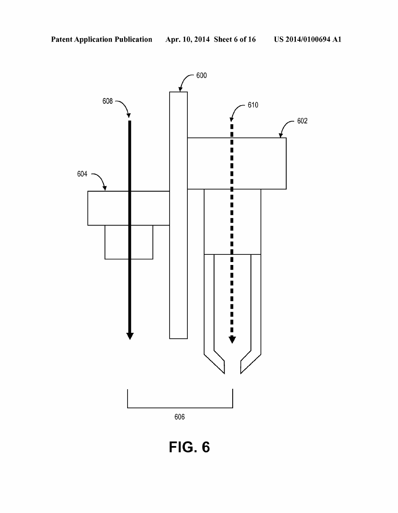
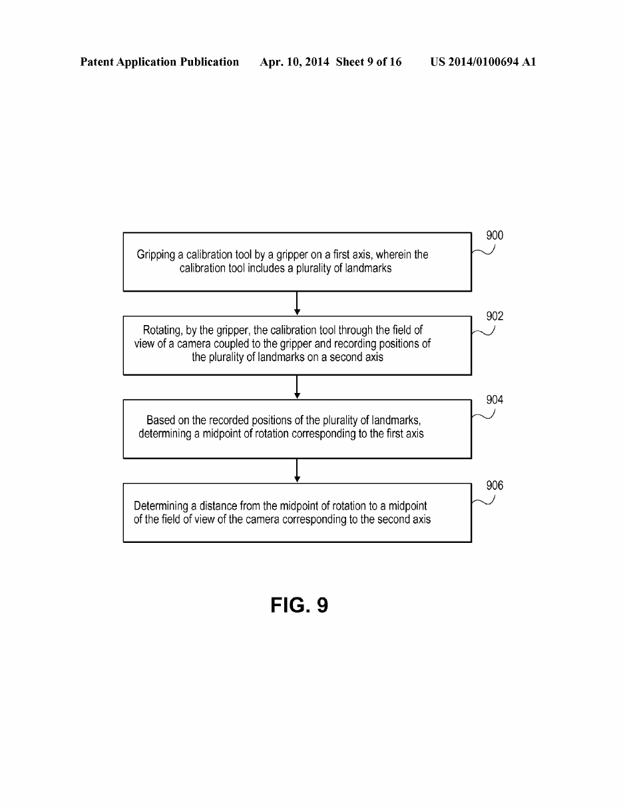
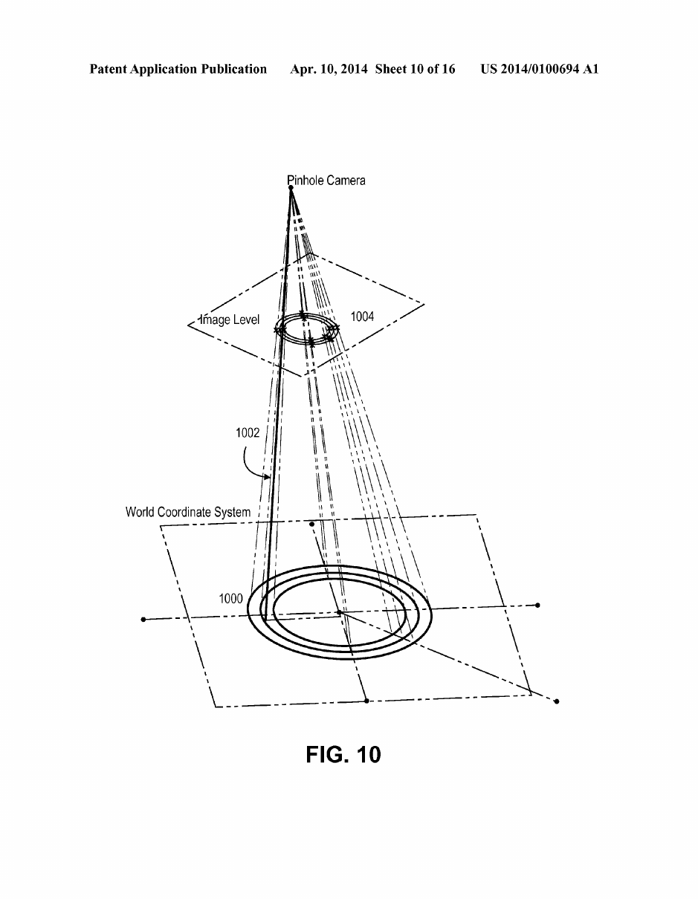
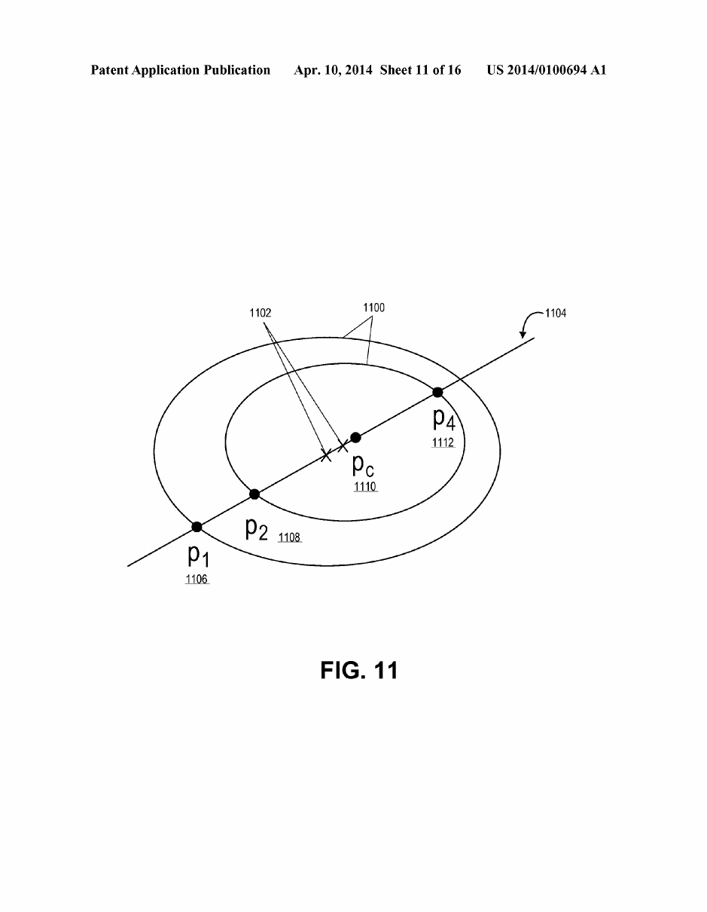

# US 2014/0100694 A1 번역: 카메라 기반 자동 정렬 시스템과 방법

번역 범위: 전문(서지, 초록, 본문 [0001]~[0092], 도면 설명, 청구항 23항).
원문: [US20140100694A1.pdf](US20140100694A1.pdf) (USPTO 공개 공보 PDF, 28쪽).

원문 처리 메모

- 공보 PDF는 300 dpi 흑백 스캔이다. 1~20쪽은 글자 층이 있어 `pdftotext -layout`으로 뽑았다.
- 21~28쪽(본문 [0039] 이후와 청구항)은 글자 층이 없다. 단을 나눠 tesseract로 글자를 읽고, 수식은 쪽 이미지를 직접 보고 옮겼다.
- 수식 기호는 원문 그대로 적었다. 원문의 오기로 보이는 곳은 [역주]로 따로 표시했다.

---

## 서지 (공보 1쪽)

- (19) 미국, (12) 특허 출원 공개, (10) 공개 번호 US 2014/0100694 A1, (43) 공개일 2014-04-10
- (54) 발명의 명칭: SYSTEM AND METHOD FOR CAMERA-BASED AUTO-ALIGNMENT (카메라 기반 자동 정렬 시스템과 방법)
- (71) 출원인: Beckman Coulter, Inc., Brea, CA (US)
- (72) 발명자: Stefan Rueckl (Garching bei Muenchen, DE), Sebastian Streibl (Muenchen, DE), Manuel Sickert (Puergen, DE)
- (73) 권리자: Beckman Coulter, Inc.
- (21) 출원 번호 14/046,829, (22) 출원일 2013-10-04
- (60) 가출원: 61/710,612 (2012-10-05), 61/745,252 (2012-12-21), 61/772,971 (2013-03-05)
- (51) Int. Cl. B25J 9/16 (2006.01), (52) CPC B25J 9/1692 (2013.01), USPC 700/254
  - [역주] 스캔 글자는 "325-19/16", "BZSJ 9/1692"로 읽히지만 B25J의 판독 오류로 보인다.

## (57) 초록

카메라 기반 자동 정렬 과정은 로봇 팔의 그리퍼 유닛이 첫째 보정 도구를 잡는 단계를 포함할 수 있다. 그리퍼 유닛에 결합된 카메라가 첫째 보정 도구의 영상을 찍을 수 있다. 그리퍼 유닛과 카메라 유닛은 대략 평행한 두 축 위에 정렬될 수 있다. 영상을 분석해 카메라의 시선 축을 그리퍼 축에 맞춰 보정하고, 이것이 로봇 팔의 XY 보정이 된다. 그리퍼 유닛은 둘째 보정 도구에 있는 표지(landmark)로 광학 보정을 하거나, 그리퍼 유닛을 작업면 쪽으로 움직여 작업면에 닿아 멈출 때까지 내려서 Z축 보정을 할 수 있다. 보정이 끝나면, 카메라로 작업면의 알려진 위치에 있는 표지 하나 이상을 찾아 로봇 팔을 작업면에 정렬할 수 있다.

---

## 관련 출원 상호 참조

[0001] 이 출원은 다음 미국 가출원의 우선권을 주장한다. 2012-10-05 출원 61/710,612 "SYSTEM AND METHOD FOR AUTO-ALIGNMENT"(Stefan Rueckl), 2012-12-21 출원 61/745,252 "SYSTEM AND METHOD FOR AUTO-ALIGNMENT"(Stefan Rueckl 외), 2013-03-05 출원 61/772,971 "SYSTEM AND METHOD FOR AUTO-ALIGNMENT"(Stefan Rueckl 외). 각 문헌의 전체 내용은 모든 목적을 위해 여기에 참조로 포함된다. 이 출원은 2013-10-04 출원된 미국 특허 출원(출원 번호 미배정) "SYSTEM AND METHOD FOR LASER-BASED AUTO ALIGNMENT"(Stephen Otts)과 관련되며, 그 전체 내용도 참조로 포함된다.

## 배경

[0002] 실험실 자동화 시스템(LAS)을 고객 현장에 설치하면, 서비스 기술자가 시스템의 요소를 정렬한다. 예를 들어 프레임, 로봇 팔용 XY 갠트리, 작업면의 서랍을 정렬해서, 로봇 팔이 시료관을 한 자리에서 다른 자리로 정확하게 잡아 옮길 수 있게 한다. 보통 로봇 팔과 작업 공간의 정렬은 손으로 했다. 손 정렬은 느리고 비싸다. 특히 로봇 팔이 여러 개이고 각각 따로 정렬해야 하는 복잡한 LAS에서 그렇다. 또 손 정렬은 정렬마다 사람의 실수가 들어갈 수 있다. 자동 정렬 과정을 쓰면 더 적은 기술자가 더 짧은 시간에 더 많은 LAS를 설치하고 정렬할 수 있고, 사람의 실수로 정렬이 틀릴 위험도 줄어든다.

[0003] 일반적인 LAS에서 각 로봇 팔은 작업면 위의 갠트리에 고정된다. 작업면에는 다른 위치로 옮길 수 있는 랙의 시험관이나 도구가 있을 수 있다. 예를 들어 시험관을 분배 랙에서 원심분리기 어댑터로 옮긴다. 여러 문제를 피하려면 잡는 동작이 정확해야 한다. 예를 들어 로봇 팔이 관을 잡지 못하거나, 고른 관을 잡았지만 정렬이 어긋나 관을 깨뜨리는 경우다. 기존 손 정렬은 여러 단계를 포함할 수 있다. 예를 들어 손이나 외부 구동 모터로 그리퍼 팔을 작업면의 여러 위치에 가져다 놓는다. 또 로봇 팔은 작업면의 랙이나 서랍마다 따로 정렬해야 한다. 이 절차는 서비스 기술자가 손으로 할 때 로봇 팔 하나당 몇 시간에서 하루가 걸릴 수 있다.

[0004] 본 발명의 실시예는 이런 문제와 다른 문제를 다룬다.

## 요약

[0005] 실시예에 따라, 실험실 자동화 시스템(LAS) 안에서 그리퍼 유닛이 달린 로봇 팔을 보정하거나 정렬하는 자동 정렬 과정과 관련 기술 구성을 개시한다.

[0006] 카메라 기반 정렬 시스템에서는, 로봇 팔이 작업면의 영상을 얻도록 XYZ 로봇의 그리퍼 유닛 자리에 카메라를 달 수 있다. 카메라는 그리퍼 위치 아래의 작업면을 찍는다. 카메라와 로봇 팔의 정렬은 카메라를 설치할 때 할 수 있다. 설치하면서 카메라 광축을 로봇 팔 축에 맞추는 방식이다. 그러나 카메라를 정확히 설치하고, 카메라 위치가 바뀌지 않게 보장하는 일은 로봇 팔이 여러 개인 복잡한 시스템에서 비용이 너무 클 수 있다. 따라서 카메라를 쓰는 자동 정렬 절차는 카메라를 로봇 팔에 정밀하게 붙이는 생산 비용을 줄이고, 카메라 위치가 바뀌거나 어긋났을 때 카메라와 로봇 팔 시스템을 다시 정렬하는 손쉬운 방법이 된다.

[0007] 실시예에 따라, 카메라 기반 자동 정렬 과정은 로봇 팔의 그리퍼 유닛이 첫째 보정 도구를 잡는 단계를 포함할 수 있다. 그리퍼 유닛에 결합된 카메라가 첫째 보정 도구의 영상을 찍을 수 있다. 그리퍼 유닛과 카메라 유닛은 대략 평행한 두 축 위에 정렬될 수 있다. 영상을 분석해 카메라 시선 축을 그리퍼 축에 맞춰 보정하고, 이것이 로봇 팔의 XY 보정이 된다. 그리퍼 유닛은 둘째 보정 도구의 표지로 광학 보정을 하거나, 작업면에 닿아 멈출 때까지 작업면 쪽으로 움직여 Z축 보정을 할 수 있다. 보정이 끝나면 카메라로 작업면의 알려진 위치에 있는 표지를 찾아 로봇 팔을 작업면에 정렬할 수 있다.

## 도면의 간단한 설명

- [0008] 도 1은 실시예에 따른 XYZ 로봇의 카메라와 그리퍼 배치를 보인다.
- [0009] 도 2는 실시예에 따른 카메라 기반 자동 정렬용 표지 설계 여러 개를 보인다.
- [0010] 도 3은 실시예에 따른 X-Y 보정 도구를 보인다.
- [0011] 도 4는 실시예에 따른 Z 보정 도구를 보인다.
- [0012] 도 5는 실시예에 따른 실험실 자동화 시스템(LAS)의 예를 보인다.
- [0013] 도 6은 실시예에 따라 Z축 하우징에 붙은 카메라 유닛과 그리퍼 유닛을 보인다.
- [0014] 도 7은 실시예에 따른 XYZ 로봇 보정 방법을 보인다.
- [0015] 도 8은 흔한 방사 왜곡의 예를 보인다.
- [0016] 도 9는 실시예에 따른 X-Y 보정 방법을 보인다.
- [0017] 도 10은 실시예에 따라 보정 중 X-Y 보정 도구가 지나간 경로의 투영을 보인다.
- [0018] 도 11은 실시예에 따라 보정 중 영상 촬영 장치의 결상 특성 때문에 생긴 타원을 보인다.
- [0019] 도 12는 실시예에 따라 영상 촬영 장치의 높이를 정하려고 표지를 삼각 측량하는 것을 보인다.
- [0020] 도 13은 실시예에 따른 Z 보정 방법을 보인다.
- [0021] 도 14는 실시예에 따라 카메라 기반 자동 정렬 시스템의 정밀도를 판정하는 시스템을 보인다.
- [0022] 도 15는 실시예에 따른 자동 정렬 시스템의 블록도다.
- [0023] 도 16은 실시예에 따른 컴퓨터 장치의 블록도다.

## 상세한 설명

[0024] 다음 설명에서는 설명을 위해, 본 발명의 여러 실시예를 충분히 이해하도록 구체적인 사항을 많이 적는다. 그러나 이 분야의 통상의 기술자에게는 이런 구체적 사항 일부 없이도 실시예를 실시할 수 있음이 분명하다. 다른 경우에는 잘 알려진 구조와 장치를 블록도로 보인다.

[0025] 이어지는 설명은 예시적 실시예일 뿐이며, 개시의 범위, 적용성, 구성을 제한하려는 것이 아니다. 오히려 예시적 실시예의 설명은 통상의 기술자에게 예시적 실시예를 구현할 수 있는 설명을 준다. 첨부된 청구항에 적힌 발명의 정신과 범위를 벗어나지 않고 요소의 기능과 배치를 여러 가지로 바꿀 수 있음을 이해해야 한다.

[0026] 실시예를 충분히 이해하도록 다음 설명에 구체적 사항을 준다. 그러나 통상의 기술자는 이런 구체적 사항 없이도 실시예를 실시할 수 있음을 이해할 것이다. 예를 들어 회로, 시스템, 네트워크, 과정과 기타 구성 요소는 실시예를 불필요한 세부로 가리지 않도록 블록도의 구성 요소로 보일 수 있다. 다른 경우에는 잘 알려진 회로, 과정, 알고리즘, 구조, 기법을 불필요한 세부 없이 보일 수 있다.

[0027] 도 1은 실시예에 따른 XYZ 로봇의 카메라와 그리퍼 배치를 보인다. 실시예에 따라, 카메라를 광학 측정 도구로 쓰는 자동 정렬 방법을 개시한다. 로봇 팔은 실험실 자동화 시스템(LAS)의 작업면에서 물체를 잡고, 들고, 옮길 수 있는 그리퍼 유닛 100을 포함할 수 있다. 카메라나 다른 영상 촬영 장치를 그리퍼 유닛에 결합해, 카메라가 찍은 영상이나 동영상으로 LAS의 요소를 찾고 로봇 팔을 LAS에 정렬할 수 있다. 일부 실시예에서 카메라는 그리퍼 유닛이 Z축을 따라 움직이는 동안 일정한 높이에 유지되도록 그리퍼 유닛에 결합된다. 로봇 팔을 정렬하는 동안 카메라와 그리퍼 유닛은 보정 도구 하나 이상으로 보정할 수 있다. 보정 과정은 카메라 좌표계(픽셀 단위)와 로봇 좌표계(스텝 또는 엔코더 카운트 단위) 사이의 관계를 세우는 데 쓴다. 보정은 카메라의 광학적 결함도 고려할 수 있다. 이 결함은 왜곡을 만들고, 고치지 않으면 정렬이 어긋날 수 있다. 카메라를 보정하면, 카메라로 작업면의 알려진 위치에 있는 표지를 찾을 수 있다. 이것으로 로봇 팔을 LAS에 정렬한다.

[0028] 실시예에 따라, 그리퍼 유닛 100은 LAS의 요소 102를 잡을 수 있다. 이 요소에는 시험관, 보정 도구, 다른 물체가 포함될 수 있다. 요소 102는 첫째 축 위의 그리퍼 유닛으로 잡는다. 카메라 유닛 104와 그리퍼 유닛 100 사이에 오프셋이 있으므로, 영상은 둘째 축 위의 카메라 유닛 104가 얻는다. 보통의 카메라와 조립체는 그리퍼 조립체나 잡을 수 있는 도구 안에 넣기에는 너무 크다. 그래서 카메라 유닛을 그리퍼 유닛 옆에 붙일 수 있고, 그 결과 첫째 축과 둘째 축 사이에 기계적 오프셋이 생긴다. 카메라는 정상 작동 중 그리퍼 유닛을 방해하지 않으므로 그리퍼 유닛에 계속 붙여 둘 수 있고, 필요할 때마다 자동 정렬을 다시 할 수 있다. 영상을 분석해 둘째 축과 첫째 축 사이의 오프셋을 정하고, 카메라 좌표계를 로봇 좌표계에 맞춰 보정할 수 있다. 오프셋은 첫째 축과 둘째 축 사이의 각도 어긋남도 반영할 수 있다. 모터 스텝과 픽셀 사이의 환산비는, 카메라를 표지 위에 두고 로봇 팔을 X와 Y 방향으로 정해진 스텝 수만큼 움직여서 정할 수 있다. 환산비는 표지의 겉보기 위치 변화로 정한다. 오프셋과 환산비로 X-Y 평면에서 그리퍼를 보정할 수 있다. 그 다음 둘째 보정 도구로 Z축에서 그리퍼를 보정할 수 있다. 선택적으로, 작업면에 있는 요소(예: 입력 영역) 하나 이상의 표지 하나 이상을 찾아 그리퍼 보정의 정밀도를 확인할 수 있다. 보정이 끝나면 카메라 유닛으로 작업면의 알려진 위치에 있는 표지를 찾아 로봇 팔을 LAS에 정렬할 수 있다.

[0029] 실시예에 따라, Z축에서 그리퍼를 보정하는 일은 둘째 보정 도구의 표지를 써서 광학적으로 보정하는 것을 포함할 수 있다. 예를 들어 카메라에서 고정 표지까지의 거리를 삼각 측량한다. 이에 더하거나 대신해서, 그리퍼가 둘째 보정 도구에 닿을 때까지 Z축을 따라 그리퍼를 도구 쪽으로 움직여 물리적으로 Z축 보정을 할 수 있다.

[0030] 위에서 말했듯이, 로봇 팔을 LAS에 보정하고 정렬하는 과정에 시각 표지를 쓸 수 있다. 예를 들어 보정 도구에는 카메라 유닛이 알아보는 표지가 있을 수 있고, 작업면의 표지로 로봇 팔을 LAS에 정렬할 수 있다. 표지는 작업면의 알려진 위치에 놓인, 대비가 뚜렷한 기하 도형일 수 있다. 표지는 카메라와 그리퍼 유닛을 보정하는 데 쓰는 보정 도구에 둘 수도 있다.

[0031] 도 2는 여러 표지 설계 200의 예를 보인다. 일부 실시예에서 표지는 접착 종이나 비닐 같은 기재에 인쇄해 작업면에 붙일 수 있다. 일부 실시예에서 표지는 작업면에 기계적, 화학적, 또는 다른 방법으로 새긴 뒤 페인트나 에폭시 같은 대비 충전재로 채울 수 있다. 다른 방법으로, 양극 산화나 다른 코팅을 한 부품을 식각해 대비를 얻을 수도 있다. 이렇게 하면 작업면에서 밀리거나 움직이지 않는 영구 표지가 된다.

[0032] 이상적으로는 만들기 쉽고, 중점을 쉽게 찾을 수 있고, 잘못 알아볼 위험이 낮은 표지를 고른다. 예를 들어 십자나 사각형 같은 선형 표지는 원형 표지보다 믿을 만하게 찾기 어렵다. 또 작업면의 긁힘은 원형 표지보다 선형 표지로 잘못 알아보기 쉽다. 동심원 여러 개로 된 표지는 찾기 쉽고, 선형 표지보다 잘못 알아볼 가능성이 낮으며, 찾은 원 중점 모두의 산술 평균으로 중점을 정할 수 있다. 여기서는 주로 원형 표지를 쓰지만, 도 2에 보인 것을 포함한 어떤 대비 도형도 본 발명의 실시예에 쓸 수 있다. 카메라 유닛이 작업면 영상을 찍으면, 패턴 인식 과정으로 영상을 처리해 표지가 있는지 판단할 수 있다. 패턴 인식 과정은 표지가 있는지 판단하고, 있으면 표지의 중점을 찾는다. 중점은 카메라 좌표계의 위치로, 픽셀 단위로 나타낼 수 있다.

[0033] 도 3은 본 발명의 실시예에 따른 X-Y 보정 도구를 보인다. X-Y 보정 도구는 X-Y 평면에서 그리퍼 유닛을 보정하는 데 쓸 수 있다. 여기서 X-Y 평면은 작업면과 평행한 평면을 뜻한다. 위에서 말했듯이 카메라는 로봇 팔의 그리퍼 유닛에 결합될 수 있고, 그 결과 카메라 축과 그리퍼 유닛 축 사이에 오프셋이 생긴다. 이 오프셋은 로봇 팔과 카메라에 들어간 기계 공차, 설치 부품의 차이 등 때문에 설치마다 다를 수 있다. 그래서 오프셋은 설치 전에 알 수 없고, 로봇 팔을 LAS에 정렬하고 보정하는 동안 정할 수 있다.

[0034] 도 3에서 보듯, X-Y 보정 도구 300은 잡는 부분 302와 거의 수평인 부분 304를 포함할 수 있다. 그리퍼 유닛이 잡는 부분 302를 잡으면, 거의 수평인 부분 304가 카메라에 보인다. 거의 수평인 부분에는 카메라가 찾을 수 있는 표지 306 여러 개가 있어서, 카메라 축과 로봇 그리퍼 축 사이의 오프셋을 재는 데 쓴다. 일부 실시예에서는 X-Y 보정 도구의 표지 적어도 둘을 찾을 수 있을 때 보정을 할 수 있다. 도 3의 X-Y 보정 도구에는 표지 306이 다섯 개 있지만, 더 많거나 더 적은 표지를 쓸 수도 있다. 표지는 도구를 따라 알려진 거리에 있다. 즉 각 표지 중심에서 잡는 부분 302의 중심까지의 거리를 안다. X-Y 보정 도구의 치수는 로봇 팔이 배치되는 LAS에 맞춰 고를 수 있다. 잡는 부분 302의 지름은 로봇이 자주 집을 물체의 지름에 맞춰 고를 수 있다. 예를 들어 시험관을 자주 잡는 로봇이면 원기둥 지름을 시험관 지름에 가깝게 고른다. 수평 부분 304의 길이는 그리퍼 축과 카메라 축 사이의 오프셋보다 길게 골라, 보정 중 수평 부분 304가 카메라에 보이도록 한다. X-Y 보정 과정의 흐름은 실시예에 따라 아래에서 자세히 설명한다.

[0035] 도 4는 본 발명의 실시예에 따른 Z 보정 도구 400을 보인다. Z 보정 도구는 Z축을 따라 그리퍼 유닛을 보정하는 데 쓸 수 있다. 여기서 Z축은 작업면에 수직인 축을 뜻한다. Z 보정 도구는 알려진 높이에 있는 여러 층 402를 포함할 수 있다. 각 층에는 카메라가 찾을 수 있는 표지 404가 있을 수 있다. 일부 실시예에서는 바코드 같은 라벨로 Z 보정 도구 400의 표지에 고유 식별 번호를 줄 수 있다. Z 보정 도구는 설치 중 서비스 기술자가 작업면의 정해진 위치에 붙이거나, 작업면에 영구히 넣어 둘 수 있다. 실시예에 따라 Z 보정은 X-Y 보정 뒤에 할 수 있다.

[0036] 실시예에 따라 로봇 팔은 압력 센서를 포함하고, 저항을 만나면 멈추도록 구성될 수 있다. 이것은 보통 로봇 팔이 자신이나 작업면, 작업면 위 물체를 망가뜨리지 않게 하는 안전 기능으로 쓴다. 압력 센서를 자동 정지에 쓰면, 로봇 팔을 Z 보정 도구의 첫째 표지 위에 놓고 그리퍼 유닛이 첫째 표지에 닿을 때까지 내릴 수 있다. 닿으면 압력 센서가 로봇 팔을 멈춘다. 팔이 멈추면 Z축 모터의 위치를 기록할 수 있다. 실시예에 따라 각 축을 따라 로봇 팔을 구동하는 모터는 브러시 DC 모터나 스테퍼 모터일 수 있다. Z축 모터 위치는 엔코더 카운트나 스텝으로 기록할 수 있다. 이 과정을 Z 보정 도구의 표지마다 되풀이할 수 있다. 위치를 모두 기록하면, 층 사이의 거리를 엔코더 카운트나 스텝으로 정할 수 있다. 아래에서 더 설명하듯이, 삼각 측량으로 Z 보정 도구 각 층의 높이(예: 픽셀당 스텝)를 정할 수 있다. 실시예에 따른 Z축 보정 과정의 흐름은 아래에서 더 설명한다.

[0037] 일부 실시예에서는 X-Y 보정 도구와 Z 보정 도구의 특징을 합친 보정 도구 하나를 쓸 수 있다. 예를 들어 합친 보정 도구는 위에서 설명한 X-Y 보정 도구와 비슷하되, 표지마다 높이가 다르도록 고친 것일 수 있다.

[0038] 도 5는 본 발명의 실시예에 따른 실험실 자동화 시스템(LAS)의 예를 보인다. 도 5에서 보듯 LAS 500은 X-Y 갠트리 502가 있는 프레임을 포함하고, 갠트리에 Z축 504가 붙어 있다. 그리퍼 유닛 506과 카메라 유닛 508을 포함하는 로봇 팔은 각각 Z축 504에 결합될 수 있다. 위에서 말했듯이 X-Y 갠트리는 작업면 510 위의 X-Y 평면에서 로봇 팔과 그리퍼 유닛을 움직이고, Z축은 로봇 팔과 그리퍼 유닛을 작업면 510에 대해 위아래로 움직인다. 실시예에 따라 각 축은 전기 모터 하나 이상으로 트랙을 따라 움직일 수 있다. 일부 실시예에서 모터는 밀리미터당 스텝으로 모터 분해능을 아는 브러시 DC 모터나 스테퍼 모터다. 마이크로컨트롤러, 프로세서, 다른 제어기 같은 제어기 하나 이상이 각 축의 모터를 제어해 작업면 위 3차원 공간에 로봇 팔을 놓는다. 로봇 팔을 작업면에 정렬하려고, 작업면에는 알려진 위치에 표지 512 하나 이상을 둘 수 있다. 카메라 유닛을 보정하면 픽셀 단위의 카메라 좌표계를 엔코더 카운트나 스텝 단위의 로봇 좌표계로 바꿀 수 있다. 또 보정 과정은 카메라 축과 그리퍼 유닛 축 사이의 작은 각도 어긋남과, 렌즈 왜곡 같은 카메라의 광학 결함을 고칠 수 있다. 또 표지 512 하나 이상으로 로봇 팔을 작업면에 자동 정렬해서, 작업면 위 물체를 집어 옮기는 일처럼 정밀도가 중요한 기능을 할 수 있다. 일부 실시예는 다른 형태의 로봇, 예를 들어 SCARA(Selective Compliant Assembly Robot Arm)를 쓸 수 있다.

[0039] 도 6은 본 발명의 실시예에 따라 Z축 하우징에 붙은 카메라 유닛과 그리퍼 유닛을 보인다. 도 6에서 보듯 Z축 하우징 600은 그리퍼 유닛 602와 카메라 유닛 604의 장착 자리가 된다. 이 때문에 카메라 광축 608과 기계적 그리퍼 축 610 사이에 오프셋 606이 생긴다. 이상적으로는 설치 중 카메라 광축 608과 그리퍼 축 610을 거의 평행하게 유지하려고 애쓴다. 그러나 축을 조심스럽고 정확하게 맞추는 일은 비싸다. 제조, 부품, 설치 비용이 늘어난다. 시스템이 어긋나면 비싼 재정렬 절차가 필요해 비용이 더 커진다. 또 복잡한 LAS에는 로봇 팔이 많을 수 있어 비용이 더 불어난다.



[0040] 실시예에 따라, 자동 정렬 과정은 LAS에 로봇 팔을 올바르게 설치하는 효율적이고 반복 가능한 방법이 되고, 사용 중 로봇 팔이 어긋나면 빠른 정비 절차가 된다. 도 7은 본 발명의 실시예에 따른 카메라 기반 자동 정렬 방법을 보인다. 700에서 X-Y 보정 도구를 첫째 축 위의 그리퍼 유닛이 잡는다. X-Y 보정 도구는 작업면의 알려진 위치에서 집거나, 기술자가 손으로 그리퍼 유닛에 X-Y 보정 도구를 잡도록 지시할 수 있다. 702에서 그리퍼 유닛에 결합된, 둘째 축 위의 카메라가 X-Y 보정 도구의 영상을 찍는다. 찍은 영상으로 카메라 축과 그리퍼 축 사이 오프셋에 해당하는 거리를 정할 수 있다. 이 오프셋은 기계 공차에 따라 달라지므로 프로그래밍으로 미리 정할 수 없다. 이 과정에서 거리는 다른 센서나 측정 도구 없이 정할 수 있다. 704에서 카메라와 Z축 사이의 Z 보정을 해서, 모터 단위로 표지 높이를 정밀하게 잴 수 있게 한다. 일부 실시예에서는 X-Y 보정이나 Z 보정 중에 렌즈 왜곡도 계산하고 고칠 수 있다. 일부 실시예에서는 렌즈 왜곡을 정렬 과정의 별도 단계로 고칠 수 있다. 위 정렬 단계를 성공적으로 마치면 시스템을 쓸 준비가 된다. 일부 실시예에서는 카메라 유닛을 보정하고 렌즈 왜곡을 고친 뒤, 카메라 유닛으로 LAS 작업면의 표지 하나 이상을 찾아 LAS 안에서 로봇 팔을 정렬할 수 있다.

[0041] 복잡한 LAS에는 각자 카메라가 달린 로봇 팔이 많을 수 있다. 따라서 LAS의 고정비를 줄이려고 값싼 카메라를 쓸 수 있다. 그러나 값싼 카메라는 보통 비싼 카메라보다 렌즈 왜곡이 크다. 이 왜곡은 정렬 과정에서 고려하고 고칠 수 있다.

[0042] 도 8은 흔한 방사 왜곡의 예를 보인다. 렌즈의 기하 특성은 영상을 찍을 때 일정한 왜곡을 만든다. 왜곡에는 기본적으로 두 가지가 있다. 하나는 방사 왜곡으로, 실패(pin-cushion) 왜곡 800 또는 통(barrel) 왜곡 802라고도 한다. 이것은 렌즈가 구면이라서, 렌즈 중심을 지나 칩에 닿는 빛은 거의 꺾이지 않는 반면 렌즈 가장자리를 지나는 빛은 더 크게 휘고 굴절되기 때문에 생긴다. 둘째는 접선 왜곡으로, 렌즈와 카메라 칩 사이의 각도 때문에 생긴다.

[0043] 비교적 품질이 좋은 렌즈나 카메라를 쓸 때는 방사 왜곡이 더 중요한 요인이 되는 경향이 있다. 방사 왜곡은 다항식 급수로 나타낼 수 있다.

```
x̂ = x*(1 + α1 r^2 + α2 r^4 + ...)
ŷ = y*(1 + α1 r^2 + α2 r^4 + ...)          (11)
```

여기서 (x̂, ŷ)은 (x, y)에 대응하는 왜곡 보정 점이고, α1, α2, ...는 방사 왜곡을 나타내는 계수다. r은 점 (x, y)에서 영상 중점까지의 유클리드 거리이며, 여기서 영상 중점은 점 (0, 0)이다.

[역주] 원문 (11)의 둘째 줄은 "ŷy*(1+...)"로 인쇄되어 있다. "ŷ = y*(...)"의 인쇄 오류로 보고 고쳐 적었다.

[0044] 보정 과정으로 계수를 정할 수 있다. 보정에서는 α1만으로 방사 왜곡을 충분히 나타낸다고 가정하고, 고차 효과는 무시한다. 왜곡을 나타내는 다른 모델로 Fitzgibbon 나눗셈 모델이 있다.

```
x̂ = x / (1 + α1 r^2)
ŷ = y / (1 + α1 r^2)                         (12)
```

[0045] α1이 작으면, 이 모델은 계수 하나짜리 다항식 급수의 결과와 거의 같다. Fitzgibbon 나눗셈 모델에 쓰인 식 (12)는 다음 식으로 고쳐 쓸 수 있다.

```
s * x = s * (x̂, ŷ, 1)^T = (x, y, 1)^T + α1 * (0, 0, r^2)^T     (13)
```

[0046] 여기서 s는 배율 인자이고, x̂는 왜곡 보정 점 (x, y)에 해당한다.

[0047] 점 x가 직선 l = (l1 l2 l3)^T 위에 있다는 가정을 쓰면, 방사 왜곡 때문에 직선이 원의 일부(호)로 찍힌다는 것을 보일 수 있다.

```
l^T p = 0,
또는
l1 x + l2 y + l3 (1 + α1 * r^2) = 0           (14)
```

[0048] 이 식을 원의 방정식

```
(x - xm)^2 + (y - ym)^2 = R^2                 (15)
```

의 꼴에 맞추면 다음이 나온다.

```
(x + l1/(2*α1*l3))^2 + (y + l2/(2*α1*l3))^2
    = (l1/(2*α1*l3))^2 + (l2/(2*α1*l3))^2 - 1/α1      (16)
```

[0049] 따라서 xm, ym, R에 대해 다음이 성립한다.

```
xm = - l1 / (2*α1*l3),
ym = - l2 / (2*α1*l3),
R^2 = xm^2 + ym^2 - 1/α1                      (17)
```

[0050] 이 성질로 계수 α1을 정할 수 있다. 실시예에 따라, 찾은 표지를 영상 가장자리로 옮긴 뒤 로봇의 축 하나를 움직여 그 가장자리를 따라 이동시킨다. 이 과정에서 표지의 중점 위치를 기록할 수 있다. 로봇의 축 하나만 움직였으므로 측정한 중점은 모두 한 직선 위에 있어야 한다. 그러나 위에서 설명한 왜곡 때문에 그렇지 않다. 다음으로 측정한 중점에 원 함수를 맞춘다. 그 다음 식 (7)을 이 함수에 적용해 왜곡 매개변수 α1을 다음과 같이 정할 수 있다.

```
α1 = 1 / (xm^2 + ym^2 + R^2)                  (18)
```

여기서 (xm, ym)은 원의 중점이고 R은 반지름이다.

[역주] 원문은 "식 (7)"이라고 적었지만 공보에 (7)번 식은 없다. 내용상 식 (17)을 가리킨다. 또 식 (17)에서 바로 풀면 α1 = 1/(xm^2 + ym^2 - R^2)이 되어 (18)의 부호(+R^2)와 다르다. 원문 그대로 옮기고, 부호 차이는 원문 확인 사항으로 남긴다.

[0051] 이 과정을 영상의 네 모서리 모두에서 되풀이해, 이런 방식으로 잰 계수를 정할 수 있다.

[0052] 다음으로 계산 효율이 좋은 영상 변환을 위해 변환 마스크를 정할 수 있다. 이를 위해 영상 크기의 행렬을 만든다. 행렬의 각 원소 (i, j)는 원래 영상의 한 픽셀에 대응하고, 그 픽셀의 보정 위치 (î, ĵ)를 담는다. 영상을 찍자마자 이 마스크로 영상의 각 픽셀을 보정한다. 오픈 소스 라이브러리 OpenCV 같은 영상 처리 라이브러리에는 이 목적의 함수가 구현되어 있어서, 카메라가 찍는 대로 영상을 보정하는 데 쓸 수 있다.

[0053] 일부 실시예에서는 체스판이나 체커보드 무늬 같은 주기적으로 되풀이되는 무늬 표지로 렌즈 왜곡을 고려하고 고칠 수 있다. 실시예에 따라, 주기 무늬 표지는 로봇이 잡을 수 있는 도구에 인쇄하거나 붙일 수 있다. 실시예에 따라 이 도구는 도 3의 X-Y 보정 도구와 비슷하되, 원형 표지 대신 체커보드 같은 주기 무늬 표지를 가질 수 있다. 이렇게 하면 로봇이 주기 무늬를 카메라 시야 안에서 돌리면서, 무늬를 카메라에 가깝게 또는 멀게 옮길 수도 있다.

[0054] 실시예에 따라, 주기 무늬 표지는 도 4의 Z 보정 도구 같은 계단형 도구에 인쇄하거나 붙일 수도 있다. 이 경우 로봇과 카메라는 무늬와 따로 움직이고, 무늬가 카메라 시야 안의 여러 다른 위치에 보이도록 로봇을 움직일 수 있다.

[0055] 실시예에 따라, 카메라로 본 주기 무늬 표지의 특징(예: 체스판 무늬의 가장자리, 칸 하나하나, 칸의 개수)을 정할 수 있다. 표지의 기하 특성을 시스템이 알고 있으므로, 맞춤 알고리즘으로 이 특징의 좌표를 알려진(기대한) 특징 위치와 비교할 수 있다. 이런 맞춤 알고리즘은 OpenCV, Matlab용 Camera Calibration Toolbox, DLR CalLab과 CalDe(DLR 카메라 보정 도구 상자) 같은 소프트웨어 라이브러리에 있다. 맞춤 알고리즘으로 컴퓨터 비전 시스템의 내부 매개변수와 외부 매개변수를 추정할 수 있다. 내부와 외부 매개변수로, 사용 중인 카메라와 렌즈 조합의 왜곡 계수를 정할 수 있다. 주기 무늬 표지를 여러 위치에 두고 찍은 사진 여러 장을 쓰면, 알고리즘이 정하는 왜곡 계수의 정확도가 좋아진다.

[0056] 도 9는 본 발명의 실시예에 따른 X-Y 보정 방법을 보인다. 일부 실시예에서는 렌즈 왜곡을 고친 뒤, X-Y 보정 도구로 카메라 축과 그리퍼 유닛 축 사이의 오프셋을 정하고 카메라를 보정할 수 있다. 위에서 설명한 X-Y 보정 도구를 로봇의 작업 영역에 가져와, 카메라 축과 그리퍼 축 사이의 X 거리와 Y 거리를 정할 수 있다. X-Y 보정 과정이 시작되면, 사용자(예: 서비스 기술자)에게 로봇을 도구 위에 놓으라는 안내가 나올 수 있다. 그 다음 로봇이 잡는 높이로 움직이고, 사용자는 로봇 위치를 한 번 더 조정할 기회를 가질 수 있다. 900에서 로봇 팔의 그리퍼 유닛이 X-Y 보정 도구를 잡고, 로봇의 현재 X-Y 위치를 기록할 수 있다. 다음으로 로봇은 작업면의 빈 곳으로 가서 보정 과정용으로 지정된 높이까지 도구를 내린다. 902에서 그리퍼 유닛은 카메라 유닛이 찍은 영상에서 도구의 표지 적어도 둘이 성공적으로 검출될 때까지 X-Y 보정 도구를 큰 간격으로 돌린다. 그 다음 가장 먼 표지가 더 이상 검출되지 않을 때까지 작은 간격으로 도구를 돌린다. 그 다음 도구를 카메라의 시야 전체에 걸쳐 한 번 돌리면서, 같은 간격으로 도구 위 표지의 위치를 기록한다. X-Y 보정 도구가 카메라 시야를 지나 돌아가는 동안, 카메라는 정해진 간격으로 영상 여러 장을 찍어 보정 도구와 그 위에 새긴 표지들이 그리는 호를 담는다. 904에서 기록한 표지 위치를 바탕으로 첫째 축에 해당하는 회전 중점을 정할 수 있다. 회전하는 동안 표지는 모두 잡는 로봇의 축 둘레로 원 경로를 따라 움직이므로, 원 경로의 중점을 정하면 첫째 축과 둘째 축 사이의 오프셋을 정할 수 있다. 906에서 첫째 축에서 둘째 축까지의 오프셋으로 픽셀 단위 거리를 정할 수 있다. 그러나 기계 공차 때문에 카메라 축과 그리퍼 유닛 축이 서로 평행하지 않을 수 있다. 그래서 보정 도구가 그리는 경로는 원으로 기록되지 않고, 관찰된 경로는 타원이 된다.



[0057] 도 10은 본 발명의 실시예에 따라 보정 중 X-Y 보정 도구가 지나간 경로의 투영을 보인다. 위에서 말했듯이, 렌즈 효과와 그리퍼 축에 대한 카메라 축의 기울기와 오프셋이 함께 작용해서, 표지의 원 경로가 타원 같은 원뿔 곡선으로 기록된다. 도 10에서 1000은 세계 좌표계의 원, 1002는 카메라 광축, 1004는 카메라 좌표계에 타원 형태로 투영된 원을 나타낸다.



[0058] 다음은 이 투영을 수식으로 보인 것이다.

[0059] 카메라의 결상 특성에 대해 다음 내부 결상 행렬 K를 가정할 수 있다.

```
      | f  0  u0 |
K =   | 0  f  v0 |                            (19)
      | 0  0  1  |
```

여기서 f는 초점거리이고, 점 P = (u0, v0)는 영상의 중점을 나타낸다. 그러면 점 X = [X, Y, Z]는 다음과 같이 점 x̃ = [u, v, w]로 옮겨진다.

```
λ x̃ = K [R  T] X,                             (20)

      | R11  R21  R31 |          | TX |
R =   | R12  R22  R32 |,   T =   | TY |
      | R13  R23  R33 |          | TZ |
```

여기서 K는 위에서 말한 카메라 내부 특성 행렬이고, [R T]는 외부 카메라 행렬이다. R은 세계 좌표계에 대한 카메라 좌표계의 회전, T는 평행 이동을 나타낸다. λ는 0이 아닌 배율 인자다.

[0060] 원의 중점을 [XC, YC, 0]로 두면, 원 위의 각 점 X는 다음 식을 만족해야 한다.

```
X^T C X = 0                                   (21)
```

여기서 C는 원을 정의하는 행렬이다.

```
      |  1     0     -XC              |
C =   |  0     1     -YC              |       (22)
      | -XC   -YC    XC^2 + YC^2 - R^2 |
```

[0061] 이 원은 다음과 같이 타원 E로 그려진다.

```
λ E = H^-T C H^-1
여기서
H = K [R1  R2  T]                             (23)
```

R1과 R2는 회전 행렬 R의 첫 두 열이다. 이제 타원은 다음과 같이 나타낼 수 있다.

```
      |  A      B/2     D/2f  |
E =   |  B/2    C       E/2f  |               (24)
      |  D/2f   E/2f    E/f^2 |
```

[역주] (24)의 오른쪽 아래 원소는 원문에 "E/f^2"로 인쇄되어 있다. 식 (25)의 상수항 F에 대응하므로 "F/f^2"의 오기로 보인다. 또 행렬 원소 C는 원 행렬 C(식 22)와 같은 글자를 쓰지만 다른 양이다.

[0062] 또는 x와 y의 함수로 쓰면 다음과 같다.

```
0 = A x^2 + B x y + C y^2 + D x + E y + F     (25)
```

이것은 원뿔 곡선의 일반형이며, 일반성을 잃지 않고 A = 1로 둘 수 있다.

```
0 = x^2 + B x y + C y^2 + D x + E y + F       (26)
```

[0063] 다음 조건은 타원임을 보장한다(포물선과 쌍곡선을 뺀다).

```
B^2 - 4C < 0,
D^2/4 + E^2/(4C) - F > 0                      (27)
```

[0064] 실시예에 따라, 앞서 잰 점으로 원 궤적을 따라 타원을 맞출 수 있다. 이를 위해 최소 오차 제곱법(최소제곱법)을 쓸 수 있다. 이 작업은 ALGLIB 같은 수치 해석과 자료 처리 라이브러리로 풀 수 있다. 다른 수치 해석 방법을 쓸 수도 있다. 이를 위해 식 (15)의 함수를 맞춤 알고리즘에 넘길 수 있다. 또 알고리즘은 반복을 시작할 초기값을 받을 수 있다. 이 초기값은 식 (15)에 다섯 점 조합을 넣고 연립 방정식을 풀어 정한다. 이 과정을 가능한 점 조합 몇 개에 대해 되풀이한 뒤, 계산한 계수를 평균한다. 이 값을 맞춤 알고리즘의 초기값으로 쓰고, 알고리즘은 반복 과정으로 최소 오차 제곱 기준의 최적 해를 정한다.

[역주] 다섯 점으로 계수를 정하는 식은 내용상 원뿔 곡선식 (26)이다. 원문은 "식 (15)"라고 적었다.

[0065] 도 11은 본 발명의 실시예에 따라 보정 중 영상 촬영 장치의 결상 특성 때문에 생긴 타원을 보인다. 도 10에 대해 위에서 설명한 대로 정한 각 타원 1100의 중점 1102는 직선 1104를 따라 흩어져 있다. 원의 투영 중점은 이제 타원 중점들을 잇는 직선 위에 있다. X 방향과 Y 방향의 오프셋 거리를 주는 원의 투영 중점은, 투영으로 보존되는 반지름의 비를 이용하는 다음 방법으로 정할 수 있다.



[0066] 투영 전 두 원의 반지름 비:

```
cr = 2 R2 / (R1 + R2)                         (28)
```

[0067] 비 cr는 이제, 타원 중점을 잇는 직선과 타원이 만나는 교점 p1, p2, p4 (1106, 1108, 1112)가 만드는 선분들의 비에 대응한다.

```
cr = d(p1, pc) d(p2, p4) / ( d(p1, p4) d(p2, pc) )      (29)
여기서
d(pi, pj) = sqrt( (pix - pjx)^2 + (piy - pjy)^2 )
```

[0068] 이 식은 원 중점 pc 1110에서 교점 하나까지의 거리로 풀 수 있다.

```
d(p2, pc) = d(p2, p1) d(p2, p4) / ( cr d(p1, p4) - d(p2, p4) )     (30)
```

[역주] (29)는 직선 위 네 점 p1, p2, pc, p4의 복비(cross ratio) 꼴이다. 복비는 원근 투영에서 보존된다. 세계 좌표에서 p1, p2, pc, p4가 중심에서 -R1, -R2, 0, +R2 자리에 있다고 놓으면 (29)는 2R1/(R1+R2)가 된다. 원문 (28)의 2R2/(R1+R2)와 첨자가 다르다. 반지름 첨자를 어느 원에 붙였는지 원문에 정의가 없어서 원문 그대로 둔다(우리 계산).

[0069] cr를 계산하는 데 쓴 반지름은 표지에서 회전 중심까지의 거리, 다시 말해 그리퍼 유닛이 잡은 X-Y 보정 도구의 잡힌 부분의 중점까지의 거리다. 이 방법에는 동심원 두 개를 쓸 수 있다. 위에서 설명한 보정 도구를 쓰면 보정 도구의 다섯 표지에 해당하는 원 다섯 개가 검출되므로, 원 쌍의 조합은 모두 10가지가 가능하다. 마지막으로 원 쌍 10가지 조합으로 계산한 중점의 산술 평균과 표준편차를 정하고, 프로그램에 정한 한계값과 비교한다. 중점을 성공적으로 정하면, 카메라 축과 그리퍼 유닛 축 사이의 오프셋을 픽셀 단위로 정할 수 있다. 위에서 말했듯이, 여기서 쓴 반지름은 표지와 그리퍼 유닛 축 사이의 거리를 픽셀로 잰 것이다. 그리퍼 유닛이 X-Y 보정 도구를 카메라 시야 가운데에 놓으면, 카메라는 영상의 중심점을 찾고, 중심점에서 그 중심점에 가장 가까운 표지까지 X축과 Y축으로 몇 픽셀인지 정할 수 있다. 중심점에서 가장 가까운 표지까지의 거리와, 그 표지에서 그리퍼 유닛 축까지의 거리로 오프셋을 픽셀 단위로 계산할 수 있다.

[0070] 일부 실시예에서는 원 중점의 좌표를 픽셀 단위 카메라 좌표계에서 스텝 단위 모터 좌표계로 바꾸려고 픽셀 대 모터 스텝 비를 정할 수 있다. 이를 위해 로봇 팔은 처음에 저장한 도구 기록 위치로 가서 도구를 그 자리에 다시 놓는다. 먼저 표지 하나를 카메라 영상 가운데에 놓는다. 일부 실시예에서 이 표지는 X-Y 보정 도구의 특정 표지, 예를 들어 예시 도구의 가운데 표지일 수 있다. 그러나 어떤 표지든 쓸 수 있다. 그 다음 로봇은 X와 Y 방향으로 정해진 거리(스텝)만큼 움직이고, 그동안 카메라 시스템은 표지 위치를 기록한다. 이 값으로 두 축 각각의 픽셀 대 스텝 비를 계산한다. 앞서 정한 원의 중점과 이 비로 그리퍼 축에서 카메라 영상 중점까지의 거리를 모터 스텝으로 정할 수 있다.

[0071] 실시예에 따라, 위의 보정 과정을 적어도 하나의 다른 잡는 높이에서 되풀이해 선형 오프셋 함수 dx(z) = mx z + bx 또는 dy(z) = my z + by를 정할 수 있다. 이 함수는 카메라 광축과 그리퍼 로봇의 기계 축 사이 거리가 X와 Y 방향에서 높이 Z에 따라 어떻게 변하는지를 나타낸다. 두 높이보다 많은 높이에서 하면, 잰 점 (dx,y, z)에 선형 함수를 맞출 수 있다. 이 함수는 작업 공간 전체에서 기계적 그리퍼 축에 대한 카메라 광축의 기울기에 해당한다.

[0072] 다른 실시예에서는 왜곡 보정 단계를 X-Y 보정 단계와 합칠 수 있다. 위에서 설명했듯이, X-Y 보정 도구가 카메라 시야를 지나 돌아가는 동안 카메라가 영상을 연속으로 찍을 수 있다. 도구에는 도 3의 원형 표지나 체커보드 같은 주기 무늬 표지가 하나 이상 있을 수 있다. 이 연속 영상으로 시스템은 위에서 설명한 대로 왜곡 보정 매개변수를 정할 수 있다. 그 다음 왜곡 보정을 영상에 적용할 수 있다. 그 뒤 왜곡을 보정한 연속 영상으로 위에서 설명한 대로 X-Y 보정을 할 수 있다. X-Y 보정 계수는 표지의 알려진 점을 왜곡 보정한 연속 영상에 맞춰 원 운동을 정함으로써 정할 수 있다. 이 특정 점에는 원형 표지의 중심점이나 주기 무늬 표지의 가장자리가 포함될 수 있다.

[0073] 도 12는 본 발명의 실시예에 따라 그리퍼 유닛의 높이를 정하려고 표지를 삼각 측량하는 것을 보인다. 위에서 설명한 도 4의 Z 보정 도구를 이 과정에 쓸 수 있다. 먼저 로봇 팔은 Z 보정 도구 위로 가서 첫째 표지를 찾는다. 실시예에 따라 첫째 표지는 카메라가 알아볼 수 있는 바코드나 다른 라벨로 고유하게 식별할 수 있다. 그 다음 로봇은 표지가 영상 가운데 오도록 자리를 다시 잡는다. 표지가 가운데 오면, 로봇은 표지의 왼쪽이나 오른쪽으로 주어진 거리만큼 움직이고 위치를 기록한다. 이 예에서 삼각 측량은 시차, 즉 카메라 영상면 1200에서 표지의 겉보기 위치가 표지 위치 1 1202에서 표지 위치 2 1204로 바뀐 것을 바탕으로 할 수 있다. 카메라는 표지의 왼쪽이나 오른쪽으로 알려진 거리만큼 움직인다. 이 거리는 모터 위치로 스텝 단위로 정할 수 있다. 표지 겉보기 위치의 변화는 카메라가 픽셀로 정할 수 있다. 도 12에서 보듯, 이 측정으로 삼각 측량을 해서 표지 높이를 픽셀당 스텝으로 정할 수 있다.

```
z[steps/px] = f / Δx[px] * Δx[steps]          (31)
```

[0074] 여기서 f는 초점거리다. 그러나 측정하는 피사계 심도 범위 때문에 f를 분명히 정할 수 없으므로 1로 가정할 수 있다. 삼각 측량으로 표지 높이를 정하면, 그 높이를 z축 스텝 수로 바꿀 수 있다. 이를 위해 위에서 정한 X-Y 오프셋을 써서 로봇 팔을 표지 바로 위에 놓는다. 다음으로 로봇 팔의 압력 센서가 정해진 수준의 저항을 감지하면 멈추도록 z축 이동 매개변수를 조정한다. 그 다음 그리퍼가 표지에 닿을 때까지 로봇을 z축을 따라 천천히 내리고, 닿는 순간 압력 센서가 저항을 감지해 로봇을 멈춘다. 그때 그리퍼의 위치를 스텝으로 저장한다.

[0075] 실시예에 따라, 이 과정을 도구의 세 계단 모두에서 되풀이할 수 있다. 마지막으로 잰 세 점 (z[steps/px], z[steps])에 선형 함수를 맞춘다. 삼각 측량으로 정한 픽셀 단위 높이를 쓰면, 이제 이 함수로 z축의 스텝 단위 높이를 정할 수 있다.

[0076] 도 13은 실시예에 따른 Z 보정 방법을 보인다. 1300에서 Z 보정 도구의 첫째 표지를 찾는다. 위에서 말했듯이 Z 보정 도구에는 작업면 위 서로 다른 높이에 놓인 표지 여러 개가 있을 수 있다. 1302에서 로봇 팔에서 첫째 표지까지의 거리를 재고 저장할 수 있다. 위에서 말했듯이 첫째 표지까지의 거리는 삼각 측량으로 픽셀당 스텝 거리를 계산하고, 그리퍼 유닛을 표지에 닿을 때까지 내리는 직접 접촉으로 스텝 단위 높이를 재서 정할 수 있다. 1304에서 Z 보정 도구의 나머지 표지마다 이 측정을 되풀이한다. 1306에서 측정 쌍(픽셀당 스텝 거리, 스텝 거리) 각각으로 선형 거리 함수를 맞춘다. 이 선형 거리 함수로 픽셀 단위 카메라 좌표계와 스텝 단위 로봇 좌표계를 서로 바꿀 수 있고, 이것으로 Z축에서 로봇 팔을 보정한다.

[0077] 실시예에 따라 왜곡 보정 단계를 Z 보정 단계와 합칠 수도 있다. 위에서 말했듯이 렌즈 왜곡을 고치려면 카메라로 표지의 연속 영상을 찍을 수 있다. 도 4와 같은 Z 보정 도구에 주기 무늬 표지 하나 이상을 써도 된다. 표지는 카메라 시야 안의 여러 다른 위치에 놓을 수 있다. 이 영상으로 왜곡 보정 계수를 정하고, 그것으로 연속 영상의 왜곡을 고칠 수 있다.

[0078] 왜곡을 고친 영상으로 Z 보정을 할 수 있다. 주기 무늬 표지의 기하를 알고 있으므로, 시스템은 알려진 무늬로 픽셀과 거리의 관계를 정할 수 있다. 예를 들어 체커보드 무늬 표지의 가장자리 사이 거리를 메모리에 저장해 둘 수 있다. 영상의 왜곡을 고치면, 영상을 분석해 표지의 가장자리 사이에 몇 픽셀이 있는지 정하고, 픽셀과 거리의 관계를 정할 수 있다. 그 다음 위에서 설명한 대로 로봇 팔을 내려 표지에 닿게 한다. 로봇 팔이 표지에 닿을 때까지 간 거리를 기록해, 픽셀과 거리의 관계를 로봇 기준계의 픽셀과 스텝 관계로 바꿀 수 있다. 실시예에 따라 이 과정을 z 보정 도구의 다른 계단에서도 되풀이할 수 있다.

[0079] 도 14는 실시예에 따라 카메라 기반 자동 정렬 시스템의 정밀도를 판정하는 시스템을 보인다. 도 14에서 보듯, 정렬 과정이 끝난 뒤 그리퍼 유닛이 탐침 1400을 잡고 작업면의 표지 1404 위에 놓을 수 있다. 레이저 거리 센서 1406으로 레이저 1402를 탐침에 겨눠 탐침 끝까지의 거리를 정할 수 있다. 정밀도 시험에 쓰는 표지는 표지 중점에서 표지 옆 벽까지의 거리를 아는 것으로 고를 수 있다. 그 다음 레이저 거리 센서에서 탐침 끝까지의 거리를 잰다. 잰 거리와 뒷벽까지의 거리 차를 정한다. 그 다음 레이저 거리 센서를 90도 옮겨 놓고 과정을 되풀이할 수 있다. 두 측정으로 두 점 (X1, Y1)과 (X2, Y2)를 얻고, 알려진 탐침 끝 반지름 R로 탐침 끝의 중점을 다음과 같이 정할 수 있다.

```
a = (2*Y2 - 2*Y1) / (2*X2 - 2*X1)                              (32)
b = ((X1^2 + Y1^2 - R^2) - (X2^2 + Y2^2 - R^2)) / (2*X2 - 2*X1)  (33)
c = (-2*a*(X1 - b) - 2*Y1) / (a^2 + 1)                         (34)
d = ((X1 - b)^2 + Y1^2 - R^2) / (a^2 + 1)                      (35)
Xm1,m2 = -p/2 ± sqrt(p^2/4 - q)                                 (36)
Ym1,m2 = a * Xm1,m2 + b                                         (37)
```

[역주] (36)의 p, q는 앞에서 정의한 c, d를 가리키는 것으로 보인다. 원문 기호 그대로 둔다.

[0080] 그러나 두 점과 반지름만으로는 최종 해가 나오지 않는다. 식 (26)과 (27)에서 보듯, 원의 중점 후보가 둘 (Xm1,m2, Ym1,m2) 있다. 그러나 보통 두 후보 가운데 하나는 잰 표지 중점과 크게 차이 난다. 맞는 중점을 찾으면, 중점 측정값을 비교해 자동 정렬 시스템의 정밀도를 정할 수 있다.

[역주] 원문은 "식 (26)과 (27)"이라고 적었지만, 내용상 식 (36)과 (37)을 가리킨다.

[0081] 도 15는 본 발명의 실시예에 따른 자동 정렬 시스템의 블록도다. 자동 정렬 시스템은 축 모터 1500a, 1500b, 1500c를 포함하는 축 모터 1500 여러 개를 포함할 수 있다. 축 모터 1500은 작업면 위 3차원 공간에 로봇 팔과 그리퍼 유닛을 놓는 데 쓴다. 카메라 같은 영상 촬영 장치 1502를 그리퍼 유닛에 결합해 로봇 팔을 작업면에 자동 정렬하는 데 쓸 수 있다. 모터 제어기 1504 하나 이상과 영상 촬영 장치 제어기 1506은 자동 정렬 과정 동안 중앙 제어기 1508의 지시를 전달할 수 있다. 일부 실시예에서 모터 제어기 1504는 각 축 모터의 위치 정보(엔코더 카운트나 스텝)를 기록하고, 영상 촬영 장치 제어기 1506은 영상 촬영 장치에 일정한 간격으로 영상을 찍게 하고 찍은 영상을 처리용으로 중앙 제어기 1508에 넘긴다. 중앙 제어기 1508은 프로세서 1510에서 정렬 지시를 받고, 모터 제어기와 영상 촬영 장치 제어기에서 받은 위치 정보와 찍은 영상 같은 정렬 결과를 돌려준다. 프로세서 1510은 중앙 제어기가 돌려준 정보로 카메라 축과 그리퍼 유닛 축 사이의 오프셋을 정하고, 그리퍼 유닛의 높이를 삼각 측량하고, 정렬 과정이 끝났는지 판단한다. 일부 실시예에서는 영상 처리기를 따로 두어 프로세서 1510과 별도로 영상 처리 연산을 할 수 있다. 프로세서 1510은 메모리 1512에 결합될 수 있다. 메모리 1512는 자동 정렬 모듈 1512a를 포함할 수 있고, 이 모듈은 프로세서 1510이 실행해 자동 정렬을 하는 컴퓨터 코드를 포함한다. 이 코드에는 축 모터에 X-Y 평면에서 로봇 팔을 움직이라는 지시와, 영상 촬영 장치에 작업면 표지의 영상을 찍고 분석하라는 지시가 들어 있다. 메모리에는 정한 표지 위치 1512b와 정렬 자료 1512c를 저장하는 공간도 있다. 정렬 자료에는 표지 위치에 대한 작업면 요소(서랍, 도구 등)의 위치 자료가 들어간다.

[0082] 프로세서 1510은 자료를 처리하는 적절한 어떤 자료 처리기든 될 수 있다. 예를 들어 프로세서는 따로 또는 함께 작동해 시스템의 여러 구성 요소를 움직이는 마이크로프로세서 하나 이상을 포함할 수 있다.

[0083] 메모리 1512는 적절한 어떤 형태의 메모리 장치든, 적절한 어떤 조합으로든 포함할 수 있다. 메모리 1512는 적절한 전기, 자기, 광학 자료 저장 기술로 작동하는 휘발성 또는 비휘발성 메모리 장치 하나 이상을 포함할 수 있다.

[0084] 여기서 도면을 참조해 설명한 여러 참여자와 요소는 여기서 설명한 기능을 돕기 위해 컴퓨터 장치 하나 이상을 작동시킬 수 있다. 위 설명의 어떤 요소든(서버, 프로세서, 데이터베이스 포함) 여기서 설명한 기능을 돕기 위해 적절한 수의 하위 시스템을 쓸 수 있다. 예를 들어 실험실 자동화 시스템의 기능 단위와 모듈, 축 제어기, 센서 제어기 등을 작동하거나 제어하는 기능이다.

[0085] 이런 하위 시스템이나 구성 요소의 예를 도 16에 보인다. 도 16의 하위 시스템은 시스템 버스 4445로 서로 연결된다. 프린터 4444, 키보드 4448, 고정 디스크 4449(또는 컴퓨터 판독 가능 매체를 포함하는 다른 메모리), 디스플레이 어댑터 4482에 결합된 모니터 4446 같은 추가 하위 시스템과 다른 것들을 보인다. 입출력 제어기 4441(프로세서나 다른 적절한 제어기일 수 있음)에 결합되는 주변 장치와 입출력 장치는 직렬 포트 4484처럼 이 분야에 알려진 여러 수단으로 컴퓨터 시스템에 연결될 수 있다. 예를 들어 직렬 포트 4484나 외부 인터페이스 4481로 컴퓨터 장치를 인터넷 같은 광역망, 마우스 입력 장치, 스캐너에 연결할 수 있다. 시스템 버스를 통한 상호 연결로 중앙 처리기 4443은 각 하위 시스템과 통신하고, 시스템 메모리 4442나 고정 디스크 4449의 명령 실행과 하위 시스템 사이의 정보 교환을 제어할 수 있다. 시스템 메모리 4442와 고정 디스크 4449 가운데 하나 이상은 컴퓨터 판독 가능 매체를 구현할 수 있다.

[0086] 기술의 실시예는 위에서 설명한 실시예에 한정되지 않는다. 위에서 설명한 일부 측면의 구체적 사항은 위에 주었다. 특정 측면의 구체적 사항은 기술 실시예의 정신과 범위를 벗어나지 않고 적절한 어떤 방식으로든 조합할 수 있다. 예를 들어 후단 처리, 자료 분석, 자료 수집과 다른 과정은 일부 실시예에서 모두 합칠 수 있다. 그러나 기술의 다른 실시예는 각 측면에 관한 특정 실시예나 이 측면들의 특정 조합에 관한 것일 수 있다.

[0087] 위에서 설명한 본 기술은 컴퓨터 소프트웨어(유형의 물리 매체에 저장)를 쓰는 제어 논리의 형태로, 모듈 방식이나 통합 방식으로 구현할 수 있음을 이해해야 한다. 또 본 기술은 어떤 영상 처리의 형태나 조합으로도 구현할 수 있다. 여기 제공된 개시와 가르침을 바탕으로, 통상의 기술자는 하드웨어와 하드웨어 및 소프트웨어 조합으로 본 기술을 구현하는 다른 방법을 알고 이해할 것이다.

[0088] 이 출원에서 설명한 소프트웨어 구성 요소나 기능은 Java, C++, Perl 같은 적절한 컴퓨터 언어로, 예를 들어 전통적 기법이나 객체 지향 기법으로 프로세서가 실행하는 소프트웨어 코드로 구현할 수 있다. 소프트웨어 코드는 RAM, ROM, 하드 드라이브나 플로피 디스크 같은 자기 매체, CD-ROM 같은 광학 매체 같은 컴퓨터 판독 가능 매체에 일련의 명령으로 저장할 수 있다. 이런 컴퓨터 판독 가능 매체는 하나의 계산 장치 위나 안에 있을 수 있고, 시스템이나 네트워크 안의 서로 다른 계산 장치 위나 안에 있을 수 있다.

[0089] 위 설명은 예시이며 제한이 아니다. 개시를 검토하면 이 분야의 기술자에게 기술의 많은 변형이 분명해질 것이다. 따라서 기술의 범위는 위 설명을 기준으로 정할 것이 아니라, 계류 중인 청구항과 그 전체 범위나 균등물을 기준으로 정해야 한다.

[0090] 어떤 실시예의 특징 하나 이상은 기술의 범위를 벗어나지 않고 다른 어떤 실시예의 특징 하나 이상과 합칠 수 있다.

[0091] "a", "an", "the"는 반대로 특별히 밝히지 않는 한 "하나 이상"을 뜻한다.

[0092] 위에서 말한 모든 특허, 특허 출원, 간행물, 설명은 모든 목적을 위해 그 전체가 여기에 참조로 포함된다. 어느 것도 선행 기술로 인정하지 않는다.

---

## 청구항

1. 자동 정렬 방법으로서,
   - 로봇 팔의 그리퍼 유닛이 첫째 축 위에서, 작업면 위 첫째 높이에서 X-Y 보정 도구를 잡는 단계,
   - 둘째 축 위의 카메라가 첫째 높이에서 X-Y 보정 도구의 영상을 얻는 단계(카메라는 그리퍼 유닛에 결합됨),
   - 첫째 높이에서 찍은 첫째 보정 도구의 영상을 분석해 둘째 축과 첫째 축 사이의 오프셋을 정하는 단계를 포함하는 방법.
2. 청구항 1에 있어서,
   - X-Y 보정 도구를 카메라의 시야를 지나도록 돌리는 단계를 더 포함하고(X-Y 보정 도구는 표지 여러 개를 가진 거의 평평한 부분을 포함함),
   - X-Y 보정 도구의 영상을 분석하는 단계는
     - 영상에서 각각 표지 하나에 대응하는 타원 경로 여러 개를 찾는 단계,
     - 첫째 축에 대응하는, 타원 경로 여러 개의 중심점을 정하는 단계,
     - 타원 경로 여러 개의 중심점을 바탕으로 첫째 축과 둘째 축 사이의 오프셋을 정하는 단계를 포함하는 방법.
3. 청구항 2에 있어서,
   - 카메라가 표지 위 가운데에 오도록 로봇 팔을 놓고, 표지의 첫째 위치를 픽셀로 기록하는 단계,
   - 로봇 팔을 X 방향과 Y 방향으로 정해진 스텝 수만큼 움직이고, 표지의 둘째 위치를 픽셀로 기록하는 단계,
   - 첫째 위치와 둘째 위치의 차와 정해진 스텝 수를 바탕으로 스텝 대 픽셀 환산비를 정하는 단계를 더 포함하는 방법.
4. 청구항 2에 있어서,
   - 둘째 높이에서 X-Y 보정 도구를 잡고, 둘째 높이에서 카메라로 영상을 얻고, 그 영상을 분석해 둘째 축과 첫째 축 사이의 둘째 오프셋을 정하는 단계,
   - 셋째 높이에서 X-Y 보정 도구를 잡고, 셋째 높이에서 카메라로 영상을 얻고, 그 영상을 분석해 셋째 오프셋을 정하는 단계,
   - 세 오프셋과 세 높이로 선형 오프셋 함수를 정하는 단계를 더 포함하는 방법.
5. 청구항 1에 있어서, X-Y 보정 도구의 표지 적어도 하나는 주기적으로 되풀이되는 무늬이고, 오프셋을 정하는 영상 분석 단계는
   - 주기 무늬로 영상을 분석해 왜곡 보정 매개변수 적어도 하나를 정하는 단계(이 매개변수로 영상의 렌즈 관련 왜곡을 고칠 수 있음),
   - 이 매개변수를 영상에 적용해 왜곡을 보정한 영상을 만드는 단계를 더 포함하는 방법.
6. 청구항 1에 있어서, 작업면의 요소 하나 이상에 있는 표지 하나 이상을 찾아 로봇 팔을 작업면에 정렬하는 단계를 더 포함하는 방법.
7. 청구항 1에 있어서, 카메라는 그리퍼 유닛이 작업면에 수직인 Z축을 따라 움직이는 동안 일정한 높이에 유지되도록 그리퍼 유닛에 결합되는 방법.
8. 자동 정렬 방법으로서,
   - 로봇 팔의 그리퍼 유닛을 Z 보정 도구 위 정해진 높이에 놓는 단계(Z 보정 도구는 여러 층에 표지 여러 개를 가짐),
   - Z 보정 도구의 첫째 표지 위에서 Z축을 따라 그리퍼 유닛을 보정하는 단계를 포함하고, 보정하는 단계는
     - 그리퍼 유닛이 Z 보정 도구에 닿을 때까지 Z축을 따라 첫째 표지 쪽으로 그리퍼 유닛을 움직이는 단계,
     - 정해진 높이에서 Z 보정 도구에 닿을 때까지 그리퍼 유닛이 간 첫째 스텝 수를 정하는 단계를 포함하는 방법.
9. 청구항 8에 있어서, 첫째 표지 위에서 Z축을 따라 그리퍼 유닛을 보정하는 단계는 삼각 측량으로 첫째 표지 위 그리퍼 유닛의 첫째 높이를 픽셀로 정하는 단계를 더 포함하는 방법.
10. 청구항 8에 있어서,
    - Z 보정 도구의 추가 표지 적어도 둘 위에서 Z축을 따라 그리퍼 유닛을 보정하는 단계,
    - 각 표지의 보정 결과를 바탕으로 픽셀 단위 높이를 스텝 단위 높이로 바꾸는 거리 함수를 정하는 단계를 더 포함하는 방법.
11. 청구항 8에 있어서, Z 보정 도구의 표지 적어도 하나는 주기 무늬이고, Z 보정 도구로 Z축에서 그리퍼를 보정하는 단계는
    - 주기 무늬로 Z 보정 도구의 영상을 분석해 왜곡 보정 매개변수 적어도 하나를 정하는 단계,
    - 이 매개변수를 영상에 적용해 왜곡을 보정한 영상을 만드는 단계를 더 포함하는 방법.
12. 자동 정렬 방법으로서,
    - 그리퍼 유닛이 첫째 축 위에서 보정 도구를 잡는 단계,
    - 둘째 축 위의 카메라가 보정 도구의 영상을 얻는 단계(카메라는 그리퍼에 연결됨),
    - 영상을 분석해 왜곡 보정 매개변수 적어도 하나를 정하는 단계(이 매개변수로 영상의 렌즈 관련 왜곡을 고칠 수 있음),
    - 이 매개변수를 영상에 적용해 왜곡을 보정한 영상을 만드는 단계를 포함하는 방법.
13. 청구항 12에 있어서, 왜곡을 보정한 영상에 보이는 X-Y 보정 도구의 표지 하나 이상으로 둘째 축과 첫째 축 사이의 오프셋을 정하도록 왜곡 보정 영상을 분석하는 단계를 더 포함하는 방법.
14. 청구항 13에 있어서, Z 보정 도구에 있는 표지 하나 이상으로 왜곡 보정 영상을 써서 Z축에서 그리퍼를 보정하는 단계를 더 포함하고, Z축 보정은 Z 보정 도구의 표지를 삼각 측량하는 단계를 포함하는 방법.
15. 청구항 14에 있어서, Z축에서 그리퍼를 보정하는 단계는 그리퍼가 Z 보정 도구에 닿을 때까지 Z축을 따라 그리퍼를 Z 보정 도구 쪽으로 움직여 물리적으로 보정하는 단계를 더 포함하는 방법.
16. 조립체로서,
    - 그리퍼 유닛을 포함하고, 작업면 위에서 3차원으로 움직이도록 구성된 로봇 팔,
    - 그리퍼 유닛이 작업면에 거의 수직인 Z축을 따라 움직이는 동안 일정한 높이에 유지되도록 그리퍼 유닛에 결합된 카메라를 포함하는 조립체.
17. 청구항 16에 있어서, 로봇 팔과 카메라에 결합된 제어기 하나 이상을 포함하는 자동 정렬 시스템을 더 포함하고,
    - 자동 정렬 시스템은 로봇 팔이 X-Y 보정 도구를 잡고 카메라의 시야를 지나도록 돌리게 지시하고, 카메라가 도는 X-Y 보정 도구의 영상을 찍게 지시하도록 구성되며,
    - 자동 정렬 시스템은 X-Y 보정 도구의 영상을 분석해 그리퍼 유닛에 대응하는 첫째 축과 카메라에 대응하는 둘째 축 사이의 오프셋을 정하도록 더 구성되는 조립체.
18. 청구항 17에 있어서, 자동 정렬 시스템은
    - 영상에서 각각 표지 하나에 대응하는 타원 경로 여러 개를 찾고,
    - 첫째 축에 대응하는, 타원 경로 여러 개의 중심점을 정하고,
    - 타원 경로 여러 개의 중심점을 바탕으로 첫째 축과 둘째 축 사이의 오프셋을 정하도록 더 구성되는 조립체.
19. 청구항 18에 있어서, 자동 정렬 시스템은
    - 로봇 팔이 둘째 높이에서 X-Y 보정 도구를 잡게 지시하고, 카메라가 둘째 높이에서 영상을 얻게 지시하고, 그 영상을 분석해 둘째 오프셋을 정하고,
    - 로봇 팔이 셋째 높이에서 X-Y 보정 도구를 잡게 지시하고, 카메라로 셋째 높이에서 영상을 얻고, 그 영상으로 셋째 오프셋을 정하고,
    - 세 오프셋과 세 높이로 선형 오프셋 함수를 정하도록 더 구성되는 조립체.
20. 청구항 17에 있어서, 자동 정렬 시스템은
    - 카메라가 표지 위 가운데에 오도록 로봇 팔을 놓고 표지의 첫째 위치를 픽셀로 기록하고,
    - 로봇 팔을 X 방향과 Y 방향으로 정해진 스텝 수만큼 움직이고 표지의 둘째 위치를 픽셀로 기록하고,
    - 첫째 위치와 둘째 위치의 차와 정해진 스텝 수로 스텝 대 픽셀 환산비를 정하도록 더 구성되는 조립체.
21. 청구항 17에 있어서, 자동 정렬 시스템은
    - 카메라가 주기 무늬를 포함하는 표지의 영상을 찍게 지시하고,
    - 그 영상을 분석해 주기 무늬로 왜곡 보정 매개변수 적어도 하나를 정하고,
    - 이 매개변수를 X-Y 보정 도구의 영상에 적용해 왜곡을 보정한 영상을 만들도록 더 구성되는 조립체.
22. 청구항 17에 있어서, 자동 정렬 시스템은
    - 로봇 팔의 그리퍼 유닛을 Z 보정 도구 위 정해진 높이에 놓고(Z 보정 도구는 여러 층에 표지 여러 개를 가짐),
    - Z 보정 도구의 첫째 표지 위에서 Z축을 따라 그리퍼 유닛을 보정하도록 더 구성되며, 보정은
      - 삼각 측량으로 첫째 표지 위 그리퍼 유닛의 첫째 높이를 픽셀로 정하고,
      - 그리퍼 유닛이 Z 보정 도구에 닿을 때까지 Z축을 따라 첫째 표지 쪽으로 움직이고,
      - 정해진 높이에서 Z 보정 도구에 닿을 때까지 간 첫째 스텝 수를 정하는 것을 포함하는 조립체.
23. 청구항 22에 있어서, 자동 정렬 시스템은
    - Z 보정 도구의 추가 표지 적어도 둘 위에서 Z축을 따라 그리퍼 유닛을 보정하고,
    - 각 표지의 보정 결과로 픽셀 단위 높이를 스텝 단위 높이로 바꾸는 거리 함수를 정하도록 더 구성되는 조립체.

---

## 도면 목록 (이 폴더 `도면/`)

| 파일 | 원문 | 내용 |
|---|---|---|
| fig06_카메라_그리퍼_축오프셋.png | 도 6 (공보 7쪽, Sheet 6) | Z축 하우징의 그리퍼와 카메라, 두 축 사이 오프셋 |
| fig09_XY보정_흐름.png | 도 9 (Sheet 9) | X-Y 보정 방법 흐름 900~906 |
| fig10_원궤적_타원투영.png | 도 10 (Sheet 10) | 세계 좌표계 동심원이 영상면에 타원으로 투영 |
| fig11_타원중심선_원중심.png | 도 11 (Sheet 11) | 타원 중점이 놓이는 직선과 교점 p1, p2, p4, 원 투영 중점 pc |

나머지 도면(도 1~5, 7, 8, 12~16)은 이미지로 넣지 않았다. 도면 쪽은 원문 PDF 2~17쪽에 있다.
