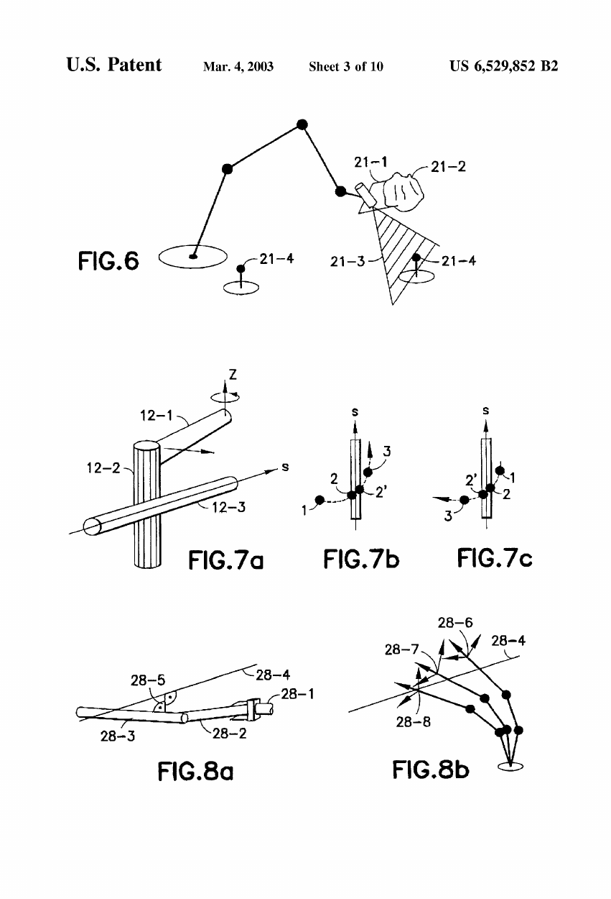
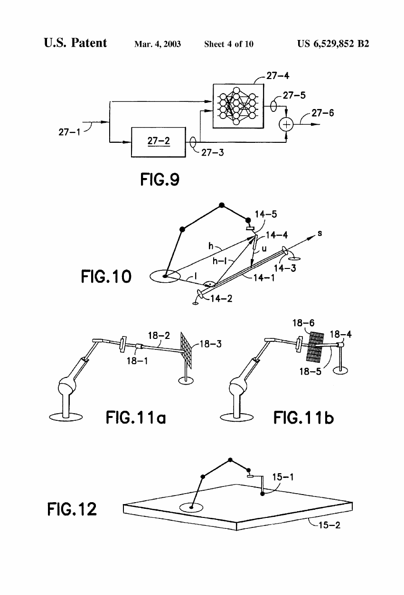
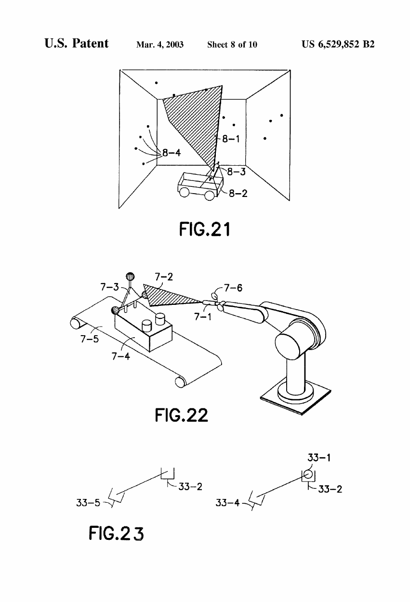

# US 6,529,852 B2 번역: 기구 위 이펙터의 자세 정확도 향상과 작업 공간 안 물체 측정 방법 및 장치

번역 범위: 전문(서지, 초록, 본문, 도면 설명, 청구항 31항). 인용 문헌 목록과 본문 안 참고 문헌 서지는 원문 그대로 둔다.
원문: [US6529852B2.pdf](US6529852B2.pdf) (공보 PDF 31쪽: 표지 1쪽, 도면 10장, 본문과 청구항 20쪽(1~40단)).
본문 텍스트 출처

- PDF 12~20쪽(본문 1~18단)은 PDF에 들어 있는 글자층을 `pdftotext`로 단별로 잘라 뽑았다.
- PDF 21~31쪽(본문 19~40단, 34단부터 청구항)은 글자층이 없는 그림 쪽이다. 300 dpi로 그림화해 tesseract OCR로 읽었다. OCR에서 깨진 기호(Δ, A_I, S_I 등)는 원본 그림을 확대해 맞췄다. 판독이 불확실한 곳은 [판독 불확실]로 표시했다.
- 원문의 오타(예: 19단 "parameter identification program 106")는 그대로 옮기고 [원문 그대로]로 표시했다.

## 서지

- (12) 미국 특허, Knoll 외
- (10) 특허 번호: US 6,529,852 B2
- (45) 등록일: 2003-03-04
- (54) 발명의 명칭: Method and Device for the Improvement of the Pose Accuracy of Effectors on Mechanisms and for the Measurement of Objects in a Workspace (기구 위 이펙터의 자세 정확도 향상과 작업 공간 안 물체 측정을 위한 방법 및 장치)
- (76) 발명자: Alois Knoll (캐나다 에드먼턴), Peter Kovacs (독일 베를린). 권리자 표기 없음(발명자 본인 출원)
- (*) 존속 기간 조정: 35 U.S.C. 154(b)에 따라 0일
- (21) 출원 번호: 09/855,101
- (22) 출원일: 2001-05-14
- (65) 선행 공개: US 2002/0013675 A1, 2002-01-31
- (63) 관련 미국 출원: PCT/IB99/01915 (1999-11-12 출원)의 일부 계속 출원(CIP)
- (30) 외국 우선권: 독일 198 54 011, 1998-11-12
- (51) 국제 분류: G06F 15/00
- (52) 미국 분류: 702/150, 702/127
- (58) 검색 분야: 702/150, 127; 700/262, 213, 166; 600/425; 414/795; 356/138, 614; 128/922; 901/16, 2, 47; 703/1, 6; 315/4, 800; 74/490; 345/854; 707/1; 709/315 (원문 표기가 일부 흐림)
- 심사관: John S. Hilten (주심), Xiuqin Sun (보조)
- 대리인: Cohen, Pontani, Lieberman & Pavane
- 청구항 31항, 도면 10장

(56) 인용 문헌 (원문 그대로, 심사관 인용 표시 *)

```
4,662,752 A  *  5/1987  Tucker et al. ............ 356/614
4,763,276 A  *  8/1988  Perreirra et al. ......... 700/254
4,831,549 A  *  5/1989  Red et al. ............... 700/254
5,177,563 A  *  1/1993  Everett et al. ........... 356/621
5,297,238 A  *  3/1994  Wang et al. .............. 700/254
5,951,475 A  *  9/1999  Gueziec et al. ........... 128/922
6,044,308 A  *  3/2000  Huissoon ................. 700/166
6,345,213 B1 *  2/2002  Graeser et al. ........... 219/124.34
```

(표지의 글자층이 단을 섞어 마지막 두 줄의 분류 번호 대응은 [판독 불확실].)

## (57) 초록

기구의 자세를 측정하는 장치와 방법이다. 기구(예: 산업용 로봇, 헥사포드)에 고정된 이펙터 물체가 적어도 하나 있고, 이 물체는 여러 축 가운데 하나를 따라 움직인다. 이펙터 물체의 이상적인 유효 형상은 점, 직선, 평면, 타원체, 원기둥, 쌍곡면 또는 이들의 조합이다. 움직이는 이펙터 물체는 기구에 대해 정해진 위치에 놓인 기준 물체와 상호작용한다. 이 상호작용은 알맞은 센서가 검출한다. 상호작용이 검출되면 그때의 기구 관절 구성만 정보 처리 장치로 보내 평가한다. 평가에는 그 밖의 측정량의 연속값이 필요 없다.

## 관련 출원

이 출원은 35 U.S.C. §111과 37 CFR §1.53에 따른, 국제 PCT 출원 PCT/IB99/01915(1999-11-12 출원, 2000-05-25에 WO 00/29175로 공개)의 일부 계속 출원이다. 독일 출원 198 54 011.6(1998-11-12 출원)의 우선권을 주장한다.

## 발명의 배경

### 1. 발명의 분야

이 발명은 공차가 있는 기구의 작업 공간 안 자세 정확도를 높이는 방법과 장치에 관한 것이다. 기구는 적어도 한 축으로 움직일 수 있고 이펙터를 가진다. 적어도 하나의 이펙터 물체가 이펙터에 고정되며, 기구의 적어도 한 축에 대해 편심(축에서 벗어난 자리)에 놓인다. 적어도 하나의 기준 물체가 기구에 대해 고정되도록 작업 공간에 놓인다. 측정 프로그램과 제어 프로그램을 가진 컴퓨터 시스템이 기구와 연결된다. 이펙터 물체와 기준 물체는 신호 발생기와 신호 검출기 쌍을 이루어, 적어도 이진 신호를 일으키고 검출할 수 있다. 검출기에 신호가 생기는 경우의, 발생기에 대한 검출기의 모든 신호 자세는 적어도 하나의 자명하지 않은 특성 방정식으로 나타낼 수 있다.

### 2. 관련 기술

기구의 자세 정확도를 높이는 방법은 여럿 알려져 있다.

FR-A-2 696 969는 로봇 마지막 마디에 레이저 빔을 달고, 로봇 가까이의 측정 평면을 기준으로 쓰는 보정 방법을 공개한다. 로봇은 레이저 빔이 측정 평면에 닿는 일련의 손 자세(더 구체적으로 정하지 않음)로 간다. 그 뒤 측정 평면 위 닿은 점의 좌표를 사진으로 구한다. 이 좌표와 해당 관절 구성, 측정 평면 자세의 추정값, 손에 대한 레이저 자세로부터, 뉴턴 관측 계산법의 변형(레벤버그-마쿼트 방법)으로 로봇 변수를 계산한다.

이 문헌의 주 실시예에서 측정 평면은 거울이나 불투명 투영막이다. 거울 앞에 놓인 카메라가 평면에 닿은 레이저 빔을 찍는다. 투영막 위 표식은 더 설명하지 않으며, 카메라와 투영막 사이 관계를 만드는 데 쓰는 것으로 보인다. 측정 평면을 광학 행렬 센서로 만들 수도 있다. 다른 실시예에서는 측정 순서를 두 번 찍는다. 두 측정 순서 사이에, 공구 지지점(예: 손 끝점)에 대한 위치가 알려진 다른 점에 레이저를 다시 달거나, 거울의 위치를 바꾼다. 방향은 언급하지 않는다. 바뀐 자세도 더 구체적으로 정하지 않는다. 다음 설명이 있다: 측정 순서를 생각 없이 고르면 변수 식별에 수학적으로 여러 값이 가능해질 수 있다. 이를 막으려고 거울 자세 두 가지를 제안한다. 문제는 레이저 빔 하나로는 손의 뿌리에 대한 레이저나 공구의 위치를 완전히 식별할 수 없다는 점이다. 또 공구 위치의 5번째, 6번째 변수를 구하려고 교차하는 레이저 빔 두 개를 쓴다. 게다가 카메라가 측정 평면의 상을 왜곡하므로 이 시스템은 부정확하다.

로봇 변수를 식별하려는 다른 시도는 Newman, Osborn, "A new method for kinematic parameter calibration via laser line tracking", Proc. Int. Conf. Robotics and Automation, USA, Atlanta (1993), p. 160-165에 있는 것으로 보인다. 여기서는 레이저 빔을 로봇 가까이 공간에 고정한다. 로봇 손에는 네 사분면으로 나뉜 평면 직사각형 광센서로 된 특수 검출기를 단다. 사분면은 한 중심점에서 만난다. 네 사분면 센서는 각각 밝기 값을 낸다. 로봇은 네 센서의 밝기가 같아지는 여러 측정 자세로 손을 차례로 옮긴다. 측정 자세의 관절 구성과, 손에 대한 레이저와 검출기 자세의 추정값으로부터 뉴턴 관측 계산법으로 로봇 변수를 계산한다. 저자들은 실험의 기본 구조를 설명하고, 관절 두 개짜리 2차원 로봇으로 원리를 모의한 결과를 보고한다. 이 방법으로는 모든 운동학 변수를 정할 수 없다. 특히 정해진 좌표계에 대한 로봇의 자세는 식별할 수 없고 무차원 변수만 식별되어, 로봇의 절대 크기 기준을 얻을 수 없다. 센서 평면이 레이저 빔에 수직이 아닐 때 3차원 공간에서 어떻게 해야 하는지도 설명하지 않는다.

작은 변수 변화의 재보정은 Zhong 외, "Autonomous robot calibration using a trigger probe", Robotics and Autonomous Systems, 18 (1996) S. 395-410에 있다. 로봇 근처에 서로 정확히 수직인 판 세 장을 고정한다. 로봇은 전방향 기계식 탐침을 잡고, 더 구체적으로 정하지 않은 일련의 손 자세로 가서 탐침이 판에 닿거나 탐침 내부 접점이 작동하게 한다. 해당 관절 구성은 신경망이 평가하며, 신경망이 로봇 변수를 결과로 내놓는다. 상대적인 변화만 알아내므로 이 방법으로는 참 크기를 정할 수 없다. 저자들도 로봇과 판 사이 참 거리 같은 정보가 빠져 있다고 밝힌다.

WO96/30171과 WO 93/11915는 산업용 로봇 운동 축의 보정 방법과 장치를 공개한다.

WO 96/30171에서는 로봇 작업 공간 안의 보정 빔(예: 레이저)과 그에 딸린 차단 검출기로 된 보정 장치를 쓴다. 로봇 손에는 반지름을 아는 구를 단다. 로봇은 구가 보정 빔을 가리는 일련의 손 자세(더 구체적으로 정하지 않음)로 간다. 해당 관절 구성, 로봇 자세의 추정값, 손에 대한 레이저 자세로부터 뉴턴-가우스 방법으로 보정 변수를 계산한다. 바람직한 실시예에서 보정 빔은 로봇 바닥이 정의하는 x-y 평면에 수직이어야 한다. 일부 예외를 빼면 축마다 보정 변수 6개를 계산한다.

보정 변수를 여러 번 계산하면 정확도를 높일 수 있다. 이때 보정 빔을 작업 공간의 여러 위치에 둔다. 그러면 여러 빔 자세에서 얻은 보정 변수의 평균을 보정 변수로 삼는다. 사용한 로봇 구성 사이의 차이를 가장 크게 하려고, 로봇에 보정 빔을 여러 개 달 수 있다. 빔 자세는 여러 측정 사이 로봇 구성의 차이가 가장 커지도록 고른다.

WO 93/11915에 따르면, 로봇 작업 공간에 옆면이 정확히 평행한 직육면체 보정체를 둔다. 로봇 손에는 반지름을 아는 구를 단다. 로봇은 구가 직육면체의 임의 한 면에 한 번 닿고, 다시 반대 면에 닿는 일련의 손 자세 쌍(더 구체적으로 정하지 않음)으로 간다. 설명과 이후 계산 방식으로 보아, 두 번째 닿는 점은 첫 점의 반대편 수선 위에 정확히 있어야 한다.

로봇 변수 계산은 반복 단계로 한다. 단계마다 먼저, 발명자가 찾는 모든 변수의 현재 근사값으로 해당 손 자세 쌍의 좌표 차를 구한다. 이 차의 제곱합이 알려진 직육면체 치수에서 나오는 목표값과 다르면 가우스-뉴턴 단계를 한 번 한다.

한 실시예에서 보정체는 로봇 바닥의 좌표축에 맞춰 놓아야 한다. 다른 실시예에서는 보정체 방향이 임의여도 된다. 추가된 방향 변수 3개를 식별하려면 식이 3개 더 필요한 것으로 보인다.

두 시스템 모두 정확한 값을 주지 못한다. 수학적, 운동학적 개념을 알아차리지 못했기 때문으로 보인다.

## 발명의 요약

이 발명의 목적은 목표 자세를 가능한 한 정확히 직접 제어하도록, 기구의 자세나 자세 정확도에 영향을 주는 모든 변수를 참 크기로 식별하는 개선된 방법과 장치를 주는 것이다. 또 다른 목적은 비용 대비 효용이 좋고, 전통적인 측정 기구, 작업 공간에 방해되는 보조물, 수동 교시를 쓰지 않는 자세 정확도 결정 방법과 장치를 주는 것이다.

또 이 발명의 방법과 장치는 기구 위 기준점의 정확한 자세를, 주변 환경에 대해, 작업 공간 안 물체에 대해, 또는 물체들 사이에서 참 크기로 정한다.

이 발명의 목적은 다음 방법으로 이룬다. 기구는 공차를 가진 채 적어도 한 축으로 움직이며 이펙터를 가진다. 적어도 하나의 이펙터 물체가 강체 연결로 이펙터에 붙으며, 기구의 적어도 한 축에 대해 편심이고, 위치와 방향에 공차가 있는 추정 자세에 놓인다. 적어도 하나의 기준 물체가 위치와 방향에 공차를 가진 채 작업 공간에 놓인다. 컴퓨터 시스템이 기구에 연결되며, 측정 제어 프로그램, 변수 식별 프로그램, 기구 제어 프로그램을 가진다. 이펙터 물체와 기준 물체는 이진 신호를 일으키고 검출하는 신호 발생 장치와 신호 검출기로 된 발생기/검출기 쌍을 적어도 하나 이룬다. 신호 검출기에 신호가 생기는, 발생 장치에 대한 신호 검출기의 모든 신호 자세는 적어도 하나의 자명하지 않은 특성 방정식으로 나타난다. 방법은 다음 단계를 포함한다.

(a) 적어도 하나의 발생기/검출기 쌍에 대해 유한 개의 근접 자세로 된 근접 순서 N을 고른다. 각 근접 자세는 각각 한 신호 자세 근처에 있다. 근접 순서 N은 다음 기준을 만족하도록 고른다.
D_G(N) ≥ D_G(A_I)/15 이고, 임의 직선 G 위에서 N을 G에 투영한 점들 가운데 이웃한 두 점 사이 거리는 최대 D_G(N)/4 이다. 여기서
  - D_G는 집합 A_I의 각 부분집합을, 그 부분집합을 G에 투영한 점들 가운데 G 위에서 서로 가장 먼 두 점 사이 거리로 보내는 함수다.
  - A_I는, 공차가 있는 알려진 기구 모델을 바탕으로 기초 운동학 계산에서 나오는, 주어진 기구가 닿을 수 있는 모든 이펙터 자세의 공간이다.
  - G는 S_I의 점을 적어도 두 개 포함하는 임의 직선이다.
  - S_I는 A_I의 부분집합으로 근접 자세의 공간을 뜻한다. 공차가 있는 알려진 기구 모델의 변수값, 공간 안 기준 물체의 추정 자세, 기구 위 이펙터 물체의 추정 자세로 수학 계산을 했을 때 신호가 기대되는 모든 이펙터 물체 자세의 모임이다.

(b) 각 근접 자세에 대해, 이펙터 물체나 기구를 단순한 탐색 알고리즘으로 움직여 신호 자세가 검출될 때까지 가까운 신호 자세를 차례로 찾는다.

(c) 단계 (b)에서 검출되면 그 순간의 기구 관절 구성을 컴퓨터 시스템에 넘기고 자료 기록으로 저장한다.

(d) 변수 식별 프로그램으로, 기구의 자세 정확도에 영향을 주는 변수와 사용자가 정한 그 부분집합의 참값을 식별한다. 이때 모든 길이 변수의 식별에 축척 계수를 쓴다.

축척 계수는 이펙터 물체를 원소 수가 정해진 두 자세 집합 A와 B로 옮겨 식별할 수 있다. 이때 A의 자세와 B의 자세 사이 거리 정보를 안다. 또는, 적어도 하나의 이펙터 물체와 적어도 두 개의 기준 물체로 된 보정 물체 세 개 이상으로 축척 계수를 식별할 수 있다. 이펙터 물체는 서로 상대 자세를 아는 두 기준 물체에 대해 각각 신호 자세로 옮겨진다. 또는 보정 물체 세 개가 적어도 두 개의 이펙터 물체와 적어도 하나의 기준 물체로 이루어질 수도 있다. 이때 서로 상대 자세를 아는 두 이펙터 물체를 적어도 하나의 기준 물체에 대해 신호 자세로 옮긴다.

자세 집합 A와 B 사이, 또는 각 위치, 보정 물체, 이펙터 물체 사이 거리는 오차 감쇠를 위해 작업 공간 지름 Δ의 1/6보다 크게, 바람직하게는 3/4 Δ로 한다. 작업 공간 지름은 G가 모든 직선을 돌 때 D_G(A_I)의 최댓값으로 정의한다. 거리를 정할 때는 평균 계산을 한다.

이 방법은 기구 전체나 기구 일부 구간의 완전 재보정 또는 부분 재보정에 쓸 수 있다.

일반적으로 보정 물체라 부르는 기준/이펙터 물체 쌍의 예는 다음과 같다. 두 역할은 서로 바꿀 수 있다.

- i) 신호 검출기와 곧은 전자기파 / 원기둥 차단 막대
- ii) 신호 검출기와 전기가 통하는 선 / 접촉 막대
- iii) 레이저 빔 / 빛에 반응하는 행렬 면
- iv) 전기가 통하는 평면 / 전도성 접촉 막대
- v) 회전축 위 접촉 문턱이 있는 안내 / 회전축 위 안내되는 막대
- vi) 점 모양이나 평면 신호 검출기 / 전자기파 평면
- vii) 쐐기 모양 전자기파 / 여러 신호 검출기

이 발명의 목적은 다음 장치로도 이룬다. 기구의 자세 정확도를 높이고 작업 공간 안 물체의 자세를 측정하는 장치는, 측정 제어 프로그램, 변수 식별 프로그램, 기구 제어 프로그램을 가진 컴퓨터 시스템과, 적어도 한 축으로 움직이고 이펙터를 가진 기구를 포함하며, 기구는 컴퓨터 시스템에 연결된다. 보정 물체로 된 장치 쌍이 적어도 하나 있다. 한 쌍은 이펙터에 강체로 붙고 기구의 적어도 한 축에 대해 편심으로 달린 이펙터 물체와, 작업 공간에서 기구에 대해 고정된 기준 물체로 이루어진다. 각 쌍은 이진 신호의 신호 발생 장치와 신호 검출기로 이루어진다. 장치는 축척 계수를 정하는 설비도 포함한다.

이 장치는 기구와 작업 공간 안 물체의 자세를, 절대적으로 또는 서로에 대해 상대적으로 측정하는 방법에 쓴다.

이 발명의 목적은 다음 방법과 장치로도 이룬다. 공차를 가진 채 적어도 한 축으로 움직이며 이펙터를 가진 기구가 있다. 적어도 하나의 이펙터 물체가 강체 연결로 이펙터에 붙으며, 기구의 적어도 한 축에 대해 편심이고, 위치와 방향에 공차가 있는 추정 자세에 놓인다. 작업 공간에는 비물질(빛 같은) 기준 물체가 적어도 하나, 위치와 방향에 공차가 있는 추정 자세로 기구에 대해 고정되어 있다. 측정 제어 프로그램과 기구 제어 프로그램을 가진 컴퓨터 시스템이 있다. 이펙터 물체와 기준 물체는 적어도 이진 신호를 일으키고 검출할 수 있는 발생기/검출기 쌍을 이룬다. 검출기에 신호가 생기는, 발생 장치에 대한 검출기의 모든 신호 자세는 적어도 하나의 자명하지 않은 특성 방정식으로 나타난다. 방법은 다음 단계를 포함한다.

- (a) 목표 자세에 이웃한 기준 물체에 놓인 이펙터 물체의 근접 자세를 적어도 하나 포함하도록 근접 순서 N을 고른다.
- (b) 적어도 하나의 근접 자세에 대해, 이펙터 물체나 기구를 단순한 탐색 알고리즘으로 움직여 가까운 신호 자세 하나를 검출로 차례로 찾는다.
- (c) 그 순간의 기구 관절 구성을 컴퓨터 시스템에 넘기고 자료 기록으로 저장한다.
- (d) 컴퓨터 시스템으로, 각 자료 기록에 대해 제어기가 현재 아는 기구 변수로 수학적으로 계산되는 작업 공간 안 기구의 잘못된 자세를 계산한다.
- (e) 신호 자세와 해당 잘못된 자세의 차이로부터, 기초 보간 절차와 기초 오차 보상 알고리즘으로 보정 이동을 계산한다. 이 보정 이동은 기구 제어가 실제로 향한 자세와 목표 자세 사이의 차이를 보상한다. 잘못된 자세와 신호 자세 사이 보정 이동 계산에는, 정확히 아는 기준 물체 자세에서 정한 스칼라 계수를 쓴다.

정리하면, 이 발명은 일반 기구의 자세 정확도에 영향을 주는 변수를 매우 좋은 비용 대비 효용으로 효율적이고 정밀하게 식별한다.

이 발명에서는 기구에 이미 있는 센서(관절 인코더)와, 기본 동작 원리상 가장 단순한 이진 센서나 검출기로 될 수 있는 가장 단순한 추가 측정 장치를 쓴다.

이와 별도로, 재보정에서 변수의 일정 부분집합만 효율적으로 식별하는 과제(예: 마모로 운전 중 다른 변수보다 빨리 변하는 것으로 알려진 변수)도 푼다. 이것으로 종래 기술보다 상당한 비용을 아낄 수 있다.

산업 현장에서는 작업 셀의 공간 위치에 대한 기구 자세의 식별이 특히 중요하다.

이 발명의 방법은 학습 시스템으로 더 보조할 수 있다. 학습 시스템은 보정 과정의 남은 오차를 스스로 알아내고, 실제 기구에서 훈련해 기구 제어에서 이 오차를 보상한다. 학습 시스템을 전체 과정에 완전히 통합할 수 있어, 이전의 따로 떨어진 해법보다 학습 시스템의 효율이 크게 오른다.

보정과 비슷한, 여기서 보간이라 부르는 방법을 자세 정확도의 대안 또는 추가적인 국소 개선에 쓴다. 추가 장치는 필요 없다.

기구 보정 말고도, 이 발명 방법의 한 특정 변형은 다음 과제를 제한된 일회성 준비 비용과 극히 낮은 장치 비용으로 푼다: (꼭 보정되지 않아도 되는) 기구의 이펙터 자세를 기준 물체나 기준 좌표계에 대해 정밀하게 식별하기, (꼭 보정되지 않아도 되는) 기구의 이펙터에 대한 작업물 자세 식별하기, 임의 물체나 기구들 사이의 자세 식별하기.

이 발명 방법을 특수화하면, 보정에 특히 맞는 장치와 방법(기준 물체 약 2~4개로 제한)이나, 자세 측정에 특히 맞는 장치와 방법(특수한 한 축 측정 기구와 특수 기준 물체를 설계해 이를 통해 간접적으로 임의 물체 사이 자세를 식별)을 얻을 수 있다.

이 형상 맞춤 방법이 이전 보정 방법보다 나은 점은 실제 적용에서 적어도 다음과 같다.

- 측정 장치를 상상할 수 있는 가장 단순하게 설치한다.
- 측정 장치 자체의 보정이 필요 없다.
- 측정 구성이 극히 단순해 비용이 가장 낮고 정비가 쉽다.
- 비접촉 측정이 가능해 측정 구성이 닳지 않는다.
- 최소 준비 비용으로 보정을 할 수 있어 자주(예: 매일) 반복할 수 있다.
- 기구의 전체 수명 동안 절대 정확도를 보장한다.
- 측정 구성을 기구 안에 완전히 통합할 수 있어 작업 공간에 추가 설비가 필요 없다.
- 기구의 일부 구간만 보정할 수 있어 시간을 크게 아낀다.

이로써 보정이 필요한 기구의 사용자는 비용과 인력을 크게 아끼면서도 기구의 높은 정확도와 그에 따른 높은 조작 품질을 보장받는다. 예를 들어 산업용 로봇에서는 높은 생산 품질로 이어진다.

이제 이 발명의 방법을 자세히 설명한다. 이때 개별 장치, 설비, 방법 단계, 용어를 기능과 연결해 설명한다. 요약된 추상 설명보다 이해하기 쉽기 때문이다.

이 발명의 다른 목적과 특징은 첨부 도면과 함께 아래 상세한 설명에서 드러난다. 다만 도면은 설명만을 위한 것이며 발명의 한계를 정하지 않는다. 한계는 첨부한 청구항을 보아야 한다. 도면은 반드시 축척대로 그린 것이 아니며, 따로 적지 않으면 여기 설명한 구조와 절차를 개념적으로 보여줄 뿐이다.

## 도면의 간단한 설명

- 도 1: 알려진 길이의 길이 기준과 기구로 축척 계수를 식별하는 모습(한 실시예).
- 도 2: 기구와 거리를 아는 두 기준 물체로 축척 계수를 식별하는 모습.
- 도 3: 축척 계수 식별을 위해 기구의 이펙터에 이중 이펙터 물체를 단 모습.
- 도 4: 옆에서 힘을 받은 빔의 변형.
- 도 5: 평행하지 않은 보정 물체로 자세 정확도를 정하는 모습.
- 도 6: 동시 보정을 위해 기구에 이펙터 물체를, 그리고 비물질 기준 물체를 배치한 모습.
- 도 7a: 차단 막대. 도 7b, 7c: 도 7a 차단 막대의 가능한 운동 궤적.
- 도 8a, 8b: 이펙터에 붙인 빔과 차단기로, 기준 물체에 대한 잔차와, 원하는 자세와 실제 자세의 차이를 정의하는 모습.
- 도 9: 보정 오차를 보상하는 신경망을 가진 관절 값 제어기의 블록도.
- 도 10: 레이저와 광검출기를 기준 물체로 쓰는 실시예.
- 도 11a, 11b: 레이저와 행렬 카메라를 이펙터 물체와 기준 물체로 서로 바꿔 쓰는 실시예.
- 도 12: 판을 기준 물체로, 전도성 막대를 이펙터 물체로 쓰는 실시예.
- 도 13: 통 안의 액체 표면을 기준 물체로 쓰는 실시예.
- 도 14: 망원경식 시스템 실시예. 도 14a: 도 14 망원경식 시스템의 단면.
- 도 15: 빛 평면과 집광 렌즈를 보정 물체로 쓰는 실시예.
- 도 16: 빛 평면(방사 평면)과 점 모양 센서(광검출기) 두 개를 보정 물체로 쓰는 실시예.
- 도 17: 빛 쐐기와 광센서를 보정 물체로 쓰는 실시예.
- 도 18: 기구의 이펙터가 이펙터 물체를 골라 집는 실시예.
- 도 19a, 19b: 기구의 일부인 기준 물체.
- 도 20: 작업 셀의 일부인 기구와, 작업 셀 좌표계에 대한 그 자세.
- 도 21: 단순한 기구와 셀에 퍼진 많은 검출기로 자율 기구(차량)의 자세를 식별하는 실시예.
- 도 22: 작업물 자세를 측정하는 다른 배치.
- 도 23: 자세의 보간.
- 도 24: 신호 자세에서 이펙터 물체의 회전축과 회전, 병진 운동 방향을 가진 신호 공간.
- 도 25: 이펙터 위치 식별을 위해 삼각대를 이펙터 물체로 쓰는 또 다른 실시예.
- 도 26: 온도 센서를 가진 이펙터 단면.
- 도 27a, 27b: 토크 센서를 가진 이펙터 단면의 무부하, 부하 상태.

## 바람직한 실시예의 상세한 설명

도면으로 발명을 설명하기 전에, 명세서에서 쓰는 개념과 발명 특징을 다음과 같이 풀이한다.

### 자세, 작업 공간, 작업 공간의 차원

임의 물체나 좌표계의 자세는 기준 좌표계에 대한 그 위치와 방향을 정한다. 작업 공간은 특정 기구의 이펙터(손 또는 그리퍼, 끝단 이펙터라고도 함)가 차지할 수 있는 자세들의 공간이다. 전형적인 산업용 로봇에서는 이펙터의 위치를 시각 공간의 세 차원 모두로 바꿀 수 있다. 또 보통 두세 축 회전으로 이펙터 방향을 바꿀 수 있다. 작업 공간의 차원은 그림으로(정확히는 선형대수나 대수기하로) 정의하며, 전형적인 산업용 로봇은 변수 6개, 때로 5개로 정의된다.

### 기구의 관절 구성

관절 구성은 기구 관절 값의 완전한 묶음이다. 회전 관절의 관절 값은 회전각이고, 직선(미끄럼) 관절의 관절 값은 변위다. 회전 관절 6개를 가진 전형적인 산업용 로봇의 관절 구성은 회전각 6개다. 관절 구성 하나가 로봇 그리퍼(끝단 이펙터)의 자세를 정한다.

다음 새 용어 정의가 발명 목적의 서술을 돕는다.

### 신호 자세, 신호 구성, 신호 공간

신호 자세는 검출기에 신호가 생기는, 기준 물체에 대한 이펙터 물체의 자세다. 신호 구성은 이펙터 물체를 신호 자세에 두는 특별한 관절 구성이다. 신호 공간은 신호를 일으키는 이펙터 물체의 모든 자세, 즉 이펙터 물체의 모든 신호 자세의 공간(정확히는 대수 다양체)이다. 이때 이펙터는 주어진 특정 기구에 강체로 달려 있어야 한다. 여기서 모든 외부 장애물, 관련 물체끼리의 물리적 관통, 검출기나 신호 발생 장치의 점진적 제약(예: 광검출기의 구경이 제한됨)은 [판독 불확실: 원문 "may be derived", 문맥상 "무시할 수 있다"로 보임]. 문맥에 따라 기구의 위치를 무시하거나 검출기나 발생기의 제약을 포함한다. 후자의 경우 신호 공간은 보정 물체(검출기나 발생기)의 치수에 따른다.

### 측정 자세, 측정 구성, 측정 순서, 측정

측정 구성은 닫힌 보정 또는 보간(즉 축척 계수 결정) 과정에서 기구가 실제로 차지하는 신호 구성이다. 측정 자세는 검출기에 신호를 일으킨다. 측정 자세는 보정이나 보간 중 쓰인 측정 구성의 자세다. 측정 순서는 닫힌 보정이나 보간 과정에서 기구가 실제로 차지한 모든 측정 자세의 모임이다. 여기서 측정이라는 말은 흔히 첫 번째 해법의 두 공정 단계로 된 닫힌 순환이라는 특별한 뜻으로 쓴다. 곧, 이펙터 물체를 근접 자세로 옮기고, 신호 자세를 찾고, 신호가 생기면 그에 응해 해당 관절 구성을 컴퓨터 시스템에 저장하는 일이다.

### 기구, 자세 정확도

이 발명의 기구는 관절로 서로 이어진 강체 링크로 이루어진다. 관절은 보통 구동되거나 수동인 회전 관절, 직선 관절, 또는 이들의 조합이다. 이 발명의 방법은 주로 관절 6개를 가진 전형적인 산업용 로봇이나 이른바 트라이포드, 헥사포드에 쓴다. 기구는 보통의 로봇 그리퍼나 원하는 임의 공구일 수 있는 이펙터를 가지며, 그 도달 범위가 기구의 작업 공간을 정한다.

기구의 기하는 이른바 운동학 변수, 예를 들어 팔 링크의 일정한 길이로 나타낼 수 있다. 이 변수는 Denavit-Hartenberg 변수나 Hayati 변수로 나타낸다. 예: Schroer의 책 "Identifikation von Kalibrationsparametern kinematischer Ketten"(운동학 사슬의 보정 변수 식별), Hanser 출판사, 뮌헨, 독일, 1993. 발명자들은 그 내용을 인용으로 이 설명에 포함한다. 운동학 변수 말고도, 관절 탄성, 빔 탄성, 백래시 같은 비운동학 변수도 이펙터 자세에 영향을 준다(Schroer). 요약하면 운동학 변수와 비운동학 변수를 함께 기구 변수라 부른다. 기구 변수를 알면, 이펙터를 원하는 자세로 옮기기 위한 원하는 목표 자세의 관절 구성(관절각과 관절 변위)을 계산할 수 있다. 이 변수들의 실제값은 생산 공차 때문에 정확히 알 수 없다. 그래서 기구 제어는 보통 제조사가 준 정보에 바탕한 이상적인(설계) 변수를 쓴다. 이상 변수값으로 계산한 이펙터 자세는 실제 원하는 자세와 어긋난다. 첫째 기구의 어긋남이 평균적으로 둘째 기구보다 작으면, 첫째 기구의 자세 정확도가 둘째보다 높다고 한다. 자세 정확도를 높이려고 기구의 실제 변수를 식별하는 일을 보정이라 한다.

종래 기술에서는 "위치 정확도"라는 말을 자주 쓴다. 그러나 이 명세서에서는 자세 정확도라는 말을 쓴다. 자세는 위치와 방향으로 정의되기 때문이다.

### 보정 물체

이 발명의 공정에 따르면 기구는 여러 보정 물체와 함께 동작한다. 보정 물체는 적어도 하나의 이펙터 물체와 적어도 하나의 기준 물체를 포함하며, 이펙터 물체와 기준 물체 한 쌍이 각각 신호 검출기와 신호 발생 장치를 포함하는 발생기/검출기 쌍을 이룬다. 이 발명의 실시예와 장치에서 물체라는 말은 하드웨어 구현에 쓴다. 예를 들어 다음 발생기/검출기 쌍을 제안하고, 공정 용어와 장치 부품의 관계를 적는다.

- i) 원통 렌즈로 만든 레이저 빛 평면 / 광검출기 또는 라인 스캔 카메라
  - 예: ILEE(미국)의 레이저 다이오드 모듈 LDA1015와 원통 렌즈 ILEE 1:4 또는 1:1, Vistek(독일)의 라인 스캔 카메라 703/M
  - 다른 구현: 레이저 빔의 주기적 이동 또는 회전 다각 거울
- ii) 레이저 빔 / 광검출기 또는 행렬 카메라
  - 예: ILEE(미국)의 레이저 다이오드 모듈 ILE-LDA1015, Conrad(독일)의 초소형 흑백 행렬 카메라 모듈 번호 11 51 93, Sitek(스웨덴)의 위치 감지 Si 검출기 PSD 2L30
- iii) 광 차단기 / 원기둥 차단 막대
  - 예: Wenglor(독일)의 광 차단기 YD50
- iv) 전기를 건 선 / 전도성 원기둥 접촉 막대
- v) 전기를 건 수평 판 또는 액체 표면 / 전도성 접촉 끝 또는 접촉 원뿔
- vi) 전기 또는 광 접점을 단 직선 관절 반쪽 / 접점 장치를 단 다른 직선 관절 반쪽. 관절이 일정 변위에 이르면 접촉이 생긴다.

어느 보정 물체가 발생기이고 어느 것이 검출기인지는 대개 자유롭게 정할 수 있다. 다만 한쪽이 실현 불가능한 경우도 있다. 예를 들어 액체를 채운 통은 이펙터 물체가 되기 어렵다.

각 이펙터 물체는 붐(팔)으로 이펙터에 단다. 붐은 기구 관절 축에 대한 편심을 만든다. 그렇지 않으면 개별 기구 변수의 식별이 실패할 수 있다. 좌표계에 대한, 이펙터에 대한 이펙터 물체의 정확한 장착 자세는 정확히 알 필요가 없고 추정하면 된다.

기준 물체는 이펙터 물체가 닿을 수 있도록 고정 배치하거나 장착한다. 기구 바닥에 대한 기준 물체의 자세도 정확히 알 필요가 없다.

보정 중 식별되는 모든 변수를 보정 변수라 부른다. 기구 변수 말고도, 보정이 끝난 뒤에는 관심이 없거나 자세 정확도에 영향을 주지 않는 다른 변수도 정해진다. 그 다른 변수는 대개 기준 물체의 자세 변수뿐이다. 이 자세 변수는 반드시 기구 변수와 함께 식별해야 한다. 보정 중 어떤 변수를 알고 있다고 가정해 식별하지 않으면, 그 경우에는 보정 변수에 넣지 않는다.

기본 동작 원리에 따라 검출기는 언제나 가장 단순한 이진 센서여도 된다. 다만 앞서 말한 신호 자세 탐색이나 탐색 알고리즘을 쉽게 하려고, 빛에 반응하는 선이나 면, 즉 라인 스캔 카메라, 행렬 카메라, CCD 카메라 같은 이진 센서 배열을 검출기로 쓸 수 있다.

### 프로그램을 가진 컴퓨터 시스템

발명에 따른 보정에는 컴퓨터 시스템이 필요하다. 여기에는 기구 제어 프로그램, 로봇의 측정 자료 수집을 제어하는 측정 흐름 프로그램, 관측 계산의 수학 알고리즘으로 측정 자료에서 보정 변수를 계산하는 변수 식별 프로그램이 들어 있다.

보정 뒤, 식별된 정확한 기구 변수는 기구를 더 정밀하게 제어하는 데 쓴다. 이를 위해 변수를 기구 제어 프로그램에 넘긴다. 기구 제어 프로그램은 이 변수로 이펙터의 원하는 목표 자세에 대한 개선된 관절 구성을 계산한다. 그래서 이후 목표 자세에 가려는 시도는 보정 전보다 정확해진다.

### 특성 방정식

이 발명의 발생기/검출기 쌍은 신호가 아무 자세에서나 생기지 않고 특정 자세에서만 생긴다는 특징이 있다. 변수 식별, 곧 관측 계산을 하기 위해, 보정 변수와 신호 구성 사이 관계를 보정 물체의 형상에서 나오는 특성 방정식으로 나타낸다. 먼저 기구가 정하는 이펙터 물체 자세의 제약을 잠시 떼어 놓고 보면, 특성 방정식의 기본 형태는 보정 물체의 형상에서 바로 나온다. 위 실시예들에서는 다음 단순한 기하 신호 조건이 나온다.

- i) 공간 안 평면과 점의 교차
- ii) 공간 안 직선과 점의 교차 (식 2개)
- iii) 공간 안 두 직선의 교차
- iv) 공간 안 평면과 점의 교차 (구가 평면의 어느 쪽에 있는지 정한 뒤에는, 평면과 구의 접촉을 구의 반지름만큼 옮긴 구 중심점과 평면의 교차로 모델링할 수 있다)
- v) 공간 안 두 점 사이 거리가 일정함

각 특성 방정식의 한쪽은 발생기의 자세를, 다른 쪽은 발생기에 대한 검출기의 자세를 나타낸다. 다음 단계에서 구체적인 기구의 제약을 고려에 넣는다. 이를 위해 기본 방정식에서 이펙터 물체의 자세를 나타내는 변수를, 해당 관절 구성의 관절 변수와, 기구의 기하 구조를 모델링하는 정확히 모르는 일정한 기구 변수, 그리고 관절 탄성 같은 비운동학 현상으로 표현한다. 이펙터 바닥에 대한 이펙터 물체의 자세 기술도 기구 변수에 넣는다. 발생기와 검출기 자세를 나타내는 변수를 이 표현으로 바꾸면 최종 특성 방정식을 얻는다. 기준 물체는 작업 공간에 고정되므로 그 자세(변수)를 다른 양으로 표현할 필요가 없다. 특성 방정식의 완전한 묶음은 식별할 모든 보정 변수를 담는다.

이 발명의 공정에 맞는 발생기/검출기 쌍은 (단순한) 특성 방정식이 있는 쌍이다. 예를 들어 전구와 광검출기는 맞지 않는다. 광검출기가 광원에서 완전히 돌아서지 않는 한 늘 빛을 받기 때문이다.

이 발명의 대상인 형상 맞춤 보정 방법은 특성 방정식 면에서, 비싼 전통 측정 장치로 하는 전통 보정 방법과 근본적으로 다르다. 전통 보정 방법에서는 이펙터의 모든 자세가 측정 자세가 될 수 있다. 예를 들어 모든 이펙터 자세를 경위의 시스템으로 잴 수 있다. 엄밀한 수학으로 말하면, 이런 방법의 특성 방정식은 자명하다(예: 0=0)고 할 수 있다.

형상 맞춤 보정 방법의 여러 실시예는 특성 방정식 전체가 같으면 서로 가까운 관계다.

### 근접 순서

이 발명의 과제는 보정할 기구에 고정한 이펙터 물체를 여러 신호 자세로 옮겨 푼다.

신호 자세는 정확히 알려져 있지 않다. 그래도 제조사가 준 공차 있는 기구 변수값, 공차의 영향을 받은 추정값, 또는 모든 보정 변수의 측정값을 바탕으로, 특성 방정식으로 신호 자세 가까이 있는 이펙터 자세를 계산할 수 있다. 특성 방정식으로 계산한 이 자세를 근접 자세라 부른다.

보정이 성공하려면 측정 순서, 즉 신호 자세가 일정 기준을 만족해야 한다. 이 발명에 따르면 질적으로 새로운 기준을 계산 가능한 근접 자세에 대해서만 세우면 충분하다. 이를 가정해 찾은 신호 자세는 근접 자세와 가까우므로 그 기준을 만족한다. 어떤 근접 자세에 대해 신호 자세를 찾지 못하면 그 근접 자세는 다음 단계에서 그냥 버린다.

첫째 기준은 작업 공간 안에서 근접 자세가 충분히 퍼지도록 한다. 둘째 기준(첫째보다 덜 중요하다)은 충분히 고르게 분포하도록, 즉 불리하게 몰리지 않도록 한다. 이 기준을 설명하기 위해, 이제부터 자세를 (로봇공학에서 흔하듯) 6차원 작업 공간의 점으로도 본다. 두 기준 모두 작업 공간에서 원하는 임의 직선 G를 고르는 데 바탕한다. G의 유일한 요건은 S_I의 자세 두 개를 포함하는 것이다. 이는 뒤에서 설명한다. 첫째 기준 D_G(N) > D_G(A_I)/15는 대략, 직선 G 방향으로의 근접 순서(와 가까이 있는 신호 자세)의 퍼짐이 같은 방향의 작업 공간 퍼짐의 약 1/15이어야 한다는 뜻이다. 이는 모든 직선, 특히 기준 좌표계의 축에도 S_I의 자세를 둘 이상 포함하는 한 성립해야 한다. 예를 들어 Z축 방향 작업 공간 퍼짐(Z축으로의 투영)이 1500 mm이면, N 안에 Z 좌표 차이가 100 mm인 근접 자세가 적어도 두 개 있어야 한다.

둘째 기준에 따르면, N을 직선 G에 투영한 점들 가운데 이웃한 두 점 사이 거리는 최대 D_G(N)/4여야 한다. 이 둘째 기준을 이하 분포 기준이라 부른다. 위 예에서 분포 기준은, N 안의 원하는 근접 자세마다 Z 좌표가 그것과 최대 100/4 = 25 mm 다른 근접 자세가 하나 더 있어야 한다고 요구한다.

직선 G는 S_I의 자세 두 개를 포함해야 한다. 그렇지 않으면 G가 S_I에 수직일 수 있다. 그 경우 D_G(N) = 0이 되어야 한다. 이는 평면을 그에 수직인 직선에 투영하면 투영점이 하나로 모이고, 따라서 가장 먼 투영점 사이 거리가 0이어야 한다는 것과 아주 비슷하다.

이 발명 방법은 두 기준을 만족하라고만 요구하며 근접 순서를 어떻게 고르는지는 말하지 않는다. 원하는 임의 선택 체계로 골라도 되고, 근접 자세를 무작위로 골라도 된다.

실제 적용에서 두 기준의 충족을 꼼꼼히 확인할 필요는 없다. 즉, 수학적으로 진짜 측정을 하고, 작업 공간의 자연스러운 계량과 스칼라곱을 정하는 계산을 하고, 근접 순서의 투영을 구할 필요는 없다. 핵심 주장은 오히려, 이것이 실제로 좋은 결과를 얻으려면 최적화해야 할 결정적 기준이라는 것이다. 언급한 최악 한계값 대신 기준의 가장 좋은 한계값에 가까워지도록 N과, 해당하면 보정 물체 치수를 고르면, 변수와 자세의 정확도는 실제로 얻을 수 있는 최대값을 향해 점근적으로 높아진다. 즉

D_G(N) > D_G(A_I) 이고 (부차적으로) 이웃한 근접 자세 n_i, n_j에 대해 D_G({n_i, n_j}) > 0 [판독 불확실: 원문 "DG({nD nj})>0"]

여기서 기준의 최대화는 실용 설계 지침으로 보아야 한다. 수학 위상수학의 기본 개념인 N의 볼록 껍질로 기준과 설계 지침을 더 분명히, 다만 정량화하지 않고 표현할 수 있다. 점 집합의 볼록 껍질은 간단히, 점 집합을 팽팽하게 감싼 천으로 볼 수 있다. 간단히 말해, 기준의 가장 좋은 한계값을 얻으려면, 지금 "빈틈"이 있는 곳(N을 직선 G에 투영한 것이 다른 직선만큼 기준을 넉넉히 만족하지 못하는 곳)에 따라 N의 볼록 껍질 밖이나 안에 근접 자세를 더 고른다. 두 기준은 다음처럼 쓸 수 있다: N의 볼록 껍질의 차원은 신호 공간의 차원과 같아야 하고, 그 부피는 (신호 공간의 각 차원에 대해) 가능한 한 커야 하며, 근접 순서나 측정 순서는 볼록 껍질 안에 비교적 고르게 퍼져야 한다.

근접 자세가 차원 기준을 어기면, 다른 조건이 이상적이어도(즉 수학 모의에서 모든 측정 오차와 실무 부정확을 빼도) 형상 맞춤 방법이 대개 완전히 무너진다. 이 기준을 고려하는 것이 이 발명 방법의 핵심 원칙 가운데 하나다.

기준의 최악 한계(앞서 말했듯 그 정량화는 실무에서 중요하지 않다)는 붐 하나와 검출기 쌍 하나에 근접 순서 하나인 경우에 대해, 관련된 모든 보정 변수를 식별하는 경우로 구해 적었다. 더 적은 변수를 식별하면 기준은 그 수에 비례해 약해진다. 근접 순서가 여럿(N_1, N_2, N_3, ...)이면 기준 D_G(N) > D_G(A_I)/15의 N을 모든 N_i의 합집합으로 바꿔야 한다. 분포 기준은 각 N_i마다 만족해야 한다.

기준에 따른 최적화는 점근적 효과를 가진다. 즉 이 기준을 향한 단순한 전략이 실무에서 좋은 결과를 내며, 공들인 복잡한 전략 개선은 정확도를 거의 눈에 띄게 높이지 못한다.

이 발명의 기준을 모르면, 근접 순서를 잘 생각해 골라도 대개 기준 충족에 실패한다. 가까운 관계의 방법 실시예 대부분에서 신호 공간이 5차원이어서 더는 쉽게 파악할 수 없기 때문이다. 그래서 다른 기준이나 알고리즘으로 측정 순서를 고르면 차원 기준을 자주 어긴다. 적힌 하한 가까이에서는 변수 정확도나 자세 정확도가 급격히 나빠지거나 변수 식별이 무너진다.

기준을 알면, 위 설계 지침이 보여주듯 맞는 근접 순서 고르기는 언제나 쉽다. 다만 큰 예외가 하나 있다. 이 발명 방법의 일부 실시예에서는 보정 물체의 치수가 신호 공간 크기에 영향을 준다. 기준 c), d)를 모르고 이 치수를 부족하게 고르면, 다음 경우 방법은 실패할 수밖에 없다.

[원문의 식이 그림 쪽에서 빠짐: 문맥상 D_G(S_I) < D_G(A_I)/15 인 경우]

정의상 자명하게 D_G(N) ≤ D_G(S_I)이기 때문이다. 이 경우 방법은 결코 성공을 보장하지 않는다.

이펙터 물체가 차단기이고 기준 물체가 레이저 광 차단기인 실시예로 이 예외를 보일 수 있다. 작업 공간 지름이 약 160 cm인 흔한 산업용 로봇(예: Staubli(스위스)의 Puma 560, 팔을 뻗은 길이 80 cm, 거의 구 모양 작업 공간)을 보정하고, 길이 10 cm인 차단 막대를 쓴다고 하자. 로봇(이펙터)이 신호 자세에 있고, 방향을 일정하게 둔 채 차단 막대와 겹치는 직선 G를 작업 공간에 놓는다고 하자. 그러면 G 위 10 cm 구간 안의 모든 이펙터 자세가 신호 자세다. 따라서 D_G(N) = D_G(S_I) = 10 cm 이다.

D_G(A_I) = 160 cm 이면

[원문의 식이 빠짐: 문맥상 10 cm < 160 cm/15 ≈ 10.7 cm]

따라서 기준 D_G(N) > D_G(A_I)/15를 어긴다.

다른 예로, 기준 물체가 광 차단기이고 이펙터 물체가 구인, 종래 기술에서 알 수 있는 실시예가 있다. 관련 그림의 치수로 보아 이들도 기준 D_G(N) > D_G(A_I)/15를 어기며, 따라서 실용에 맞지 않는다.

보정 물체의 치수를 정할 때와 측정 순서를 고를 때 이 발명의 기준을 모르거나 모르고 지키지 않은 것이, 과거 비슷한 접근이 실무에서 제한된 성공만 거둔 중요한 이유였다.

전문가는 신호 공간 크기에 영향을 주는 보정 물체 치수를 쉽게 알아내고, 신호 공간을 넓혀 기준을 만족하려면 그것을 어떻게 바꿔야 하는지 쉽게 정할 수 있다. 위 예에서는 예를 들어 길이 20~25 cm의 차단 막대를 고르거나, 언급한 방법에서 그려진 구의 반지름을 키울 수 있다.

### 탐색 알고리즘과 신호 자세

기구의 치수가 알려져 있지 않으므로 신호 자세로 바로, 또는 콕 집어 갈 수 없다. 이 방법의 기본 단계는 근접 자세에서 출발해 신호 자세를 찾는 것이다. 탐색 알고리즘은 이 탐색을 하는 방식과 예외 상황(작업 공간 한계 도달, 제한된 탐색 뒤에도 신호 없음 등)의 처리 절차를 정한다.

(시간 때문에 탐색 알고리즘은 늘 가능한 한 단순하게 설계한다. 기본적으로 탐색 알고리즘의 변형은 하나뿐이다. 탐색 공간이 1차원이면, 로봇 관절 하나(대개 마지막 관절)를 신호가 생길 때까지 유한한 가능 구간만큼 움직인다. 2차원 다양체 안에서 (0차원) 점을 찾는 일은 효율 때문에 이 적용 맥락에서 배제한다. 탐색 공간이 2차원 이상이면 설계를 바꿔 1차원 경우로 줄인다. 그래서 실시예 변형에 따라, 마지막 관절의 1차원 탐색 운동으로 충분하도록 이진 센서를 알맞은 차원과 크기의 센서 배열로 바꾼다.

신호 자세를 찾지 못하면 그 근접 자세를 버리고, 필요하면 새로 고른다. 그러나 실제로 신호 자세를 못 찾는 일은 아주 드물다.

신호 자세를 찾으면, 해당 측정 구성, 즉 기구의 현재 관절 구성을 컴퓨터 시스템에 저장한다.

### 변수 식별

모든 측정 구성을 저장하면 측정 제어 프로그램을 끝내고 변수 식별 프로그램을 부른다.

변수 식별이라는 말은 원자료로부터 모든 보정 변수를 정하는 알고리즘(또는 컴퓨터 프로그램)을 뜻한다. 원자료는 해당 신호가 나올 때 저장한 관절 구성 전체, 공간 안 기준 물체 자세의 추정값, 손에 대한 이펙터 물체 자세의 추정값, 그리고 특성 방정식이다.

변수 식별의 수학적 핵심은 뉴턴 관측 계산법이다. 수학 알고리즘과 그 변형의 동작, 특성 방정식에서 필요한 범함수를 체계적으로 구하는 일 등은 여기서 설명하지 않는다. Schroer의 책에 이 수학 분야의 완전한 입문이 있다.

간단히 말해, 모든 보정 변수의 가능한 값과, 조정 보정을 포함한 저장된 측정 구성을 분석하고 나면, 결국 등록된 관절 구성에서 신호를 일으킬 수 있는 적용 가능한 기구 하나와 기준 물체 자세 하나만 남는다. 그것이 실제로 측정에 쓰인 기구다. 이 기구에 대해서만, 보정 변수값과 저장된 측정 구성에서 순수하게 수학적으로 나오는 이펙터 물체 자세가 보정 물체의 형상에서 나오는 조건과 맞는다. 예를 들어 광센서로 빛 평면을 훑는다고 하자. 이때 측정 자세를 순수하게 수학 계산하면, 참 보정 변수값을 썼을 때만 결과가 한 평면 위에 놓인다. 다른 값을 쓰면 측정 자세가 불규칙한 곡면 위에 놓여 보정 물체의 형상, 곧 평면과 맞지 않는다. 이름의 유래인, 보정 물체의 정확한 형상에 대한 맞춤은 변수 식별 중에 이루어진다. 문헌에서는 (여기서는 아니지만) "변수 식별"을 가끔 "보정"과 같은 뜻으로 쓴다.

기구의 보정 변수 n개를 정하려면 적어도 k = n번 측정해야 한다. 그러나 오차를 감쇠하는 여분을 얻으려면 그보다 더 많이 하는 것이 의미 있다. 실제 적용에서 k는 n의 적어도 3배, 바람직하게는 10배여야 한다.

수학적 식별에는 측정 자세가 측정 구성으로 유일하게 정해져야 한다. 보정할 기구가 "운동학 사슬"(로봇)이 아니라 이른바 다중 고리 기구(예: 헥사포드나 "비행 모의기")이면, 기구 부류에 따라 알맞은 수동(구동되지 않는) 관절 몇 개에, 각도나 직선 길이를 재는 "관절 인코더"를 달아야 한다. 대량 생산되면 해당 기구 부류는 필요한 장치를 갖춰 납품된다.

이렇게 찾은 실제 기구의 실제 변수는 제조사 정보와 다르며, 정한 축척 계수를 반영해, 자세 정확도 향상이나 더 정밀한 제어를 위해 기구 제어기에 넘긴다.

도 24에서 신호 공간은 다음으로 펼쳐진다: 이펙터 물체 2-2의 축(해당 방향 벡터처럼 u로 표시)을 따른 독립 병진 4, 기준 물체 2-1의 축 s를 따른 병진 3, 이 두 축 둘레의 회전 2, 1, 그리고 공통 수선 5(u×s) 둘레의 회전. 모든 측정 자세가 이 차원 가운데 하나에 대해 거의 일정하면, 예를 들어 u×s 둘레 회전에 대해 거의 일정하면, 변수 식별은 실패한다. 즉 모든 측정 자세에서 두 보정 물체 축 사이 각의 열이 거의 일정한 값 u와 s의 내적 = 일정 으로 유지되면 실패한다.

### 축척 계수

아래에서 이 발명 해법의 세부를 더 설명한다. 축척 계수를 식별해야 한다는 점이 형상 맞춤 방법과 전통 보정 방법의 중요한 차이다. 전통 방법에서는 전통 정밀 측정 기구를 쓰므로 축척 계수 식별이 보정 방법에 늘 암묵적으로 들어 있어, 이 문제를 따로 생각할 필요가 없다.

형상 맞춤 방법의 기본 형태에서 기준 물체와 이펙터 물체를 하나씩만 쓰고 길이 기준이나 기준 길이를 보정에 넣지 않으면, 기구의 절대 크기를 정할 수 없다. 이 관찰은 종래 기술 문헌에서도 볼 수 있다. 이 경우 변수 식별 알고리즘은, 회전이 아니라 변위를 나타내는 임의 길이 변수 하나를 임의(추정)값 l_i'로 두고 식별하지 않은 채 고정해야만 끝날 수 있다. 그렇지 않으면 Schroer가 말한 기구 모델의 "최소성"을 어기기 때문이다. 이렇게 바꾼 변수 식별의 결과로, 기구 길이 변수들 사이의 비는 정확히 얻지만 절대 크기는 얻지 못한다. 이런 변수 식별을 축척 없는(변수) 식별이라 부른다. 축척 없는 식별 뒤, 얻은 모든 길이 변수 l_i'에 유일하게 정해지는 공통 계수 s를 곱하면 전체 길이 변수의 올바른 (근사)값이 나온다. 이 s를 축척 계수라 한다. l_i가 찾는 올바른 변수값이면 l_i = s × l_i' 이다.

축척 계수를 정하기 위해, 이 발명의 형상 맞춤 방법은 보통 뜻의 특정 길이 측정을 요구하지 않고, 치수를 알맞게 고른 알려진 길이 기준으로 맞춤을 한다. 축척 없는 식별에서 출발해 두 단계를 한다.

- i) 기구가 길이 기준의 두 개 이상의 (끝)점을 이펙터 물체로 건드려 길이 기준을 보정에 넣는다. 가장 단순한 경우 그 점들 사이 거리 d를 안다.
- ii) 해당 관절 구성으로부터, 축척 없는 변수값을 바탕으로 계산상 거리가 나온다. 이를 d'라 한다. d/d' = s = l_i/l_i' 가 성립해야 하며, 여기서 지금까지 몰랐던 축척 계수 s, 또는 참값 l_i = d × l_i'/d' 를 계산할 수 있다.

쓰는 방법의 성격상, 보통 보정 시스템 제작 때 실제 배치 전에 한 번 전통 방법으로 잰 값 d에는 대개 오차 e가 있다. e는 보통 길이 기준의 크기와 무관하다. 따라서 올바른 값 l_i 대신 (d+e) × l_i'/d' 를 얻고, 오차는 e × (l_i'/d') 이다. 계수 (l_i'/d')가 1보다 작으면 오차 감쇠를 얻는다. 길이 기준의 전통 측정에서 생긴 측정 오차뿐 아니라, 형상 맞춤 보정 중이나 길이 기준을 훑을 때 피할 수 없이 생기는 오차도 아주 비슷하게, 변수 식별에서 나오는 길이 변수로 옮겨 간다. 오차 감쇠를 가능한 한 크게 하려면, 길이 기준 d, 즉 e × (l_i'/d')에 나오는 d'를 방법의 나머지 부수 조건(예: 측정 자세에 닿을 수 있는지)이 허락하는 만큼 크게 고르면 충분하다. 전체 방법은 Δ/6보다 작은 길이 기준에서도 동작하지만 오차가 불리하게 커진다.

두 주요 변형은 뒤에 예로 설명한다.

변수 식별을 꼭 축척 없는 부분과 축척 계수의 별도 식별로 나눌 필요는 없다.

결과를 개선하려고, 축척 계수를 정하는 첫 단계(단계 i)에서 길이 기준의 각 쪽마다 한 번보다 많이 측정한다. 이렇게 두 자세 열 A와 B를 얻으며, 이들은 예를 들어 방향이 다를 수 있다. 비교량 d'는 평균 계산으로 정하며 이것이 오차 감쇠에 이바지한다. 길이 기준이 평행한 긴 물체이면 두 자세 집합은 위치도 다를 수 있다. 이 경우 개별 자세 쌍 사이 거리를 비교량으로 쓰지 않고, 물체 방향을 수학적으로 정한 뒤 두 물체 사이 수학적 거리를 정해 해당 비교량 d'를 얻는다. 이미 아는 d로 축척 계수 s = d/d' 가 나온다.

종래 기술에서는 지금까지 개별 보정 물체만 길이 기준으로 썼다. 예를 들어 직육면체의 두 면이나 구의 지름이다. 같은 종류의 여러 보정 물체 사이 정확한 거리는 쓰지 않았다. 이 방법의 중요한 원칙은 비교 측정의 평균 계산과, 오차 감쇠를 위한 길이 기준 치수 선택이다. 둘째 변형의 방법은 길이 기준을 정하는 별도 비교 측정이 필요 없고 그 식별이 보정 방법에 통합된다는 점에서 더 낫다. 이로써 개별 측정이 모두 축척 계수 식별에 암묵적으로 참여해 평균 효과가 최대가 되고, 축척 계수의 정확도가 올라간다. 또 품질 손실 없이 필요한 측정 수가 줄어든다. 정한 축척 계수의 정확도는 오차 감쇠, 즉 쓴 길이 기준의 절대 길이에 결정적으로 달려 있다. 이 발명의 장치와 방법 변형, 그리고 같은 종류(바람직하게는 똑같은) 보정 물체 두 개를 쓰는 것의 결정적 장점은, 보정 시스템의 비용과 제작비, 보정 과정의 준비나 재작업 비용, 충돌 방지 같은 중요한 실무 측면을 해치지 않고 언제나 아주 큰 길이 기준을 쓸 수 있다는 것이다. 서로 맞춘 여러 장치와 방법 요소의 상호작용으로 축척 계수를 통합적이고 효율적이며 매우 정확하게 식별하는 전체 전략이 이 발명의 결정적 구성 요소다.

길이 기준과의 비교로 축척 계수를 정하는 방법을 도 1에 보인다. 길이 기준 6-1은 작업 영역 위에 단단히 고정된 평행 막대로, 작업 평면에 수직인 평행 끝면 두 개를 가진다. 기구는 먼저 작업 영역에 수직으로 정렬한 이펙터 물체 6-2로 길이 기준의 앞 끝면을 건드린다. 즉 이진 센서로 접촉을 만든다. 이 접촉을 길이 기준 6-1의 뒤 끝면에서 되풀이한다. 두 측정 구성으로부터, 정해지고 식별된 기구 변수로 거리 d'를 계산하고, 축척 계수 길이 기준 6-1의 이미 아는 d와 비교해 식별한다. 길이 기준 6-1의 각 끝에 측정점을 여러 개 두는 것이 유리하다.

도 1에 보이듯 기구는 제어 시스템 100에 연결된다. 제어 시스템 100은 측정 제어 프로그램 102, 변수 식별 프로그램 104, 기구 제어 프로그램 106을 포함한다. 기구 제어 프로그램 106은 기구의 움직임을 제어하는 데 쓴다. 측정 제어 프로그램 102는 기구의 위치를 재어 현재 위치와 방향, 즉 자세를 정한다. 변수 식별 프로그램 106 [원문 그대로, 104의 오기로 보임]은 위에서 설명한 대로 보정 변수를 식별한다. 제어 시스템은 예를 들어 길이 기준 측정 같은 필요한 작업을 하도록 기구를 제어하는 데 쓴다.

축척 계수를 정하는 데 필요한 길이 기준은 도 2의 다른 실시예처럼 설계할 수도 있다. 평행한 기준 물체 두 개 9-1을 거리 d가 변하지 않고 이미 알려지거나 미리 정밀하게 재도록 단다. 측정 순서는 먼저 한 기준 물체로 기록하고 이어 다른 기준 물체로 기록한다. 또는 두 측정 순서를 섞어 기록해도 된다. 그러면 축척 계수는 앞서 말한 방식의 공통 변수 식별에서 나온다. 길이 기준을 정하려고 별도 측정 순서를 기록할 필요가 없다는 것이 중요하고 큰 장점이다.

도 3은 길이 기준을, 이펙터 10-3이 서로 일정한 아는 거리에 잡은 이펙터 물체 두 개 10-1, 10-2로 만들 수도 있음을 보인다. 도 3에서 왼쪽 막대 10-2와 오른쪽 막대 10-1로 된 똑같은 차단기 두 개를 이펙터 10-3 위에 아는 거리 d로 배치한다. 두 이펙터 물체 10-1, 10-2 각각으로 기준 물체 10-4를 검출하면 이 거리가 나오며, 두 측정 순서는 임의로 섞어 기록할 수 있다. 쌍대 원리에 따라 이 축척 계수 식별 방법은 앞 절에서 나오고 그 반대도 성립한다.

다음 두 전제가 있으면 축척 계수 식별이 특히 단순하다. 1) 축척 계수를 포함한 기구의 정확한 치수를 이전 시점에 다른 방법으로 정해 두었고(보통 제조사가 제작 직후 전통 정밀 측정이나 위 방법 가운데 하나로) 그 치수를 안다. 2) 마지막 정확한 보정 이후 기구 링크 대부분이 작은 변형만 겪었다.

이 전제가 만족되면, 형상 맞춤 보정과 축척 없는 식별로 추가 측정 없이 축척 계수를 식별할 수 있다. 축척 계수 결정은, 보통의 산업 사용(마모부터 가벼운 충돌까지)에서 변형이 생겨도 강체의 일부 치수나 길이 비는 변하지 않는다는 관찰에 바탕한다.

도 4는 예를 들어 한쪽이 고정된 금속 막대(예: 로봇 팔 마디)가 힘 F를 받아 조금 변형되는 모습을 개략으로 보인다. 실험에서 높이 h는 대체로 변하지 않는다. 변형을 작은 몸체 조각들이 힘의 방향으로 평행 이동한 것으로 해석할 수 있기 때문이다(오른쪽 그림: "베르누이 가설"). 이 발명에서는 이를 다음처럼 쓴다.

- (1) 여러 재료로 만들어 변형성이 다를 수 있는 기구의 여러 강체 링크의 상수를, 베르누이 가설에서 출발해 실제 시험으로 얻는다.
- (2) 운전 시작 전에 기구를 정확히 보정하고 결과를 목표값으로, 예를 들어 제어기나 디스크에 저장한다. (단계 (1), (2)는 보통 기구 제조사가 하는 초기 조치다.)
- (3) 축척 없는 보정 뒤, 보정 프로그램이 해당 개별 링크의 상수를 계산하고 저장된 목표값과 비교한다. (보통 임의 링크 길이의 목표값 대 실제값의 비는 모두 같으며, 모든 링크 또는 기구 전체의 공통 축척 계수를 준다: l_1/l_1' = l_2/l_2' = l_3/l_3' = ... = s [판독 불확실: OCR 첨자 깨짐].)
- (4) 기구가 목표 치수를 아는 링크를 둘 이상 가지면(식별된 기준 물체 자세는 아는 목표 치수에 들지 않는다), 보상할 수 없는 더 강한 변형이라는 특수한 경우를 알아내고 바로잡을 수 있다. (단계 (3), (4)는 사용자가 한다.)

대개 하나 또는 몇 개의 링크만 뚜렷한 변형(충돌)을 겪고, 모든 링크가 똑같이 겪는 일은 드물다. 그래서 개별 축척 계수 l_i/l_i'를 모든 링크에 대해 따로 재면, 위 전제에 따라 대부분의 링크에서 일치한다. 이 공통값이 기구의 축척 계수다. 이와 다른 개별 링크의 축척 계수는 해당 링크의 강한 변형을 뜻한다. 강하게 변형된 링크의 올바른 치수를 얻으려면, 축척 없는 식별로 얻은 그 링크 길이에 앞서 정한 기구의 축척 계수를 곱하면 된다.

축척 계수 식별을 위해 두 기준 물체가 이상적으로는 평행해야 하는데 실제로는 평행하지 않을 수 있다. 정확히 평행하지 않은 레이저 빔 두 개(도 5)를 예로 설명한다. 이 예는 다른 보정 물체(예: 거의 평행한 평면)에도 그대로 적용된다.

실제 길이를 식별하려면 축척 계수를 보정에 넣거나, 축척 없는 변수 식별을 마친 뒤 길이 변수에 그 계수를 곱해야 한다. 축척 계수는 현실과, 축척 없는 식별에서 식별되어 컴퓨터 안에 축척 없는 보정 변수로 나타난 기구의 축척 없는 모델 사이를 잇는다.

정확히 평행한 직선(예: 레이저 빔)이면 이 연결을 만들기 쉽다. 거리가 분명히 정의되고 비교적 쉽게 잴 수 있다. 대각선 연결선이 아니라 가장 짧은 경로로 재도록 주의하기만 하면 된다. 그러나 빔이 꼬여(비틀린 위치) 있으면 재기가 훨씬 어렵다. 기초 수학 개념과 표준 거리를 실무에 쓸 수 없다.

모델과 현실의 연결은, 모델 안의 정확한 위치를 아는 보정 물체 위 두 점을 현실에서 재고 그 결과를 모델로 옮겨 만들 수 있다. 모델과 현실 모두에서 정확한 위치를 아는 유일한 점은 신호 자세다. 그러나 산업 적용에서는 부수 조건을 고려해야 한다. 정확한 측정은 두 보정 물체(또는 그 발생원)를 공통 지지대에 변하지 않게, 가능한 한 평행하게 단 뒤 보정 시스템을 제작할 때 해야 한다. 그런데 축척 계수는 구매자, 사용자 현장에서 식별해야 한다. 그래서 신호 자세는 로봇마다 달라 필요한 연결을 직접 주지 못한다.

이 발명 방법은 실무 부수 조건을 고려하고, 측정 노력이 적으며, 무엇보다 오차 감쇠가 최대라는 점이 특징이다. 실무 절차를 도 5로 설명한다. 보정 시스템을 만든 뒤, 다시 찾기 쉬운 빔 위 임의 두 점(예: 레이저 빔이 레이저 지지대에서 나오는 점 44-1, 44-2) 사이 거리를 먼저 전통 정밀 측정 시스템으로 정확히 잰다. 그다음 구매자, 사용자 현장의 주기적 보정에서는 먼저 축척 없는 식별을 한다. 이로써 수학 모델에서 빔의 방향(단위) 벡터를 정확히 안다.

그 뒤 빔 위에서 신호 자세 44-3, 44-4를 고른다.

작업자는 공차가 있는 단순한 측정 기구(예: 줄자)로 44-1과 44-3 사이 거리, 44-2와 44-4 사이 거리를 재고, 두 측정값을 컴퓨터 시스템에 넣는다. 컴퓨터 시스템은 방향 벡터에 작업자가 잰 거리를 곱하고, 그 벡터를 신호 자세 점에 더한다. 이렇게 수학 모델에서 점 44-1, 44-2의 위치를 정확히 얻고, 여기서 모델 안 거리를 계산할 수 있다. 점 거리 계산으로 값 d'가 나오고, 알려진 참 거리 d로 축척 계수 s = d/d' 가 나온다.

수치 예로, 레이저 지지대에 레이저를 제작, 장착한 직후 정확히 잰 44-1과 44-2 사이 거리가 정확히 d = 1000 mm라 하자. 수학 모델에서 계산 거리 d' = 990 mm가 나오면 축척 계수는 1000/990이다. 기구의 식별된 모든 길이 변수에 이 값을 곱한다.

이 발명 방법에서 결정적인 것은 오차 감쇠다. 작업자가 현장에서 거리 44-2~44-4를 잴 때 오차 ε를 내면, 그림의 오차 δ가 축척 계수에 들어간다. 44-1과 44-2를 잇는 직선과 수선 사이 각을 α라 하면 δ = tan(α) × ε 이다. α가 거의 0이므로 tan(α)도 0에 가깝다. δ는 늘 ε의 일부에 불과하다. 이 발명 방법은 이로써 실무상 최대의 오차 감쇠를 보장한다.

축척에 관한 설명에서 전문가에게 분명하듯, 발명을 더 발전시키면 축척 계수는 첫 보정 때만 정확히 식별하면 되고, 재보정 때의 축척은 보통의 산업 사용에서 변하지 않는, 아는 선택 가능한 기구 길이와의 비교로 정한다.

### 동시 보정과 부분 재보정

보통은 실제 작업 단계를 하기 전에, 또는 기구의 부분 재보정을 원할 때, 또는 맞다고 가정한 보정 변수에 어긋남이 있음을 알았을 때 완전한 보정 단계가 필요해 보인다. 이 발명에 따르면 측정 순서를 기구의 작업 단계 중에 할 수 있다. 원하는 임의 움직임을 하는 동안 이펙터 물체가 기존 기준 물체에 대해 가능한 한 자주 신호 자세를 지나가도록 보정 물체를 구성하면 된다.



*도면 3장: 도 6(작업 중 동시 보정 배치), 도 7a~7c(차단 막대와 양방향 통과 궤적), 도 8a, 8b(잔차 정의와 보정 전후 도달 자세).*

예를 들어 도 6처럼 이펙터 물체를 기구에 영구히 또는 임시로 달 수 있다. 이펙터 물체의 종류는 상관없으며, 정상 작업 단계(예: 로봇 집게 21-1을 가진 이펙터로 작업물 21-2를 다루는 일)를 방해하지 않으면서 동시에 기준 물체(예: 여러 점 모양 광센서 21-4)를 훑을 수 있는 빛 평면 21-3일 수 있다. 기구가 작업 운동을 하는 동안, 작업 운동에 아무 영향 없이 신호 구성에 이를 때마다 관절 변수 값을 기록, 저장한다. 신호가 충분히 생기면 변수 식별을 할 수 있다. 위에서 설명한 측정 순서 기준을 만족하는 데 필요한 측정 구성으로, 작업 중 얻은 측정 순서를 늘리기 위해, 충분히 긴 작업 휴식 중에 기구의 추가 움직임을 일으킬 수도 있다.

식별을 빠르게 하거나 측정 결과를 개선하려고, 기구의 관절을 운동학적, 물리적으로 이어진 묶음으로 나누어 차례로, 따로따로 식별할 수도 있다. 흔한 로봇에서 한 묶음은 바닥에서 센 관절 1, 2, 3을, 다른 묶음은 마지막 세 관절을 포함할 수 있다. 그러면 묶음마다 별도 측정 순서를 기록한다. 예를 들어 먼저 관절 4, 5, 6을 고정하고 관절 1, 2, 3을 움직인다. 4번째 관절에서 이펙터까지의 사슬을 아직 식별할 단일 강체로 보면, 식별할 보정 변수 수가 원래 로봇에 비해 거의 반으로 준다. 이 경우에도 이 발명 보정 방법의 모든 실시예는 바뀌지 않은 올바른 결과를 준다. 첫 묶음(관절 1, 2, 3)의 변수 식별 뒤 이 관절을 잠그고, 둘째 묶음의 관절 4, 5, 6을 같은 방식으로 식별한다. 앞 식별 결과를 이 결과와 비교할 수 있다. 즉 둘째 묶음 식별 동안 관절 1, 2, 3의 사슬을 정확히 아는 강체로 볼 수 있다. 둘째 묶음 식별 뒤에는 사슬 1, 2, 3에 대해서도 결과를 비교할 수 있다. 최종 결과로 찾는 모든 보정 변수를 얻는다. 이 분리의 장점은 측정 작업을 줄이면서 동시에 식별 결과가 좋아진다는 것이다. 겹치지 않는 변수를 차례로(예: 24개씩 두 번) 식별하면, 40개 변수를 한꺼번에 식별할 때보다 훨씬 적은 측정이 들고 훨씬 좋은 결과가 나온다. 또 오차 원인을 묶음별로 따로 돌릴 수 있다. 오차원을 이렇게 더 잘 알아낼 수 있다.

이 과정은 관절 하나를 분리해 따로 재는 데까지 이어갈 수 있다.

### 문턱값과 신호 지연 제거 (양방향 통과 평균)

문턱값과 신호 지연으로 생기는 측정 오차를 없애려고, 기구의 자유롭게 움직이는 구동 관절 하나를, 측정 자세에서 이진 신호 상태의 변화가 검출될 때까지 움직인다. 신호가 처음 상태로 돌아올 때까지 계속 움직인다. 신호가 바뀌는 두 관절 값(더 쉽게, 관절 종류에 따라 "전환 값", "전환 각", "전환 길이" 등)을 기록한다. 이제 관절을 반대 방향으로 움직여 전환 값을 다시 기록한다. 전환 값들 사이의 평균으로부터, 방법의 실시예에 따라 결론을 낼 수 있으며, 알맞은 경우 문턱값과 신호 지연 오차를 없앨 수 있다.

도 7a는 기구 마지막 관절을 회전 관절(회전축 z)로 가정한 상황이다. 측정점을 기록하려고 붐 12-1과 차단 막대 12-2를 가진 이펙터 물체를 z 둘레로 돌린다. 도 7b는 도 7a의 붐과 차단 막대를 위에서 본 것으로, 차례로 차지하는 여러 회전각 1, 2, 2', 3을 보인다. 여기서는 왼쪽에서 들어가 오른쪽으로 나간다. 움직이는 동안 기준 물체(예: 레이저 빔 12-3)의 차단이 [원문 "interruption of 12-1"] 검출되면(진입 자세 2) 이 관절각(전환 각)을 기록한다. 더 움직여 나감 자세 2'에서 차단이 더는 없음을 검출한다. 보통 진입 자세 2와 나감 자세 2'는 일치하지 않는다. 진입과 나감이 빔 중심축 s에 대해 대칭이면 그 평균이 원하는 측정각이다. 진입과 나감의 히스테리시스 오차를 보상하려고, 도 7c처럼 반대 회전 방향으로 두 번째 통과에서 측정할 수 있다(오른쪽에서 진입, 왼쪽으로 나감). 그러면 찾는 값(레이저와 차단 막대 중심축의 평균)은 첫째와 둘째 통과 평균값의 평균, 즉 값 네 개의 평균이다. 원칙적으로 원하는 임의 궤적(예: 직선)으로 이펙터를 움직여 두 신호 변화를 기록할 수도 있다. 이 경우 대개 여러 관절이 움직이는데, 부정확하다(축 동기 오차)는 결정적 단점이 있다. 그래서 아무 관절이나 움직이지 않고, 유리하게는 사슬의 마지막 관절만 움직인다. 결정적인 것은 평균값, 또는 충분히 쉽게 계산되는 신호각의 함수가 실무에 쓸 수 있는 결과를 준다는 것, 즉 해를 정할 수 있고 측정 정확도를 높이는 식으로 이어진다는 것이다.

### 학습 시스템(신경망)에 의한 남은 오차 보상

모든 변수를 식별한 뒤, 과정 중에 얻은 자세 정보를 발명에 따라 적응 학습 시스템 "LS" 또는 신경망의 훈련에 쓴다. 도 8a는 광 빔 28-4를 가리려고 이펙터 28-1에 단 연장 팔 28-2와 차단기 28-3을 보인다. 신경망은 원하는 목표 자세와 그에서 벗어난 실제 자세 사이의 차이 28-5를 배운다. 이 차이는 보정 뒤에도 기구 변수에 여전히 공차가 있어 생길 수 있다. 학습 시스템의 종류와 일반화 능력에 따라 도달한 자세의 정보도 쓴다. 실제 자세는 이 발명의 더 정밀한 보충 측정 방법으로 식별할 수 있다. 학습 단계 뒤, 학습 시스템은 각 관절 구성마다, 식별된 변수로 계산한 자세에 대해 올바른 이펙터 자세(위치)가 어디 있는지 알려주는 다차원 벡터를 준다.

도 8b에 그린 것은 다음과 같다.

- 올바른 목표 자세 (28-8)
- 보정 없이 도달한 자세 (28-6)
- 보정 뒤 도달한 자세 (28-7)
- 보정과 학습 시스템의 오차 보상 뒤 도달한 자세 (28-8 가까이)
- 보정 없이 학습 시스템의 오차 보정만 한 자세 (28-7 가까이)

여기서 중요한 것은, LS가 기구의 역운동학이나 형상 맞춤 보정으로 이미 식별된 어긋남을 배울 필요가 없고, 형상 맞춤 보정 뒤 남은 오차(즉 측정 오차와 모델 오차) 때문에 생긴 위치 어긋남만 배운다는 것이다. 다시 말해 LS는 모델 오차만 배우고 다른 오차는 배우지 않으며, 모델 오차가 일으킨 자세 어긋남에 온전히 집중한다. 거꾸로 말하면, 모델링할 수 있는 큰 오차를 식별하는 데 학습 시스템을 쓰면, 훈련 자료가 많아도 정확도를 거의 얻지 못한다. 앞선 (형상 맞춤) 보정이 있어야만 학습 시스템의 과제가 그 실제 능력과 실제 문제, 곧 형상 맞춤 보정 뒤 남은, 모델링하기 어려운 작은 잔여 어긋남의 기록으로 줄어든다. 학습 시스템을 보정에 원리적으로 쓰는 것이 아니라 남은 오차를 효율적으로 없애는 것이 이 발명의 주요 목적이다.

이런 차분 오차 보상은 기구 제어에 바로 쓸 수 있다. 신경망이 주는 관절각 보정 벡터의 각 성분을, 식별된 변수로 제어기가 계산한 관절 값 벡터의 해당 성분에 더하면 된다.



*도면 4장: 도 9(신경망 오차 보상 관절 제어 블록도), 도 10(레이저 빔과 차단 막대), 도 11a, 11b(레이저와 행렬 센서의 역할 교환), 도 12(평판과 탄성 막대).*

도 9는 기구의 오차 보상 관절 제어를 보인다. 예를 들어 직교 좌표로 주어진 자세의 목표값 27-1을 운동학 모듈 27-2에 넘긴다. 이 모듈은 예를 들어 보정에서 나온 운동학 변수로 해당 기구 관절 구성 27-3을 계산한다. 관절 구성 27-3은 기구 조정에 바로 쓰지 않고 학습 시스템 27-4가 더 고친다. 즉 목표값 27-1과 관절 구성 27-3으로부터 보정값 27-5를 계산해 관절 조정의 결과 27-5 [원문 그대로]에 이른다. 새 관절 구성 27-6은 관절 구성 27-3과 보정값 27-5로 얻는다.

발명의 결과를 더 개선하려고 비틀림이나 온도 같은 다른 변수를 감지하는 센서의 값을 쓸 수 있다. 전형적인 온도 센서 25-2를 도 26에, 비틀림 센서 24-1을 도 27a(이완 상태)와 도 27b(비틀린 상태)에 보인다.

### 실시예 (보정 물체 쌍)

아래 예에서 설명하듯, 이펙터 물체와 기준 물체를 바꿔 알려진 실시예에서 새 실시예를 끌어낼 수 있다. 새 실시예는 구조상 관계가 있어도, 충돌 방지, 이펙터 물체 무게, 정확도 등에서 원래 실시예와 완전히 다른 기술적 장단점을 가질 수 있다. 교환으로 얻은 실시예의 특성 방정식은 원래 실시예에서 변수를 바꿔 얻는다.

기준 또는 이펙터 물체 쌍으로 아주 다른 실시예를 생각할 수 있다.

- i) 도 10은 기준 물체가 전자기파의 가는 빔(예: 레이저 14-2가 만드는 레이저 빔 14-1)이고, 이 빔이 원하는 임의 배치로 기구 작업 공간을 가로지르는 실시예다. 레이저 14-2에서 충분히 떨어진 곳에 광검출기 14-3을 달며, 처음에는 레이저 빔이 방해 없이 닿는다. 이펙터 물체는 연장 팔 14-5에 단 차단 막대로, 기구가 알맞은 상황에 두면 레이저 빔이 광검출기 쪽으로 가는 것을 막는 일을 한다. 측정 순서 선택 기준의 충족을 보장하려면 차단 막대가 충분히 길어야 한다. 흔한 중형 산업용 로봇이면 최소 차단기 길이는 약 100 mm다. 실제로는 길이 150 mm 이상인 차단기가 산업 요구를 만족하는 결과를 얻는다. 차단 막대는 정확히 곧게 만들어야 한다.
  이 실시예의 한 변형은 레이저 빔을 한 보정 물체로 쓰고, 다른 하나를 1차원(곧은) 이진 광센서로 하는 것이다. 기술적으로 후자는 광검출기 벡터로 만들 수 있다. 이 경우 레이저 빔이 광검출기 하나를 비추면 신호가 생긴다. 두 경우의 특성 방정식은 같다. 벡터 l, h, h-l, u, s가 보정 물체의 자세를 정하며 식에 나타난다.
- ii) 광 빔 대신 팽팽한 가는 선을 쓸 수 있으며, 이펙터 물체가 선에 닿는 접촉을 예를 들어 전자적으로 검출한다. 정확도를 높이려고, 접촉 막대를 선에서 뗄 때 전기 접촉이 끊기는 것을 신호 발생으로 정할 수 있다.
- iii) 도 11a에서 이펙터는 지향성 방사원 18-1(보통의 레이저 빔)을 이펙터 물체로 가진다. 아주 단순한 실시예에서 기준 물체는 점 모양 센서일 수 있다. 위에서 설명했듯 빔이 센서에 기록되면 신호가 생긴다. 이 방법은 앞의 모든 방법과 다르다. 근접 자세를 가정해도, 2차원 다양체 안의 점을 찾아야 하므로 되먹임 없이 신호 자세를 찾기 어렵다. 그래서 도 11a의 실시예에서는 점 모양 이진 센서 대신 센서를 깐 평면 18-3을 기준 물체로 쓴다. 한편 도 11b는 평면 18-6이 이펙터 물체이고, 빔 18-5를 내는 레이저 18-4가 기준 물체인 경우를 보인다. 평면 18-6은 CCD 행렬이나 위치 감지 소자(PSD)로 만든다. 신호의 이후 처리는 다른 방법과 정확히 같다. 센서 차원을 높인 방법의 장점은 보정 과정이 빨라진다는 것이다. 측정(측정 구성)마다 특성 방정식이 두 개 나오므로 측정이 절반만 필요하다.
  실행 중, 즉 보정을 마친 뒤에는 면 센서와 빔 발생원 하드웨어를 로봇을 이끄는 데 쓴다. 즉 기준 물체와 이펙터 물체를 배치해, 작업 단계 중 로봇의 모든 자세가 신호 자세가 되게 한다. 로봇이 말하자면 레이저 빔을 "타고" 간다. 이를 특히 정밀한 움직임을 보장하는 데 쓰며, 그 밖에 모델 오차를 알아내고 적응 시스템을 훈련하는 데에도 쓸 수 있다.
- iv) 도 12는 정확히 평평한 재료 판 15-2를 기준 물체로 쓰는 실시예로, 정확히 맞춘 판들의 조합이 필요 없다. 이펙터 물체는 끝이 구 모양인 탄성이 큰 (강철) 막대 15-1이다. 이 특징은 날카로운 이펙터 물체의 단점을 피한다. 센서와 판의 접촉은 예를 들어 전기적으로 할 수 있다. 따라서 구와 판은 전도성이어야 한다. 또 판의 아는 모서리 길이를 짚어 축척 계수를 식별할 수 있다. 모서리 자세를 방법의 뜻대로 "짚어서" 정하면, 축척 계수 식별을 위해 모서리가 정확히 평행할 필요가 없고 마주 보는 두 모서리만 곧으면 된다. 모서리 길이 하나만 정확히 알면 충분하다. 모서리가 길수록 축척 계수 결정의 오차 감쇠가 커진다. 판 면적이 클수록 측정 순서 선택 기준을 만족하기 좋다.
- v) 또는 도 13의 실시예처럼 통 16-2 안의 액면을 기준 물체로 쓴다. 막대 16-1 모양 이펙터 물체가 닿은 뒤 액면이 충분히 빨리 잔잔해져야 한다. 그래서 알맞은 감쇠를 마련해야 한다. 이펙터 물체와의 접촉도 예를 들어 전기적으로 검출할 수 있다. 통 안쪽 모서리 사이 거리를 짚어 축척 계수를 식별할 수 있다. 모서리는 정확히 평행하거나 곧을 필요가 없다. 모서리 길이 하나만 정확히 알면 충분하다. 측정을 한 번 할 때마다 이펙터에 남은 액체를 닦아야 한다.
- vi) 도 14와 14a의 실시예에서는, 보정할 기구와 함께 운동학적 고리를 만드는 망원경식 정밀 기구를 쓴다. 관 모양 안쪽 망원경 부분 17-7은 바깥 관 17-6 쪽으로 넓은 범위에서 움직일 수 있다(도 14a). 즉 둘이 직선 관절을 이룬다. 안쪽 부분이 바깥 부분에 일정 깊이만큼 들어가면, 이진 센서가 반응하므로 이를 정밀하게 검출할 수 있다. 이 센서는 예를 들어 전기 접점이나, 그 깊이에서(오직 거기서만) 광 송신기 17-4와 광 검출기 17-5 사이 광 차단을 여는 안쪽 막대의 구멍 17-3으로 작동할 수 있다. 보정을 하려면 망원경 부분 17-7을 구면 관절 17-1로 기구에 달고, 바깥 부분은 거리 L에서 자재 관절 17-2로 기구 좌표계에 대해 고정된 점에 단다. 이렇게 하면, 다른 예처럼 기구를 움직일 때 이펙터 물체 17-7과 기준 물체 17-6이 서로 일정 거리에 있을 때마다 신호 자세가 검출된다. 측정(신호) 자세는 발명의 규칙에 따라 고른다. 다른 모든 실시예와 달리 여기서는 보정 물체가 계속 접촉해 있어, 대부분의 경우 동시 보정이 불가능하다. 그러나 신호 사건을 매우 높은 정밀도로 알아낼 수 있고, 다른 예에서 일부 필요한 오차 제거가 필요 없다는 장점이 있다.
- vii) 도 15에서는 전자기파(예: 빛)로 된 부채꼴 평면 13-2를 기준 물체로 쓴다. 이 평면은 예를 들어 알맞은 광학계를 단 레이저 13-1이나 회전 레이저, 또는 레이저와 회전 다각 거울의 조합으로 만든다. 검출기 13-3을 가진 이펙터 물체는 빛 평면 13-2에 닿는 순간을 알아낼 수 있다. 신호 공간이 최대 차원을 갖도록 보장하려면, 빛 평면 쪽으로 기운 검출기의 경우에도 검출기가 빛 평면에 닿는 때를 확실히 알아낼 수 있어야 한다. 방향 감도가 있는 검출기를 쓰는 한, 크게 기울어도 빛 평면의 빛을 실제 검출 소자로 충분히 보내는 집광 렌즈를 달아야 할 수 있다. 이 렌즈는 표면이 반지름을 아는 구 모양인 것이 좋다. 변수 식별의 수학이 단순해지기 때문이다.
  축척 계수는 앞서 말한 방법 가운데 하나로 비슷하게 식별할 수 있다. 예를 들어 첫 평면에서 아는 거리에 있는 둘째 빛 평면, 또는 첫 검출기에서 아는 거리에 단 둘째 광검출기로 한다.
  또는 도 16은 수신 특성을 교란이 최소가 되도록 최적화한 점 모양 광검출기 1-4를 기준 물체로 쓴다. 이펙터 물체로는, 예를 들어 이펙터 1-1 위 레이저 1-2가 선 렌즈나 회전 (다각) 거울로 만든 빛 평면 1-3을 쓴다. 빛 평면이 광검출기를 비추는 것이 신호 자세를 정한다. 광검출기는 크고 아는 거리 d에 놓여, 컴퓨터 시스템 1-5로 축척 계수를 더 큰 오차 감쇠로 정확히 정할 수 있다. 이때 물체 자세 계산에 벡터 h, h-l, l, u를 쓴다. 광검출기는 점 모양이므로 서로에 대해 방향을 맞출 필요가 없다.
- viii) 측지 측량에서 알려진 시차 이중상 시거 측량 같은 전통 측정 방법은 보통 전통 측정을 바탕으로 한다. 이로부터 특수한 경우의 형상 맞춤 보정 방법을 끌어낼 수 있다.
  위 측량 방법의 적용은 예를 들어 도 17처럼, 발생원 19-1이 복사(빛) 쐐기 19-2를 만들고 기준 물체가 광검출기 19-3인 경우다. 빛 원뿔이 검출기를 비출 때와 다시 어두워질 때 기록한다. 예를 들어 점 모양 광검출기 19-3 두 쌍을 쓰며, 각 쌍의 검출기는 바로 이웃해야 하고, 두 쌍은 같은 직선 위에서 서로 더 멀리 떨어져 놓인다. 빛 쐐기가 두 "안쪽" 검출기를 비추고 바깥 검출기는 어두울 때 정확히 신호가 생긴다. 이 배치는 더 높은 차원의 센서, 이 경우 아는 거리에 같은 직선 위로 단 짧은 센서 줄의 쌍을 써서 종래 기술의 전형적 단점을 넘는다.

### 보정 물체의 자동 집기와 기구 통합

보정 과정을 수동 개입 없이 기구의 작업 단계 사이사이에 번갈아 하려면 보정 환경을 자동으로 만들 수 있다. 기구가 알맞은 움직임으로 이펙터 물체를 자동으로 잡는다. 필요하면 기구가 기준 물체도 잡아 알맞은 위치에 둘 수 있다. 이 단계는 기구 작업 영역 안의 알맞은 모양 고정구에 보정 물체를 보관해 이룰 수 있다.

도 18에 따르면 보정 물체는 어댑터 22-2에 기계적으로 강하게 연결되어 이펙터로 집을 수 있다. 어댑터는 이펙터인 그리퍼 22-1이 집을 수 있는 공간 위치에 있어야 한다. 이펙터 물체가 고정구 22-4 안에서 하나의 정해진 자세로 놓여 있으면 이펙터 물체 22-3(그리고 기준 물체)을 잡기 쉽다. 그 자세로의 접근을 쉽게 프로그램할 수 있기 때문이다.

공간을 아끼고, 계획과 설치 비용을 피하고, 보정 물체를 보호하려고 보정 물체를 기구에 단단히 통합할 수도 있다.

도 19a, 19b는 기준 물체가 기구의 일부가 되는 두 가지 방법을 보인다. 도 19a에서 기준 물체는 비물질 기준 물체(예: 레이저 광선 23-1)이고, 도 19b에서는 물질 기준 물체(예: 평평한 금속판 23-3)다. 기준 물체가 각 보정 방법에 충분한 공간적 퍼짐을 가지고, 모든 특정 측정 구성에서 보정 절차를 방해 없이 계속할 수 있는 위치로 기구와 연결되도록 해야 한다. 구조상 이유로 기준 물체를 기구 바닥 23-2에 강하게 연결할 수 없으면 기구의 다른 점에 달 수 있다. 그러나 바닥에서 보아 관절 하나 이상 뒤에 달면, 그 관절의 보정은 더는 할 수 없다.

고른 보정 방법이 기구의 작업 공간이나 작업 범위를 제한하지 않거나 거의 제한하지 않는 이펙터 물체를 쓸 수 있게 하면, 이펙터 물체를 예를 들어 이펙터 위나 앞, 즉 바닥에서 보아 사슬의 마지막 관절에 단단히 달 수 있다(도 6). 그러면 이펙터 물체는 기구 사용 기간 내내 거기 있으며 보정 과정에서 알맞게 쓰인다. 설치 시간을 아끼는 것 말고도, 마지막 관절에서 이펙터 물체까지의 운동학 변환이 알려져 있고 일정해, 측정 중 미지 변수로 식별할 필요가 없다는 장점이 있다.

또는 이펙터 물체의 일부만 내려놓고 다시 집을 수 있다. 예를 들어 이펙터 물체가 카메라이고, 보정이나 보간(뒤에 설명) 목적으로 그 앞에 투명 확산판을 두었다고 하자. 이 예에서는 확산판만 잠시 치울 수 있다. 그러면 카메라를 전통 감지 용도로 쓸 수 있다. 확산판을 치울 때 카메라가 진동하지 않으면 카메라는 보정된 카메라로 그 위치에 남는다.

### 면 센서와 센서 배열

점 모양 센서를 쓰는 단점은 대신 평평한 센서나 센서 배열을 쓰면 피할 수 있다. 전 면적에서 해상도가 같은 센서 배열이면, 측정 순서의 각 측정에서 기대 신호를 배열의 임의 센서로 기록하고, 수학 식별 과정을 겉보기로 고친 뒤 처리할 수 있다. 자세한 장점은 다음과 같다: 문턱값과 신호 지연 오차 제거로 인한 정밀도 향상, "이산화 오차" 제거, "히스테리시스"(또는 "제어 공차") 제거, 오차 감쇠를 위한 여러 번 측정의 필요 제거, 문턱값 제거와 신호 지연 제거가 필요 없어져 측정 과정이 여러 배 빨라짐, 축척 계수 식별의 정밀도 향상과 단순화.

차원을 높여도 형상 맞춤 측정의 동작 원리는 바뀌지 않는다. 각 개별 측정은, 경우마다 다르더라도 여전히 개별 센서 하나로 줄일 수 있다. 따라서 더 높은 차원의 센서를 써도 보정 방법을 정하는 특성 방정식과 측정 순서 선택 기준은 그대로다.

센서 배열의 해상도는 서로 다를 수 있다. 해상도가 낮은 센서(거친 영역)를 센서 밀도가 가장 높은 중심(정밀 영역) 둘레에 모을 수 있다. 실제 측정은 정밀 영역에서만 한다. 정밀 영역이 검출한 자세만 신호 자세로 정의한다. 거친 영역의 일은 오로지 이펙터 물체를 정밀 영역, 즉 신호 자세로 빨리 이끄는 것("포착")이다. 방사 기반 방법의 기술 구현에서는 정밀 영역에 고해상도 검출기 줄이나 행렬(예: CCD 배열)을, 거친 영역에는 큰 면적 광소자를 쓴다.

이 말은 해상도는 고르지만 오차(예: 렌즈 오차) 때문에 알려진 일부 영역에서만 정밀하게 동작하는 센서에도 비슷하게 맞는다. 두 예는 다음과 같다.

- a) CCD 줄로 만든 1차원 정밀 영역이면, CCD 줄의 길이 방향 양 끝에 치수를 아는 직사각형 광소자를 하나씩 두어 거친 영역을 만들 수 있다.
- b) 0차원 또는 2차원 정밀 영역과, 정밀 영역 둘레에 고리 모양으로 놓인 고리 조각 모양 거친 센서이면, 가까운 근접 자세에서 출발해 이펙터 물체를 신호 자세로 이끄는 여러 기초 제어 알고리즘을 찾을 수 있다. 원칙적으로 나사선이나 나선 모양 탐색 운동이 목표에 이른다. 다른 방법은, 다른 거친 센서 소자로 넘어갈 때마다 직각으로 꺾어 이어가는 직선 운동이다.

### 여러 기구의 상대 자세와 셀 안 위치 식별

산업용 로봇의 오프라인 프로그래밍에서는, 여러 기구 M_1, M_2, ..., M_n 사이 상대 자세를 정밀하게 식별하는 능력이 예를 들어 작업 프로그램의 동기화에 쓸모 있으며, 시간차를 둔 측정으로도 할 수 있다. 이를 위해 M_i를 충분한 수의 강하게 놓인 기준 물체 R_1, R_2, ..., R_n으로 보정하고, 보정 뒤 M_i의 R_j에 대한 자세로부터 서로에 대한 자세를 계산한다. 이를 위해 기본 방법을 바꿀 필요는 없다. 기준 물체 서로에 대한 자세를 알아야 하며, 정확히 보정된 것으로 알려진 기구로 거리를 식별하거나 다른 측정 방법으로 이를 얻을 수 있다. 이렇게 기구의 전체 "사슬"을 보정할 수 있고, 기준 물체를 축척 계수 식별에 쓸 수 있다. [판독 불확실: 첨자 OCR 깨짐]

마찬가지로 산업용 로봇의 오프라인 프로그래밍에서는, 로봇의 운동학 변수를 재는 것 말고 그 위치도 식별하면 쓸모 있는 경우가 많다.

도 20에 따르면, 결함, 마모, 기종 변경 때문에 셀 안의 로봇을 다른 로봇으로 바꾸면, 처리할 작업물이 있는 작업 셀 26-1에 대한 위치 식별이 의미 있다. 그래서 기구 26-2의 자세를 셀 26-1 안의 정해진 좌표계 S_Z [판독 불확실]에 대해 식별해야 한다. 물체의 자세는 예를 들어 적어도 두 직선 또는 적어도 세 점에 대한 자세로 유일하게 정해진다. 기준 물체 R_1, R_2, ..., R_n에 대한 S_Z의 자세가 유일하게 정해지면, R_1, ..., R_n의 S_Z에 대한 자세를 정밀하게 재고, R_1, ..., R_n으로 M을 보정하고, 정한 M의 R_1, ..., R_n에 대한 자세로부터 로봇공학이나 운동학의 기초 방법으로 S_Z에 대한 M의 자세를 계산해, 발명의 공정으로 S_Z에 대한 기구 자세를 정할 수 있다.

기구가 이미 보정되었으면, 위치와 보정 변수를 함께 식별할 때보다 훨씬 적은 측정 자세로 S_Z의 위치를 정할 수 있다. 보정 뒤 기구 이펙터를 기구 바닥에 고정된 기준 좌표계에 대해 정해진 자세에 두고(즉 어떤 뜻에서 이펙터가 이 정확한 자세를 "보여주고"), 이어서 이펙터 자세를 셀에 대해 수동으로 재도 같은 결과를 얻을 수 있다. 그러나 이는 측정을 한 번 더 요구하고 추가 측정 오차를 낳는다.

### 물체 자세 측정

발명에 따르면 작업 공간 안 기구의 자세를 여러 기준 물체에 대해 정할 수 있다. 임의 물체에 서로 거리를 아는 기준 물체를 달면, 임의 물체의 자세를 잴 수 있는 발명의 일반 보정 공정의 특수화를 얻는다. 이때 변수 식별 방법이 실제 관련된 기구 변수와 함께 기준 좌표계에 대한 기준 물체의 자세도 늘 식별한다는 사실을 이용한다. 그러나 이전 보정 방법은 보정 뒤 이 정보를 더는 쓰지 않는다. 실제 적용에서 보정과 자세 측정은 대개 동시에 필요하지 않다. 그래서 이 발명 방법은 보통 어느 시점에 두 과제 가운데 하나에만 쓴다. 두 기능을 동시에 쓰는 것이 아니라 한 과제에 따로 또는 번갈아 쓰는 데 초점이 있다.

이 발명 방법을 자세 측정에 쓰면, 결과 정보를 보정 때와 반대로 쓴다. 보정 물체의 자세가 앞에 오고, 기구 구조의 식별은 필요한 최소로 줄인다. 그래서 자세 측정만을 위해 만든 기구는 가장 단순한 구조여도 된다.

쓰인 자세 측정 방법의 중요한 특징은, 정밀한 관절 인코더를 갖춘 임의 기구를 물체 자세 측정에 쓸 수 있고, 형상 맞춤 보정용 장치 말고는 하드웨어에 다른 장치나 변경이 필요 없으며, 물체 자세 측정의 정밀도를 보통 보정의 경우보다 분명히 높일 수 있다는 것이다. 이 향상은 발명에 따라, 측정 기구의 관절 수를 적게 하고 그만큼 기준 물체 수를 늘려 얻는다. 이 조치로 보통 보정에서 생기는 주요 잔여 오차가 준다. 인용한 K. Schroer의 연구에 따르면 그것은 모델 오차로 이루어진다. 모델 오차는 기구의 복잡도가 줄면 저절로 줄며, 복잡도는 거의 오로지 축 수에 달려 있다.

자세 측정에만 맞는 장치는, 형상 맞춤 보정용 이펙터 물체를 적어도 하나 갖춘 측정 기구와 해당 기준 물체로 이루어진다. 측정 기구는 관절 인코더로 값을 정밀하게 식별할 수 있는 관절 하나만 가져도 된다. 특히 관절 하나를 뺀 모든 관절을 고정하면 임의 기구를 정밀 측정 기구로 쓸 수 있다.

물체 자세는 측정 기구 안의 특정 좌표계에 대해서만 정밀하게, 직접 정할 수 있다.

구체적으로 바뀐 동작 방식은 실시예로 설명한다.

### 실시예



*도면 8장: 도 21(한 축 측정 기구와 벽의 점 검출기), 도 22(작업물 위 기준 구로 작업물 자세 측정), 도 23(보간: 목표 자세 33-2, 신호 자세 33-3, 잘못된 자세 33-4, 보정 대상 자세 33-5).*

도 21의 관절 하나짜리 측정 기구 8-2는 발명에 따라 작업 공간 안 자기 자세를 높은 정밀도로 잰다. 이 경우 이펙터 물체 8-3은 빛 평면이고, 셀 벽의 기준 물체 8-4는 서로 거리를 알아야 하는 점 모양 광검출기다. 자세 측정을 위해 측정 기구는 이펙터 물체 8-3을 하나뿐인 축 둘레로 돌리고, 기준 물체 8-4의 신호를 보통 방식으로 기록해 해당 컴퓨터 시스템에 넘긴다.

관절 축이 빛 평면 위에 놓이도록 빛 평면을 달았으면, 이 축을 따라 기구를 옮겨도 늘 같은 신호가 생겨야 한다. 달리 말해, 관절 축에 평행한 기구 이동은 이 발명 방법으로 결코 알아낼 수 없다. 따라서 완전한 측정을 위해 빛 평면은 관절 축에 대해 비스듬히, 축과 교차하도록 달아야 한다.

이제 원점이 앞서 말한 축과 빛 평면의 점에 있는, 움직이지 않는 이펙터 좌표계 K를 관절에 둔다. K에 대한 이펙터 물체 자세를 알면(추가 기준 물체로 한 번 보정한 뒤라면 전제할 수 있다), 서로 다른 기준 물체 6개에서의 신호 자세 6개로 K의 자세, 즉 공간 안 측정 기구의 자세를 정밀하게 식별하기에 충분하다. 오차 감쇠를 위해 6번보다 많이 잴 수 있으며, 이때 기구에서 충분히 많은 기준 물체가 보여야 한다. 기준 물체마다 신호 자세가 정확히 하나만 있다는 점에 주의한다. 적어도 전문가에게는, 식별된 보정 변수의 정밀도가 거의 발생기/검출기 쌍과 관절 인코더의 정확도로만 제한된다는 것이 분명하다.

예로 보인 자세 측정 방법은, 기구 보정용 하드웨어와 소프트웨어가 이미 있으면 특히 비용이 적게 든다.

도 21과 비슷한 기준 물체를 복잡한 (꼭 보정되지 않아도 되는) 기구의 작업 셀 벽과 천장에 달면, 기구 변수를 모르고도 이펙터 자세를 정밀하게 식별할 수 있다. 측정은 발명에 따라, 이펙터 바로 앞 마지막 관절만 움직이고, 신호를 낸 해당 검출기와 해당 관절 값을 기록해 한다. 이것은 보통 보정과 이후 자세 계산보다 더 정밀한, 이펙터 자세의 "독립" 측정을 준다.

도 21 예에서 설명한 방법은 고정된 기준 물체에 대한 기구 자세를 식별했다. 도 22에서는 로봇 이펙터에 대한 움직이는 물체의 자세를 식별한다. 이를 위해 식별할 작업물 7-4(컨베이어 벨트 7-5 위 직육면체)에 예를 들어 자세 측정용 기준 물체 계 7-3을 단다. 이것은 작업물을 처리한 뒤 (특히 기구가) 쉽게 뗄 수 있다. 작업물에 단 구 세 개(기준 물체 7-3)가 발생원 7-1에서 보낸 복사 7-2를 반사하고, 이펙터에 복사 검출기를 추가로 달면, 측정 세 번으로 이펙터에 대한 기본 물체(작업물)의 자세를 식별할 수 있다.

### 보간

자세 정확도에 영향을 주는 모든 보정 변수의 식별(줄여서 "보정")은 작업 공간 전체에서 자세 정확도를 고르게 높이는 전략이다. 고를 수 있는 수학 모델의 피할 수 없는 부족함과 다른 오차원 때문에, 얻는 평균 정밀도는 피할 수 없이 제한된다. 보간이라 부르는 대안 또는 보완 전략은, 변수를 고치지 않고 자세 정확도를 높이되 국소적으로만 높이는 것을 목표로 한다. 보간의 기본 생각은, 기구가 실제로 이른 자세와 원하는 목표 자세의 어긋남이 이웃한 목표 자세의 어긋남과 대부분 같다는 것이다. 보간의 기본 전제는 적어도 일부 기준 물체의 자세를, 예를 들어 전통 측정으로, 정확히 안다는 것이다.

보간을 위해, 기준 물체를 정밀도를 높이고 싶은 작업 공간 영역에 가능한 한 가깝게 둔다. 특히 관심 영역에 주로 보간을 위한 추가 기준 물체를 세울 수 있다.

첫 해법이라 부르는 방법은, 목표 자세에 가능한 한 가깝게 고른 작업 공간의 여러 알려진 자세에서 개별 보정 이동을 여러 개 정한다. 여러 알려진 보정 이동으로부터, 알려진 기초 수학 보간 알고리즘으로 현재 원하는 목표 자세의 보정 이동을 계산한다. 보정 이동을 하나만 알면, 그 보정 이동을 다른 점에서 (평행) 이동해 되풀이하는 것도 이 발명의 뜻에서 보간으로 본다.

방법의 자세한 설명은 실시예로 한다. 여기서는 비물질 기준 물체를 쓰는 보간 방법만 청구한다. 이 경우 큰 장점은 기준 물체와 충돌이 없어 기준 물체를 작업 공간에 둘 수 있다는 것이다. 이펙터 물체가 아주 가볍고 작아, 산업용 보통 손에 영구히 남거나 설계의 일부로 통합될 수 있는 특별한 실시예에서는 추가 장점이 있다. 이전 방법은 손을 어떤 "보간 공구"나 해당 이펙터 물체로 바꿔야 했고, 그에 따른 모든 단점이 있었다.

도 23에서 보간 개념을, 도면 평면에 수직으로 선 레이저 빔으로 된 기준 물체 33-1로 보인다. 위치와 방향은 개략적인 로봇 손으로 나타낸다. 기준 물체 33-1이 해당 목표 자세 33-2 근처의 유일한 기준 물체이면, 이 기준 물체에서 목표 자세 33-2와 가능한 한 비슷한(방향이 비슷하고 거리가 가장 짧은) 신호 자세 33-3을 찾는다. 실제로 신호가 생긴 신호 자세 33-3의 관절 구성은, 기구 제어기가 제어기에 저장된 기구 변수와 정확히 안다고 가정한 기준 물체 자세로 신호 자세의 관절 구성을 계산했을 때 얻는 계산 관절 구성과 다르다. 계산 관절 구성은 이펙터를 신호 자세 33-3에서 조금 벗어난 잘못된 자세 33-4로 이끈다. 33-3과 33-4의 차이는 레이저 빔 33-1에 수직인 (도면) 평면 안에서 바로 보정 이동을 주며, 이 보정 이동이 이펙터를 33-4에서 실제 신호 자세 33-3으로 옮긴다(화살표). 이제 (결코 정확히 맞지는 않는) 가정은, 제어기가 실제로 목표 자세 33-2를 이루려고 계산한 관절 구성이 이펙터를 자세 33-5에 둔다는 것이다. 33-5는 잘못된 자세 33-4가 신호 자세 33-3에 대해 가진 것과 같은 오차를 보인다. 그래서 작업 공간에서 자세 33-4에서 33-3으로의 이동에 해당하고 저장된 기구 변수로 계산한, 정확히 같은 보정 이동을 제어 시스템이 계산한 가정상 목표 자세 33-5에 적용한다. 그렇게 이른 자세는 정확히 목표 자세 33-2는 아니지만(33-5도 제어로 정확히 이루어지지 않으므로), 보정 변수로 계산한 자세보다 33-2에 더 가깝다.

목표 자세 근처에 기준 물체가 세 개 있으면, 각 기준 물체에서 따로 정한 세 보정 이동에 대해, 기초 수학 고려로, 33-4 유형의 세 위치를 해당 33-3 유형 위치로 옮기는 평면 안 아핀 변환("회전-변위")이 정확히 하나 있다. 기준 물체가 여럿이고 기준 물체마다 신호 자세가 여럿일 수 있는 경우를 보간에 넣으면, 관측 계산의 알려진 기초 방법으로 알맞은, 필요하면 가중한 보정 이동을 계산해 목표 자세에 더 정밀하게 이를 수 있다.

위 예에서 평면뿐 아니라 공간에서 보정을 원하면, 33-1에 대략 수직으로 선(예: 도면 평면 안의) 레이저 빔 하나 또는 평행 레이저 빔 다발이 더 필요하다.

지금까지 보간은 물질 기준 물체로만, 그리고 통합 보정 없이 따로 했다. 앞선 보정은 당연히 보간 결과를 크게 개선한다.

보통 이 발명의 첫 해법에 따른 보정은 더 긴 시간 간격으로 하고, 둘째 해법에 따른 보간은 필요에 따라 한다. 여기서 처음 보인, 보정과 보간을 한 일관된 공정으로 완전히 통합하는 것은 상당한 추가 정밀도 향상과 비용 이점을 준다.

이 발명 방법과 장치의 일부 변형의 또 다른 중요한 측면은, 보정과 보간을 같은 저렴한 하드웨어로 변경 없이 할 수 있다는 것이다. 이로써 기구 정밀도를 높이는 두 기본 방법이 공정 기술 면과 쓰는 장치 면에서 통합된다.

발명의 보정 방법을 수행하는 발명의 장치는 청구항, 공정 설명, 도면 설명에 적혀 있다.

예를 들어 도 25의 삼각대 기구에 배치한 특수 보정 물체는, 광 차단기와, 이펙터 5-1 위 서로 직교하는 차단 막대 두세 개 5-2(도 25에는 세 개)를 포함하는 이펙터 물체를 갖춘다. 이 보정 물체는 적어도 두 번의 별도 보정을 한 뒤 이펙터의 정확한 위치를 정하는 데 쓸 수 있다. 즉 이펙터를 보정에 넣을 수 있다. 다른 경우 필요한 공구 보정이 필요 없다.

이상 바람직한 실시예에 적용한 발명의 기본적 새 특징을 보이고 설명하고 지적했지만, 당업자는 발명의 정신에서 벗어나지 않고 보인 장치와 그 동작의 형태와 세부를 여러모로 빼고, 바꾸고, 고칠 수 있음을 이해할 것이다. 예를 들어, 같은 결과를 내려고 실질적으로 같은 방식으로 실질적으로 같은 기능을 하는 요소나 방법 단계의 모든 조합은 분명히 발명의 범위 안에 있다. 또 발명의 어느 공개된 형태나 실시예와 관련해 보이거나 설명한 구조, 요소, 방법 단계는 일반적인 설계 선택으로서 다른 공개, 설명, 시사된 형태나 실시예에 넣을 수 있음을 알아야 한다. 따라서 여기 첨부한 청구항의 범위로만 제한하려는 것이 발명자의 뜻이다.

## 청구항

1. 작업 공간 안 기구의 자세 정확도를 높이는 방법으로서, 기구는 공차를 가진 채 적어도 한 축으로 움직일 수 있고 이펙터를 포함하며, 적어도 하나의 이펙터 물체가 강체 연결로 이펙터에, 기구의 적어도 한 축에 대해 편심으로, 위치와 방향에 공차가 있는 추정 자세로 달리고, 적어도 하나의 기준 물체가 위치와 방향에 공차를 가진 채 작업 공간에 놓이며, 측정 제어 프로그램, 변수 식별 프로그램, 기구 제어 프로그램을 가진 컴퓨터 시스템이 기구에 연결되고, 적어도 하나의 이펙터 물체와 적어도 하나의 기준 물체는 이진 신호를 일으키고 검출하는 신호 발생 장치와 신호 검출기로 된 발생기/검출기 쌍을 적어도 하나 이루며, 신호 검출기에 신호가 생기는, 발생 장치에 대한 신호 검출기의 모든 신호 자세는 적어도 하나의 자명하지 않은 특성 방정식으로 나타나고, 상기 방법은 다음 단계를 포함한다:
   (a) 적어도 하나의 발생기/검출기 쌍에 대해 유한 개의 근접 자세로 된 근접 순서 N을 고른다. 각 근접 자세는 각각 한 신호 자세 근처에 있으며, 근접 순서 N은 다음 기준을 만족하도록 고른다: D_G(N) ≥ D_G(A_I)/15 이고, 임의 직선 G 위에서 N을 G에 투영한 점 가운데 이웃한 두 점 사이 거리는 최대 D_G(N)/4 이며, 여기서 D_G는 집합 A_I의 각 부분집합을 그 부분집합을 G에 투영한 점들 가운데 G 위에서 가장 먼 두 점 사이 거리로 보내는 함수이고; A_I는 공차가 있는 알려진 기구 모델을 바탕으로 기초 운동학 계산에서 나오는, 주어진 기구가 닿을 수 있는 모든 이펙터 자세의 공간이며; G는 S_I의 점을 적어도 두 개 포함하는 임의 직선이고; S_I는 A_I의 부분집합으로 근접 자세의 공간을 뜻하며, 공차가 있는 알려진 기구 모델의 변수값, 공간 안 기준 물체의 추정 자세, 기구 위 이펙터 물체의 추정 자세에 바탕한 수학 계산에 따르면 신호가 기대되는 모든 이펙터 물체 자세의 모임으로 정의된다;
   (b) 각 근접 자세에 대해, 적어도 하나의 이펙터 물체와 기구 가운데 하나를 단순한 탐색 알고리즘으로 움직여, 신호 자세가 검출될 때까지 가까운 신호 자세를 차례로 찾는다;
   (c) 단계 (b)에서 검출한 뒤 그 순간의 기구 관절 구성을 컴퓨터 시스템에 넘기고 자료 기록으로 컴퓨터 시스템에 저장한다;
   (d) 변수 식별 프로그램으로, 기구의 자세 정확도에 영향을 주는 변수들 가운데 하나와 이 변수 묶음의 사용자 지정 부분집합의 참값을 식별하며, 모든 길이 변수의 식별에 축척 계수를 쓴다.
2. 청구항 1의 방법에서, 자세 집합 A의 자세와 자세 집합 B의 자세 사이 거리 정보를 아는, 원소 수 1인 두 자세 집합 A와 B로 이펙터 물체를 옮겨 축척 계수를 식별하는 단계를 더 포함하며, 자세 집합 A와 B의 자세 사이 거리는 작업 공간 지름(Δ)의 1/6보다 크고, 바람직하게는 3/4 Δ이며 [OCR 판독 "4%", "%4A"를 본문 14쪽의 "1/6", "3/4 Δ"로 맞춤], 작업 공간 지름은 G가 모든 직선 G를 돌 때 D_G(A_I)의 최댓값으로 정의되고, 거리 결정에는 평균 계산을 한다.
3. 청구항 2의 방법에서, 축척 계수를 식별하는 단계는 첫 보정 때만 하고, 재보정 때의 축척 계수는 보통의 산업 사용 동안 변하지 않는, 이미 아는 기구의 선택된 길이와의 비교로 정한다.
4. 청구항 1의 방법에서, 적어도 하나의 기준 물체는 서로 상대 자세를 아는 적어도 두 개의 기준 물체를 포함하며, 적어도 두 개의 기준 물체와 적어도 하나의 이펙터 물체로 된 적어도 세 개의 보정 물체를 써서 축척 계수를 식별하는 단계를 더 포함한다. 적어도 하나의 이펙터 물체를 두 기준 물체의 신호 자세로 옮기며, 두 기준 물체의 자세 사이 거리는 작업 공간 지름(Δ)의 1/6보다 크고, 바람직하게는 3/4 Δ이며 [판독 맞춤, 청구항 2와 같음], 작업 공간 지름은 G가 모든 직선 G를 돌 때 D_G(A_I)의 최댓값으로 정의되고, 거리 결정에는 평균 계산을 한다.
5. 청구항 4의 방법에서, 축척 계수를 식별하는 단계는, 평행하지 않고 앞선 보정으로 방향을 아는 길게 뻗은 보정 물체를 쓰며, 다음 하위 단계를 포함한다: 보정 물체 위 임의 두 점 사이 거리를 잰다; 각 보정 물체 위에서 신호 자세를 하나씩 고른다; 각 보정 물체 위 신호 자세와 임의 점 사이 거리를 잰다; 잰 거리를 컴퓨터 시스템에 넣는다; 보정 물체 사이 기하 관계와 축척 계수를 계산한다.
6. 청구항 4의 방법에서, 축척 계수를 식별하는 단계는 첫 보정 때만 하고, 재보정 때의 축척 계수는 보통의 산업 사용 동안 변하지 않는, 이미 아는 기구의 선택된 길이와의 비교로 정한다.
7. 청구항 1의 방법에서, 적어도 하나의 이펙터 물체는 서로 상대 자세를 아는 적어도 두 개의 이펙터 물체를 포함하며, 적어도 하나의 기준 물체와 적어도 두 개의 이펙터 물체로 된 적어도 세 개의 보정 물체를 써서 축척 계수를 식별하는 단계를 더 포함한다. 적어도 두 개의 이펙터 물체를 적어도 하나의 기준 물체와 함께 신호 자세로 옮기며, 적어도 두 이펙터 물체의 자세 사이 거리는 작업 공간 지름(Δ)의 1/6보다 크고, 바람직하게는 3/4 Δ이며 [판독 맞춤], 작업 공간 지름은 G가 모든 직선 G를 돌 때 D_G(A_I)의 최댓값으로 정의되고, 거리 결정에는 평균 계산을 한다.
8. 청구항 7의 방법에서, 축척 계수를 식별하는 단계는, 평행하지 않고 앞선 보정으로 방향을 아는 길게 뻗은 보정 물체를 쓰며, 다음 하위 단계를 포함한다: 보정 물체 위 임의 두 점 사이 거리를 잰다; 각 보정 물체 위에서 신호 자세를 하나씩 고른다; 각 보정 물체 위 신호 자세와 임의 점 사이 거리를 잰다; 잰 거리를 컴퓨터 시스템에 넣는다; 보정 물체 사이 기하 관계와 축척 계수를 계산한다.
9. 청구항 7의 방법에서, 축척 계수를 식별하는 단계는 첫 보정 때만 하고, 재보정 때의 축척 계수는 보통의 산업 사용 동안 변하지 않는, 이미 아는 기구의 선택된 길이와의 비교로 정한다.
10. 청구항 1의 방법에서, 이펙터 물체 두 개와 기준 물체 두 개 가운데 하나를 쓴다.
11. 청구항 1의 방법에서, 임의 움직임을 하는 동안 이펙터 물체가 기준 물체에 대해 신호 자세에 이르도록 이펙터 물체와 기준 물체를 배치하는 단계를 더 포함한다.
12. 청구항 1의 방법에서, 기구는 물리적으로 이어진 여러 하위 구간을 포함하고, 단계 (a)~(d)를 여러 하위 구간 가운데 선택된 하위 구간에 대해 수행하며, 단계 (a)~(d) 동안 선택된 하위 구간의 관절만 움직이고 나머지 하위 구간은 강체로 본다.
13. 청구항 1의 방법에서, 신호 검출기의 문턱값, 측정 배치의 비대칭, 컴퓨터 시스템에 넘기는 관절 구성에 미치는 관절의 제동 거리, 그 밖의 신호 지연의 영향을 없애는 단계를 더 포함한다. 이를 위해 각 신호 자세에 대해, 기구의 개별 축만 움직이며 선택된 경로로 신호 자세에 다가가고 지나가는 체계적 측정 순서를 기록하고, 컴퓨터 시스템으로 검출기 반응과 해당 관절 구성으로부터 기초 수학 연산과 중앙값 계산 가운데 하나로 올바른 자료 기록을 정해 컴퓨터 시스템에 저장한다.
14. 청구항 1의 방법에서, 보정 뒤 남는, 도달한 목표 위치의 잔여 오차를 재고 기록하며, 기록한 값을 인공 신경망의 학습/적응 시스템과 규칙 해석기 가운데 하나에 넘겨 이펙터 자세를 처리하고 바로잡는 단계를 더 포함한다.
15. 청구항 1의 방법에서, 관절 특성 측정에 맞는 센서에서 자료를 더 모으고, 그 자료를 컴퓨터 시스템에 넘기고, 단계 (d)에서 그 자료를 평가하는 단계를 더 포함한다.
16. 청구항 1의 방법에서, 적어도 하나의 이펙터 물체 가운데 하나와 적어도 하나의 기준 물체 가운데 하나는 다음 쌍 가운데 하나의 발생기/검출기 쌍을 이룬다: i) 신호 검출기와 곧은 전자기파 / 원기둥 차단 막대; ii) 신호 검출기와 전도성 선 / 접촉 막대; iii) 레이저 빔 / 빛에 반응하는 행렬 면; iv) 전도성 평면 / 전도성 접촉 막대; v) 접촉 문턱이 있는 다축 매단 직선 안내 / 다축 매단 안내 막대; vi) 점, 선, 평면 모양 신호 검출기 / 전자기파 평면; vii) 쐐기 모양 전자기파 / 여러 신호 검출기.
17. 청구항 1의 방법에서, 적어도 하나의 보정 물체가 보정할 기구에 통합된다.
18. 청구항 1의 방법에서, 기구에 단단히 연결된 적어도 하나의 보정 물체를 기구가 받고, 단계 (d) 뒤 그 보정 물체를 내려놓는 단계를 더 포함한다.
19. 청구항 1의 방법에서, 단계 (b)는 더 높은 차원의 센서 면으로 신호 자세를 찾는 것을 포함한다.
20. 청구항 1의 방법에서, 적어도 두 기준 물체가 서로 이미 아는 상대 자세로 놓이며, 위치와 시간 가운데 적어도 하나가 다른 여러 기구의 서로에 대한 상대 자세 측정을 정하는 단계를 더 포함한다. 단계 (d)에서 컴퓨터 시스템이 식별한 변수로 기준 물체에 대한 기구들의 자세를 정하고, 여기서 여러 기구의 서로에 대한 자세를 정한다.
21. 청구항 1의 방법에서, 적어도 두 기준 물체가 아는 상대 자세로 놓이며, 기준 물체 가운데 적어도 하나에 대해 자세를 아는 임의 좌표계에 대한 기구의 절대 자세를 정하는 단계를 더 포함한다. 단계 (d)에서 컴퓨터 시스템이 식별한 변수로 기준 물체에 대한 기구의 자세를 정하고, 여기서 좌표계에 대한 기구의 자세를 정한다.
22. 청구항 1의 방법에서, 작업 공간 안 임의 물체에 서로 아는 거리의 기준 물체를 달며, 기구에 대한 기준 물체 하나의 자세와 물체들 서로에 대한 자세를 재는 단계를 더 포함한다. 기구의 한 축만 움직여 이펙터 물체를 움직이며 신호 자세를 차례로 정하고, 여기서 컴퓨터 시스템으로 기구와 물체들의 서로에 대한 상대 자세를 계산한다.
23. 작업 공간 안 기구의 자세 정확도를 높이는 방법으로서, 기구는 공차를 가진 채 적어도 한 축으로 움직일 수 있고 이펙터를 포함하며, 적어도 하나의 이펙터 물체가 강체 연결로 이펙터에, 기구의 적어도 한 축에 대해 편심으로, 위치와 방향에 공차가 있는 추정 자세로 달리고, 적어도 하나의 비물질 기준 물체가 정확히 아는 자세로 작업 공간에 놓이며, 측정 제어 프로그램, 변수 식별 프로그램, 기구 제어 프로그램을 가진 컴퓨터 시스템이 기구에 연결되고, 적어도 하나의 이펙터 물체와 적어도 하나의 비물질 기준 물체는 이진 신호를 일으키고 검출하는 신호 발생 장치와 신호 검출기로 된 발생기/검출기 쌍을 이루며, 신호 검출기에 신호가 생기는, 발생 장치에 대한 신호 검출기의 모든 신호 자세는 적어도 하나의 자명하지 않은 특성 방정식으로 나타나고, 상기 방법은 다음 단계를 포함한다:
   (a) 목표 자세에 이웃한 기준 물체에 놓인 근접 자세를 적어도 하나 포함하도록 근접 순서 N을 고른다;
   (b) 이펙터 물체와 기구 가운데 하나를 단순한 탐색 알고리즘으로 움직여, 적어도 하나의 근접 자세 가까이의 신호 자세 검출을 차례로 찾는다;
   (c) 단계 (b)에서 신호를 검출하면 그 순간의 기구 관절 구성을 컴퓨터 시스템에 넘기고 자료 기록으로 저장한다;
   (d) 컴퓨터 시스템으로, 각 자료 기록에 대해 제어기가 현재 아는 기구 변수로 수학적으로 나오는 작업 공간 안의 잘못된 자세를 계산한다;
   (e) 신호 자세와 해당 잘못된 자세의 차이로부터, 기초 보간 절차와 기초 오차 보상 알고리즘으로 보정 이동을 계산한다. 이 보정 이동은 기구 제어가 실제로 향한 자세와 원하는 자세 사이의 차이를 보상하며, 잘못된 자세와 신호 자세로부터 보정 이동을 계산할 때 정확히 아는 기준 물체 자세에서 정한 스칼라 계수를 쓴다.
24. 청구항 1의 방법에서, 단계 (a)~(d)를 한 번 한 뒤 다음 단계를 한다:
   (e) 목표 자세에 이웃한 기준 물체에 놓인 근접 자세를 적어도 하나 포함하도록 근접 순서 N을 고른다;
   (f) 이펙터 물체와 기구 가운데 하나를 단순한 탐색 알고리즘으로 움직여, 적어도 하나의 근접 자세 가까이의 신호 자세 검출을 차례로 찾는다;
   (g) 단계 (f)에서 신호를 검출하면 그 순간의 기구 관절 구성을 컴퓨터 시스템에 넘기고 자료 기록으로 저장한다;
   (h) 컴퓨터 시스템으로, 각 자료 기록에 대해 제어기가 현재 아는 기구 변수로 수학적으로 나오는 작업 공간 안의 잘못된 자세를 계산한다;
   (i) 신호 자세와 해당 잘못된 자세의 차이로부터, 기초 보간 절차와 기초 오차 보상 알고리즘으로 보정 이동을 계산한다. 이 보정 이동은 기구 제어가 실제로 향한 자세와 원하는 자세 사이의 차이를 보상하며, 잘못된 자세와 신호 자세로부터 보정 이동을 계산할 때 정확히 아는 기준 물체 자세에서 정한 스칼라 계수를 쓴다.
25. 기구의 자세 정확도를 높이고 작업 공간 안 물체의 자세를 측정하는 장치로서 다음을 포함한다: 측정 제어 프로그램, 변수 식별 프로그램, 기구 제어 프로그램을 포함하는 컴퓨터 시스템; 이펙터를 가지며 적어도 한 축으로 움직일 수 있고 상기 컴퓨터 시스템에 연결된 기구; 적어도 한 쌍의 보정 물체(각 쌍은 상기 이펙터에 강체로 연결되고 상기 기구의 적어도 한 축에 대해 편심으로 달린 이펙터 물체와, 상기 작업 공간에서 상기 기구에 대해 고정된 기준 물체로 이루어지며, 각 쌍은 이진 신호의 신호 발생 장치와 신호 검출기를 포함한다); 축척 계수를 정하는 설비.
26. 청구항 25의 장치에서, 상기 기구는 트라이포드, 헥사포드, 다축 로봇, 차량, 핸들링 장치 가운데 적어도 하나를 포함하는 제어 가능한 장치다.
27. 청구항 25의 장치에서, 상기 이펙터 물체와 상기 기준 물체는 각각 다음 무리에서 고른다: CCD 행렬 카메라, 복사 빔 안에 둘 수 있는 확산판을 단 카메라, 광검출기를 가진 레이저 또는 메이저 복사원, 광센서, 위치 감지 소자(PSD), 광 차단 장치, 전도성 접촉 막대, 전도성 긴 선, 빛 평면을 만드는 복사원, 영구히 또는 주기적으로 켤 수 있는 거울이나 렌즈로 빛 쐐기를 만드는 복사원, 점 모양 광검출기로 된 2차원 센서 배열, 정확히 원기둥인 직교 막대 두세 개 형태로 설계할 수 있는 기하학적으로 규칙적인 강체.
28. 청구항 25의 장치에서, 상기 이펙터 물체 장치는 상기 기구의 일체 부분이다.
29. 청구항 25의 장치에서, 상기 이펙터 물체는 상기 기구 위 상기 이펙터가 골라서 잡는다.
30. 청구항 25의 장치에서, 상기 기준 물체는, 일부 길이 치수를 아는 큰 용기로 그 안 액체의 표면에 닿을 수 있는 것, 그리고 일부 길이 치수를 알고 모서리를 따라갈 수 있는 큰 판 가운데 하나를 포함한다.
31. 기구의 자세 정확도를 높이고 작업 공간 안 물체의 자세를 측정하는 장치로서 다음을 포함한다: 측정 제어 프로그램, 변수 식별 프로그램, 기구 제어 프로그램을 포함하는 컴퓨터 시스템; 공차가 있고 이펙터와 함께 적어도 한 축으로 움직일 수 있는 기구; 위치와 방향에 공차가 있는 추정 자세로 상기 이펙터에 강체로 연결되고 상기 기구의 적어도 한 축에 대해 편심으로 달린 적어도 하나의 이펙터 물체; 작업 공간에 고정되고 자세를 정확히 아는 적어도 하나의 비물질 기준 물체. 상기 각 이펙터 물체는 상기 각 기준 물체와 발생기/검출기 쌍을 이루며, 상기 발생기/검출기 쌍은 신호 발생 장치와 신호 검출기를 포함해 각 쌍이 적어도 이진 신호의 발생과 검출에 맞고, 상기 신호 발생 장치에 대한 상기 신호 검출기의 모든 신호 자세(검출기에 신호가 생기는 자세)는 적어도 하나의 자명하지 않은 특성 방정식으로 나타난다.
