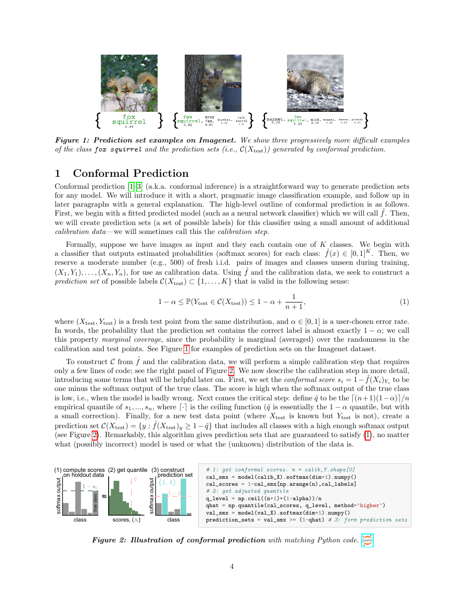
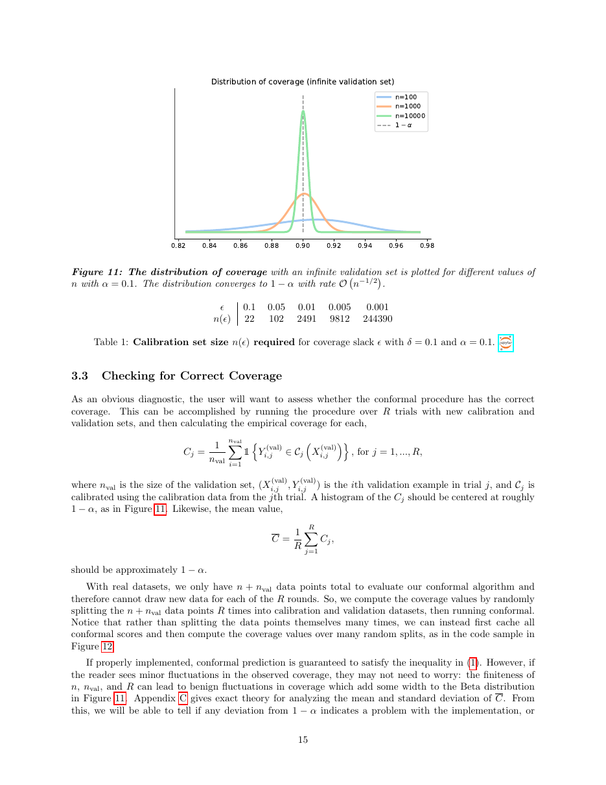

# 컨포멀 예측과 분포 무관 불확도 정량화 입문 (번역)

- 원제: A Gentle Introduction to Conformal Prediction and Distribution-Free Uncertainty Quantification
- 저자: Anastasios N. Angelopoulos, Stephen Bates
- 원문: 같은 폴더의 `Angelopoulos2023_컨포멀예측_입문.pdf` (arXiv 2107.07511v6, 2022-12-07, 51쪽)
- 게재본: Foundations and Trends in Machine Learning 16(4):494-591, 2023. doi:10.1561/2200000101
- 번역 범위: 전문(초록, 본문 1~7장, 부록 A~D, 그림 캡션). 참고문헌은 원문 그대로 둔다.
- 번역 원칙: 수식은 원문 기호를 살려 옮긴다. Python 코드는 원문 그대로 둔다. 그림 안의 글자는 옮기지 않고 캡션만 옮긴다.
- pdftotext로 뽑은 글이라 수식 배치가 깨진 곳이 있다. 그런 곳은 PDF를 보고 다시 적었다.

---

## 초록

블랙박스 머신러닝 모델은 이제 의료 진단처럼 위험이 큰 곳에서 흔히 쓰인다. 이런 곳에서는 큰 사고로 이어지는 모델 실패를 막으려면 불확도를 정량화해야 한다.
컨포멀 예측(conformal prediction, 컨포멀 추론이라고도 한다)은 이런 모델의 예측에 통계적으로 엄밀한 불확도 집합이나 구간을 만드는, 쓰기 쉬운 틀이다.
중요한 점은 이 집합이 분포 무관(distribution-free)한 의미로 유효하다는 것이다. 분포에 대한 가정이나 모델에 대한 가정이 없어도, 명시적이고 점근적이지 않은(유한 표본) 보장을 가진다.
신경망 같은 어떤 사전 학습 모델에도 컨포멀 예측을 쓸 수 있다. 그러면 사용자가 정한 확률(예: 90%)로 정답을 포함하도록 보장된 집합을 만든다.
이해하기 쉽고, 쓰기 쉽고, 일반적이다. 컴퓨터 비전, 자연어 처리, 심층 강화학습 등의 문제에 자연스럽게 적용된다.

이 실습형 입문서는 독자가 하나의 자족적인 문서로 컨포멀 예측과 관련 분포 무관 불확도 정량화 기법을 실제로 쓸 수 있을 만큼 이해하게 하는 것이 목표다.
컨포멀 예측의 실용 이론과 예제를 따라가며 설명한다. 그리고 구조화된 출력, 분포 이동, 시계열, 이상치, 판단을 보류하는 모델 등 복잡한 머신러닝 과제로의 확장을 설명한다.
전체에 걸쳐 설명용 그림, 예제, Python 코드가 많다. 코드 예제마다 실제 자료에 방법을 구현한 Jupyter 노트북이 있다. 노트북은 다음 아이콘을 눌러 쉽게 열고 실행할 수 있다.

## 목차

1. 컨포멀 예측 (4쪽)
   - 1.1 컨포멀 예측 사용 순서 (5쪽)
2. 컨포멀 절차의 예 (6쪽)
   - 2.1 적응 예측 집합을 쓰는 분류 (6쪽)
   - 2.2 컨포멀화한 분위수 회귀 (8쪽)
   - 2.3 스칼라 불확도 추정의 컨포멀화 (9쪽)
     - 2.3.1 추정 표준편차 (9쪽)
     - 2.3.2 다른 1차원 불확도 추정 (9쪽)
   - 2.4 베이즈의 컨포멀화 (10쪽)
3. 컨포멀 예측 평가 (11쪽)
   - 3.1 적응성 평가 (12쪽)
   - 3.2 교정 집합 크기의 영향 (14쪽)
   - 3.3 올바른 포함률 확인 (15쪽)
4. 컨포멀 예측의 확장 (16쪽)
   - 4.1 집단 균형 컨포멀 예측 (16쪽)
   - 4.2 클래스 조건부 컨포멀 예측 (17쪽)
   - 4.3 컨포멀 위험 제어 (18쪽)
   - 4.4 이상치 탐지 (19쪽)
   - 4.5 공변량 이동 아래의 컨포멀 예측 (20쪽)
   - 4.6 분포 드리프트 아래의 컨포멀 예측 (21쪽)
5. 풀이 예제 (23쪽)
   - 5.1 다중 레이블 분류 (23쪽)
   - 5.2 종양 분할 (23쪽)
   - 5.3 시계열 분포 이동이 있는 날씨 예측 (24쪽)
   - 5.4 이상치 탐지로 유해 온라인 댓글 찾기 (25쪽)
   - 5.5 선택적 분류 (25쪽)
6. 완전 컨포멀 예측 (27쪽)
   - 6.1 완전 컨포멀 예측 (27쪽)
   - 6.2 교차 컨포멀 예측, CV+, Jackknife+ (28쪽)
7. 컨포멀 예측의 역사 메모 (28쪽)
- 부록 A. 일반 위험의 분포 무관 제어 (39쪽)
  - A.1 Learn then Test 사용 순서 (40쪽)
    - A.1.1 p값 만들기 속성 강의 (43쪽)
    - A.1.2 족별 오류율 알고리즘 속성 강의 (44쪽)
- 부록 B. 분포 무관 위험 제어의 예 (45쪽)
  - B.1 FDR 제어가 있는 다중 레이블 분류 (46쪽)
  - B.2 분포 밖 탐지와 포함률의 동시 보장 (46쪽)
- 부록 C. 경험적 포함률의 집중 성질 (49쪽)
- 부록 D. 정리와 증명: 컨포멀 예측의 포함 성질 (50쪽)

---

## 1. 컨포멀 예측

그림 1: Imagenet의 예측 집합 예. 여우다람쥐(fox squirrel) 클래스의 예를 점점 어려운 순서로 세 개 보이고, 컨포멀 예측이 만든 예측 집합(즉 C(X_test))을 함께 보인다.

컨포멀 예측 [1-3](컨포멀 추론이라고도 한다)은 어떤 모델에든 예측 집합을 만드는 간단한 방법이다.
짧고 실용적인 영상 분류 예로 소개하고, 뒤 문단에서 일반적으로 설명한다.
큰 흐름은 다음과 같다. 먼저 학습을 마친 예측 모델(예: 신경망 분류기) f̂ 에서 시작한다. 그 다음 적은 양의 추가 교정(calibration) 자료로 이 분류기의 예측 집합(가능한 레이블의 집합)을 만든다. 이것을 교정 단계라고 부르기도 한다.

형식적으로 쓰면 이렇다. 입력은 영상이고, 각 영상은 K개 클래스 중 하나를 담는다. 각 클래스의 추정 확률(softmax 점수)을 내는 분류기 f̂(x) ∈ [0,1]^K 에서 시작한다.
학습에 쓰지 않은 새 i.i.d. (영상, 클래스) 쌍을 적당한 수(예: 500개) 떼어 둔다. (X_1, Y_1), ..., (X_n, Y_n) 이고, 교정 자료로 쓴다.
f̂과 교정 자료로, 다음 뜻에서 유효한 가능한 레이블의 예측 집합 C(X_test) ⊂ {1, ..., K} 를 만들려 한다.

$$1-\alpha \le P(Y_{test} \in C(X_{test})) \le 1-\alpha+\frac{1}{n+1} \quad (1)$$

여기서 (X_test, Y_test)는 같은 분포에서 나온 새 시험점이고, α ∈ [0,1] 은 사용자가 고른 오류율이다.
말로 하면, 예측 집합이 정답 레이블을 담을 확률이 거의 정확히 1−α 다. 이 확률은 교정점과 시험점의 무작위성 전체에 대해 주변화(평균)한 것이므로, 이 성질을 주변 포함률(marginal coverage)이라 부른다. Imagenet 자료의 예측 집합 예는 그림 1을 보라.

f̂과 교정 자료로 C를 만들려면, 코드 몇 줄이면 되는 간단한 교정 단계를 거친다(그림 2의 오른쪽).
교정 단계를 더 자세히 설명하면서, 뒤에서 쓸 용어를 소개한다.
먼저 컨포멀 점수 s_i = 1 − f̂(X_i)_{Y_i} 를 정한다. 정답 클래스의 softmax 출력을 1에서 뺀 값이다. 정답 클래스의 softmax 출력이 낮을 때, 즉 모델이 크게 틀릴 때 점수가 높다.
다음이 결정적인 단계다. q̂ 을 s_1, ..., s_n 의 ⌈(n+1)(1−α)⌉/n 경험 분위수로 정한다. ⌈·⌉ 은 올림 함수다(q̂ 은 사실상 1−α 분위수인데, 작은 보정이 붙은 것이다).
마지막으로 새 시험점(X_test는 알고 Y_test는 모름)에 대해, softmax 출력이 충분히 높은 모든 클래스를 담는 예측 집합 C(X_test) = {y : f̂(X_test)_y ≥ 1 − q̂} 를 만든다(그림 2).
놀랍게도 이 알고리즘은 어떤 모델(틀린 모델일 수도 있다)을 쓰든, 자료의 (모르는) 분포가 무엇이든, (1)을 만족하도록 보장된 예측 집합을 준다.



그림 2: 컨포멀 예측의 그림 설명과 대응하는 Python 코드. 그림의 세 칸은 (1) 떼어 둔 자료에서 점수 계산, (2) 분위수 구하기, (3) 예측 집합 만들기다.

```python
# 1: get conformal scores. n = calib_Y.shape[0]
cal_smx = model(calib_X).softmax(dim=1).numpy()
cal_scores = 1-cal_smx[np.arange(n),cal_labels]
# 2: get adjusted quantile
q_level = np.ceil((n+1)*(1-alpha))/n
qhat = np.quantile(cal_scores, q_level, method='higher')
val_smx = model(val_X).softmax(dim=1).numpy()
prediction_sets = val_smx >= (1-qhat) # 3: form prediction sets
```

### 덧붙임

C를 어떻게 해석할지 생각해 보자. 함수 C는 집합 값을 낸다. 영상 하나를 받아 그림 1처럼 클래스의 집합을 낸다. 모델의 softmax 출력이 집합을 만드는 데 쓰인다.
이 방법은 입력마다 적응적으로 다른 출력 집합을 만든다. 모델이 불확실하거나 영상 자체가 어려우면 집합이 커진다. 이것은 바라는 성질이다. 집합 크기가 모델의 확신 정도를 알려 주기 때문이다.
또 C(X_test)는 영상 X_test가 속할 수 있는 그럴듯한 클래스들의 집합으로 해석할 수 있다. 마지막으로 C는 유효하다. 즉 (1)을 만족한다(각주 1). 뒤에서 보듯 C의 이런 성질은 회귀 같은 다른 머신러닝 문제로 자연스럽게 옮겨진다.

일반화를 염두에 두고, 분류 문제에서 무슨 일이 있었는지 자세히 되짚어 보자.
처음에 우리는 내장된, 그러나 경험적인(heuristic) 불확도 개념을 가진 모델을 받았다. softmax 출력이다. softmax 출력은 각 클래스의 조건부 확률을 재려 한다. 즉 softmax 벡터의 j번째 값은 입력 영상 x가 주어졌을 때 클래스 j의 확률 P(Y = j | X = x)를 추정한다.
그러나 softmax 출력이 쓸 만하다는 보장은 없었다. 마음대로 과적합되었거나 달리 믿을 수 없을 수 있다. 그래서 softmax 출력을 액면 그대로 받지 않고, 떼어 둔 집합으로 그 결함을 보정했다.

떼어 둔 집합에는 모델이 학습 중에 본 적 없는 새 자료점 n ≈ 500개가 있었다. 덕분에 성능을 정직하게 평가할 수 있었다.
보정은 컨포멀 점수를 계산하는 것이었다. 이 점수는 모델이 불확실할 때 커지지만, 그 자체로는 유효한 예측 구간이 아니다. 이 예에서 컨포멀 점수는 1에서 정답 클래스의 softmax 출력을 뺀 값이었지만, 일반적으로 점수는 x와 y의 어떤 함수여도 된다.
그 다음 q̂ 을 점수의 대략 1−α 분위수로 잡았다. 이 경우 분위수는 쉽게 해석된다. α = 0.1이면 정답 클래스 softmax 출력의 최소 90%가 1 − q̂ 위에 있음이 보장된다(부록 D에서 엄밀히 증명한다).
이 사실을 이용해, 시험 때 새 영상 X_test의 softmax 출력을 얻고 1 − q̂ 위의 모든 클래스를 예측 집합 C(X_test)에 모았다. 새 정답 클래스 Y_test의 softmax 출력이 최소 90% 확률로 1 − q̂ 위에 있음이 보장되므로, 마침내 식 (1)의 보장을 얻는다.

### 1.1 컨포멀 예측 사용 순서

요약에서 말했듯 컨포멀 예측은 softmax 출력이나 분류 문제에만 쓰는 것이 아니다. 사실 컨포멀 예측은 어떤 모델의 어떤 경험적 불확도 개념이든 엄밀한 것으로 바꾸는 방법으로 볼 수 있다(아래 그림).
컨포멀 예측은 밑바탕의 예측 문제가 이산인지 연속인지, 분류인지 회귀인지 상관하지 않는다.

(그림: 입력별 경험적 불확도 → 컨포멀 예측 → 입력별 엄밀한 불확도)

다음은 일반 입력 x와 출력 y(꼭 이산일 필요 없음)에 대한 컨포멀 예측의 개요다.

1. 사전 학습 모델로 경험적 불확도 개념을 정한다.
2. 점수 함수 s(x, y) ∈ ℝ 를 정한다. (점수가 클수록 x와 y가 잘 안 맞는다는 뜻이다.)
3. 교정 점수 s_1 = s(X_1, Y_1), ..., s_n = s(X_n, Y_n) 의 ⌈(n+1)(1−α)⌉/n 분위수로 q̂ 을 계산한다.
4. 이 분위수로 새 예의 예측 집합을 만든다.

$$C(X_{test}) = \{y : s(X_{test}, y) \le \hat q\} \quad (2)$$

앞에서처럼 이 집합은 어떤 점수 함수(정보가 없는 것이라도)와 어떤 자료 분포(모르는 것이라도)에서도 (1)의 유효성을 만족한다. 포함 보장을 형식적으로 쓰면 다음과 같다.

각주 1: Y가 이산이므로 상한까지 만족하려면 동률 처리(tie-breaking)를 하는 작은 수정이 필요하다([4] 참고. 실무에서는 이 무작위화를 보통 무시한다). 이후로는 동률 처리를 무시한다.

**정리 1 (컨포멀 포함 보장; Vovk, Gammerman, Saunders [5]).** (X_i, Y_i)_{i=1,...,n} 과 (X_test, Y_test) 가 i.i.d.라 하고, q̂ 을 위 3단계처럼, C(X_test)를 위 4단계처럼 정하자. 그러면 다음이 성립한다.

$$P(Y_{test} \in C(X_{test})) \ge 1-\alpha$$

증명과 (1)의 상한을 포함한 진술은 부록 D를 보라.
위의 것은 컨포멀 예측의 한 특수한 경우로, 분할 컨포멀 예측(split conformal prediction)이라 부른다. 가장 널리 쓰이는 형태이고, 이 글의 주된 대상이다. 그림을 완성하기 위해, 가장 일반적인 형태의 컨포멀 예측은 6장에서 설명하고, 문헌 개관은 7장에서 한다.

### 점수 함수의 선택

처음 보면 너무 좋아서 믿기 어렵다. 의심 많은 독자는 이렇게 물을 수 있다.

> 밑바탕 모델의 경험적 불확도 개념이 아무리 나빠도, 어떻게 통계적으로 유효한 예측 집합을 만들 수 있는가?

부록 D의 증명에서 얻는 수학적 이해를 보충할 직관을 주자.
대략 말해, 점수 s_i가 입력을 모델 오차가 작은 것부터 큰 것까지 올바르게 줄 세우면, 결과 집합은 쉬운 입력에서 작고 어려운 입력에서 크다. 점수가 이 순서를 근사하지 못할 만큼 나쁘면, 집합은 쓸모가 없다.
예를 들어 점수가 무작위 잡음이면, 집합은 레이블 공간에서 무작위로 뽑은 표본을 담는다. 그 표본은 유효한 주변 포함률을 줄 만큼만 크다.
이것은 컨포멀 예측의 중요한 사실을 보여 준다. **보장은 항상 성립하지만, 예측 집합이 쓸모 있는지는 주로 점수 함수가 정한다.**
놀랄 일은 아니다. 점수 함수에는 문제와 자료에 대해 우리가 아는 거의 모든 정보가 들어간다. 밑바탕 모델 자체도 포함된다. 예를 들어 분류 문제와 회귀 문제에 컨포멀 예측을 쓸 때의 주된 차이는 점수의 선택이다.
한 모델에도 가능한 점수 함수가 많고, 성질이 서로 다르다. 그래서 알맞은 점수 함수를 만드는 것은 중요한 공학적 선택이다. 다음으로 좋은 점수 함수의 예를 몇 개 보인다.

## 2. 컨포멀 절차의 예

이 장에서는 여러 상황에 적용한 컨포멀 예측의 예를 보여, 독자가 실제로 배치할 수 있는 기법 모음을 주려 한다.
이 장에서는 1차원 Y만 다루고, 컨포멀 점수가 작을수록 모델이 더 확신한다는 뜻이다(이런 점수를 비순응 점수, nonconformity score라 한다).
고차원 Y, 복잡한(또는 여러) 오차 개념, 실수마다 비용이 다른 경우 같은 더 풍부한 상황은 흔히 위험 제어(risk control)의 언어가 필요하다. 부록 A에서 개관한다.

### 2.1 적응 예측 집합을 쓰는 분류

1장의 분류 예를 개선하는 것으로 예제를 시작하자.
앞의 방법은 평균 크기가 가장 작은 예측 집합을 만든다 [6]. 하지만 어려운 하위 집단은 덜 덮고(undercover) 쉬운 하위 집단은 더 덮는(overcover) 경향이 있다.
여기서는 이 문제를 피하는 적응 예측 집합(adaptive prediction sets, APS)이라는 다른 방법을 만든다. [7]과 [4]를 따른다.

이 새 절차의 동기는 이렇다. softmax 출력 f̂(X_test)가 Y_test | X_test 의 완벽한 모델이라면, 점수가 높은 클래스부터 차례로 넣다가 그 합이 1−α를 막 넘을 때 멈추면 된다.

```python
# Get scores. calib_X.shape[0] == calib_Y.shape[0] == n
cal_pi = cal_smx.argsort(1)[:,::-1]; cal_srt = np.take_along_axis(cal_smx,cal_pi,axis=1).cumsum(axis=1)
cal_scores = np.take_along_axis(cal_srt,cal_pi.argsort(axis=1),axis=1)[range(n),cal_labels]
# Get the score quantile
qhat = np.quantile(cal_scores, np.ceil((n+1)*(1-alpha))/n, interpolation='higher')
# Deploy (output=list of length n, each element is tensor of classes)
val_pi = val_smx.argsort(1)[:,::-1]; val_srt = np.take_along_axis(val_smx,val_pi,axis=1).cumsum(axis=1)
prediction_sets = np.take_along_axis(val_srt <= qhat,val_pi.argsort(axis=1),axis=1)
```

그림 3: 적응 예측 집합의 Python 코드.

이 오라클 알고리즘을 형식적으로 쓰면 다음과 같다.

$$\{\pi_1(x), ..., \pi_k(x)\},\quad k = \sup\Big\{k' : \sum_{j=1}^{k'} \hat f(X_{test})_{\pi_j(x)} < 1-\alpha\Big\} + 1$$

π(x)는 {1, ..., K}를 f̂(X_test)가 큰 것부터 작은 것 순으로 정렬하는 순열이다.
하지만 실제로는 f̂(X_test)가 완벽하지 않아서, 이 절차는 포함률을 주지 못한다. 경험적 불확도 개념만 줄 뿐이다. 그래서 컨포멀 예측으로 이것을 엄밀한 불확도 개념으로 바꾼다.

이를 위해 오라클 알고리즘에서 착안한 점수 함수를 정한다.

$$s(x,y) = \sum_{j=1}^{k} \hat f(x)_{\pi_j(x)},\quad y = \pi_k(x)$$

다시 말해, 정답 레이블에 닿을 때까지 클래스를 차례로 집합에 넣고, 닿으면 멈춘다. 1장의 점수와 달리, 이 점수는 정답 클래스만이 아니라 모든 클래스의 softmax 출력을 쓴다.

모든 컨포멀 절차처럼, 다음 단계는 q̂ = Quantile(s_1, ..., s_n; ⌈(n+1)(1−α)⌉/n) 로 두는 것이다. 그 다음 예측 집합 {y : s(x, y) ≤ q̂} 를 만드는데, 크기 0인 집합을 피하도록 조금 고친다.

$$C(x) = \{\pi_1(x), ..., \pi_k(x)\},\quad k = \sup\Big\{k' : \sum_{j=1}^{k'} \hat f(x)_{\pi_j(x)} < \hat q\Big\} + 1 \quad (3)$$

그림 3은 이 방법을 구현하는 Python 코드다. 늘 그렇듯 이 불확도 집합(동률 처리 포함)은 (1)을 만족한다. 자세한 내용과 큰 실용적 개선은 [4]를 보라. 여기서 그 개선을 구현했다.

그림 4: 식 (3)의 적응 예측 집합 알고리즘의 시각화. 클래스를 가능성이 큰 것부터 작은 것 순으로 넣고, 누적 softmax 출력이 분위수를 넘을 때까지 넣는다.

```python
# Get scores
cal_scores = np.maximum(cal_labels-model_upper(cal_X), model_lower(cal_X)-cal_labels)
# Get the score quantile
qhat = np.quantile(cal_scores, np.ceil((n+1)*(1-alpha))/n, interpolation='higher')
# Deploy (output=lower and upper adjusted quantiles)
prediction_sets = [val_lower - qhat, val_upper + qhat]
```

그림 5: 컨포멀화한 분위수 회귀의 Python 코드.

### 2.2 컨포멀화한 분위수 회귀

다음으로 연속 출력을 가진 회귀 문제에 불확도를 넣는 방법을 [8]의 알고리즘을 따라 보인다. 기본 모델로 분위수 회귀 [9]를 쓴다.
다시 말하면, 분위수 회귀 알고리즘은 가능한 x 값마다 Y_test | X_test = x 의 γ 분위수를 배우려 한다. 참 분위수를 t_γ(x), 적합한 모델을 t̂_γ(x) 라 부르자.
정의상 Y_test | X_test = x 는 5% 확률로 t_0.05(x) 아래에, 5% 확률로 t_0.95(x) 위에 떨어지므로, 구간 [t̂_0.05(x), t̂_0.95(x)] 는 대략 90% 포함률을 가질 것으로 기대한다.
하지만 적합한 분위수가 부정확할 수 있으므로, 이것을 컨포멀화한다. 컨포멀화한 분위수 회귀의 Python 의사코드는 그림 5에 있다.

이런 분위수 두 개 t_{α/2}, t_{1−α/2} 를 내도록 알고리즘을 학습한 뒤(표준 손실 함수로 할 수 있다. 아래 참고), 점수를 y와 가장 가까운 분위수 사이의 차로 정할 수 있다.

$$s(x,y) = \max\{\hat t_{\alpha/2}(x) - y,\ y - \hat t_{1-\alpha/2}(x)\}$$

교정 집합에서 점수를 계산하고 q̂ = Quantile(s_1, ..., s_n; ⌈(n+1)(1−α)⌉/n) 로 두면, 다음처럼 유효한 예측 구간을 만들 수 있다.

$$C(x) = [\hat t_{\alpha/2}(x) - \hat q,\ \hat t_{1-\alpha/2}(x) + \hat q] \quad (4)$$

직관적으로 집합 C(x)는 포함률을 맞추려고 분위수 사이 거리를 q̂ 만큼 늘이거나 줄일 뿐이다.

(그림 6은 원문 8쪽 참고.)

그림 6: 식 (4)의 컨포멀화한 분위수 회귀 알고리즘의 시각화. 교정 단계에서 고른 상수 q̂ 으로 분위수를 조정한다.

앞에서처럼 C는 식 (1)의 포함 성질을 만족한다. 하지만 1장의 예와 달리 C는 이제 클래스의 집합이 아니라 ℝ 위의 연속 구간이다.
연속 값 구간을 얻는 방법이 분위수 회귀만 있는 것은 아니다. 하지만 흔히 가장 좋은 방법이다. 특히 α를 미리 알 때 그렇다.
이유는 컨포멀 예측 없이도 분위수 회귀로 만든 구간 [t̂_{α/2}(x), t̂_{1−α/2}(x)] 가 처음부터 포함률이 좋기 때문이다. 게다가 점근적으로 유효한 조건부 포함률(3장에서 설명할 개념)을 가진다. 이 성질이 컨포멀 절차를 거쳐도 이어져, 성능이 좋은 예측 집합이 된다.

분위수 회귀의 매력 하나는, 손실 함수를 분위수 손실(흔히 핀볼 손실이라 부른다)로 바꾸기만 하면 어떤 기본 모델 위에도 쉽게 얹을 수 있다는 점이다.

$$L_\gamma(\hat t_\gamma, y) = (y - \hat t_\gamma)\gamma\,\mathbb{1}\{y > \hat t_\gamma\} + (\hat t_\gamma - y)(1-\gamma)\,\mathbb{1}\{y \le \hat t_\gamma\}$$

(그림: 핀볼 손실의 모양)

분위수 회귀는 L1 노름 회귀의 일반화로 생각하면 된다. γ = 0.5이면 손실은 L_0.5 = |t̂_γ(x) − y|/2 가 되어, t̂_0.5(x)가 조건부 중앙값으로 수렴하게 한다. γ를 바꾸면 위 그림처럼 L1 노름의 기울기가 바뀌어 다른 분위수를 겨냥한다.
실제로는 신경망 같은 어떤 알고리즘이든 끝에서 MSE 대신 분위수 손실을 쓰면 분위수로 회귀할 수 있다.

### 2.3 스칼라 불확도 추정의 컨포멀화

#### 2.3.1 추정 표준편차

분위수 회귀 대신 쓸 수 있는 다음 예는, 연속 y의 예측 집합을 만드는 다른 방법이다. 덜 풍부하지만 더 흔한 경험적 불확도 개념, 곧 표준편차 추정값 σ̂(x)를 쓴다.
예를 들어 Y_test | X_test = x 가 어떤 모수 분포(예: 가우스 분포)를 따른다고 가정하고, 그 분포의 평균과 분산을 내도록 모델을 학습하면 불확도 스칼라를 만들 수 있다.
정확히 말하면, 이 설정에서는 Y_test | X_test = x ∼ N(µ(x), σ(x)) 로 모형화하고, 모델 f̂(x)와 σ̂(x)를 각각 E[Y_test | X_test = x] 와 √Var[Y_test | X_test = x] 에 대해 자료의 우도를 최대화하도록 학습한다.
그 다음 f̂(x)를 점 예측으로, σ̂(x)를 불확도로 쓴다. 이 전략은 너무 흔해서 상품화되어 있다. PyTorch에는 GaussianNLLLoss 같은 내장 손실이 있어 신경망을 이렇게 학습할 수 있다.
하지만 보통 Y_test | X_test 가 가우스가 아님을 안다. 그래서 자료가 무한히 많아도 σ̂(x)가 꼭 믿을 만하지는 않다. 컨포멀 예측으로 이 경험적 불확도 개념을 f̂(x) ± q̂σ̂(x) 꼴의 엄밀한 예측 구간으로 바꿀 수 있다.

#### 2.3.2 다른 1차원 불확도 추정

더 일반적으로, 값이 클수록 불확도가 크다는 뜻인 함수 u(x)가 있다고 하자. 이 숫자 하나는 표준편차 말고도 여러 뜻일 수 있다.
예를 들어 불확도 스칼라의 한 예는 사용자가 잔차 크기의 모델을 만드는 것이다. 이 경우 사용자는 먼저 x로 y를 예측하는 모델 f̂을 적합한다. 그 다음 |y − f̂(x)| 를 예측하는 두 번째 모델 r̂(같은 신경망일 수도 있다)을 적합한다.
r̂이 완벽하다면 집합 [f̂(x) − r̂(x), f̂(x) + r̂(x)] 의 포함률이 완벽할 것이다. 하지만 학습한 오차 모델 r̂은 실제로는 흔히 나쁘다.

이런 불확도 스칼라는 이 문서에서 자세히 다룰 수 있는 것보다 훨씬 많다. 예를 들면 다음과 같다.

1. 여러 모델의 앙상블에서 f̂(x)의 분산을 잰다.
2. 신경망의 노드 일부를 무작위로 끄면서(dropout) f̂(x)의 분산을 잰다.
3. 작은 무작위 입력 섭동에 대한 f̂(x)의 분산을 잰다.
4. 생성 모델에 넣는 잡음 표본을 바꿔 가며 f̂(x)의 분산을 잰다.
5. 적대적 섭동을 줄 때 f̂(x)가 바뀌는 크기를 잰다. 등등.

이 경우들은 모두 같은 방식으로 다룬다. 어떤 점 예측 f̂(x)가 있고, 모델이 불확실하면 크고 아니면 작은 어떤 불확도 스칼라 u(x)가 있다(잔차 설정에서는 u(x) := r̂(x), 가우스 설정에서는 u(x) := σ̂(x)).
일반성을 위해 이 표기로 진행하지만, u는 어떤 함수로든 바꿀 수 있음을 이해하기 바란다.

경험적 불확도 개념을 손에 쥐었으니, 점수 함수를 정할 수 있다.

$$s(x,y) = \frac{|y - \hat f(x)|}{u(x)}$$

```python
# model(X)[:,0]=E(Y|X), and model(X)[:,1]=stddev(Y|X)
scores = abs(model(calib_X)[:,0]-calib_Y)/model(calib_X)[:,1]
# Get the score quantile
qhat = torch.quantile(scores,np.ceil((n+1)*(1-alpha))/n)
# Deploy (represent sets as tuple of lower and upper endpoints)
muhat, stdhat = (model(test_X)[:,0], model(test_X)[:,1])
prediction_sets = (muhat-stdhat*qhat, muhat+stdhat*qhat)
```

그림 7: 컨포멀화한 불확도 스칼라의 Python 코드.

이 점수 함수는 자연스럽게 해석된다. 불확도 스칼라에 곱하는 보정 계수다(즉 s(x, y)u(x) = |y − f̂(x)|).
앞에서처럼 q̂ 을 교정 점수의 ⌈(1−α)(n+1)⌉/n 분위수로 잡으면, 새 예에 대해 다음이 보장된다.

$$P[s(X_{test}, Y_{test}) \le \hat q] \ge 1-\alpha \implies P\big[|Y_{test} - \hat f(X_{test})| \le u(X_{test})\hat q\big] \ge 1-\alpha$$

그러면 자연스럽게 다음 규칙으로 예측 집합을 만들 수 있다.

$$C(x) = [\hat f(x) - u(x)\hat q,\ \hat f(x) + u(x)\hat q] \quad (5)$$


그림 8: 식 (5)의 불확도 스칼라 알고리즘의 시각화. q̂u(x)를 더하고 빼서 집합을 만든다. 상수 q̂ 은 교정 단계에서 고른다. (위 그림은 원문 10쪽 전체로, 그림 7의 코드와 그림 8, 2.4절 앞부분이 함께 있다.)

이 예측 집합의 성질을 조금 생각해 보자. 바라던 대로 예측 집합은 유효하다. 만든 방식 때문에 예측값 f̂(x)를 중심으로 대칭이기도 하다. 다만 작은 수정으로 대칭을 풀 수 있다.
하지만 불확도 스칼라는 α에 맞게 제대로 늘거나 줄지 않을 수 있다. 다시 말해 σ̂ 같은 양이 레이블 분포의 분위수와 직접 관계있다고 믿을 이유가 없다.
가능하면 분위수 회귀를 더 좋아한다. 이 양을 직접 추정하므로 더 나은 경험적 지표일 것이기 때문이다(실제로도 보통 그렇다. 평가는 [10] 참고).
그래도 불확도 스칼라는 배치하기 쉽고 유명한 머신러닝 라이브러리에 상품화되어 있어서 계속 쓰인다. 이 방법의 Python 구현은 그림 7을 보라.

### 2.4 베이즈의 컨포멀화

컨포멀 예측의 마지막 예는 베이즈 모델을 쓴다. 베이즈 신경망 같은 베이즈 예측기는 불확도 정량화 분야에서 흔히 연구되지만, 포함률을 주려면 검증할 수 없거나 틀린 가정을 많이 기댄다.
그래도 가진 사전 정보는 예측 집합에 넣어야 한다. 이제 유효하면서도, 1−α 포함률을 달성하는 모든 예측 집합 가운데 베이즈 최적인 예측 집합을 만드는 법을 보인다.
이 예측 집합은 사후 예측 밀도를 컨포멀 점수로 쓴다. 이 절차의 베이즈 최적성은 [11]에서 처음 증명되었고, 그 전에 [12, 13]에서 연구되었다.
알고리즘이 사후 예측 밀도가 높은 레이블을 고르는 것으로 줄어들기 때문에, Python 코드는 그림 2와 똑같다. 다른 것은 해석뿐이다. 이제 softmax는 범주 분포가 아니라 연속 분포의 근사를 나타낸다.

먼저 베이즈 모델 f̂(y | x)가 주어졌을 때 베이즈주의자가 무엇을 할지 설명하자. f̂(y | x)는 입력 X_test = x에서 레이블 y의 Y_test 사후 분포 값을 추정한다.
필요한 가정(주로 올바르게 지정된 모델과 점근적으로 큰 n)을 모두 믿는다면, 다음이 최적 예측 집합이다.

$$S(x) = \{y : \hat f(y \mid x) > t\},\quad t \text{는 } \int_{y \in S(x)} \hat f(y \mid x)\,dy = 1-\alpha \text{가 되도록 고른다.}$$

하지만 모델과 자료에 가정을 둘 수 없으므로, f̂(y | x)는 경험적 불확도 개념으로만 볼 수 있다.

이제 익숙해진 점검 목록을 따라 컨포멀 점수를 정할 수 있다.

$$s(x,y) = -\hat f(y \mid x)$$

모델이 불확실하면 높고 아니면 낮다. 교정 자료에서 q̂ 을 계산한 뒤 다음 예측 집합을 만든다.

$$C(x) = \{y : \hat f(y \mid x) > -\hat q\} \quad (6)$$

그림 9: 식 (6)의 컨포멀화한 베이즈 알고리즘의 시각화. 예측 집합은 사후 예측 밀도의 상위 수준 집합이다.

이 집합은 임계값 q̂ 을 컨포멀 예측으로 골랐으므로 유효하다. 또 어떤 기술적 가정이 만족되면, 1−α 포함률을 가진 모든 예측 집합 가운데 베이즈 위험이 가장 작다.
더 정확히 말하면 [11]의 가정 아래에서 C(X_test)는 1−α 포함률을 가진 어떤 컨포멀 절차보다 평균 크기가 작다. 여기서 평균은 자료와 모수에 대해 취한다.
결정 이론에 익숙한 사람에게는 놀랍지 않은 결과다. 여기서 하는 논증은 네이만-피어슨 보조정리와 비슷하게 느껴진다. 이것으로 마지막 예를 마친다.

### 논의

예에서 보았듯 컨포멀 예측은 쓰임새가 많은 간단하고 실용적인 기법이다. 구현이 쉽고 계산량도 무시할 만하다.
또 위의 네 예는 평균 크기, 적응성, 베이즈 위험 같은 여러 최적성 개념으로 점수 함수를 설계하는 길잡이가 된다.
더 있다. 컨포멀 예측은 지금 보이는 것보다 더 넓게 쓸 수 있다. 4장에서 이상치 탐지, 영상 분할, 순차 시계열 예측 같은 다른 예측 과제로의 확장을 개관한다.
그 확장을 다루기 전에, 표준 설정에서 컨포멀 예측의 진단, 특히 조건부 포함률이라는 중요한 주제를 깊이 살펴본다.

## 3. 컨포멀 예측 평가

앞 두 장에서 엄밀한 통계적 보장을 만족하는 유효한 예측 집합을 만드는 법을 배웠다. 이제 그것을 평가하는 법을 논한다. 평가는 두 범주 중 하나에 속한다.

1. **적응성 평가.** 평균 집합 크기가 가장 작은 컨포멀 절차가 꼭 가장 좋은 것은 아님을 꼭 기억해야 한다. 좋은 컨포멀 절차는 모델의 불확도를 충실히 반영하여 쉬운 입력에는 작은 집합을, 어려운 입력에는 큰 집합을 준다. 이 적응성은 컨포멀 예측의 포함 보장에서 나오지 않지만, 실제 배치에서는 양보할 수 없다. 적응성을 형식화하고, 그 결과를 살피고, 평가하는 실용 알고리즘을 제안한다.
2. **정확성 점검.** 컨포멀 예측을 올바르게 구현했는지 시험하는 데 쓴다. 포함률이 정리 1을 만족하는지 경험적으로 확인한다. 이 성질이 성립하는지 엄밀히 평가하려면 실제 자료에 있는 유한 표본 변동을 꼼꼼히 따져야 한다. 해롭지 않은 흔들림의 크기에 대한 명시적 공식을 만든다. 포함률이 1−α에서 이 공식보다 크게 벗어나면 구현에 문제가 있다.

제안하는 평가 다수는 계산량이 많아, 서로 다른 자료 분할에서 전체 컨포멀 절차를 최소 100번 돌려야 한다. 점수 계산이 오래 걸리면 단순한 구현은 느릴 수 있다.
간단한 계산 요령과 전략적 캐싱으로 이 과정을 몇 자릿수 빠르게 할 수 있다. 그래서 수학적 설명 사이에 이 계산을 효율적으로 구현하는 코드를 끼워 넣는다.

### 3.1 적응성 평가

어떤 컨포멀 절차든 (1)을 만족하는 예측 구간을 주지만, 그런 절차는 많고 다른 중요한 점에서 서로 다르다.
특히 컨포멀 예측의 핵심 설계 고려 사항은 적응성이다. 어려운 입력에는 더 큰 집합을, 쉬운 입력에는 더 작은 집합을 돌려주기를 바란다.
대부분의 합리적인 컨포멀 절차는 어느 정도 이것을 만족하지만, 여기서는 사용자가 컨포멀 절차를 점검하고 여러 대안 절차를 비교할 수 있도록 적응성의 정확한 지표를 논한다.

**집합 크기.** 첫 단계는 집합 크기의 히스토그램을 그리는 것이다. 이 히스토그램은 두 가지로 돕는다.
첫째, 평균 집합 크기가 크면 컨포멀 절차가 그다지 정밀하지 않다는 뜻이고, 점수나 밑바탕 모델에 문제가 있을 수 있다.
둘째, 집합 크기의 퍼짐은 예측 집합이 예의 어려움에 제대로 적응하는지 보여 준다. 퍼짐이 넓을수록 보통 바람직하다. 절차가 쉬운 입력과 어려운 입력을 실제로 구별한다는 뜻이기 때문이다.

(그림: 집합 크기 히스토그램 두 개. 퍼짐이 좁은 것과 넓은 것)

포함률과 집합 크기를 그린 뒤 평가를 멈추고 싶을 수 있지만, 중요한 질문이 아직 남는다. 집합 크기가 잘 퍼져 있으면 보통 더 좋지만, 집합이 X의 어려움에 제대로 적응한다는 뜻은 아니다.
집합 크기에 동적 범위가 있다는 것을 넘어, 큰 집합이 어려운 예에서 나오는지 확인해야 한다. 다음으로 이 개념을 형식화하고 평가 지표를 준다.

**조건부 포함률.** 적응성은 보통 조건부 포함률(conditional coverage) [14] 성질을 요구하는 것으로 형식화한다.

$$P[Y_{test} \in C(X_{test}) \mid X_{test}] \ge 1-\alpha \quad (7)$$

즉 입력 X_test의 모든 값에 대해 1−α 포함률을 가진 예측 집합을 돌려주려 한다. 이것은 컨포멀 예측이 달성을 보장하는 (1)의 주변 포함률보다 강한 성질이다. 실제로 가장 일반적인 경우에는 조건부 포함률을 달성할 수 없다 [14].
다시 말해 컨포멀 절차가 (7)을 만족한다는 보장은 없으므로, 우리 절차가 얼마나 가깝게 근사하는지 확인해야 한다.

주변 포함률과 조건부 포함률의 차이는 미묘하지만 실무에서 매우 중요하므로, 여기서 시간을 들여 생각해 보자.
사람이 두 집단 A와 B로 나뉘고, 비율이 90%와 10%라 하자. 예측 집합이 A 집단 사람에게는 항상 Y를 덮고 B 집단 사람에게는 절대 덮지 않는다고 하자. 그러면 예측 집합은 90% 포함률을 갖지만 조건부 포함률은 갖지 않는다.
조건부 포함률은 두 집단 모두에서 최소 90% 덮는다는 뜻을 포함한다. 이것은 필요조건이지만 충분조건은 아니다. 조건부 포함률은 특정한 한 사람에 대해 예측 집합의 확률이 ≥ 90%여야 한다는 매우 강한 성질이다. 다시 말해 모집단의 어떤 부분집합에서도 포함률이 ≥ 90%여야 한다.
조건부 포함률과 주변 포함률의 차이를 시각화한 것은 그림 10을 보라.

그림 10: 여러 포함률 개념의 예측 집합. 포함률 없음, 주변 포함률, 조건부 포함률(90% 수준). (그림 안: 집단 1 5%, 집단 2 14% / 집단 1 100%, 집단 2 80% / 집단 1 90%, 집단 2 90%. 위는 집단별 오류, 아래는 회귀 예.) 주변 포함률의 경우 오류가 모두 같은 집단과 X 공간의 같은 영역에서 일어난다. 조건부 포함률은 이런 행동을 허용하지 않고, 오류가 고르게 흩어진다.

**특징 층화 포함률 지표.** 조건부 포함률의 첫 지표로, 앞에서 든 예, 곧 어떤 집단들에서 포함률이 고르지 않은 경우를 형식화한다. 이 집단은 인종 같은 이산 범주일 수도, 나이 구간 같은 연속 특징을 나눈 것일 수도 있다.
형식적으로, 특징 X_{i,1}^{(val)} 이 어떤 G에 대해 {1, ..., G} 에서 값을 갖는다고 하자. (여기서 i = 1, ..., n_val 은 검증 집합의 예 번호이고, 각 특징의 첫 좌표가 집단이다.) I_g ⊂ {1, ..., n_val} 을 X_{i,1}^{(val)} = g 인 관측의 집합이라 하자(g = 1, ..., G).
조건부 포함률은 절차가 X_test의 모든 값에서 같은 포함률을 갖는다는 뜻을 포함하므로, 다음 척도를 쓴다.

$$\text{FSC 지표: } \min_{g \in \{1,...,G\}} \frac{1}{|I_g|} \sum_{i \in I_g} \mathbb{1}\{Y_i^{(val)} \in C(X_i^{(val)})\}$$

말로 하면, 이산 특징이 값 g를 갖는 모든 경우에서 관측한 포함률(의 최솟값)이다. 조건부 포함률을 달성하면 이 값은 1−α이고, 1−α보다 많이 낮을수록 조건부 포함률을 더 크게 어긴다는 뜻이다. 이 지표는 연속 특징을 유한 개 범주로 나누어 쓸 수도 있다.

**크기 층화 포함률 지표.** 다음으로, 컨포멀 절차가 (7)에 얼마나 가까운지 보는 더 범용 지표를 본다. [4]에서 도입했다.
먼저 C(x)의 가능한 크기를 G개 구간 B_1, ..., B_G 로 나눈다. 예를 들어 분류에서는 C(x)가 원소 1개인지, 2개인지, 2개보다 많은지에 따라 관측을 세 집단으로 나눌 수 있다. I_g ⊂ {1, ..., n_val} 을 구간 g에 드는 관측의 집합이라 하자(g = 1, ..., G). 그러면 다음을 본다.

$$\text{SSC 지표: } \min_{g \in \{1,...,G\}} \frac{1}{|I_g|} \sum_{i \in I_g} \mathbb{1}\{Y_i^{(val)} \in C(X_i^{(val)})\}$$

말로 하면, 집합 크기 |C(x)|가 구간 g에 드는 모든 단위의 관측 포함률이다. 앞에서처럼 조건부 포함률을 달성하면 1−α이고, 1−α보다 많이 낮을수록 더 크게 어긴다.
식은 FSC 지표와 같고 I_g의 정의만 바뀌었다. FSC 지표와 달리, 사용자가 중요한 이산 특징 집합을 미리 정하지 않아도 된다. 어떤 예에도 쓸 수 있는 일반 지표다.

조건부 포함률의 다른 지표는 [15]와 [16]을 보라.

### 3.2 교정 집합 크기의 영향

먼저 잠시 멈춰, 교정 집합 크기가 컨포멀 예측에 어떤 영향을 주는지 논한다. 두 가지 이유로 이 질문을 본다.
첫째, 실제 배치에서 사용자가 이것을 골라야 한다. 대략 결론은, 대부분의 목적에 교정 집합 크기 n = 1000 이면 충분하다는 것이다.
둘째, 교정 집합 크기는 포함률을 올바르게 점검하려면 분석해야 하는 유한 표본 변동의 한 원인이다. 다음 절에서 이 결과를 바탕으로 실제 포함률 점검 방법을 완전하게 설명한다.

교정 집합 크기 n은 컨포멀 예측에 어떤 영향을 주는가? (1)의 포함 보장은 어떤 n에서도 성립하므로, 교정 집합이 아주 작아도 예측 집합의 포함률은 최소 1−α 다.
하지만 직관적으로는 n이 클수록 좋고 더 안정된 절차가 될 것 같다. 이 직관은 옳고, 실제로 더 큰 교정 집합이 유익한 이유를 설명한다. 세부가 미묘하므로 꼼꼼히 따져 본다.

핵심 생각은, 교정 집합을 조건으로 한 컨포멀 예측의 포함률이 확률 변수라는 것이다.
즉 컨포멀 예측 알고리즘을 두 번 돌리되 매번 새 교정 자료를 뽑고, 무한히 많은 검증점에서 포함률을 확인하면, 두 수는 같지 않다.
(1)의 포함 성질은 교정 집합의 무작위성에 대해 평균하면 포함률이 최소 1−α 라는 뜻이다. 하지만 교정 집합 하나를 고정하면, 무한 검증 집합의 포함률은 정확히 1−α가 아닌 어떤 수가 된다.
그래도 그 분포를 분석해서, 포함률의 이런 흔들림을 제어할 만큼 n을 크게 고를 수 있다.

특히 포함률의 분포는 해석적 형태가 있다. Vladimir Vovk가 [14]에서 처음 소개했다.

$$P\big(Y_{test} \in C(X_{test}) \mid \{(X_i, Y_i)\}_{i=1}^n\big) \sim \text{Beta}(n+1-l,\ l),\quad l = \lfloor (n+1)\alpha \rfloor$$

위의 조건부 기댓값은 교정 자료를 고정하고 무한 검증 자료로 잰 포함률이다. 이 사실의 간단한 증명은 [14]에 있다. 여러 n 값에 대한 포함률 분포를 그림 11에 그렸다.

그림 11을 보면, 교정점을 n = 1000개 고르면 포함률이 대개 0.88과 0.92 사이다. 그래서 교정점을 약 1000개 고르라는 대략의 지침이 나온다.
더 형식적으로, 확률 1−δ로 포함률 1−α ± ε 을 달성하는 데 필요한 교정점 수 n을 정확히 계산할 수 있다. 다시 말하지만 평균 포함률은 항상 최소 1−α 다. 모수 δ는 교정 자료를 조건으로 한 포함률의 꼬리 확률을 제어한다.
어떤 δ에서든 필요한 교정 집합 크기 n은 간단한 식으로 명시적으로 계산할 수 있다. 참고용으로 몇 값을 표 1에 적었다. 사용자가 어떤 n과 α에서든 결과를 낼 수 있는 코드가 표에 딸려 있다.



그림 11: α = 0.1에서 n 값마다 무한 검증 집합으로 잰 포함률의 분포(n = 100, 1000, 10000). 분포는 O(n^{−1/2}) 속도로 1−α에 수렴한다. (위 그림은 원문 15쪽 전체로, 표 1과 3.3절 앞부분이 함께 있다.)

| ε | 0.1 | 0.05 | 0.01 | 0.005 | 0.001 |
|---|---|---|---|---|---|
| n(ε) | 22 | 102 | 2491 | 9812 | 244390 |

표 1: δ = 0.1, α = 0.1일 때 포함률 여유 ε 에 필요한 교정 집합 크기 n(ε).

### 3.3 올바른 포함률 확인

당연한 진단으로, 사용자는 컨포멀 절차의 포함률이 올바른지 평가하고 싶을 것이다. 새 교정 집합과 검증 집합으로 절차를 R번 시행하고, 각 시행의 경험적 포함률을 계산하면 된다.

$$C_j = \frac{1}{n_{val}} \sum_{i=1}^{n_{val}} \mathbb{1}\{Y_{i,j}^{(val)} \in C_j(X_{i,j}^{(val)})\},\quad j = 1, ..., R$$

n_val 은 검증 집합 크기, (X_{i,j}^{(val)}, Y_{i,j}^{(val)}) 는 시행 j의 i번째 검증 예, C_j 는 j번째 시행의 교정 자료로 교정한 것이다. C_j의 히스토그램은 그림 11처럼 대략 1−α를 중심으로 놓여야 한다. 마찬가지로 평균값

$$\bar C = \frac{1}{R}\sum_{j=1}^R C_j$$

은 대략 1−α 여야 한다.

실제 자료에서는 컨포멀 알고리즘을 평가할 자료점이 모두 n + n_val 개뿐이라, R번마다 새 자료를 뽑을 수 없다. 그래서 n + n_val 개 자료점을 무작위로 R번 교정 자료와 검증 자료로 나누고 컨포멀을 돌려 포함률 값을 계산한다.
자료점 자체를 여러 번 나누는 대신, 먼저 모든 컨포멀 점수를 캐시한 뒤 여러 무작위 분할에서 포함률 값을 계산할 수 있다. 그림 12의 코드 예와 같다.

제대로 구현하면 컨포멀 예측은 (1)의 부등식을 만족함이 보장된다. 하지만 관측한 포함률에 작은 흔들림이 보여도 걱정할 필요가 없을 수 있다. n, n_val, R이 유한하면 해롭지 않은 흔들림이 생겨, 그림 11의 베타 분포에 폭이 조금 더해진다.
부록 C는 C̄ 의 평균과 표준편차를 분석하는 정확한 이론을 준다. 이로부터 1−α에서 벗어난 것이 구현 문제를 뜻하는지, 해롭지 않은 것인지 알 수 있다. 모든 n, n_val, R 값에서 포함률을 점검하는 코드는 그림 12의 Jupyter 노트북에 있다.

```python
try: # try loading the scores first
  scores = np.load('scores.npy')
except:
  # X and Y have n + n_val rows each
  scores = get_scores(X,Y)
  np.save(scores, 'scores.npy')
# calculate the coverage R times and store in list
coverages = np.zeros((R,))
for r in range(R):
  np.random.shuffle(scores) # shuffle
  calib_scores, val_scores = (scores[:n],scores[n:]) # split
  qhat = np.quantile(calib_scores, np.ceil((n+1)*(1-alpha)/n), method='higher') # calibrate
  coverages[r] = (val_scores <= qhat).astype(float).mean() # see caption
average_coverage = coverages.mean() # should be close to 1-alpha
plt.hist(coverages) # should be roughly centered at 1-alpha
```

그림 12: 효율적인 점수 캐싱으로 포함률을 계산하는 Python 코드. (2)의 컨포멀 집합 식에서, 검증점은 s(X, Y) ≤ q̂ 일 때 그리고 그때만 덮인다. 끝에서 세 번째 줄은 이것으로 포함률을 간단히 계산한다.

## 4. 컨포멀 예측의 확장

여기까지 핵심을 보았다. 어떤 표준 지도 예측 문제에서든 포함률을 가진 예측 집합을 만드는 법이다.
이제 부가 정보, 공변량 이동 등 구조가 다른 예측 과제로 시야를 넓힌다. 이런 특이한 문제는 현실에서 꽤 자주 나오므로, 이를 다루는 실용 컨포멀 알고리즘을 보인다.

### 4.1 집단 균형 컨포멀 예측

어떤 상황에서는 자료의 특정 부분집합들에서 오류율이 같은 예측 구간을 원할 수 있다. 예를 들어 의료 분류기가 모든 인종과 민족 집단에서 올바른 포함률을 갖기를 요구할 수 있다.
이를 형식화하려고, 입력의 첫 특징 X_{i,1} (i = 1, ..., n)이 범주 집단에 대응하는 이산 집합 {1, ..., G} 에서 값을 갖는다고 하자. 그리고 집단 균형 포함률을 요구한다.

$$P(Y_{test} \in C(X_{test}) \mid X_{test,1} = g) \ge 1-\alpha \quad (8)$$

모든 집단 g ∈ {1, ..., G} 에 대해서다. 말로 하면 모든 집단에서 포함률이 1−α 라는 뜻이다. 집단 출력은 자료의 원래 특징을 후처리한 것일 수도 있다. 예를 들어 X_test 값을 이산 집합으로 나눌 수 있다.

표준 컨포멀 예측을 쓰면 각 집단 안의 포함률이 동시에 나온다는 보장이 없음을 기억하라. 즉 (8)이 만족되지 않을 수 있다. 그림 10에서 예를 보았다. 일반 컨포멀 예측의 주변 보장은 모든 오류가 한 집단에서 일어나도 여전히 만족될 수 있다.

집단 균형 포함률을 얻으려면, 아래 그림처럼 집단마다 따로 컨포멀 예측을 돌리면 된다.

(그림: 집단별로 점수를 나누어 각각 분위수를 구하는 모습)

형식적으로, 컨포멀 점수 함수 s가 주어지면 교정 집합의 점수를 집단별로 층화한다.

$$s_i^{(g)} = s(X_j, Y_j),\quad X_{j,1} \text{은 집단 } g \text{의 } i \text{번째 등장}$$

그 다음 각 집단 안에서 컨포멀 분위수를 계산한다.

$$\hat q^{(g)} = \text{Quantile}\Big(s_1^{(g)}, ..., s_{n^{(g)}}^{(g)};\ \frac{\lceil (n^{(g)}+1)(1-\alpha)\rceil}{n^{(g)}}\Big),\quad n^{(g)} \text{은 집단 } g \text{의 예 수}$$

마지막으로 해당 분위수를 먼저 골라 예측 집합을 만든다.

$$C(x) = \{y : s(x,y) \le \hat q^{(x_1)}\}$$

즉 집단 x_1에 드는 점 x에는 임계값 q̂^{(x_1)} 으로 예측 집합을 만든다. 이렇게 고른 C는 (8)을 만족한다. Vovk가 [14]에서 처음 기록했다.

**명제 1 (집단 균형 컨포멀 예측의 오류 제어 보장).** (X_1, Y_1), ..., (X_n, Y_n), (X_test, Y_test) 가 어떤 분포의 i.i.d. 표본이라 하자. 그러면 위에서 정한 집합 C는 (8)의 오류 제어 성질을 만족한다.

### 4.2 클래스 조건부 컨포멀 예측

분류 문제에서는 마찬가지로 모든 정답 클래스마다 포함률을 요구할 수 있다. 예를 들어 입력을 정상 클래스나 암 클래스로 나누는 의료 분류기가 있다면, 정답이 암일 때도 정상일 때도 예측 집합이 95% 맞기를 요구할 수 있다.
형식적으로, Y = {1, ..., K} 인 분류 설정으로 돌아간다. 클래스 균형 포함률을 얻으려 한다.

$$P(Y_{test} \in C(X_{test}) \mid Y_{test} = y) \ge 1-\alpha \quad (9)$$

모든 클래스 y ∈ {1, ..., K} 에 대해서다.

클래스 균형 포함률을 얻으려면 클래스마다 따로 교정한다. 알고리즘은 4.1절의 집단 균형 포함률과 비슷하지만, 시험 때 정답 클래스를 모르므로 고쳐야 한다. (반면 4.1절에서는 집단 정보 X_{test,1}을 입력 특징으로 관측했다.) 아래 그림을 보라.

(그림: 클래스별로 점수를 나누어 각각 분위수를 구하는 모습)

알고리즘은 이렇다. 컨포멀 점수 함수 s가 주어지면 교정 집합의 점수를 클래스별로 층화한다.

$$s_i^{(k)} = s(X_j, Y_j),\quad Y_j \text{는 클래스 } k \text{의 } i \text{번째 등장}$$

그 다음 각 클래스 안에서 컨포멀 분위수를 계산한다.

$$\hat q^{(k)} = \text{Quantile}\Big(s_1^{(k)}, ..., s_{n^{(k)}}^{(k)};\ \frac{\lceil (n^{(k)}+1)(1-\alpha)\rceil}{n^{(k)}}\Big),\quad n^{(k)} \text{은 클래스 } k \text{의 예 수}$$

마지막으로 클래스를 하나씩 돌며 각자의 분위수를 기준으로 예측 집합에 넣는다.

$$C(x) = \{y : s(x,y) \le \hat q^{(y)}\}$$

위 식에서 응답의 임시 값 y를 잡고, 컨포멀 임계값 q̂^{(y)} 로 그것을 예측 집합에 넣을지 정한다. 이렇게 고른 C는 (9)를 만족한다. Vovk가 [14]에서 증명했고, 다른 형태는 [6]에 있다.

**명제 2 (클래스 균형 컨포멀 예측의 오류 제어 보장).** (X_1, Y_1), ..., (X_n, Y_n), (X_test, Y_test) 가 어떤 분포의 i.i.d. 표본이라 하자. 그러면 위에서 정한 집합 C는 (9)의 오류 제어 성질을 만족한다.

### 4.3 컨포멀 위험 제어

지금까지 컨포멀 예측으로 놓침 비율(miscoverage)을 묶는 예측 집합을 만들었다.

$$P(Y_{test} \notin C(X_{test})) \le \alpha \quad (10)$$

하지만 많은 머신러닝 문제에서 자연스러운 오류 개념은 놓침 비율이 아니다. 여기서는 컨포멀 예측이 다음 꼴의 보장도 줄 수 있음을 보인다.

$$E[\ell(C(X_{test}), Y_{test})] \le \alpha \quad (11)$$

C가 커지면 줄어드는 어떤 유계 손실 함수 ℓ에 대해서다. 이것을 컨포멀 위험 제어(conformal risk control) 보장이라 한다. 놓침 손실 ℓ(C(X_test), Y_test) = 1{Y_test ∉ C(X_test)} 을 쓰면 (11)은 (10)이 된다.
하지만 이 알고리즘은 거짓 음성률(FNR) 같은 다른 손실 함수가 더 적절한 상황으로 컨포멀 예측을 넓힌다.

예로 다중 레이블 분류를 보자. 여기서 응답 Y_i ⊆ {1, ..., K} 는 K개 클래스의 부분집합이다. 학습한 모델 f : X → [0,1]^K 가 주어졌을 때, Y_i의 참 클래스를 많이 담는 집합을 내고 싶다.
이를 위해 모델의 원출력을 점수가 충분히 높은 클래스의 집합 C_λ(x) = {k : f(X)_k ≥ 1 − λ} 로 후처리한다. 임계값 λ가 커지면 C_λ(x)에 더 많은 클래스가 들어가 더 보수적이 된다. 참 클래스를 빠뜨릴 가능성이 줄어든다.
컨포멀 위험 제어로, 빠뜨린 클래스의 비율을 제어하는 임계값 λ̂ 을 찾을 수 있다. 즉 ℓ(C_λ̂(X_test), Y_test) = 1 − |Y_test ∩ C_λ(X_test)|/|Y_test| 의 기댓값이 사용자가 정한 오류율 α 아래로 떨어지도록 보장되게 λ̂ 을 고를 수 있다.
예를 들어 α = 0.1로 두면 C_λ̂(X_test)가 평균적으로 Y_test 참 클래스의 90%를 담는다. 5.1절에서 다중 레이블 분류 예를 자세히 풀어 본다.

형식적으로, 모델 f의 예측을 후처리해 예측 집합 C_λ(·)를 만든다고 하자. 예측 집합에는 보수성의 정도를 나타내는 모수 λ가 있다. λ가 클수록 더 보수적인 출력(예: 더 큰 예측 집합)이 나온다.
C_λ 출력의 질을 재려고 어떤 B < ∞ 에 대해 손실 함수 ℓ(C_λ(x), y) ∈ (−∞, B] 를 쓴다. 손실 함수가 λ의 함수로서 증가하지 않아야 한다. 다음 알고리즘은 (11)의 위험 제어가 성립하도록 λ̂ 을 고른다.

$$\hat\lambda = \inf\Big\{\lambda : \hat R(\lambda) \le \alpha - \frac{B-\alpha}{n}\Big\} \quad (12)$$

여기서 R̂(λ) = (ℓ(C_λ(X_1), Y_1) + ... + ℓ(C_λ(X_n), Y_n))/n 은 교정 자료의 경험 위험이다.
이 알고리즘은 α보다 조금 더 보수적인 수준에서 경험 위험을 기준으로 조정하는 것일 뿐이다. 예를 들어 B = 1, α = 0.1, 교정점 n = 1000개면, 경험 위험이 0.1 대신 0.0991 수준에 닿는 값을 λ̂ 으로 고른다.

그러면 예측 집합 C_λ̂(X_test)는 (11)을 만족한다.

**정리 2 (컨포멀 위험 제어 [17]).** (X_1, Y_1), ..., (X_n, Y_n), (X_test, Y_test) 가 어떤 분포의 i.i.d. 표본이라 하자. 또 ℓ이 λ의 단조 함수라 하자. 즉 모든 (x, y)와 λ_1 ≤ λ_2 에 대해

$$\ell(C_{\lambda_1}(x), y) \ge \ell(C_{\lambda_2}(x), y) \quad (13)$$

를 만족한다. 그러면 (12)처럼 고른 λ̂ 에 대해

$$E[\ell(C_{\hat\lambda}(X_{test}), Y_{test})] \le \alpha$$

컨포멀 위험 제어의 이론과 풀이 예는 [17]에 있다. 5.1절과 5.2절에서 종양 분할에 적용한 풀이 예를 보인다. 또 부록 A는 (13)을 만족하지 않는 일반 위험도 제어할 수 있는 더 강력한 기법인 Learn then Test [18]를 설명한다.

### 4.4 이상치 탐지

컨포멀 예측은 비지도 이상치 탐지에도 맞출 수 있다. 여기서는 깨끗한 자료 X_1, ..., X_n 이 있고, 시험점이 같은 분포에서 오지 않았을 때를 알아채려 한다.
앞에서처럼 이상치를 찾으려는 경험적 모델에서 시작한다. 점수가 클수록 모델이 그 점을 이상치일 가능성이 크다고 판단한다는 뜻이다. 그 다음 컨포멀 예측의 변형으로 이것을 교정해 통계적 보장을 준다. 특히 거짓 양성을 너무 많이 내지 않도록 보장한다.

형식적으로, 시험점에 이상치 또는 정상치 표시를 다는 함수 C : X → {outlier, inlier} 를 다음을 만족하도록 만든다.

$$P(C(X_{test}) = \text{outlier}) \le \alpha \quad (14)$$

여기서 확률은 깨끗한 자료 분포에서 새로 뽑은 X_test에 대한 것이다. (14)를 얻는 알고리즘은 보통의 컨포멀 알고리즘과 비슷하다.
컨포멀 점수 s : X → ℝ 에서 시작한다(비지도 설정이므로 점수는 특징에만 의존한다). 다음으로 깨끗한 자료에서 컨포멀 점수 s_i = s(X_i) (i = 1, ..., n)를 계산한다. 그 다음 보통 방식으로 컨포멀 임계값을 계산한다.

$$\hat q = \text{quantile}\Big(s_1, ..., s_n;\ \frac{\lceil (n+1)(1-\alpha)\rceil}{n}\Big)$$

마지막으로 시험점을 만나면, 점수가 q̂ 을 넘을 때 이상치라고 선언한다.

$$C(x) = \begin{cases} \text{inlier} & s(x) \le \hat q \\ \text{outlier} & s(x) > \hat q \end{cases}$$

이 구성은 다음에 적는 것처럼 오류 제어를 보장한다.

**명제 3 (이상치 탐지의 오류 제어 보장).** X_1, ..., X_n, X_test 가 어떤 분포의 i.i.d. 표본이라 하자. 그러면 위에서 정한 C는 (14)의 오류 제어 성질을 만족한다.

표준 컨포멀 예측처럼, 방법이 잘 작동하려면, 즉 이상치를 효과적으로 표시하려면 점수 함수가 매우 중요하다. 여기서는 시험 자료에서 볼 것으로 예상하는 종류의 이상치를 깨끗한 자료와 효과적으로 구별하도록 점수 함수를 골라야 한다.
이상치를 구별하는 모델을 학습하는 일반 문제는 이상 탐지, 새것 탐지, 단일 클래스 분류라 부르기도 하며, 바로 쓸 수 있는 좋은 방법들이 있다. 이상치 탐지 개관은 [19]를 보라.
컨포멀 이상치 탐지는 가설 검정 문제로도 볼 수 있다. 이상치로 기각된 점은 "교정 자료와 교환 가능하다"는 귀무가설에 대한 p값이 α보다 작다. 이 해석은 고전적인 순열 검정 [20, 21]과 밀접하다. 이 해석과 컨포멀 이상치 탐지의 다른 통계적 성질은 [22-24]를 보라.

### 4.5 공변량 이동 아래의 컨포멀 예측

앞의 모든 컨포멀 방법은 정리 1에 기대며, 정리 1은 들어오는 시험점이 교정점과 같은 분포에서 온다고 가정한다. 하지만 실제로 과거 자료가 미래 자료를 대표한다는 보장은 없다.

컨포멀 예측이 다룰 수 있는 분포 이동의 한 종류는 공변량 이동(covariate shift)이다. 공변량 이동은 X_test의 분포가 P에서 P_test로 바뀌지만, X_test와 Y_test의 관계, 즉 Y_test | X_test 의 분포는 그대로인 상황을 말한다.

교정 특징 {X_i}가 P에서 독립으로 뽑혔지만 시험 특징 X_test는 P_test에서 뽑혔다고 하자. 그러면 공변량 이동이 일어났고 자료는 더 이상 i.i.d.가 아니다. 이 문제는 현실에서 흔하다. 예를 들면 다음과 같다.

- MRI 영상으로 질병을 예측하려 한다. 영아 50%, 성인 50%로 균형 맞춘 자료에서 컨포멀화했지만, 실제 빈도는 영아 5%, 성인 95%다. 이 모델을 현실에 배치하면 포함률이 무효가 된다. 표본에서 영아가 과대 대표되었으므로 영아기 질병이 과대 예측된다. 나이의 공변량 이동이다.
- 인스턴스 분할, 즉 영상의 각 물체를 배경에서 분리하려 한다. 교정 영상은 아침에 모았지만 시스템은 오후에 배치하려 한다. 햇빛 양이 바뀌었고 점심 먹는 사람이 늘었다. 하루 중 시간의 공변량 이동이다.

P에서 P_test로의 공변량 이동을 다루려면, [25]에서 처음 만든 가중 컨포멀 예측으로 유효한 예측 집합을 만들 수 있다.

가중 컨포멀 예측에서는 새 분포에서 더 나올 법한 교정점의 컨포멀 점수에 더 큰 가중을 주어 공변량 이동을 반영한다. 우도비를 쓴다.

$$w(x) = \frac{dP_{test}(x)}{dP(x)}$$

보통 이것은 점 x에서 새 확률밀도를 옛 확률밀도로 나눈 값일 뿐이다. 이제 가중을 정한다.

$$p_i^w(x) = \frac{w(X_i)}{\sum_{j=1}^n w(X_j) + w(x)},\qquad p_{test}^w(x) = \frac{w(x)}{\sum_{j=1}^n w(X_j) + w(x)}$$

직관적으로 가중 p_i^w(x)는 X_i가 새 분포에서 나올 법할 때 크고, p_test^w(x)는 입력 x가 새 분포에서 나올 법할 때 크다. 그러면 컨포멀 분위수를 다시 가중한 분포의 1−α 분위수로 쓸 수 있다.

$$\hat q(x) = \inf\Big\{s_j : \sum_{i=1}^{j} p_i^w(x)\,\mathbb{1}\{s_i \le s_j\} \ge 1-\alpha\Big\}$$

위에서는 표기 편의를 위해 점수가 미리 작은 것부터 큰 것 순으로 정렬되어 있다고 가정한다. 분위수 선택이 이 알고리즘의 핵심 단계이므로 잠시 멈추어 풀어 보자.
먼저 분위수가 이제 입력 x의 함수다. 다만 의존은 작다. p_i^w(x) = p_test^w(x) = 1/(n+1) 로 두면 익숙한 컨포멀 예측이 된다. 모든 점의 가중이 같으므로 ⌈(n+1)(1−α)⌉ 번째로 작은 점수를 분위수로 고르게 된다.
공변량 이동이 있으면, 대신 교정점에 같지 않은 가중을 주어 시험 분포에 맞춘다. 공변량 이동이 쉬운 x 값을 더 잦게 만들면 분위수가 작아진다. 공변량 이동이 작은 점수에 더 큰 가중을 주기 때문이다(아래 그림). 물론 공변량 이동이 어려운 x 값에 가중을 더 주면 반대로 이동 보정 분위수가 커진다.

(그림: 왼쪽은 표준 컨포멀, 오른쪽은 공변량 이동 컨포멀. 가로축 점수, 세로축 점수의 가중 누적분포, q는 분위수 위치)

이 분위수 함수를 가지고 표준 방식으로 예측 집합을 만든다.

$$C(x) = \{y : s(x,y) \le \hat q(x)\}$$

q̂ 의 선택에 공변량 이동을 반영해, 교정 자료가 시험점과 교환 가능해 보이게 만들었고, 다음 보장을 얻는다.

**정리 3 (공변량 이동 아래의 컨포멀 예측 [25]).** (X_1, Y_1), ..., (X_n, Y_n) 이 P × P_{Y|X} 에서 i.i.d.로 뽑히고, (X_test, Y_test)가 P_test × P_{Y|X} 에서 독립으로 뽑힌다고 하자. 그러면 위에서 고른 C는 다음을 만족한다.

$$P(Y_{test} \in C(X_{test})) \ge 1-\alpha$$

여러 분포 이동 아래의 컨포멀 예측은 열린 과제가 많은 활발하고 중요한 연구 분야다. 이 알고리즘은 다소 제한된 경우, 곧 공변량 이동을 아는 경우를 다루지만, 그래도 꽤 실용적이다.

### 4.6 분포 드리프트 아래의 컨포멀 예측

분포 이동의 또 다른 흔한 형태는 분포 드리프트(distribution drift)다. 자료 분포가 천천히 변하는 것이다. 예를 들어 시계열 자료를 모을 때 자료 분포가 바뀔 수 있고, 게다가 모르거나 추정하기 어려운 방식으로 바뀔 수 있다.
이때는 최근 컨포멀 점수에 더 큰 가중을 주는 방식을 생각할 수 있다. 다음 이론은 이런 가중 컨포멀 절차에 어느 정도 근거를 준다. 특히 이 절차는 항상 주변 포함률을 만족하고, 분포 이동의 크기를 알면 정확하다.

더 형식적으로, 교정 자료 {(X_i, Y_i)} 가 서로 다른 분포 {P_i} 에서 독립으로 뽑히고, 시험점 (X_test, Y_test)는 P_test에서 뽑힌다고 하자. 어떤 가중 일정 w_1, ..., w_n, w_i ∈ [0,1] 이 주어지면, 교정 자료로 가중 분위수를 계산한다.

$$\hat q = \inf\Big\{q : \sum_{i=1}^n \tilde w_i\,\mathbb{1}\{s_i \le q\} \ge 1-\alpha\Big\}$$

w̃_i 는 정규화한 가중이다.

$$\tilde w_i = \frac{w_i}{w_1 + ... + w_n + 1}$$

그러면 보통 방식으로 예측 집합을 만들 수 있다.

$$C(x) = \{y : s(x,y) \le \hat q\}$$

이제 분포가 이동할 때 오래된 표본에 할인 계수를 주는 것이 좋은 생각임을 보이는 정리를 적는다.
특히 ε_i = d_TV((X_i, Y_i), (X_test, Y_test)) 를 i번째 자료점과 시험 자료점 사이의 TV(총변동) 거리라 하자. TV 거리는 분포가 얼마나 이동했는지의 척도다. ε_i가 크면(1에 가까우면) i번째 자료점이 새 시험점을 대표하지 못한다는 뜻이다.
결과는, w가 이동이 큰 점들을 할인하면 포함률이 1−α 가까이 유지된다는 것이다.

**정리 4 (분포 드리프트 아래의 컨포멀 예측 [26]).** ε_i = d_TV((X_i, Y_i), (X_test, Y_test)) 라 하자. 그러면 위에서 고른 C는 다음을 만족한다.

$$P(Y_{test} \in C(X_{test})) \ge 1-\alpha-2\sum_{i=1}^n \tilde w_i \epsilon_i$$

곱 w̃_i ε_i 의 어느 한 인자가 작으면, i번째 자료점 때문에 포함률이 잃어지지 않는다는 뜻이다. 다시 말해 분포 이동이 크지 않으면 그 자료점에 큰 가중을 주어도 손해가 크지 않고, 반대도 마찬가지다.
위에서 ε_i = 0 으로 두면, 분포 이동이 없을 때는 어떤 가중을 쓰든 포함률 손실이 없음도 알 수 있다. 이 사실은 [25, 27]에서 이미 관찰되었다.

ε_i 는 미리 정확히 알 수 없다. 크기에 대한 경험적 감만 있을 뿐이다. 실제로 시계열 문제에서는, 드리프트 속도에 대한 분야 지식을 써서 크기 K의 이동 창이나 매끄러운 감쇠를 고르는 것으로 흔히 충분하다.

$$w_i^{fixed} = \mathbb{1}\{i \ge n-K\}\quad\text{또는}\quad w_i^{decay} = 0.99^{\,n-i+1}$$

5.3절에서 시간에 따라 이동하는 분포에 이 절차를 쓴 풀이 예를 보인다.

이 알고리즘에 대한 마지막 말로, 이것이든 다른 가중 컨포멀 절차든 쓰는 데에는 대가가 있다. 특히 가중이 분포의 유효 표본 크기를 정한다.

$$n^{eff}(w_1, ..., w_n) = \frac{w_1 + ... + w_n}{w_1^2 + ... + w_n^2}$$

이것은 실무에서 꽤 중요하다. n_eff 가 작으면 가중 컨포멀 절차의 분산이 폭발할 수 있기 때문이다. 3장에서처럼 포함률의 분산은 1/√n_eff 로 커지며, w_i 가 너무 많이 작으면 클 수 있다. 분포 드리프트 아래의 가중 컨포멀 예측 이론은 [26]을 더 보라.

(번역자 주: 위 식은 원문 22쪽에 적힌 그대로다. 가중이 모두 1이면 이 식은 1이 되어 n이 아니다. 흔히 쓰는 Kish 유효 표본 크기는 분자를 제곱한 (w_1 + ... + w_n)^2 / (w_1^2 + ... + w_n^2) 이다. 원문 식에 제곱이 빠진 것으로 보이나, 원문 확인 범위에서는 단정하지 않는다.)

## 5. 풀이 예제

이제 4장에서 설명한 기법의 풀이 예를 몇 개 보인다. 예마다 결과를 쉽게 재현하고 확장할 수 있는 Jupyter 노트북을 준다.

### 5.1 다중 레이블 분류

그림 13: α = 0.1에서 MS COCO 자료의 다중 레이블 분류 거짓 음성률 제어 예. 거짓 음성은 빨강, 거짓 양성은 파랑, 참 양성은 검정이다.

다중 레이블 분류 설정에서는 영상을 받아 K개 물체 중 어느 것이 영상에 있는지 예측한다. K개 클래스 각각의 추정 확률을 내는 사전 학습 모델 f̂이 있다.
영상에 있을 수 있는 클래스를 보고하되, 참 레이블 대부분을 돌려주고 싶다. 이를 위해 모델 출력에 임계값을 걸어, 모델이 가장 있을 법하다고 보는 K개 클래스의 부분집합 C_λ(x) = {y : f̂(x) ≥ λ} 를 얻고, 이것을 예측이라 부른다.
컨포멀 위험 제어(4.3절)로 거짓 음성률(FNR)이 낮음을 보증하는 임계값 λ를 고른다. 즉 모델이 놓친 정답 클래스의 평균 비율이 α보다 작음을 보장한다.

더 형식적으로, 교정 집합 {(X_i, Y_i)} 는 교환 가능한 영상 X_i와 클래스 집합 Y_i ⊆ {1, ..., K} 를 담는다. 4.3절 표기로 손실 함수를 ℓ_FNR(C_λ(x), y) = 1 − |C_λ(x) ∩ y|/|y| 로 둔다. 그러면 (12)처럼 λ̂ 을 고르면 거짓 음성률의 한계를 얻는다.

$$E[\ell_{FNR}(C_{\hat\lambda}(X_{test}), Y_{test})] \le \alpha$$

그림 13은 Microsoft Common Objects in Context 자료 [28]의 FNR 제어 결과와 코드를 준다.

### 5.2 종양 분할

그림 14: α = 0.1에서 종양 분할의 거짓 음성률 제어 예. 거짓 음성은 빨강, 거짓 양성은 파랑, 참 양성은 검정이다.

종양 분할 설정에서는 종양의 M × N × 3 영상을 받아 M × N 이진 마스크를 예측한다. '1'은 종양 화소다. 각 화소가 종양 화소일 추정 확률의 M × N 격자를 내는 사전 학습 분할 모델 f̂에서 시작한다.
모델 출력에 임계값을 걸어 예측 이진 마스크 C_λ(x) = {(i, j) : f̂(x)_{(i,j)} ≥ λ} 를 얻고, 이것을 예측이라 부른다. 컨포멀 위험 제어(4.3절)로 낮은 FNR을 보증하는 임계값 λ를 고른다. 즉 놓친 종양 화소의 평균 비율이 α보다 작음을 보장한다.

더 형식적으로, 교정 집합 {(X_i, Y_i)} 는 교환 가능한 영상 X_i와 종양 화소 집합 Y_i ⊆ {1, ..., M} × {1, ..., N} 을 담는다. 앞 예처럼 손실을 거짓 음성 비율 ℓ_FNR 로 둔다. 그러면 (12)처럼 λ̂ 을 고르면 5.1절의 FNR 한계를 얻는다. 그림 14는 장 폴립 자료의 결과와 코드를 준다.
