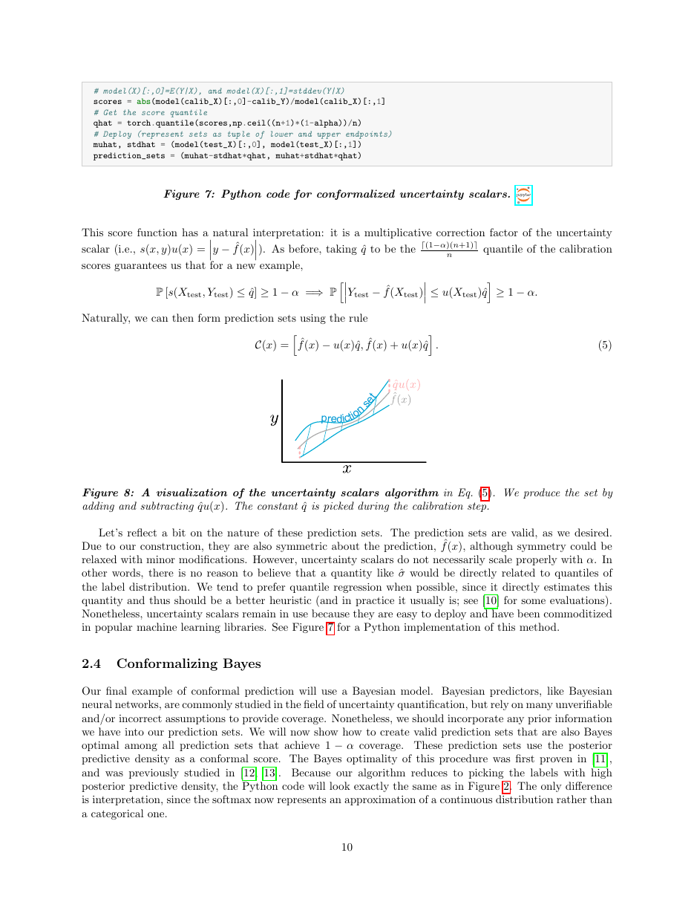

# 컨포멀 예측과 분포 무관 불확도 정량화 입문 (번역)

- 원제: A Gentle Introduction to Conformal Prediction and Distribution-Free Uncertainty Quantification
- 저자: Anastasios N. Angelopoulos, Stephen Bates
- 원문: 같은 폴더의 `Angelopoulos2023_컨포멀예측_입문.pdf` (arXiv 2107.07511v6, 2022-12-07, 51쪽)
- 게재본: Foundations and Trends in Machine Learning 16(4):494-591, 2023. doi:10.1561/2200000101
- 번역 범위: 전문(초록, 본문 1~7장, 부록 A~D, 그림 캡션). 참고문헌은 원문 그대로 둔다.
- 번역 원칙: 수식은 원문 기호를 살려 옮긴다. Python 코드는 원문 그대로 둔다. 그림 안의 글자는 옮기지 않고 캡션만 옮긴다.
- pdftotext로 뽑은 글이라 수식 배치가 깨진 곳이 있다. 그런 곳은 PDF를 보고 다시 적었다.

---

## 초록

블랙박스 머신러닝 모델은 이제 의료 진단처럼 위험이 큰 곳에서 흔히 쓰인다. 이런 곳에서는 큰 사고로 이어지는 모델 실패를 막으려면 불확도를 정량화해야 한다.
컨포멀 예측(conformal prediction, 컨포멀 추론이라고도 한다)은 이런 모델의 예측에 통계적으로 엄밀한 불확도 집합이나 구간을 만드는, 쓰기 쉬운 틀이다.
중요한 점은 이 집합이 분포 무관(distribution-free)한 의미로 유효하다는 것이다. 분포에 대한 가정이나 모델에 대한 가정이 없어도, 명시적이고 점근적이지 않은(유한 표본) 보장을 가진다.
신경망 같은 어떤 사전 학습 모델에도 컨포멀 예측을 쓸 수 있다. 그러면 사용자가 정한 확률(예: 90%)로 정답을 포함하도록 보장된 집합을 만든다.
이해하기 쉽고, 쓰기 쉽고, 일반적이다. 컴퓨터 비전, 자연어 처리, 심층 강화학습 등의 문제에 자연스럽게 적용된다.

이 실습형 입문서는 독자가 하나의 자족적인 문서로 컨포멀 예측과 관련 분포 무관 불확도 정량화 기법을 실제로 쓸 수 있을 만큼 이해하게 하는 것이 목표다.
컨포멀 예측의 실용 이론과 예제를 따라가며 설명한다. 그리고 구조화된 출력, 분포 이동, 시계열, 이상치, 판단을 보류하는 모델 등 복잡한 머신러닝 과제로의 확장을 설명한다.
전체에 걸쳐 설명용 그림, 예제, Python 코드가 많다. 코드 예제마다 실제 자료에 방법을 구현한 Jupyter 노트북이 있다. 노트북은 다음 아이콘을 눌러 쉽게 열고 실행할 수 있다.

## 목차

1. 컨포멀 예측 (4쪽)
   - 1.1 컨포멀 예측 사용 순서 (5쪽)
2. 컨포멀 절차의 예 (6쪽)
   - 2.1 적응 예측 집합을 쓰는 분류 (6쪽)
   - 2.2 컨포멀화한 분위수 회귀 (8쪽)
   - 2.3 스칼라 불확도 추정의 컨포멀화 (9쪽)
     - 2.3.1 추정 표준편차 (9쪽)
     - 2.3.2 다른 1차원 불확도 추정 (9쪽)
   - 2.4 베이즈의 컨포멀화 (10쪽)
3. 컨포멀 예측 평가 (11쪽)
   - 3.1 적응성 평가 (12쪽)
   - 3.2 교정 집합 크기의 영향 (14쪽)
   - 3.3 올바른 포함률 확인 (15쪽)
4. 컨포멀 예측의 확장 (16쪽)
   - 4.1 집단 균형 컨포멀 예측 (16쪽)
   - 4.2 클래스 조건부 컨포멀 예측 (17쪽)
   - 4.3 컨포멀 위험 제어 (18쪽)
   - 4.4 이상치 탐지 (19쪽)
   - 4.5 공변량 이동 아래의 컨포멀 예측 (20쪽)
   - 4.6 분포 드리프트 아래의 컨포멀 예측 (21쪽)
5. 풀이 예제 (23쪽)
   - 5.1 다중 레이블 분류 (23쪽)
   - 5.2 종양 분할 (23쪽)
   - 5.3 시계열 분포 이동이 있는 날씨 예측 (24쪽)
   - 5.4 이상치 탐지로 유해 온라인 댓글 찾기 (25쪽)
   - 5.5 선택적 분류 (25쪽)
6. 완전 컨포멀 예측 (27쪽)
   - 6.1 완전 컨포멀 예측 (27쪽)
   - 6.2 교차 컨포멀 예측, CV+, Jackknife+ (28쪽)
7. 컨포멀 예측의 역사 메모 (28쪽)
- 부록 A. 일반 위험의 분포 무관 제어 (39쪽)
  - A.1 Learn then Test 사용 순서 (40쪽)
    - A.1.1 p값 만들기 속성 강의 (43쪽)
    - A.1.2 족별 오류율 알고리즘 속성 강의 (44쪽)
- 부록 B. 분포 무관 위험 제어의 예 (45쪽)
  - B.1 FDR 제어가 있는 다중 레이블 분류 (46쪽)
  - B.2 분포 밖 탐지와 포함률의 동시 보장 (46쪽)
- 부록 C. 경험적 포함률의 집중 성질 (49쪽)
- 부록 D. 정리와 증명: 컨포멀 예측의 포함 성질 (50쪽)

---

## 1. 컨포멀 예측

그림 1: Imagenet의 예측 집합 예. 여우다람쥐(fox squirrel) 클래스의 예를 점점 어려운 순서로 세 개 보이고, 컨포멀 예측이 만든 예측 집합(즉 C(X_test))을 함께 보인다.

컨포멀 예측 [1-3](컨포멀 추론이라고도 한다)은 어떤 모델에든 예측 집합을 만드는 간단한 방법이다.
짧고 실용적인 영상 분류 예로 소개하고, 뒤 문단에서 일반적으로 설명한다.
큰 흐름은 다음과 같다. 먼저 학습을 마친 예측 모델(예: 신경망 분류기) f̂ 에서 시작한다. 그 다음 적은 양의 추가 교정(calibration) 자료로 이 분류기의 예측 집합(가능한 레이블의 집합)을 만든다. 이것을 교정 단계라고 부르기도 한다.

형식적으로 쓰면 이렇다. 입력은 영상이고, 각 영상은 K개 클래스 중 하나를 담는다. 각 클래스의 추정 확률(softmax 점수)을 내는 분류기 f̂(x) ∈ [0,1]^K 에서 시작한다.
학습에 쓰지 않은 새 i.i.d. (영상, 클래스) 쌍을 적당한 수(예: 500개) 떼어 둔다. (X_1, Y_1), ..., (X_n, Y_n) 이고, 교정 자료로 쓴다.
f̂과 교정 자료로, 다음 뜻에서 유효한 가능한 레이블의 예측 집합 C(X_test) ⊂ {1, ..., K} 를 만들려 한다.

$$1-\alpha \le P(Y_{test} \in C(X_{test})) \le 1-\alpha+\frac{1}{n+1} \quad (1)$$

여기서 (X_test, Y_test)는 같은 분포에서 나온 새 시험점이고, α ∈ [0,1] 은 사용자가 고른 오류율이다.
말로 하면, 예측 집합이 정답 레이블을 담을 확률이 거의 정확히 1−α 다. 이 확률은 교정점과 시험점의 무작위성 전체에 대해 주변화(평균)한 것이므로, 이 성질을 주변 포함률(marginal coverage)이라 부른다. Imagenet 자료의 예측 집합 예는 그림 1을 보라.

f̂과 교정 자료로 C를 만들려면, 코드 몇 줄이면 되는 간단한 교정 단계를 거친다(그림 2의 오른쪽).
교정 단계를 더 자세히 설명하면서, 뒤에서 쓸 용어를 소개한다.
먼저 컨포멀 점수 s_i = 1 − f̂(X_i)_{Y_i} 를 정한다. 정답 클래스의 softmax 출력을 1에서 뺀 값이다. 정답 클래스의 softmax 출력이 낮을 때, 즉 모델이 크게 틀릴 때 점수가 높다.
다음이 결정적인 단계다. q̂ 을 s_1, ..., s_n 의 ⌈(n+1)(1−α)⌉/n 경험 분위수로 정한다. ⌈x⌉ 는 올림 함수다(q̂ 은 사실상 1−α 분위수인데, 작은 보정이 붙은 것이다).
마지막으로 새 시험점(X_test는 알고 Y_test는 모름)에 대해, softmax 출력이 충분히 높은 모든 클래스를 담는 예측 집합 C(X_test) = {y : f̂(X_test)_y ≥ 1 − q̂} 를 만든다(그림 2).
놀랍게도 이 알고리즘은 어떤 모델(틀린 모델일 수도 있다)을 쓰든, 자료의 (모르는) 분포가 무엇이든, (1)을 만족하도록 보장된 예측 집합을 준다.


그림 2: 컨포멀 예측의 그림 설명과 대응하는 Python 코드. 그림의 세 칸은 (1) 떼어 둔 자료에서 점수 계산, (2) 분위수 구하기, (3) 예측 집합 만들기다.

```python
# 1: get conformal scores. n = calib_Y.shape[0]
cal_smx = model(calib_X).softmax(dim=1).numpy()
cal_scores = 1-cal_smx[np.arange(n),cal_labels]
# 2: get adjusted quantile
q_level = np.ceil((n+1)*(1-alpha))/n
qhat = np.quantile(cal_scores, q_level, method='higher')
val_smx = model(val_X).softmax(dim=1).numpy()
prediction_sets = val_smx >= (1-qhat) # 3: form prediction sets
```

### 덧붙임

C를 어떻게 해석할지 생각해 보자. 함수 C는 집합 값을 낸다. 영상 하나를 받아 그림 1처럼 클래스의 집합을 낸다. 모델의 softmax 출력이 집합을 만드는 데 쓰인다.
이 방법은 입력마다 적응적으로 다른 출력 집합을 만든다. 모델이 불확실하거나 영상 자체가 어려우면 집합이 커진다. 이것은 바라는 성질이다. 집합 크기가 모델의 확신 정도를 알려 주기 때문이다.
또 C(X_test)는 영상 X_test가 속할 수 있는 그럴듯한 클래스들의 집합으로 해석할 수 있다. 마지막으로 C는 유효하다. 즉 (1)을 만족한다(각주 1). 뒤에서 보듯 C의 이런 성질은 회귀 같은 다른 머신러닝 문제로 자연스럽게 옮겨진다.

일반화를 염두에 두고, 분류 문제에서 무슨 일이 있었는지 자세히 되짚어 보자.
처음에 우리는 내장된, 그러나 경험적인(heuristic) 불확도 개념을 가진 모델을 받았다. softmax 출력이다. softmax 출력은 각 클래스의 조건부 확률을 재려 한다. 즉 softmax 벡터의 j번째 값은 입력 영상 x가 주어졌을 때 클래스 j의 확률 P(Y = j | X = x)를 추정한다.
그러나 softmax 출력이 쓸 만하다는 보장은 없었다. 마음대로 과적합되었거나 달리 믿을 수 없을 수 있다. 그래서 softmax 출력을 액면 그대로 받지 않고, 떼어 둔 집합으로 그 결함을 보정했다.

떼어 둔 집합에는 모델이 학습 중에 본 적 없는 새 자료점 n ≈ 500개가 있었다. 덕분에 성능을 정직하게 평가할 수 있었다.
보정은 컨포멀 점수를 계산하는 것이었다. 이 점수는 모델이 불확실할 때 커지지만, 그 자체로는 유효한 예측 구간이 아니다. 이 예에서 컨포멀 점수는 1에서 정답 클래스의 softmax 출력을 뺀 값이었지만, 일반적으로 점수는 x와 y의 어떤 함수여도 된다.
그 다음 q̂ 을 점수의 대략 1−α 분위수로 잡았다. 이 경우 분위수는 쉽게 해석된다. α = 0.1이면 정답 클래스 softmax 출력의 최소 90%가 1 − q̂ 위에 있음이 보장된다(부록 D에서 엄밀히 증명한다).
이 사실을 이용해, 시험 때 새 영상 X_test의 softmax 출력을 얻고 1 − q̂ 위의 모든 클래스를 예측 집합 C(X_test)에 모았다. 새 정답 클래스 Y_test의 softmax 출력이 최소 90% 확률로 1 − q̂ 위에 있음이 보장되므로, 마침내 식 (1)의 보장을 얻는다.

### 1.1 컨포멀 예측 사용 순서

요약에서 말했듯 컨포멀 예측은 softmax 출력이나 분류 문제에만 쓰는 것이 아니다. 사실 컨포멀 예측은 어떤 모델의 어떤 경험적 불확도 개념이든 엄밀한 것으로 바꾸는 방법으로 볼 수 있다(아래 그림).
컨포멀 예측은 밑바탕의 예측 문제가 이산인지 연속인지, 분류인지 회귀인지 상관하지 않는다.

(그림: 입력별 경험적 불확도 → 컨포멀 예측 → 입력별 엄밀한 불확도)

다음은 일반 입력 x와 출력 y(꼭 이산일 필요 없음)에 대한 컨포멀 예측의 개요다.

1. 사전 학습 모델로 경험적 불확도 개념을 정한다.
2. 점수 함수 s(x, y) ∈ ℝ 를 정한다. (점수가 클수록 x와 y가 잘 안 맞는다는 뜻이다.)
3. 교정 점수 s_1 = s(X_1, Y_1), ..., s_n = s(X_n, Y_n) 의 ⌈(n+1)(1−α)⌉/n 분위수로 q̂ 을 계산한다.
4. 이 분위수로 새 예의 예측 집합을 만든다.

$$C(X_{test}) = \{y : s(X_{test}, y) \le \hat q\} \quad (2)$$

앞에서처럼 이 집합은 어떤 점수 함수(정보가 없는 것이라도)와 어떤 자료 분포(모르는 것이라도)에서도 (1)의 유효성을 만족한다. 포함 보장을 형식적으로 쓰면 다음과 같다.

각주 1: Y가 이산이므로 상한까지 만족하려면 동률 처리(tie-breaking)를 하는 작은 수정이 필요하다([4] 참고. 실무에서는 이 무작위화를 보통 무시한다). 이후로는 동률 처리를 무시한다.

**정리 1 (컨포멀 포함 보장; Vovk, Gammerman, Saunders [5]).** (X_i, Y_i)_{i=1,...,n} 과 (X_test, Y_test) 가 i.i.d.라 하고, q̂ 을 위 3단계처럼, C(X_test)를 위 4단계처럼 정하자. 그러면 다음이 성립한다.

$$P(Y_{test} \in C(X_{test})) \ge 1-\alpha$$

증명과 (1)의 상한을 포함한 진술은 부록 D를 보라.
위의 것은 컨포멀 예측의 한 특수한 경우로, 분할 컨포멀 예측(split conformal prediction)이라 부른다. 가장 널리 쓰이는 형태이고, 이 글의 주된 대상이다. 그림을 완성하기 위해, 가장 일반적인 형태의 컨포멀 예측은 6장에서 설명하고, 문헌 개관은 7장에서 한다.

### 점수 함수의 선택

처음 보면 너무 좋아서 믿기 어렵다. 의심 많은 독자는 이렇게 물을 수 있다.

> 밑바탕 모델의 경험적 불확도 개념이 아무리 나빠도, 어떻게 통계적으로 유효한 예측 집합을 만들 수 있는가?

부록 D의 증명에서 얻는 수학적 이해를 보충할 직관을 주자.
대략 말해, 점수 s_i가 입력을 모델 오차가 작은 것부터 큰 것까지 올바르게 줄 세우면, 결과 집합은 쉬운 입력에서 작고 어려운 입력에서 크다. 점수가 이 순서를 근사하지 못할 만큼 나쁘면, 집합은 쓸모가 없다.
예를 들어 점수가 무작위 잡음이면, 집합은 레이블 공간에서 무작위로 뽑은 표본을 담는다. 그 표본은 유효한 주변 포함률을 줄 만큼만 크다.
이것은 컨포멀 예측의 중요한 사실을 보여 준다. **보장은 항상 성립하지만, 예측 집합이 쓸모 있는지는 주로 점수 함수가 정한다.**
놀랄 일은 아니다. 점수 함수에는 문제와 자료에 대해 우리가 아는 거의 모든 정보가 들어간다. 밑바탕 모델 자체도 포함된다. 예를 들어 분류 문제와 회귀 문제에 컨포멀 예측을 쓸 때의 주된 차이는 점수의 선택이다.
한 모델에도 가능한 점수 함수가 많고, 성질이 서로 다르다. 그래서 알맞은 점수 함수를 만드는 것은 중요한 공학적 선택이다. 다음으로 좋은 점수 함수의 예를 몇 개 보인다.

## 2. 컨포멀 절차의 예

이 장에서는 여러 상황에 적용한 컨포멀 예측의 예를 보여, 독자가 실제로 배치할 수 있는 기법 모음을 주려 한다.
이 장에서는 1차원 Y만 다루고, 컨포멀 점수가 작을수록 모델이 더 확신한다는 뜻이다(이런 점수를 비순응 점수, nonconformity score라 한다).
고차원 Y, 복잡한(또는 여러) 오차 개념, 실수마다 비용이 다른 경우 같은 더 풍부한 상황은 흔히 위험 제어(risk control)의 언어가 필요하다. 부록 A에서 개관한다.

### 2.1 적응 예측 집합을 쓰는 분류

1장의 분류 예를 개선하는 것으로 예제를 시작하자.
앞의 방법은 평균 크기가 가장 작은 예측 집합을 만든다 [6]. 하지만 어려운 하위 집단은 덜 덮고(undercover) 쉬운 하위 집단은 더 덮는(overcover) 경향이 있다.
여기서는 이 문제를 피하는 적응 예측 집합(adaptive prediction sets, APS)이라는 다른 방법을 만든다. [7]과 [4]를 따른다.

이 새 절차의 동기는 이렇다. softmax 출력 f̂(X_test)가 Y_test | X_test 의 완벽한 모델이라면, 점수가 높은 클래스부터 차례로 넣다가 그 합이 1−α를 막 넘을 때 멈추면 된다.

```python
# Get scores. calib_X.shape[0] == calib_Y.shape[0] == n
cal_pi = cal_smx.argsort(1)[:,::-1]; cal_srt = np.take_along_axis(cal_smx,cal_pi,axis=1).cumsum(axis=1)
cal_scores = np.take_along_axis(cal_srt,cal_pi.argsort(axis=1),axis=1)[range(n),cal_labels]
# Get the score quantile
qhat = np.quantile(cal_scores, np.ceil((n+1)*(1-alpha))/n, interpolation='higher')
# Deploy (output=list of length n, each element is tensor of classes)
val_pi = val_smx.argsort(1)[:,::-1]; val_srt = np.take_along_axis(val_smx,val_pi,axis=1).cumsum(axis=1)
prediction_sets = np.take_along_axis(val_srt <= qhat,val_pi.argsort(axis=1),axis=1)
```

그림 3: 적응 예측 집합의 Python 코드.

이 오라클 알고리즘을 형식적으로 쓰면 다음과 같다.

$$\{\pi_1(x), ..., \pi_k(x)\},\quad k = \sup\Big\{k' : \sum_{j=1}^{k'} \hat f(X_{test})_{\pi_j(x)} < 1-\alpha\Big\} + 1$$

π(x)는 {1, ..., K}를 f̂(X_test)가 큰 것부터 작은 것 순으로 정렬하는 순열이다.
하지만 실제로는 f̂(X_test)가 완벽하지 않아서, 이 절차는 포함률을 주지 못한다. 경험적 불확도 개념만 줄 뿐이다. 그래서 컨포멀 예측으로 이것을 엄밀한 불확도 개념으로 바꾼다.

이를 위해 오라클 알고리즘에서 착안한 점수 함수를 정한다.

$$s(x,y) = \sum_{j=1}^{k} \hat f(x)_{\pi_j(x)},\quad y = \pi_k(x)$$

다시 말해, 정답 레이블에 닿을 때까지 클래스를 차례로 집합에 넣고, 닿으면 멈춘다. 1장의 점수와 달리, 이 점수는 정답 클래스만이 아니라 모든 클래스의 softmax 출력을 쓴다.

모든 컨포멀 절차처럼, 다음 단계는 q̂ = Quantile(s_1, ..., s_n; ⌈(n+1)(1−α)⌉/n) 로 두는 것이다. 그 다음 예측 집합 {y : s(x, y) ≤ q̂} 를 만드는데, 크기 0인 집합을 피하도록 조금 고친다.

$$C(x) = \{\pi_1(x), ..., \pi_k(x)\},\quad k = \sup\Big\{k' : \sum_{j=1}^{k'} \hat f(x)_{\pi_j(x)} < \hat q\Big\} + 1 \quad (3)$$

그림 3은 이 방법을 구현하는 Python 코드다. 늘 그렇듯 이 불확도 집합(동률 처리 포함)은 (1)을 만족한다. 자세한 내용과 큰 실용적 개선은 [4]를 보라. 여기서 그 개선을 구현했다.

그림 4: 식 (3)의 적응 예측 집합 알고리즘의 시각화. 클래스를 가능성이 큰 것부터 작은 것 순으로 넣고, 누적 softmax 출력이 분위수를 넘을 때까지 넣는다.

```python
# Get scores
cal_scores = np.maximum(cal_labels-model_upper(cal_X), model_lower(cal_X)-cal_labels)
# Get the score quantile
qhat = np.quantile(cal_scores, np.ceil((n+1)*(1-alpha))/n, interpolation='higher')
# Deploy (output=lower and upper adjusted quantiles)
prediction_sets = [val_lower - qhat, val_upper + qhat]
```

그림 5: 컨포멀화한 분위수 회귀의 Python 코드.

### 2.2 컨포멀화한 분위수 회귀

다음으로 연속 출력을 가진 회귀 문제에 불확도를 넣는 방법을 [8]의 알고리즘을 따라 보인다. 기본 모델로 분위수 회귀 [9]를 쓴다.
다시 말하면, 분위수 회귀 알고리즘은 가능한 x 값마다 Y_test | X_test = x 의 γ 분위수를 배우려 한다. 참 분위수를 t_γ(x), 적합한 모델을 t̂_γ(x) 라 부르자.
정의상 Y_test | X_test = x 는 5% 확률로 t_0.05(x) 아래에, 5% 확률로 t_0.95(x) 위에 떨어지므로, 구간 [t̂_0.05(x), t̂_0.95(x)] 는 대략 90% 포함률을 가질 것으로 기대한다.
하지만 적합한 분위수가 부정확할 수 있으므로, 이것을 컨포멀화한다. 컨포멀화한 분위수 회귀의 Python 의사코드는 그림 5에 있다.

이런 분위수 두 개 t_{α/2}, t_{1−α/2} 를 내도록 알고리즘을 학습한 뒤(표준 손실 함수로 할 수 있다. 아래 참고), 점수를 y와 가장 가까운 분위수 사이의 차로 정할 수 있다.

$$s(x,y) = \max\{\hat t_{\alpha/2}(x) - y,\ y - \hat t_{1-\alpha/2}(x)\}$$

교정 집합에서 점수를 계산하고 q̂ = Quantile(s_1, ..., s_n; ⌈(n+1)(1−α)⌉/n) 로 두면, 다음처럼 유효한 예측 구간을 만들 수 있다.

$$C(x) = [\hat t_{\alpha/2}(x) - \hat q,\ \hat t_{1-\alpha/2}(x) + \hat q] \quad (4)$$

직관적으로 집합 C(x)는 포함률을 맞추려고 분위수 사이 거리를 q̂ 만큼 늘이거나 줄일 뿐이다.

(그림 6은 원문 8쪽 참고.)

그림 6: 식 (4)의 컨포멀화한 분위수 회귀 알고리즘의 시각화. 교정 단계에서 고른 상수 q̂ 으로 분위수를 조정한다.

앞에서처럼 C는 식 (1)의 포함 성질을 만족한다. 하지만 1장의 예와 달리 C는 이제 클래스의 집합이 아니라 ℝ 위의 연속 구간이다.
연속 값 구간을 얻는 방법이 분위수 회귀만 있는 것은 아니다. 하지만 흔히 가장 좋은 방법이다. 특히 α를 미리 알 때 그렇다.
이유는 컨포멀 예측 없이도 분위수 회귀로 만든 구간 [t̂_{α/2}(x), t̂_{1−α/2}(x)] 가 처음부터 포함률이 좋기 때문이다. 게다가 점근적으로 유효한 조건부 포함률(3장에서 설명할 개념)을 가진다. 이 성질이 컨포멀 절차를 거쳐도 이어져, 성능이 좋은 예측 집합이 된다.

분위수 회귀의 매력 하나는, 손실 함수를 분위수 손실(흔히 핀볼 손실이라 부른다)로 바꾸기만 하면 어떤 기본 모델 위에도 쉽게 얹을 수 있다는 점이다.

$$L_\gamma(\hat t_\gamma, y) = (y - \hat t_\gamma)\gamma\,\mathbb{1}\{y > \hat t_\gamma\} + (\hat t_\gamma - y)(1-\gamma)\,\mathbb{1}\{y \le \hat t_\gamma\}$$

(그림: 핀볼 손실의 모양)

분위수 회귀는 L1 노름 회귀의 일반화로 생각하면 된다. γ = 0.5이면 손실은 L_0.5 = |t̂_γ(x) − y|/2 가 되어, t̂_0.5(x)가 조건부 중앙값으로 수렴하게 한다. γ를 바꾸면 위 그림처럼 L1 노름의 기울기가 바뀌어 다른 분위수를 겨냥한다.
실제로는 신경망 같은 어떤 알고리즘이든 끝에서 MSE 대신 분위수 손실을 쓰면 분위수로 회귀할 수 있다.

### 2.3 스칼라 불확도 추정의 컨포멀화

#### 2.3.1 추정 표준편차

분위수 회귀 대신 쓸 수 있는 다음 예는, 연속 y의 예측 집합을 만드는 다른 방법이다. 덜 풍부하지만 더 흔한 경험적 불확도 개념, 곧 표준편차 추정값 σ̂(x)를 쓴다.
예를 들어 Y_test | X_test = x 가 어떤 모수 분포(예: 가우스 분포)를 따른다고 가정하고, 그 분포의 평균과 분산을 내도록 모델을 학습하면 불확도 스칼라를 만들 수 있다.
정확히 말하면, 이 설정에서는 Y_test | X_test = x ∼ N(µ(x), σ(x)) 로 모형화하고, 모델 f̂(x)와 σ̂(x)를 각각 E[Y_test | X_test = x] 와 √Var[Y_test | X_test = x] 에 대해 자료의 우도를 최대화하도록 학습한다.
그 다음 f̂(x)를 점 예측으로, σ̂(x)를 불확도로 쓴다. 이 전략은 너무 흔해서 상품화되어 있다. PyTorch에는 GaussianNLLLoss 같은 내장 손실이 있어 신경망을 이렇게 학습할 수 있다.
하지만 보통 Y_test | X_test 가 가우스가 아님을 안다. 그래서 자료가 무한히 많아도 σ̂(x)가 꼭 믿을 만하지는 않다. 컨포멀 예측으로 이 경험적 불확도 개념을 f̂(x) ± q̂σ̂(x) 꼴의 엄밀한 예측 구간으로 바꿀 수 있다.

#### 2.3.2 다른 1차원 불확도 추정

더 일반적으로, 값이 클수록 불확도가 크다는 뜻인 함수 u(x)가 있다고 하자. 이 숫자 하나는 표준편차 말고도 여러 뜻일 수 있다.
예를 들어 불확도 스칼라의 한 예는 사용자가 잔차 크기의 모델을 만드는 것이다. 이 경우 사용자는 먼저 x로 y를 예측하는 모델 f̂을 적합한다. 그 다음 |y − f̂(x)| 를 예측하는 두 번째 모델 r̂(같은 신경망일 수도 있다)을 적합한다.
r̂이 완벽하다면 집합 [f̂(x) − r̂(x), f̂(x) + r̂(x)] 의 포함률이 완벽할 것이다. 하지만 학습한 오차 모델 r̂은 실제로는 흔히 나쁘다.

이런 불확도 스칼라는 이 문서에서 자세히 다룰 수 있는 것보다 훨씬 많다. 예를 들면 다음과 같다.

1. 여러 모델의 앙상블에서 f̂(x)의 분산을 잰다.
2. 신경망의 노드 일부를 무작위로 끄면서(dropout) f̂(x)의 분산을 잰다.
3. 작은 무작위 입력 섭동에 대한 f̂(x)의 분산을 잰다.
4. 생성 모델에 넣는 잡음 표본을 바꿔 가며 f̂(x)의 분산을 잰다.
5. 적대적 섭동을 줄 때 f̂(x)가 바뀌는 크기를 잰다. 등등.

이 경우들은 모두 같은 방식으로 다룬다. 어떤 점 예측 f̂(x)가 있고, 모델이 불확실하면 크고 아니면 작은 어떤 불확도 스칼라 u(x)가 있다(잔차 설정에서는 u(x) := r̂(x), 가우스 설정에서는 u(x) := σ̂(x)).
일반성을 위해 이 표기로 진행하지만, u는 어떤 함수로든 바꿀 수 있음을 이해하기 바란다.

경험적 불확도 개념을 손에 쥐었으니, 점수 함수를 정할 수 있다.

$$s(x,y) = \frac{|y - \hat f(x)|}{u(x)}$$

```python
# model(X)[:,0]=E(Y|X), and model(X)[:,1]=stddev(Y|X)
scores = abs(model(calib_X)[:,0]-calib_Y)/model(calib_X)[:,1]
# Get the score quantile
qhat = torch.quantile(scores,np.ceil((n+1)*(1-alpha))/n)
# Deploy (represent sets as tuple of lower and upper endpoints)
muhat, stdhat = (model(test_X)[:,0], model(test_X)[:,1])
prediction_sets = (muhat-stdhat*qhat, muhat+stdhat*qhat)
```

그림 7: 컨포멀화한 불확도 스칼라의 Python 코드.

이 점수 함수는 자연스럽게 해석된다. 불확도 스칼라에 곱하는 보정 계수다(즉 s(x, y)u(x) = |y − f̂(x)|).
앞에서처럼 q̂ 을 교정 점수의 ⌈(1−α)(n+1)⌉/n 분위수로 잡으면, 새 예에 대해 다음이 보장된다.

$$P[s(X_{test}, Y_{test}) \le \hat q] \ge 1-\alpha \implies P\big[|Y_{test} - \hat f(X_{test})| \le u(X_{test})\hat q\big] \ge 1-\alpha$$

그러면 자연스럽게 다음 규칙으로 예측 집합을 만들 수 있다.

$$C(x) = [\hat f(x) - u(x)\hat q,\ \hat f(x) + u(x)\hat q] \quad (5)$$



그림 8: 식 (5)의 불확도 스칼라 알고리즘의 시각화. q̂u(x)를 더하고 빼서 집합을 만든다. 상수 q̂ 은 교정 단계에서 고른다. (위 그림은 원문 10쪽 전체로, 그림 7의 코드와 그림 8, 2.4절 앞부분이 함께 있다.)

이 예측 집합의 성질을 조금 생각해 보자. 바라던 대로 예측 집합은 유효하다. 만든 방식 때문에 예측값 f̂(x)를 중심으로 대칭이기도 하다. 다만 작은 수정으로 대칭을 풀 수 있다.
하지만 불확도 스칼라는 α에 맞게 제대로 늘거나 줄지 않을 수 있다. 다시 말해 σ̂ 같은 양이 레이블 분포의 분위수와 직접 관계있다고 믿을 이유가 없다.
가능하면 분위수 회귀를 더 좋아한다. 이 양을 직접 추정하므로 더 나은 경험적 지표일 것이기 때문이다(실제로도 보통 그렇다. 평가는 [10] 참고).
그래도 불확도 스칼라는 배치하기 쉽고 유명한 머신러닝 라이브러리에 상품화되어 있어서 계속 쓰인다. 이 방법의 Python 구현은 그림 7을 보라.

### 2.4 베이즈의 컨포멀화

컨포멀 예측의 마지막 예는 베이즈 모델을 쓴다. 베이즈 신경망 같은 베이즈 예측기는 불확도 정량화 분야에서 흔히 연구되지만, 포함률을 주려면 검증할 수 없거나 틀린 가정을 많이 기댄다.
그래도 가진 사전 정보는 예측 집합에 넣어야 한다. 이제 유효하면서도, 1−α 포함률을 달성하는 모든 예측 집합 가운데 베이즈 최적인 예측 집합을 만드는 법을 보인다.
이 예측 집합은 사후 예측 밀도를 컨포멀 점수로 쓴다. 이 절차의 베이즈 최적성은 [11]에서 처음 증명되었고, 그 전에 [12, 13]에서 연구되었다.
알고리즘이 사후 예측 밀도가 높은 레이블을 고르는 것으로 줄어들기 때문에, Python 코드는 그림 2와 똑같다. 다른 것은 해석뿐이다. 이제 softmax는 범주 분포가 아니라 연속 분포의 근사를 나타낸다.

먼저 베이즈 모델 f̂(y | x)가 주어졌을 때 베이즈주의자가 무엇을 할지 설명하자. f̂(y | x)는 입력 X_test = x에서 레이블 y의 Y_test 사후 분포 값을 추정한다.
필요한 가정(주로 올바르게 지정된 모델과 점근적으로 큰 n)을 모두 믿는다면, 다음이 최적 예측 집합이다.

$$S(x) = \{y : \hat f(y \mid x) > t\},\quad t \text{는 } \int_{y \in S(x)} \hat f(y \mid x)\,dy = 1-\alpha \text{가 되도록 고른다.}$$

하지만 모델과 자료에 가정을 둘 수 없으므로, f̂(y | x)는 경험적 불확도 개념으로만 볼 수 있다.

이제 익숙해진 점검 목록을 따라 컨포멀 점수를 정할 수 있다.

$$s(x,y) = -\hat f(y \mid x)$$

모델이 불확실하면 높고 아니면 낮다. 교정 자료에서 q̂ 을 계산한 뒤 다음 예측 집합을 만든다.

$$C(x) = \{y : \hat f(y \mid x) > -\hat q\} \quad (6)$$

그림 9: 식 (6)의 컨포멀화한 베이즈 알고리즘의 시각화. 예측 집합은 사후 예측 밀도의 상위 수준 집합이다.

이 집합은 임계값 q̂ 을 컨포멀 예측으로 골랐으므로 유효하다. 또 어떤 기술적 가정이 만족되면, 1−α 포함률을 가진 모든 예측 집합 가운데 베이즈 위험이 가장 작다.
더 정확히 말하면 [11]의 가정 아래에서 C(X_test)는 1−α 포함률을 가진 어떤 컨포멀 절차보다 평균 크기가 작다. 여기서 평균은 자료와 모수에 대해 취한다.
결정 이론에 익숙한 사람에게는 놀랍지 않은 결과다. 여기서 하는 논증은 네이만-피어슨 보조정리와 비슷하게 느껴진다. 이것으로 마지막 예를 마친다.

### 논의

예에서 보았듯 컨포멀 예측은 쓰임새가 많은 간단하고 실용적인 기법이다. 구현이 쉽고 계산량도 무시할 만하다.
또 위의 네 예는 평균 크기, 적응성, 베이즈 위험 같은 여러 최적성 개념으로 점수 함수를 설계하는 길잡이가 된다.
더 있다. 컨포멀 예측은 지금 보이는 것보다 더 넓게 쓸 수 있다. 4장에서 이상치 탐지, 영상 분할, 순차 시계열 예측 같은 다른 예측 과제로의 확장을 개관한다.
그 확장을 다루기 전에, 표준 설정에서 컨포멀 예측의 진단, 특히 조건부 포함률이라는 중요한 주제를 깊이 살펴본다.

## 3. 컨포멀 예측 평가

앞 두 장에서 엄밀한 통계적 보장을 만족하는 유효한 예측 집합을 만드는 법을 배웠다. 이제 그것을 평가하는 법을 논한다. 평가는 두 범주 중 하나에 속한다.

1. **적응성 평가.** 평균 집합 크기가 가장 작은 컨포멀 절차가 꼭 가장 좋은 것은 아님을 꼭 기억해야 한다. 좋은 컨포멀 절차는 모델의 불확도를 충실히 반영하여 쉬운 입력에는 작은 집합을, 어려운 입력에는 큰 집합을 준다. 이 적응성은 컨포멀 예측의 포함 보장에서 나오지 않지만, 실제 배치에서는 양보할 수 없다. 적응성을 형식화하고, 그 결과를 살피고, 평가하는 실용 알고리즘을 제안한다.
2. **정확성 점검.** 컨포멀 예측을 올바르게 구현했는지 시험하는 데 쓴다. 포함률이 정리 1을 만족하는지 경험적으로 확인한다. 이 성질이 성립하는지 엄밀히 평가하려면 실제 자료에 있는 유한 표본 변동을 꼼꼼히 따져야 한다. 해롭지 않은 흔들림의 크기에 대한 명시적 공식을 만든다. 포함률이 1−α에서 이 공식보다 크게 벗어나면 구현에 문제가 있다.

제안하는 평가 다수는 계산량이 많아, 서로 다른 자료 분할에서 전체 컨포멀 절차를 최소 100번 돌려야 한다. 점수 계산이 오래 걸리면 단순한 구현은 느릴 수 있다.
간단한 계산 요령과 전략적 캐싱으로 이 과정을 몇 자릿수 빠르게 할 수 있다. 그래서 수학적 설명 사이에 이 계산을 효율적으로 구현하는 코드를 끼워 넣는다.

### 3.1 적응성 평가

어떤 컨포멀 절차든 (1)을 만족하는 예측 구간을 주지만, 그런 절차는 많고 다른 중요한 점에서 서로 다르다.
특히 컨포멀 예측의 핵심 설계 고려 사항은 적응성이다. 어려운 입력에는 더 큰 집합을, 쉬운 입력에는 더 작은 집합을 돌려주기를 바란다.
대부분의 합리적인 컨포멀 절차는 어느 정도 이것을 만족하지만, 여기서는 사용자가 컨포멀 절차를 점검하고 여러 대안 절차를 비교할 수 있도록 적응성의 정확한 지표를 논한다.

**집합 크기.** 첫 단계는 집합 크기의 히스토그램을 그리는 것이다. 이 히스토그램은 두 가지로 돕는다.
첫째, 평균 집합 크기가 크면 컨포멀 절차가 그다지 정밀하지 않다는 뜻이고, 점수나 밑바탕 모델에 문제가 있을 수 있다.
둘째, 집합 크기의 퍼짐은 예측 집합이 예의 어려움에 제대로 적응하는지 보여 준다. 퍼짐이 넓을수록 보통 바람직하다. 절차가 쉬운 입력과 어려운 입력을 실제로 구별한다는 뜻이기 때문이다.

(그림: 집합 크기 히스토그램 두 개. 퍼짐이 좁은 것과 넓은 것)

포함률과 집합 크기를 그린 뒤 평가를 멈추고 싶을 수 있지만, 중요한 질문이 아직 남는다. 집합 크기가 잘 퍼져 있으면 보통 더 좋지만, 집합이 X의 어려움에 제대로 적응한다는 뜻은 아니다.
집합 크기에 동적 범위가 있다는 것을 넘어, 큰 집합이 어려운 예에서 나오는지 확인해야 한다. 다음으로 이 개념을 형식화하고 평가 지표를 준다.

**조건부 포함률.** 적응성은 보통 조건부 포함률(conditional coverage) [14] 성질을 요구하는 것으로 형식화한다.

$$P[Y_{test} \in C(X_{test}) \mid X_{test}] \ge 1-\alpha \quad (7)$$

즉 입력 X_test의 모든 값에 대해 1−α 포함률을 가진 예측 집합을 돌려주려 한다. 이것은 컨포멀 예측이 달성을 보장하는 (1)의 주변 포함률보다 강한 성질이다. 실제로 가장 일반적인 경우에는 조건부 포함률을 달성할 수 없다 [14].
다시 말해 컨포멀 절차가 (7)을 만족한다는 보장은 없으므로, 우리 절차가 얼마나 가깝게 근사하는지 확인해야 한다.

주변 포함률과 조건부 포함률의 차이는 미묘하지만 실무에서 매우 중요하므로, 여기서 시간을 들여 생각해 보자.
사람이 두 집단 A와 B로 나뉘고, 비율이 90%와 10%라 하자. 예측 집합이 A 집단 사람에게는 항상 Y를 덮고 B 집단 사람에게는 절대 덮지 않는다고 하자. 그러면 예측 집합은 90% 포함률을 갖지만 조건부 포함률은 갖지 않는다.
조건부 포함률은 두 집단 모두에서 최소 90% 덮는다는 뜻을 포함한다. 이것은 필요조건이지만 충분조건은 아니다. 조건부 포함률은 특정한 한 사람에 대해 예측 집합의 확률이 ≥ 90%여야 한다는 매우 강한 성질이다. 다시 말해 모집단의 어떤 부분집합에서도 포함률이 ≥ 90%여야 한다.
조건부 포함률과 주변 포함률의 차이를 시각화한 것은 그림 10을 보라.

그림 10: 여러 포함률 개념의 예측 집합. 포함률 없음, 주변 포함률, 조건부 포함률(90% 수준). (그림 안: 집단 1 5%, 집단 2 14% / 집단 1 100%, 집단 2 80% / 집단 1 90%, 집단 2 90%. 위는 집단별 오류, 아래는 회귀 예.) 주변 포함률의 경우 오류가 모두 같은 집단과 X 공간의 같은 영역에서 일어난다. 조건부 포함률은 이런 행동을 허용하지 않고, 오류가 고르게 흩어진다.

**특징 층화 포함률 지표.** 조건부 포함률의 첫 지표로, 앞에서 든 예, 곧 어떤 집단들에서 포함률이 고르지 않은 경우를 형식화한다. 이 집단은 인종 같은 이산 범주일 수도, 나이 구간 같은 연속 특징을 나눈 것일 수도 있다.
형식적으로, 특징 X_{i,1}^{(val)} 이 어떤 G에 대해 {1, ..., G} 에서 값을 갖는다고 하자. (여기서 i = 1, ..., n_val 은 검증 집합의 예 번호이고, 각 특징의 첫 좌표가 집단이다.) I_g ⊂ {1, ..., n_val} 을 X_{i,1}^{(val)} = g 인 관측의 집합이라 하자(g = 1, ..., G).
조건부 포함률은 절차가 X_test의 모든 값에서 같은 포함률을 갖는다는 뜻을 포함하므로, 다음 척도를 쓴다.

$$\text{FSC 지표: } \min_{g \in \{1,...,G\}} \frac{1}{|I_g|} \sum_{i \in I_g} \mathbb{1}\{Y_i^{(val)} \in C(X_i^{(val)})\}$$

말로 하면, 이산 특징이 값 g를 갖는 모든 경우에서 관측한 포함률(의 최솟값)이다. 조건부 포함률을 달성하면 이 값은 1−α이고, 1−α보다 많이 낮을수록 조건부 포함률을 더 크게 어긴다는 뜻이다. 이 지표는 연속 특징을 유한 개 범주로 나누어 쓸 수도 있다.

**크기 층화 포함률 지표.** 다음으로, 컨포멀 절차가 (7)에 얼마나 가까운지 보는 더 범용 지표를 본다. [4]에서 도입했다.
먼저 C(x)의 가능한 크기를 G개 구간 B_1, ..., B_G 로 나눈다. 예를 들어 분류에서는 C(x)가 원소 1개인지, 2개인지, 2개보다 많은지에 따라 관측을 세 집단으로 나눌 수 있다. I_g ⊂ {1, ..., n_val} 을 구간 g에 드는 관측의 집합이라 하자(g = 1, ..., G). 그러면 다음을 본다.

$$\text{SSC 지표: } \min_{g \in \{1,...,G\}} \frac{1}{|I_g|} \sum_{i \in I_g} \mathbb{1}\{Y_i^{(val)} \in C(X_i^{(val)})\}$$

말로 하면, 집합 크기 |C(x)|가 구간 g에 드는 모든 단위의 관측 포함률이다. 앞에서처럼 조건부 포함률을 달성하면 1−α이고, 1−α보다 많이 낮을수록 더 크게 어긴다.
식은 FSC 지표와 같고 I_g의 정의만 바뀌었다. FSC 지표와 달리, 사용자가 중요한 이산 특징 집합을 미리 정하지 않아도 된다. 어떤 예에도 쓸 수 있는 일반 지표다.

조건부 포함률의 다른 지표는 [15]와 [16]을 보라.

### 3.2 교정 집합 크기의 영향

먼저 잠시 멈춰, 교정 집합 크기가 컨포멀 예측에 어떤 영향을 주는지 논한다. 두 가지 이유로 이 질문을 본다.
첫째, 실제 배치에서 사용자가 이것을 골라야 한다. 대략 결론은, 대부분의 목적에 교정 집합 크기 n = 1000 이면 충분하다는 것이다.
둘째, 교정 집합 크기는 포함률을 올바르게 점검하려면 분석해야 하는 유한 표본 변동의 한 원인이다. 다음 절에서 이 결과를 바탕으로 실제 포함률 점검 방법을 완전하게 설명한다.

교정 집합 크기 n은 컨포멀 예측에 어떤 영향을 주는가? (1)의 포함 보장은 어떤 n에서도 성립하므로, 교정 집합이 아주 작아도 예측 집합의 포함률은 최소 1−α 다.
하지만 직관적으로는 n이 클수록 좋고 더 안정된 절차가 될 것 같다. 이 직관은 옳고, 실제로 더 큰 교정 집합이 유익한 이유를 설명한다. 세부가 미묘하므로 꼼꼼히 따져 본다.

핵심 생각은, 교정 집합을 조건으로 한 컨포멀 예측의 포함률이 확률 변수라는 것이다.
즉 컨포멀 예측 알고리즘을 두 번 돌리되 매번 새 교정 자료를 뽑고, 무한히 많은 검증점에서 포함률을 확인하면, 두 수는 같지 않다.
(1)의 포함 성질은 교정 집합의 무작위성에 대해 평균하면 포함률이 최소 1−α 라는 뜻이다. 하지만 교정 집합 하나를 고정하면, 무한 검증 집합의 포함률은 정확히 1−α가 아닌 어떤 수가 된다.
그래도 그 분포를 분석해서, 포함률의 이런 흔들림을 제어할 만큼 n을 크게 고를 수 있다.

특히 포함률의 분포는 해석적 형태가 있다. Vladimir Vovk가 [14]에서 처음 소개했다.

$$P\big(Y_{test} \in C(X_{test}) \mid \{(X_i, Y_i)\}_{i=1}^n\big) \sim \text{Beta}(n+1-l,\ l),\quad l = \lfloor (n+1)\alpha \rfloor$$

위의 조건부 기댓값은 교정 자료를 고정하고 무한 검증 자료로 잰 포함률이다. 이 사실의 간단한 증명은 [14]에 있다. 여러 n 값에 대한 포함률 분포를 그림 11에 그렸다.

그림 11을 보면, 교정점을 n = 1000개 고르면 포함률이 대개 0.88과 0.92 사이다. 그래서 교정점을 약 1000개 고르라는 대략의 지침이 나온다.
더 형식적으로, 확률 1−δ로 포함률 1−α ± ε 을 달성하는 데 필요한 교정점 수 n을 정확히 계산할 수 있다. 다시 말하지만 평균 포함률은 항상 최소 1−α 다. 모수 δ는 교정 자료를 조건으로 한 포함률의 꼬리 확률을 제어한다.
어떤 δ에서든 필요한 교정 집합 크기 n은 간단한 식으로 명시적으로 계산할 수 있다. 참고용으로 몇 값을 표 1에 적었다. 사용자가 어떤 n과 α에서든 결과를 낼 수 있는 코드가 표에 딸려 있다.


그림 11: α = 0.1에서 n 값마다 무한 검증 집합으로 잰 포함률의 분포(n = 100, 1000, 10000). 분포는 O(n^{−1/2}) 속도로 1−α에 수렴한다. (위 그림은 원문 15쪽 전체로, 표 1과 3.3절 앞부분이 함께 있다.)

| ε | 0.1 | 0.05 | 0.01 | 0.005 | 0.001 |
|---|---|---|---|---|---|
| n(ε) | 22 | 102 | 2491 | 9812 | 244390 |

표 1: δ = 0.1, α = 0.1일 때 포함률 여유 ε 에 필요한 교정 집합 크기 n(ε).

### 3.3 올바른 포함률 확인

당연한 진단으로, 사용자는 컨포멀 절차의 포함률이 올바른지 평가하고 싶을 것이다. 새 교정 집합과 검증 집합으로 절차를 R번 시행하고, 각 시행의 경험적 포함률을 계산하면 된다.

$$C_j = \frac{1}{n_{val}} \sum_{i=1}^{n_{val}} \mathbb{1}\{Y_{i,j}^{(val)} \in C_j(X_{i,j}^{(val)})\},\quad j = 1, ..., R$$

n_val 은 검증 집합 크기, (X_{i,j}^{(val)}, Y_{i,j}^{(val)}) 는 시행 j의 i번째 검증 예, C_j 는 j번째 시행의 교정 자료로 교정한 것이다. C_j의 히스토그램은 그림 11처럼 대략 1−α를 중심으로 놓여야 한다. 마찬가지로 평균값

$$\bar C = \frac{1}{R}\sum_{j=1}^R C_j$$

은 대략 1−α 여야 한다.

실제 자료에서는 컨포멀 알고리즘을 평가할 자료점이 모두 n + n_val 개뿐이라, R번마다 새 자료를 뽑을 수 없다. 그래서 n + n_val 개 자료점을 무작위로 R번 교정 자료와 검증 자료로 나누고 컨포멀을 돌려 포함률 값을 계산한다.
자료점 자체를 여러 번 나누는 대신, 먼저 모든 컨포멀 점수를 캐시한 뒤 여러 무작위 분할에서 포함률 값을 계산할 수 있다. 그림 12의 코드 예와 같다.

제대로 구현하면 컨포멀 예측은 (1)의 부등식을 만족함이 보장된다. 하지만 관측한 포함률에 작은 흔들림이 보여도 걱정할 필요가 없을 수 있다. n, n_val, R이 유한하면 해롭지 않은 흔들림이 생겨, 그림 11의 베타 분포에 폭이 조금 더해진다.
부록 C는 C̄ 의 평균과 표준편차를 분석하는 정확한 이론을 준다. 이로부터 1−α에서 벗어난 것이 구현 문제를 뜻하는지, 해롭지 않은 것인지 알 수 있다. 모든 n, n_val, R 값에서 포함률을 점검하는 코드는 그림 12의 Jupyter 노트북에 있다.

```python
try: # try loading the scores first
  scores = np.load('scores.npy')
except:
  # X and Y have n + n_val rows each
  scores = get_scores(X,Y)
  np.save(scores, 'scores.npy')
# calculate the coverage R times and store in list
coverages = np.zeros((R,))
for r in range(R):
  np.random.shuffle(scores) # shuffle
  calib_scores, val_scores = (scores[:n],scores[n:]) # split
  qhat = np.quantile(calib_scores, np.ceil((n+1)*(1-alpha)/n), method='higher') # calibrate
  coverages[r] = (val_scores <= qhat).astype(float).mean() # see caption
average_coverage = coverages.mean() # should be close to 1-alpha
plt.hist(coverages) # should be roughly centered at 1-alpha
```

그림 12: 효율적인 점수 캐싱으로 포함률을 계산하는 Python 코드. (2)의 컨포멀 집합 식에서, 검증점은 s(X, Y) ≤ q̂ 일 때 그리고 그때만 덮인다. 끝에서 세 번째 줄은 이것으로 포함률을 간단히 계산한다.

## 4. 컨포멀 예측의 확장

여기까지 핵심을 보았다. 어떤 표준 지도 예측 문제에서든 포함률을 가진 예측 집합을 만드는 법이다.
이제 부가 정보, 공변량 이동 등 구조가 다른 예측 과제로 시야를 넓힌다. 이런 특이한 문제는 현실에서 꽤 자주 나오므로, 이를 다루는 실용 컨포멀 알고리즘을 보인다.

### 4.1 집단 균형 컨포멀 예측

어떤 상황에서는 자료의 특정 부분집합들에서 오류율이 같은 예측 구간을 원할 수 있다. 예를 들어 의료 분류기가 모든 인종과 민족 집단에서 올바른 포함률을 갖기를 요구할 수 있다.
이를 형식화하려고, 입력의 첫 특징 X_{i,1} (i = 1, ..., n)이 범주 집단에 대응하는 이산 집합 {1, ..., G} 에서 값을 갖는다고 하자. 그리고 집단 균형 포함률을 요구한다.

$$P(Y_{test} \in C(X_{test}) \mid X_{test,1} = g) \ge 1-\alpha \quad (8)$$

모든 집단 g ∈ {1, ..., G} 에 대해서다. 말로 하면 모든 집단에서 포함률이 1−α 라는 뜻이다. 집단 출력은 자료의 원래 특징을 후처리한 것일 수도 있다. 예를 들어 X_test 값을 이산 집합으로 나눌 수 있다.

표준 컨포멀 예측을 쓰면 각 집단 안의 포함률이 동시에 나온다는 보장이 없음을 기억하라. 즉 (8)이 만족되지 않을 수 있다. 그림 10에서 예를 보았다. 일반 컨포멀 예측의 주변 보장은 모든 오류가 한 집단에서 일어나도 여전히 만족될 수 있다.

집단 균형 포함률을 얻으려면, 아래 그림처럼 집단마다 따로 컨포멀 예측을 돌리면 된다.

(그림: 집단별로 점수를 나누어 각각 분위수를 구하는 모습)

형식적으로, 컨포멀 점수 함수 s가 주어지면 교정 집합의 점수를 집단별로 층화한다.

$$s_i^{(g)} = s(X_j, Y_j),\quad X_{j,1} \text{은 집단 } g \text{의 } i \text{번째 등장}$$

그 다음 각 집단 안에서 컨포멀 분위수를 계산한다.

$$\hat q^{(g)} = \text{Quantile}\Big(s_1^{(g)}, ..., s_{n^{(g)}}^{(g)};\ \frac{\lceil (n^{(g)}+1)(1-\alpha)\rceil}{n^{(g)}}\Big),\quad n^{(g)} \text{은 집단 } g \text{의 예 수}$$

마지막으로 해당 분위수를 먼저 골라 예측 집합을 만든다.

$$C(x) = \{y : s(x,y) \le \hat q^{(x_1)}\}$$

즉 집단 x_1에 드는 점 x에는 임계값 q̂^{(x_1)} 으로 예측 집합을 만든다. 이렇게 고른 C는 (8)을 만족한다. Vovk가 [14]에서 처음 기록했다.

**명제 1 (집단 균형 컨포멀 예측의 오류 제어 보장).** (X_1, Y_1), ..., (X_n, Y_n), (X_test, Y_test) 가 어떤 분포의 i.i.d. 표본이라 하자. 그러면 위에서 정한 집합 C는 (8)의 오류 제어 성질을 만족한다.

### 4.2 클래스 조건부 컨포멀 예측

분류 문제에서는 마찬가지로 모든 정답 클래스마다 포함률을 요구할 수 있다. 예를 들어 입력을 정상 클래스나 암 클래스로 나누는 의료 분류기가 있다면, 정답이 암일 때도 정상일 때도 예측 집합이 95% 맞기를 요구할 수 있다.
형식적으로, Y = {1, ..., K} 인 분류 설정으로 돌아간다. 클래스 균형 포함률을 얻으려 한다.

$$P(Y_{test} \in C(X_{test}) \mid Y_{test} = y) \ge 1-\alpha \quad (9)$$

모든 클래스 y ∈ {1, ..., K} 에 대해서다.

클래스 균형 포함률을 얻으려면 클래스마다 따로 교정한다. 알고리즘은 4.1절의 집단 균형 포함률과 비슷하지만, 시험 때 정답 클래스를 모르므로 고쳐야 한다. (반면 4.1절에서는 집단 정보 X_{test,1}을 입력 특징으로 관측했다.) 아래 그림을 보라.

(그림: 클래스별로 점수를 나누어 각각 분위수를 구하는 모습)

알고리즘은 이렇다. 컨포멀 점수 함수 s가 주어지면 교정 집합의 점수를 클래스별로 층화한다.

$$s_i^{(k)} = s(X_j, Y_j),\quad Y_j \text{는 클래스 } k \text{의 } i \text{번째 등장}$$

그 다음 각 클래스 안에서 컨포멀 분위수를 계산한다.

$$\hat q^{(k)} = \text{Quantile}\Big(s_1^{(k)}, ..., s_{n^{(k)}}^{(k)};\ \frac{\lceil (n^{(k)}+1)(1-\alpha)\rceil}{n^{(k)}}\Big),\quad n^{(k)} \text{은 클래스 } k \text{의 예 수}$$

마지막으로 클래스를 하나씩 돌며 각자의 분위수를 기준으로 예측 집합에 넣는다.

$$C(x) = \{y : s(x,y) \le \hat q^{(y)}\}$$

위 식에서 응답의 임시 값 y를 잡고, 컨포멀 임계값 q̂^{(y)} 로 그것을 예측 집합에 넣을지 정한다. 이렇게 고른 C는 (9)를 만족한다. Vovk가 [14]에서 증명했고, 다른 형태는 [6]에 있다.

**명제 2 (클래스 균형 컨포멀 예측의 오류 제어 보장).** (X_1, Y_1), ..., (X_n, Y_n), (X_test, Y_test) 가 어떤 분포의 i.i.d. 표본이라 하자. 그러면 위에서 정한 집합 C는 (9)의 오류 제어 성질을 만족한다.

### 4.3 컨포멀 위험 제어

지금까지 컨포멀 예측으로 놓침 비율(miscoverage)을 묶는 예측 집합을 만들었다.

$$P(Y_{test} \notin C(X_{test})) \le \alpha \quad (10)$$

하지만 많은 머신러닝 문제에서 자연스러운 오류 개념은 놓침 비율이 아니다. 여기서는 컨포멀 예측이 다음 꼴의 보장도 줄 수 있음을 보인다.

$$E[\ell(C(X_{test}), Y_{test})] \le \alpha \quad (11)$$

C가 커지면 줄어드는 어떤 유계 손실 함수 ℓ에 대해서다. 이것을 컨포멀 위험 제어(conformal risk control) 보장이라 한다. 놓침 손실 ℓ(C(X_test), Y_test) = 1{Y_test ∉ C(X_test)} 을 쓰면 (11)은 (10)이 된다.
하지만 이 알고리즘은 거짓 음성률(FNR) 같은 다른 손실 함수가 더 적절한 상황으로 컨포멀 예측을 넓힌다.

예로 다중 레이블 분류를 보자. 여기서 응답 Y_i ⊆ {1, ..., K} 는 K개 클래스의 부분집합이다. 학습한 모델 f : X → [0,1]^K 가 주어졌을 때, Y_i의 참 클래스를 많이 담는 집합을 내고 싶다.
이를 위해 모델의 원출력을 점수가 충분히 높은 클래스의 집합 C_λ(x) = {k : f(X)_k ≥ 1 − λ} 로 후처리한다. 임계값 λ가 커지면 C_λ(x)에 더 많은 클래스가 들어가 더 보수적이 된다. 참 클래스를 빠뜨릴 가능성이 줄어든다.
컨포멀 위험 제어로, 빠뜨린 클래스의 비율을 제어하는 임계값 λ̂ 을 찾을 수 있다. 즉 ℓ(C_λ̂(X_test), Y_test) = 1 − |Y_test ∩ C_λ(X_test)|/|Y_test| 의 기댓값이 사용자가 정한 오류율 α 아래로 떨어지도록 보장되게 λ̂ 을 고를 수 있다.
예를 들어 α = 0.1로 두면 C_λ̂(X_test)가 평균적으로 Y_test 참 클래스의 90%를 담는다. 5.1절에서 다중 레이블 분류 예를 자세히 풀어 본다.

형식적으로, 모델 f의 예측을 후처리해 예측 집합 C_λ(x)를 만든다고 하자. 예측 집합에는 보수성의 정도를 나타내는 모수 λ가 있다. λ가 클수록 더 보수적인 출력(예: 더 큰 예측 집합)이 나온다.
C_λ 출력의 질을 재려고 어떤 B < ∞ 에 대해 손실 함수 ℓ(C_λ(x), y) ∈ (−∞, B] 를 쓴다. 손실 함수가 λ의 함수로서 증가하지 않아야 한다. 다음 알고리즘은 (11)의 위험 제어가 성립하도록 λ̂ 을 고른다.

$$\hat\lambda = \inf\Big\{\lambda : \hat R(\lambda) \le \alpha - \frac{B-\alpha}{n}\Big\} \quad (12)$$

여기서 R̂(λ) = (ℓ(C_λ(X_1), Y_1) + ... + ℓ(C_λ(X_n), Y_n))/n 은 교정 자료의 경험 위험이다.
이 알고리즘은 α보다 조금 더 보수적인 수준에서 경험 위험을 기준으로 조정하는 것일 뿐이다. 예를 들어 B = 1, α = 0.1, 교정점 n = 1000개면, 경험 위험이 0.1 대신 0.0991 수준에 닿는 값을 λ̂ 으로 고른다.

그러면 예측 집합 C_λ̂(X_test)는 (11)을 만족한다.

**정리 2 (컨포멀 위험 제어 [17]).** (X_1, Y_1), ..., (X_n, Y_n), (X_test, Y_test) 가 어떤 분포의 i.i.d. 표본이라 하자. 또 ℓ이 λ의 단조 함수라 하자. 즉 모든 (x, y)와 λ_1 ≤ λ_2 에 대해

$$\ell(C_{\lambda_1}(x), y) \ge \ell(C_{\lambda_2}(x), y) \quad (13)$$

를 만족한다. 그러면 (12)처럼 고른 λ̂ 에 대해

$$E[\ell(C_{\hat\lambda}(X_{test}), Y_{test})] \le \alpha$$

컨포멀 위험 제어의 이론과 풀이 예는 [17]에 있다. 5.1절과 5.2절에서 종양 분할에 적용한 풀이 예를 보인다. 또 부록 A는 (13)을 만족하지 않는 일반 위험도 제어할 수 있는 더 강력한 기법인 Learn then Test [18]를 설명한다.

### 4.4 이상치 탐지

컨포멀 예측은 비지도 이상치 탐지에도 맞출 수 있다. 여기서는 깨끗한 자료 X_1, ..., X_n 이 있고, 시험점이 같은 분포에서 오지 않았을 때를 알아채려 한다.
앞에서처럼 이상치를 찾으려는 경험적 모델에서 시작한다. 점수가 클수록 모델이 그 점을 이상치일 가능성이 크다고 판단한다는 뜻이다. 그 다음 컨포멀 예측의 변형으로 이것을 교정해 통계적 보장을 준다. 특히 거짓 양성을 너무 많이 내지 않도록 보장한다.

형식적으로, 시험점에 이상치 또는 정상치 표시를 다는 함수 C : X → {outlier, inlier} 를 다음을 만족하도록 만든다.

$$P(C(X_{test}) = \text{outlier}) \le \alpha \quad (14)$$

여기서 확률은 깨끗한 자료 분포에서 새로 뽑은 X_test에 대한 것이다. (14)를 얻는 알고리즘은 보통의 컨포멀 알고리즘과 비슷하다.
컨포멀 점수 s : X → ℝ 에서 시작한다(비지도 설정이므로 점수는 특징에만 의존한다). 다음으로 깨끗한 자료에서 컨포멀 점수 s_i = s(X_i) (i = 1, ..., n)를 계산한다. 그 다음 보통 방식으로 컨포멀 임계값을 계산한다.

$$\hat q = \text{quantile}\Big(s_1, ..., s_n;\ \frac{\lceil (n+1)(1-\alpha)\rceil}{n}\Big)$$

마지막으로 시험점을 만나면, 점수가 q̂ 을 넘을 때 이상치라고 선언한다.

$$C(x) = \begin{cases} \text{inlier} & s(x) \le \hat q \\ \text{outlier} & s(x) > \hat q \end{cases}$$

이 구성은 다음에 적는 것처럼 오류 제어를 보장한다.

**명제 3 (이상치 탐지의 오류 제어 보장).** X_1, ..., X_n, X_test 가 어떤 분포의 i.i.d. 표본이라 하자. 그러면 위에서 정한 C는 (14)의 오류 제어 성질을 만족한다.

표준 컨포멀 예측처럼, 방법이 잘 작동하려면, 즉 이상치를 효과적으로 표시하려면 점수 함수가 매우 중요하다. 여기서는 시험 자료에서 볼 것으로 예상하는 종류의 이상치를 깨끗한 자료와 효과적으로 구별하도록 점수 함수를 골라야 한다.
이상치를 구별하는 모델을 학습하는 일반 문제는 이상 탐지, 새것 탐지, 단일 클래스 분류라 부르기도 하며, 바로 쓸 수 있는 좋은 방법들이 있다. 이상치 탐지 개관은 [19]를 보라.
컨포멀 이상치 탐지는 가설 검정 문제로도 볼 수 있다. 이상치로 기각된 점은 "교정 자료와 교환 가능하다"는 귀무가설에 대한 p값이 α보다 작다. 이 해석은 고전적인 순열 검정 [20, 21]과 밀접하다. 이 해석과 컨포멀 이상치 탐지의 다른 통계적 성질은 [22-24]를 보라.

### 4.5 공변량 이동 아래의 컨포멀 예측

앞의 모든 컨포멀 방법은 정리 1에 기대며, 정리 1은 들어오는 시험점이 교정점과 같은 분포에서 온다고 가정한다. 하지만 실제로 과거 자료가 미래 자료를 대표한다는 보장은 없다.

컨포멀 예측이 다룰 수 있는 분포 이동의 한 종류는 공변량 이동(covariate shift)이다. 공변량 이동은 X_test의 분포가 P에서 P_test로 바뀌지만, X_test와 Y_test의 관계, 즉 Y_test | X_test 의 분포는 그대로인 상황을 말한다.

교정 특징 {X_i}가 P에서 독립으로 뽑혔지만 시험 특징 X_test는 P_test에서 뽑혔다고 하자. 그러면 공변량 이동이 일어났고 자료는 더 이상 i.i.d.가 아니다. 이 문제는 현실에서 흔하다. 예를 들면 다음과 같다.

- MRI 영상으로 질병을 예측하려 한다. 영아 50%, 성인 50%로 균형 맞춘 자료에서 컨포멀화했지만, 실제 빈도는 영아 5%, 성인 95%다. 이 모델을 현실에 배치하면 포함률이 무효가 된다. 표본에서 영아가 과대 대표되었으므로 영아기 질병이 과대 예측된다. 나이의 공변량 이동이다.
- 인스턴스 분할, 즉 영상의 각 물체를 배경에서 분리하려 한다. 교정 영상은 아침에 모았지만 시스템은 오후에 배치하려 한다. 햇빛 양이 바뀌었고 점심 먹는 사람이 늘었다. 하루 중 시간의 공변량 이동이다.

P에서 P_test로의 공변량 이동을 다루려면, [25]에서 처음 만든 가중 컨포멀 예측으로 유효한 예측 집합을 만들 수 있다.

가중 컨포멀 예측에서는 새 분포에서 더 나올 법한 교정점의 컨포멀 점수에 더 큰 가중을 주어 공변량 이동을 반영한다. 우도비를 쓴다.

$$w(x) = \frac{dP_{test}(x)}{dP(x)}$$

보통 이것은 점 x에서 새 확률밀도를 옛 확률밀도로 나눈 값일 뿐이다. 이제 가중을 정한다.

$$p_i^w(x) = \frac{w(X_i)}{\sum_{j=1}^n w(X_j) + w(x)},\qquad p_{test}^w(x) = \frac{w(x)}{\sum_{j=1}^n w(X_j) + w(x)}$$

직관적으로 가중 p_i^w(x)는 X_i가 새 분포에서 나올 법할 때 크고, p_test^w(x)는 입력 x가 새 분포에서 나올 법할 때 크다. 그러면 컨포멀 분위수를 다시 가중한 분포의 1−α 분위수로 쓸 수 있다.

$$\hat q(x) = \inf\Big\{s_j : \sum_{i=1}^{j} p_i^w(x)\,\mathbb{1}\{s_i \le s_j\} \ge 1-\alpha\Big\}$$

위에서는 표기 편의를 위해 점수가 미리 작은 것부터 큰 것 순으로 정렬되어 있다고 가정한다. 분위수 선택이 이 알고리즘의 핵심 단계이므로 잠시 멈추어 풀어 보자.
먼저 분위수가 이제 입력 x의 함수다. 다만 의존은 작다. p_i^w(x) = p_test^w(x) = 1/(n+1) 로 두면 익숙한 컨포멀 예측이 된다. 모든 점의 가중이 같으므로 ⌈(n+1)(1−α)⌉ 번째로 작은 점수를 분위수로 고르게 된다.
공변량 이동이 있으면, 대신 교정점에 같지 않은 가중을 주어 시험 분포에 맞춘다. 공변량 이동이 쉬운 x 값을 더 잦게 만들면 분위수가 작아진다. 공변량 이동이 작은 점수에 더 큰 가중을 주기 때문이다(아래 그림). 물론 공변량 이동이 어려운 x 값에 가중을 더 주면 반대로 이동 보정 분위수가 커진다.

(그림: 왼쪽은 표준 컨포멀, 오른쪽은 공변량 이동 컨포멀. 가로축 점수, 세로축 점수의 가중 누적분포, q는 분위수 위치)

이 분위수 함수를 가지고 표준 방식으로 예측 집합을 만든다.

$$C(x) = \{y : s(x,y) \le \hat q(x)\}$$

q̂ 의 선택에 공변량 이동을 반영해, 교정 자료가 시험점과 교환 가능해 보이게 만들었고, 다음 보장을 얻는다.

**정리 3 (공변량 이동 아래의 컨포멀 예측 [25]).** (X_1, Y_1), ..., (X_n, Y_n) 이 P × P_{Y|X} 에서 i.i.d.로 뽑히고, (X_test, Y_test)가 P_test × P_{Y|X} 에서 독립으로 뽑힌다고 하자. 그러면 위에서 고른 C는 다음을 만족한다.

$$P(Y_{test} \in C(X_{test})) \ge 1-\alpha$$

여러 분포 이동 아래의 컨포멀 예측은 열린 과제가 많은 활발하고 중요한 연구 분야다. 이 알고리즘은 다소 제한된 경우, 곧 공변량 이동을 아는 경우를 다루지만, 그래도 꽤 실용적이다.

### 4.6 분포 드리프트 아래의 컨포멀 예측

분포 이동의 또 다른 흔한 형태는 분포 드리프트(distribution drift)다. 자료 분포가 천천히 변하는 것이다. 예를 들어 시계열 자료를 모을 때 자료 분포가 바뀔 수 있고, 게다가 모르거나 추정하기 어려운 방식으로 바뀔 수 있다.
이때는 최근 컨포멀 점수에 더 큰 가중을 주는 방식을 생각할 수 있다. 다음 이론은 이런 가중 컨포멀 절차에 어느 정도 근거를 준다. 특히 이 절차는 항상 주변 포함률을 만족하고, 분포 이동의 크기를 알면 정확하다.

더 형식적으로, 교정 자료 {(X_i, Y_i)} 가 서로 다른 분포 {P_i} 에서 독립으로 뽑히고, 시험점 (X_test, Y_test)는 P_test에서 뽑힌다고 하자. 어떤 가중 일정 w_1, ..., w_n, w_i ∈ [0,1] 이 주어지면, 교정 자료로 가중 분위수를 계산한다.

$$\hat q = \inf\Big\{q : \sum_{i=1}^n \tilde w_i\,\mathbb{1}\{s_i \le q\} \ge 1-\alpha\Big\}$$

w̃_i 는 정규화한 가중이다.

$$\tilde w_i = \frac{w_i}{w_1 + ... + w_n + 1}$$

그러면 보통 방식으로 예측 집합을 만들 수 있다.

$$C(x) = \{y : s(x,y) \le \hat q\}$$

이제 분포가 이동할 때 오래된 표본에 할인 계수를 주는 것이 좋은 생각임을 보이는 정리를 적는다.
특히 ε_i = d_TV((X_i, Y_i), (X_test, Y_test)) 를 i번째 자료점과 시험 자료점 사이의 TV(총변동) 거리라 하자. TV 거리는 분포가 얼마나 이동했는지의 척도다. ε_i가 크면(1에 가까우면) i번째 자료점이 새 시험점을 대표하지 못한다는 뜻이다.
결과는, w가 이동이 큰 점들을 할인하면 포함률이 1−α 가까이 유지된다는 것이다.

**정리 4 (분포 드리프트 아래의 컨포멀 예측 [26]).** ε_i = d_TV((X_i, Y_i), (X_test, Y_test)) 라 하자. 그러면 위에서 고른 C는 다음을 만족한다.

$$P(Y_{test} \in C(X_{test})) \ge 1-\alpha-2\sum_{i=1}^n \tilde w_i \epsilon_i$$

곱 w̃_i ε_i 의 어느 한 인자가 작으면, i번째 자료점 때문에 포함률이 잃어지지 않는다는 뜻이다. 다시 말해 분포 이동이 크지 않으면 그 자료점에 큰 가중을 주어도 손해가 크지 않고, 반대도 마찬가지다.
위에서 ε_i = 0 으로 두면, 분포 이동이 없을 때는 어떤 가중을 쓰든 포함률 손실이 없음도 알 수 있다. 이 사실은 [25, 27]에서 이미 관찰되었다.

ε_i 는 미리 정확히 알 수 없다. 크기에 대한 경험적 감만 있을 뿐이다. 실제로 시계열 문제에서는, 드리프트 속도에 대한 분야 지식을 써서 크기 K의 이동 창이나 매끄러운 감쇠를 고르는 것으로 흔히 충분하다.

$$w_i^{fixed} = \mathbb{1}\{i \ge n-K\}\quad\text{또는}\quad w_i^{decay} = 0.99^{\,n-i+1}$$

5.3절에서 시간에 따라 이동하는 분포에 이 절차를 쓴 풀이 예를 보인다.

이 알고리즘에 대한 마지막 말로, 이것이든 다른 가중 컨포멀 절차든 쓰는 데에는 대가가 있다. 특히 가중이 분포의 유효 표본 크기를 정한다.

$$n^{eff}(w_1, ..., w_n) = \frac{w_1 + ... + w_n}{w_1^2 + ... + w_n^2}$$

이것은 실무에서 꽤 중요하다. n_eff 가 작으면 가중 컨포멀 절차의 분산이 폭발할 수 있기 때문이다. 3장에서처럼 포함률의 분산은 1/√n_eff 로 커지며, w_i 가 너무 많이 작으면 클 수 있다. 분포 드리프트 아래의 가중 컨포멀 예측 이론은 [26]을 더 보라.

(번역자 주: 위 식은 원문 22쪽에 적힌 그대로다. 가중이 모두 1이면 이 식은 1이 되어 n이 아니다. 흔히 쓰는 Kish 유효 표본 크기는 분자를 제곱한 (w_1 + ... + w_n)^2 / (w_1^2 + ... + w_n^2) 이다. 원문 식에 제곱이 빠진 것으로 보이나, 원문 확인 범위에서는 단정하지 않는다.)

## 5. 풀이 예제

이제 4장에서 설명한 기법의 풀이 예를 몇 개 보인다. 예마다 결과를 쉽게 재현하고 확장할 수 있는 Jupyter 노트북을 준다.

### 5.1 다중 레이블 분류

그림 13: α = 0.1에서 MS COCO 자료의 다중 레이블 분류 거짓 음성률 제어 예. 거짓 음성은 빨강, 거짓 양성은 파랑, 참 양성은 검정이다.

다중 레이블 분류 설정에서는 영상을 받아 K개 물체 중 어느 것이 영상에 있는지 예측한다. K개 클래스 각각의 추정 확률을 내는 사전 학습 모델 f̂이 있다.
영상에 있을 수 있는 클래스를 보고하되, 참 레이블 대부분을 돌려주고 싶다. 이를 위해 모델 출력에 임계값을 걸어, 모델이 가장 있을 법하다고 보는 K개 클래스의 부분집합 C_λ(x) = {y : f̂(x) ≥ λ} 를 얻고, 이것을 예측이라 부른다.
컨포멀 위험 제어(4.3절)로 거짓 음성률(FNR)이 낮음을 보증하는 임계값 λ를 고른다. 즉 모델이 놓친 정답 클래스의 평균 비율이 α보다 작음을 보장한다.

더 형식적으로, 교정 집합 {(X_i, Y_i)} 는 교환 가능한 영상 X_i와 클래스 집합 Y_i ⊆ {1, ..., K} 를 담는다. 4.3절 표기로 손실 함수를 ℓ_FNR(C_λ(x), y) = 1 − |C_λ(x) ∩ y|/|y| 로 둔다. 그러면 (12)처럼 λ̂ 을 고르면 거짓 음성률의 한계를 얻는다.

$$E[\ell_{FNR}(C_{\hat\lambda}(X_{test}), Y_{test})] \le \alpha$$

그림 13은 Microsoft Common Objects in Context 자료 [28]의 FNR 제어 결과와 코드를 준다.

### 5.2 종양 분할

그림 14: α = 0.1에서 종양 분할의 거짓 음성률 제어 예. 거짓 음성은 빨강, 거짓 양성은 파랑, 참 양성은 검정이다.

종양 분할 설정에서는 종양의 M × N × 3 영상을 받아 M × N 이진 마스크를 예측한다. '1'은 종양 화소다. 각 화소가 종양 화소일 추정 확률의 M × N 격자를 내는 사전 학습 분할 모델 f̂에서 시작한다.
모델 출력에 임계값을 걸어 예측 이진 마스크 C_λ(x) = {(i, j) : f̂(x)_{(i,j)} ≥ λ} 를 얻고, 이것을 예측이라 부른다. 컨포멀 위험 제어(4.3절)로 낮은 FNR을 보증하는 임계값 λ를 고른다. 즉 놓친 종양 화소의 평균 비율이 α보다 작음을 보장한다.

더 형식적으로, 교정 집합 {(X_i, Y_i)} 는 교환 가능한 영상 X_i와 종양 화소 집합 Y_i ⊆ {1, ..., M} × {1, ..., N} 을 담는다. 앞 예처럼 손실을 거짓 음성 비율 ℓ_FNR 로 둔다. 그러면 (12)처럼 λ̂ 을 고르면 5.1절의 FNR 한계를 얻는다. 그림 14는 장 폴립 자료의 결과와 코드를 준다.

### 5.3 시계열 분포 이동이 있는 날씨 예측

그림 15: α = 0.1에서 시계열 기온 추정의 컨포멀 예측. 왼쪽은 시간에 따른 포함률 그래프다. 'weighted'는 5.3절의 절차, 'unweighted'는 지금까지 본 모든 컨포멀 점수로 컨포멀 분위수를 계산하는 절차다. 포함률은 500점 이동 창으로 계산했으므로 포함률의 변동 일부는 그 때문이다. 5000점 후행 평균으로 노트북을 돌리면, 가중하지 않은 방식은 변화점 전에도 체계적으로 덜 덮는다. 오른쪽은 가중 절차로 얻은 구간을 보인다(가로축 timestamp, 세로축 기온 °C, 정답과 가중 컨포멀 구간).

이 예에서는 위도, 경도, 고도, 기압 같은 공변량으로 지구 여러 곳의 기온을 예측하려 한다. 이 예측을 시간 순서대로 한다. 국지적, 전역적 날씨 변화 때문에 이웃한 자료점 사이에 의존성이 생겨 표준 교환 가능성 가정을 어기므로, 4.6절의 방법을 써야 한다.

이 설정에는 시계열 {(X_t, Y_t)}_{t=1}^T 가 있다. X_t는 표 형식 공변량이고 Y_t ∈ ℝ 은 섭씨 기온이다. 이 자료점은 교환 가능하지도 i.i.d.도 아니다. 이웃한 자료점은 상관된다.
특징을 받아 기온을 예측하는 사전 학습 모델 f̂과, 특징을 받아 불확도 스칼라를 내는 불확도 모델 û에서 시작한다. 2.3절을 따라 컨포멀 점수를 계산한다.

$$s_t = \frac{|Y_t - \hat f(X_t)|}{\hat u(X_t)}$$

자료점을 차례로 관측하므로 점수도 차례로 관측하고, 들어오는 자료점마다 다른 컨포멀 분위수를 골라야 한다.
더 형식적으로, 시각 t ≤ T 의 기온을 예측하는 과제를 생각하자. 모든 t' < t 에 대해 크기 K의 고정 창 w_{t'} = 1{t' ≥ t − K} 로 5.3절(번역자 주: 4.6절의 오기로 보인다)의 가중 컨포멀 기법을 쓴다. 그러면 다음 분위수를 얻는다.

$$\hat q_t = \inf\Big\{q : \frac{1}{\min(K, t'-1)+1}\sum_{t'=1}^{t-1} s_{t'}\,\mathbb{1}\{t' \ge t-K\} \ge 1-\alpha\Big\}$$

(번역자 주: 원문 24쪽 식을 기호 그대로 옮겼다. 의도는 창 안 점수 중 q 이하인 비율이 1−α 이상이 되는 가장 작은 q, 즉 1{s_{t'} ≤ q} 를 세는 식으로 읽힌다.)

이렇게 조정한 분위수로 시간 단계마다 보통 방식으로 예측 집합을 만든다.

$$C(X_t) = [\hat f(X_t) - \hat q_t\,\hat u(X_t),\ \hat f(X_t) + \hat q_t\,\hat u(X_t)]$$

이 절차를 Yandex 날씨 예측 자료에 돌린다. 이 자료는 Shifts 프로젝트 [29]의 일부로, 기온 예측용으로 사전 학습한 CatBoost [30] 모델 10개의 앙상블도 제공한다.
이 모델들의 평균 예측을 기본 모델 f̂으로 쓴다. 모델마다 내부 분산이 있는데, 이 분산들의 평균을 불확도 스칼라 û으로 쓴다.
자료에는 기본 모델을 학습한 기간과 같은 기간의 새 자료로 된 분포 내 분할과, 모델이 본 적 없는 시간 창으로 된 분포 밖 분할이 있다. 두 자료를 시간 순으로 이어 붙여, 점수 분포에 큰 변화점이 생기게 했다.
그림 15의 결과는 가중 방법이 단순한 비가중 컨포멀 기준선보다 잘 작동함을 보인다. 정상 상태에서 원하는 포함률을 얻고 변화점에서 빨리 회복한다.
정리 4를 쓰려고 이웃 자료점 사이의 TV 거리를 잴 가망은 없으므로, 형식적 포함률 한계는 얻을 수 없다.
그래도 드리프트 속도에 대한 경험적 이해만으로 고른 이 간단한 고정 가중 창으로도 절차는 쓸모가 있다. 시계열용 컨포멀 예측은 지금 특히 활발한 연구 분야이고, 여기 보인 방법이 분명히 최선은 아니다. 서로 다른 두 관점은 [31-33]과 [34]를 보라.

### 5.4 이상치 탐지로 유해 온라인 댓글 찾기

그림 16: Jigsaw 다국어 유해 댓글 분류 자료에서 α = 0.1 수준의 1종 오류 제어로 유해 온라인 댓글을 찾은 예. (그림 안 예: 참 음성은 러시아어 "올해 물을 어떻게 뺄지, 홍수가 날지 알고 싶다", 거짓 음성은 프랑스어 모욕 문장, 거짓 양성은 이탈리아어 "전적으로 동의한다. 이게 자유 백과사전이라고???", 참 양성은 스페인어 욕설 문장. 원문은 PDF 25쪽.)

위협, 음란, 모욕, 정체성 기반 혐오 같은 유해 온라인 댓글을 표시하는 모델에 1종 오류 보장을 준다.
유해하지 않은 글 표본 n개 X_1, ..., X_n 이 주어지고, 새 글 X_test가 유해한지 묻는다고 하자. 사전 학습한 유해성 예측 모델 f̂(x) ∈ [0,1] 도 있다. 1에 가까울수록 유해성이 높다. 목표는 유해하지 않은 댓글을 α 비율보다 많이 표시하지 않으면서 유해 댓글을 되도록 많이 표시하는 것이다.

4.4절의 이상치 탐지 절차가 바로 적용된다. 먼저 각 교정점에 모델을 돌려 컨포멀 점수 s_i = f̂(X_i) 를 얻는다. 유해성 임계값 q̂ 을 s_i 중 ⌈(n+1)(1−α)⌉ 번째로 작은 값으로 잡고, 다음 함수를 만든다.

$$C(x) = \begin{cases} \text{inlier} & \hat f(x) \le \hat q \\ \text{outlier} & \hat f(x) > \hat q \end{cases}$$

이것은 명제 3의 보장을 준다. 앞으로 올 유해하지 않은 글 가운데 α 비율보다 많이 유해로 분류되지 않는다.

그림 16은 WILDS 벤치마크 [37]의 Jigsaw 다국어 유해 댓글 분류 자료에서 Unitary Detoxify BERT 기반 모델 [35, 36]로 이 절차를 돌린 결과다. 자료는 위키백과 문서 토론 채널의 댓글로 되어 있다. 1종 오류 α = 10%에서 시스템은 전체 유해 댓글의 70%를 올바르게 표시한다.

### 5.5 선택적 분류

많은 상황에서 모델이 확신할 때만 예측을 보여 주고 싶다. 예를 들어 모델이 95% 정확할 때만 의료 진단을 내리고, 아니면 "모르겠다"고 말하고 싶을 수 있다.
다음으로 영상 분류 문제에서 전략적으로 판단을 보류해 기본 모델보다 높은 정확도를 얻는 시스템을 보인다.

그림 17: α = 0.1에서 Imagenet에 선택적 분류를 쓴 결과. (왼쪽: 가로축 임계값, 세로축 정확도와 유지 비율. 오른쪽: 예측을 유지한 예(정답 가오리, 예측 가오리)와 보류한 예(정답 붉은여우, 예측 키트여우).)

더 형식적으로, (영상, 클래스) 쌍 {(X_i, Y_i)} 와 영상 분류기 f̂이 주어졌을 때 다음을 보장하려 한다.

$$P\big(Y_{test} = \hat Y(X_{test}) \mid \hat P(X_{test}) \ge \hat\lambda\big) \ge 1-\alpha \quad (15)$$

여기서 Ŷ(x) = argmax_y f̂(x)_y, P̂(X_test) = max_y f̂(x)_y 이고, λ̂ 은 교정 자료로 고른 임계값이다.
이것을 선택적 정확도 보장이라 부른다. 확신이 높은 예측의 부분집합에서만 정확도를 계산하기 때문이다. 모델 정확도가 기준값 λ에 대해 단조라는 보장이 없으므로, 지금까지 본 기법으로는 이 양을 제어할 수 없다.
그래도 임의의 위험을 제어하는 틀인 Learn then Test(부록 A)로 다룰 수 있다. 여기서는 선택적 분류 정확도를 제어하는 특수한 경우만 보인다.

교정 집합에서 선택적 정확도의 경험 추정을 바탕으로 임계값을 고른다.

$$\hat R(\lambda) = \frac{1}{n(\lambda)}\sum_{i=1}^n \mathbb{1}\{Y_i \ne \hat Y(X_i)\ \text{그리고}\ \hat P(X_i) \ge \lambda\},\quad n(\lambda) = \sum_{i=1}^n \mathbb{1}\{\hat P(X_i) \ge \lambda\}$$

이 함수는 λ에 대해 단조가 아니므로 4.3절과 다르게 λ̂ 을 고른다. 특히 λ 값을 훑으며 참 위험의 보수적 상한(즉 선택적 오분류율 신뢰구간의 위 끝)을 본다.
R̂(λ) 가 시행 n(λ)회의 이항 확률 변수임을 이용해, 오분류 오류를 다음처럼 위에서 묶는다.

$$\hat R^+(\lambda) = \sup\{r : \text{BinomCDF}(\hat R(\lambda); n(\lambda), r) \ge \delta\}$$

δ ∈ [0,1] 은 사용자가 정한 실패율이다. 그 다음 상한이 α를 넘는 마지막 지점까지 상한을 훑는다.

$$\hat\lambda = \inf\{\lambda : \hat R^+(\lambda') \le \alpha\ \text{모든}\ \lambda' \ge \lambda\ \text{에 대해}\}$$

임계값 λ̂ 을 배치하면 높은 확률로 (15)를 만족한다.

**명제 4.** {(X_i, Y_i)} 와 (X_test, Y_test)가 i.i.d.이고 λ̂ 을 위처럼 골랐다고 하자. 그러면 (15)가 확률 1−δ로 만족된다.

α = 0.1 수준의 Imagenet 결과는 그림 17을 보라. 이 절차와 다른 비단조 위험을 제어하는 기법을 더 깊이 보려면 부록 A를 보라.

## 6. 완전 컨포멀 예측

지금까지는 귀납적 컨포멀 예측이라고도 하는 분할 컨포멀 예측만 보았다. 이 형태는 모델을 한 번만 적합하면 되므로 계산 면에서 매력적이지만, 자료를 학습 자료와 교정 자료로 나눠야 하므로 통계적 효율을 희생한다.
다음으로 완전 컨포멀 예측, 또는 전도적(transductive) 컨포멀 예측을 본다. 훨씬 많은 모델 적합을 대가로 자료 분할을 피한다.
역사적으로는 완전 컨포멀 예측이 먼저 나왔고, 분할 컨포멀 예측은 나중에 중요한 특수한 경우로 인식되었다.
다음으로 완전 컨포멀 예측을 설명한다. 세 관점에서 동기를 얻는다. 첫째, 완전 컨포멀 예측은 이 분야에서 우아하고 역사적으로 중요한 생각이다. 둘째, 설명 과정에서 컨포멀 예측을 가설 검정으로 보는 보완적 해석이 드러난다. 마지막으로 통계적 효율이 가장 중요할 때 완전 컨포멀 예측은 유용한 알고리즘이다.

### 6.1 완전 컨포멀 예측

이 주제에는 확장한 표기가 필요하다. (X_1, Y_1), ..., (X_{n+1}, Y_{n+1}) 을 교환 가능한 자료점 n+1개라 하자.
앞에서처럼 사용자는 (X_1, Y_1), ..., (X_n, Y_n) 과 X_{n+1} 을 보고, Y_{n+1} 을 담는 예측 집합을 만들고 싶다. 하지만 분할 컨포멀 예측과 달리 모델이 모든 자료점으로 학습하도록 허용하므로, 따로 떼어 둔 교정 자료가 없다.

완전 컨포멀 예측의 핵심 생각은 이렇다. 참 레이블 Y_{n+1} 은 Y 어딘가에 있다. 그러니 가능한 모든 y ∈ Y 를 돌면 결국 처음 n개 자료점과 교환 가능한 자료점 (X_{n+1}, Y_{n+1}) 에 닿는다. 완전 컨포멀 예측이라는 이름은 이 반복을 직접 계산하기 때문에 붙었다.
각 y ∈ Y 에 대해, 늘린 자료 (X_1, Y_1), ..., (X_{n+1}, y) 로 새 모델 f̂^y 를 적합한다. 중요한 점은 f̂의 모델 적합이 자료 순서 바꿈에 불변이어야 한다는 것이다.
그 다음 점수 함수 s_i^y = s(X_i, Y_i, f̂^y) (i = 1, ..., n)와 s_{n+1}^y = s(X_{n+1}, y, f̂^y) 를 계산한다. 이 점수 함수는 2장의 것과 똑같은데, 모델 f̂^y 가 더 이상 고정이 아니어서 인자로 주어진다는 점만 다르다. 그 다음 컨포멀 분위수를 계산한다.

$$\hat q^y = \text{Quantile}\Big(s_1^y, ..., s_n^y;\ \frac{\lceil (n+1)(1-\alpha)\rceil}{n}\Big)$$

그 다음 앞의 자료 (X_1, Y_1), ..., (X_n, Y_n) 과 충분히 일관된 y 값을 모두 모아, 모르는 Y_{n+1} 값의 신뢰 집합으로 삼는다.

$$C(X_{test}) = \{y : s_{n+1}^y \le \hat q^y\} \quad (16)$$

이 예측 집합은 앞과 같은 유효성 보장을 가진다.

**정리 5 (완전 컨포멀 포함 보장 [1]).** (X_1, Y_1), ..., (X_{n+1}, Y_{n+1}) 이 P에서 i.i.d.로 뽑히고 f̂이 대칭 알고리즘이라 하자. 그러면 위에서 고른 C는 다음을 만족한다.

$$P(Y_{n+1} \in C(X_{n+1})) \ge 1-\alpha$$

더 일반적으로 위 결과는 교환 가능한 확률 변수 (X_1, Y_1), ..., (X_{n+1}, Y_{n+1}) 에 대해 성립한다. 정리 5의 증명은 점수 s_{n+1}^{Y_{n+1}} 이 s_1^{Y_{n+1}}, ..., s_n^{Y_{n+1}} 과 교환 가능하다는 사실에 결정적으로 기댄다. 증명은 [1]로 미루고, 점수 함수가 연속이면 (1)의 상한도 성립함을 적어 둔다.

계산은 어떤가? 원리상 (16)을 계산하려면 모든 y ∈ Y 를 돌아야 해서 계산 부담이 크다. (Y가 연속이면 보통 먼저 공간을 이산화하고 유한 집합의 각 원소를 확인한다.)
예를 들어 |Y| = K 이면 (16)을 계산하는 데 (n+1) × K 번의 모델 적합이 필요하다. 어떤 특정 점수 함수에서는 Y가 연속이어도 (16)의 집합을 정확히 계산할 수 있다. 그런 경우의 요약은 [1]과 [38], 최근 발전은 [39, 40]을 보라. 그래도 완전 컨포멀 예측은 대체로 계산 비용이 크다.

마지막으로 (16)의 예측 집합에 통계적 해석을 준다. 조건 s_{n+1}^y ≤ q̂^y 는 어떤 순열 검정의 수용 조건과 같다.
이를 보려면 s_1^y, ..., s_n^y 와 시험 점수 s_{n+1}^y 의 교환 가능성에 대해, 점수 함수가 클 때 기각하는 수준 α 순열 검정을 생각하자. 검정이 기각하지 않는 y 값이 정확히 (16)에 있는 값이다.
말로 하면, 신뢰 집합은 이 순열 검정으로 판단할 때 가상의 자료점이 다른 자료와 일관된 모든 y 값이다. 컨포멀 예측을 보는 이 관점은 [1]을 다시 보라.

### 6.2 교차 컨포멀 예측, CV+, Jackknife+

분할 컨포멀 예측은 모델 적합이 한 번만 필요하지만 통계적 효율을 희생한다. 반면 완전 컨포멀 예측은 모델 적합이 매우 많이 필요하지만 통계적 효율이 높다.
이 두 점만 가능한 것은 아니다. 그 사이에서 통계적 효율과 계산 효율을 다르게 맞바꾸는 기법들이 있다. 특히 교차 컨포멀 예측 [41]과 CV+/Jackknife+ [42]는 모두 적은 수의 모델 적합만 쓰면서, 모든 자료를 모델 적합과 교정 양쪽에 쓴다. 알고리즘과 해당 통계 보장의 정확한 설명은 그 문헌들을 보라.

## 7. 컨포멀 예측의 역사 메모

독자가 이 입문서의 기술 내용을 즐겁게 읽었기를 바란다. 마무리로 컨포멀 예측의 역사에 경의를 표한다.
구체적으로, 분포 무관한 컨포멀 예측 관련 기법, 즉 (1) 모델을 가리지 않고, (2) 자료 분포를 가리지 않고, (3) 유한 표본에서 유효한 기법의 역사를 따라간다.
통계학에는 특히 점근적으로 해석할 때 "분포 무관"이라는 말을 똑같이 쓸 자격이 있는 다른 연구 흐름들이 있다. 순열 검정 [43], 분위수 회귀 [9], 순위 검정 [44-46], 부트스트랩 [47, 48] 등이다. 다음 내용은 그 주제들의 역사가 아니다. 컨포멀 예측의 선조와 후손에 집중한다.

### 기원

컨포멀 예측의 이야기는 우크라이나에서 일곱 번째로 큰 도시에서 북쪽으로 63 km 떨어진, 리비우 주의 광산 도시 체르보노흐라드에서 시작한다. 블라디미르 보브크(Vladimir Vovk)가 어린 시절을 보낸 곳이다.
블라디미르의 부모는 둘 다 의료인이었고 우크라이나계였다. 다만 리비우 지역은 여러 해에 걸쳐 주인이 여러 번 바뀌었다.
초기 교육 때 보브크는 시험이 아주 적었고, 성적이 주로 구술 답변으로 매겨졌다고 기억한다. 학교 성적이 좋았고 결국 우크라이나 수학 올림피아드에서 1등을 했다. 금메달도 받았는데, 이는 중등학교 졸업생 최상위권이라는 뜻이다.
아마 조숙했기 때문인지, 수학 선생님은 수업 중에 그에게 이사크 키코인과 안드레이 콜모고로프가 예전에 편집한 잡지 크반트(Kvant)를 주어 바쁘게 했다. 그는 거기서 물리, 수학, 공학을 배웠다(그림 18).
블라디미르는 처음에 모스크바 제2의과대학(지금의 러시아 국립 연구 의과대학)에서 생물 사이버네틱스를 공부했다. 하지만 의학 비중이 너무 크고 해부학, 생리학 같은 수업을 들어야 하는 과정에 결국 실망했다("이상한 라틴어 이름을 가진 뼈가 너무 많았다").
그래서 입학 시험을 다시 치고 모스크바 국립대학 메흐-마트(역학수학부)에서 학교를 새로 시작했다. 그곳 3학년 때 안드레이 콜모고로프의 학생이 되었다. 이때 컨포멀 예측의 씨앗이 처음 뿌려졌다.
오늘날 블라디미르 보브크는 공동 연구자 알렉산더 감머만, 블라디미르 바프닉 등과 함께 컨포멀 예측의 공동 발명자로 널리 인정받는다. 그들의 기여는 곧 논한다. 먼저 컨포멀 예측의 역사적 뿌리 일부와, 적어 두지 않으면 잊힐 수 있는 보브크의 구술 역사를 전한다.

그림 18: 1976년판 크반트 잡지의 지면. (왼쪽에 Vladimir Vovk 사진)

콜모고로프와 보브크는 그가 모스크바 국립대학에서 학부생으로 지낸 남은 3년 동안 대략 일주일에 한 번 만났다. 그때 콜모고로프는 보브크에게 관심을 두고 어려운 수학 문제를 풀도록 격려했다.
결국 보브크는 콜모고로프가 관심을 둔 주제를 공부하기로 했다. 알고리즘적 무작위 수열이다. 당시 콜렉티브(collective)라 불렸고, 콜모고로프가 베르누이 수열로 고친 것이다.

콜렉티브 연구는 20세기 초 구스타프 페히너의 Kollectivmasslehre [49]에서 시작했고, 폰 미제스 [50], 아브라함 발트 [51], 알론조 처치 [52] 등이 크게 발전시켰다.
폰 미제스의 공리가 확률의 유효한 토대인지를 두고 이 통계학자들 사이에 긴 논쟁이 이어졌고, 장 빌이 대표적인 반대자였다 [53].
폰 미제스 콜렉티브 이론은 지금은 다소 사라졌지만, 이 시기에 나온 수학적 생각은 뒤에서 보듯 통계학에 계속 넓은 영향을 준다. 콜렉티브에 대한 원래 논쟁의 더 자세한 역사 검토는 다른 곳에 있다 [52, 54-56]. 여기서는 컨포멀 예측의 발전과의 연결에 집중한다.

베르누이 수열에 대한 콜모고로프의 관심은 보브크가 그의 학생이던 1970년대와 1980년대까지 이어졌다. 보브크는 기차역으로 가는 길에 콜모고로프가 이렇게 말했다고 기억한다(정확히 이 말은 아니다).

> "주위를 둘러보게. 무한 수열만 보이는 게 아니야. 유한 수열도 있지."

유한한 경우가 실용적으로 중요하다고 느낀 콜모고로프는 베르누이 수열로 콜렉티브의 생각을 넓혔다.

**정의 1 (베르누이 수열, 비형식).** 1이 k개인 길이 n의 결정론적 이진 수열이, 같은 길이와 같은 1의 개수를 가진 모든 (n choose k)개 수열 집합의 "무작위" 원소이면 베르누이 수열이다. "무작위"는 콜모고로프 복잡도가 최댓값 log (n choose k) 에 가깝다는 뜻으로 정의한다.

무작위 수열 연구에서 흔하듯, 대상 자체는 확률 변수의 수열이 아니다. 콜모고로프는 콜모고로프 복잡도로 수열의 "전형성"을 정량화했다. 같은 공간의 다른 수열과 구별하려면 얼마나 긴 프로그램을 써야 하는지를 물었다 [57-59].
무작위 수열에 대한 보브크의 첫 연구는 동전 던지기 같은 사건의 무작위성을 더 잘 반영하도록 콜모고로프 [60]의 정의를 고쳤다. 보브크는 [61]의 부록에서 마르틴-뢰프와 레빈의 중요한 연구를 포함한 베르누이 수열의 역사를 논한다.
베르누이 수열 이론을 배우면서 보브크는 유한 표본 교환 가능성과 그것이 예측 문제에서 하는 역할에 더 가까이 다가갔다.

현대로 넘어가기 전에 초기 확률론자들의 기여에 대해 마지막으로 적는다. 비순응 점수라는 개념은 (국소) 무작위성 결핍이라는 생각에서 왔다. 다음 수열을 보자.

00000000000000000000000000000000000000000000000000000000000000000001

컴퓨터로 이 수열의 '1'을 찾는 아주 짧은 프로그램을 쓸 수 있다. '1'은 전형적이지 않기 때문이다. 무작위성 결핍이 크다. 하지만 수열의 어떤 특정한 '0'을 찾으려면 그 위치를 지정해야 한다. 너무 전형적이기 때문이다. 무작위성 결핍이 작다.
여기서는 경험적 이해로 충분하므로, 튜링 기계와 콜모고로프 복잡도의 표기를 피하고 무작위성 결핍의 형식적 정의는 [62]로 미룬다. 무작위성 결핍이 크면 점은 전형적이지 않다. 2장에서 논한 점수와 똑같다.
이런 생각들이 허용 구간에 대한 기존 통계 문헌 [63-66], 교환 가능성에 대한 드 피네티 정리 관련 연구 [67-72]와 함께 컨포멀 예측의 종자가 되었다. 콜렉티브라는 대략의 개념은 결국 교환 가능성이 되었고, 무작위성 결핍이라는 생각은 결국 비순응성이 되었다.
또 허용 구간에 대한 초기 문헌은 수학적으로 컨포멀 예측에 꽤 가까웠다. 실제로 균등 분포의 순서 통계량이 베타 분포를 따른다는 사실은 그때 이미 알려져 있었고, [14]와 매우 비슷하게 높은 확률의 예측 영역을 만드는 데 쓰였다. 이 연결은 Edgar Dobriban의 강의 노트 [73]에 더 있다.

### 컨포멀 예측의 등장

지금 컨포멀 예측이라 부르는 틀은 블라디미르 보브크, 알렉산더 감머만, 크레이그 손더스, 블라디미르 바프닉이 1996-1999년에 처음 e값 [74]으로, 그 다음 p값 [5, 75]으로 만들어 냈다. 수십 년 동안 보브크와 공동 연구자들은 컨포멀 예측의 이론과 응용을 발전시켰다. 주요 순간은 다음과 같다.

- 2002년, 온라인 컨포멀 예측에서 오류 확률이 시간 단계 사이에 독립임을 증명 [76]
- 2002년, 해리스 파파도풀로스, 코스타스 프로에드루와 함께 분할 컨포멀 예측기를 개발 [2]
- 2003년 12월 1일, 글렌 셰이퍼가 보브크와 Algorithmic Learning in a Random World [1]를 쓰다가 "컨포멀 예측기"라는 용어를 만듦
- 2003년, 벤 예측기(Venn Predictors) 개발 [77] (보브크는 다그슈툴 세미나 "콜모고로프 복잡도와 응용" 중 독일의 버스에서 이 생각이 떠올랐다고 한다)
- 2012년, 해리스 파파도풀로스와 동료들이 그리스에서 주최한 컨포멀 및 확률 예측과 응용 심포지엄(COPA) 창설
- 2012년, 교차 컨포멀 예측기 [41]와 벤-아버스 예측기 [78] 개발
- 2017년, 컨포멀 예측 분포 발명 [79]

보브크, 감머만, 글렌 셰이퍼의 Algorithmic Learning in a Random World [1]는 2장 참고문헌과 10장 본문에서 위 역사에 대한 관점을 더 담고 있다. 또 책 웹사이트에는 컨포멀 예측과 관련 주제의 기술 보고서 수십 편 링크가 있다. 이제 이 주요 발전 일부를 독자가 이해하도록 돕는다.

컨포멀 예측은 최근 미국에서 징 레이(Jing Lei), 래리 와서먼(Larry Wasserman)과 동료들의 선구적 연구 [3, 80-83]로 널리 알려졌다. 보브크 자신도 와서먼의 참여를 이 분야 역사의 기념비적 순간으로 기억한다.
특히 회귀에서 분포 무관 예측 추론의 일반 틀 [83]은 획기적인 연구였다. 또 커널 밀도 추정과 커널 회귀라는 특수한 경우에 완전 컨포멀 예측의 효율적 근사를 만들었다 [3, 84]. 징 레이는 라쏘와 엘라스틱넷 절차의 빠르고 정확한 컨포멀화도 만들었다 [85].
그들의 똑같이 중요한 또 다른 기여는 이 논문의 저자들, 그리고 최근 근본적인 기여를 한 리나 바버, 에마뉘엘 캉데스, 아디티야 람다스, 라이언 팁시라니를 포함한 수천 명의 연구자에게 컨포멀 예측을 소개한 것이다. 이 중 일부는 2장에서 이미 다뤘다. 적응 예측 집합, 컨포멀화한 분위수 회귀, 공변량 이동 컨포멀, 중첩 집합에 번호를 매기는 것으로 보는 컨포멀 예측의 생각 [86] 등이다.

이 집단은 분포 무관 조건부 보장이 존재할 수 있는 조건을 한정하는 근본 연구도 했다 [87]. 이는 임의의 연속 분포에서 조건부 포함률이 불가능함을 보인 보브크, 레이, 와서먼의 앞선 연구 [3, 14, 83]를 바탕으로 한다.
이 사실을 더 세밀하게 분석한 연구도 최근 [88]에서 나왔다. X_test 분포의 유효 지지 크기가 표본 크기의 제곱보다 작을 때, 그리고 그때만 폭이 사라지는 구간을 얻을 수 있음을 보였다.

### 현재 흐름

이제 컨포멀 예측과 더 넓은 분포 무관 불확도 정량화의 최근 연구를 논하고, 앞 절에서 다루지 않은 주제의 길잡이를 준다. 여기 인용한 논문 다수는 분포 무관 방법에 대한 새 연구를 시작하기 좋은 출발점이다.

최근 많은 논문은 특정 요구에 따라 실용 성능이 좋은 컨포멀 절차를 설계하는 데 집중했다. 작은 집합 크기 [6], 특징 공간 영역마다 대략 균형 잡힌 포함률 [4, 7, 15, 27, 87, 89], 클래스마다 균형 잡힌 오류 [6, 23, 90, 91] 등이다.
이는 보통 컨포멀 점수를 조정하는 것이다. 2장에서 그런 조정의 예를 많이 보였다. 좋은 컨포멀 점수는 더 복잡한 요구를 최적화하도록 자료로 학습할 수도 있다 [92].

컨포멀 예측의 통계적 확장도 많이 나왔다. 앞에서 논한 위험 제어 [4, 18]와 공변량 이동 [25]의 생각이 그런 확장이다. 중요하고 꾸준한 연구 분야 하나는 분포 이동, 곧 시험점의 분포가 교정 자료와 다른 경우다.
예를 들어 [93]은 점수 함수에서 알려진 f-발산의 이동에 강건한 컨포멀 절차를 만들고, 적응 컨포멀 예측 [31]은 분포가 모르는 방식으로 시간에 따라 바뀌는 자료 흐름에서 컨포멀 분위수를 계속 다시 추정해 예측 집합을 만든다.
[26]이 개척한 가중 컨포멀 예측은 교환 가능하지 않은 자료, 특히 천천히 바뀌는 시계열을 다루는 도구를 준다. 같은 연구는 비대칭 알고리즘에 완전 컨포멀 예측을 쓰는 기법도 만든다.
분포 이동 말고도 최근 통계적 확장은 반사실과 개별 처치 효과의 믿을 만한 컨포멀 예측 구간 [94-96], 생존 시간의 공변량 의존 하한 [97], 교정 자료의 사생활을 지키는 예측 집합 [98], 의존 자료 처리 [99-101], 서로 겹칠 수 있는 여러 집단에 대해 조건부로 유효한 '다중 유효' 포함률 [102, 103] 같은 주제를 다룬다.

또 예측 집합만이 분포 무관 불확도 정량화의 중요한 형태는 아니다. 다른 형태 하나는 컨포멀 예측 분포로, 회귀 문제에서 응답 공간 Y 위의 확률 분포를 낸다 [79].
최근 연구는 히스토그램 구간화로 스칼라 불확도 개념이 확률적 의미를 갖도록 교정하는 문제도 다룬다 [104, 105]. 플랫 스케일링이나 등위 회귀의 엄밀한 형태와 같다.
컨포멀 예측의 도구는 새 자료점에서 점수 함수의 행동을 살펴 자료 분포가 바뀐 때를 알아내는 데에도 쓸 수 있다. 예를 들어 [24]는 컨포멀 예측으로 이상치를 탐지하고, [61, 106]은 시계열 자료의 변화점을 탐지하고, [107]은 두 자료 사이의 공변량 이동을 검정하고, [108]은 자료 흐름에서 예측기의 위험을 추적해 해로운 분포 변화(위험을 키우는 변화)가 일어나는 때를 찾는다.

더 나은 불확도 추정기를 만들면 컨포멀 예측의 실용 효과가 좋아진다. 이 주제의 문헌은 논의를 시작조차 할 수 없을 만큼 넓다. 대신 2.2절에서 컨포멀 예측과 특히 잘 어울린 성과 많은 연구 흐름의 예로 분위수 회귀를 가리킨다.
분위수 회귀는 [9]에서 처음 제안되었고 [109]에서 국소 다항식 경우로 확장되었다. 충분한 정칙성 아래에서 분위수 회귀는 참 분위수 함수로 균등 수렴한다 [109-113]. 분위수 회귀의 실용적이고 쉬운 참고서는 Koenker와 공동 연구자들이 썼다 [114, 115].
가법 모형 [116]처럼 여러 조건에서 분위수 회귀와 그 변형의 통계적 성질을 분석하거나, 구간 크기가 놓침 사건과 상관될 수 있을 때 조건부 포함률을 개선하는 [16] 연구가 지금도 활발하다. Handbook of Quantile Regression [115]은 이런 주제의 더 자세한 내용과, 관심 있는 독자를 위한 분위수 회귀의 회고를 담고 있다.
분위수 회귀는 점근적으로 조건부에 가까운 포함률을 가진 구간을 주므로, 컨포멀화한 형태도 이 좋은 행동을 물려받는다.

이런 통계적 발전과 함께 최근 컨포멀 예측의 실용 응용이 크게 늘었다. 대규모 심층 학습에서의 컨포멀 예측은 영상 분류를 중심으로 [4]에서 연구되었다.
컨포멀 예측의 설득력 있는 사용 예 하나는 복잡한 모델의 시험 시 평가를 빠르게 하고 계산 비용을 줄이는 것이다 [117, 118]. 같은 연구자들은 메타 학습 설정에서 여러 과제의 정보를 모아, 적은 예 예측에서 촘촘한 예측 집합을 만들었다 [119].
레이와 와서먼의 연구보다 조금 뒤에 나온, 결정 트리에 컨포멀 예측을 쓴 더 이른 연구 흐름도 있다 [120-122].
최종 사용자에 더 가까운 쪽에서는, 컨포멀 예측의 실제 응용을 몇 개 알고 있다. 워싱턴 포스트는 2020년 미국 대선에서 아직 개표되지 않은 민주당과 공화당 표 수를 컨포멀 예측으로 추정했다 [123].
병원의 초기 임상 실험도 그 환경에서 컨포멀 예측의 유용성을 보여 준다. 다만 실제 배치는 아직이다 [124, 125]. 형사 사법 체계의 알고리즘 위험 예측은 컨포멀 예측을 쓰면 (통제된 자료에서) 공정성과 신뢰성이 좋아진다 [125-127].
컨포멀 예측은 최근 물체에 부딪히지 않는 안전한 로봇 계획 알고리즘을 만드는 데 쓰였다 [128, 129]. 최근에는 컨포멀 예측 구간을 만드는 scikit-learn 호환 오픈소스 라이브러리 MAPIE가 개발되었다. 컨포멀 예측의 이런 응용과 다른 많은 응용에 앞으로 할 일이 산더미처럼 남아 있다.

오늘날 분포 무관 불확도 정량화 분야는 아직 작지만 해마다 빠르게 자란다. 머신러닝 배치가 퍼지면서 점 예측만으로는 부족하다는 깨달음이 왔고, 믿을 만한 의사결정에는 여전히 엄밀한 통계 추론이 필요함이 드러났다.
전 세계 많은 연구자가 이 사실에 주목해 컨포멀 예측 같은 분포 무관 생각을 쓰는 새 알고리즘과 소프트웨어를 만들었다. 이런 발전은 수가 많고 질이 높아서 대부분의 개관은 이미 낡았다. 나오는 것을 따라가려면 이 분야 자료 목록을 자주 갱신하는 Awesome Conformal Prediction 저장소 [130]를 보면 좋다.

이 입문서를 독자에게 보내는 개인적인 말로 마친다. 당신도 이 이야기의 일부가 될 수 있다. 갓 태어난 분포 무관 불확도 정량화 분야에는 의미 있는 기술 기여를 할 여지가 많다.
또 개념이 실용적이고 다가가기 쉽다. 쉽게 이해하고 코드로 구현할 수 있다. 그러니 독자가 분포 무관 불확도 정량화에 직접 손을 대 보기를 권한다. 할 일이 훨씬 많이 남아 있다!

## 참고문헌

참고문헌 [1]~[132]는 원문 PDF 32~38쪽을 그대로 따른다. 원문 그대로 두기 위해 아래 "참고문헌 원문" 절에 pdftotext 출력을 붙인다.

---

## 부록 A. 일반 위험의 분포 무관 제어

그림 19: 기대 IOU(교집합 대 합집합 비), 재현율, 포함률에 대한 분포 무관 보장을 동시에 가진 물체 검출.

많은 예측 과제에서 관련된 신뢰성 개념은 포함률이 아니다. 실제로 많은 응용에는 거짓 발견율에서 공정성까지, 예측의 건전성을 직접 담는 문제별 성능 지표가 있다.
4.3절에서 컨포멀 위험 제어로 단조 손실 함수의 기댓값을 제어하는 법을 보았다. 여기서는 더 일반화해, 모델을 다시 학습하지 않고 분포 무관 방식으로 어떤 위험이든, 여러 위험이든 제어한다.
예로, 인스턴스 분할에서는 영상을 받아 영상의 모든 물체를 찾고, 분할하고, 분류해야 한다. 이 세 하위 과제는 각각 자기 위험이 있다. 재현율, IOU, 포함률이다. 그림 19에서 미리 보듯, 이 위험들은 분포 무관 통계로 자동 제어할 수 있다.

먼저 아래에서 위험 제어 이론을 다시 소개하고, 예시 목록을 준다. 컨포멀 위험 제어처럼 사전 학습 모델 f̂에서 시작한다. 모델에는 자유롭게 고를 수 있는 모수 λ도 있다.
f̂(x)와 λ로 예측 T_λ(x)를 만든다. 집합일 수도, 다른 대상일 수도 있다. 예를 들어 회귀를 할 때 λ는 아래처럼 추정 확률밀도에 거는 임계값일 수 있다.

(그림: 회귀에서 추정 밀도에 임계값 λ를 걸어 예측 집합을 만드는 모습)

그 다음 위험 R(λ)의 개념을 정한다. 위험 함수는 사용자 기준에서 T_λ의 질을 잰다. 위험 제어의 목표는 교정 집합으로 모수 λ̂ 을 골라, 높은 확률로 위험이 작게 하는 것이다.
형식적으로, 사용자가 정한 위험 허용치 α와 오류율 δ에 대해 다음을 보장하려 한다.

$$P\big(R(\hat\lambda) < \alpha\big) \ge 1-\delta \quad (17)$$

여기서 확률은 λ̂ 을 고르는 데 쓴 교정 자료에 대한 것이다. 이 보장은 기댓값 보장인 4.3절과 달리 높은 확률(high-probability) 보장이다.
(17)을 만족하는 λ̂ 을 찾는 분포 무관 기법 Learn then Test(LTT)를 곧 소개한다. 아래에 컨포멀 예측과 컨포멀 위험 제어로는 불가능한 위험 제어 응용 예 둘을 든다.

- **FDR 제어가 있는 다중 레이블 분류**: 이 설정에서 X_test는 영상이고 Y_test는 영상에 든 K개 클래스의 부분집합이다. 모델 f̂은 K개 클래스 각각이 영상에 있을 확률을 준다. f̂_k > λ 이면 클래스를 y의 추정에 넣는다. 즉 모수 λ는 추정 확률에 거는 임계값이다. 예측한 레이블 집합이 거짓 발견율(FDR) 위험 R(λ̂) 으로 잰 신뢰성이 충분함을 보장하는 λ̂ 들을 찾는다.
- **분포 밖 탐지와 포함률의 동시 보장**: 참 클래스가 Y_test인 각 입력 X_test에 대해, 그것이 분포 밖인지 정하고 싶다. 그렇다면 그렇다고 표시한다. 아니면 90% 확률로 참 클래스를 담는 예측 집합을 내고 싶다. 이 경우 모델이 둘이다. 입력이 얼마나 분포 밖인지 알려 주는 OOD(x)와, 입력이 K개 클래스 각각에서 왔을 추정 확률을 주는 f̂(x)다. 이 경우 λ는 좌표가 둘이고 위험도 둘이다. 첫 좌표 λ_1은 거짓 경보 비율 R_1이 제어되도록 OOD(x)에 임계값을 어디 걸지 알려 준다. 둘째 좌표 λ_2는 분포 내로 판정된 점들 사이에서 놓침 비율 R_2를 제어하려면 예측 집합에 클래스를 몇 개 넣을지 알려 준다. R_1(λ̂)과 R_2(λ̂)를 함께 제어하는 λ̂ 들을 찾는다.

이 예들은 부록 B에서 자세히 설명한다. 그림 19의 물체 검출 예를 포함해 더 많은 풀이 예는 인용한 위험 제어 문헌 [18, 131]에 있다. 하지만 먼저 Learn then Test를 통한 위험 제어의 일반 방법을 소개한다.

### A.1 Learn then Test 사용 순서

먼저 위험 제어의 형식적 설정을 설명한다. 정의 2에서 표기와 위험 제어 성질을 소개한다. 그 다음 교정 알고리즘을 설명한다.

#### 오류 제어의 형식 표기

(X_i, Y_i)_{i=1,...,n} 을 독립 동일 분포(i.i.d.) 변수의 집합이라 하자. 특징 X_i는 X에서, 응답 Y_i는 Y에서 값을 갖는다. 연구자는 사전 학습 예측 모델 f̂에서 시작한다. 처음 모델 적합의 질이나 자료 분포와 상관없이, f̂에서 위험을 제어하는 예측기를 이어서 만드는 법을 보인다.

다음으로 T_λ : X → Y' 를 특징을 예측으로 보내는 모수 λ의 함수라 하자(Y'는 응답 공간 Y나 예측 집합 공간 2^Y 등 어떤 공간이어도 된다). 이 함수 T_λ는 보통 앞의 회귀 예처럼 예측 모델 f̂으로 만든다.
또 λ가 (다차원일 수 있는) 이산 집합 Λ에서 값을 갖는다고 가정한다. Λ가 자연스럽게 이산이 아니면 보통 촘촘히 이산화한다. 예를 들어 Λ는 {0, 0.001, 0.002, ..., 0.999, 1} 일 수 있다.

그 다음 사용자가 예측기 T_λ의 위험을 고르게 한다. 이 위험은 T_λ의 어떤 함수여도 되지만, 흔히 위험 함수를 손실 함수의 기댓값으로 잡는다.

$$R(T_\lambda) = E\big[\underbrace{L(T_\lambda(X_{test}), Y_{test})}_{\text{손실 함수}}\big] \quad (18)$$

손실 함수는 T_λ(X_test)가 Y_test를 잘못 예측할 때 높은 결정론적 함수다. 위험은 이 손실을 (X_test, Y_test)의 분포에 대해 평균한다. 예를 들어

$$R_{miscoverage}(T_\lambda) = E[\mathbb{1}\{Y_{test} \notin T_\lambda(X_{test})\}] = P(Y_{test} \notin T_\lambda(X_{test}))$$

로 잡으면 익숙한 놓침 비율 제어가 된다.

독자를 돕기 위해, (18)에 대해 분명하지 않을 수 있는 사실 몇 가지를 짚는다. 위험의 입력 T_λ는 함수다. 그래서 위험은 범함수(함수의 함수)다. T_λ를 위험에 넣으면 시험점 하나의 무작위성에 대해 손실의 기댓값을 취한다.
과정이 끝나면, 결정론적 λ에 대해 결정론적 스칼라 R(T_λ)를 얻는다. 이후 표기를 쉽게 하려고 이 수를 R(λ) := R(T_λ) 로 줄여 쓴다.

목표는 다음 뜻에서 위험을 제어하는 것이다.

**정의 2 (위험 제어).** λ̂ 을 Λ에서 값을 갖는 확률 변수(즉 교정 자료에서 돌린 알고리즘의 출력)라 하자. 최소 1−δ 확률로 R(λ̂) ≤ α 이면, T_λ̂ 을 (α, δ) 위험 제어 예측(RCP)이라 한다.

정의 2에서는 교정 자료를 바탕으로 고른 확률적 모수 λ̂ 을 넣는다. 그래서 위험이 결정론적 함수여도 R(λ̂)는 확률적이다.
따라서 정의 2의 높은 확률 부분은, 나쁜 교정 집합을 고를 때만 λ̂ 이 위험 제어를 어길 수 있고, 그런 일은 최대 δ 확률로 일어난다는 뜻이다. 그러므로 교정 자료를 여러 번 다시 뽑을 때 위험의 분포는 아래처럼 보여야 한다.

(그림: 위험의 히스토그램. α 오른쪽 꼬리 면적이 δ)

#### Learn then Test 절차

정의 2를 떠올리면, 목표는 위험이 사용자가 정한 임계값 α보다 작은 집합 함수를 찾는 것이다. 이를 위해 함수 모음 {T_λ}_{λ∈Λ} 를 훑으며 교정 자료 (X_1, Y_1), ..., (X_n, Y_n) 에서 위험을 추정한다.
절차의 출력은 모두 위험 제어가 보장된 λ 값들의 집합 Λ̂ ⊆ Λ 이다. Learn then Test 절차의 개요는 아래와 같다.

1. 각 λ ∈ Λ 에 귀무가설 H_λ : R(λ) > α 를 짝짓는다. H_λ를 기각한다는 것은 위험이 제어되는 점으로 λ를 골랐다는 뜻이다. 여기서는 각 귀무가설을 파란 점으로 나타낸다. 노란 점은 절차를 설명하는 동안 따라가려고 강조한 것이다. (그림: 0.0~1.0 축 위의 점들, 노란 점은 H_0.38 : R(0.38) > α)
2. 각 귀무가설에 대해 집중 부등식으로 p값을 계산한다. 예를 들어 Hoeffding 부등식은 p_λ = e^{−2n(α − R̂(λ))_+^2} 를 준다. 여기서 R̂(λ) = (1/n) Σ_{i=1}^n L(T_λ(X_i), Y_i) 다. p값이 무엇인지, 왜 위험 제어와 관련되는지, 더 강한 p값의 참고문헌은 A.1.1에서 다룬다. (그림: 왼쪽은 λ에 따른 R̂(λ), 오른쪽은 λ에 따른 p값과 δ/N 선)
3. Λ̂ = A({p_λ}_{λ∈Λ}) 를 돌려준다. A는 족별 오류율(FWER)을 제어하는 알고리즘이다. 예를 들어 Bonferroni 보정은 Λ̂ = {λ : p_λ < δ/|Λ|} 를 준다. FWER의 정의와 좋은 FWER 제어 절차를 설계하는 방법은 A.1.2에서 미리 본다. 아래에서 빨간 가위표가 쳐진 귀무가설은 절차가 기각한 것이다. 즉 모두 높은 확률로 위험을 제어한다.

위 절차를 따르면 정리 A.1의 통계 보장을 얻는다.

**정리 A.1.** Learn then Test 절차가 돌려준 Λ̂ 은 다음을 만족한다.

$$P\Big(\sup_{\hat\lambda \in \hat\Lambda} R(\hat\lambda) \le \alpha\Big) \ge 1-\delta$$

따라서 어떤 λ̂ ∈ Λ̂ 을 골라도 T_λ̂ 은 (α, δ)-RCP다.

LTT 절차는 위험 제어를 두 하위 문제로 나눈다. p값 계산과, 다중 검정으로 그것을 묶는 것이다. 이제 각 하위 문제를 더 자세히 본다.

```python
# Implementation of LTT. Assume access to X, Y where n=X.shape[0]=Y.shape[0]
lambdas = torch.linspace(0,1,N) # Commonly choose N=1000
losses = torch.zeros((n,N)) # Compute the loss function next
for (i,j) in [(i,j) for i in range(n) for j in range(N)]:
  prediction_set = T(X[i],lambdas[j]) # T ( ) is problem depemdent
  losses[i,j] = get_loss(prediction_set,Y[i]) # Loss is problem dependent
risk = losses.mean(dim=0)
pvals = torch.exp(-2*n*(torch.relu(alpha-risk)**2)) # Or any p-value
lambda_hat = lambdas[pvals<delta/lambdas.shape[0]] # Or any FWER-controlling algorithm
```

그림 20: Learn then Test를 돌리는 PyTorch 코드.

#### A.1.1 p값 만들기 속성 강의

**p값이란 무엇이고, 왜 위험 제어와 관련되는가?** LTT 절차 1단계에서 모든 λ ∈ Λ 에 귀무가설 H_λ를 짝지었다. λ에서 귀무가설이 성립하면, 그 모수 값에서 위험이 제어되지 않는다.
이렇게 다시 놓으면, 과제는 귀무가설이 성립하지 않는 점 λ를 자동으로 찾는 것, 즉 R(λ) ≤ α 인 λ의 어떤 부분집합에서 귀무가설을 기각하는 것이다. 귀무가설을 받아들이거나 기각하는 과정을 가설 검정이라 한다.

- 귀무가설 H_λ 기각 → λ에서 위험이 제어된다.
- 귀무가설 H_λ 수용 → λ에서 위험이 제어되지 않는다.

귀무가설을 기각하려면 λ에서 위험이 제어된다는 경험적 증거가 있어야 한다. 교정 자료로 이 정보를 p값 p_λ 의 꼴로 요약한다. p값은 다음 조건을 만족해야 한다. 이것을 유효성 또는 초균등성(super-uniformity)이라 부르기도 한다.

$$\forall t \in [0,1],\quad P_{H_\lambda}(p_\lambda \le t) \le t$$

P_{H_λ} 는 귀무가설 아래의 확률이다. 초균등성 조건을 꼼꼼히 풀면, p_λ가 낮을 때 귀무가설 H_λ에 반하는 증거가 있다는 뜻이다.
다시 말해 특정 λ에서 p_λ < 5% 이면 H_λ를 기각할 수 있고, 틀리는 경우가 5%보다 많지 않을 것으로 기대한다. 이 과정을 수준 δ에서 가설을 검정한다고 한다. 앞 문장에서는 δ = 5% 다.

(그림: 왼쪽은 p값의 확률밀도, 오른쪽은 누적분포. 균등 p값과 초균등 p값 비교)

Learn then Test의 핵심 재료 하나는 분포 무관 유효성을 가진 p값이다. 자료 분포에 대한 가정 없이 유효하다. 예를 들어 포함률, IOU, FDR처럼 [0,1]에서 값을 갖는 위험 함수를 다룰 때 가장 쉬운 p값 선택은 Hoeffding 부등식에 바탕을 둔 것이다.

$$p_\lambda^{Hoeffding} = e^{-2n\left(\alpha - \hat R(\lambda)\right)_+^2}$$

더 촘촘한 집중 한계에 바탕을 둔 더 강력한 p값은 [18]에 있다. 특히 그 문헌의 실용 예 다수는 Hoeffding-Bentkus(HB) p값이라는 더 강한 p값을 쓴다.

$$p_\lambda^{HB} = \min\Big(\exp\{-n\,h_1(\hat R(\lambda) \wedge \alpha,\ \alpha)\},\ e\,P\big(\text{Bin}(n,\alpha) \le \lceil n\hat R(\lambda)\rceil\big)\Big),\quad h_1(a,b) = a\log\frac{a}{b} + (1-a)\log\frac{1-a}{1-b}$$

유효한 p값이면 무엇이든 된다. 더 강력한 선택이 있다는 것을 알고, 이 글의 나머지에서는 p_λ^{Hoeffding} 을 염두에 두어도 좋다.

#### A.1.2 족별 오류율 알고리즘 속성 강의

가설 H_λ가 하나뿐이면 수준 δ로 검정하면 된다. 하지만 λ ∈ Λ 마다 가설이 하나씩 있고, |Λ|는 흔히 매우 크다(수백만 이상). 이것이 문제를 일으킨다. 검정하는 가설이 많을수록 적어도 하나를 잘못 기각할 가능성이 커진다. 이것은 족별 오류율(FWER)로 형식적으로 따질 수 있다.

**정의 3 (족별 오류율).** Λ̂ 을 돌려주는 절차의 족별 오류율은 적어도 한 번 거짓 기각을 할 확률이다. 즉

$$\text{FWER}(\hat\Lambda) = P\big(\exists \hat\lambda \in \hat\Lambda : R(\hat\lambda) > \alpha\big)$$

p값에 단순히 수준 δ 임계값을 걸면 FWER을 제어하지 못함을 보이는 간단한 예로, 모든 가설이 귀무이고 균등 p값을 수준 δ에서 독립으로 검정하는 경우를 보자. 그러면 FWER은 1에 다가간다. 아래를 보라.

Λ̂ = {λ : p_λ < δ} 로 잡으면 FWER(Λ̂) = 1 − (1−δ)^{|Λ|} 다.

이 간단한 장난감 분석은 더 깊은 문제를 드러낸다. 많은 p값의 정보를 묶는 영리한 전략이 없으면 높은 확률로 거짓 기각을 하게 될 수 있다. 과제는 (p값이 독립이라고 가정하지 않고) 이 다중성 문제를 피하도록 p값을 영리하게 묶는 것이다.

이 근본적인 통계 과제는 다중 가설 검정이라는, 수십 년 동안 이어지며 계속 풍부해지는 연구 분야를 낳았다. 특히 FWER 제어 알고리즘이라는 알고리즘 갈래는 FWER(Λ̂) ≤ δ 를 보장하는 가장 큰 Λ̂ 을 고르려 한다. 가장 간단한 FWER 제어 알고리즘은 Bonferroni 보정이다.

$$\hat\Lambda^{Bonferroni} = \Big\{\lambda \in \Lambda : p_\lambda \le \frac{\delta}{|\Lambda|}\Big\}$$

속을 보면 Bonferroni 보정은 각 가설을 수준 δ/|Λ| 로 검정할 뿐이므로, 합집합 한계에 의해 실패한 검정이 있을 확률은 δ를 넘지 않는다. Bonferroni 보정을 개선한 방법이 있다는 것은 놀랍지 않다.

먼저 단조 손실 함수의 경우 중요한 개선 하나를 논한다. 고정 순서 검정(fixed-sequence testing)이다.
이름이 말하듯 고정 순서 검정에서는 교정 자료를 보기 전에 가설의 순서 {H_{λ_j}}_{j=1}^N (N = |Λ|)를 만든다. 보통 미리 아는 정보를 바탕으로 가장 유망한 것부터 덜 유망한 것 순으로 가설을 정렬할 뿐이다.
예를 들어 큰 λ가 위험을 제어할 가능성이 더 크면 {λ_j}는 Λ를 큰 것부터 작은 것 순으로 정렬한 것이다. 그 다음 정한 순서대로 수준 δ에서 가설을 차례로 검정하며 Λ̂ 에 넣어 가고, 처음으로 수용(기각 실패)하면 멈춘다.

$$\hat\Lambda^{FST} = \{\lambda_j : j \le T\},\quad T = \max\{t \in \{1, ..., N\} : p_{\lambda_{t'}} \le \delta,\ \text{모든}\ t' \le t\ \text{에 대해}\}$$

그림 22: MS-COCO 자료에서 FDR 제어가 있는 다중 레이블 분류 예. 검은 클래스는 참 양성, 파란 클래스는 잘못 들어간 것, 빨간 클래스는 놓친 것이다. FDR은 α = 0.1, δ = 0.1 수준으로 제어했다.

그림 21: δ = 0.05에서 고정 순서 검정의 예. 파란 원 하나가 귀무가설 하나이고, 각 줄은 절차의 한 단계다. 빨간 가위표가 쳐진 귀무가설은 그 단계에서 기각된 것이다. (그림 안 p값: λ_1~λ_10 순서로 .01 .01 .02 .03 .04 .04 .05 .06 .06 .09)

이 순차 절차는 만나는 모든 가설을 수준 δ에서 검정하는데도 여전히 FWER을 제어한다. 거짓 발견율 같은 단조 또는 거의 단조인 위험에서 꽤 잘 작동한다.

고정 순서 검정의 기본 생각을 비단조 함수로 넓혀, 순차 그래프 검정 [132]이라는 생각으로 강력하고 유연한 FWER 제어 절차를 만드는 것도 가능하다.
좋은 그래프 FWER 제어 절차는 특정 문제에서 검정력이 높도록 설계할 수도 있고, 자료로 자동 발견할 수도 있다. 이 주제는 [18]에서 자세히 다루고, 여기서는 간단히 하려고 생략한다.

분포 무관 위험 제어의 범용 흐름을 설명했다. 그림 20에 PyTorch 코드로 적었다. 사용자가 문제를 세우면(즉 Λ, T_λ, R을 고르면), 위에서 설명한 LTT 흐름이 자동으로 Λ̂ 을 만든다. 이제 실제 상황에서 Λ, T, R을 고르는 법을 알려 주는 풀이 예 세 개를 살펴본다.

## 부록 B. 분포 무관 위험 제어의 예

이 절에서는 실용 머신러닝 문제에 분포 무관 위험 제어를 쓴 예 몇 개를 살펴본다. 목표는 다시 한번, 실제 문제에 작동하는 분포 무관 위험 제어의 실용 원형들을 독자에게 갖춰 주는 것이다.

### B.1 FDR 제어가 있는 다중 레이블 분류

익숙하고 기본적인 설정, 다중 레이블 분류로 예제를 시작한다. 여기서 특징 X_test는 무엇이든(예: 영상) 될 수 있고, 레이블 Y_test ⊆ {1, ..., K} 는 클래스의 집합(예: 영상 X_test에 든 것들)이어야 한다.
사전 학습 머신러닝 모델 f̂(x)가 있어, 클래스 k가 해당 집합 값 레이블에 있을 추정 확률 f̂(x)_k 를 준다. 이 확률로, 가장 있을 법하다고 추정한 클래스를 예측 집합에 넣는다.

$$T_\lambda(x) = \{k : \hat f(x)_k > \lambda\},\quad \lambda \in \Lambda$$

여기서 Λ = {0, 0.001, ..., 1} ([0,1]의 이산화)다. 하지만 질문이 하나 남는다. λ를 어떻게 고르는가?

LTT로 정확한 확률적 보장을 만족하는 λ 값을 찾을 수 있다. 이 경우는 거짓 발견율(FDR)의 한계다.

$$R_{FDR}(\lambda) = E\Big[\underbrace{1 - \frac{|Y_{test} \cap T_\lambda(X_{test})|}{|T_\lambda(X_{test})|}}_{L_{FDP}(T_\lambda(X_{test}), Y_{test})}\Big]$$

밑괄호에 적었듯 FDR은 손실 함수인 거짓 발견 비율(FDP)의 기댓값이다. 예측 집합 T_λ(X_test)가 대부분 Y_test의 원소를 담으면 FDP가 낮다.
이런 뜻에서 FDR은 예측 집합의 질을 잰다. FDR이 낮으면 예측 집합 원소 대부분이 좋다는 뜻이다. α = 0.1, δ = 0.1로 두면 다음을 바란다.

$$P\big[R_{FDR}(\hat\lambda) > 0.1\big] < 0.1$$

확률은 λ̂ 을 고르는 데 쓴 교정 집합의 무작위성에 대한 것이다.

```python
# model is a multi-class neural network, X.shape[0]=Y.shape[0]=n
lambdas = torch.linspace(0,1,N) # N can be taken to infinity without penalty
losses = torch.zeros((n,N)) # loss for example i with parameter lambdas[j]
for i in range(n): # In reality we parallelize these loops massively
  sigmoids = model(X[i].unsqueeze(0)).sigmoid().squeeze() # Care with dims
  for j in range(N):
    T = sigmoids > lambdas[j] # This is the prediction set
    set_size = T.float().sum()
    if set_size != 0:
      losses[i,j] = 1 - (T[Y] == True).float().sum()/set_size
risk = losses.mean(dim=0)
pvals = torch.exp(-2*n*(torch.relu(alpha-risk)**2)) # Or the HB p-value
# Fixed-sequence test starting at lambdas[-1] and ending at lambdas[0]
below_delta = (pvals <= delta).float()
valid = torch.tensor([(below_delta[j:].mean() == 1) for j in range(N)])
lambda_hat = lambdas[valid]
```

그림 23: LTT로 FDR 제어를 하는 PyTorch 코드.

문제를 세웠으니 그림 23의 코드로 LTT 절차를 돌리기만 하면 된다. FDR은 거의 단조인 위험이므로 고정 순서 검정을 쓴다. 실제로는 그림 23의 간단한 Hoeffding p값보다 강한 HB p값도 쓰고 싶다. MS-COCO 영상 자료에서 이 절차의 결과는 그림 22에 있다.

### B.2 분포 밖 탐지와 포함률의 동시 보장

다음 예에서는 두 목표로 분류를 한다.

1. 거짓 표시를 너무 많이 하지 않으면서 분포 밖(OOD) 입력을 표시한다.
2. 입력이 분포 내(In-D)로 판정되면, 높은 확률로 참 클래스를 담는 예측 집합을 낸다.

이 예의 목적 일부는 여러 위험 함수(그중 하나는 조건부 위험)와 다차원 모수 λ를 다루는 법을 독자에게 알려 주는 것이다.

설정에는 서로 다른 두 모델이 필요하다. 첫째 OOD(x)는 입력이 OOD일 때 더 커야 하는 스칼라를 낸다. 둘째 f̂(x)_y 는 입력 x가 클래스 y일 확률을 추정한다. 예를 들어 f̂(x)는 신경망의 softmax 출력일 수 있다.
마찬가지로 T_λ(x)를 만드는 데에도 두 하위 단계가 있고, 각각 다른 모델을 쓴다. 첫 하위 단계에서 OOD(x)가 충분히 커져 λ_1을 넘으면, ∅ 를 내서 그 예를 OOD로 표시한다. 아니면 사실상 2.1절의 APS 방법으로 예측 집합을 만든다. 이 절차를 정확히 쓰면 다음과 같다.

$$T_\lambda(x) = \begin{cases} \varnothing & OOD(x) > \lambda_1 \\ \{\pi_1(x), ..., \pi_K(x)\} & \text{그 밖} \end{cases}$$

여기서 K = inf{k : Σ_{j=1}^k f̂(x)_{π_j(x)} > λ_2} 이고 π(x)는 f̂(x)를 큰 것부터 작은 것 순으로 정렬한다. 보통 Λ = {0, 1/N, 2/N, ..., 1}^2 로 잡는다. 즉 상자 [0,1] × [0,1] 을 N ≈ 1000 으로 N^2개 작은 상자로 나눈다.
T_λ(x)의 직관은 매우 간단하다. 예가 충분히 전형적이지 않으면 포기한다. 아니면 컨포멀 예측과 비슷한(같지는 않은) 절차로 예측 집합을 만든다.

(그림: 입력 → "OOD인가?" → 예이면 "이런 건 본 적이 없다!", 아니오이면 {다람쥐, 줄다람쥐} "90% 확신으로 다람쥐나 줄다람쥐다.")

같은 맥락에서 두 위험 함수를 동시에 제어한다.

$$R_1(\lambda) = P(T_\lambda(X_{test}) = \varnothing),\qquad R_2(\lambda) = P\big(Y_{test} \notin T_\lambda(X_{test}) \mid T_\lambda(X_{test}) \ne \varnothing\big)$$

첫 위험 함수 R_1은 거짓 표시의 확률이고, 둘째 위험 함수 R_2는 분포 내로 판정된 조건 아래의 (놓침) 포함률이다. 사용자는 각각의 위험 허용치를 정해야 하므로 α는 2차원 벡터다. α_1은 바라는 거짓 표시 비율을, α_2는 바라는 놓침 비율을 정한다.
α = (0.05, 0.1)로 두면, 분포 내 자료점을 5%보다 많이 잘못 버리지 않고, 분포 내라고 주장한 자료점 가운데에서는 90% 확률로 정답 클래스를 담는 예측 집합을 낸다는 것이 보장된다.
두 위험을 모두 제어하려면 이제 각 λ ∈ Λ 에 복합 귀무가설을 짝지어야 한다. 즉 다음을 고른다.

$$H_\lambda : H_\lambda^{(1)}\ \text{또는}\ H_\lambda^{(2)}$$

H_λ 는 두 중간 귀무가설의 합집합이다.

$$H_\lambda^{(1)} : R_1(\lambda) > \alpha_1,\qquad H_\lambda^{(2)} : R_2(\lambda) > \alpha_2$$

설정을 아래 표에 요약한다.

| 목표 | 귀무가설 | 모수 |
|---|---|---|
| 너무 많은 영상을 잘못 OOD로 표시하지 않는다. | H_λ^{(1)} : R_1(λ) > α_1 | λ_1 |
| 참 레이블을 담음이 보장된 레이블 집합을 돌려준다. | H_λ^{(2)} : R_2(λ) > α_2 | λ_2 |

```python
# ood is an OOD detector, model is classifier with softmax output
lambda1s = torch.linspace(0,1,N) # Usually N ~= 1000
lambda2s = torch.linspace(0,1,N)
losses = torch.zeros((2,n,N,N)) # 2 losses, n data points, N x N lambdas
# The following loop can be massively parallelized (and GPU accelerated)
for (i,j,k) in [(i,j,k) for i in range(n) for j in range(N) for k in range(N)]:
  softmaxes = model(X[i].unsqueeze(0)).softmax(1).squeeze() # Care with dims
  cumsum = softmaxes.sort(descending=True)[0].cumsum(0)[Y[i]]
  if odd(X) > lambda1s[j]:
    losses[0,i,j,k] = 1
    continue
  losses[1,i,j,k] = int(cumsum > lambda2s[k])
risks = losses.mean(dim=1) # 2 x N x N
risks[1] = risks[1] - alpha2*risks[0]
pval1s = torch.exp(-2*n*(torch.relu(alpha1-risks[0])**2)) # Or HB p-value
pval2s = torch.exp(-2*n*(torch.relu(alpha2-risks[1])**2)) # Ditto
pvals = torch.maximum(pval1s,pval2s)
# Bonferroni can be replaced by sequential graphical test as in LTT paper
valid = torch.where(pvals <= delta/(N*N))
lambda_hat = [lambda1s[valid[0]], lambda2s[valid[1]]]
```

그림 24: OOD 탐지의 1종 오류와 예측 집합 포함률을 동시에 제어하는 PyTorch 코드.

설정을 마쳤으니 이제 LTT를 쓸 수 있다. 위험이 여럿이라 생기는 몇 가지 주름을 독자와 함께 펴 본다. 귀무가설 H_λ 는 앞에서 본 것과 구조가 다르지만, 같은 도구로 검정할 수 있다. 먼저 중간 귀무가설의 p값을 만든다.

$$p_\lambda^{(1)} = e^{-2n\left(\alpha_1 - \hat R_1(\lambda)\right)_+^2},\qquad p_\lambda^{(2)} = e^{-2n\left(\alpha_2 - \hat R_2(\lambda)\right)_+^2}$$

여기서

$$\hat R_1(\lambda) = \frac{1}{n}\sum_{i=1}^n \mathbb{1}\{T_\lambda(X_i) = \varnothing\},\qquad \hat R_2(\lambda) = \frac{1}{n}\sum_{i=1}^n \Big(\mathbb{1}\{Y_i \notin T_\lambda(X_i),\ T_\lambda(X_i) \ne \varnothing\} - \alpha_2\,\mathbb{1}\{T_\lambda(X_i) = \varnothing\}\Big)$$

(각주 2)

두 p값의 최댓값도 p값이므로(초균등성을 확인하면 직접 점검할 수 있다), 합집합 귀무가설의 p값을 다음처럼 만들 수 있다.

$$p_\lambda = \max(p_\lambda^{(1)}, p_\lambda^{(2)})$$

실제로는 앞에서처럼 Hoeffding 대신 HB 부등식의 p값을 쓴다. 그 다음 Bonferroni 보정 대신 덜 보수적인 형태의 순차 그래프 검정으로 묶는다. 이 더 수학적인 세부는 [18]을 보라. 여기서 전개하는 목적에는 Bonferroni 영역을 돌려주는 것으로 충분하다.

$$\hat\Lambda = \Big\{\lambda : p_\lambda \le \frac{\delta}{|\Lambda|}\Big\}$$

그러면 Λ̂ 의 모든 원소가 두 위험을 동시에 제어한다. 이 절차의 PyTorch 구현은 그림 24를 보라.

각주 2: 둘째 경험 위험 R̂_2 는 조건부이기 때문에 표준 경험 위험과 달라 보인다. 다시 말해 모든 교정 자료점의 예측 집합이 비어 있지 않은 것은 아니다. 이 점은 [18]의 4장을 보라.

## 부록 C. 경험적 포함률의 집중 성질

3장과 같은 표기를 쓴다.

C̄ 의 변동에는 세 성분이 있다. 첫째, n이 유한하다. 이것이 포함률의 흔들림으로 이어지는 방식은 3.2절에서 분석했다.
둘째 흔들림 원인은 검증 집합 크기 n_val 이 유한하다는 것이다. 검증점이 적으면 포함률 추정의 분산이 클 수 있다. 그러면 C_j의 히스토그램이 위의 베타 분포보다 넓어진다. 하지만 지금 보이겠지만, C_j는 해석적 분포를 가져 히스토그램의 기대 성질을 정확히 이해할 수 있다.

이제 C_j의 분포를 본다. C_j는 지시 함수의 평균이므로 이항 분포 확률 변수처럼 보인다. 교정 자료를 조건으로 하면 맞지만, 주변으로는 아니다.
이항 분포의 평균이 베타 분포를 따르기 때문이다. 위 분석에서 보였듯 E[C_j | {(X_{i,j}, Y_{i,j})}] ∼ Beta(n+1−l, l) 이다. (X_{i,j}, Y_{i,j}) 는 j번째 시행의 i번째 교정점이다.
편리하게도 평균이 베타 분포인 이항 확률 변수

$$C_j \sim \frac{1}{n_{val}}\text{Binom}(n_{val}, \mu),\quad \mu \sim \text{Beta}(n+1-l,\ l)$$

를 베타-이항 확률 변수라 부른다. 이 분포를 BetaBinom(n_val, n+1−l, l) 이라 부른다. 적률과 확률질량함수 같은 성질은 표준 참고서에 있다.

C_j의 해석적 형태를 알면 그 분포를 바로 그릴 수 있다. 시행 수 R이 충분하면 C_j의 히스토그램은 해석적 PMF(α, n, n_val 만의 함수)로 거의 정확히 수렴해야 한다.
그림 25는 n_val 값이 다르고 R이 클 때 히스토그램이 어떻게 보여야 하는지 보인다. 이 그림을 만드는 코드도 앞서 말한 Jupyter 노트북에 있다.

그림 25: n_val 이 커지면 경험적 포함률의 분포는 그림 11의 베타 분포로 수렴한다. 하지만 n_val 이 작으면 히스토그램의 분산이 부풀 수 있다. (n = 1000, n_val = 100, 1000, 10000, 100000)

마지막 흔들림 원인은 실험 수 R이 유한하다는 것이다. 지금까지 C_j가 독립 베타-이항 확률 변수임을 보였다. 아쉽게도 C̄, 즉 독립 베타-이항 확률 변수 R개의 평균의 분포는 닫힌 형태가 없다. 하지만 분포를 쉽게 모의할 수 있고, 그림 26에 현실적인 R, n_val, n 몇 가지로 시각화했다.

그림 26: n개 교정점과 n_val 개 검증점으로 R번 시행한 평균 경험 포함률의 분포. (왼쪽 n = 1000, n_val = 1000, 오른쪽 n = 10000, n_val = 10000, R = 100, 1000, 10000)

또 C̄ 의 꼬리 성질을 해석적으로 따질 수 있다. C̄ 는 i.i.d. 베타-이항 확률 변수 R개의 평균이므로 평균과 표준편차는 다음과 같다.

$$E[\bar C] = 1 - \frac{l}{n+1},\qquad \sqrt{\text{Var}(\bar C)} = \sqrt{\frac{l(n+1-l)(n+n_{val}+1)}{n_{val} R (n+1)^2 (n+2)}} = O\Big(\sqrt{\frac{1}{R\,\min(n, n_{val})}}\Big)$$

(번역자 주: pdftotext 출력에서 제곱근 기호가 깨졌다. 원문 50쪽은 표준편차를 제곱근 꼴로 적은 것으로 읽힌다.)

실무자가 절차를 꼼꼼히 디버깅하는 가장 좋은 방법은 C̄ 를 경험적으로 계산한 뒤 그림 26과 대조하는 것이다. 어떤 n, R, n_val 에서든 히스토그램을 모의하는 코드를 그림 26의 연결 노트북에 준다. 모의한 평균 경험 포함률이 실제 자료에서 관측한 포함률과 잘 맞지 않으면, 컨포멀 구현에 문제가 있을 가능성이 크다.

## 부록 D. 정리와 증명: 컨포멀 예측의 포함 성질

이것은 [2]에 처음 나온 분할 컨포멀 예측 유효성의 표준 증명인데, 완결성을 위해 여기 다시 적는다. 하한부터 시작한다.

**정리 D.1 (컨포멀 교정 포함 보장).** (X_i, Y_i)_{i=1,...,n} 과 (X_test, Y_test)가 i.i.d.라 하자. q̂ 을 다음처럼 정한다.

$$\hat q = \inf\Big\{q : \frac{|\{i : s(X_i, Y_i) \le q\}|}{n} \ge \frac{\lceil (n+1)(1-\alpha)\rceil}{n}\Big\}$$

결과 예측 집합은 C(X) = {y : s(X, y) ≤ q̂} 다. 그러면

$$P(Y_{test} \in C(X_{test})) \ge 1-\alpha$$

이것은 서론의 (1)과 같은 포함 성질을 더 형식적으로 쓴 것이다. 기술적인 덧붙임으로, 관측이 더 약한 조건인 교환 가능성만 만족해도 정리가 성립한다. [1]을 보라. 아래에서 하한을 증명한다.

**정리 1의 증명.** s_i = s(X_i, Y_i) (i = 1, ..., n), s_test = s(X_test, Y_test) 라 하자. 동률을 다루지 않으려고, s_i가 확률 1로 서로 다른 경우를 본다. 일반적인 경우의 증명은 [25]를 보라.

일반성을 잃지 않고 교정 점수가 s_1 < ... < s_n 으로 정렬되어 있다고 하자. 이 경우 α ≥ 1/(n+1) 이면 q̂ = s_{⌈(n+1)(1−α)⌉}, 아니면 q̂ = ∞ 다.
q̂ = ∞ 인 경우 C(X_test) = Y 이므로 포함 성질이 당연히 만족된다. 따라서 α ≥ 1/(n+1) 인 경우만 다루면 된다. 두 사건이 같다는 것에 주목해 진행한다.

$$\{Y_{test} \in C(X_{test})\} = \{s_{test} \le \hat q\}$$

이것을 q̂ 의 정의와 합치면

$$\{Y_{test} \in C(X_{test})\} = \{s_{test} \le s_{\lceil (n+1)(1-\alpha)\rceil}\}$$

이제 결정적인 통찰이 나온다. 변수 (X_1, Y_1), ..., (X_test, Y_test) 의 교환 가능성에 의해, 모든 정수 k에 대해

$$P(s_{test} \le s_k) = \frac{k}{n+1}$$

말로 하면, s_test는 교정점 s_1, ..., s_n 사이 어디에든 똑같은 확률로 떨어진다. 위에서 무작위성은 모든 변수 s_1, ..., s_n, s_test 에 대한 것이다.

여기서 다음을 결론짓는다.

$$P(s_{test} \le s_{\lceil (n+1)(1-\alpha)\rceil}) = \frac{\lceil (n+1)(1-\alpha)\rceil}{n+1} \ge 1-\alpha$$

이것이 원하는 결과를 준다.

이제 상한을 논한다. 기술적으로 상한은 컨포멀 점수의 분포가 연속이어서 동률이 없을 때만 성립한다. 하지만 실무에서 이 조건은 중요하지 않다. 사용자가 언제든 점수에 아주 작은 무작위 잡음을 더할 수 있기 때문이다. 정리를 지금 적고 증명은 미룬다.

**정리 D.2 (컨포멀 교정 상한).** 추가로 점수 s_1, ..., s_n 이 연속 결합 분포를 가지면

$$P(Y_{test} \in C(X_{test}, U_{test}, \hat q)) \le 1-\alpha+\frac{1}{n+1}$$

**증명.** [83]의 정리 2.2를 보라.

---

## 참고문헌 원문

아래는 원문 32~38쪽 참고문헌을 pdftotext로 뽑아 그대로 붙인 것이다(번역하지 않음).

```text
[1]   V. Vovk, A. Gammerman, and G. Shafer, Algorithmic Learning in a Random World. Springer, 2005.
[2]   H. Papadopoulos, K. Proedrou, V. Vovk, and A. Gammerman, “Inductive confidence machines for
regression,” in Machine Learning: European Conference on Machine Learning, 2002, pp. 345–356.
[3]   J. Lei and L. Wasserman, “Distribution-free prediction bands for non-parametric regression,” Journal
of the Royal Statistical Society: Series B: Statistical Methodology, pp. 71–96, 2014.
[4]   A. N. Angelopoulos, S. Bates, J. Malik, and M. I. Jordan, “Uncertainty sets for image classifiers using
conformal prediction,” in International Conference on Learning Representations, 2021.
[5]   V. Vovk, A. Gammerman, and C. Saunders, “Machine-learning applications of algorithmic random-
ness,” in International Conference on Machine Learning, 1999, pp. 444–453.
[6]   M. Sadinle, J. Lei, and L. Wasserman, “Least ambiguous set-valued classifiers with bounded error
levels,” Journal of the American Statistical Association, vol. 114, pp. 223–234, 2019.
[7]   Y. Romano, M. Sesia, and E. J. Candès, “Classification with valid and adaptive coverage,” arXiv:2006.02544,
2020.
[8]   Y. Romano, E. Patterson, and E. Candès, “Conformalized quantile regression,” in Advances in Neural
Information Processing Systems, vol. 32, 2019, pp. 3543–3553.
[9]   R. Koenker and G. Bassett Jr, “Regression quantiles,” Econometrica: Journal of the Econometric
Society, vol. 46, no. 1, pp. 33–50, 1978.
[10]   A. N. Angelopoulos, A. P. Kohli, S. Bates, M. I. Jordan, J. Malik, T. Alshaabi, S. Upadhyayula,
and Y. Romano, “Image-to-image regression with distribution-free uncertainty quantification and
applications in imaging,” arXiv preprint arXiv:2202.05265, 2022.
[11]   P. Hoff, “Bayes-optimal prediction with frequentist coverage control,” arXiv:2105.14045, 2021.
[12]   L. Wasserman, “Frasian inference,” Statistical Science, vol. 26, no. 3, pp. 322–325, 2011.
[13]   T. Melluish, C. Saunders, I. Nouretdinov, and V. Vovk, “Comparing the bayes and typicalness frame-
works,” in European Conference on Machine Learning, Springer, 2001, pp. 360–371.
[14]   V. Vovk, “Conditional validity of inductive conformal predictors,” in Proceedings of the Asian Con-
ference on Machine Learning, vol. 25, 2012, pp. 475–490.
[15]   M. Cauchois, S. Gupta, and J. Duchi, “Knowing what you know: Valid and validated confidence sets
in multiclass and multilabel prediction,” arXiv:2004.10181, 2020.
[16]   S. Feldman, S. Bates, and Y. Romano, “Improving conditional coverage via orthogonal quantile
regression,” in Advances in Neural Information Processing Systems, 2021.
[17]   A. N. Angelopoulos, S. Bates, A. Fisch, L. Lei, and T. Schuster, “Conformal risk control,” arXiv
preprint arXiv:2208.02814, 2022.
[18]   A. N. Angelopoulos, S. Bates, E. J. Candès, M. I. Jordan, and L. Lei, “Learn then test: Calibrating
predictive algorithms to achieve risk control,” arXiv:2110.01052, 2021.
[19]   M. A. Pimentel, D. A. Clifton, L. Clifton, and L. Tarassenko, “A review of novelty detection,” Signal
Processing, vol. 99, pp. 215–249, 2014.
[20]   R. A. Fisher, “Design of experiments,” British Medical Journal, vol. 1, no. 3923, p. 554, 1936.
[21]   E. J. Pitman, “Significance tests which may be applied to samples from any populations,” Supplement
to the Journal of the Royal Statistical Society, vol. 4, no. 1, pp. 119–130, 1937.
[22]   V. Vovk, I. Nouretdinov, and A. Gammerman, “Testing exchangeability on-line,” in Proceedings of
the 20th International Conference on Machine Learning (ICML-03), 2003, pp. 768–775.
[23]   L. Guan and R. Tibshirani, “Prediction and outlier detection in classification problems,” arXiv:1905.04396,
2019.
[24]   S. Bates, E. Candès, L. Lei, Y. Romano, and M. Sesia, “Testing for outliers with conformal p-values,”
arXiv:2104.08279, 2021.
[25]   R. J. Tibshirani, R. Foygel Barber, E. Candes, and A. Ramdas, “Conformal prediction under covariate
shift,” in Advances in Neural Information Processing Systems 32, 2019, pp. 2530–2540.
[26]   R. F. Barber, E. J. Candes, A. Ramdas, and R. J. Tibshirani, “Conformal prediction beyond ex-
changeability,” arXiv:2202.13415, 2022.
[27]   L. Guan, “Conformal prediction with localization,” arXiv:1908.08558, 2020.
[28]   T.-Y. Lin, M. Maire, S. Belongie, J. Hays, P. Perona, D. Ramanan, P. Dollár, and C. L. Zitnick,
“Microsoft coco: Common objects in context,” in European conference on computer vision, Springer,
2014, pp. 740–755.
[29]   A. Malinin, N. Band, G. Chesnokov, Y. Gal, M. J. Gales, A. Noskov, A. Ploskonosov, L. Prokhorenkova,
I. Provilkov, V. Raina, et al., “Shifts: A dataset of real distributional shift across multiple large-scale
tasks,” arXiv preprint arXiv:2107.07455, 2021.
[30]   A. V. Dorogush, V. Ershov, and A. Gulin, “Catboost: Gradient boosting with categorical features
support,” arXiv preprint arXiv:1810.11363, 2018.
[31]   I. Gibbs and E. Candès, “Adaptive conformal inference under distribution shift,” arXiv:2106.00170,
2021.
[32]   M. Zaffran, O. Féron, Y. Goude, J. Josse, and A. Dieuleveut, “Adaptive conformal predictions for
time series,” in International Conference on Machine Learning, PMLR, 2022, pp. 25 834–25 866.
[33]   I. Gibbs and E. Candès, “Conformal inference for online prediction with arbitrary distribution shifts,”
arXiv preprint arXiv:2208.08401, 2022.
[34]   C. Xu and Y. Xie, “Conformal prediction interval for dynamic time-series,” in International Confer-
ence on Machine Learning, PMLR, 2021, pp. 11 559–11 569.
[35]   L. Hanu and Unitary team, Detoxify, Github. https://github.com/unitaryai/detoxify, 2020.
[36]   J. Devlin, M.-W. Chang, K. Lee, and K. Toutanova, “Bert: Pre-training of deep bidirectional trans-
formers for language understanding,” arXiv preprint arXiv:1810.04805, 2018.
[37]   P. W. Koh, S. Sagawa, H. Marklund, S. M. Xie, M. Zhang, A. Balsubramani, W. Hu, M. Yasunaga,
R. L. Phillips, I. Gao, et al., “Wilds: A benchmark of in-the-wild distribution shifts,” in International
Conference on Machine Learning, PMLR, 2021, pp. 5637–5664.
[38]   G. Shafer and V. Vovk, “A tutorial on conformal prediction,” Journal of Machine Learning Research,
vol. 9, no. Mar, pp. 371–421, 2008.
[39]   E. Ndiaye and I. Takeuchi, “Computing full conformal prediction set with approximate homotopy,”
in Advances in Neural Information Processing Systems, 2019.
[40]   E. Ndiaye and I. Takeuchi, “Root-finding approaches for computing conformal prediction set,” Ma-
chine Learning, 2022.
[41]   V. Vovk, “Cross-conformal predictors,” Annals of Mathematics and Artificial Intelligence, vol. 74,
no. 1-2, pp. 9–28, 2015.
[42]   R. F. Barber, E. J. Candes, A. Ramdas, and R. J. Tibshirani, “Predictive inference with the jack-
knife+,” The Annals of Statistics, vol. 49, no. 1, pp. 486–507, 2021.
[43]   E. Chung and J. P. Romano, “Exact and asymptotically robust permutation tests,” The Annals of
Statistics, vol. 41, no. 2, pp. 484–507, 2013.
[44]   H. B. Mann and D. R. Whitney, “On a test of whether one of two random variables is stochastically
larger than the other,” The Annals of Mathematical Statistics, pp. 50–60, 1947.
[45]   E. L. Lehmann, “The power of rank tests,” The Annals of Mathematical Statistics, pp. 23–43, 1953.
[46]   Z. Sidak, P. K. Sen, and J. Hajek, Theory of rank tests. Elsevier, 1999.
[47]   B. Efron and R. J. Tibshirani, An introduction to the bootstrap. CRC press, 1994.
[48]   S. Chatterjee and P. Qiu, “Distribution-free cumulative sum control charts using bootstrap-based
control limits,” The Annals of Applied Statistics, vol. 3, no. 1, pp. 349–369, 2009.
[49]   G. T. Fechner, Kollektivmasslehre. Engelmann, 1897.
[50]   R. von Mises, “Grundlagen der wahrscheinlichkeitsrechnung,” Mathematische Zeitschrift, vol. 5, no. 1,
pp. 52–99, 1919.
[51]   A. Wald, “Die widerspruchfreiheit des kollectivbegriffes der wahrscheinlichkeitsrechnung,” Ergebnisse
Eines Mathematischen Kolloquiums, vol. 8, no. 38-72, p. 37, 1937.
[52]   A. Church, “On the concept of a random sequence,” Bulletin of the American Mathematical Society,
vol. 46, no. 2, pp. 130–135, 1940.
[53]   J. Ville, “Etude critique de la notion de collectif,” Bull. Amer. Math. Soc, vol. 45, no. 11, p. 824,
1939.
[54]   G. Shafer and V. Vovk, “The sources of Kolmogorov’s Grundbegriffe,” Statistical Science, vol. 21,
no. 1, pp. 70–98, 2006.
[55]   V. Vovk, “Kolmogorov’s complexity conception of probability,” Synthese Library, pp. 51–70, 2001.
[56]   C. P. Porter, “Kolmogorov on the role of randomness in probability theory,” Mathematical Structures
in Computer Science, vol. 24, no. 3, 2014.
[57]   A. N. Kolmogorov, “Three approaches to the quantitative definition of information,” Problems of
Information Transmission, vol. 1, no. 1, pp. 1–7, 1965.
[58]   A. Kolmogorov, “Logical basis for information theory and probability theory,” IEEE Transactions
on Information Theory, vol. 14, no. 5, pp. 662–664, 1968.
[59]   A. N. Kolmogorov, “Combinatorial foundations of information theory and the calculus of probabili-
ties,” Russian Mathematical Surveys, vol. 38, no. 4, pp. 29–40, 1983.
[60]   V. G. Vovk, “On the concept of the Bernoulli property,” Russian Mathematical Surveys, vol. 41, no. 1,
p. 247, 1986.
[61]   V. Vovk, “Testing randomness online,” Statistical Science, vol. 36, no. 4, pp. 595–611, 2021.
[62]   F. Mota, S. Aaronson, L. Antunes, and A. Souto, “Sophistication as randomness deficiency,” in
International Workshop on Descriptional Complexity of Formal Systems, Springer, 2013, pp. 172–
181.
[63]   S. S. Wilks, “Determination of sample sizes for setting tolerance limits,” Annals of Mathematical
Statistics, vol. 12, no. 1, pp. 91–96, 1941.
[64]   ——, “Statistical prediction with special reference to the problem of tolerance limits,” Annals of
Mathematical Statistics, vol. 13, no. 4, pp. 400–409, 1942.
[65]   A. Wald, “An extension of Wilks’ method for setting tolerance limits,” Annals of Mathematical Statis-
tics, vol. 14, no. 1, pp. 45–55, 1943.
[66]   J. W. Tukey, “Non-parametric estimation II. Statistically equivalent blocks and tolerance regions–the
continuous case,” Annals of Mathematical Statistics, vol. 18, no. 4, pp. 529–539, 1947.
[67]   P. Diaconis and D. Freedman, “Finite exchangeable sequences,” The Annals of Probability, pp. 745–
764, 1980.
[68]   D. J. Aldous, “Exchangeability and related topics,” in École d’Été de Probabilités de Saint-Flour
XIII—1983, 1985, pp. 1–198.
[69]   B. De Finetti, “Funzione caratteristica di un fenomeno aleatorio,” in Atti del Congresso Internazionale
dei Matematici: Bologna del 3 al 10 de Settembre di 1928, 1929, pp. 179–190.
[70]   D. A. Freedman, “Bernard Friedman’s urn,” The Annals of Mathematical Statistics, pp. 956–970,
1965.
[71]   E. Hewitt and L. J. Savage, “Symmetric measures on Cartesian products,” Transactions of the Amer-
ican Mathematical Society, vol. 80, no. 2, pp. 470–501, 1955.
[72]   J. F. Kingman, “Uses of exchangeability,” The Annals of Probability, vol. 6, no. 2, pp. 183–197, 1978.
[73]   E. Dobriban, Topics in Modern Statistical Learning (STAT 991, UPenn, 2022 Spring), Dec. 2022.
[74]   A. Gammerman, V. Vovk, and V. Vapnik, “Learning by transduction,” Proceedings of the Fourteenth
Conference on Uncertainty in Artificial Intelligence, vol. 14, pp. 148–155, 1998.
[75]   C. Saunders, A. Gammerman, and V. Vovk, “Transduction with confidence and credibility,” 1999.
[76]   V. Vovk, “On-line confidence machines are well-calibrated,” in The 43rd Annual IEEE Symposium
on Foundations of Computer Science, IEEE, 2002, pp. 187–196.
[77]   V. Vovk, G. Shafer, and I. Nouretdinov, “Self-calibrating probability forecasting.,” in Neural Infor-
mation Processing Systems, 2003, pp. 1133–1140.
[78]   V. Vovk and I. Petej, “Venn-Abers predictors,” arXiv:1211.0025, 2012.
[79]   V. Vovk, J. Shen, V. Manokhin, and M.-g. Xie, “Nonparametric predictive distributions based on
conformal prediction,” Machine Learning, pp. 1–30, 2017.
[80]   J. Lei, J. Robins, and L. Wasserman, “Efficient nonparametric conformal prediction regions,” arXiv:1111.1418,
2011.
[81]   ——, “Distribution-free prediction sets,” Journal of the American Statistical Association, vol. 108,
no. 501, pp. 278–287, 2013.
[82]   B. Póczos, A. Singh, A. Rinaldo, and L. Wasserman, “Distribution-free distribution regression,” in
Artificial Intelligence and Statistics, PMLR, 2013, pp. 507–515.
[83]   J. Lei, M. G’Sell, A. Rinaldo, R. J. Tibshirani, and L. Wasserman, “Distribution-free predictive
inference for regression,” Journal of the American Statistical Association, vol. 113, no. 523, pp. 1094–
1111, 2018.
[84]   J. Lei, A. Rinaldo, and L. Wasserman, “A conformal prediction approach to explore functional data,”
Annals of Mathematics and Artificial Intelligence, vol. 74, pp. 29–43, 2015.
 [85]   J. Lei, “Fast exact conformalization of the lasso using piecewise linear homotopy,” Biometrika, vol. 106,
no. 4, pp. 749–764, 2019.
[86]   C. Gupta, A. K. Kuchibhotla, and A. Ramdas, “Nested conformal prediction and quantile out-of-bag
ensemble methods,” Pattern Recognition, p. 108 496, 2021.
[87]   R. Foygel Barber, E. J. Candes, A. Ramdas, and R. J. Tibshirani, “The limits of distribution-free
conditional predictive inference,” Information and Inference: A Journal of the IMA, vol. 10, no. 2,
pp. 455–482, 2021.
[88]   Y. Lee and R. F. Barber, “Distribution-free inference for regression: Discrete, continuous, and in
between,” arXiv:2105.14075, 2021.
[89]   R. Izbicki, G. Shimizu, and R. Stern, “Flexible distribution-free conditional predictive bands using
density estimators,” in Proceedings of Machine Learning Research, vol. 108, PMLR, 2020, pp. 3068–
3077.
[90]   J. Lei, “Classification with confidence,” Biometrika, vol. 101, no. 4, pp. 755–769, Oct. 2014.
[91]   Y. Hechtlinger, B. Poczos, and L. Wasserman, “Cautious deep learning,” arXiv:1805.09460, 2018.
[92]   D. Stutz, K. D. Dvijotham, A. T. Cemgil, and A. Doucet, “Learning optimal conformal classifiers,”
in International Conference on Learning Representations, 2022.
[93]   M. Cauchois, S. Gupta, A. Ali, and J. C. Duchi, “Robust validation: Confident predictions even when
distributions shift,” arXiv:2008.04267, 2020.
[94]   L. Lei and E. J. Candès, “Conformal inference of counterfactuals and individual treatment effects,”
arXiv:2006.06138, 2020.
[95]   M. Yin, C. Shi, Y. Wang, and D. M. Blei, “Conformal sensitivity analysis for individual treatment
effects,” arXiv:2112.03493, 2021.
[96]   V. Chernozhukov, K. Wüthrich, and Y. Zhu, “An exact and robust conformal inference method for
counterfactual and synthetic controls,” Journal of the American Statistical Association, pp. 1–16,
2021.
[97]   E. J. Candès, L. Lei, and Z. Ren, “Conformalized survival analysis,” arXiv:2103.09763, 2021.
[98]   A. N. Angelopoulos, S. Bates, T. Zrnic, and M. I. Jordan, “Private prediction sets,” arXiv:2102.06202,
2021.
[99]   V. Chernozhukov, K. Wüthrich, and Z. Yinchu, “Exact and robust conformal inference methods for
predictive machine learning with dependent data,” in Conference On Learning Theory, PMLR, 2018,
pp. 732–749.
[100]   R. Dunn, L. Wasserman, and A. Ramdas, “Distribution-free prediction sets with random effects,”
arXiv:1809.07441, 2018.
[101]   R. I. Oliveira, P. Orenstein, T. Ramos, and J. V. Romano, “Split conformal prediction for dependent
data,” arXiv:2203.15885, 2022.
[102]   O. Bastani, V. Gupta, C. Jung, G. Noarov, R. Ramalingam, and A. Roth, “Practical adversarial
multivalid conformal prediction,” in Advances in Neural Information Processing Systems, A. H. Oh,
A. Agarwal, D. Belgrave, and K. Cho, Eds., 2022.
[103]   C. Jung, G. Noarov, R. Ramalingam, and A. Roth, “Batch multivalid conformal prediction,” arXiv
preprint arXiv:2209.15145, 2022.
[104]   C. Gupta and A. Ramdas, “Distribution-free calibration guarantees for histogram binning without
sample splitting,” in International Conference on Machine Learning, vol. 139, 2021, pp. 3942–3952.
[105]   S. Park, S. Li, O. Bastani, and I. Lee, “PAC confidence predictions for deep neural network classifiers,”
in International Conference on Learning Representations, 2021.
[106]   D. Volkhonskiy, E. Burnaev, I. Nouretdinov, A. Gammerman, and V. Vovk, “Inductive conformal
martingales for change-point detection,” in Conformal and Probabilistic Prediction and Applications,
PMLR, 2017, pp. 132–153.
[107]   X. Hu and J. Lei, “A distribution-free test of covariate shift using conformal prediction,” arXiv:2010.07147,
2020.
[108]   A. Podkopaev and A. Ramdas, “Tracking the risk of a deployed model and detecting harmful distri-
bution shifts,” arXiv:2110.06177, 2021.
[109]   P. Chaudhuri, “Global nonparametric estimation of conditional quantile functions and their deriva-
tives,” Journal of Multivariate Analysis, vol. 39, no. 2, pp. 246–269, 1991.
[110]   I. Steinwart and A. Christmann, “Estimating conditional quantiles with the help of the pinball loss,”
Bernoulli, vol. 17, no. 1, pp. 211–225, 2011.
[111]   I. Takeuchi, Q. V. Le, T. D. Sears, and A. J. Smola, “Nonparametric quantile estimation,” Journal
of Machine Learning Research, vol. 7, pp. 1231–1264, 2006.
[112]   K. Q. Zhou, S. L. Portnoy, et al., “Direct use of regression quantiles to construct confidence sets in
linear models,” The Annals of Statistics, vol. 24, no. 1, pp. 287–306, 1996.
[113]   K. Q. Zhou and S. L. Portnoy, “Statistical inference on heteroscedastic models based on regression
quantiles,” Journal of Nonparametric Statistics, vol. 9, no. 3, pp. 239–260, 1998.
[114]   R. Koenker, Quantile Regression. Cambridge University Press, 2005.
[115]   R. Koenker, V. Chernozhukov, X. He, and L. Peng, “Handbook of quantile regression,” 2018.
[116]   R. Koenker, “Additive models for quantile regression: Model selection and confidence bandaids,”
Brazilian Journal of Probability and Statistics, vol. 25, no. 3, pp. 239–262, 2011.
[117]   A. Fisch, T. Schuster, T. S. Jaakkola, and R. Barzilay, “Efficient conformal prediction via cascaded
inference with expanded admission,” in International Conference on Learning Representations, 2021.
[118]   T. Schuster, A. Fisch, T. Jaakkola, and R. Barzilay, “Consistent accelerated inference via confident
adaptive transformers,” Empirical Methods in Natural Language Processing, 2021.
[119]   A. Fisch, T. Schuster, T. Jaakkola, and D. Barzilay, “Few-shot conformal prediction with auxiliary
tasks,” in International Conference on Machine Learning, vol. 139, 2021, pp. 3329–3339.
[120]   U. Johansson, H. Boström, T. Löfström, and H. Linusson, “Regression conformal prediction with
random forests,” Machine learning, vol. 97, no. 1, pp. 155–176, 2014.
[121]   H. Linusson, U. Norinder, H. Boström, U. Johansson, and T. Löfström, “On the calibration of ag-
gregated conformal predictors,” in Conformal and probabilistic prediction and applications, PMLR,
2017, pp. 154–173.
[122]   H. Boström, H. Linusson, T. Löfström, and U. Johansson, “Accelerating difficulty estimation for
conformal regression forests,” Annals of Mathematics and Artificial Intelligence, vol. 81, no. 1, pp. 125–
144, 2017.
[123]   J. Cherian and L. Bronner, “How the Washington Post estimates outstanding votes for the 2020 presi-
dential election,” Washington Post, 2021, https://s3.us-east-1.amazonaws.com/elex-models-prod/2020-
general/write-up/election model writeup.pdf.
[124]   C. Lu and J. Kalpathy-Cramer, “Distribution-free federated learning with conformal predictions,”
arXiv:2110.07661, 2021.
[125]   C. Lu, A. Lemay, K. Chang, K. Hoebel, and J. Kalpathy-Cramer, “Fair conformal predictors for
applications in medical imaging,” arXiv:2109.04392, 2021.
[126]   Y. Romano, R. F. Barber, C. Sabatti, and E. Candès, “With malice toward none: Assessing uncertainty
via equalized coverage,” Harvard Data Science Review, vol. 2, no. 2, Apr. 30, 2020.
[127]   A. K. Kuchibhotla and R. A. Berk, “Nested conformal prediction sets for classification with applica-
tions to probation data,” arXiv:2104.09358, 2021.
[128]   L. Lindemann, M. Cleaveland, G. Shim, and G. J. Pappas, “Safe planning in dynamic environments
using conformal prediction,” arXiv preprint arXiv:2210.10254, 2022.
[129]   A. Dixit, L. Lindemann, M. Cleaveland, S. Wei, G. J. Pappas, and J. W. Burdick, “Adaptive conformal
prediction for motion planning among dynamic agents,” arXiv preprint arXiv:2212.00278, 2022.
[130]   V. Manokhin, Awesome Conformal Prediction, version v1.0.0, Apr. 2022.
[131]   S. Bates, A. Angelopoulos, L. Lei, J. Malik, and M. Jordan, “Distribution-free, risk-controlling pre-
diction sets,” Journal of the Association for Computing Machinery, vol. 68, no. 6, Sep. 2021.
[132]   F. Bretz, W. Maurer, W. Brannath, and M. Posch, “A graphical approach to sequentially rejective
multiple test procedures,” Statistics in Medicine, vol. 28, no. 4, pp. 586–604, 2009.
```
