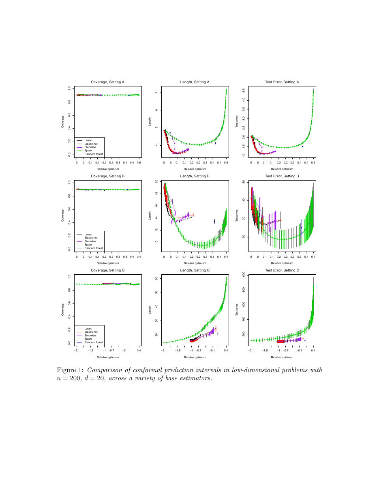
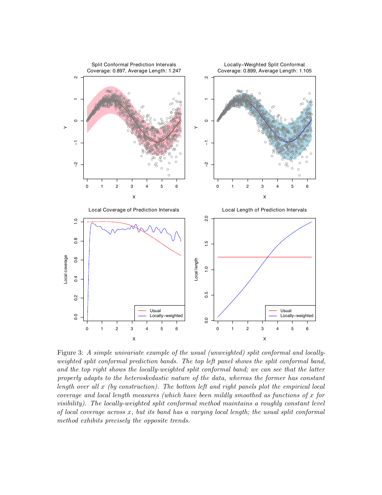

# 회귀를 위한 분포 무관 예측 추론 (번역)

- 원제: Distribution-Free Predictive Inference For Regression
- 저자: Jing Lei, Max G'Sell, Alessandro Rinaldo, Ryan J. Tibshirani, Larry Wasserman (카네기멜런대 통계학과)
- 원문: 같은 폴더의 `Lei2018_분할컨포멀_예측구간.pdf` (arXiv 1604.04173v2, 2017-03-08)
- 게재본: Journal of the American Statistical Association 113(523):1094-1111, 2018. doi:10.1080/01621459.2017.1307116
- 번역 범위: 전문(초록, 본문 1~7장, 부록 A, B의 설명, 그림과 표 캡션). 참고문헌은 원문 그대로 둔다. 부록 A의 증명은 정리별 논증 줄기만 옮긴다.
- 번역 원칙: 수식은 원문 기호를 살려 옮긴다. 그림 안의 글자는 옮기지 않고 캡션만 옮긴다.
- pdftotext로 뽑은 글이라 수식 배치가 깨진 곳이 있다. 그런 곳은 PDF 쪽을 보고 다시 적었다.

---

## 초록

우리는 컨포멀 추론(conformal inference)을 써서 회귀에서 분포 무관 예측 추론을 하는 일반 틀을 만든다.
이 방법은 회귀 함수의 **어떤 추정량을 쓰더라도** 반응 변수에 대한 예측 띠(prediction band)를 만들 수 있게 한다.
그렇게 만든 예측 띠는, 표준 가정 아래에서 원래 추정량의 일치성(consistency) 성질을 그대로 보존하면서, 그 가정이 성립하지 않을 때도 **유한 표본 주변 포함률(finite-sample marginal coverage)**을 보장한다.

우리는 이 컨포멀 틀의 두 큰 변종, 즉 완전 컨포멀 추론(full conformal inference)과 분할 컨포멀 추론(split conformal inference)을, 관련 잭나이프 방법과 함께 실증과 이론 양쪽으로 분석하고 비교한다.
이 방법들은 통계적 정확도(예측 구간의 길이)와 계산 효율 사이에서 서로 다른 맞바꿈을 보인다.

확장으로, 표본 안(in-sample) 예측 구간을 유효하게 만드는 방법인 **rank-one-out 컨포멀 추론**을 만든다. 이 방법은 계산 효율이 분할 컨포멀과 사실상 같다.
또한 자료의 이분산성(heteroskedasticity)에 맞추기 위해, 위치마다 길이가 달라지는 예측 띠를 만드는 확장도 설명한다.
마지막으로 모델에 기대지 않는 변수 중요도 개념인 **leave-one-covariate-out, 줄여서 LOCO 추론**을 제안한다.

이 논문에는 우리가 소개한 모든 제안을 구현한 R 패키지 `conformalInference`가 따라붙는다. 재현성을 위해, 논문의 모든 실증 결과는 이 패키지로 쉽게 다시 만들 수 있다.

## 목차

1. 서론 (3쪽)
   - 1.1 관련 연구 (3쪽)
   - 1.2 요약과 개요 (5쪽)
2. 컨포멀 추론 (6쪽)
   - 2.1 컨포멀 예측 집합 (7쪽)
   - 2.2 분할 컨포멀 예측 집합 (9쪽)
   - 2.3 여러 번 분할 (11쪽)
   - 2.4 잭나이프 예측 구간 (12쪽)
3. 통계적 정확도 (13쪽)
   - 3.1 두 신탁(oracle) 비교 (15쪽)
   - 3.2 안정성 가정 아래 신탁 근사 (15쪽)
   - 3.3 일치성 가정 아래 초신탁 근사 (17쪽)
   - 3.4 고차원 희소 회귀 예제 (18쪽)
4. 실증 연구 (21쪽)
   - 4.1 선형 회귀의 모수적 구간과 비교 (22쪽)
   - 4.2 기본 추정기별 컨포멀 구간 비교 (23쪽)
5. 컨포멀 추론의 확장 (26쪽)
   - 5.1 표본 안 분할 컨포멀 추론 (26쪽)
   - 5.2 국소 가중 컨포멀 추론 (30쪽)
6. 모델 무관 변수 중요도: LOCO (32쪽)
   - 6.1 변수 중요도의 국소 측도 (34쪽)
   - 6.2 변수 중요도의 전역 측도 (36쪽)
7. 결론 (37쪽)
- 부록 A. 기술적 증명 (42쪽)
- 부록 B. 추가 실험 (48쪽)

---

## 1. 서론

i.i.d. 회귀 자료를 생각한다.

    Z₁, ..., Zₙ ~ P,

각 Zᵢ = (Xᵢ, Yᵢ)는 ℝᵈ × ℝ 위의 확률 변수이고, 반응 변수 Yᵢ와 d차원 특징 벡터 Xᵢ = (Xᵢ(1), ..., Xᵢ(d))로 이루어진다.
특징 차원 d는 표본 크기 n에 비해 클 수 있다(점근 모형에서는 d가 n과 같이 커지도록 허용한다).

    μ(x) = E(Y | X = x), x ∈ ℝᵈ

를 회귀 함수라고 하자.
우리는 μ와 P에 아무 가정도 두지 않고, 새 특징 값 X_{n+1}에서 새 반응 Y_{n+1}을 예측하려고 한다.
형식적으로, 명목 비포함 수준 α ∈ (0,1)이 주어졌을 때, Z₁, ..., Zₙ에 기초해 다음 성질을 가지는 예측 띠 C ⊆ ℝᵈ × ℝ를 만들고자 한다.

    P{ Y_{n+1} ∈ C(X_{n+1}) } ≥ 1 − α,                (1)

여기서 확률은 P에서 나온 n+1개의 i.i.d. 추출 Z₁, ..., Zₙ, Z_{n+1}에 대해 잡고, 점 x에 대해 C(x) = {y ∈ ℝ : (x,y) ∈ C}로 쓴다.

이 논문의 주된 목표는, P에 가정을 두지 않고 **유한 표본(비점근) 유효성**을 가지는 (1) 꼴의 예측 띠를 만드는 것이다.
두 번째 목표는, X_{n+1}이 주어졌을 때 Y_{n+1}의 예측 모형에서 각 공변량의 중요도에 대한 모델 무관 추론 서술을 만드는 것이다.

우리의 대표 예는 고차원 회귀다. d ≫ n이고 μ를 근사하는 데 선형 함수를 쓴다(다만 선형 모형이 맞다고 가정하지는 않는다).
이 상황에서 흔한 접근은 전진 단계별 회귀 같은 탐욕 방법과, lasso 같은 ℓ₁ 기반 방법이다.
이들 방법의 여러 성질을 연구한 양은 방대하지만, 우리가 아는 한 **예측 집합**에 대한 연구는 아주 적다.
우리 틀은 이런 방법들, 그리고 사실상 모든 고차원 회귀 방법에 제대로 된 예측 집합을 준다. 고전 선형 회귀와 비모수 회귀 기법도 덮는다.
이 틀의 바탕은 Vovk 외(2005)가 만든 컨포멀 예측이다.

### 1.1 관련 연구

**컨포멀 추론.** 컨포멀 예측 틀은 Vovk 외(2005, 2009)가 예측 구간을 만드는 순차적 접근으로 처음 제안했다.
기본 생각은 간단하다. 위의 회귀 상황에서 P로부터 새 독립 추출 (X_{n+1}, Y_{n+1})이 주어졌을 때, 어떤 값 y를 C(X_{n+1})에 넣을지 정하기 위해, 귀무가설 Y_{n+1} = y를 검정한다.
그리고 Y_{n+1} = y로 둔 증강 표본 (X₁,Y₁), ..., (Xₙ,Yₙ), (X_{n+1}, Y_{n+1})의 경험 분위수로 유효한 p값을 만든다(자세한 것은 2장).
자료를 증강하는 이 단계가 절차를 과적합에서 면역시킨다. 그래서 만들어진 예측 띠는 (1)처럼 언제나 유효한 평균 포함률을 가진다.

컨포멀 추론은 순차가 아닌 일괄(batch) 방법으로도 여러 상황에서 연구되었다.
예를 들어 Burnaev & Vovk(2014)는 저차원 최소제곱과 능형 회귀 모형을 다루었다.
Lei 외(2013)는 컨포멀 예측으로 통계적으로 거의 최적인 허용 영역(tolerance region)을 만들었다.
Lei & Wasserman(2014)은 이를 저차원 비모수 회귀로 확장했다. 분류와 군집화 같은 다른 확장은 Lei(2014), Lei 외(2015)에 있다.

고차원 회귀의 예측 집합에 대한 연구는 아주 적다.
Hebiri(2010)는 컨포멀화한 lasso 추정량의 근사를 설명했다. 이 근사는 lasso 위에 올린 원래 컨포멀 예측보다 크게 빨라지지만, 컨포멀 추론의 핵심 매력인 유한 표본 포함률을 잃는다.
최근 Steinberger & Leeb(2016)은 고차원 상황에서 잭나이프 예측 방법을 분석해, Butler & Rothman(1980)의 저차원 결과를 확장했다.
그러나 이 잭나이프 접근은 기본 추정량이 강한 점근 평균제곱오차 성질과 안정성 성질을 만족할 때에만 점근 유효성이 보장된다. 이는 2.4절에서 더 논의한다.

우리 보기에, 간단하고 계산이 효율적이면서도 강력한데 간과되어 온 방법이 **분할 컨포멀 추론**이다(Lei 외 2015, Papadopoulos 외 2002, 또는 2.2절 참고).
예를 들어 lasso 추정량과 결합하면, 분할 컨포멀 예측 구간을 만드는 전체 비용은 lasso를 적합하는 비용이 지배한다.
그리고 이 방법은 lasso 추정량이 일치하든 아니든 **어떤 상황에서나** 유한 표본 포함률을 준다.

**고차원 추론.** 고차원 추론 분야의 최근 흐름은 (고정된) 모집단 기반 표적이나 (무작위) 선택 후 표적에 대한 신뢰 구간을 만드는 것이다.
첫째 부류, 모집단 기반 접근은 선형 모형이 참이라고 가정하고 그 모형의 계수에 대한 신뢰 구간에 초점을 둔다(Belloni 외 2012, Bühlmann 2013, Zhang & Zhang 2014, van de Geer 외 2014, Javanmard & Montanari 2014).
둘째 부류, 선택 후 접근은 고른 공변량 부분집합이 주어졌을 때 μ에 대한 최선 선형 근사의 계수를 덮는 데 초점을 둔다(Berk 외 2013, Lee 외 2016, Tibshirani 외 2016, Fithian 외 2014, Tian & Taylor 2015a,b).

이 추론 접근들은 모두 흥미롭고 목적이 서로 다르다.
다만 공통점이 하나 있다. 모두 사소하지 않은 가정에 기댄다는 것이다. 선형 모형이 참일 필요는 없더라도, 쓰는 회귀 추정량의 품질, 오차 분포, 오차 분산의 지식이나 추정 가능성, 오차의 등분산성 등에 (정도 차이는 있지만) 조건이 붙는다.
이와 달리 6장에서 설명하는 예측 기반 변수 중요도 방법 두 가지는 그런 조건에 전혀 기대지 않는다.

### 1.2 요약과 개요

이 논문에서 우리는 회귀의 컨포멀 추론에 여러 방법론적, 이론적 기여를 한다.

- 컨포멀 추론을 일반적으로 소개한다(2장). 이는 분포 무관, 유한 표본 예측 집합을 만드는 범용 도구다. 특히 고차원 회귀 맥락을 다루는데, 기존 추론 방법들이 요구하는 가정이 강하기 때문에 컨포멀 추론이 가장 쓸모 있는 상황이라고 본다.
- 컨포멀 추론에 새 이론적 통찰을 준다. 유한 표본 포함률의 정확도 보장(정리 2.1, 2.2), 그리고 분포 무관 점근 표본 안 포함률 보장(정리 2.3, 5.1)이다.
- 컨포멀 추론의 여러 판이 어떤 신탁(oracle) 방법을 근사함을 보인다(3장). 그러면서 표준 가정 아래 예측 구간 길이에 거의 최적인 한계를 준다. 구체적으로 다음을 보인다.
  1. 기본 추정량이 재표집과 작은 교란에 안정하면, 컨포멀 예측 띠는 추정량에 의존하는 신탁 띠에 가깝다(정리 3.2, 3.3).
  2. 기본 추정량이 일치하면, 컨포멀 예측 띠는 모든 유효한 예측 띠 가운데 길이가 가장 짧은 **초신탁(super oracle)** 띠에 가깝다(정리 3.4, 3.5).
- 컨포멀 추론의 두 변종(완전, 분할)과 관련 잭나이프 방법을 평가하는 광범위한 모의실험을 한다(4장). 이 모의실험은 함께 제공하는 R 패키지 `conformalInference` (https://github.com/ryantibs/conformal)로 재현할 수 있다.
- 컨포멀 추론의 확장 두 가지를 만든다(5장). 표본 안 포함률을 가지는 예측 구간, 그리고 국소 길이가 달라지는 예측 구간이다.
- LOCO(leave-one-covariate-out) 추론에 기초한, 모델 무관 예측 기반 변수 중요도 접근 두 가지를 제안한다.

---

## 2. 컨포멀 추론

컨포멀 예측 이론의 바탕 생각은 표본 분위수에 대한 간단한 결과와 이어진다.
U₁, ..., Uₙ을 스칼라 확률 변수의 i.i.d. 표본이라고 하자(사실 뒤의 논증은 i.i.d. 가정을 더 약한 **교환 가능성(exchangeability)**으로 바꿔도 성립한다).
주어진 비포함 수준 α ∈ (0,1)과 또 하나의 i.i.d. 표본 U_{n+1}에 대해 다음이 성립한다.

    P(U_{n+1} ≤ q_{1−α}) ≥ 1 − α,                     (2)

여기서 U₁, ..., Uₙ에 기초한 표본 분위수 q_{1−α}는 다음으로 정의한다.

    q_{1−α} = U_(⌈(n+1)(1−α)⌉)   (⌈(n+1)(1−α)⌉ ≤ n 일 때)
            = ∞                   (그 밖의 경우),

그리고 U_(1) ≤ ... ≤ U_(n)은 U₁, ..., Uₙ의 순서 통계량이다.
(2)의 유한 표본 포함 성질은 확인하기 쉽다. 교환 가능성에 의해 U₁, ..., Uₙ, U_{n+1} 가운데 U_{n+1}의 순위가 {1, ..., n+1} 위에서 균등 분포를 따르기 때문이다.

회귀 문제에서, i.i.d. 표본 Zᵢ = (Xᵢ, Yᵢ) ∈ ℝᵈ × ℝ ~ P, i = 1, ..., n을 관측할 때, 새 특징 값 X_{n+1}에서 Y_{n+1}의 예측 구간을 만드는 다음 **순진한(naive)** 방법을 생각할 수 있다.

    C_naive(X_{n+1}) = [ μ̂(X_{n+1}) − F̂ₙ⁻¹(1−α),  μ̂(X_{n+1}) + F̂ₙ⁻¹(1−α) ],   (3)

여기서 μ̂은 바탕 회귀 함수의 추정량이고, F̂ₙ은 적합 잔차 |Yᵢ − μ̂(Xᵢ)|, i = 1, ..., n의 경험 분포, F̂ₙ⁻¹(1−α)는 그 (1−α) 분위수다.
이 방법은 추정한 회귀 함수 μ̂이 정확하기만 하면 큰 표본에서 대략 유효하다.
그러나 그런 정확성을 보장하려면 바탕 자료 분포 P와 추정량 μ̂ 자체에 적절한 정칙성 조건이 필요하다. 올바르게 설정된 모형이나 적절한 조율 모수 선택 같은 것이다.

### 2.1 컨포멀 예측 집합

일반적으로 순진한 방법 (3)은 포함률을 크게 밑돌 수 있다. 적합 잔차 분포가 아래쪽으로 치우치기 쉽기 때문이다.
컨포멀 예측 구간(Vovk 외 2005, 2009, Lei 외 2013, Lei & Wasserman 2014)은 이 결함을 극복하고, 놀랍게도 **P나 μ̂에 아무 가정 없이도**(μ̂이 자료 점들의 대칭 함수이기만 하면) 제대로 된 유한 표본 포함률을 준다.

다음 전략을 생각한다. 각 값 y ∈ ℝ에 대해, 증강 자료 Z₁, ..., Zₙ, (X_{n+1}, y)로 학습한 증강 회귀 추정량 μ̂_y를 만든다. 이제

    R_{y,i} = |Yᵢ − μ̂_y(Xᵢ)|, i = 1,...,n,  그리고  R_{y,n+1} = |y − μ̂_y(X_{n+1})|,   (4)

로 두고, 나머지 적합 잔차들 사이에서 R_{y,n+1}의 순위를 매겨

    π(y) = (1/(n+1)) Σ_{i=1}^{n+1} 1{R_{y,i} ≤ R_{y,n+1}}
         = 1/(n+1) + (1/(n+1)) Σ_{i=1}^{n} 1{R_{y,i} ≤ R_{y,n+1}},                  (5)

즉 증강 표본에서 적합 잔차가 마지막 것보다 작은 점의 비율을 계산한다.
자료 점들의 교환 가능성과 μ̂의 대칭성에 의해, y = Y_{n+1}에서 평가하면 π(Y_{n+1})은 {1/(n+1), 2/(n+1), ..., 1} 위에서 균등 분포를 따른다. 따라서

    P{ (n+1)π(Y_{n+1}) ≤ ⌈(1−α)(n+1)⌉ } ≥ 1 − α.                                   (6)

위 식은 1 − π(Y_{n+1})이 귀무가설 H₀ : Y_{n+1} = y를 검정하는 유효한(보수적) p값을 준다는 뜻으로 읽을 수 있다.

가능한 모든 y ∈ ℝ에 대해 이 검정을 역으로 뒤집으면, (6)에서 곧바로 X_{n+1}에서의 컨포멀 예측 구간이 나온다.

    C_conf(X_{n+1}) = { y ∈ ℝ : (n+1)π(y) ≤ ⌈(1−α)(n+1)⌉ }.                        (7)

(4), (5), (7) 단계는 새 특징 값에서 예측 구간을 만들 때마다 되풀이해야 한다.
실제로는 (7)에서 시도 값 y를 이산 격자로 제한해야 한다. 이 내용은 알고리즘 1에 정리했다.

**알고리즘 1. 컨포멀 예측**

- 입력: 자료 (Xᵢ, Yᵢ), i = 1, ..., n, 비포함 수준 α ∈ (0,1), 회귀 알고리즘 A, 예측 구간을 만들 점 X_new = {X_{n+1}, X_{n+2}, ...}, 시도 값 Y_trial = {y₁, y₂, ...}
- 출력: X_new의 각 원소에서의 예측 구간
- 각 x ∈ X_new에 대해
  - 각 y ∈ Y_trial에 대해
    - μ̂_y = A({(X₁,Y₁), ..., (Xₙ,Yₙ), (x,y)})
    - R_{y,i} = |Yᵢ − μ̂_y(Xᵢ)|, i = 1,...,n,  R_{y,n+1} = |y − μ̂_y(x)|
    - π(y) = (1 + Σ_{i=1}^{n} 1{R_{y,i} ≤ R_{y,n+1}}) / (n+1)
  - C_conf(x) = { y ∈ Y_trial : (n+1)π(y) ≤ ⌈(1−α)(n+1)⌉ }
- 각 x ∈ X_new에 대해 C_conf(x)를 돌려준다

구성상 (7)의 컨포멀 예측 구간은 유효한 유한 표본 포함률을 가진다. 또 이 구간은 정확하다. 즉 포함률을 크게 넘기지도 않는다. 다음 정리로 정리한다(증명은 부록 A.1).

**정리 2.1.** (Xᵢ, Yᵢ), i = 1, ..., n이 i.i.d.이면, 새 i.i.d. 쌍 (X_{n+1}, Y_{n+1})에 대해

    P{ Y_{n+1} ∈ C_conf(X_{n+1}) } ≥ 1 − α

가 (7), 즉 알고리즘 1로 만든 컨포멀 예측 띠 C_conf에 대해 성립한다.
여기에 더해 모든 y ∈ ℝ에 대해 적합 절대 잔차 R_{y,i} = |Yᵢ − μ̂_y(Xᵢ)|, i = 1,...,n이 연속 결합 분포를 가진다고 가정하면, 다음도 성립한다.

    P{ Y_{n+1} ∈ C_conf(X_{n+1}) } ≤ 1 − α + 1/(n+1).

**주석 2.1.** 정리의 앞부분, 즉 회귀에서 컨포멀 구간의 유한 표본 유효성은 모든 컨포멀 추론 절차의 표준 성질이며 Vovk에게서 왔다.
뒷부분, 즉 컨포멀 구간이 지나치게 보수적이지 않다는 결과는 새로운 것이다.
뒷부분에서만 잔차가 연속 분포를 가질 것을 요구하는데, 이는 꽤 약한 가정이고 (절대) 잔차 순위를 매길 때 동점을 피하려는 것이다. 무작위 동점 처리 규칙을 쓰면 이 가정도 완전히 없앨 수 있다.
실제로 컨포멀 구간의 포함률은 1 − α 주변에 강하게 몰려 있고, 4장 실험이 이를 확인한다.
연속성 가정 말고는, 정리 2.1에서 회귀 추정량 μ̂이나 자료 생성 분포 P에 대해 아무 가정도 필요 없다.
이는 컨포멀 추론의 다소 놀랍고 고유한 성질이며, 잭나이프 방법에는 성립하지 않는다(2.4절 논의. 고차원 선형 모형 계수의 신뢰 구간을 만드는 방법들도 마찬가지다).

**주석 2.2.** 일반적으로 바탕 회귀 함수 μ의 추정량 μ̂을 개선할수록 그 결과 컨포멀 예측 구간의 길이는 줄어든다.
직관적으로, 더 정확한 μ̂은 더 작은 잔차를 낳고, 컨포멀 구간은 본질적으로 (증강) 잔차 분포의 분위수로 정의되기 때문이다. 4장이 이 직관을 뒷받침하는 실증 예를 준다.

**주석 2.3.** 정리 2.1의 확률 서술은 i.i.d. 표본 (Xᵢ, Yᵢ), i = 1, ..., n, n+1에 대해 잡은 것이므로, **평균(주변) 포함률** 보장을 주장한다.
이것을 모든 x ∈ ℝᵈ에 대한 P(Y_{n+1} ∈ C(x) | X_{n+1} = x) ≥ 1 − α, 즉 **조건부 포함률**과 헷갈리면 안 된다.
조건부 포함률은 훨씬 강한 성질이고, 모형과 추정량에 정칙성과 일치성 가정을 두지 않으면 길이가 유한한 예측 구간으로는 달성할 수 없다(Lei & Wasserman 2014).
조건부 포함률은 어떤 조건 아래에서 점근적으로는 성립한다. 3장의 정리 3.5를 보라.

**주석 2.4.** 정리 2.1은 각 R_{y,i}를 다음으로 바꿔도 여전히 성립한다.

    f( (X₁,Y₁), ..., (X_{i−1},Y_{i−1}), (X_{i+1},Y_{i+1}), ..., (X_{n+1}, y) ; (Xᵢ, Yᵢ) ),   (8)

여기서 f는 앞의 n개 인수에 대해 대칭인 임의의 함수다.
이런 함수 f를 컨포멀 추론에서 **적합도 점수(conformity score)**라고 한다.
예를 들어 (8)의 값은 (Xᵢ, Yᵢ)에서 평가한 추정 결합 밀도 함수일 수도 있고, 조건부 밀도 함수일 수도 있다(뒤의 것은 Y − E(Y|X)가 X와 독립이고 [0,∞)에서 감소하는 밀도의 대칭 분포를 가질 때 절대 잔차 R_{y,i}와 같다).
특별한 **국소 가중 적합도 점수**는 5.2절에서 다룬다.

**주석 2.5.** 우리는 보통 "분포 무관(distribution-free)"이라는 말을 i.i.d. 자료만 가정했을 때의 유한 표본 포함 성질을 가리키는 데 쓴다.
컨포멀 예측은 i.i.d. 가정만으로 모든 분포와 모든 대칭 추정량에 대해 유효한 포함률을 주지만, 컨포멀 구간의 **길이**는 처음 추정량의 품질에 달려 있다. 3장에서 그 관계에 대한 이론적 통찰을 준다.

### 2.2 분할 컨포멀 예측 집합

앞 절에서 본 원래 컨포멀 예측 방법은 계산이 무겁다.
어떤 X_{n+1}과 y에 대해서든 y를 C_conf(X_{n+1})에 넣을지 판단하려면, 새 점 (X_{n+1}, y)를 포함한 증강 자료로 모형을 다시 학습하고 절대 잔차를 다시 계산하고 다시 정렬해야 한다.
X_{n+1}이 꼭 관측되지 않는 응용에서는 알고리즘 1처럼 촘촘한 격자 위의 모든 (x, y) 쌍에 대해 1{y ∈ C_conf(x)}를 평가해 예측 구간을 만든다.
커널 밀도 추정과 커널 회귀의 특수한 경우에는 완전 컨포멀 예측 집합의 간단하고 정확한 근사가 있다(Lei 외 2013, Lei & Wasserman 2014).
저차원 선형 회귀에서는 Sherman-Morrison 갱신 방식으로 완전 컨포멀 방법의 복잡도를 줄일 수 있다.
그러나 lasso 같은 비교적 복잡한(비선형) 추정량을 쓰는 고차원 회귀에서는 효율적인 완전 컨포멀 추론이 아직 열린 문제다.

다행히 대안이 있다. 우리가 **분할 컨포멀 예측(split conformal prediction)**이라고 부르는 방법이다. 완전히 일반적이고, 계산 비용은 완전 컨포멀 방법의 아주 작은 일부다.

**알고리즘 2. 분할 컨포멀 예측**

- 입력: 자료 (Xᵢ, Yᵢ), i = 1, ..., n, 비포함 수준 α ∈ (0,1), 회귀 알고리즘 A
- 출력: x ∈ ℝᵈ 위의 예측 띠
- {1, ..., n}을 같은 크기의 두 부분집합 I₁, I₂로 무작위 분할한다
- μ̂ = A({(Xᵢ, Yᵢ) : i ∈ I₁})
- Rᵢ = |Yᵢ − μ̂(Xᵢ)|, i ∈ I₂
- d = {Rᵢ : i ∈ I₂} 중 k번째로 작은 값, 여기서 k = ⌈(n/2 + 1)(1 − α)⌉
- 모든 x ∈ ℝᵈ에 대해 C_split(x) = [μ̂(x) − d, μ̂(x) + d]를 돌려준다

분할 컨포멀 방법은 표본 분할로 **적합 단계와 순위 단계를 분리**하고, 계산 비용은 그냥 적합 단계의 비용이다.
비슷한 생각이 온라인 예측 문헌에서 귀납 컨포멀 추론(inductive conformal inference)이라는 이름으로 나왔다(Papadopoulos 외 2002, Vovk 외 2005).
알고리즘 2는 Lei 외(2015)에서 가져왔다. 핵심 포함 성질은 정리 2.2에 있다(증명은 부록 A.1). 여기서는 간단히 n이 짝수라고 둔다.

**정리 2.2.** (Xᵢ, Yᵢ), i = 1, ..., n이 i.i.d.이면, 새 i.i.d. 추출 (X_{n+1}, Y_{n+1})에 대해

    P{ Y_{n+1} ∈ C_split(X_{n+1}) } ≥ 1 − α

가 알고리즘 2로 만든 분할 컨포멀 예측 띠 C_split에 대해 성립한다.
나아가 잔차 Rᵢ, i ∈ I₂가 연속 결합 분포를 가진다고 가정하면

    P{ Y_{n+1} ∈ C_split(X_{n+1}) } ≤ 1 − α + 2/(n+2).

원래 컨포멀 방법에 비해 매우 효율적인 것 말고도, 분할 컨포멀 추론은 메모리에서도 이점이 있다.
예를 들어 회귀 절차 A가 lasso나 전진 단계별 회귀처럼 변수 선택을 포함하면, Xᵢ, i ∈ I₂에서 적합값을 평가하고 잔차를 계산할 때 **고른 변수만** 저장하면 된다.
원래 변수 집합이 아주 크고 고른 집합이 훨씬 작을 때 메모리를 크게 아낀다.

분할 컨포멀 예측 구간은 근사적인 **표본 안 포함률** 보장도 준다. 그래서 미래 추출을 얻지 않고도 주어진 표본으로 보이고 해석하기 쉽다. 다음에서 설명한다.

**정리 2.3.** 정리 2.2의 조건 아래, 절대 상수 c > 0이 있어서 임의의 ε > 0에 대해

    P{ | (2/n) Σ_{i∈I₂} 1{Yᵢ ∈ C_split(Xᵢ)} − (1−α) | ≥ ε } ≤ 2 exp{ −c n (ε − 4/n)₊² }.

**주석 2.6.** 정리 2.3은 "절반 표본" 표본 안 포함률을 뜻한다. I₁, I₂의 역할을 바꾼 또 하나의 분할 컨포멀 예측 띠를 만들어 전체 표본으로 확장하는 것은 어렵지 않다.
이 생각은 5.1절에서 더 탐구하고 확장하며, 거기서 정리 2.3을 더 일반적인 결과의 따름정리로 유도한다. 관련 결과로 Vovk(2013)의 따름정리 1을 보라.

**주석 2.7.** 분할 컨포멀 추론은 불균형 분할로도 구현할 수 있다. 즉 |I₁| = ρn, |I₂| = (1−ρ)n, ρ ∈ (0,1)로 둔다.
회귀 절차가 복잡할 때처럼, 학습한 추정량 μ̂을 더 정확하게 만들려고 ρ > 0.5로 두는 것이 이로운 상황도 있다.
이 논문에서는 간단히 ρ = 0.5에 집중하고, ρ 선택 문제는 다루지 않는다.

### 2.3 여러 번 분할

분할은 컨포멀 추론의 속도를 극적으로 올리지만, 절차에 여분의 무작위성을 들여온다.
이 무작위성을 줄이는 한 방법은 여러 번 분할해서 얻은 추론을 합치는 것이다.
학습 자료를 N번 분할해 분할 컨포멀 예측 구간 C_split,1, ..., C_split,N을 얻되, 각 구간을 1 − α/N 수준에서 만든다고 하자. 그러면

    C_split^(N)(x) = ∩_{j=1}^{N} C_split,j(x),  x ∈ ℝᵈ.                              (9)

간단한 본페로니식 논증으로 예측 띠 C_split^(N)의 주변 포함 수준이 적어도 1 − α임이 따라온다.

여러 번 분할은 분할에서 오는 변동을 줄인다. 그러나 대가가 있을 수 있다. C_split^(N)의 길이가 N과 함께 커질 수 있다.
α를 α/N로 바꾸면 각 분할 컨포멀 구간은 분명 커진다. 그러나 교집합을 취하면 최종 구간은 작아진다. 즉 "본페로니 대 교집합"의 맞바꿈이 있다.

다음 결과는 3장에서 자세히 적는 꽤 일반적인 조건 아래, 본페로니 효과가 지배해서 N이 커질수록 구간이 넓어짐을 보인다. 그래서 우리는 **단일 분할**을 권한다. 증명은 부록 A.2에 있다.

**정리 2.4.** 가정 A0, A1, A2 아래에서 ρₙ = o(η_n^{−1})이고, |Y − μ̄(X)|가 연속 분포를 가지면, n → ∞일 때 확률 1로 수렴하면서 C_split^(N)(X)는 C_split(X)보다 넓다.

**주석 2.8.** 여러 번 분할은 다른 저자들도 다루었다(예: Meinshausen & Bühlmann 2010). 다만 그쪽 상황은 선형 모형이 맞다고 가정하고 그 모형의 계수에 추론을 하는 것이라 꽤 다르다.

### 2.4 잭나이프 예측 구간

완전 컨포멀과 분할 컨포멀의 계산 복잡도 사이에 잭나이프 예측이 있다.
이 방법은 하나 빼기(leave-one-out) 잔차의 분위수로 예측 구간을 정한다. 알고리즘 3에 정리한다.

**알고리즘 3. 잭나이프 예측 띠**

- 입력: 자료 (Xᵢ, Yᵢ), i = 1, ..., n, 비포함 수준 α ∈ (0,1), 회귀 알고리즘 A
- 출력: x ∈ ℝᵈ 위의 예측 띠
- 각 i ∈ {1, ..., n}에 대해
  - μ̂^(−i) = A({(X_ℓ, Y_ℓ) : ℓ ≠ i})
  - Rᵢ = |Yᵢ − μ̂^(−i)(Xᵢ)|
- d = {Rᵢ} 중 k번째로 작은 값, k = ⌈n(1−α)⌉
- 모든 x ∈ ℝᵈ에 대해 C_jack(x) = [μ̂(x) − d, μ̂(x) + d]를 돌려준다

잭나이프가 분할 컨포멀보다 나은 점은 절대 잔차와 그 분위수를 만들 때 학습 자료를 더 많이 쓴다는 것이다. 그래서 더 짧은 구간을 내는 일이 잦다.
그러나 분명한 단점은, 그 예측 구간이 유한 표본에서 유효한 포함률을 **보장받지 못한다**는 것이다.
사실 점근적으로도, 기본 추정량에 사소하지 않은 조건을 걸지 않으면 포함 성질이 성립하지 않는다.
대칭성에 의해 잭나이프 방법은 유한 표본 **표본 안** 포함 성질

    P{ Yᵢ ∈ C_jack(Xᵢ) } ≥ 1 − α, 모든 i = 1, ..., n

은 가진다. 그러나 표본 밖 포함률(참된 예측 추론)에서는 훨씬 깨지기 쉽다.
Butler & Rothman(1980)은 저차원 선형 회귀에서 잭나이프가 점근 유효 구간을 낸다고 보였지만, 그 정칙성 조건은 선형 회귀 추정량의 일치성까지 함의할 만큼 강하다.
더 최근에 Steinberger & Leeb(2016)은 고차원 회귀에서 잭나이프 구간의 점근 유효성을 세웠다. 이들은 기본 추정량 μ̂의 일치성 자체를 요구하지는 않지만, μ̂에 균등 점근 평균제곱오차 한계와 점근 안정성 조건을 요구한다.
컨포멀 방법은 그런 조건이 전혀 필요 없다.
게다가 Butler & Rothman(1980), Steinberger & Leeb(2016)의 분석은 표준 선형 모형 설정, 즉 회귀 함수 자체가 특징의 선형 함수이고, 특징이 오차와 독립이며, 오차가 등분산이라고 가정한다. 분할(그리고 완전) 컨포멀 방법이 유한 표본 유효성을 가지는 데는 이 중 아무것도 필요 없다.

---

## 3. 통계적 정확도

컨포멀 추론은 i.i.d. 자료라는 것 말고 아무 가정 없이 믿을 만한 포함률을 준다.
이 장에서는 결과 구간 C(X)의 길이를 한계 지어 컨포멀 예측 구간의 통계적 정확도를 조사한다.
포함 보장과 달리, 이런 통계적 정확도는 모형과 적합 방법 양쪽에 적절한 정칙성 조건 아래에서만 세울 수 있다.
우리 분석은 아주 약한 조건에서 출발해, 고차원 회귀에서 흔히 두는 표준 가정으로 옮겨 간다. 그리고 거기서 컨포멀 방법이 거의 최적의 통계 효율을 달성함을 보인다.

**가정 A0 (i.i.d. 자료).** ℝᵈ × ℝ 위의 공통 분포 P에서 나온 i.i.d. 자료 (Xᵢ, Yᵢ), i = 1, ..., n을 관측한다. 평균 함수는 μ(x) = E(Y | X = x)다.

**가정 A1 (독립이고 대칭인 잡음).** (X, Y) ~ P에 대해, 잡음 변수 ε = Y − μ(X)가 X와 독립이고, ε의 밀도 함수는 0에 대해 대칭이며 [0,∞)에서 비증가다.

가정 A1은 회귀 문헌에서 보통 두는 가정보다 약하다. 특히 ε에 유한한 1차 적률조차 요구하지 않는다.
대칭성과 단조성 조건은 편의를 위한 것이고, ε의 적절한 분위수나 밀도 수준 집합을 쓰면 뺄 수 있다.
ε 분포의 연속성은 확률 1로 적합 잔차가 모두 서로 다르게 만들어, 경험 분포 함수를 뒤집는 일을 쉽게 한다.

**두 신탁 띠.** 완전 컨포멀과 분할 컨포멀으로 만든 예측 띠의 정확도를 재기 위해, 그 길이를 두 신탁이 만든 이상적인 예측 띠의 길이와 비교한다.
**초신탁(super oracle)**은 회귀 함수 μ(x)와 오차 분포를 완전히 안다.
보통 **신탁(oracle)**은 잔차 분포, 즉 Y − μ̂ₙ(X)의 분포만 안다.

가정 A0과 A1에서 초신탁 예측 띠는

    C_s(x) = [μ(x) − q_α, μ(x) + q_α],  q_α는 L(|ε|)의 α 상위 분위수

다. 이 띠 C_s(x)는 다음 뜻에서 최적이다. (i) 유효한 조건부 포함률을 가진다. (ii) 조건부 포함률을 가지는 모든 띠 가운데 길이가 가장 짧다. (iii) 주변 포함률을 가지는 모든 띠 가운데 평균 길이가 가장 짧다(Lei & Wasserman 2014).

기본 적합 알고리즘 Aₙ과 크기 n 표본이 있으면, μ를 μ̂ₙ으로 바꿔 초신탁을 흉내 낼 수 있다. 유효한 예측이 되려면 띠가 μ̂ₙ과 새 독립 표본 (X, Y)의 무작위성을 받아들여야 한다. 그래서 다음 신탁을 생각하는 것이 자연스럽다.

    C_o(x) = [μ̂ₙ(x) − q_{n,α}, μ̂ₙ(x) + q_{n,α}],  q_{n,α}는 L(|Y − μ̂ₙ(X)|)의 α 상위 분위수.

q_{n,α}의 정의는 조건부가 아니므로 무작위성은 (n+1)개 쌍에 걸쳐 있다.
C_o(x)도 |Y − μ̂ₙ(X)|의 분포를 모르기 때문에 실용적이지는 않지만, 그 분위수는 추정할 수 있다.
초신탁 띠와 달리 신탁 띠는 일반적으로 주변 포함률만 준다.

이 장의 주요 이론 결과는 다음으로 요약된다.

1. 기본 추정량이 일치하면, 두 신탁 띠의 길이가 비슷하다(3.1절).
2. 기본 추정량이 재표집과 작은 교란에 안정하면, 컨포멀 예측 띠가 신탁 띠에 가깝다(3.2절).
3. 기본 추정량이 일치하면, 컨포멀 예측 띠가 초신탁에 가깝다(3.3절).

### 3.1 두 신탁 비교

직관적으로 μ̂ₙ이 μ에 가까우면 두 신탁 띠도 가까워야 한다. Δₙ(x) = μ̂ₙ(x) − μ(x)를 추정 오차라고 하자.

**정리 3.1 (신탁 띠 비교).** 가정 A0, A1 아래, F, f를 |ε|의 분포 함수와 밀도 함수라고 하자. f가 M > 0으로 균등하게 유계인 연속 도함수를 가진다고 더 가정한다. Fₙ, fₙ을 |Y − μ̂ₙ(X)|의 분포, 밀도 함수라고 하면

    sup_{t>0} |Fₙ(t) − F(t)| ≤ (M/2) E Δₙ²(X),                                      (10)

여기서 기댓값은 μ̂ₙ과 X의 무작위성에 대해 잡는다.
나아가 δ > (M/2r) E Δₙ²(X)인 어떤 δ에 대해 f가 (q_α − δ, q_α + δ)에서 r > 0으로 하계를 가지면

    |q_{n,α} − q_α| ≤ (M/2r) E Δₙ²(X).                                              (11)

신탁 띠의 폭(길이)은 초신탁이 2q_α, 신탁이 2q_{n,α}다. 정리 3.1은 두 신탁 띠의 폭이 비슷하고 차이가 E Δₙ²(X)에 비례함을 뜻한다.
여기서 μ̂ₙ이 일치할 것조차 요구하지 않는다는 점이 주목할 만하다. 정리 3.1은 E Δₙ²(X)가 (M, r, δ)로 정해지는 어떤 상수보다 작기만 하면 적용된다.
또 추정 오차 Δₙ(X)가 신탁 예측 띠에 **2차(second-order) 영향**만 준다는 점도 주목할 만하다. 이는 ε이 대칭 밀도를 가진다는 가정에서 온다.

### 3.2 안정성 가정 아래 신탁 근사

**경우 I: 분할 컨포멀.** 추가 가정은 표집 안정성이다.

**가정 A2 (표집 안정성).** 충분히 큰 n에 대해 P( ‖μ̂ₙ − μ̄‖_∞ ≥ ηₙ ) ≤ ρₙ, 여기서 ηₙ = o(1), ρₙ = o(1)이고 μ̄는 어떤 함수다.

μ̄가 참 회귀 함수 μ에 가깝다고 가정할 필요가 없다. 추정량 μ̂ₙ이 μ̄ 주변에 몰리기만 하면 된다.
이것은 일치성 가정이 아니라 **안정성** 가정이다. 예를 들어 과평활(over-smoothing)한 비모수 회귀가 이를 만족한다.
μ̄ = μ일 때는 상한 노름 일치성 가정이 되고, 표준 가정 아래의 lasso류 추정량, 유계 설명 변수를 가지는 고정 차원 최소제곱, 콤팩트 정의역의 표준 비모수 회귀 추정량이 이를 만족한다.
보통 ηₙ은 c(log n / n)^{−r} 꼴이고 ρₙ은 n^{−c} 차수다.

표집 안정성이 깨지면, μ̂ₙ을 조건으로 할 때 잔차 Y − μ̂ₙ(X)의 분포가 Fₙ과 크게 달라질 수 있고, 분할 컨포멀 구간도 신탁 구간과 크게 달라질 수 있다.

**주석 3.1.** 가정 A2의 상한 노름 한계는 p > 0인 ℓ_{p,X} 노름 한계로 약화할 수 있다. ℓ_{p,X} 노름 한계가 성립하면 마르코프 부등식으로, 확률이 사라지는 작은 집합을 빼고는 ℓ_∞ 노름 한계가 성립하기 때문이다. 그런 작은 집합은 분위수에 미치는 영향이 무시할 만하다.

**정리 3.2 (분할 컨포멀의 신탁 근사).** α ∈ (0,1)을 고정하고, C_{n,split}과 ν_{n,split}을 분할 컨포멀 구간과 그 폭이라고 하자. 가정 A0, A1, A2 아래, |Y − μ̄(X)|의 밀도 f̄가 그 α 상위 분위수의 열린 근방에서 0에서 떨어져 하계를 가지면

    ν_{n,split} − 2q_{n,α} = O_P(ρₙ + ηₙ + n^{−1/2}).

**경우 II: 완전 컨포멀.** 완전 컨포멀 띠가 신탁을 근사하려면 표집 안정성에 더해 **하나 교란(perturb-one) 민감도** 조건이 필요하다.
후보 값 y에 대해 (n+1)번째 자료 점을 (X, y)로 둔 증강 자료로 회귀 함수를 적합하고, 이를 μ̂_{n,(X,y)}로 쓴다. y가 임의이므로 고려할 y의 범위를 제한해야 한다. 여기서는 y ∈ 𝒴로 두고, 𝒴의 전형적 경우는 길이가 고정된 콤팩트 구간이다.

**가정 A3 (하나 교란 민감도).** 충분히 큰 n에 대해 P( sup_{y∈𝒴} ‖μ̂ₙ − μ̂_{n,(X,y)}‖_∞ ≥ ηₙ' ) ≤ ρₙ', 여기서 ηₙ' = o(1), ρₙ' = o(1).

하나 교란 민감도 조건은 마지막 자료 항목의 y 값만 바꿨을 때 적합 회귀 함수가 크게 변하지 않을 것을 요구한다.
이는 충분히 큰 대역폭의 커널 회귀와 국소 다항 회귀, 설계가 잘 조건화된 최소제곱 회귀, 능형 회귀, 그리고 어떤 조건 아래의 lasso도 만족한다(Thakurta & Smith 2013).

**정리 3.3 (완전 컨포멀의 신탁 근사).** 정리 3.2와 같은 가정에, Y가 𝒴에서 지지되어 가정 A3이 성립한다고 더 가정한다. α ∈ (0,1)을 고정하고 C_{n,conf}(X), ν_{n,conf}(X)를 컨포멀 예측 구간과 그 폭이라고 하면

    ν_{n,conf}(X) − 2q_{n,α} = O_P(ρₙ + ηₙ + ρₙ' + ηₙ' + n^{−1/2}).

### 3.3 일치성 가정 아래 초신탁 근사

3.1절과 3.2절 결과를 합치면, E Δₙ²(X) = o(1)일 때 곧바로 ν_{n,split} − 2q_α = o_P(1), ν_{n,conf} − 2q_α = o_P(1)을 얻는다.
사실 추정량 μ̂ₙ이 일치하면, 컨포멀 예측 띠에 대해 **조건부 포함** 결과까지 세울 수 있다. 즉 길이뿐 아니라 **위치**도 거의 최적이다.

**가정 A4 (기본 추정량의 일치성).** 충분히 큰 n에 대해 P( E_X (μ̂ₙ(X) − μ(X))² | μ̂ₙ ≥ ηₙ ) ≤ ρₙ, 여기서 ηₙ = o(1), ρₙ = o(1).

**정의 (점근 조건부 포함률).** 예측 띠의 열 Cₙ이 수준 (1−α)에서 점근 조건부 포함률을 가진다는 것은, 어떤 (무작위일 수 있는) 집합 열 Λₙ ⊆ ℝᵈ이 있어서 P(X ∈ Λₙ | Λₙ) = 1 − o_P(1)이고 inf_{x∈Λₙ} |P(Y ∈ Cₙ(x) | X = x) − (1−α)| = o_P(1)임을 뜻한다.

**정리 3.4 (분할 컨포멀의 초신탁 근사).** 가정 A0, A1, A4 아래, |Y − μ(X)|가 그 α 상위 분위수의 열린 근방에서 0에서 떨어진 밀도를 가진다고 더 가정하면, 분할 컨포멀 구간은

    L( C_{n,split}(X) Δ C_s(X) ) = o_P(1)

을 만족한다. 여기서 L(A)는 집합 A의 르베그 측도, Δ는 대칭 차집합이다. 따라서 C_{n,split}은 수준 1 − α에서 점근 조건부 포함률을 가진다.

**정리 3.5 (완전 컨포멀의 초신탁 근사).** 정리 3.4와 같은 조건에 가정 A3을 더하면, L( C_{n,conf}(X) Δ C_s ) = o_P(1)이고 따라서 C_{n,conf}도 점근 조건부 포함률을 가진다.

### 3.4 고차원 희소 회귀 예제

기본 추정량의 안정성과 일치성 아래 컨포멀 예측 띠의 폭에 대한 일반 이론을 보이기 위해 고차원 선형 회귀 설정을 본다.
자료가 Y = Xᵀβ + ε 모형에서 i.i.d.로 나오고, ε은 X와 독립이며 평균 0, 분산 σ²이라고 하자. 편의상 X와 ε의 지지는 각각 [−1,1]^p와 [−R, R]로 둔다.
β ∈ ℝᵈ는 0이 아닌 성분이 s ≪ min{n, d}개인 희소 벡터다.

기본 추정량은 lasso다.

    β̂_{n,lasso} = argmin_{β∈ℝᵈ} (1/2n) Σᵢ (Yᵢ − Xᵢᵀβ)² + λ‖β‖₁.

**경우 I: 분할 컨포멀.** Bickel 외(2009)의 논증을 따른다. β의 지지 J의 크기가 s < min{n,d}이고, X의 공분산 행렬 Σ가 제한 고윳값 조건을 만족한다고 가정한다.
그러면 Bickel 외(2009)의 정리 7.2를 적용해, λ = C σ √(log d / n)이면 확률 적어도 1 − d^{−c}로

    ‖β̂_{n,lasso} − β‖₁ ≤ C' σ² R s √(log d / n).

결과적으로 가정 A2와 A4가 μ̄(x) = xᵀβ, ηₙ = C' σ² R s √(log d / n), ρₙ = d^{−c}로 성립한다.

**경우 II: 완전 컨포멀.** 완전 컨포멀에서는 훨씬 강한 하나 교란 민감도 한계(가정 A3)도 세워야 한다.
Thakurta & Smith(2013)의 모형 선택 안정성 결과를 쓰며, 지지 복원에 필요한 다음 조건들을 가정한다.

- β의 0이 아닌 성분의 절댓값이 모두 [a, 1−a], a ∈ (0, 1/2)에 있다.
- 어떤 b ∈ (0, 1/4)에 대해 ‖Σ_{JᶜJ} Σ_{JJ}^{−1} sign(β_J)‖_∞ ≤ 1/4 − b (강한 비대표성 조건).
- 공분산 행렬의 활성 블록 Σ_{JJ}의 최소 고윳값이 ψ > 0.

표준 합집합 한계 논증으로, 높은 확률에서 β̂_{n,lasso}와 β̂_{n,lasso}(X,y)의 지지가 모두 J와 같음을 확인할 수 있다.
이를 lasso의 KKT 조건과 합치면 ‖β̂_{J,lasso}(X,y) − β̂_{J,ols}(X,y)‖_∞ ≤ O_P(λ s^{1/2}) + O_P(λ) = O_P(√(log d / n))을 얻는다.
따라서 가정 A3과 A4가 ηₙ' √(n / log d) → ∞, ηₙ' = o(1)인 모든 ηₙ'에 대해 성립한다.

---

## 4. 실증 연구

모의 자료 세 설정에서 컨포멀 예측 구간의 실증 성질을 살펴본다. 결과는 다음으로 요약된다.

1. 컨포멀 예측 띠는 모형이 완전히 잘못 설정되었을 때도 거의 정확한 (주변) 포함률을 가진다.
2. 고차원 문제에서 컨포멀 추론은 기존 방법보다 훨씬 작은 띠를 내는 일이 잦다.
3. 컨포멀 예측 띠의 정확도(길이)는 처음 추정량의 품질과 밀접하게 이어진다. 그 품질은 다시 모형과 조율 모수에 달려 있다.

각 설정에서 표본 (Xᵢ, Yᵢ)는 i.i.d.로 만든다. 먼저 μ(x) = E(Yᵢ | Xᵢ = x)를 정하고, 다음 Xᵢ의 분포를 정하고, 마지막으로 εᵢ = Yᵢ − μ(Xᵢ)의 분포를 정한다.
N(μ, σ²)은 정규 분포, SN(μ, σ², α)은 비대칭 모수 α의 비대칭 정규, t(k)는 자유도 k의 t분포, Bern(p)는 성공 확률 p의 베르누이를 뜻한다.

**설정 A (선형, 고전).** 평균 μ(x)가 x에 선형이다. 특징은 i.i.d. N(0,1)이다. 오차 εᵢ는 N(0,1)이고 특징과 독립이다.

**설정 B (비선형, 두꺼운 꼬리).** 설정 A와 같되 μ(x)가 x에 비선형이고, x(1), ..., x(d)의 B 스플라인의 가법 함수다. 오차 εᵢ는 t(2)(따라서 분산이 유한하지 않다)이고 특징과 독립이다.

**설정 C (선형, 이분산, 두꺼운 꼬리, 상관된 특징).** 평균 μ(x)는 x에 선형이다. 특징은 먼저 N(0,1), SN(0,1,5), Bern(0.5)에 같은 확률을 준 혼합 분포에서 독립으로 뽑은 뒤, 각 Xᵢ(j)를 현재 값과 Xᵢ(j−1), ..., Xᵢ((j−3)∨1)의 볼록 결합으로 다시 정의해 자기상관을 준다. 오차 εᵢ는 t(2)이고 표준편차가 1 + 2|μ(Xᵢ)|³ / E(|μ(X)|³)다(따라서 특징과 독립이 아니다).

설정 A는 고전 방법이 잘 작동하리라 기대되는 간단한 설정이다.
설정 B는 평균이 비선형이고 오차 꼬리가 두꺼울 때의 성능을 본다.
설정 C는 추정에 특히 어려운 선형 설정으로, 꼬리가 두껍고 이분산인 오차와 강하게 상관된 특징을 가진다.
아래 모든 모의실험 결과는 50회 반복의 평균이다. 모든 구간은 명목 포함 수준 90%에서 계산한다.

### 4.1 선형 회귀의 모수적 구간과 비교

여기서는 보통 선형 회귀 추정량에 기초한 컨포멀 예측 구간을, 선형 모형의 고전적 모수 예측 구간과 비교한다.
고전 구간은 참 평균이 선형이고 오차가 정규, 등분산일 때 유효하거나, 오차가 유한 분산을 가지면 점근적으로 유효하다.
완전 컨포멀과 분할 컨포멀은 사실상 아무 가정 없이 유효한 반면, 잭나이프는 점근 유효성을 얻으려면 적어도 선형 회귀 추정량에 균등 평균제곱오차 한계가 필요하다.
저차원(n = 100, d = 10)과 고차원(n = 500, d = 490) 문제 모두에서 설정 A부터 C까지 비교한다.

저차원 문제에서, 평균이 선형이고 오차가 정규 등분산일 때(설정 A, 표 1) 네 방법 모두 합리적인 포함률을 준다.
모수 구간이 컨포멀 구간보다 짧다. 모수 가정이 만족되고 d가 작아 모형이 잘 추정되기 때문이다.
완전 컨포멀 구간이 분할 컨포멀 구간보다 짧지만, 계산 비용이 더 든다.

다른 두 저차원 문제(설정 B, C, 표 1)에서는 고전 예측 구간을 받치는 가정이 무너진다.
그래서 모수 구간은 과포함이 되고, 컨포멀 방법보다 훨씬 넓은 구간을 준다.
다소 놀랍게도(설정 B, C에서 선형 회귀 추정량은 정확하지 않은데도) 잭나이프 구간은 합리적인 길이에서 합리적인 포함률을 유지한다.
여기서 컨포멀 구간도 선형 회귀 추정값을 쓰는데, 포함률은 여전히 명목 90% 바로 근처에 있다. 컨포멀 접근의 포함률은 **모형 오설정에 강건하다**.

고차원 문제(표 2)에서는 참 모형이 선형인 설정 A에서조차, 완전 컨포멀 구간이 길이와 포함률 양쪽에서 모수 구간을 앞선다.
이는 d가 클 때 선형 회귀 추정의 정확도가 나쁘기 때문이다. 잭나이프 구간도 어려움을 겪는다.
분할 컨포멀은 여기서 뺐다. 표본을 나누면(n/2 = 250, d = 490) 선형 회귀가 정의되지 않기 때문이다.

고차원이 선형 회귀에 주는 문제 때문에, 능형 회귀도 살펴본다(표 3). 모든 방법에서 능형 조율 모수 λ = 10을 썼다.
결과를 보면 능형 벌점이 모든 방법의 성능을 올리지만, 컨포멀 방법이 계속 모수 방법을 앞선다.
게다가 분할 컨포멀은 완전 컨포멀과 성능이 비슷하면서 계산에서 분명한 이점을 보인다.
계산 비용이 이렇게 극적으로 줄면, 교차 검증이나 붓스트랩을 포함한 무거운 추정량과도 분할 컨포멀을 쉽게 결합할 수 있다.

**표 1.** 저차원 문제(n = 100, d = 10)에서 예측 구간 비교. 모든 값은 50회 반복 평균이고 괄호 안은 표준 오차다. 표 2, 3도 같다.

| 설정 | 지표 | 완전 컨포멀 | 잭나이프 | 분할 컨포멀 | 모수적 |
|---|---|---|---|---|---|
| A | 포함률 | 0.904 (0.005) | 0.892 (0.005) | 0.905 (0.008) | 0.900 (0.006) |
| A | 길이 | 3.529 (0.044) | 3.399 (0.040) | 3.836 (0.082) | 3.477 (0.036) |
| A | 시간 | 1.106 (0.004) | 0.001 (0) | 0 (0) | 0.001 (0) |
| B | 포함률 | 0.915 (0.005) | 0.901 (0.006) | 0.898 (0.006) | 0.933 (0.007) |
| B | 길이 | 6.594 (0.254) | 6.266 (0.254) | 7.384 (0.532) | 8.714 (0.768) |
| B | 시간 | 1.097 (0.002) | 0.001 (0) | 0.001 (0) | 0.001 (0) |
| C | 포함률 | 0.904 (0.004) | 0.892 (0.005) | 0.896 (0.008) | 0.943 (0.005) |
| C | 길이 | 20.606 (1.161) | 19.231 (1.082) | 24.882 (2.224) | 33.9 (4.326) |
| C | 시간 | 1.105 (0.002) | 0.001 (0) | 0.001 (0) | 0 (0) |

**표 2.** 고차원 문제(n = 500, d = 490)에서 예측 구간 비교.

| 설정 | 지표 | 완전 컨포멀 | 잭나이프 | 모수적 |
|---|---|---|---|---|
| A | 포함률 | 0.903 (0.013) | 0.883 (0.018) | 0.867 (0.018) |
| A | 길이 | 8.053 (0.144) | 26.144 (0.95) | 24.223 (0.874) |
| A | 시간 | 167.189 (0.316) | 1.091 (0) | 0.416 (0) |
| B | 포함률 | 0.882 (0.015) | 0.881 (0.016) | 0.858 (0.019) |
| B | 길이 | 53.544 (12.65) | 75.983 (15.926) | 69.309 (14.757) |
| B | 시간 | 167.52 (0.019) | 1.092 (0.001) | 0.415 (0) |
| C | 포함률 | 0.896 (0.013) | 0.869 (0.017) | 0.852 (0.019) |
| C | 길이 | 227.519 (12.588) | 277.658 (16.508) | 259.352 (15.391) |
| C | 시간 | 168.531 (0.03) | 1.092 (0.002) | 0.415 (0) |

**표 3.** 능형 정칙화를 쓴 고차원 문제(n = 500, d = 490)에서 예측 구간 비교.

| 설정 | 지표 | 완전 컨포멀 | 잭나이프 | 분할 컨포멀 | 모수적 |
|---|---|---|---|---|---|
| A | 포함률 | 0.903 (0.004) | 0.900 (0.005) | 0.907 (0.005) | 1 (0) |
| A | 길이 | 3.348 (0.019) | 3.325 (0.019) | 3.380 (0.031) | 23.837 (0.107) |
| A | 시험 오차 | 1.009 (0.018) | 1.009 (0.018) | 1.009 (0.021) | 1.009 (0.018) |
| A | 시간 | 167.189 (0.316) | 1.091 (0) | 0.155 (0.001) | 0.416 (0) |
| B | 포함률 | 0.905 (0.006) | 0.903 (0.004) | 0.895 (0.006) | 0.999 (0) |
| B | 길이 | 5.952 (0.12) | 5.779 (0.094) | 5.893 (0.114) | 69.335 (12.224) |
| B | 시험 오차 | 6.352 (0.783) | 6.352 (0.783) | 11.124 (3.872) | 6.352 (0.783) |
| B | 시간 | 167.52 (0.019) | 1.092 (0.001) | 0.153 (0) | 0.415 (0) |
| C | 포함률 | 0.906 (0.004) | 0.900 (0.004) | 0.902 (0.005) | 0.998 (0.001) |
| C | 길이 | 15.549 (0.193) | 14.742 (0.199) | 15.026 (0.323) | 249.932 (9.806) |
| C | 시험 오차 | 158.3 (48.889) | 158.3 (48.889) | 114.054 (19.984) | 158.3 (48.889) |
| C | 시간 | 168.531 (0.03) | 1.092 (0.002) | 0.154 (0) | 0.415 (0) |

### 4.2 기본 추정기별 컨포멀 구간 비교

여러 기본 추정기에 걸쳐 컨포멀 구간이 어떻게 움직이는지 본다.
설정 A부터 C까지 저차원(n = 200, d = 20)과 고차원(n = 200, d = 2000)에서 자료를 만들고, 각 경우에 전진 단계별 회귀(Efroymson 1960), lasso(Tibshirani 1996), 엘라스틱 넷(Zou & Hastie 2005), 희소 가법 모형(SPAM, Ravikumar 외 2009), 랜덤 포레스트(Breiman 2001)를 적용한다.
희소성의 효과를 보이기 위해, 0이 아닌 계수 수가 s = 100인 것 말고는 설정 A와 같은 고차원 설정 D를 더한다.

각 방법은 여러 조율 모수 선택에 걸쳐 적용한다. 비교의 공통 기준으로 모든 값을 **상대 낙관도(relative optimism)**에 대해 그린다.

    (상대 낙관도) = { (시험 오차) − (학습 오차) } / (시험 오차).

예외는 랜덤 포레스트로, 조율 선택에 걸쳐 오차가 안정했기 때문에 각 그림에서 한 점으로 나타낸다.
모든 곡선은 50회 반복 평균이고 오차 막대는 표준 오차다. 계산 효율을 위해 모든 경우에 분할 컨포멀 방법을 썼다.



**그림 1.** 저차원 문제(n = 200, d = 20)에서 여러 기본 추정기에 걸친 컨포멀 예측 구간 비교.

저차원 문제(그림 1)에서 가장 좋은 시험 오차는, 선형 설정 A에서는 선형 방법(lasso, 엘라스틱 넷, 단계별)이, 비선형(가법) 설정 B에서는 SPAM이 얻는다.
설정 C에서는 모든 추정기가 꽤 나쁘다.
주목할 점은, 모든 설정과 추정기에 걸쳐 시험 오차 성능이 어떻든 **컨포멀 구간의 포함률이 거의 정확히 명목 수준 90%**이고, 구간 길이는 시험 오차와 강하게 상관된다는 것이다.

고차원 문제(그림 2)에서도 결과는 비슷하다.
정칙화한 선형 추정기가 선형 설정 A에서 가장 좋고, SPAM이 비선형(가법) 설정 B를 지배하며 설정 C에서도 조금 낫다.
모든 추정기가 설정 A에서는 합리적으로, 설정 C에서는 꽤 나쁘게 작동한다.
그럼에도 이 범위의 설정과 난이도에 걸쳐 컨포멀 예측 구간의 포함률은 다시 거의 정확히 90%이고, 길이는 시험 오차와 강하게 상관된다.

**그림 2.** 고차원 문제(n = 200, d = 2000)에서 여러 기본 추정기에 걸친 컨포멀 예측 구간 비교.

---

## 5. 컨포멀 추론의 확장

컨포멀 방법과 분할 컨포멀 방법은 회귀의 사실상 어떤 적합 절차와도 결합해 유한 표본 분포 무관 예측 추론을 준다.
해석 가능성과 적용 가능성을 높이는 확장 몇 가지를 설명한다.

### 5.1 표본 안 분할 컨포멀 추론

표본 (Xᵢ, Yᵢ), i = 1, ..., n과 예측 띠를 내는 방법이 있을 때, 관측된 점 Xᵢ 가운데 일부나 전부에서 그 띠를 평가하고 싶을 때가 많다. 예측 띠를 시각화하는 가장 자연스러운 방법이기 때문이다.
그러나 2장의 컨포멀 예측 방법은 {Xᵢ}와 같은 분포에서 나왔지만 아직 관측되지 않은 미래 점 X_{n+1}에서 유효한 예측 구간을 주도록 설계되었다.
관측된 특징 값에 완전이나 분할 컨포멀을 적용하면 유한 표본 유효성을 세우기 쉽지 않다.

컨포멀 방법에서 유효한 표본 안 예측 추론을 얻는 간단한 방법은, 각 Xᵢ를 새 특징 값으로 보고 나머지 n−1개 점을 원래 특징으로 쓰는 것이다.
이 접근에는 단점이 둘 있다. 첫째, 계산 효율을 심하게 떨어뜨린다. 완전 컨포멀이면 (이미 비싼) 알고리즘 1의 비용에 n을 곱하고, 분할 컨포멀이면 알고리즘 2의 비용에 n을 곱해 잭나이프만큼 비싸진다.
둘째, 그렇게 얻은 구간들의 경험 포함률이 명목 수준과 어긋날 수 있다.

우리 기법은 두 단점을 모두 극복하며, 분할 컨포멀의 변종으로 **rank-one-out, 줄여서 ROO 분할 컨포멀 추론**이라고 부른다.
기본 생각은 분할 컨포멀과 꽤 비슷하지만, 순위를 하나 빼기 방식으로 매긴다. 알고리즘 4에 있다.

**알고리즘 4. Rank-One-Out 분할 컨포멀**

- 입력: 자료 (Xᵢ, Yᵢ), i = 1, ..., n, 비포함 수준 α ∈ (0,1), 회귀 알고리즘 A
- 출력: 각 Xᵢ, i = 1, ..., n에서의 예측 구간
- {1, ..., n}을 같은 크기의 두 부분집합 I₁, I₂로 무작위 분할한다
- k ∈ {1, 2}에 대해
  - μ̂_k = A({(Xᵢ, Yᵢ) : i ∈ I_k})
  - i ∉ I_k인 각 i에 대해 Rᵢ = |Yᵢ − μ̂_k(Xᵢ)|를 계산하고, 자기 자신을 뺀 나머지 잔차들 사이에서 순위를 매겨 구간을 만든다

계산 면에서 ROO 분할 컨포멀은 매우 효율적이다.
첫째, 적합 알고리즘 A를 두 번만 돌리면 된다.
둘째, 각 분할에서 절대 잔차의 정렬을 한 번만 계산하면 되고, 조심스럽게 갱신하면 각 i에 대해 Xᵢ의 예측 구간을 O(1) 연산으로 재사용할 수 있다.

구성의 대칭성에 의해 ROO 분할 컨포멀 구간은 표본 안 유한 표본 포함 성질 P{Yᵢ ∈ C_roo(Xᵢ)} ≥ 1 − α를 가진다.
실용적으로 흥미로운 성능 측도는 경험 표본 안 평균 포함률 (1/n) Σᵢ 1{Yᵢ ∈ C_roo(Xᵢ)}다.
알고리즘 4의 구성은 이 평균 안의 지시 변수들 사이에 약한 의존만 만들고, 그 결과 명목 1 − α와의 차이는 높은 확률로 √(log n / n) 차수가 된다.

**정리 5.1.** (Xᵢ, Yᵢ)가 i.i.d.이면, 알고리즘 4로 만든 ROO 분할 컨포멀 띠 C_roo에 대해 절대 상수 c > 0이 있어서 모든 ε > 0에 대해

    P{ (1/n) Σᵢ 1{Yᵢ ∈ C_roo(Xᵢ)} ≥ 1 − α − ε } ≥ 1 − 2 exp(−c n ε²).

나아가 잔차 Rᵢ, i = 1, ..., n이 연속 결합 분포를 가진다고 가정하면, 모든 ε > 0에 대해

    P{ 1 − α − ε ≤ (1/n) Σᵢ 1{Yᵢ ∈ C_roo(Xᵢ)} ≤ 1 − α + 2/n + ε } ≥ 1 − 2 exp(−c n ε²).

정리 5.1의 증명은 McDiarmid 부등식을 쓴다. 개념은 간단하지만 의존 관계를 꼼꼼히 따라가야 해서 부록 A.3으로 미룬다.

**주석 5.1.** 각 표본 안 예측 구간 C_roo(Xᵢ)의 더 간단하고 보수적인 근사는

    C̃_roo(Xᵢ) = [ μ̂_k(Xᵢ) − d_k,  μ̂_k(Xᵢ) + d_k ],                                 (12)

여기서 d_k는 {Rᵢ : i ∉ I_k}의 m번째로 작은 원소이고 m = ⌈(1−α)n/2⌉ + 1이다.
따라서 각 분할마다 적합 잔차의 표본 분위수 하나만 있으면 된다.
대가로 (12)의 각 구간은 알고리즘 4의 대응 구간보다 많아야 한 분위수 간격만큼 넓다.
정리 5.1의 결과는 C̃_roo에도 넘어간다. 둘째 확률 서술에서 2/n 항을 6/n으로만 바꾸면 된다.

### 5.2 국소 가중 컨포멀 추론

완전 컨포멀과 분할 컨포멀은 모두 폭이 x에 걸쳐 거의 일정한 예측 띠 C(x)를 내는 경향이 있다.
사실 분할 컨포멀에서는 폭이 x에 걸쳐 **정확히 일정**하다. 완전 컨포멀에서는 x에 따라 조금 달라질 수 있지만, 적합 방법이 어느 정도 안정하면 차이는 대개 무시할 만하다.
C(x)의 폭이 x에 무관한 이 성질은 잔차 Y − μ̂(X)의 흩어짐이 X에 따라 크게 변하지 않을 때는 바람직하다.
그러나 어떤 상황에서는 그렇지 않다. 즉 잔차 분산이 X에 따라 뚜렷하게 변하고, 그런 경우 컨포멀 띠도 거기에 맞춰 적응하기를 바란다.

이제 일정하지 않은 잔차 분산을 다룰 수 있는 확장을 소개한다.
컨포멀 추론이 유효한 포함률을 가지려면, 주석 2.4의 (8)처럼 **어떤 적합도 점수 함수든** 쓸 수 있다는 점을 떠올리자.
이 확장에서는 알고리즘 1의 잔차 정의를, 적합 잔차를 **추정한 오차 흩어짐으로 나눠** 비례 조정하도록 고친다. 형식적으로

    R_{y,i} = |Yᵢ − μ̂_y(Xᵢ)| / σ̂_y(Xᵢ),  i = 1,...,n,   R_{y,n+1} = |y − μ̂_y(x)| / σ̂_y(x),   (13)

여기서 σ̂_y(x)는 (Y − μ(X)) | X = x의 **조건부 평균 절대 편차(MAD)** 추정값이며 x의 함수다.
오차 흩어짐을 표준편차 대신 적합 잔차의 평균 절대 편차로 추정하기로 한 것은, 표준편차가 존재하지 않는 경우에도 평균 절대 편차는 존재하는 경우가 있기 때문이다.
조건부 평균 μ̂_y와 조건부 MAD σ̂_y는 함께 추정해도 되고, 더 간단히 조건부 평균을 먼저 추정한 뒤 적합 절대 잔차들로 조건부 MAD를 추정해도 된다.
(13)의 국소 가중 잔차를 쓰면 완전 컨포멀 추론의 유효성과 정확도 성질이 그대로 넘어간다.

분할 컨포멀과 ROO 분할 컨포멀에서도 확장은 비슷하다. 알고리즘 2에서 국소 가중 잔차

    Rᵢ = |Yᵢ − μ̂(Xᵢ)| / σ̂(Xᵢ),  i ∈ I₂                                              (14)

를 쓴다. 여기서 조건부 평균 μ̂과 조건부 MAD σ̂은 I₁의 표본으로 함께 또는 두 단계로 적합한다.
점 x에서의 출력 예측 구간도 고쳐야 하며, 이제 [μ̂(x) − σ̂(x)d, μ̂(x) + σ̂(x)d]가 된다.
알고리즘 4에서도 같은 식으로 고친다. (14)의 국소 가중 잔차를 쓰면 정리 2.2, 2.3, 5.1의 유한 표본과 점근 성질이 다시 그대로 넘어간다. 잭나이프 구간도 비슷하게 확장할 수 있다.



그림 3은 국소 가중 잔차를 쓴 분할 컨포멀의 간단한 예다.
n = 1000으로 두고 Xᵢ ~ Unif(0, 2π)를 i.i.d.로 뽑은 뒤

    Yᵢ = sin(Xᵢ) + π |Xᵢ| εᵢ / 20,  εᵢ ~ N(0,1) i.i.d.

로 두었다(원문 식 그대로, 잡음 크기가 X에 따라 커진다).
자료를 무작위로 두 절반 I₁, I₂로 나누고, 첫 절반 I₁의 표본으로 조건부 평균 추정량 μ̂을 평활 스플라인으로 적합했다. 조율 모수는 교차 검증으로 골랐다.
이를 써서 보통의 (가중하지 않은) 분할 컨포멀 전략으로 90% 예측 띠를 만들었고, 설계상 폭이 일정하다. 그림 3의 왼쪽 위가 그것이다.
국소 가중 판에서는 |Yᵢ − μ̂(Xᵢ)|, i ∈ I₁로 조건부 MAD 추정량을 다시 평활 스플라인으로 적합했다.
국소 가중 잔차로 만든 90% 예측 띠는 폭이 위치마다 달라지고, 오른쪽 위에 그렸다.
보기에 국소 가중 띠가 자료의 이분산 성질에 더 잘 적응한다. 이는 오른쪽 아래의 국소 길이 그림이 확인해 준다.
또 Unif(0, 2π)에서 새로 5000번 뽑아 계산한 경험 평균 길이에서도 국소 가중 띠가 낫다. **1.105 대 1.247**이다.
평균 포함률은 같은 5000개 새 추출로 계산했을 때 두 방법 모두 명목 90%에 매우 가깝다. 가중하지 않은 판이 **89.7%**, 가중한 판이 **89.9%**다.
가장 중요한 것은, 국소 가중 판이 모든 x에 걸쳐 조건부 포함률을 90% 근처로 유지하는 일을 더 잘한다는 점이다. 반면 보통 분할 컨포멀은 작은 x에서 과포함하고 큰 x에서 미포함한다.

마지막으로, 잡음이 실제로 등분산이면 당연히 국소 가중 컨포멀 띠는 조건부 MAD를 추정하는 데서 오는 추가 무작위성 때문에 보통 띠보다 (평균) 길이가 부푼다.
부록 B에서 그림 3과 같은 설정이되 등분산 잡음인 경우를 흉내 내어, 이 문제에서는 부풀어 오르는 정도가 크지 않음을 보인다.

**그림 3.** 보통의 (가중하지 않은) 분할 컨포멀과 국소 가중 분할 컨포멀 예측 띠의 간단한 1변수 예.
왼쪽 위는 분할 컨포멀 띠, 오른쪽 위는 국소 가중 분할 컨포멀 띠다. 뒤의 것이 자료의 이분산 성질에 제대로 적응하는 반면, 앞의 것은 (구성상) 모든 x에서 길이가 일정하다.
왼쪽 아래와 오른쪽 아래는 경험 국소 포함률과 국소 길이를 그린 것이다(보기 좋게 x의 함수로 약하게 평활했다).
국소 가중 분할 컨포멀은 x에 걸쳐 국소 포함률을 거의 일정하게 유지하지만 띠의 국소 길이는 변한다. 보통 분할 컨포멀은 정확히 반대 경향을 보인다.

---

## 6. 모델 무관 변수 중요도: LOCO

이 장에서는 예측 모형에서 각 변수의 중요도를 추정하는 문제를 다룬다.
핵심 질문은 이것이다. 쓰고 있는 모형이 틀렸다고 보면서 변수 중요도를 어떻게 평가할 것인가?
변수 선택이 있는 선형 모형을 적합한다면, 계수를 평균 함수 μ의 최선 선형 근사의 모수 추정값으로 해석하는 길이 있다(Wasserman 2014, Buja 외 2014, Tibshirani 외 2016).
그러나 우리는 두 이유로 다른 길을 간다. 첫째, 우리 방법은 선형 회귀에 한정되지 않는다. 둘째, 예측량에 초점을 두고 변수 중요도를 **예측으로 직접** 재고 싶기 때문이다. 정신은 랜덤 포레스트의 변수 중요도 측도(Breiman 2001)와 비슷하다.

우리 제안인 LOCO(leave-one-covariate-out) 추론은 다음과 같다.
μ̂을 자료 (Xᵢ, Yᵢ), i ∈ I₁로 적합한 평균 함수 추정값이라고 하자.
j번째 공변량의 중요도를 조사하려면, j번째 공변량을 뺀 자료 (Xᵢ(−j), Yᵢ), i ∈ I₁로 평균 함수를 다시 적합한다. 이를 μ̂^(−j)라고 쓴다.
새 i.i.d. 추출 (X_{n+1}, Y_{n+1})에서 공변량 j의 **초과 예측 오차**를

    Δⱼ(X_{n+1}, Y_{n+1}) = |Y_{n+1} − μ̂^(−j)(X_{n+1})| − |Y_{n+1} − μ̂(X_{n+1})|

로 정의한다. 이 확률 변수는 자료에서 공변량 j를 쓰지 못할 때 늘어나는 예측 오차를 재며, 추론 서술의 바탕이 된다.

### 6.1 변수 중요도의 국소 측도

조건부 분포를 보는 국소 측도에서는, 각 Xᵢ에서 Δⱼ(Xᵢ)의 구간 Wⱼ(Xᵢ)를 ROO 분할 컨포멀 기법으로 비포함 수준 α = 0.1에서 계산한다.
가법 모형을 기본 추정기로 쓰고(각 성분을 자유도 5 스플라인으로 모형화) 그린 것이 그림 4다.
성분 j = 1, 2, 3의 많은 구간이 0보다 완전히 위에 있어서, 그 공변량을 빼면 추정기의 예측 정확도가 상한다는 것을 보여 준다.
나아가 그 구간들이 0 위에 놓이는 위치는, 바탕 성분 f₁, f₂, f₃가 0에서 크게 벗어나는 위치와 정확히 일치한다.
반면 성분 j = 4, 5, 6의 구간은 모두 0을 포함하며, 이는 기대한 바다.

**그림 4.** 본문에서 설명한 가법 모형 설정에서 모든 공변량 j = 1, ..., 6과 표본 i = 1, ..., 1000에 걸친 Δⱼ(Xᵢ)의 표본 안 예측 구간. 0보다 완전히 위에 있는 구간은 초록색으로 칠했다.

### 6.2 변수 중요도의 전역 측도

더 전역적인 변수 중요도 측도를 위해, (X_{n+1}, Y_{n+1})에 대해 주변화한 Δⱼ의 분포에 초점을 둔다.
분할 접근을 쓰며, μ̂과 μ̂^(−j) 학습에 쓰는 색인 집합은 I₁ ⊂ {1, ..., n}이고, 그 여집합을 I₂, 각 집합의 자료 표본을 D_k라고 한다.

    Gⱼ(t) = P( Δⱼ(X_{n+1}, Y_{n+1}) ≤ t | D₁ ),  t ∈ ℝ

를 정의한다. 이제 Gⱼ의 평균 θⱼ나 중앙값 mⱼ 같은 모수를 추론한다.
평균 θⱼ = E( Δⱼ | D₁ )에 대해서는 점근 1 − α 신뢰 구간

    [ θ̄ⱼ − z_{α/2} sⱼ / √(n/2),  θ̄ⱼ + z_{α/2} sⱼ / √(n/2) ]

를 얻는다. 여기서 θ̄ⱼ는 D₂에서 잰 표본 평균, sⱼ²은 표본 분산, z_{α/2}는 표준 정규의 1 − α/2 분위수다.
비슷하게 H₀ : θⱼ ≤ 0 대 H₁ : θⱼ > 0의 단측 가설 검정을 √(n/2) × θ̄ⱼ / sⱼ > z_α일 때 기각하는 방식으로 할 수 있다.
이 추론은 점근이지만, 그 점근 극한으로의 수렴은 (Berry-Esseen 정리가 말하듯) 균등하고 특징 차원 d와 무관하다(Δⱼ가 언제나 1변수이기 때문이다).
다중성을 통제하려면 위의 α를 α/|S|로 바꾸기를 권한다. S는 중요도를 검정할 변수 집합이다.

θⱼ 추론은 오차항의 1차, 2차 적률 존재를 요구한다. 실제로는 중앙값 모수 mⱼ = median(Δⱼ | D₁)를 보는 것이 더 안정할 수 있다.
mⱼ에 대해서는 부호 검정이나 윌콕슨 부호 순위 검정 같은 표준 비모수 검정을 Δⱼ(Xᵢ, Yᵢ), i ∈ I₂에 적용해 **비점근** 추론을 할 수 있다.
이렇게 하면 Gⱼ 분포에 사실상 아무 가정 없이 H₀ : mⱼ ≤ 0 대 H₁ : mⱼ > 0을 유한 표본 유효성으로 검정할 수 있다(부호 검정은 연속성만, 윌콕슨 검정은 연속성과 대칭성을 요구한다).
mⱼ의 신뢰 구간은 양측 판 검정을 뒤집어 얻는다. 여기서도 다중성 보정을 위해 α를 α/|S|로 바꾸기를 권한다.

마지막으로 n = 200, d = 500인 고차원 선형 회귀 예를 든다.
평균 함수 μ(x)는 x(1), ..., x(5)만의 선형 함수로 정했고 계수는 N(0,4)에서 i.i.d.로 뽑았다.
단일 분할을 적용하고, 첫 절반에서 조율 모수를 10겹 교차 검증으로 고른 lasso 추정량 μ̂을 적합했다.
활성 설명 변수 집합 S를 모았더니 |S| = 17이었고, 여기에는 참으로 관련된 변수 5개와 관련 없는 변수 12개가 들어 있었다.
각 j ∈ S에 대해 공변량 j를 뺀 lasso 추정량 μ̂^(−j)를 같은 교차 검증으로 다시 적합했다.
자료 둘째 절반에서 윌콕슨 순위합 검정을 적용해 변수 제거에 따른 초과 시험 오차의 중앙값 mⱼ의 신뢰 구간을 각 j ∈ S에 대해 계산했다.
이 구간들은 다중성 보정을 제대로 했다. 각각 수준 1 − 0.1/17에서 계산해 동시 수준 1 − 0.1 = 0.9의 포함률을 얻었다.
그림 5가 결과다. 앞의 5개 변수 구간은 0보다 훨씬 위에 있고, 다음 12개 구간은 모두 0 근처를 맴돈다. 바라던 그대로다.

**그림 5.** 본문에서 설명한 n = 200, d = 500의 고차원 선형 회귀 예에서, 고른 모든 변수에 대해 변수 제거에 따른 초과 시험 오차 중앙값의 윌콕슨 기반 신뢰 구간.

---

## 7. 결론

현재의 고차원 추론 방법들은 강한 가정을 두면서도, 모형 오설정에 대한 강건성은 거의 알려져 있지 않다.
우리는 **예측 띠**에 초점을 맞추면, 자료가 i.i.d.이기만 하면 모형이 심하게 잘못 설정되어도 사실상 모든 기존 점 추정량으로 유효한 예측 띠를 만들 수 있음을 보였다.

컨포멀 추론은 자료의 대칭성을 쓴다는 점에서 잭나이프, 붓스트랩, 교차 검증과 비슷하다.
두드러진 차이는 **"표본 밖 적합(out-of-sample fitting)"**이다.
대부분의 기존 예측 방법은 학습 표본으로 모형을 적합한 뒤 새 자료 점에 그 모형을 적용하는 반면, 완전 컨포멀 방법은 새 값 X_{n+1}에서 예측이 요청될 때마다 모형을 다시 적합한다.
이 "표본 밖 적합"의 중요하고 독특한 결과가 보장된 유한 표본 포함 성질이다.

컨포멀 구간이 주는 분포 무관 포함률은 **주변** 포함률이다.
조건부 포함률은 어떤 x에서는 1 − α보다 크고 다른 x에서는 작을 수 있다.
이것을 컨포멀 추론의 단점으로 볼 일은 아니다. 컨포멀 예측 띠의 통계적 정확도는 기본 추정량과 강하게 묶여 있기 때문이다.
어떤 뜻에서 컨포멀 추론은 거의 아무 비용 없이 모든 회귀 추정량의 쓸모와 가치를 넓힌다.
추정량이 정확하면(보통 대략 맞는 모형과 적절한 조율 모수 선택이 필요하다) 컨포멀 예측 띠는 거의 최적이다. 추정량이 나쁘면 그래도 유효한 주변 포함률은 남는다.
그래서 컨포멀 예측 띠를 회귀 함수 추정량의 **진단 도구이자 비교 도구**로 쓰는 것이 이치에 맞는다.

컨포멀 추론에서 더 파고들 만한 방향이 많다.
첫째, 완전 컨포멀과 분할 컨포멀의 맞바꿈을 더 잘 이해하는 것이 흥미롭다. 분할 컨포멀은 빠르지만 추론이 덜 정확하다.
또 실제로는 자료를 나누는 데서 오는 추가 무작위성을 줄이는 것이 바람직하다.
이 논문에서 여러 분할 결과를 (본페로니식 보정으로) 합치면 띠가 넓어짐을 보였다. 여러 분할 결과를 더 효율적으로 합치는 새 방법을 만들면 실용적으로 매력적일 것이다.
둘째, 컨포멀 추론이 모델 무관 변수 선택에 어떻게 도움이 되는지 보는 것이 흥미롭다.
우리 LOCO 방법이 그 첫걸음이다. 다만 초과 예측 오차에 기초한 현재 LOCO는 계산 때문에 분할 컨포멀로만 구현할 수 있다.
분할 컨포멀을 쓰면 추론이 자료 첫 절반에서 적합한 모형에 조건부가 된다. 무작위 분할의 효과는 선택 추론 문제를 불가피하게 일으키며, 적절히 다뤄야 한다.

---

## 부록 A. 기술적 증명

### A.1 2장의 증명

**정리 2.1의 증명.** 앞부분(하계)은 (7)의 컨포멀 구간 정의와 (6)의 (이산) p값 성질에서 바로 나온다.
뒷부분(상계)에 집중한다. α' = α − 1/(n+1)로 둔다.
적합 잔차의 연속 결합 분포를 가정하면 R_{y,1}, ..., R_{y,n+1} 값이 확률 1로 모두 다르다.
(7)의 집합 C_conf는 R_{y,n+1}이 전체 중 ⌈(n+1)(1−α)⌉번째로 작은 것 안에 드는 모든 y의 집합과 같다.
이제 R_{y,n+1}이 ⌊(n+1)α'⌋번째로 큰 것 안에 드는 y들의 집합 D(X_{n+1})을 생각한다.
구성상 P{Y_{n+1} ∈ D(X_{n+1})} ≥ α'이고, C_conf(X_{n+1}) ∩ D(X_{n+1}) = ∅이므로 결과가 따라온다.

**정리 2.2의 증명.** 앞부분(하계)은 (X_{n+1}, Y_{n+1})에서의 잔차와 (Xᵢ, Yᵢ), i ∈ I₂에서의 잔차 사이의 대칭성에서 바로 나온다.
뒷부분(상계)도 비슷하다. 잔차의 연속 결합 분포를 가정해 동점이 없으면, 집합 C_split(X_{n+1})은 |y − μ̂(X_{n+1})|이 {Rᵢ : i ∈ I₂} 중 (n/2) − ⌈(n/2+1)(1−α)⌉번째로 큰 것 안에 드는 y들을 뺀다.
그 뺀 점들의 집합을 D(X_{n+1})이라 하면 다시 대칭성으로 결과가 따라온다.

정리 2.3은 정리 5.1의 변형으로 증명한다.

### A.2 3장의 증명

정리 3.1, 3.2, 3.3, 3.4, 3.5와 정리 2.4의 증명이 들어 있다. 핵심은 (10), (11)의 분위수 안정성 한계를 경험 분위수의 수렴 속도와 결합하는 것이다.

### A.3 5장의 증명

**정리 5.1의 증명.** 표기 편의상 I₁ = {1, ..., n/2}로 둔다. 증명은 McDiarmid 부등식에 기초하며, 하나 빼기 순위가 만드는 약한 의존을 꼼꼼히 따라간다.

## 부록 B. 추가 실험

추가 실험 두 가지를 보인다.

그림 6은 그림 2의 첫 칸과 같은 모의 설정이되, 평균 함수가 희소하지 않은 경우다. 평균은 바탕 특징 중 s = 100개의 선형 결합이다.
전하는 바는, 시험 오차 면에서 어떤 방법도 잘 작동하지 않지만 모든 컨포멀 띠는 여전히 정해진 대로 (거의) 정확히 90% 평균 포함률을 달성한다는 것이다.

**그림 6.** 설정 D(고차원, 선형, 비희소)에서 여러 기본 추정기에 걸친 컨포멀 예측 구간 비교.

그림 7은 그림 3과 같은 모의 설정이되 잡음 분포에 이분산이 없는 경우다.
국소 가중 방법이 국소 길이가 약간만 변하는 띠를 만들고, 국소 포함률은 사실상 일정함을 볼 수 있다.
전체적으로 국소 가중 방법의 평균 길이는 보통의 가중하지 않은 컨포멀 방법보다 그리 나쁘지 않다.

**그림 7.** 보통의 (가중하지 않은) 분할 컨포멀과 국소 가중 분할 컨포멀 예측 띠의 또 다른 예. 그림 3과 같은 설정이되 이분산이 없다.

---

## 참고문헌 (원문 그대로)

```
Belloni, A., Chen, D., Chernozhukov, V., & Hansen, C. (2012). Sparse models and methods
  for optimal instruments with an application to eminent domain. Econometrica, 80(6), 2369-2429.
Berk, R., Brown, L., Buja, A., Zhang, K., & Zhao, L. (2013). Valid post-selection inference.
  Annals of Statistics, 41(2), 802-837.
Bickel, P. J., Ritov, Y., & Tsybakov, A. B. (2009). Simultaneous analysis of lasso and
  dantzig selector. The Annals of Statistics, (pp. 1705-1732).
Breiman, L. (2001). Random forests. Machine Learning, 45(1), 5-32.
Buhlmann, P. (2013). Statistical significance in high-dimensional linear models. Bernoulli, 19(4), 1212-1242.
Buja, A., Berk, R., Brown, L., George, E., Pitkin, E., Traskin, M., Zhang, K., & Zhao,
  L. (2014). Models as approximations: How random predictors and model violations
  invalidate classical inference in regression. ArXiv: 1404.1578.
Bunea, F., Tsybakov, A., & Wegkamp, M. (2007). Sparsity oracle inequalities for the lasso.
  Electronic Journal of Statistics, 1, 169-194.
Burnaev, E., & Vovk, V. (2014). Efficiency of conformalized ridge regression. Proceedings
  of the Annual Conference on Learning Theory, 25, 605-622.
Butler, R., & Rothman, E. (1980). Predictive intervals based on reuse of the sample.
  Journal of the American Statistical Association, 75(372), 881-889.
Efroymson, M. A. (1960). Multiple regression analysis. In Mathematical Methods for Digital
  Computers, vol. 1, (pp. 191-203). Wiley.
Fithian, W., Sun, D., & Taylor, J. (2014). Optimal inference after model selection. ArXiv: 1410.2597.
Hebiri, M. (2010). Sparse conformal predictors. Statistics and Computing, 20(2), 253-266.
Javanmard, A., & Montanari, A. (2014). Confidence intervals and hypothesis testing for
  high-dimensional regression. Journal of Machine Learning Research, 15, 2869-2909.
Lee, J., Sun, D., Sun, Y., & Taylor, J. (2016). Exact post-selection inference, with application
  to the lasso. Annals of Statistics, 44(3), 907-927.
Lei, J. (2014). Classification with confidence. Biometrika, 101(4), 755-769.
Lei, J., Rinaldo, A., & Wasserman, L. (2015). A conformal prediction approach to explore
  functional data. Annals of Mathematics and Artificial Intelligence, 74(1), 29-43.
Lei, J., Robins, J., & Wasserman, L. (2013). Distribution free prediction sets. Journal of
  the American Statistical Association, 108, 278-287.
Lei, J., & Wasserman, L. (2014). Distribution-free prediction bands for non-parametric
  regression. Journal of the Royal Statistical Society: Series B, 76(1), 71-96.
Meinshausen, N., & Buhlmann, P. (2010). Stability selection. Journal of the Royal Statistical
  Society: Series B, 72(4), 417-473.
Papadopoulos, H., Proedrou, K., Vovk, V., & Gammerman, A. (2002). Inductive confidence
  machines for regression. In Machine Learning: ECML 2002, (pp. 345-356). Springer.
Ravikumar, P., Lafferty, J., Liu, H., & Wasserman, L. (2009). Sparse additive models.
  Journal of the Royal Statistical Society: Series B, 71(5), 1009-1030.
Steinberger, L., & Leeb, H. (2016). Leave-one-out prediction intervals in linear regression
  models with many variables. ArXiv: 1602.05801.
Thakurta, A. G., & Smith, A. (2013). Differentially private feature selection via stability
  arguments, and the robustness of the lasso. In Conference on Learning Theory, (pp. 819-850).
Tian, X., & Taylor, J. (2015a). Asymptotics of selective inference. ArXiv: 1501.03588.
Tian, X., & Taylor, J. (2015b). Selective inference with a randomized response. ArXiv: 1507.06739.
Tibshirani, R. (1996). Regression shrinkage and selection via the lasso. Journal of the Royal
  Statistical Society: Series B, 58(1), 267-288.
Tibshirani, R. J., Taylor, J., Lockhart, R., & Tibshirani, R. (2016). Exact post-selection
  inference for sequential regression procedures. Journal of the American Statistical
  Association, 111(514), 600-620.
van de Geer, S., Buhlmann, P., Ritov, Y., & Dezeure, R. (2014). On asymptotically optimal
  confidence regions and tests for high-dimensional models. Annals of Statistics, 42(3), 1166-1201.
Vovk, V. (2013). Conditional validity of inductive conformal predictors. Machine Learning, 92, 349-376.
Vovk, V., Gammerman, A., & Shafer, G. (2005). Algorithmic Learning in a Random World. Springer.
Vovk, V., Nouretdinov, I., & Gammerman, A. (2009). On-line predictive linear regression.
  The Annals of Statistics, 37(3), 1566-1590.
Wasserman, L. (2014). Discussion: A significance test for the lasso. Annals of Statistics, 42(2), 501-508.
Zhang, C.-H., & Zhang, S. (2014). Confidence intervals for low dimensional parameters in
  high dimensional linear models. Journal of the Royal Statistical Society: Series B, 76(1), 217-242.
Zou, H., & Hastie, T. (2005). Regularization and variable selection via the elastic net.
  Journal of the Royal Statistical Society: Series B, 67(2), 301-320.
```
