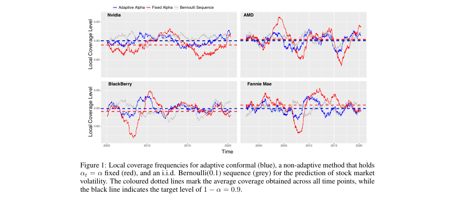
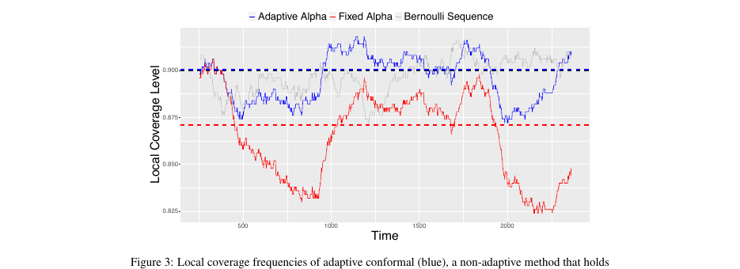
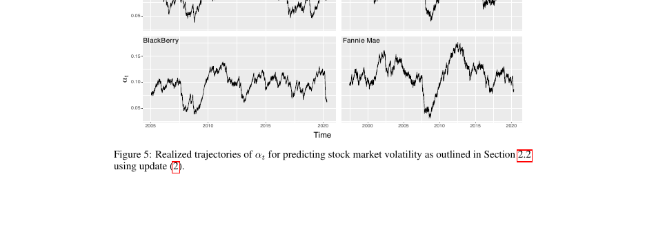

# 분포 이동 아래의 적응 컨포멀 추론 (번역)

- 원제: Adaptive Conformal Inference Under Distribution Shift
- 저자: Isaac Gibbs (스탠퍼드대 통계학과), Emmanuel J. Candès (스탠퍼드대 통계학과, 수학과)
- 원문: 같은 폴더의 `Gibbs2021_적응컨포멀_분포이동.pdf` (arXiv 2106.00170v3, 2021-10-28, 25쪽)
- 게재: Advances in Neural Information Processing Systems 34 (NeurIPS 2021), pp. 1660-1672 (NeurIPS 논문집 페이지에서 확인, 2026-11-04)
- 번역 범위: 전문 (초록, 본문, 그림 캡션, 부록). 참고문헌은 원문 그대로.
- 번역 메모: 수식 기호는 원문을 따른다. miscoverage는 "덮지 못함(미포함)", coverage는 "포함률"로 옮겼다.

---

## 초록

데이터를 만드는 분포가 시간에 따라 알 수 없는 방식으로 바뀔 수 있는 온라인 환경에서 예측 집합을 만드는 방법을 개발한다. 이 틀은 컨포멀 추론의 생각을 바탕으로 한다. 아직 보지 못한 정답의 점 예측이나, 그 분포의 분위수 추정을 내는 어떤 블랙박스 방법과도 결합할 수 있는 일반적인 감싸개(wrapper)를 제공한다.

이전의 컨포멀 추론 방법은 데이터 점들이 교환 가능하다는 가정에 기댄다. 반면 우리의 적응형 방법은 실제 데이터 생성 과정과 상관없이, 긴 시간 구간에서 원하는 포함 빈도를 달성함을 증명할 수 있다. 이를 위해 분포 이동을, 최적값이 시간에 따라 바뀌고 계속 다시 추정해야 하는 단일 모수의 학습 문제로 모형화한다.

우리 방법인 적응 컨포멀 추론을 두 실제 데이터셋에서 시험했고, 눈에 보이는 큰 분포 이동에도 예측이 강건함을 확인했다.

## 1. 서론

기계학습 알고리즘은 위험이 큰 의사결정 과정에 점점 더 많이 쓰인다. 예를 들어 심층 신경망은 자율주행차에서 주변 물체를 찾는 데 쓰이고 [2], 가석방 결정은 백 개가 넘는 특징을 결합하는 복잡한 모형의 도움을 받아 내려진다 [1]. 블랙박스 방법의 인기와 잘못된 결정의 비용이 함께 커지면서, 그 예측의 불확실성을 정량화하는 도구를 만드는 일이 매우 중요해졌다.

이 논문에서는 높은 확률로 목표 정답을 담도록 보장된 예측 집합을 만드는 방법을 개발한다. 특히 공변량과 응답의 쌍 $\{(X_t, Y_t)\}_{t\in\mathbb{N}} \subseteq \mathbb{R}^d \times \mathbb{R}$을 차례로 관측하는 온라인 학습 환경에 집중한다. 각 시점 $t$에서, 이전에 관측한 데이터 $\{(X_r, Y_r)\}_{1\le r\le t-1}$와 새 공변량 $X_t$를 써서 $Y_t$의 예측 집합 $\hat C_t$를 만들어야 한다. 목표 포함 수준 $\alpha \in (0,1)$이 주어지면, 일반적인 목표는 $Y_t$가 적어도 $100(1-\alpha)\%$의 시간 동안 $\hat C_t$에 속하도록 보장하는 것이다.

이 문제를 푸는 가장 강력하고 유연한 도구는 아마 컨포멀 추론에서 나온다 [예: 34, 16, 32, 22, 31, 15, 3]. 이 틀은 어떤 블랙박스 예측 알고리즘의 출력이든 예측 집합으로 바꾸는 일반적인 방법론을 준다. 이 일반성 덕분에 특정 예측 문제에 특화된 많은 컨포멀 방법이 개발되었다 [예: 30, 11, 23, 8, 24, 21]. 아주 작은 예외를 빼면, 이 알고리즘들은 모두 같은 보장을 공유한다. 학습 데이터와 시험 데이터가 교환 가능하면, 예측 집합은 유효한 주변 포함률 $\mathbb{P}(Y_t \in \hat C_t) = 1-\alpha$를 가진다.

교환 가능성은 흔한 가정이지만, $(X_t, Y_t)$의 주변 분포가 정상(stationary)이라고 기대할 수 없는 실제 응용이 많다. 예를 들어 금융과 경제에서는 새 법률이나 큰 세계적 사건에 반응해 시장 행동이 크게 바뀔 수 있다. 또는 예측 모형을 새 환경에 배치하면서 $(X_t, Y_t)$의 분포가 바뀔 수 있다.

이 논문은 적응 컨포멀 추론(ACI)을 개발한다. 이는 데이터의 주변 분포 변화에 강건한 예측 집합을 만드는 방법이다. 우리 접근은 단순하다. 이동을 모형화하는 모수 하나만 추적하면 된다. 또 일반적이다. 응답의 점 예측이나 추정 분위수를 내는 어떤 현대 기계학습 알고리즘과도 결합할 수 있다. 우리는 긴 시간 구간에서 ACI가 데이터 생성 분포에 대한 어떤 가정 없이도 목표 포함 빈도를 달성함을 보인다. 나아가 분포 이동이 작고 예측 알고리즘이 어떤 단순한 형태를 가지면, ACI가 대부분의 시점에서 근사적인 주변 포함률도 얻음을 보인다.

### 1.1 컨포멀 추론

$X$로 $Y$의 값을 예측하는 적합된 회귀 모형이 있다고 하자. $y$를 $Y_t$의 후보 값이라 하자. $y$가 $Y_t$의 합리적인 추정인지 정하기 위해, 값 $y$가 적합 모형의 예측과 얼마나 잘 맞는지 재는 순응 점수(conformity score) $S(X, Y)$를 정의한다. 예를 들어 회귀 모형이 점 예측 $\hat\mu(X)$를 내면, $\hat\mu(X_t)$와 $y$ 사이의 거리를 재는 점수를 쓸 수 있다. 한 예는 다음과 같다.

$$S(X_t, y) = |\hat\mu(X_t) - y|.$$

또는 회귀 모형이 $Y|X$ 분포의 $p$번째 분위수 추정 $\hat q(X; p)$를 낸다고 하자. 그러면 컨포멀화 분위수 회귀(CQR) 방법 [28]을 쓸 수 있다. 이 방법은 $y$와 적합된 위아래 분위수 사이의 부호 있는 거리를 다음 점수로 본다.

$$S(X_t, y) = \max\{\hat q(X_t; \alpha/2) - y,\; y - \hat q(X_t; 1-\alpha/2)\}.$$

어떤 순응 점수를 고르든, 핵심 문제는 $y$를 $Y_t$의 합리적 예측으로 받아들이려면 $S(X_t, y)$가 얼마나 작아야 하는지 정하는 것이다. 회귀 모형 적합에 쓰지 않은 교정 집합 $D_{cal} \subseteq \{(X_r, Y_r)\}_{1\le r\le t-1}$이 있다고 하자. 이 교정 집합으로 순응 점수의 적합 분위수를 다음과 같이 정의한다.

$$\hat Q(p) := \inf\Big\{ s : \frac{1}{|D_{cal}|} \sum_{(X_r,Y_r)\in D_{cal}} \mathbb{1}_{\{S(X_r,Y_r)\le s\}} \ge p \Big\}, \qquad (1)$$

그리고 $S(X_t, y) \le \hat Q(1-\alpha)$이면 $y$가 $Y_t$의 합리적 예측이라고 말한다.

핵심 관찰은 이것이다. 데이터 $D_{cal} \cup \{(X_t, Y_t)\}$가 교환 가능하고 동점을 균등 무작위로 깨면, 점들 $\{S(X_r,Y_r)\}_{(X_r,Y_r)\in D_{cal}} \cup \{S(X_t,Y_t)\}$ 가운데 $S(X_t, Y_t)$의 순위는 균등하다. 따라서

$$\mathbb{P}(S(X_t,Y_t) \le \hat Q(1-\alpha)) = \frac{\lceil |D_{cal}|(1-\alpha)\rceil}{|D_{cal}|+1}.$$

그러므로 예측 집합을 $\hat C_t := \{y : S(X_t, y) \le \hat Q(1-\alpha)\}$로 정의하면 다음 주변 포함 보장을 얻는다.

$$\mathbb{P}(Y_t \in \hat C_t) = \mathbb{P}(S(X_t,Y_t) \le \hat Q(1-\alpha)) = \frac{\lceil |D_{cal}|(1-\alpha)\rceil}{|D_{cal}|+1}.$$

무작위화를 조금 더하면, 이 일반 절차를 약간 바꿔 정확한 주변 포함 보장 $\mathbb{P}(Y_t \in \hat C_t) = 1-\alpha$를 만족하는 집합 $\hat C_t$를 만들 수 있다 [34]. 이 논문의 목적에는 이 조정이 중요하지 않으므로 자세한 내용은 생략한다. 또 위의 방법은 흔히 분할(split) 또는 귀납(inductive) 컨포멀 추론이라 불린다 [27, 34, 26]. 관측 데이터를 회귀 모형 적합용 학습 집합과 따로 떼어 둔 교정 집합으로 나눴다는 뜻이다. 이 글에서 개발하는 적응 컨포멀 추론은 전체(full) 컨포멀 추론에도 쉽게 맞출 수 있다. 전체 컨포멀은 더 많은 계산을 대가로 데이터 분할을 피한다 [34].

## 2. 분포 이동에 컨포멀 추론 맞추기

지금까지는 점수 함수 $S(\cdot)$ 하나와 분위수 함수 $\hat Q(\cdot)$ 하나로 작업했다. 데이터 분포가 시간에 따라 이동하는 일반적인 경우에는 두 함수 모두 가장 최근 관측에 맞도록 주기적으로 다시 추정해야 한다. 그래서 각 시점 $t$에 적합된 점수 함수 $S_t(\cdot)$와 대응하는 분위수 함수 $\hat Q_t(\cdot)$가 주어진다고 가정한다. 예측 집합 $\hat C_t(\alpha) := \{y : S_t(X_t, y) \le \hat Q_t(1-\alpha)\}$의 실현 미포함률을 다음과 같이 정의한다.

$$M_t(\alpha) := \mathbb{P}(S_t(X_t, Y_t) > \hat Q_t(1-\alpha)),$$

여기서 확률은 시험 점 $(X_t, Y_t)$와 $S_t(\cdot)$, $\hat Q_t(\cdot)$ 적합에 쓴 데이터 모두에 대한 것이다.

데이터 생성 분포가 정상이 아니므로 $M_t(\alpha)$가 $\alpha$와 같거나 가깝다고 기대하지 않는다. 그래도 $\hat Q_t(\cdot)$ 적합에 쓴 순응 점수가 $S_t(X_t,Y_t)$ 분포의 대부분을 덮는다면, $M_t(\alpha_t^*) \cong \alpha$가 되는 다른 값 $\alpha_t^* \in [0,1]$이 있을 수 있다고 가정할 수 있다. 더 엄밀히, 확률 1로 $\hat Q_t(\cdot)$가 연속이고 감소하지 않으며 $\hat Q_t(0) = -\infty$, $\hat Q_t(1) = \infty$라고 가정하자. 이는 (1)에서 정의한 분할 컨포멀 분위수 함수에서는 성립하지 않는다. 하지만 순응 점수 사이에 동점이 없으면 $\hat Q(\cdot)$의 점프 불연속을 매끄럽게 하여 이를 보장하도록 정의를 고칠 수 있다. 그러면 $M_t(\cdot)$는 $[0,1]$에서 감소하지 않고 $M_t(0)=0$, $M_t(1)=1$이므로 다음을 정의할 수 있다.

$$\alpha_t^* := \sup\{\beta \in [0,1] : M_t(\beta) \le \alpha\}.$$

나아가 추가로

$$\mathbb{P}(S_t(X_t,Y_t) = \hat Q_t(1-\alpha_t^*)) = 0$$

을 가정하면 $M_t(\alpha_t^*) = \alpha$가 된다. 특히 $\hat Q_t(\cdot)$의 인자를 올바르게 교정하면 근사적 또는 정확한 주변 포함을 얻을 수 있다.

이 교정을 위해 단순한 온라인 갱신을 쓴다. 이 갱신은 이전 예측 집합들의 경험적 미포함 빈도를 보고, 예측 집합이 과거에 $Y_t$를 덜 덮었으면(더 덮었으면) $\alpha_t^*$의 추정을 내린다(올린다). 구체적으로 $\alpha_1$을 초기 추정이라 하자(실험에서는 $\alpha_1 = \alpha$로 둔다). 미포함 사건의 수열을 재귀적으로 정의한다.

$$\mathrm{err}_t := \begin{cases} 1, & Y_t \notin \hat C_t(\alpha_t), \\ 0, & \text{그 밖}, \end{cases} \qquad \hat C_t(\alpha_t) := \{y : S_t(X_t, y) \le \hat Q_t(1-\alpha_t)\}.$$

그다음 걸음 크기 모수 $\gamma > 0$을 정하고 다음의 단순한 온라인 갱신을 생각한다.

$$\alpha_{t+1} := \alpha_t + \gamma(\alpha - \mathrm{err}_t). \qquad (2)$$

이 알고리즘을 적응 컨포멀 추론이라 부른다. 여기서 $\mathrm{err}_t$는 과거 미포함 빈도의 추정 역할을 한다. 자연스러운 대안은 다음 갱신이다.

$$\alpha_{t+1} = \alpha_t + \gamma\Big(\alpha - \sum_{s=1}^{t} w_s\, \mathrm{err}_s\Big), \qquad (3)$$

여기서 $\{w_s\}_{1\le s\le t} \subseteq [0,1]$은 $\sum_{s=1}^t w_s = 1$인 증가하는 가중치 수열이다. 이 갱신은 $\alpha_t$를 내릴지 올릴지 정할 때 최근의 경험적 미포함 빈도를 더 직접 평가한다는 장점이 있다. 실제로는 (2)와 (3)이 거의 같은 결과를 낸다. 예를 들어 부록 A.3에서 다음 가중치로 갱신 (3)을 써서 얻은 $\alpha_t$의 표본 궤적을 보인다.

$$w_s := \frac{0.95^{t-s}}{\sum_{s'=1}^{t} 0.95^{t-s'}}.$$

이 궤적은 (2)로 얻은 궤적과 매우 비슷하다. 주된 차이는 (3)으로 얻은 궤적이 더 매끄럽고 $\alpha_t$의 국소 변동이 적다는 점이다. 이 글의 나머지에서는 단순함을 위해 (2)에 집중한다.

### 2.1 걸음 크기 고르기

$\gamma$의 선택은 적응성과 안정성 사이의 균형을 정한다. $\gamma$를 키우면 관측된 분포 이동에 더 잘 적응하지만, $\alpha_t$ 값의 변동도 커진다. 실제로 $\alpha_t$가 크게 흔들리는 것은 바람직하지 않을 수 있다. 방법이 작고 보수적인 예측 집합과 크고 반보수적인 예측 집합 사이를 오가게 되기 때문이다.

정리 4.2에서 $(M_t(\alpha_t)-\alpha)^2$의 상한을 주는데, 이 상한은 $\gamma$를 $\sqrt{|\alpha_{t+1}^* - \alpha_t^*|}$에 비례하게 고를 때 최적이 된다. 실제로 바로 쓸 수는 없지만, 이 결과는 분포 이동이 큰 환경일수록 알고리즘이 더 적응적이어야 하고 따라서 $\gamma$를 더 크게 골라야 한다는 직관을 뒷받침한다. 실험에서는 $\gamma = 0.005$를 쓴다. 이 값은 $\alpha_t$의 궤적을 비교적 안정되게 하면서도 관측된 이동에 적응할 만큼 충분히 커서 골랐다. 위의 일반 원칙과 맞게, 더 큰 $\gamma$도 분포 이동을 성공적으로 막아 주었다. 반면 $\gamma$를 너무 작게 하면 적응 컨포멀 추론이 $\alpha_t = \alpha$를 시간 내내 고정하는 비적응 방법과 비슷하게 동작했다.

### 2.2 실제 데이터 예: 시장 변동성 예측

ACI를 시장 변동성 예측에 적용한다. $\{P_t\}_{1\le t\le T}$를 한 주식의 일별 시가 수열이라 하자. 모든 $t \ge 2$에 대해 수익률 $R_t := (P_t - P_{t-1})/P_{t-1}$과 실현 변동성 $V_t = R_t^2$를 정의한다. 목표는 이전에 관측한 수익률 $X_t := \{R_s\}_{1\le s\le t-1}$로 $Y_t := V_t$의 예측 집합을 만드는 것이다. 더 정교한 금융 모형이라면 $X_t$에 다른 시장 공변량(시점 $t-1$에 분석가가 쓸 수 있는 것)을 더할 것이다. 이 절의 주목적은 적응 컨포멀 추론을 보여 주는 것이므로 단순한 예측 방법만 쓴다.

먼저 GARCH(1,1) 모형 [4]으로 점 예측을 만든다. 이 방법은 $R_t = \sigma_t \epsilon_t$이고 $\epsilon_2, \dots, \epsilon_T$가 i.i.d. $N(0,1)$이며 $\sigma_t$가 다음 재귀 갱신을 만족한다고 가정한다.

$$\sigma_t^2 = \omega + \tau V_{t-1} + \beta \sigma_{t-1}^2.$$

이는 경제학에서 변동성 예측에 흔히 쓰는 방법이다. 실제로는 시장 동역학이 바뀌면서 이 모형의 예측이 긴 기간에 걸쳐 부정확해질 수 있다. 그래서 점 예측을 만들 때 최근 1250 거래일(약 5년)의 시장 데이터만으로 모형을 적합한다. 더 정확히, 모든 $t > 1250$에 대해 계수 $\hat\omega_t, \hat\tau_t, \hat\beta_t$와 분산 수열 $\{\hat\sigma_s^t\}_{1\le s\le t-1}$를 데이터 $\{R_r\}_{t-1250\le r<t}$만으로 적합한다. 그러면 시점 $t$의 실현 변동성에 대한 점 예측은 다음과 같다.

$$(\hat\sigma_t^t)^2 := \hat\omega_t + \hat\tau_t V_{t-1} + \hat\beta_t (\hat\sigma_{t-1}^t)^2.$$

예측 구간을 만들기 위해 순응 점수 수열과

$$S_t := \frac{|V_t - (\hat\sigma_t^t)^2|}{(\hat\sigma_t^t)^2}$$

대응하는 분위수 함수를 정의한다.

$$\hat Q_t(p) := \inf\Big\{ x : \frac{1}{1250}\sum_{r=t-1250}^{t-1} \mathbb{1}_{S_r \le x} \ge p \Big\}.$$

그러면 시점 $t$의 예측 집합은

$$\hat C_t(\alpha_t) := \Big\{ v : \frac{|v - (\hat\sigma_t^t)^2|}{(\hat\sigma_t^t)^2} \le \hat Q_t(1-\alpha_t) \Big\}$$

이고, $\{\alpha_t\}$는 $\alpha_{1250} = \alpha = 0.1$로 시작해 (2)처럼 재귀적으로 갱신한다.

이 알고리즘을 $\alpha_t = \alpha$로 고정하는 비적응 대안과 비교한다. 시간에 따른 성능을 재기 위해 국소 포함 빈도를 본다. 이는 가장 최근 2년의 평균 포함률로 다음과 같다.

$$\mathrm{localCov}_t := 1 - \frac{1}{500}\sum_{r=t-250+1}^{t+250} \mathrm{err}_r. \qquad (4)$$

방법이 잘 동작하면 국소 포함 빈도가 모든 시점에서 목표값 $1-\alpha$ 근처에 머물 것이다.



그림 1: 주식시장 변동성 예측에서 적응 컨포멀(파랑), $\alpha_t = \alpha$로 고정한 비적응 방법(빨강), i.i.d. Bernoulli(0.1) 수열(회색)의 국소 포함 빈도. 색 점선은 모든 시점에 걸친 평균 포함률이고, 검은 선은 목표 수준 $1-\alpha = 0.9$이다.

일별 시가는 The Wall Street Journal이 공개한 데이터셋에서 얻었다. 네 주식에 대해 비적응과 적응 컨포멀 방법의 실현 국소 포함 빈도를 그림 1에 보였다. 이 주식들은 살펴본 12개 주식 가운데 비적응 방법의 실패가 뚜렷한 것들로 골랐다. 적응 컨포멀 추론은 모든 경우에 잘 동작했다(부록 그림 9 참고).

시각적 비교 대상으로, 회색 곡선은 i.i.d. Bernoulli(0.1)인 수열 $\{I_t\}_{1\le t\le T}$의 이동 평균 $1 - \frac{1}{500}\sum_{r=t-250+1}^{t+250} I_r$을 보인다. 적응 컨포멀 추론의 국소 포함 빈도(파란 선)는 항상 i.i.d. Bernoulli 수열에서 예상되는 변동 안에 머문다. 반면 비적응 방법은 목표 수준 $1-\alpha = 0.9$에서 크게 벗어난다(빨간 선). 예를 들어 오른쪽 아래 그림에서, 비적응 방법은 2008년 금융위기 동안 Fannie Mae의 실현 변동성을 덮지 못하지만 적응 방법은 이 사건에 강건하다(이 기간 Fannie Mae 가격은 부록 그림 4 참고).

## 3. 관련 연구

컨포멀 추론의 이전 연구는 두 가지 분포 이동을 다뤘다 [33, 10]. 두 경우 모두 교정 데이터가 하나의 분포 $P_0$에서 i.i.d.로 뽑히고 시험 점은 두 번째 분포 $P_1$에서 나오는 환경에 초점을 둔다. 이 환경에서 Tibshirani 외 [33]는 $P_1$과 $P_0$의 우도비로 교정 데이터에 다시 가중치를 주면 유효한 예측 집합을 얻을 수 있음을 보였다. 하지만 이는 $Y|X$의 조건부 분포가 학습과 시험 사이에 일정해야 하고, 우도비 $P_1(X)/P_0(X)$를 알거나 아주 정확히 추정해야 한다. 한편 Cauchois 외 [10]는 $P_1$과 $P_0$가 $f$-발산으로 가까우면 유효한 예측 집합을 만드는 방법을 개발했다. 우리 연구와 비슷하게, 그들은 $D_f(P_1\|P_0) \le \rho$이면 다음을 만족하는 보수적인 값 $\alpha_\rho \in (0,1)$이 있음을 보인다.

$$M(\alpha_\rho) := \mathbb{P}(S(X_t,Y_t) > \hat Q(1-\alpha_\rho)) \le \alpha.$$

우리 접근과 그들의 차이는 두 가지다. 첫째, 그들은 보수적인 값 $\alpha_\rho$ 하나를 고정하지만, 우리 방법은 $M(\alpha^*) = \alpha$를 만족하는 최적 선택 $\alpha^*$를 추정하려 한다. [10]의 환경에서는 분포 이동의 크기를 추정할 데이터를 관측하지 않으므로 이것이 불가능하다. 둘째, 그들은 학습 분포 하나와 시험 분포 하나만 생각하지만, 우리는 분포가 시간에 따라 계속 이동할 수 있는 완전한 온라인 환경에서 작업한다.

## 4. 포함 보장

### 4.1 분포 무관 결과

이 절에서는 적응 컨포멀 추론의 이론적 포함 보장을 정리한다. 내내 확률 1로 $\alpha_1 \in [0,1]$이고, $\hat Q_t$가 감소하지 않으며 모든 $x<0$에서 $\hat Q_t(x) = -\infty$, 모든 $x>1$에서 $\hat Q_t(x) = \infty$라고 가정한다. 첫 결과는, 긴 시간 구간에서 적응 컨포멀 추론이 데이터 생성 분포에 대한 어떤 가정과도 상관없이 올바른 포함 빈도를 얻음을 보인다.

**보조정리 4.1** 확률 1로, 모든 $t \in \mathbb{N}$에 대해 $\alpha_t \in [-\gamma, 1+\gamma]$이다.

*증명:* 귀류법으로, 양의 확률로 $\{\alpha_t\}_{t\in\mathbb{N}}$가 $\inf_t \alpha_t < -\gamma$라고 하자($\sup_t \alpha_t > 1+\gamma$인 경우도 같다). $\sup_t |\alpha_{t+1} - \alpha_t| = \sup_t \gamma|\alpha - \mathrm{err}_t| < \gamma$임에 주목하자. 따라서 양의 확률로 $\alpha_t < 0$이고 $\alpha_{t+1} < \alpha_t$인 $t \in \mathbb{N}$을 찾을 수 있다. 그런데

$$\alpha_t < 0 \implies \hat Q_t(1-\alpha_t) = \infty \implies \mathrm{err}_t = 0 \implies \alpha_{t+1} = \alpha_t + \gamma(\alpha - \mathrm{err}_t) \ge \alpha_t$$

이므로 $\mathbb{P}(\exists t \text{ s.t. } \alpha_{t+1} < \alpha_t < 0) = 0$이다. 모순이다. ∎

**명제 4.1** 확률 1로 모든 $T \in \mathbb{N}$에 대해

$$\Big|\frac{1}{T}\sum_{t=1}^{T} \mathrm{err}_t - \alpha\Big| \le \frac{\max\{\alpha_1, 1-\alpha_1\} + \gamma}{T\gamma}. \qquad (5)$$

특히 $\lim_{T\to\infty} \frac{1}{T}\sum_{t=1}^T \mathrm{err}_t \overset{a.s.}{=} \alpha$이다.

*증명:* (2)의 재귀를 펼치고 보조정리 4.1을 적용하면

$$[-\gamma, 1+\gamma] \ni \alpha_{T+1} = \alpha_1 + \sum_{t=1}^{T} \gamma(\alpha - \mathrm{err}_t).$$

이를 정리하면 결과를 얻는다. ∎

명제 4.1은 데이터 생성 분포에 어떤 제약도 두지 않는다. 분포 이동에 가벼운 가정을 두면 이 결과를 개선할 수 있는지 곧바로 물을 수 있다. 우리는 초기화의 질에 대한 가정 없이는 답이 부정적이라고 주장한다. 이를 이해하려고, 고정된 최적 목표 $\alpha^* \in [0,1]$ 하나가 있는 환경을 생각하고 다음을 가정하자.

$$M_t(p) = M(p) = \begin{cases} \alpha + \frac{1-\alpha}{1-\alpha^*}(p - \alpha^*), & p > \alpha^*, \\ \alpha + \frac{\alpha}{\alpha^*}(p - \alpha^*), & p \le \alpha^*. \end{cases}$$

추가로 $\mathbb{E}[\mathrm{err}_t | \alpha_t] = M(\alpha_t)$라고 가정하자.¹ 계산을 단순하게 하려고 잡음 없는 갱신 $\alpha_{t+1} = \alpha_t + \gamma(\alpha - M(\alpha_t)) = \alpha_t + \gamma(\alpha - \mathbb{E}[\mathrm{err}_t|\alpha_t])$를 생각한다. 직관적으로 잡음 없는 갱신은 (2)의 평균적 행동으로 볼 수 있다. 이제 어떤 초기화 $\alpha_1$과 어떤 $\gamma \le \min\{\frac{1-\alpha^*}{1-\alpha}, \frac{\alpha^*}{\alpha}\}$에 대해서도, 모든 $t$에서 $M(\alpha_t) - \alpha = c(\alpha_t - \alpha^*)$를 만족하는 상수 $c \in \{\frac{1-\alpha}{1-\alpha^*}, \frac{\alpha}{\alpha^*}\}$가 있다. 그러므로

$$\mathbb{E}[\mathrm{err}_t] - \alpha = c\,\mathbb{E}[\alpha_t - \alpha^*] = c\,\mathbb{E}[\alpha_{t-1} + \gamma(\alpha - M_{t-1}(\alpha_{t-1})) - \alpha^*] = c(1-c\gamma)\mathbb{E}[\alpha_{t-1} - \alpha^*].$$

이 계산을 재귀적으로 반복하면

$$\mathbb{E}[\mathrm{err}_t] - \alpha = c(1-c\gamma)^{t-1}\mathbb{E}[\alpha_1 - \alpha^*] = c(1-c\gamma)^{t-1}(\alpha_1 - \alpha^*),$$

이고 따라서

$$\Big|\frac{1}{T}\sum_{t=1}^{T}\mathbb{E}[\mathrm{err}_t] - \alpha\Big| = \frac{1-(1-c\gamma)^T}{T\gamma}|\alpha_1 - \alpha^*|.$$

이 경계와 (5)의 비교는 자명하다. 주된 차이는 $\max\{1-\alpha_1, \alpha_1\}$을 $|\alpha_1 - \alpha^*|$로 바꾼 것이다. 이는 $\alpha^* \in (0,1)$이 임의이므로 $\max\{1-\alpha_1, \alpha_1\}$이 $|\alpha_1 - \alpha^*|$의 가능한 최선의 상한이라는 사실에서 나온다. 그래서 우리는 명제 4.1을, 실제 데이터 생성 과정과 상관없이 올바른 장기 경험적 포함 빈도를 준다는 불가지(agnostic) 보장이자, 초기화 직후 최악 행동에 대한 근사적으로 빡빡한 경계로 본다.

¹ 이 마지막 가정은 일반적으로 $\hat Q_t(\cdot)$와 $\alpha_t$가 서로 독립적으로 적합될 때만 참이다.

### 4.2 은닉 마르코프 모형에서의 성능

명제 4.1이 초기화 이후 행동을 근사적으로 빡빡하게 특징짓는다고 믿지만, 큰 시점에서는 더 나은 경계를 얻을 수 있는지 여전히 물을 수 있다. 이 절에서는 $\alpha_1$을 적절히 초기화하고 분포 이동이 작으면 더 빡빡한 포함 보장을 줄 수 있음을 보여 이 질문에 긍정적으로 답한다. 쓸모 있는 결과를 얻으려고 데이터 생성 과정에 몇 가지 단순화 가정을 둔다. 이 가정이 실제 환경에서 정확히 성립하리라 기대하지는 않지만, 우리 결과가 적응 컨포멀 추론의 실제 행동을 대표한다고 보며, 다른 모형에서도 비슷한 결과가 성립하리라 예상한다.

#### 4.2.1 설정

데이터가 은닉 마르코프 모형에서 나온다고 모형화한다. 구체적으로 $\{A_t\}_{t\in\mathbb{N}} \subseteq \mathcal{A}$를 환경의 바탕 마르코프 연쇄라 하고, $\{A_t\}_{t\in\mathbb{N}}$가 주어지면 $\{(X_t, Y_t)\}_{t\in\mathbb{N}}$가 어떤 분포 모음 $\{P_a : a \in \mathcal{A}\}$에 대해 $(X_t, Y_t) \sim P_{A_t}$인 독립 수열이라고 가정한다. 계산을 단순하게 하려고, 추정 분위수 함수 $\hat Q_t(\cdot)$와 점수 함수 $S_t(\cdot)$가 $t$에 의존하지 않는다고 추가로 가정하고 $\hat Q(\cdot)$와 $S(\cdot)$로 쓴다. 이는 예를 들어 학습 집합과 교정 집합이 고정된 분할 컨포멀 환경에서 일어난다. 이 환경에서 $\{(\alpha_t, A_t)\}_{t\in\mathbb{N}}$는 $[-\gamma, 1+\gamma] \times \mathcal{A}$ 위의 마르코프 연쇄를 이룬다. 이 연쇄가 유일한 정상 분포 $\pi$를 가지고 $(\alpha_1, A_1) \sim \pi$라고 가정한다. 이는 $(\alpha_t, A_t, \mathrm{err}_t)$가 정상 과정임을 뜻하며, $\mathrm{err}_t$의 행동을 특징짓는 일을 크게 단순하게 한다. 이론을 확장할 수 있음은 의심할 여지가 없지만, 우리의 주목표는 쓸모 있고 단순한 결과를 얻는 것임을 상기하자. 그렇긴 해도 우리가 실제로 염두에 둔 것은 $\{A_t\}_{t\in\mathbb{N}}$가 충분히 잘 행동해 $(\alpha_t, A_t)$가 극한 정상 분포를 가지는 경우다. 부록 A.5에 이것이 증명 가능하게 성립하는 예를 든다. 끝으로 $(\alpha_1, A_1) \sim \pi$라는 가정은 사실상 4.1절에서 설명한 초기화 단계를 벗어날 만큼 알고리즘을 오래 돌렸다고 가정하는 것과 같다.

#### 4.2.2 오차의 대편차 경계

첫 관찰은 $\mathrm{err}_t$의 평균값이 올바르다는 것이다. 더 정확히, 명제 4.1로 $\lim_{T\to\infty} T^{-1}\sum_{t=1}^T \mathrm{err}_t \overset{a.s.}{=} \alpha$이고, $\mathrm{err}_t$가 정상이므로 $\mathbb{E}[\mathrm{err}_t] = \alpha$이다. 그러므로 $T^{-1}\sum_{t=1}^T \mathrm{err}_t$가 $\alpha$에서 벗어나는 정도를 이해하려면 $\{\mathrm{err}_t\}_{t\in\mathbb{N}}$의 의존 구조만 특징지으면 된다.

정리 4.1에서 이를 해낸다. 정리 4.1은 $|T^{-1}\sum_{t=1}^T \mathrm{err}_t - \alpha|$의 대편차 경계를 준다. 이 결과의 생각은 $\{\mathrm{err}_t\}_{t\in\mathbb{N}}$의 의존을 두 부분으로 나누는 것이다. 첫째, $\alpha_t$가 $\{\mathrm{err}_r\}_{1\le r\le t-1}$의 함수라서 생기는 의존이 있다. 부록 A.7에서 이 의존이 음의 상관을 만들고, 따라서 오차가 i.i.d. Bernoulli 수열보다 느리지 않은 속도로 기댓값 주위에 모인다고 논증한다. 이것이 (6)의 첫 항을 낳는데, i.i.d. 수열에 Hoeffding 부등식을 적용하면 얻는 것과 같다. 둘째, $A_t$가 $A_{t-1}$에 의존해서 생기는 의존이 있다. 더 구체적으로, 어떤 상태에서 $Y|X$ 분포의 변동이 다른 상태보다 큰 환경을 생각하자. 적응 컨포멀 추론의 목표는 변동 수준에 적응해, $Y|X$ 분포가 더 퍼진 상태에서 더 큰 예측 집합을 내는 것이다. 하지만 이 알고리즘은 완벽하지 않으므로, $\mathbb{E}[\mathrm{err}_t | A_t = a]$가 $\alpha$에서 치우친 상태 $a \in \mathcal{A}$가 있을 수 있다. 게다가 환경이 변동이 더 큰(또는 작은) 상태에 오래 머무는 경향이 있으면, 오차에 양의 의존이 생겨 $T^{-1}\sum_{t=1}^T \mathrm{err}_t$가 $\alpha$에서 벗어나게 된다. 이 의존을 다루려고 마르코프 연쇄용 Bernstein 부등식으로 $|T^{-1}\sum_{t=1}^T \mathbb{E}[\mathrm{err}_t|A_t] - \alpha|$를 묶는다. 이것이 (6)의 둘째 항을 낳는다.

**정리 4.1** $\{A_t\}_{t\in\mathbb{N}}$가 0이 아닌 절대 스펙트럼 간격 $1-\eta > 0$을 가진다고 하자. 다음을 두자.

$$B := \sup_{a\in\mathcal{A}} |\mathbb{E}[\mathrm{err}_t | A_t = a] - \alpha| \quad\text{그리고}\quad \sigma_B^2 := \mathbb{E}[(\mathbb{E}[\mathrm{err}_t|A_t] - \alpha)^2].$$

그러면

$$\mathbb{P}\Big(\Big|\frac{1}{T}\sum_{t=1}^{T}\mathrm{err}_t - \alpha\Big| \ge \epsilon\Big) \le 2\exp\Big(-\frac{T\epsilon^2}{8}\Big) + 2\exp\Big(-\frac{T(1-\eta)\epsilon^2}{8(1+\eta)\sigma_B^2 + 20B\epsilon}\Big). \qquad (6)$$

이 결과의 형식적 증명은 A.7절에 있다. 이 집중 부등식의 질은 편향 항 $B$와 $\sigma_B^2$의 크기에 결정적으로 달려 있다. 더 나가기 전에, $(\alpha_t, A_t, \mathrm{err}_t)$를 정상이라고 가정했으므로 $B$와 $\sigma_B^2$의 정의가 $t$의 선택과 무관하다는 점을 강조한다. 이제 이 양들을 이해하기 위해

$$M(p|a) := \mathbb{P}(S(X_t,Y_t) > \hat Q(1-p) | A_t = a)$$

를 분위수 $\hat Q(1-p)$로 상태 $a \in \mathcal{A}$에서 얻는 실현 미포함 수준이라 하자. $M(p|a)$가 연속이라고 가정한다. 이는 예를 들어 $\hat Q(\cdot)$가 연속이고 $S(X_t,Y_t)|A_t = a$가 연속 분포일 때 일어난다. 그러면 $M(\alpha_a^*|a) = \alpha$인 최적값 $\alpha_a^*$가 있다. 부록 보조정리 A.4는 추가로 $M(\cdot|a)$가 2차 테일러 전개를 허용하면 다음을 보인다.

$$B \le C\Big(\gamma + \gamma^{-1}\sup_{a\in\mathcal{A}}\sup_{k\in\mathbb{N}} \mathbb{E}[|\alpha^*_{A_{t+1}} - \alpha^*_{A_t}| \mid A_{t+k} = a]\Big) \quad\text{그리고}\quad \sigma_B^2 \le B^2.$$

여기서 상수 $C$는 $\hat Q(\cdot)$가 $S(X_t,Y_t)|A_t = a$의 참 분위수 함수인 이상적인 경우와 $M(\cdot|a)$가 얼마나 다른지에 달려 있다. 이상적인 경우에는 $M(\cdot|a)$가 선형 함수 $M(p|a) = p,\ \forall p \in [0,1]$이고 $C \le 2$이다.

항 $\mathbb{E}[|\alpha^*_{A_{t+1}} - \alpha^*_{A_t}| \mid A_{t+k} = a]$는 임계값 $\alpha_a^*$의 변화로 잰 분포 이동 크기의 정량적 척도로 볼 수 있다. 그래서 우리는 이 결과를, 분포 이동이 작고 모든 $a \in \mathcal{A}$에서 $\hat Q(\cdot)$가 $S(X_t,Y_t)|A_t = a$ 분포를 합리적으로 덮으면 $T^{-1}\sum_{t=1}^T \mathrm{err}_t$가 $\alpha$ 주위에 잘 모인다는 뜻으로 해석한다.

#### 4.2.3 근사적 주변 포함 달성

정리 4.1은 긴 시간 구간에서 평균 미포함률과 목표 수준 사이의 거리를 묶는다. 하지만 한 시점의 주변 포함 빈도에 대해서는 아무 정보도 주지 않는다. 다음 결과는 분포 이동이 작으면 실현 주변 포함률 $M(\alpha_t|A_t)$가 평균적으로 $\alpha$에 가까움을 보인다.

**정리 4.2** 모든 $a \in \mathcal{A}$와 모든 $\alpha_1, \alpha_2 \in \mathbb{R}$에 대해 $|M(\alpha_2|a) - M(\alpha_1|a)| \le L|\alpha_2 - \alpha_1|$인 상수 $L > 0$이 있다고 하자. 또 모든 $a \in \mathcal{A}$에 대해 $M(\alpha_a^*|a) = \alpha$인 $\alpha_a^* \in (0,1)$이 있다고 하자. 그러면

$$\mathbb{E}[(M(\alpha_t|A_t) - \alpha)^2] \le \frac{L(1+\gamma)}{\gamma}\mathbb{E}[|\alpha^*_{A_{t+1}} - \alpha^*_{A_t}|] + \frac{L}{2}\gamma. \qquad (7)$$

다시 강조하면, $(\alpha_t, A_t, \mathrm{err}_t)$를 정상이라고 가정했으므로 경계에 나오는 양들은 $t$에 대해 불변이고 (7)은 어떤 $t$에서도 성립한다. 이 결과의 증명은 부록 A.8절에 있다. (7)의 우변은 $\gamma = (2\mathbb{E}[|\alpha^*_{A_{t+1}} - \alpha^*_{A_t}|])^{1/2}$로 고를 때 최소가 되며, 다음 부등식을 준다.

$$\mathbb{E}[(M(\alpha_t|A_t) - \alpha)^2] \le L(\sqrt{2}+1)\sqrt{\mathbb{E}[|\alpha^*_{A_{t+1}} - \alpha^*_{A_t}|]}.$$

위와 같이 이상적인 경우에는 $\hat Q(\cdot)$가 $S(X_t,Y_t)|A_t = a$ 분위수의 완벽한 추정이므로 $M(p|a) = p$이고 $L = 1$이다. 또 이번에도 $\mathbb{E}[|\alpha^*_{A_{t+1}} - \alpha^*_{A_t}|]$를 분포 이동의 정량적 척도로 해석할 수 있다. 따라서 이 결과는 실현 주변 포함률과 목표 주변 포함률의 평균 차이를 바탕 분포 이동의 크기로 묶는 것으로 해석할 수 있다. 끝으로 $\gamma = (2\mathbb{E}[|\alpha^*_{A_{t+1}} - \alpha^*_{A_t}|])^{1/2}$라는 선택은, 분포 이동이 큰 영역에서는 $\gamma$를 더 크게 고르되 $\alpha_t$가 지나치게 흔들릴 만큼 크게 하지는 말아야 한다는 직관을 형식화한다.

## 5. 성능에 대한 $S_t(\cdot)$의 영향

모든 컨포멀 추론 방법의 성능은 순응 점수 설계에 크게 달려 있다. 이전 연구는 신중하게 고른 점수나 구간 폭의 명시적 최적화로 더 작은 예측 집합을 얻을 수 있음을 보였다 [예: 28, 29, 20, 12]. 적응 컨포멀 추론은 어떤 순응 점수 $S_t(\cdot)$와 분위수 함수 $\hat Q_t(\cdot)$와도 함께 동작하므로, 컨포멀 추론의 다른 개선과 바로 결합해 더 짧은 구간을 얻을 수 있다. 여기서 중요한 단서 하나는 컨포멀 예측 집합의 길이가 적합된 회귀 모형의 질에 직접 달려 있다는 점이다. 그래서 더 작은 구간을 얻으려면, 가장 정확한 예측을 만들기 위해 매 시점 가장 최근 데이터로 모형을 다시 적합해야 한다. 2.2절과 6절의 실험에서 바로 이렇게 했다.

이에 더해 $S_t(\cdot)$의 선택은 적응 컨포멀 추론의 포함 성질에도 직접 영향을 줄 수 있다. 정리 4.1과 4.2는 적응 컨포멀 추론의 성능이 시간에 따른 최적 모수 $\alpha_t^*$ 이동의 크기로 정해짐을 보인다. 또 $\alpha_t^*$ 자체는 $S_t(X_t,Y_t)$의 $1-\alpha$ 분위수와 일대일로 대응한다. 그러므로 적응 컨포멀 추론의 포함 성질은 $S_t(X_t,Y_t)$가 정상에 얼마나 가까운지에 달려 있다. 이 의존의 영향을 보여 주는 간단한 예로, 2.2절에서 다음 순응 점수로 예측 집합을 만들었음을 떠올리자.

$$S_t := \frac{|V_t - \hat\sigma_t^2|}{\hat\sigma_t^2}.$$

사전에는 합리적인 대안으로 정규화하지 않은 점수가 있다.

$$\tilde S_t := |V_t - \hat\sigma_t^2|.$$

하지만 더 자세히 보면, 근사적으로 정상인 순응 점수를 얻는 데 $\hat\sigma_t^2$로 나누는 정규화가 결정적이고, 따라서 $\tilde S_t$가 훨씬 나쁜 포함 성질을 낸다는 것이 놀랍지 않다. 그림 2는 $\tilde S_t$를 쓴 적응 컨포멀 추론의 국소 포함 빈도((4) 참고)를 보인다. 그림 1과 비교하면, 포함률이 이제 목표 수준 0.9에서 훨씬 크게 흔들린다. 이 문제는 알고리즘에 더 큰 적응성을 주는 더 큰 $\gamma$를 골라 부분적으로 완화할 수 있다.

그림 2: 순응 점수 $\tilde S_t$로 주식시장 변동성을 예측할 때 적응 컨포멀(파랑), $\alpha_t = \alpha$로 고정한 비적응 방법(빨강), i.i.d. Bernoulli(0.1) 수열(회색)의 국소 포함 빈도. 색 점선은 모든 시점에 걸친 평균 포함률이고, 검은 선은 목표 수준 $1-\alpha = 0.9$이다. (그림은 원문 9쪽. 세로축이 0.4~1.0으로, 그림 1의 0.85~0.95보다 흔들림이 훨씬 크다.)

## 6. 실제 데이터 예: 선거 당일 밤 예측

2020년 미국 대통령 선거 동안 The Washington Post는 컨포멀화 분위수 회귀(CQR)((1)과 1.1절 참고)를 써서 선거 당일 밤 카운티 수준 득표수 예측을 만들었다 [13]. 여기서는 고정 분위수와 적응 분위수를 모두 써서 이 방법의 핵심 요소를 재현한다.



그림 3: 카운티 수준 선거 예측에서 적응 컨포멀(파랑), $\alpha_t = \alpha$로 고정한 비적응 방법(빨강), i.i.d. Bernoulli(0.1) 수열(회색)의 국소 포함 빈도. 색 점선은 모든 시점에 걸친 평균 포함률이고, 검은 선은 목표 포함 수준 $1-\alpha = 0.9$이다.

설정을 정확히 하자. $\{Y_t\}_{1\le t\le T}$를 미국 약 $T = 3000$개 카운티 각각에서 2020년 선거 대통령 후보 Joe Biden이 얻은 표 수라 하자. $X_t$는 $t$번째 카운티의 인구통계 공변량 집합이다. 실험에서 $X_t$는 카운티 인구의 인종, 나이, 성별 구성, 중위 소득, 교육 정보를 포함한다(자세한 내용은 A.6.1절). 선거 당일 밤 카운티 득표 합계는 개표가 끝나는 대로 관측되었다. 개표가 끝나는 순서가 균등 무작위였다면 $\{(X_t, Y_t)\}_{1\le t\le T}$는 교환 가능한 수열이 되어 표준 컨포멀 추론 방법을 돌릴 수 있었을 것이다. 실제로는 큰 도시 카운티가 작은 시골 카운티보다 결과를 늦게 보고하는 경향이 있고, 미국 동부 해안 카운티가 서부 해안보다 먼저 보고한다. 그래서 $(X_t, Y_t)$의 분포는 선거 당일 밤 내내 표류한다고 볼 수 있다.

카운티 수준 득표 합계를 예측하는 데 CQR를 적용한다(자세한 내용은 A.6.2절). 선거 당일 밤에 관측된 동부에서 서부로의 편향을 재현하려고, 카운티를 시간대 순으로 정렬해 동부 시간대 카운티가 먼저, 하와이 카운티가 마지막에 오게 한다. 각 시간대 안에서는 카운티를 균등 무작위로 정렬한다. 그림 3은 비적응과 적응 컨포멀 방법의, 가장 최근 300개 카운티에 대한 실현 국소 포함 빈도((4) 참고)를 보인다. 비적응 방법은 원하는 90% 포함 수준을 유지하지 못하고, 시간대가 바뀔 때 포함 빈도가 크게 꺼진다. 반면 적응 방법은 모든 시점에서 근사적으로 90% 포함을 유지하며, 국소 포함 수준의 편차도 Bernoulli 수열에서 관측되는 것과 비슷하다.

## 7. 논의

이 분야에는 아직 열린 문제가 많다. 우리가 개발한 방법은 각 시점에 $Y_t$가 드러나는 경우에 특화되어 있다. 하지만 응답을 늦게 받거나 큰 묶음으로 받는 환경도 많다. 또 4.2절의 이론 결과는 데이터 생성 분포의 한 모형과, 분위수 함수 $\hat Q_t(\cdot)$가 시간에 따라 고정된 특수한 경우로 한정된다. 가장 최근 데이터로 $\hat Q_t(\cdot)$를 온라인으로 적합하는 환경에서도 비슷한 결과를 얻을 수 있는지 밝히면 흥미로울 것이다. 개선할 수 있는 또 다른 영역은 걸음 크기 $\gamma$의 선택이다. 2.1절에서 환경의 분포 이동 크기에 근거해 $\gamma$를 고르는 경험적 지침을 몇 가지 주었다. 하지만 이상적으로는 사전 지식 없이 $\gamma$를 적응적으로 정하고 싶다. 끝으로 실험 결과가 두 영역에 한정된다. 우리 방법이 더 다양한 실제 분포 이동을 성공적으로 막을 수 있는지 밝히려면 추가 연구가 필요하다.

## 8. 감사의 글

E.C.는 해군연구청(ONR) 과제 N00014-20-12157, 미국국립과학재단(NSF) 과제 OAC 1934578과 DMS 2032014, 육군연구청(ARO) 과제 W911NF-17-1-0304, Simons 재단 지원 814641의 지원을 받았다. 2020년 대통령 선거 당일 밤에 관한 귀중한 토론을 해 준 John Cherian, 온라인 학습과의 관계에 대해 도움 되는 의견을 준 Lihua Lei에게 감사한다.

## 참고문헌 (원문 그대로)

```
 [1] Julia Angwin, Jeff Larson, Surya Mattu, and Lauren Kirchner.                      Machine bias:
     There’s software used across the country to predict future criminals. and it’s bi-
     ased against blacks, 2016.                 URL https://www.propublica.org/article/
     machine-bias-risk-assessments-in-criminal-sentencing.
 [2] Claudine Badue, Rânik Guidolini, Raphael Vivacqua Carneiro, Pedro Azevedo, Vinicius B.
     Cardoso, Avelino Forechi, Luan Jesus, Rodrigo Berriel, Thiago M. Paixão, Filipe Mutz, Lucas
     de Paula Veronese, Thiago Oliveira-Santos, and Alberto F. De Souza. Self-driving cars: A
     survey. Expert Systems with Applications, 165:113816, 2021. ISSN 0957-4174. doi: https:
     //doi.org/10.1016/j.eswa.2020.113816. URL https://www.sciencedirect.com/science/
     article/pii/S095741742030628X.
 [3] Rina Foygel Barber, Emmanuel J. Candès, Aaditya Ramdas, and Ryan J. Tibshirani. Predictive
     inference with the jackknife+. The Annals of Statistics, 49(1):486 – 507, 2021. doi: 10.1214/
     20-AOS1965. URL https://doi.org/10.1214/20-AOS1965.
 [4] Tim Bollerslev. Generalized autoregressive conditional heteroskedasticity. Journal of
     Econometrics, 31(3):307–327, 1986. ISSN 0304-4076. doi: https://doi.org/10.1016/
     0304-4076(86)90063-1. URL https://www.sciencedirect.com/science/article/
     pii/0304407686900631.
 [5] United States Census Bureau. County characteristics resident population estimates, 2019. data
     retrieved from https://www.census.gov/data/tables/time-series/demo/popest/
     2010s-counties-detail.html.
 [6] United States Census Bureau. 2015-2019 american community survey 5-year average county-
     level estimates, 2019. data retrieved from https://www.ers.usda.gov/data-products/
     county-level-data-sets/download-data/.
 [7] United States Census Bureau.            Small area income and poverty estimates: 2019,
     2019.            data retrieved from https://www.ers.usda.gov/data-products/
     county-level-data-sets/download-data/.
 [8] Emmanuel J. Candès, Lihua Lei, and Zhimei Ren. Conformalized survival analysis. arXiv
     preprint, 2021. arXiv:2103.09763.
 [9] X. Cao, J. Zhang, and H. V. Poor. On the time-varying distributions of online stochastic
     optimization. In 2019 American Control Conference (ACC), pages 1494–1500, 2019. doi:
     10.23919/ACC.2019.8814889.
[10] Maxime Cauchois, Suyash Gupta, Alnur Ali, and John C. Duchi. Robust validation: Confident
     predictions even when distributions shift. arXiv preprint, 2020. arXiv:2008.04267.
[11] Maxime Cauchois, Suyash Gupta, and John C. Duchi. Knowing what you know: valid and
     validated confidence sets in multiclass and multilabel prediction. Journal of Machine Learning
     Research, 22(81):1–42, 2021. URL http://jmlr.org/papers/v22/20-753.html.
[12] Haoxian Chen, Ziyi Huang, Henry Lam, Huajie Qian, and Haofeng Zhang. Learning prediction
     intervals for regression: Generalization and calibration. In Proceedings of The 24th International
     Conference on Artificial Intelligence and Statistics, volume 130 of Proceedings of Machine
     Learning Research, pages 820–828. PMLR, 13–15 Apr 2021.
[13] John Cherian and Lenny Bronner. How the washington post estimates outstanding votes
     for the 2020 presidential election. https://elex-models-prod.s3.amazonaws.com/
     2020-general/write-up/election_model_writeup.pdf, 2020.
[14] MIT Election Data and Science Lab. County Presidential Election Returns 2000-2016, 2018.
     URL https://doi.org/10.7910/DVN/VOQCHQ.
[15] Rina Foygel Barber, Emmanuel J Candès, Aaditya Ramdas, and Ryan J Tibshirani. The
     limits of distribution-free conditional predictive inference. Information and Inference: A
     Journal of the IMA, 08 2020. ISSN 2049-8772. doi: 10.1093/imaiai/iaaa017. URL https:
     //doi.org/10.1093/imaiai/iaaa017. iaaa017.
[16] Alexander Gammerman and Vladimir Vovk. Hedging predictions in machine learning. The
     Computer Journal, 50(2):151–163, 2007. doi: 10.1093/comjnl/bxl065.
[17] Elad Hazan.         Introduction to online convex optimization.          arXiv preprint, 2019.
     arXiv:1909.05207.
[18] Wassily Hoeffding. Probability inequalities for sums of bounded random variables. Journal
     of the American Statistical Association, 58(301):13–30, 1963. doi: 10.1080/01621459.1963.
     10500830.
[19] Bai Jiang, Qiang Sun, and Jianqing Fan. Bernstein’s inequality for general markov chains.
     arXiv preprint, 2020. arXiv:1805.10721.
[20] Danijel Kivaranovic, Kory D. Johnson, and Hannes Leeb. Adaptive, distribution-free prediction
     intervals for deep networks. In Proceedings of the Twenty Third International Conference on
     Artificial Intelligence and Statistics, volume 108 of Proceedings of Machine Learning Research,
     pages 4346–4356. PMLR, 26–28 Aug 2020.
[21] Danijel Kivaranovic, Robin Ristl, Martin Posch, and Hannes Leeb. Conformal prediction
     intervals for the individual treatment effect. arXiv preprint, 2020. arXiv:2006.01474.
[22] Jing Lei and Larry Wasserman. Distribution-free prediction bands for non-parametric regression.
     Journal of the Royal Statistical Society: Series B (Statistical Methodology), 76, 01 2014. doi:
     10.1111/rssb.12021.
[23] Jing Lei, Max G’Sell, Alessandro Rinaldo, Ryan J. Tibshirani, and Larry Wasserman.
     Distribution-free predictive inference for regression. Journal of the American Statistical
     Association, 113(523):1094–1111, 2018. doi: 10.1080/01621459.2017.1307116. URL
     https://doi.org/10.1080/01621459.2017.1307116.
[24] Lihua Lei and Emmanuel J. Candès. Conformal inference of counterfactuals and individual
     treatment effects. arXiv preprint, 2021. arXiv:2006.06138.
[25] David Leip. Dave leip’s atlas of u.s. presidential elections., 2020. http://uselectionatlas.
     org.
[26] Harris Papadopoulos. Inductive conformal prediction: Theory and application to neural net-
     works. In Tools in Artificial Intelligence,, pages 315–330, 2008.
[27] Harris Papadopoulos, Kostas Proedrou, Volodya Vovk, and Alex Gammerman. Inductive
     confidence machines for regression. In Tapio Elomaa, Heikki Mannila, and Hannu Toivonen,
     editors, Machine Learning: ECML 2002, pages 345–356, Berlin, Heidelberg, 2002. Springer
     Berlin Heidelberg. ISBN 978-3-540-36755-0.
[28] Yaniv Romano, Evan Patterson, and Emmanuel Candes. Conformalized quantile regres-
     sion. In H. Wallach, H. Larochelle, A. Beygelzimer, F. d'Alché-Buc, E. Fox, and R. Gar-
     nett, editors, Advances in Neural Information Processing Systems, volume 32. Curran
     Associates, Inc., 2019. URL https://proceedings.neurips.cc/paper/2019/file/
     5103c3584b063c431bd1268e9b5e76fb-Paper.pdf.
[29] Yaniv Romano, Matteo Sesia, and Emmanuel Candes. Classification with valid and
     adaptive coverage. In Advances in Neural Information Processing Systems, volume 33,
     pages 3581–3591, 2020. URL https://proceedings.neurips.cc/paper/2020/file/
     244edd7e85dc81602b7615cd705545f5-Paper.pdf.
[30] Yaniv Romano, Matteo Sesia, and Emmanuel Candes. Classification with valid and adap-
     tive coverage. In H. Larochelle, M. Ranzato, R. Hadsell, M. F. Balcan, and H. Lin, ed-
     itors, Advances in Neural Information Processing Systems, volume 33, pages 3581–3591.
     Curran Associates, Inc., 2020. URL https://proceedings.neurips.cc/paper/2020/
     file/244edd7e85dc81602b7615cd705545f5-Paper.pdf.
[31] Mauricio Sadinle, Jing Lei, and Larry Wasserman. Least ambiguous set-valued classifiers with
     bounded error levels. Journal of the American Statistical Association, 114(525):223–234, 2019.
     doi: 10.1080/01621459.2017.1395341. URL https://doi.org/10.1080/01621459.2017.
     1395341.
[32] Glenn Shafer and Vladimir Vovk. A tutorial on conformal prediction. Journal of Machine
     Learning Research, 9(12):371–421, 2008. URL http://jmlr.org/papers/v9/shafer08a.
     html.
[33] Ryan J Tibshirani, Rina Foygel Barber, Emmanuel Candes, and Aaditya Ramdas. Conformal
     prediction under covariate shift. In H. Wallach, H. Larochelle, A. Beygelzimer, F. d'Alché-Buc,
     E. Fox, and R. Garnett, editors, Advances in Neural Information Processing Systems, volume 32.
     Curran Associates, Inc., 2019. URL https://proceedings.neurips.cc/paper/2019/
     file/8fb21ee7a2207526da55a679f0332de2-Paper.pdf.
[34] Vladimir Vovk, Alex Gammerman, and Glenn Shafer. Algorithmic Learning in a Random
     World. Springer-Verlag, Berlin, Heidelberg, 2005. ISBN 0387001522.
[35] Jingyi Zhu and James Spall. Tracking capability of stochastic gradient algorithm with constant
     gain. In 2016 IEEE 55th Conference on Decision and Control (CDC), pages 4522–4527, 12
     2016. doi: 10.1109/CDC.2016.7798957.
```

---

## 부록 A

### A.1 온라인 학습과의 연결

2절에서는 갱신 (2)를, 실현된 과거 미포함 빈도에 맞춰 예측 집합의 크기를 조정하는 방법으로 동기를 주었다. 다른 방식으로, (2)를 핀볼 손실에 대한 온라인 경사 하강 알고리즘으로 유도할 수도 있다. 더 정확히,

$$\beta_t := \sup\{\beta : Y_t \in \hat C_t(\beta)\}$$

라 하자. 여기서 $\hat C_t(\beta_t)$는 $Y_t$를 담는 가장 작은 예측 집합으로 생각할 수 있다. 또 핀볼 손실을 정의한다.

$$\rho_\alpha(u) = \begin{cases} \alpha u, & u > 0, \\ -(1-\alpha)u, & u \le 0. \end{cases}$$

손실 $\ell(\alpha_t, \beta_t) = \rho_\alpha(\beta_t - \alpha_t)$를 생각하자. 그러면 바로 계산해서

$$\alpha_t - \gamma\,\partial_{\alpha_t}\ell(\alpha_t, \beta_t) = \alpha_t + \gamma(\alpha - \mathbb{1}_{\alpha_t > \beta_t}) = \alpha_t + \gamma(\alpha - \mathrm{err}_t)$$

를 얻는다. 핀볼 손실은 볼록이므로, 이 경사 하강 갱신은 온라인 학습 문헌에서 폭넓게 연구된 잘 이해된 알고리즘 부류에 든다(예: [17]). 표준 분석은 $\alpha_t$의 후회(regret)를 다음과 같이 정의해 묶는 것이다.

$$\mathrm{Reg}_T := \sum_{t=1}^{T}\ell(\alpha_t, \beta_t) - \min_\beta \sum_{t=1}^{T}\ell(\beta, \beta_t).$$

아쉽게도 이 후회 개념은 $\alpha_t$가 움직이는 목표 $\alpha_t^*$를 적응적으로 추적한다는 우리 직관을 담지 못한다. 그래서 온라인 경사 하강과의 연결은 지나가며 언급만 하고, 4절에서 다른 이론 도구를 개발한다.

### A.2 주가

그림 4는 2.2절에서 다룬 네 주식의 일별 시가를 보인다.

그림 4: 2.2절에서 다룬 네 주식의 일별 시가. (원문 14쪽. Nvidia, AMD, BlackBerry, Fannie Mae. 그림 생략)

### A.3 $\alpha_t$의 궤적

이 절에서는 2.2절과 6절 실험에서 얻은 $\alpha_t$의 실현 궤적을 보인다.



그림 5: 2.2절에 설명한 주식시장 변동성 예측에서, 갱신 (2)를 써서 얻은 $\alpha_t$의 실현 궤적.

그림 6: 2.2절에 설명한 주식시장 변동성 예측에서, $w_s \propto 0.95^{t-s}$인 갱신 (3)을 써서 얻은 $\alpha_t$의 실현 궤적. (원문 15쪽)

그림 7: 6절에 설명한 선거 당일 밤 예측에서, 갱신 (2)를 써서 얻은 $\alpha_t$의 실현 궤적. (원문 16쪽. 세로축 약 0.03~0.09)

그림 8: 6절에 설명한 선거 당일 밤 예측에서, $w_s \propto 0.95^{t-s}$인 갱신 (3)을 써서 얻은 $\alpha_t$의 실현 궤적. (원문 16쪽)

### A.4 추가 주식의 포함률

그림 9는 시장 변동성 예측(2.2절 참고)에서 추가 주식과 지수 8개에 대한 적응과 비적응 컨포멀 추론의 국소 포함 수준을 보인다.

그림 9: 시장 변동성 예측에서 적응 컨포멀(파랑), $\alpha_t = \alpha$로 고정한 비적응 방법(빨강), i.i.d. Bernoulli(0.1) 수열(회색)의 국소 포함 빈도. 색 점선은 모든 시점에 걸친 평균 포함률이고, 검은 선은 목표 수준 $1-\alpha = 0.9$이다. (원문 17쪽. S&P 500, Nasdaq, Dow Jones, Apple, Illumina, Exxon Mobil, Toyota, Goldman Sachs. 세로축 0.84~0.96)

### A.5 $(\alpha_t, A_t)$의 정상 분포 존재

이 절에서는 마르코프 연쇄 $\{(\alpha_t, A_t)\}_{t\in\mathbb{N}}$가 유일한 정상 분포를 가지는 간단한 예 하나를 든다. 고려하는 환경은 4.2절에서 설명한 것과 같다.

$\alpha_t$를 $\alpha_1 \in \{\alpha + k\gamma\alpha : k \in \mathbb{Z}\}$로 초기화하자. $\mathcal{A}$가 유한하다고 가정한다. $P$를 $\{A_t\}_{t\in\mathbb{N}}$의 전이 행렬이라 하고, 모든 $a_1, a_2 \in \mathcal{A}$에 대해 $P_{a_1,a_2} = \mathbb{P}(A_{t+1} = a_2 | A_t = a_1) > 0$이라 가정한다. $\alpha$가 $\alpha^{-1}(1-\alpha) \in \mathbb{N}$을 만족한다고 가정한다. 이는 $\alpha = 0.1$, $\alpha = 0.05$ 같은 흔한 선택에서 성립한다. 끝으로 모든 $a \in \mathcal{A}$와 모든 $p \in (0,1)$에 대해 $\mathbb{P}(S(X_t,Y_t) \le \hat Q(p) | A = a) \in (0,1)$이라 가정한다. 이는 예를 들어 $S(X_t,Y_t)|A_t = a$가 $\mathbb{R}$ 위에 받침을 가지고 $\hat Q(\cdot)$가 모든 $p \in (0,1)$에서 유한할 때 일어난다.

이 경우 $\{(\alpha_t, A_t)\}_{t\in\mathbb{N}}$가 유일한 정상 분포를 가진다고 주장한다. 이를 증명하려면 이 연쇄가 기약(irreducible)이고 상태 공간이 유한함을 보이면 충분하다. 상태 공간이 유한함을 확인하려면 $\alpha_t$의 상태 공간이 유한함을 보이면 충분하다. 확률 1로 모든 $t \in \mathbb{N}$에서 $\alpha_t \in \{\alpha + k\gamma\alpha : k \in \mathbb{Z}\}$라고 주장한다. 귀납법으로 증명한다. 기저 단계는 $\alpha_1$의 선택으로 주어진다. 귀납 단계는 다음과 같다.

$$\alpha_t \in \{\alpha + k\gamma\alpha : k \in \mathbb{Z}\} \implies \alpha_{t+1} = \alpha_t + \gamma(\alpha - \mathrm{err}_t) = \begin{cases} \alpha_t + \gamma\alpha, & \mathrm{err}_t = 0, \\ \alpha_t - \gamma\alpha(\alpha^{-1}(1-\alpha)), & \mathrm{err}_t = 1, \end{cases} \in \{\alpha + k\gamma\alpha : k \in \mathbb{Z}\}.$$

$\alpha_t$는 유계이기도 하므로(보조정리 4.1 참고), 이는 $\alpha_t$의 상태 공간이 유한함을 뜻한다.

끝으로 $\{(\alpha_t, A_t)\}_{t\in\mathbb{N}}$가 기약이라는 것은 $\{A_t\}_{t\in\mathbb{N}}$, $\hat Q(\cdot)$, $\mathbb{P}(S(X_t,Y_t) \le \hat Q(p) | A = a)$에 대한 가정에서 쉽게 따라 나온다.

### A.6 6절에 대한 추가 정보

#### A.6.1 데이터셋 설명

예측에 쓴 카운티 수준 인구통계 특성은 다음 인종 범주 각각(단독 또는 복합)에 속하는 인구 비율이다. 흑인 또는 아프리카계 미국인, 아메리카 원주민 또는 알래스카 원주민, 아시아인, 하와이 원주민 또는 기타 태평양 섬 주민. 이에 더해 남성 비율, 히스패닉 출신 비율, 나이대 20-29, 30-44, 45-64, 65+ 각각에 속하는 비율도 썼다. 인구통계 정보는 미국 인구조사국이 발표한 2019년 추정치에서 얻었고 [5]에서 구할 수 있다. 이 인구통계 특징을 보충하려고 가구 중위 소득과 학사 이상 학위 소지자 비율도 공변량으로 썼다. 카운티 수준 가구 중위 소득 자료는 [7]에서 얻은 2019년 추정치에 근거한다. 학사 이상 학위 소지자 비율은 2015-2019년에 수집되어 [6]에 발표된 자료로 계산했다. 덧붙여, 2019년 추정치를 쓴 것은 자료를 구할 수 있는 가장 최근 연도였기 때문이다.

2016년 선거 득표수는 [14]에서, 2020년 선거 자료는 [25]에서 얻었다. 모두 3111개 카운티에서 공변량과 선거 득표수 자료를 맞출 수 있었다.

#### A.6.2 자세한 예측 알고리즘

아래 알고리즘 1은 선거 결과 예측에 쓴 핵심 컨포멀 추론 방법을 정리한다. 이 알고리즘과 2.2절에 설명한 핵심 방법의 R 구현은 https://github.com/isgibbs/AdaptiveConformal 에서 찾을 수 있다.

**알고리즘 1: 선거 당일 밤 예측을 위한 CQR 방법**

- 자료: 카운티 수준 득표수와 공변량의 관측 수열 $\{(X_t, Y_t)\}_{1\le t\le T}$, 지난 선거의 민주당 후보 득표수 $\{Y_t^{prev}\}_{1\le t\le T}$.
- $t = 1, 2, \dots, T$에 대해
  - 잔차 $r_t = (Y_t - Y_t^{prev})/Y_t^{prev}$를 계산한다.
- $t = 501, 502, \dots, T$에 대해 (카운티 500개를 관측한 뒤부터 예측을 시작한다)
  - 데이터 $\{(X_l, r_l)\}_{1\le l\le t-1}$를 무작위로 학습 집합 $D_{train}$과 교정 집합 $D_{cal}$로 나눈다. $|D_{train}| = \lfloor (t-1)\cdot 0.75 \rfloor$.
  - $D_{train}$에 선형 분위수 회귀 모형 $\hat q(x; p)$를 적합한다.
  - $(X_l, r_l) \in D_{cal}$에 대해 순응 점수 $S_l = \max\{\hat q(X_l; \alpha/2) - r_l,\ r_l - \hat q(X_l; 1-\alpha/2)\}$를 계산한다.
  - 분위수 함수 $\hat Q_t(p) = \inf\{x : \frac{1}{|D_{cal}|}\sum_{(X_l,r_l)\in D_{cal}} \mathbb{1}_{S_l \le x} \ge p\}$를 정의한다.
  - 예측 집합 $\hat C_t(\alpha) := \{y : \max\{\hat q(X_t; \alpha/2) - \frac{y - Y_t^{prev}}{Y_t^{prev}},\ \frac{y - Y_t^{prev}}{Y_t^{prev}} - \hat q(X_t; 1-\alpha/2)\} \le \hat Q_t(1-\alpha)\}$를 돌려준다.

### A.7 오차 수열의 대편차 경계

이 절에서는 정리 4.1을 증명한다. 내내 수열 $\{\alpha_t\}_{t\in\mathbb{N}}$, $\{\mathrm{err}_t\}_{t\in\mathbb{N}}$, $\{A_t\}_{t\in\mathbb{N}}$를 4.2절처럼 정의하고, $\{(\alpha_t, A_t)\}_{t\in\mathbb{N}}$가 정상 마르코프 연쇄라고 가정한다. 이로부터 $\{(\alpha_t, A_t, \mathrm{err}_t)\}_{t\in\mathbb{N}}$도 정상임이 바로 따른다. 또 $\hat Q(\cdot)$와 $S(\cdot)$는 고정 함수이고, $\hat Q(\cdot)$는 감소하지 않으며 모든 $x<0$에서 $\hat Q(x) = -\infty$, 모든 $x>1$에서 $\hat Q(x) = \infty$라고 가정한다. 정리 4.1의 증명은 다음 보조정리들에 기댄다.

**보조정리 A.1** $f : \mathbb{R}\to\mathbb{R}$과 $g : \mathbb{R}\to\mathbb{R}$이 유계 함수이고 다음 중 하나라고 하자.

1. $f$는 증가하지 않고 $g$는 감소하지 않는다.
2. 또는 $f$는 감소하지 않고 $g$는 증가하지 않는다.

그러면 어떤 확률변수 $Y$에 대해서도 $\mathbb{E}[f(Y)g(Y)] \le \mathbb{E}[f(Y)]\mathbb{E}[g(Y)]$이다.

이 결과의 증명은 간단하며 A.10절에 있다.

**보조정리 A.2** 어떤 $\lambda \in \mathbb{R}$과 $t \in \mathbb{N}$에 대해서도

$$\mathbb{E}\Big[\prod_{s=1}^{t}\exp(\lambda(\mathrm{err}_s - \mathbb{E}[\mathrm{err}_s|A_s]))\Big] \le \exp(\lambda^2/2)\,\mathbb{E}\Big[\prod_{s=1}^{t-1}\exp(\lambda(\mathrm{err}_s - \mathbb{E}[\mathrm{err}_s|A_s]))\Big]. \qquad (8)$$

*증명:* (8)의 좌변과 우변 모두 $\alpha_1$과 $A_1, \dots, A_t$로 조건부하면 이 양들을 고정된 것으로 볼 수 있다. 읽기 쉽게 이 조건부를 명시하지 않지만, 다음 계산은 $\alpha_1$과 $A_1, \dots, A_t$에 대한 조건부로 읽어야 한다. 그러면

$$\mathbb{E}\Big[\prod_{s=1}^{t}\exp(\lambda(\mathrm{err}_s - \mathbb{E}[\mathrm{err}_s|A_s]))\Big] = \mathbb{E}\Big[\prod_{s=1}^{t-1}\exp(\lambda(\mathrm{err}_s - \mathbb{E}[\mathrm{err}_s|A_s]))\,\mathbb{E}\big[\exp(\lambda(\mathrm{err}_t - \mathbb{E}[\mathrm{err}_t|A_t])) \,\big|\, \mathrm{err}_1, \dots, \mathrm{err}_{t-1}\big]\Big].$$

$\alpha_t = \alpha_1 + \gamma\sum_{s=1}^{t-1}(\alpha - \mathrm{err}_s)$는 $\alpha_1$과 $\sum_{s=1}^{t-1}\mathrm{err}_s$의 결정적 함수임을 떠올리자. 그래서 다음 함수들을 정의할 수 있다.

$$f\Big(\sum_{s=1}^{t-1}\mathrm{err}_s\Big) = \prod_{s=1}^{t-1}\exp(\lambda(\mathrm{err}_s - \mathbb{E}[\mathrm{err}_s|A_s])),$$

$$g\Big(\sum_{s=1}^{t-1}\mathrm{err}_s\Big) := \mathbb{E}[\exp(\lambda(\mathrm{err}_t - \mathbb{E}[\mathrm{err}_t|A_t])) | \mathrm{err}_1, \dots, \mathrm{err}_{t-1}]$$
$$= P_{A_t}(S(X_t,Y_t) \le \hat Q(1-\alpha_t))\exp(-\lambda\mathbb{E}[\mathrm{err}_t|A_t]) + (1 - P_{A_t}(S(X_t,Y_t) \le \hat Q(1-\alpha_t)))\exp(\lambda(1 - \mathbb{E}[\mathrm{err}_t|A_t])),$$

여기서 마지막 줄의 $A_t$와 $\alpha_t$는 고정된 양으로 봐야 함을 강조한다. 이제 $\alpha_t$가 $\sum_{s=1}^{t-1}\mathrm{err}_s$에 대해 단조 감소하므로, $\lambda \ge 0$이면 $g$는 증가하지 않고(λ < 0이면 감소하지 않고) $f$는 감소하지 않음(λ < 0이면 증가하지 않음)이 분명하다. 그래서 보조정리 A.1로

$$\mathbb{E}\Big[\prod_{s=1}^{t-1}\exp(\cdots)\,\mathbb{E}[\exp(\lambda(\mathrm{err}_t - \mathbb{E}[\mathrm{err}_t|A_t])) | \mathrm{err}_1, \dots, \mathrm{err}_{t-1}]\Big]$$
$$\le \mathbb{E}\Big[\prod_{s=1}^{t-1}\exp(\cdots)\Big]\,\mathbb{E}\big[\mathbb{E}[\exp(\lambda(\mathrm{err}_t - \mathbb{E}[\mathrm{err}_t|A_t])) | \mathrm{err}_1, \dots, \mathrm{err}_{t-1}]\big]$$
$$= \mathbb{E}\Big[\prod_{s=1}^{t-1}\exp(\cdots)\Big]\,\mathbb{E}[\exp(\lambda(\mathrm{err}_t - \mathbb{E}[\mathrm{err}_t|A_t]))] \le \mathbb{E}\Big[\prod_{s=1}^{t-1}\exp(\cdots)\Big]\exp(\lambda^2/2)$$

를 얻는다. 여기서 $\exp(\cdots)$는 $\exp(\lambda(\mathrm{err}_s - \mathbb{E}[\mathrm{err}_s|A_s]))$이고, 마지막 부등식은 Hoeffding 보조정리(보조정리 A.5 참고)에서 나온다. ∎

정리 4.1을 증명하는 데 필요한 마지막 결과는 마르코프 연쇄의 대편차 경계다.

**정의 A.1** $\{X_i\}_{i\in\mathbb{N}} \subseteq \mathcal{X}$를 전이 핵 $P$와 정상 분포 $\pi$를 가진 마르코프 연쇄라 하자. 내적 공간

$$L^2(\mathcal{X}, \pi) = \Big\{h : \int_{\mathcal{X}} h(x)^2\pi(dx) < \infty\Big\}$$

을 내적 $\langle h_1, h_2\rangle_\pi = \int_{\mathcal{X}} h_1(x)h_2(x)\pi(dx)$로 정의한다. 임의의 $h \in L^2(\mathcal{X},\pi)$에 대해 $L^2(\mathcal{X},\pi) \ni Ph := \int h(y)P(\cdot, dy)$라 하자. 그러면 다음이 성립할 때 $\{X_i\}_{i\in\mathbb{N}}$가 0이 아닌 절대 스펙트럼 간격 $1-\eta$를 가진다고 말한다.

$$\eta := \sup\Big\{\sqrt{\langle Ph, Ph\rangle_\pi} : \langle h, h\rangle_\pi = 1,\ \int_{\mathcal{X}} h(x)\pi(dx) = 0\Big\} < 1.$$

**정리 A.1** ([19]의 정리 1) $\{X_i\}_{i\in\mathbb{N}} \subseteq \mathcal{X}$를 불변 분포 $\pi$와 0이 아닌 절대 스펙트럼 간격 $1-\eta > 0$을 가진 정상 마르코프 연쇄라 하자. $f_i : \mathcal{X} \to [-C, C]$를 $\pi(f_i) = 0$인 함수 수열이라 하고 $\sigma^2 := \sum_{i=1}^n \pi(f_i^2)/n$으로 정의하자. 그러면 모든 $\epsilon > 0$에 대해

$$\mathbb{P}_\pi\Big(\frac{1}{n}\sum_{i=1}^{n} f_i(X_i) \ge \epsilon\Big) \le \exp\Big(-\frac{n(1-\eta)\epsilon^2/2}{(1+\eta)\sigma^2 + 5C\epsilon}\Big).$$

마침내 정리 4.1을 증명할 준비가 되었다.

*증명:* [정리 4.1의 증명] 다음과 같이 쓴다.

$$\mathbb{P}\Big(\Big|\frac{1}{T}\sum_{t=1}^{T}\mathrm{err}_t - \alpha\Big| > \epsilon\Big) \qquad (9)$$
$$\le \mathbb{P}\Big(\Big|\frac{1}{T}\sum_{t=1}^{T}\mathrm{err}_t - \mathbb{E}[\mathrm{err}_t|A_t]\Big| > \epsilon/2\Big) + \mathbb{P}\Big(\Big|\frac{1}{T}\sum_{t=1}^{T}\mathbb{E}[\mathrm{err}_t|A_t] - \alpha\Big| > \epsilon/2\Big). \qquad (10)$$

보조정리 A.2를 귀납적으로 적용하면 모든 $\lambda > 0$에 대해

$$\mathbb{P}\Big(\frac{1}{T}\sum_{t=1}^{T}\mathrm{err}_t - \mathbb{E}[\mathrm{err}_t|A_t] > \epsilon/2\Big) \le \exp(-T\lambda\epsilon/2)\,\mathbb{E}\Big[\prod_{t=1}^{T}\exp(\lambda(\mathrm{err}_t - \mathbb{E}[\mathrm{err}_t|A_t]))\Big] \le \exp(-T\lambda\epsilon/2)\exp(T\lambda^2/2)$$

이고, 왼쪽 꼬리에도 같은 경계가 있다. $\lambda = \epsilon/2$를 고르면 다음 경계를 얻는다.

$$\mathbb{P}\Big(\Big|\frac{1}{T}\sum_{t=1}^{T}\mathrm{err}_t - \mathbb{E}[\mathrm{err}_t|A_t]\Big| > \epsilon/2\Big) \le 2\exp(-T\epsilon^2/8).$$

한편 (10)의 둘째 항은 정리 A.1로 바로 묶을 수 있다. ∎

### A.8 근사적 주변 포함

이 절에서는 정리 4.2를 증명한다.

*증명:* [정리 4.2의 증명] 이 증명은 분포 이동 아래의 확률적 경사 하강에 대한 이전 연구 [9, 35]와 비슷한 단계를 따른다. 먼저 다음에 주목한다.

$$(\alpha_{t+1} - \alpha^*_{A_t})^2 = (\alpha_t - \alpha^*_{A_t})^2 + 2\gamma(\alpha - \mathrm{err}_t)(\alpha_t - \alpha^*_{A_t}) + \gamma^2(\alpha - \mathrm{err}_t)^2.$$

이제 $M(\alpha^*_{A_t}|A_t) = \alpha$임을 떠올리면

$$-\mathbb{E}[(\alpha - \mathrm{err}_t)(\alpha_t - \alpha^*_{A_t})] = \mathbb{E}[\mathbb{E}[(\mathrm{err}_t - \alpha)(\alpha_t - \alpha^*_{A_t}) | A_t, \alpha_t]]$$
$$= \mathbb{E}[(M(\alpha_t|A_t) - M(\alpha^*_{A_t}|A_t))(\alpha_t - \alpha^*_{A_t})] \ge \frac{1}{L}\mathbb{E}[(M(\alpha_t|A_t) - M(\alpha^*_{A_t}|A_t))^2] = \frac{1}{L}\mathbb{E}[(M(\alpha_t|A_t) - \alpha)^2].$$

따라서

$$2\gamma L^{-1}\sum_{t=1}^{T}\mathbb{E}[(M(\alpha_t|A_t)-\alpha)^2] \le \sum_{t=1}^{T}\mathbb{E}[(\alpha_t - \alpha^*_{A_t})^2 - (\alpha_{t+1} - \alpha^*_{A_t})^2 + \gamma^2(\alpha - \mathrm{err}_t)^2]$$
$$\le \sum_{t=1}^{T}\mathbb{E}[(\alpha_{t+1} - \alpha^*_{A_{t+1}})^2 - (\alpha_{t+1} - \alpha^*_{A_t})^2] + \mathbb{E}[(\alpha_1 - \alpha^*_{A_1})^2] + \gamma^2 T$$
$$\le \sum_{t=1}^{T}\mathbb{E}[2\alpha_{t+1}(\alpha^*_{A_t} - \alpha^*_{A_{t+1}})] + (\alpha^*_{A_{T+1}})^2 + \mathbb{E}[(\alpha_1 - \alpha^*_{A_1})^2] + \gamma^2 T$$
$$\le \sum_{t=1}^{T}2(1+\gamma)\mathbb{E}[|\alpha^*_{A_{t+1}} - \alpha^*_{A_t}|] + (\alpha^*_{A_{T+1}})^2 + \mathbb{E}[(\alpha_1 - \alpha^*_{A_1})^2] + \gamma^2 T,$$

여기서 마지막 부등식은 보조정리 4.1에서 나온다. 그러므로 정리하면 다음 부등식을 얻는다.

$$\frac{1}{T}\sum_{t=1}^{T}\mathbb{E}[(M(\alpha_t|A_t)-\alpha)^2] \le \frac{L}{2T\gamma}\Big(\sum_{t=1}^{T}2(1+\gamma)\mathbb{E}[|\alpha^*_{A_{t+1}} - \alpha^*_{A_t}|] + (\alpha^*_{A_{T+1}})^2 + \mathbb{E}[(\alpha_1 - \alpha^*_{A_1})^2] + \gamma^2 T\Big).$$

끝으로 $\{(A_t, \alpha_t)\}_{t\in\mathbb{N}}$가 정상이므로 $T\to\infty$로 보내면

$$\mathbb{E}[(M(\alpha_t|A_t)-\alpha)^2] \le \frac{L(1+\gamma)}{\gamma}\mathbb{E}[|\alpha^*_{A_{t+1}} - \alpha^*_{A_t}|] + \frac{L\gamma}{2}$$

를 얻는다. 주장한 대로다. ∎

### A.9 $B$와 $\sigma_B^2$의 경계

이 절에서는 정리 4.1에 나오는 상수 $B$와 $\sigma_B^2$를 묶는다. 다음을 두자.

$$\epsilon_1 = \sup_{k\in\{0,1,2,\dots\}}\sup_{a\in\mathcal{A}}\mathbb{E}[|\alpha^*_{A_{T-k}} - \alpha^*_{A_{T-k-1}}| \mid A_T = a], \qquad \epsilon_2 = \sup_{k\in\{0,1,2,\dots\}}\sup_{a\in\mathcal{A}}\mathbb{E}[(\alpha^*_{A_{T-k}} - \alpha^*_{A_{T-k-1}})^2 \mid A_T = a].$$

그러면 주결과는 다음을 보이는 보조정리 A.4다.

$$B \le C(\gamma + \gamma^{-1}(\epsilon_1 + \epsilon_2)) \quad\text{그리고}\quad \sigma_B^2 \le B^2, \qquad (11)$$

여기서 상수 $C$는 $M(\cdot|a)$가 이상적인 선형 함수 $M(p|a) = p$에 얼마나 가까운지에 달려 있다.

(11)을 정리 4.1에 넣으면 $|T^{-1}\sum_{t=1}^T \mathrm{err}_t - \alpha|$의 집중 부등식을 얻는다. 특히 최적 걸음 크기 $\gamma \propto \sqrt{\epsilon_1}$을 쓴다고 하자. 그러면 (11)과 정리 4.1을 결합하면 대략 다음을 알 수 있다.

$$\Big|\frac{1}{T}\sum_{t=1}^{T}\mathrm{err}_t - \alpha\Big| \le O\Big(\max\Big\{\frac{1}{\sqrt T}, \sqrt{\frac{\sqrt{\epsilon_1}}{T(1-\eta)}}, \frac{\sqrt{\epsilon_1}}{T(1-\eta)}\Big\}\Big). \qquad (12)$$

비교로, 명제 4.1의 더 단순한 경계는 다음과 같이 쓸 수 있다는 점을 짚는 것이 도움 될 수 있다.

$$\Big|\frac{1}{T}\sum_{t=1}^{T}\mathrm{err}_t - \alpha\Big| \le O\Big(\frac{1}{T\gamma}\Big) = O\Big(\frac{1}{T\sqrt{\epsilon_1}}\Big). \qquad (13)$$

예리한 독자는 (13)의 단순한 경계가 사실 HMM 기반 경계 (12)보다 $T$에 대해 더 빨리 0으로 간다는 것을 알아챌 수 있다. 이는 사실이지만, 경계 (13)은 $1/\sqrt{\epsilon_1}$에 대해 증가한다는, 즉 분포 이동의 크기가 줄수록 경계가 커진다는 매우 바람직하지 않은 성질을 가진다. 반면 HMM 기반 경계는 분포 이동과 함께 줄어드는 더 직관적인 성질을 가진다.

남은 문제는 $\sqrt{\epsilon_1}/(1-\eta)$의 크기를 정하는 것뿐이다. 이 양에 대한 감을 주려고, $|T^{-1}\sum_{t=1}^T \mathrm{err}_t - \alpha|$가 작으리라 기대하는 두 주된 영역이 있음을 짚는다.

1. 상태 $A_t$가 자주 바뀌지만 $|\alpha^*_{A_{t+1}} - \alpha^*_{A_t}|$가 항상 작은 환경. 이 경우 $1-\eta$가 너무 작지 않다고 기대하는 것이 합리적이므로, (12)가 합리적인 경계를 주리라 예상한다.
2. 상태가 매우 드물게 바뀌는 환경. 이 경우 $\{A_t\}_{t\in\mathbb{N}}$가 느리게 섞이므로 $1-\eta$가 꽤 작으리라 예상한다. 또 대부분의 시간에 $\alpha^*_{A_{t+1}} = \alpha^*_{A_t}$이므로 $\epsilon_1$도 작다. 그 결과 (12)가 $|T^{-1}\sum_{t=1}^T \mathrm{err}_t - \alpha|$에 대해 무엇을 말하는지 바로 분명하지 않다. 아래에 (12)가 이 경우에도 합리적인 경계일 수 있음을 보이는 간단한 예 하나를 든다.

**예 A.1** $\{A_t\}_{t\in\mathbb{N}}$를 상태 $\{1, \dots, n\}$과 다음 전이 행렬을 가진 마르코프 연쇄라 하자.

$$P = \Big(p - \frac{1-p}{n-1}\Big)I + \frac{1-p}{n-1}\mathbf{1}\mathbf{1}^T,$$

여기서 $p \in [0,1]$은 1에 매우 가깝게 잡는다. $\Delta := \max_{i\ne j}|\alpha_i^* - \alpha_j^*|$라 하자. 그러면 $\epsilon_1, \epsilon_2 \le \Delta(1-p)$이다. 또 이 연쇄의 스펙트럼 간격이 $1-\eta \cong 1-p$임에 주목한다. 그래서 (12)는 다음으로 단순해진다.

$$\Big|\frac{1}{T}\sum_{t=1}^{T}\mathrm{err}_t - \alpha\Big| \le O\Big(\max\Big\{\frac{1}{\sqrt T}, \frac{\sqrt\Delta}{T\sqrt{1-p}}\Big\}\Big). \qquad (14)$$

특히 $T > \Delta/(1-p)$이면 오차 수열이 $O(1/\sqrt T)$의 속도로 모이며, 이는 i.i.d. Bernoulli 수열의 행동과 일치한다. 끝으로 $T$에 대한 이 제약을 이해하려면, 시작 상태 $j \in \{1, \dots, n\}$가 주어지면 $\alpha_t$가 $(1-\gamma)$의 속도로 $\alpha_j^*$ 쪽으로 수축하리라 기대하고, 따라서

$$\frac{1}{T}\sum_{t=1}^{T}|\alpha_t - \alpha_j^*| \propto \frac{1}{T}\sum_{t=1}^{T}(1-\gamma)^{t-1}|\alpha_1 - \alpha_j^*| \le \frac{\Delta}{T\gamma} = \frac{\sqrt\Delta}{T\sqrt{1-p}}$$

임에 주목하자. 여기서 $\alpha_1 \in \{\alpha_1^*, \dots, \alpha_n^*\}$라 가정했다. 그래서 (14)의 최댓값 안 둘째 항은, 마르코프 연쇄가 상태 $j$에 있는 동안 그리고 $\alpha_1$이 어떤 $\alpha_i^*$, $1 \le i \le n$에서 시작한다는 조건에서, $\alpha_t$가 $\alpha_j^*$로 수렴하는 속도를 반영한다고 볼 수 있다.

이제 (11)을 유도한다.

**보조정리 A.3** 모든 $a \in \mathcal{A}$와 모든 $p \in [-\gamma, 1+\gamma]$에 대해 $|M(p|a) - M(\alpha_a^*|a)| \ge c|p - \alpha_a^*|$인 $0 < c < 1/(2\gamma)$가 있다고 하자. 그러면 모든 $a \in \mathcal{A}$, $k \in \{0,1,2,\dots\}$, $T \in \mathbb{N}$에 대해

$$\mathbb{E}[(\alpha_1 - \alpha^*_{A_1})^2 | A_{1+k} = a] \le (1-2c\gamma)^{T-1}\mathbb{E}[(\alpha_1 - \alpha^*_{A_1})^2 | A_{T+k} = a]$$
$$+ \sum_{t=2}^{T}(1-2c\gamma)^{T-t}\big(\gamma^2 + 2(1+\gamma)\mathbb{E}[|\alpha^*_{A_{t-1}} - \alpha^*_{A_t}| \mid A_{T+k} = a] + \mathbb{E}[(\alpha^*_{A_{t-1}} - \alpha^*_{A_t})^2 | A_{T+k} = a]\big).$$

또 모든 $a \in \mathcal{A}$와 $k \in \{0,1,2,\dots\}$에 대해 $\mathbb{E}[|\alpha^*_{A_{t-k}} - \alpha^*_{A_{t-k-1}}| \mid A_t = a] \le \epsilon_1$이고 $\mathbb{E}[(\alpha^*_{A_{t-k}} - \alpha^*_{A_{t-k-1}})^2 | A_t = a] \le \epsilon_2$라고 가정하면

$$\mathbb{E}[(\alpha_1 - \alpha^*_{A_1})^2 | A_{1+k} = a] \le \frac{1}{2c\gamma}\big(\gamma^2 + 2(1+\gamma)\epsilon_1 + \epsilon_2\big).$$

*증명:* 임의의 $T \in \mathbb{N}$을 고정한다. $\{(\alpha_t, A_t)\}_{t\in\mathbb{N}}$가 정상이므로 $\mathbb{E}[(\alpha_1 - \alpha^*_{A_1})^2 | A_{1+k}] = \mathbb{E}[(\alpha_T - \alpha^*_{A_T})^2 | A_{T+k}]$이다. 이제

$$\mathbb{E}[(\alpha_T - \alpha^*_{A_T})^2 | A_{T+k}] = \mathbb{E}[(\alpha_T - \alpha^*_{A_{T-1}})^2 | A_{T+k}] + 2\mathbb{E}[(\alpha_T - \alpha^*_{A_{T-1}})(\alpha^*_{A_{T-1}} - \alpha^*_{A_T}) | A_{T+k}] + \mathbb{E}[(\alpha^*_{A_{T-1}} - \alpha^*_{A_T})^2 | A_{T+k}]$$
$$\le \mathbb{E}[(\alpha_T - \alpha^*_{A_{T-1}})^2 | A_{T+k}] + 2(1+\gamma)\mathbb{E}[|\alpha^*_{A_{T-1}} - \alpha^*_{A_T}| \mid A_{T+k}] + \mathbb{E}[(\alpha^*_{A_{T-1}} - \alpha^*_{A_T})^2 | A_{T+k}],$$

이고, 마지막 줄에서 보조정리 4.1을 적용했다. 위의 첫 항은 다음과 같이 묶을 수 있다.

$$\mathbb{E}[(\alpha_T - \alpha^*_{A_{T-1}})^2 | A_{T+k}] \le \mathbb{E}[(\alpha_{T-1} - \alpha^*_{A_{T-1}})^2 | A_{T+k}] + 2\mathbb{E}[\gamma(\alpha - \mathrm{err}_{T-1})(\alpha_{T-1} - \alpha^*_{A_{T-1}}) | A_{T+k}] + \gamma^2,$$

여기서 추가로

$$\mathbb{E}[(\alpha - \mathrm{err}_T)(\alpha_{T-1} - \alpha^*_{A_{T-1}}) | A_{T+k}] = \mathbb{E}[(\alpha - \mathbb{E}[\mathrm{err}_{T-1} | A_{T-1}, \alpha_{T-1}, A_{T+k}])(\alpha_{T-1} - \alpha^*_{A_{T-1}}) | A_{T+k}]$$
$$= \mathbb{E}[(M(\alpha^*_{A_{T-1}}|A_{T-1}) - M(\alpha_{T-1}|A_{T-1}))(\alpha_{T-1} - \alpha^*_{A_{T-1}}) | A_{T+k}] \le -c\,\mathbb{E}[(\alpha_{T-1} - \alpha^*_{A_{T-1}})^2 | A_{T+k}].$$

그러므로

$$\mathbb{E}[(\alpha_T - \alpha^*_{A_{T-1}})^2 | A_{T+k}] \le (1-2c\gamma)\mathbb{E}[(\alpha_{T-1} - \alpha^*_{A_{T-1}})^2 | A_{T+k}] + \gamma^2,$$

이고 이를 첫 부등식에 넣으면

$$\mathbb{E}[(\alpha_T - \alpha^*_{A_T})^2 | A_{T+k}] \le (1-2c\gamma)\mathbb{E}[(\alpha_{T-1} - \alpha^*_{A_{T-1}})^2 | A_{T+k}] + \gamma^2 + 2(1+\gamma)\mathbb{E}[|\alpha^*_{A_{T-1}} - \alpha^*_{A_T}| \mid A_{T+k}] + \mathbb{E}[(\alpha^*_{A_{T-1}} - \alpha^*_{A_T})^2 | A_{T+k}]$$

를 얻는다. 이 논증을 귀납적으로 반복하면

$$\mathbb{E}[(\alpha_T - \alpha^*_{A_T})^2 | A_{T+k} = a] \le (1-2c\gamma)^{T-1}\mathbb{E}[(\alpha_1 - \alpha^*_{A_1})^2 | A_{T+k} = a]$$
$$+ \sum_{t=2}^{T}(1-2c\gamma)^{T-t}\big(\gamma^2 + 2(1+\gamma)\mathbb{E}[|\alpha^*_{A_{t-1}} - \alpha^*_{A_t}| \mid A_{T+k} = a] + \mathbb{E}[(\alpha^*_{A_{t-1}} - \alpha^*_{A_t})^2 | A_{T+k} = a]\big)$$

를 얻는다. 보조정리의 마지막 부분은 $T\to\infty$로 보내면 따라 나온다. ∎

**보조정리 A.4** 모든 $a \in \mathcal{A}$와 $p \in [-\gamma, 1+\gamma]$에 대해 $M(\cdot|a)$가 다음 2차 테일러 전개를 허용한다고 하자.

$$M(p|a) - M(\alpha_a^*|a) = C_a^1(p - \alpha_a^*) + C_{p,a}^2(p - \alpha_a^*)^2,$$

여기서 $0 < c_1 \le C_a^1 \le C_1 < 1/\gamma$이고 $|C_{p,a}^2| \le C_2$이다. 그러면 모든 $T \in \mathbb{N}$과 $a \in \mathcal{A}$에 대해

$$|\mathbb{E}[\mathrm{err}_1 | A_1 = a] - \alpha| \le C_1(1-\gamma c_1)^{T-1}\mathbb{E}[|\alpha_1 - \alpha^*_{A_1}| \mid A_T = a] + \sum_{t=1}^{T-1}C_1C_2\gamma(1-c_1\gamma)^{T-t-1}\mathbb{E}[(\alpha_t - \alpha^*_{A_t})^2 | A_T = a]$$
$$+ \sum_{t=1}^{T-1}C_1(1-c_1\gamma)^{T-t-1}\mathbb{E}[|\alpha^*_{A_{t+1}} - \alpha^*_{A_t}| \mid A_T] + C_2\mathbb{E}[(\alpha_T - \alpha^*_{A_T})^2 | A_T = a].$$

또 보조정리 A.3의 가정이 성립하고, 모든 $a \in \mathcal{A}$와 $k \in \{0,1,2,\dots\}$에 대해 $\mathbb{E}[|\alpha^*_{A_{T-k}} - \alpha^*_{A_{T-k-1}}| \mid A_T = a] \le \epsilon_1$, $\mathbb{E}[(\alpha^*_{A_{T-k}} - \alpha^*_{A_{T-k-1}})^2 | A_T = a] \le \epsilon_2$라고 하자. 그러면 모든 $a \in \mathcal{A}$에 대해

$$|\mathbb{E}[\mathrm{err}_1 | A_1 = a] - \alpha| \le \Big(\frac{C_1C_2}{c_1} + C_2\Big)\frac{1}{2c\gamma}\big(\gamma^2 + 2(1+\gamma)\epsilon_1 + \epsilon_2\big) + \frac{C_1}{c_1\gamma}\epsilon_1.$$

*증명:* 임의의 $T \in \mathbb{N}$을 고정한다. $\{(\mathrm{err}_t, A_t)\}_{t\in\mathbb{N}}$가 정상이므로 $\mathbb{E}[\mathrm{err}_1 | A_1 = a] = \mathbb{E}[\mathrm{err}_T | A_T = a]$이다. 그러면 $M(\cdot|A_T)$를 테일러 전개해

$$|\mathbb{E}[\mathrm{err}_T | A_T = a] - \alpha| = |\mathbb{E}[M(\alpha_T|A_T) - M(\alpha^*_{A_T}|A_T) | A_T]| \le |\mathbb{E}[C^1_{A_T}(\alpha_T - \alpha^*_{A_T}) | A_T]| + \mathbb{E}[|C^2_{\alpha_T,A_T}|(\alpha_T - \alpha^*_{A_T})^2 | A_T]$$
$$\le |\mathbb{E}[C^1_{A_T}(\alpha_T - \alpha^*_{A_T}) | A_T]| + C_2\mathbb{E}[(\alpha_T - \alpha^*_{A_T})^2 | A_T]$$

를 얻는다. 위의 첫 항은 다음과 같이 더 묶을 수 있다.

$$\mathbb{E}[C^1_{A_T}(\alpha_T - \alpha^*_{A_T}) | A_T] = \mathbb{E}[C^1_{A_T}(\alpha_{T-1} + \gamma(\alpha - \mathrm{err}_{T-1}) - \alpha^*_{A_{T-1}}) | A_T] + \mathbb{E}[C^1_{A_T}(\alpha^*_{A_{T-1}} - \alpha^*_{A_T}) | A_T]$$
$$\le \mathbb{E}[C^1_{A_T}(\alpha_{T-1} - \alpha^*_{A_{T-1}})] + \gamma\mathbb{E}[C^1_{A_T}(M(\alpha^*_{A_{T-1}}|A_{T-1}) - M(\alpha_{T-1}|A_{T-1})) | A_T] + C_1\mathbb{E}[|\alpha^*_{A_{T-1}} - \alpha^*_{A_T}| \mid A_T]$$
$$= \mathbb{E}[C^1_{A_T}(1 - \gamma C^1_{A_{T-1}})(\alpha_{T-1} - \alpha^*_{A_{T-1}}) | A_T] + C_1C_2\gamma\mathbb{E}[(\alpha_{T-1} - \alpha^*_{A_{T-1}})^2 | A_T] + C_1\mathbb{E}[|\alpha^*_{A_{T-1}} - \alpha^*_{A_T}| \mid A_T].$$

원하는 결과는 이 과정을 귀납적으로 반복하면 따라 나온다. 끝으로 보조정리의 마지막 부분은 $T\to\infty$로 보내고 보조정리 A.3의 결과를 적용하면 따라 나온다. ∎

마지막으로 덧붙이면, 본문에서 모든 $p \in [0,1]$에 대해 $M(p|a) = p$인 이상적인 경우에는 이 경계를 다음으로 바꿀 수 있다고 주장했다.

$$|\mathbb{E}[\mathrm{err}_1 | A_1 = a] - \alpha| \le 2(\gamma + \gamma^{-1}\epsilon_1).$$

이는 이 경우 모든 $p \in [-\gamma, 1+\gamma]$에 대해 $|C_{p,a}^2| \le \gamma$인 $M(p|a) - M(\alpha_a^*|a) = (p - \alpha_a^*) + C_{p,a}^2$이 성립한다는 사실로 정당화할 수 있다. 원하는 결과는 보조정리 A.4의 논증을 반복하면 따라 나온다.

### A.10 기술적 보조정리

*증명:* [보조정리 A.1의 증명] 일반성을 잃지 않고 $f$는 감소하지 않고 $g$는 증가하지 않는다고 가정한다. 그렇지 않으면 $f$와 $g$에 모두 $-1$을 곱하면 된다.

$g^U := \sup\{g(y) : f(y) > \mathbb{E}[f(Y)]\}$, $g^L := \inf\{g(y) : f(y) \le \mathbb{E}[f(Y)]\}$라 하자. $f$와 $g$의 단조성으로 분명히 $g^L \ge g^U$이다. 그러므로

$$\mathbb{E}[f(Y)g(Y)] - \mathbb{E}[f(Y)]\mathbb{E}[g(Y)] = \mathbb{E}[(f(Y) - \mathbb{E}[f(Y)])g(Y)]$$
$$\le \mathbb{E}[(f(Y) - \mathbb{E}[f(Y)])g^L\mathbb{1}_{f(Y)\le\mathbb{E}[f(Y)]}] + \mathbb{E}[(f(Y) - \mathbb{E}[f(Y)])g^U\mathbb{1}_{f(Y)>\mathbb{E}[f(Y)]}]$$
$$\le \mathbb{E}[(f(Y) - \mathbb{E}[f(Y)])g^L\mathbb{1}_{f(Y)\le\mathbb{E}[f(Y)]}] + \mathbb{E}[(f(Y) - \mathbb{E}[f(Y)])g^L\mathbb{1}_{f(Y)>\mathbb{E}[f(Y)]}] = 0,$$

원하는 대로다. ∎

**보조정리 A.5** [Hoeffding 보조정리 [18]] $X$를 평균 0이고 거의 확실하게 $X \in [a, b]$인 확률변수라 하자. 그러면 모든 $\lambda \in \mathbb{R}$에 대해

$$\mathbb{E}[\exp(\lambda X)] \le \exp\Big(\lambda^2\frac{(b-a)^2}{8}\Big).$$
