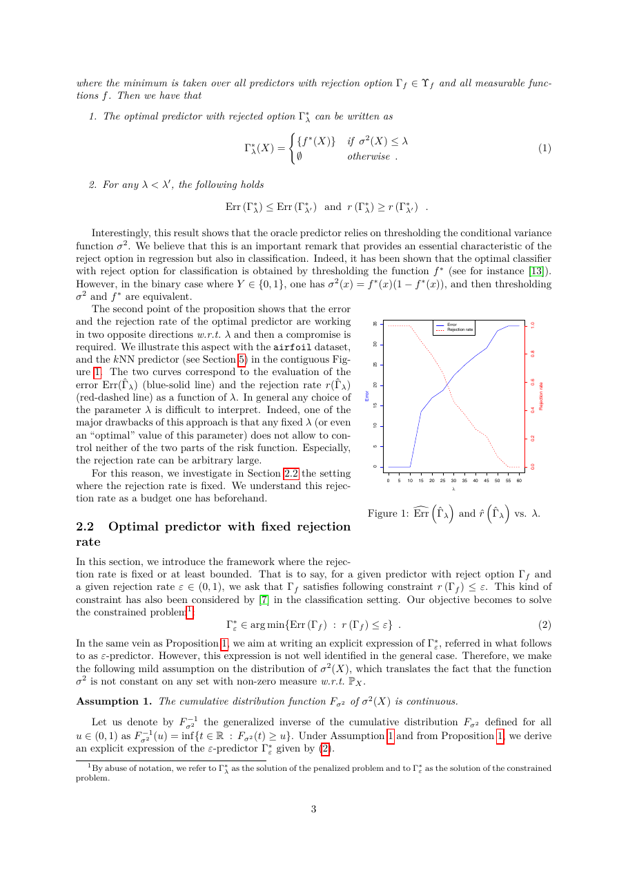
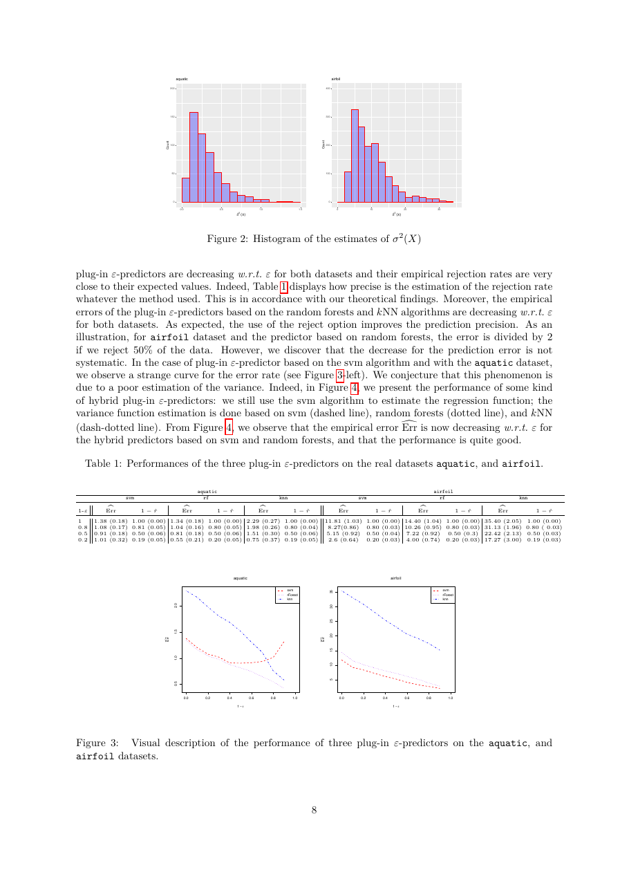
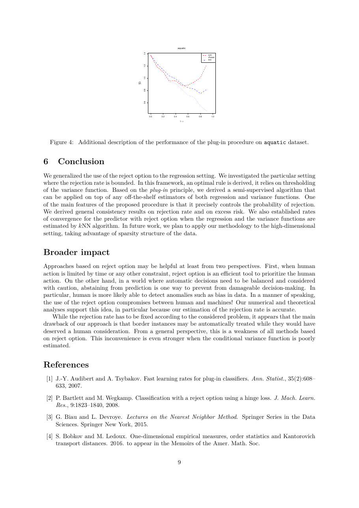

# 거부 선택이 있는 회귀와 kNN 적용 (번역)

번역 범위: 전문 (초록, 본문 1~6절, 광범위 영향, 보충 자료 A~E). 참고문헌은 원문 그대로 둔다.

- 원제: Regression with reject option and application to kNN
- 저자: Christophe Denis, Mohamed Hebiri, Ahmed Zaoui (LAMA, UMR-CNRS 8050, Université Gustave Eiffel)
- 원문: 같은 폴더의 `Denis2020_거부선택회귀_kNN.pdf` (arXiv 2006.16597v2, 2021-03-05, 22쪽)
- 번역 원칙: 수식 기호는 원문을 따른다. 수식은 pdftotext 결과를 보고 다시 적었다. 첨자 배치가 깨진 곳은 PDF 그림과 맞춰 읽었다.

---

## 초록

예측을 포기할 수 있는 회귀 문제를 다룬다. 분류의 거부 선택(reject option)을 넓힌 것이므로 이 틀을 "거부 선택이 있는 회귀"라 부른다.
여기서는 거부 비율을 고정한 경우에 집중한다. 이때 최적 규칙은 **조건부 분산 함수에 임계값을 거는 것**임을 보인다.
최적 규칙을 추정하는 반지도(semi-supervised) 절차를 제안한다. 자료는 두 묶음을 쓴다.

- 정답이 있는 첫 묶음으로 회귀 함수와 조건부 분산 함수를 함께 추정한다.
- 정답이 없는 두 번째 묶음으로 원하는 거부 비율에 맞게 임계값을 맞춘다(교정).

이렇게 만든 거부 예측기는 위험과 거부 비율 두 면에서 최적 거부 예측기와 거의 같다는 것을 보인다.
또 이 방법을 kNN 알고리즘에 적용하고, 약한 조건에서 수렴 속도를 증명한다.
끝으로 수치 실험으로 이 절차의 이점을 보여 준다.

키워드: 회귀, 거부 선택이 있는 회귀, kNN, 거부 선택 예측기.

## 1. 서론

믿을 수 있는 예측은 통계 학습의 기본 문제다. 신경망, 커널 방법, k 최근접 이웃(kNN) 같은 효율적인 알고리즘이 많이 나왔다.
그러나 최신 방법도 어떤 상황에서는 실패하고, 잘못된 결정으로 이어질 수 있다. 의료 진단처럼 잘못된 추정이 치명적인 분야도 있다.
이 논문은 이런 경우를 다루는 새 통계 절차를 낸다. 회귀에서, **의심이 너무 클 때 예측을 포기할 수 있는** 예측 알고리즘을 만든다.
거부 선택이 있는 분류 [5, 6, 7, 13, 15, 18, 25]를 일반화한 것이므로 자연스럽게 "거부 선택이 있는 회귀"라 부른다.
[7]의 생각을 따라, 예측기가 자료의 최대 ε ∈ (0, 1) 비율까지 포기할 수 있는 전략을 고른다.
이 방법의 장점은 예측이 너무 어려운 부분에만 사람이 손을 쓰고, 나머지 부분은 일반 기계 학습 알고리즘으로 예측할 수 있다는 점이다. 예측이 어려운 정도는 절차가 자동으로 평가한다. 이 관점에서 사람 개입의 효율을 높일 수 있다.

이 논문은 거부(포기) 비율을 통제하는 거부 선택 회귀 문제를 다룬다. 통계적 근거가 있고 계산이 가벼운 알고리즘을 낸다.

- 2절: 거부 선택 회귀 틀을 정의하고, 거부 비율에 상한이 있을 때의 최적 예측기를 명시적으로 보인다. 이 최적 규칙은 조건부 분산 함수에 임계값을 거는 것이다. 이 결과가 이 연구의 바탕이며, 대입(plug-in) 방식을 쓰자는 근거가 된다.
- 3절: 두 단계 절차를 낸다. 정답이 있는 첫 자료로 회귀 함수와 조건부 분산 함수를 추정하고, 정답이 없는 두 번째 자료로 포기를 정하는 임계값을 교정한다. 약한 가정에서, 이 절차가 위험과 거부 비율 모두에서 최적 예측기만큼 좋다는 것을 보인다. 이 절차는 어떤 기성 추정기와도 쓸 수 있다.
- 4절: 예로 kNN에 적용하고 수렴 속도를 유도한다.
- 5절: 수치 실험으로 이점을 보인다. 특히 절차의 유연성을 보여 준다.

회귀에서 거부는 문헌에서 매우 드물게 다뤄졌다. 예외는 [26]인데, 다른 관점에서 거부를 본다. 그 저자들은 ε 최적성 쪽에서 거부를 써서, 높은 확률로 예측이 회귀 함수 주변 반지름 ε 공 안에 있게 한다. 그 방법은 경험적 위험 최소화 절차와 본질적으로 묶여 있다. 반면 우리 방법은 어떤 추정 절차에도 쓸 수 있다.
우리와 더 가까운 연구는 거부 선택 분류 문헌 [2, 5, 6, 7, 13, 15, 18, 25]이다. 이 논문은 거부 선택 분류를 넓힌 것으로 볼 수 있다. 더 넓게 보면, 이 기여는 거부 선택을 더 깊이 이해하게 해 준다. 중요한 점은 **조건부 분산 함수가 포기 결정의 핵심 특징을 담는다**는 것이다.
[7]의 저자들도 거부 비율에 상한이 있는 경우 대입 방식의 수렴 속도를 냈다. 그러나 그 속도는 마진형 가정 [1, 19]과 추정기의 매끄러움 가정에서만 성립한다. 우리는 이런 가정 없이 유효한 수렴 속도를 얻는다.

## 2. 거부 선택이 있는 회귀

이 절에서는 거부 선택 회귀 설정을 소개하고, 최적 규칙의 일반 형태를 유도한다. 거부 비율을 고정한 경우를 주된 틀로 강조한다.

먼저 기호를 정한다. (X, Y)는 R^d × R 값을 갖는 확률 쌍이다. X는 특징 벡터, Y는 그에 맞는 출력이다. (X, Y)의 결합 분포를 P, 특징 X의 주변 분포를 P_X라 한다.
x ∈ R^d에 대해 회귀 함수 f\*(x) = E[Y | X = x]와 조건부 분산 함수 σ²(x) = E[(Y − f\*(X))² | X = x]를 정의한다. 분석에서 이 두 함수를 중요하게 다룬다.
‖·‖는 R^d의 유클리드 노름, 유한 집합에서 |·|는 원소 수를 뜻한다.

### 2.1 거부 선택 예측기

f를 측정 가능한 실수 값 함수로 두고 예측 함수로 본다. f에 딸린 거부 선택 예측기 Γ_f는 R^d를 P(R)로 보내는 함수로서, 모든 x에 대해 Γ_f(x) ∈ {∅, {f(x)}}인 것이다. f에 기대는 거부 선택 예측기 전체 집합을 Υ_f라 한다.
즉 어떤 x에 대해 선택지는 두 가지뿐이다. 빈 집합을 내어 예측을 하지 않거나, 크기 1인 출력을 내고 그 값이 f(x)와 같다.

이 틀에서는 예측기 Γ_f의 두 가지 중요한 성질이 생긴다.
첫째는 거부 비율 r(Γ_f) = P(|Γ_f(X)| = 0)이다.
둘째는 예측을 했을 때의 L2 오차다.

  Err(Γ_f) = E[(Y − f(X))² | |Γ_f(X)| = 1].

거부 선택 회귀의 목표는 거부 비율도 작고 조건부 L2 오차도 작은 Γ_f를 만드는 것이다. 이 둘을 한 성능 척도에 넣는 자연스러운 방법으로 다음 위험을 생각한다.

  R_λ(Γ_f) = E[(Y − f(X))² 1{|Γ_f(X)|=1}] + λ r(Γ_f).

λ ≥ 0은 오차와 거부 비율 사이를 조절하는 값이다. λ가 크면 거부 비율은 작아지고 오차는 커진다. 그래서 λ는 거부 선택을 쓰는 데 치르는 값으로 해석할 수 있다. 이 위험 R_λ는 분류에서 [13]이 이미 다뤘다.

R_λ를 최소화해 최적 거부 예측기의 명시적 형태를 얻는다.

**명제 1.** λ ≥ 0에 대해 Γ\*_λ ∈ arg min R_λ(Γ_f)라 하자(최소는 모든 Γ_f ∈ Υ_f와 모든 측정 가능한 f에 대해 잡는다). 그러면 다음이 성립한다.

1. 최적 거부 예측기는 다음과 같이 쓸 수 있다.

   Γ\*_λ(X) = {f\*(X)}  (σ²(X) ≤ λ 일 때),  ∅  (그 밖)          (1)

2. λ < λ′이면 Err(Γ\*_λ) ≤ Err(Γ\*_λ′)이고 r(Γ\*_λ) ≥ r(Γ\*_λ′)이다.

흥미롭게도 이 결과는 오라클(참값을 아는) 예측기가 조건부 분산 σ²에 임계값을 거는 것임을 보여 준다. 이는 회귀뿐 아니라 분류에서도 거부 선택의 본질적 성질을 드러낸다고 본다. 분류에서 최적 거부 분류기는 f\*에 임계값을 걸어 얻는다고 알려져 있다(예: [13]). 그런데 Y ∈ {0, 1}인 이진 경우 σ²(x) = f\*(x)(1 − f\*(x))이므로 σ²에 거는 것과 f\*에 거는 것은 같다.

명제의 두 번째 점은 최적 예측기의 오차와 거부 비율이 λ에 대해 서로 반대로 움직이므로 절충이 필요하다는 뜻이다. 그림 1에 airfoil 자료와 kNN 예측기(5절)로 이를 보인다. 두 곡선은 λ에 따른 오차 Err(Γ̂_λ)(파란 실선)와 거부 비율 r(Γ̂_λ)(빨간 점선)이다. 일반적으로 λ를 어떻게 골라도 해석이 어렵다. 이 방식의 큰 약점은, λ를 고정하면(심지어 "최적" λ라도) 위험의 두 부분 어느 쪽도 통제할 수 없다는 점이다. 특히 거부 비율이 마음대로 커질 수 있다.

그림 1: λ에 따른 추정 오차 Err(Γ̂_λ)와 추정 거부 비율 r̂(Γ̂_λ).

그래서 2.2절에서는 거부 비율을 고정한 설정을 다룬다. 이 거부 비율은 미리 정해 둔 예산으로 이해한다.

### 2.2 거부 비율을 고정한 최적 예측기

이 절에서는 거부 비율을 고정하거나 적어도 상한을 둔 틀을 소개한다. 즉 주어진 거부 예측기 Γ_f와 거부 비율 ε ∈ (0, 1)에 대해 r(Γ_f) ≤ ε를 요구한다. 분류에서는 [7]이 이런 제약을 다뤘다. 목표는 다음 제약 문제를 푸는 것이다(각주 1).

  Γ\*_ε ∈ arg min{Err(Γ_f) : r(Γ_f) ≤ ε}.          (2)

명제 1처럼 Γ\*_ε(이하 ε 예측기)의 명시적 식을 쓰고 싶다. 그러나 일반 경우에는 이 식이 잘 정해지지 않는다. 그래서 σ²(X)의 분포에 약한 가정을 둔다. σ²가 P_X 측도가 0이 아닌 어떤 집합에서도 상수가 아니라는 뜻이다.

**가정 1.** σ²(X)의 누적 분포 함수 F_σ²가 연속이다.

F_σ²의 일반화 역함수를 u ∈ (0, 1)에 대해 F_σ²⁻¹(u) = inf{t ∈ R : F_σ²(t) ≥ u}로 둔다. 가정 1과 명제 1로부터 (2)의 ε 예측기 Γ\*_ε의 명시적 식을 얻는다.

각주 1: 기호를 겹쳐 써서, 벌점 문제의 해를 Γ\*_λ, 제약 문제의 해를 Γ\*_ε라 한다.

**명제 2.** ε ∈ (0, 1)이고 λ_ε = F_σ²⁻¹(1 − ε)라 하자. 가정 1에서 Γ\*_ε = Γ\*_λε이다.

이 명제와 분위 함수의 성질에서 바로

  r(Γ\*_ε) = P(|Γ\*_ε(X)| = 0) = P(σ²(X) ≥ λ_ε) = P(F_σ²(σ²(X)) ≥ 1 − ε) = ε

를 얻는다. 즉 ε 예측기의 거부 비율은 정확히 ε이다. 연속성 가정 1은 이 성질이 성립하기 위한 충분 조건이다. 또 이 가정에서 ε 예측기는 다음과 같이 쓸 수 있다.

  Γ\*_ε(x) = {f\*(x)}  (F_σ²(σ²(x)) ≤ 1 − ε 일 때),  ∅  (그 밖)          (3)

끝으로 명제 1, 2가 시사하듯, 거부 예측기 Γ_f의 성능은 λ = λ_ε에서의 위험 R_λ로 잰다. 그 초과 위험은

  E_λε(Γ_f) = R_λε(Γ_f) − R_λε(Γ\*_ε)

이고, 다음 결과가 닫힌 식을 준다.

**명제 3.** ε ∈ (0, 1)이면 어떤 예측기 Γ_f에 대해서도

  E_λε(Γ_f) = E_X[(f\*(X) − f(X))² 1{|Γ_f(X)|=1}] + E_X[|σ²(X) − λ_ε| 1{|Γ_f(X)| ≠ |Γ\*_ε(X)|}].

이 초과 위험은 거부 선택 회귀 문제의 서로 다른 두 면을 나타내는 두 항으로 이루어진다. 첫 항은 예측 함수 f의 L2 위험과 관련된 것으로 회귀에서 흔한 항이다. 반면 두 번째 항은 거부 선택 문제와 관련된 것이다. 이 항은 임계값 λ_ε 근처에서 조건부 분산 σ²가 어떻게 행동하는지에 달려 있다.

## 3. 대입 ε 예측기

이 절은 명제 2의 최적 규칙을 흉내 내는, 대입 원리에 기반한 자료 기반 거부 예측기를 다룬다.

### 3.1 추정 전략

식 (3)은 Γ\*_ε를 대입 원리로 추정할 수 있음을 보여 준다. 더 구체적으로, f\*와 σ², 그리고 누적 분포 F_σ²를 추정하면 Γ\*_ε의 추정기를 얻을 수 있다.
이를 위해 먼저 (X, Y)의 독립 복사본 n개로 된 학습 표본 D_n = {(X_i, Y_i), i = 1, ..., n}을 둔다. 이 자료로 회귀 함수 f\*와 조건부 분산 함수 σ²의 추정기 f̂와 σ̂²를 만든다.
이 논문에서는 잔차 기반 방법 [11]에 기대는 σ̂²에 집중한다. D_n을 바탕으로, 출력 (Y − f̂(X))²를 입력 X에 회귀하는 문제를 풀어 σ̂²를 얻는다.
마지막 F_σ²는 누적 분포 함수를 경험 분포로 바꾸면 되므로 간단하다. 이 항은 주변 분포 P_X에만 달려 있으므로, X의 독립 복사본 N개로 된 **정답 없는 두 번째 자료** D_N = {X_{n+1}, ..., X_{n+N}}으로 추정한다. 정답 없는 자료는 보통 얻기 쉬우므로 이는 우리 방법의 중요한 특징이다. D_N은 D_n과 독립이라고 가정한다.

  F̂_σ̂²(·) = (1/N) Σ_{i=1}^{N} 1{σ̂²(X_{n+i}) ≤ ·}

를 F_σ²의 추정기로 둔다. 이 기호로 대입 ε 예측기는 각 x ∈ R^d에 대해 다음과 같이 정의한다.

  Γ̂_ε(x) = {f̂(x)}  (F̂_σ̂²(σ̂²(x)) ≤ 1 − ε 일 때),  ∅  (그 밖)          (4)

이 방법은 회귀 함수 f\*와 조건부 분산 함수 σ²에 대해 어떤 기성 추정기든 쓸 수 있을 만큼 유연하다.

### 3.2 대입 ε 예측기의 일치성

여기서는 대입 ε 예측기의 통계적 성질을 본다. 이 분석에는 다음 양에 대한 추가 가정이 필요하다.

  F_σ̂²(·) = P_X(σ̂²(X) ≤ · | D_n).

**가정 2.** σ̂²(X)의 누적 분포 함수 F_σ̂²가 연속이다.

이 조건은 가정 1과 비슷하지만 참 조건부 분산 σ²(X) 대신 추정기 σ̂²(X)를 다룬다. σ̂²(X)는 사용자가 고르는 것이므로 가정 2는 꽤 약하다. 게다가 매끄럽게 만든 판을 쓰면 어떤 추정기든 이 조건을 만족하게 할 수 있다. 4절에서 kNN으로 이 방법을 보인다.
다음 정리가 이 절의 주 결과로, Γ̂_ε가 최적 예측기로 수렴함(일치성)을 보인다.

**정리 1.** ε ∈ (0, 1)이라 하자. σ²가 유계이고, f̂가 L2 위험에 대해 f\*의 일치 추정기이며, σ̂²가 L1 위험에 대해 σ²의 일치 추정기라 하자. 가정 1~2에서 다음이 성립한다.

  E[E_λε(Γ̂_ε)] → 0 (n, N → +∞),   E[|r(Γ̂_ε) − ε|] ≤ C N^{−1/2}.

여기서 C > 0은 절대 상수다.

이 정리는 대입 ε 예측기가 위험과 거부 비율 모두에서 점근적으로 최적 ε 예측기만큼 잘 행동함을 말한다. 거부 비율의 수렴에는 꽤 약한 가정 2만 필요하고, 4.2절의 방법을 따르면 이 가정마저 없앨 수 있다. 특히 대입 ε 예측기의 거부 비율은 O(N^{−1/2}) 항을 빼면 ε 수준이다. 이 속도는 분류에서 얻은 것 [7]과 비슷하다. 이는 F_σ̂²와 그 경험판 F̂_σ̂²의 차이에 기대며, Dvoretzky-Kiefer-Wolfowitz 부등식 [17]으로 통제한다. 흥미롭게도 이 결과는 f\*와 σ²의 어떤 일치 추정기에도 적용된다.

회귀 함수 f\*의 추정은 널리 연구되었고, 랜덤 포레스트, 커널 절차, kNN 추정기 같은 알고리즘을 쓸 수 있다 [3, 10, 20, 22, 23]. 잔차 기반 조건부 분산 함수 추정도 커널 절차를 중심으로 많이 연구되었다 [9, 11, 12, 14, 21]. 다음 절에서는 f̂와 σ̂²가 모두 kNN에 기대는 경우의 수렴 속도를 유도한다. 특히 σ̂²의 수렴 속도를 상한 노름(sup norm)으로 낸다(보충 자료의 명제 6).

## 4. kNN 알고리즘 적용: 수렴 속도

대입 ε 예측기 Γ̂_ε는 회귀 함수와 조건부 분산 함수의 추정기에 기댄다. 이 절에서는 kNN 기반 추정이라는 특정 경우를 보고, 이를 거부 선택 kNN 예측기라 부른다. 이 절차의 수렴 속도를 낸다. 또 σ²의 kNN 추정기는 가정 2를 어기므로, kNN에 적용하면 이 조건을 만족시키는 매끄럽게 하기 기법을 보여 주는 이점이 있다.

### 4.1 가정

유한 표본에서 거부 선택 kNN 예측기의 성능을 보려고, X가 정칙 콤팩트 집합 C ⊂ R^d에 속한다고 가정한다([1] 참고). 또 다음을 가정한다.

**가정 3.** f\*와 σ²가 립시츠 함수다.

**가정 4 (강한 밀도 가정).** 주변 분포 P_X가 르베그 측도에 대한 밀도 μ를 갖고, 모든 x ∈ C에서 0 < μ_min ≤ μ(x) ≤ μ_max이다.

이 두 가정은 수렴 속도를 다룰 때 흔한 것이다([10, 23] 참고). 강한 밀도 가정은 이진 분류에서 예컨대 [1]이 도입했다. 마지막 가정은 임계값 λ_ε 근처에서 σ²의 행동을 다룬다.

**가정 5 (α 지수 가정).** σ²가 P_X에 대해 (수준 λ_ε에서) 지수 α ≥ 0을 갖는다는 것은, 어떤 c\* > 0이 있어 모든 t > 0에 대해

  P_X(0 < |σ²(X) − λ_ε| ≤ t) ≤ c\* t^α

인 것이다.

이 가정은 [19]가 처음 도입했고, 이진 분류에서는 마진 가정이라고도 부른다([16] 참고). α > 0이면 가정 5는 확률 변수 σ²(X)가 임계값 λ_ε 근처에 너무 몰리지 않음을 보장한다. 이로써 더 빠른 수렴 속도를 얻는다. α = 0이면 아무 가정도 아니다.

### 4.2 거부 선택 kNN 예측기

x ∈ R^d에 대해, R^d의 ℓ2 거리 순으로 다시 정렬한 자료를 (X_(i,n)(x), Y_(i,n)(x)), i = 1, ..., n이라 한다. 즉 i < j이면 ‖X_(i,n)(x) − x‖ < ‖X_(j,n)(x) − x‖이다. 가정 4는 동점이 확률 0으로만 생김을 보장한다([10] 참고). k = k_n을 정수라 하자. f\*와 σ²의 kNN 추정기는 모든 x에 대해 다음과 같다.

  f̂(x) = (1/k_n) Σ_{i=1}^{k_n} Y_(i,n)(x),
  σ̂²(x) = (1/k_n) Σ_{i=1}^{k_n} (Y_(i,n)(x) − f̂(X_(i,n)(x)))².

D_n이 주어지면 누적 분포 F_σ̂²는 연속이 아니므로 가정 2가 성립하지 않는다. 이를 피하려고 [0, u] 균등 분포를 따르는 무작위 섭동 ζ를 넣는다. ζ는 다른 모든 확률 변수와 독립이고, u > 0은 뒤에 정할 (작은) 고정 실수다. 그리고 σ̄²(X, ζ) := σ̂²(X) + ζ로 둔다. D_n이 주어졌을 때 σ̄²(X, ζ)의 누적 분포 F_σ̄²가 연속임은 쉽게 알 수 있다. 또 삼각 부등식에 의해, u가 0으로 가면 σ̂²의 일치성이 σ̄²의 일치성을 뜻한다. 그래서 거부 선택 kNN 예측기를 다음과 같이 정의한다.

(ζ_1, ..., ζ_N)을 ζ의 독립 복사본(다른 모든 확률 변수와도 독립)이라 하고

  F̂_σ̄²(·) = (1/N) Σ_{i=1}^{N} 1{σ̂²(X_{n+i}) + ζ_i ≤ ·}

로 둔다. kNN ε 예측기는 모든 x와 ζ에 대해

  Γ̂_ε(x, ζ) = {f̂(x)}  (F̂_σ̄²(σ̄²(x, ζ)) ≤ 1 − ε 일 때),  ∅  (그 밖)

이다.

### 4.3 수렴 속도

이 절에서는 다음 틀에서 kNN ε 예측기의 수렴 속도를 유도한다. Y가 유계이거나, Y가

  Y = f\*(X) + σ(X) ξ          (5)

를 만족한다고 가정한다. 여기서 ξ는 X와 독립이고 표준 정규 분포를 따른다. 이 가정들은 넓은 응용을 덮는다. 이 가정에서 다음 결과를 말할 수 있다.

**정리 2.** 가정 1, 3, 4, 5를 두자. ε ∈ (0, 1)이고 k_n ∝ n^{2/(d+2)}, u ≤ n^{−1/(d+2)}이면 kNN ε 예측기 Γ̂_ε는

  E[E_λε(Γ̂_ε)] ≤ C ( n^{−2/(d+2)} + log(n)^{(α+1)} n^{−(α+1)/(d+2)} + N^{−1/2} )

를 만족한다. 여기서 C > 0은 f\*, σ², c_0, c\*, α, C, 차원 d에 달린 상수다.

위 속도의 각 부분은 문제의 한 특징을 나타낸다.

- 첫 항은 회귀 함수의 추정 오차에서 온다.
- 둘째 항은 가정 5의 α에 일부 달려 있으며, 보충 자료의 명제 6에 적은 조건부 분산의 상한 노름 추정 오차 E[sup_{x∈C} |σ̂²(x) − σ²(x)|] ≤ C log(n) n^{−1/(d+2)}에서 온다. α = 1이면 둘째 항은 (로그 인자를 빼면) 회귀 함수 추정 항과 같은 차수다.
- 마지막 항은 임계값 λ_ε의 추정과 바로 이어진다.

끝으로 α > 1이면, 정답 없는 표본 크기 N이 충분히 클 때 이 속도는 f̂의 L2 노름 속도와 같다. 이는 거부 설정에서 기대할 수 있는 가장 좋은 상황이다.

## 5. 수치 실험

이 절에서는 대입 ε 예측기의 성능을 수치 실험으로 보인다. 이 예측기를 만드는 과정은 3.1절에 적었고, 회귀 함수와 조건부 분산 함수의 추정기에 기댄다. 대입 ε 예측기 구현 코드는 https://github.com/ZaouiAmed/Neurips2020_RejectOption 에 있다.

이 실험에서는 두 추정 과제에 같은 알고리즘을 쓰고, 서포트 벡터 머신(svm), 랜덤 포레스트(rf), kNN(knn)에 기반한 대입 ε 예측기 세 가지를 만든다. 또 연속성 문제를 피하려고 4.2절처럼 모든 방법에 무작위 섭동 ζ ∼ U[0, 10^{−10}]을 더한다.
성능은 UCI 데이터베이스의 두 기준 자료 QSAR aquatic toxicity와 Airfoil Self-Noise로 평가한다. 각각 aquatic, airfoil이라 부른다.
모든 자료를 세 부분으로 나눈다(정답 있는 학습 50%, 정답 없는 학습 20%, 시험 30%). 첫 부분으로 회귀 함수와 분산 함수를 추정하고, 둘째 부분으로 경험 누적 분포 함수를 계산한다.
끝으로 각 ε ∈ {i/10, i = 0, ..., 9}와 각 대입 ε 예측기에 대해 시험 집합에서 경험 거부 비율 r̂와 경험 오차 Êrr를 계산한다. 이 과정을 100번 반복하고 시험 집합 평균 성능과 표준 편차를 보고한다.
kNN의 k ∈ {5, 10, 15, 20, 30, 50, 70, 100, 150}는 10겹 교차 검증으로 고른다. 랜덤 포레스트와 svm은 각각 R 패키지 randomForest와 e1071을 기본 설정으로 썼다.

### 5.1 자료

- QSAR aquatic toxicity: 물고기 Pimephales promelas에 대한 급성 수생 독성을 예측하는 정량 회귀 QSAR 모델을 만드는 데 쓰인 자료다. 관측 n = 546개, 수치 특징 8개다. 출력은 [0.12, 10.05] 범위다.
- Airfoil Self-Noise: 관측 n = 1503개, 특징 5개다. 공기역학 및 음향 시험에서 얻었다. 출력은 데시벨 단위로 환산한 음압 수준이며 [103, 140] 범위다.

분산 함수가 대입 ε 예측기를 만드는 데 핵심이므로, 그림 2에 랜덤 포레스트로 만든 σ²(X) 추정값의 히스토그램을 보인다. 구체적으로 각 i = 1, ..., n에 대해 10겹 교차 검증으로 σ̂²(X_i)를 구하고, 그 히스토그램을 그렸다.
그림 2의 왼쪽과 오른쪽은 각각 aquatic과 airfoil이며, 거부 선택이 의미 있는 두 가지 다른 상황을 보여 준다. airfoil의 추정 분산은 대체로 크다(값의 약 40%가 10보다 크다). 그래서 그 예측에 의심을 가질 수 있다. aquatic에서는 추정값 σ̂²의 대부분이 1보다 작아서 거부 선택을 쓰는 것이 덜 중요해 보인다. 그러나 이 경우 대입 ε 예측기의 예측은 매우 정확할 것이다.

그림 2: σ²(X) 추정값의 히스토그램 (왼쪽 aquatic, 오른쪽 airfoil).

### 5.2 결과

결과를 그림 3과 표 1에 보인다. ε ∈ {0, 0.2, 0.5, 0.8}에 집중한다.
전체적으로 결과는 이론을 반영한다. 두 자료 모두에서 대입 ε 예측기의 경험 오차는 ε에 대해 줄고, 경험 거부 비율은 기대값에 매우 가깝다. 표 1은 어떤 방법을 쓰든 거부 비율 추정이 얼마나 정확한지 보여 준다. 이는 이론 결과와 맞다.
또 랜덤 포레스트와 kNN 기반 대입 ε 예측기의 경험 오차는 두 자료 모두에서 ε에 대해 준다. 예상대로 거부 선택을 쓰면 예측 정밀도가 좋아진다. 예를 들어 airfoil과 랜덤 포레스트 기반 예측기에서 자료의 50%를 거부하면 오차가 절반이 된다.
그러나 예측 오차의 감소가 늘 생기지는 않는다는 것도 발견했다. aquatic 자료와 svm 기반 대입 ε 예측기에서는 오차 곡선이 이상하다(그림 3 왼쪽). 이 현상은 분산 추정이 나쁘기 때문이라고 추측한다.
실제로 그림 4에 일종의 혼합 대입 ε 예측기 성능을 보인다. 회귀 함수 추정에는 여전히 svm을 쓰고, 분산 함수 추정은 svm(파선), 랜덤 포레스트(점선), kNN(일점 쇄선)으로 한다. 그림 4에서 svm과 랜덤 포레스트 기반 혼합 예측기의 경험 오차 Êrr는 이제 ε에 대해 줄고, 성능도 꽤 좋다.

표 1: 실제 자료 aquatic, airfoil에서 세 대입 ε 예측기의 성능. 괄호 안은 100회 반복의 표준 편차. 1 − r̂는 예측을 낸 비율.

| 1−ε | aquatic svm Êrr | 1−r̂ | aquatic rf Êrr | 1−r̂ | aquatic knn Êrr | 1−r̂ | airfoil svm Êrr | 1−r̂ | airfoil rf Êrr | 1−r̂ | airfoil knn Êrr | 1−r̂ |
|---|---|---|---|---|---|---|---|---|---|---|---|---|
| 1 | 1.38 (0.18) | 1.00 (0.00) | 1.34 (0.18) | 1.00 (0.00) | 2.29 (0.27) | 1.00 (0.00) | 11.81 (1.03) | 1.00 (0.00) | 14.40 (1.04) | 1.00 (0.00) | 35.40 (2.05) | 1.00 (0.00) |
| 0.8 | 1.08 (0.17) | 0.81 (0.05) | 1.04 (0.16) | 0.80 (0.05) | 1.98 (0.26) | 0.80 (0.04) | 8.27 (0.86) | 0.80 (0.03) | 10.26 (0.95) | 0.80 (0.03) | 31.13 (1.96) | 0.80 (0.03) |
| 0.5 | 0.91 (0.18) | 0.50 (0.06) | 0.81 (0.18) | 0.50 (0.06) | 1.51 (0.30) | 0.50 (0.06) | 5.15 (0.92) | 0.50 (0.04) | 7.22 (0.92) | 0.50 (0.3) | 22.42 (2.13) | 0.50 (0.03) |
| 0.2 | 1.01 (0.32) | 0.19 (0.05) | 0.55 (0.21) | 0.20 (0.05) | 0.75 (0.37) | 0.19 (0.05) | 2.6 (0.64) | 0.20 (0.03) | 4.00 (0.74) | 0.20 (0.03) | 17.27 (3.00) | 0.19 (0.03) |

(원문 airfoil rf, 1−ε = 0.5 의 표준 편차 "0.3"은 원문 표기 그대로다. 다른 값과 비교하면 0.03의 오기로 보인다.)

그림 3: aquatic, airfoil 자료에서 세 대입 ε 예측기 성능의 시각적 표현 (가로축 1−ε, 세로축 Err). 위 그림 파일의 아래쪽에 있다.

그림 4: aquatic 자료에서 대입 절차 성능의 추가 표현 (회귀는 svm, 분산 추정은 svm, rForest, knn).

## 6. 결론

거부 선택을 회귀 설정으로 넓혔다. 거부 비율에 상한이 있는 특정 설정을 다뤘다. 이 틀에서 최적 규칙을 유도했으며, 이는 분산 함수에 임계값을 거는 것이다.
대입 원리에 따라, 회귀 함수와 분산 함수의 어떤 기성 추정기 위에도 얹을 수 있는 반지도 알고리즘을 유도했다. 이 절차의 주된 특징 하나는 거부 확률을 정밀하게 통제한다는 것이다.
거부 비율과 초과 위험에 대한 일반 일치성 결과를 유도했다. 또 회귀 함수와 분산 함수를 kNN으로 추정할 때 거부 예측기의 수렴 속도를 냈다.
앞으로는 자료의 희소 구조를 이용해 이 방법을 고차원 설정에 적용할 계획이다.

## 광범위 영향 (Broader impact)

거부 선택에 기반한 방법은 적어도 두 관점에서 도움이 될 수 있다.
첫째, 사람의 개입이 시간이나 다른 제약으로 제한될 때, 거부 선택은 사람 개입의 우선순위를 정하는 효율적인 도구다.
둘째, 자동 결정을 신중히 따져야 하는 세상에서 예측을 포기하는 것은 해로운 결정을 막는 한 방법이다. 특히 사람은 자료의 편향 같은 이상을 더 잘 알아챌 수 있다. 말하자면 거부 선택은 사람과 기계 사이의 절충이다. 우리의 수치 및 이론 분석은 이 생각을 지지한다. 특히 거부 비율 추정이 정확하기 때문이다.

거부 비율은 문제에 맞게 정해야 한다. 그런데 우리 방법의 주된 약점은, 사람이 봐야 했을 경계 사례가 자동으로 처리될 수 있다는 점이다. 넓게 보면 이는 거부 선택에 기반한 모든 방법의 약점이다. **조건부 분산 함수를 잘못 추정하면 이 문제는 더 심해진다.**

## 참고문헌 (원문 그대로)

[1] J.-Y. Audibert and A. Tsybakov. Fast learning rates for plug-in classifiers. Ann. Statist., 35(2):608–633, 2007.
[2] P. Bartlett and M. Wegkamp. Classification with a reject option using a hinge loss. J. Mach. Learn. Res., 9:1823–1840, 2008.
[3] G. Biau and L. Devroye. Lectures on the Nearest Neighbor Method. Springer Series in the Data Sciences. Springer New York, 2015.
[4] S. Bobkov and M. Ledoux. One-dimensional empirical measures, order statistics and Kantorovich transport distances. 2016. to appear in the Memoirs of the Amer. Math. Soc.
[5] C. Chow. An optimum character recognition system using decision functions. IRE Transactions on Electronic Computers, (4):247–254, 1957.
[6] C. Chow. On optimum error and reject trade-off. IEEE Trans. Inform. Theory, 16:41–46, 1970.
[7] C. Denis and M. Hebiri. Consistency of plug-in confidence sets for classification in semi-supervised learning. Journal of Nonparametric Statistics, 2019.
[8] L. Devroye, L. Györfi, and G. Lugosi. A Probabilistic Theory of Pattern Recognition. Springer, New York, 1996.
[9] J. Fan and Q. Yao. Efficient estimation of conditional variance functions in stochastic regression. Biometrika, 85(3):645–660, 1998.
[10] L. Györfi, M. Kohler, A. Krzyżak, and H. Walk. A distribution-free theory of nonparametric regression. Springer Ser. Statist. Springer-Verlag, New York, 2002.
[11] P. Hall and R.J. Carroll. Variance function estimation in regression: The mean effect of estimating the mean. Journal of the Royal Statistical Society: Series B (Methodological), 51(1):3–14, 1989.
[12] W. Härdle and A. Tsybakov. Local polynomial estimators of the volatility function in nonparametric autoregression. Journal of Econometrics, 81(1):223–242, 1997.
[13] R. Herbei and M. Wegkamp. Classification with reject option. Canad. J. Statist., 34(4):709–721, 2006.
[14] R. Kulik and C. Wichelhaus. Nonparametric conditional variance and error density estimation in regression models with dependent errors and predictors. Electron. J. Statist., 5:856–898, 2011.
[15] J. Lei. Classification with confidence. Biometrika, 101(4):755–769, 2014.
[16] E. Mammen and A. Tsybakov. Smooth discrimination analysis. Ann. Statist., 27(6):1808–1829, 1999.
[17] P. Massart. The tight constant in the dvoretzky-kiefer-wolfowitz inequality. Ann. Probab., 18(3):1269–1283, 1990.
[18] M. Naadeem, J.D. Zucker, and B. Hanczar. Accuracy-rejection curves (ARCs) for comparing classification methods with a reject option. In MLSB, pages 65–81, 2010.
[19] W. Polonik. Measuring mass concentrations and estimating density contour clusters-an excess mass approach. Ann. Statist., 23(3):855–881, 1995.
[20] E. Scornet, G. Biau, and J.-P. Vert. Consistency of random forests. Ann. Statist., 43(4):1716–1741, 08 2015.
[21] Y. Shen, G. Gao, D. Witten, and F. Han. Optimal estimation of variance in nonparametric regression with random design. 2019.
[22] C. Stone. Consistent nonparametric regression. Ann. Statist., pages 595–620, 1977.
[23] A. Tsybakov. Introduction to Nonparametric Estimation. Springer Ser. Statist. Springer New York, 2008.
[24] Roman Vershynin. High-Dimensional Probability: An Introduction with Applications in Data Science. Cambridge Series in Statistical and Probabilistic Mathematics. Cambridge University Press, 2018.
[25] V. Vovk, A. Gammerman, and G. Shafer. Algorithmic learning in a random world. Springer, New York, 2005.
[26] Y. Wiener and R. El-Yaniv. Pointwise tracking the optimal regression function. In F. Pereira, C. J. C. Burges, L. Bottou, and K. Q. Weinberger, editors, Advances in Neural Information Processing Systems 25, pages 2042–2050. Curran Associates, Inc., 2012.

---

# 보충 자료

이 보충 자료의 구성은 다음과 같다.

- A절: 최적 예측기에 관한 결과(명제 1, 2, 3)의 증명
- B절: 일치성을 세우는 정리 1의 증명
- C절: 대입 ε 예측기 Γ̂_ε의 수렴 속도를 말하는 정리 2의 증명
- D절: kNN 추정기에 대한 몇 가지 유한 표본 보장
- E절: 읽기 쉽도록 증명에 쓴 기술적 도구를 모았다.

## A. 최적 예측기에 대한 증명

**명제 1의 증명.** R_λ의 정의에서 어떤 거부 예측기 Γ_f에 대해

  R_λ(Γ_f) = E[(Y − f(X))² 1{|Γ_f(X)|=1}] + λ P(|Γ_f(X)| = 0)
  = E[(Y − f\*(X) + f\*(X) − f(X))² 1{|Γ_f(X)|=1}] + λ P(|Γ_f(X)| = 0)
  = E[(Y − f\*(X))² 1{...}] + E[(f\*(X) − f(X))² 1{...}] + 2E[(Y − f\*(X))(f\*(X) − f(X)) 1{...}] + λ P(|Γ_f(X)| = 0).

E[(Y − f\*(X))(f\*(X) − f(X)) 1{|Γ_f(X)|=1}] = 0이고 E[(Y − f\*(X))² 1{|Γ_f(X)|=1}] = E[σ²(X) 1{|Γ_f(X)|=1}]이므로

  R_λ(Γ_f) = E[(f\*(X) − f(X))² 1{...} + σ²(X) 1{...} + λ(1 − 1{...})]
  = E[((f\*(X) − f(X))² + (σ²(X) − λ)) 1{|Γ_f(X)|=1}] + λ.          (6)

사건 {|Γ_f(X)| = 1} 위에서, 사상 f ↦ (f\*(X) − f(X))² + σ²(X) − λ는 f = f\*에서 최소가 된다. 남은 것은 Υ_f\* 위에서 Γ ↦ E[(σ²(X) − λ) 1{|Γ(X)|=1}] + λ를 최소화하는 것이며, 그 답은 {|Γ(X)| = 1} = {σ²(X) ≤ λ}이다. 모두 합치면 {|Γ\*_λ(X)| = 1} = {σ²(X) ≤ λ}이고 이 사건 위에서 Γ\*_λ(X) = {f\*(X)}이다. 명제 1의 1번이 증명되었다.

2번은 다음과 같다. 0 < λ < λ′이면 {|Γ\*_λ(X)| = 1} = {σ²(X) ≤ λ} ⊂ {σ²(X) ≤ λ′} = {|Γ\*_λ′(X)| = 1}이다. 이 포함에서 r(Γ\*_λ′) ≤ r(Γ\*_λ)를 얻는다. 또 a_λ = P(|Γ\*_λ(X)| = 1)로 두면

  Err(Γ\*_λ) − Err(Γ\*_λ′) = (1/a_λ) E[(Y − f\*(X))² 1{σ²(X)≤λ}] − (1/a_λ′) E[(Y − f\*(X))² 1{σ²(X)≤λ′}]
  = (1/a_λ − 1/a_λ′) E[(Y − f\*(X))² 1{σ²(X)≤λ}] − (1/a_λ′) E[(Y − f\*(X))² 1{λ<σ²(X)≤λ′}].          (7)

σ²(X)의 정의로 E[(Y − f\*(X))² 1{σ²(X)≤λ}] = E[1{σ²(X)≤λ} E[(Y − f\*(X))² | X]] = E[1{σ²(X)≤λ} σ²(X)] ≤ λ a_λ이므로

  (1/a_λ − 1/a_λ′) E[(Y − f\*(X))² 1{σ²(X)≤λ}] ≤ λ(1 − a_λ/a_λ′).

같은 방법으로

  (1/a_λ′) E[(Y − f\*(X))² 1{λ≤σ²(X)≤λ′}] ≥ (λ/a_λ′)(a_λ′ − a_λ) = λ(1 − a_λ/a_λ′).

식 (7)에서 Err(Γ\*_λ) ≤ Err(Γ\*_λ′)를 얻는다.

**명제 2의 증명.** ε ∈ (0, 1)에 대해 λ_ε = F_σ²⁻¹(1 − ε)로 두면, λ = λ_ε인 (1)의 최적 예측기 Γ\*_λ는

  r(Γ\*_λε) = P(σ²(X) ≥ λ_ε) = P(F_σ²(σ²(X)) ≥ 1 − ε) = ε

를 만족한다. r(Γ_f) = ε′ (ε′ ≤ ε)인 어떤 예측기 Γ_f도 Err(Γ_f) ≥ Err(Γ\*_λε)를 만족함을 보이면 된다. 이를 위해 λ_ε′ = F_σ²⁻¹(1 − ε′)인 Γ\*_λε′를 생각한다.
한편 Γ\*_λε′의 최적성(명제 1의 1번)에서

  Err(Γ_f) − Err(Γ\*_λε′) = (1/(1 − ε′)) (R_λε′(Γ_f) − R_λε′(Γ\*_λε′)) ≥ 0.

다른 한편 ε′ ≤ ε이면 λ_ε ≤ λ_ε′이므로 명제 1의 2번에서 Err(Γ\*_λε) ≤ Err(Γ\*_λε′)이다. 두 사실을 합치면 원하는 결과를 얻는다.

**명제 3의 증명.** 먼저 식 (6)에서

  R_λε(Γ_f) = E[((f\*(X) − f(X))² + σ²(X) − λ_ε) 1{|Γ_f(X)|=1}] + λ_ε
  = E[(f\*(X) − f(X))² 1{|Γ_f(X)|=1}] + E[(σ²(X) − λ_ε) 1{|Γ_f(X)|=1}] + λ_ε.

그러므로

  E(Γ_f) = E[(f\*(X) − f(X))² 1{|Γ_f(X)|=1}] + E[(σ²(X) − λ_ε)(1{|Γ_f(X)|=1} − 1{|Γ\*_ε(X)|=1})].

{|Γ\*_ε(X)| = 1} = {σ²(X) − λ_ε ≤ 0}이므로 1{|Γ_f(X)|=1} − 1{|Γ\*_ε(X)|=1}의 0 아닌 값은 모두 σ²(X) − λ_ε의 부호와 같다. 여기서 결과가 나온다.

## B. 일치성 결과의 증명: 정리 1

Γ̂_ε의 일치성은 모든 x ∈ R^d에 대해 다음과 같이 정의한 의사 오라클 ε 예측기 Γ̃_ε를 도입해 보인다.

  Γ̃_ε(x) = {f̂(x)}  (σ̂²(x) ≤ F_σ̂²⁻¹(1 − ε) 일 때),  ∅  (그 밖)          (8)

이 예측기는 주변 분포 P_X를 안다는 점에서 Γ̂_ε와 다르다. 그래서 거부 비율이 정확히 ε이다. 다음 분해를 생각한다.

  E[E_λε(Γ̂_ε)] = E[R_λε(Γ̂_ε) − R_λε(Γ̃_ε)] + E[E_λε(Γ̃_ε)]          (9)

그리고 오른쪽 두 항이 모두 0으로 감을 보인다.

**1단계. E[E_λε(Γ̃_ε)] → 0.** 명제 3을 써서 다음 결과를 얻는다.

**명제 4.** ε ∈ (0, 1)이라 하자. 가정 1, 2에서

  E[E_λε(Γ̃_ε)] ≤ E[(f̂(X) − f\*(X))²] + E[|σ̂²(X) − σ²(X)|] + C E[|F_σ̂²(λ_ε) − F_σ²(λ_ε)|]

이다. C > 0은 σ²와 λ_ε의 상한에 달린 상수다.

**명제 4의 증명.** ε ∈ (0, 1)이라 하자. 기호 F_σ̂²(·) = P_X(σ̂²(X) ≤ · | D_n)와 λ_ε = F_σ²⁻¹(1 − ε)를 다시 쓴다. λ_ε의 의사 오라클 짝 λ̃_ε = F_σ̂²⁻¹(1 − ε)도 둔다. 명제 3을 바로 쓰면

  E(Γ̃_ε) ≤ E_X[(f̂(X) − f\*(X))²] + E_X[|σ²(X) − λ_ε| 1{|Γ̃_ε(X)| ≠ |Γ\*_ε(X)|}].          (10)

먼저 σ²(X) ≤ λ_ε이고 σ̂²(X) ≥ λ̃_ε이면 다음 두 경우 중 하나다.

- λ̃_ε ≥ λ_ε이면 |σ²(X) − λ_ε| ≤ |σ̂²(X) − σ²(X)|이다.
- λ̃_ε ≤ λ_ε이면 |σ²(X) − λ_ε| ≤ |σ̂²(X) − σ²(X)|이거나 σ̂²(X) ∈ (λ̃_ε, λ_ε)이다.

σ²(X) ≥ λ_ε이고 σ̂²(X) ≤ λ̃_ε인 경우도 비슷하다. 따라서

  E[|σ²(X) − λ_ε| 1{|Γ̃_ε(X)| ≠ |Γ\*_ε(X)|} | D_n]
  ≤ E[|σ²(X) − λ_ε| 1{|σ²(X)−λ_ε| ≤ |σ̂²(X)−σ²(X)|} | D_n]
  + 1{λ_ε ≤ λ̃_ε} E[|σ²(X) − λ_ε| 1{λ_ε ≤ σ̂²(X) ≤ λ̃_ε} | D_n]
  + 1{λ̃_ε ≤ λ_ε} E[|σ²(X) − λ_ε| 1{λ̃_ε ≤ σ̂²(X) ≤ λ_ε} | D_n].

σ²가 유계이므로 어떤 상수 C > 0이 있어

  E[|σ²(X) − λ_ε| 1{|Γ̃_ε(X)| ≠ |Γ\*_ε(X)|}] ≤ E[|σ̂²(X) − σ²(X)|] + C E[|F_σ̂²(λ̃_ε) − F_σ̂²(λ_ε)|].

가정 1, 2에서 F_σ²(λ_ε) = 1 − ε = F_σ̂²(λ̃_ε)이므로

  E[|σ²(X) − λ_ε| 1{|Γ̃_ε(X)| ≠ |Γ\*_ε(X)|}] ≤ E[|σ̂²(X) − σ²(X)|] + C E[|F_σ²(λ_ε) − F_σ̂²(λ_ε)|].

이를 식 (10)에 넣으면 명제 4가 나온다.

f̂와 σ̂²가 각각 L2, L1 위험에 대해 일치하므로, 명제 4 상한의 첫 두 항은 0으로 간다. 마지막 항의 수렴만 보면 된다. 이를 위해

  E[|F_σ²(λ_ε) − F_σ̂²(λ_ε)|] = E[|1{σ²(X)≤λ_ε} − 1{σ̂²(X)≤λ_ε}|] ≤ P(|σ²(X) − σ̂²(X)| ≥ |σ²(X) − λ_ε|)

임을 보인다. 그러면 어떤 β > 0에 대해서도 마르코프 부등식으로

  E[|F_σ²(λ_ε) − F_σ̂²(λ_ε)|] ≤ P(|σ²(X) − λ_ε| ≤ β) + P(|σ²(X) − σ̂²(X)| ≥ β)
  ≤ P(|σ²(X) − λ_ε| ≤ β) + E[|σ̂²(X) − σ²(X)|]/β.

이 부등식, 명제 4, f̂와 σ̂²의 일치성을 합치면 모든 β > 0에 대해

  lim sup_{n,N→+∞} E[E_λε(Γ̃_ε)] ≤ C P(|σ²(X) − λ_ε| ≤ β).

모든 β > 0에서 성립하므로 가정 1에서 E[E_λε(Γ̃_ε)] → 0이고, 이 단계의 증명이 끝난다.

**2단계. E[R_λε(Γ̂_ε) − R_λε(Γ̃_ε)] → 0.** 식 (6)에서

  R_λε(Γ̂_ε) − R_λε(Γ̃_ε) = E_X[((f\*(X) − f̂(X))² + (σ²(X) − λ_ε))(1{|Γ̂_ε(X)|=1} − 1{|Γ̃_ε(X)|=1})].

σ²가 유계이므로 어떤 C > 0이 있어

  E[|R_λε(Γ̂_ε) − R_λε(Γ̃_ε)|] ≤ 2E[(f\*(X) − f̂(X))²] + C E[|1{|Γ̂_ε(X)|=1} − 1{|Γ̃_ε(X)|=1}|]
  ≤ 2E[(f\*(X) − f̂(X))²] + C A_ε,          (11)

  A_ε = E[|1{|Γ̂_ε(X)|=1} − 1{|Γ̃_ε(X)|=1}|] = E[|1{F̂_σ̂²(σ̂²(X)) ≥ 1−ε} − 1{F_σ̂²(σ̂²(X)) ≥ 1−ε}|].          (12)

f̂가 L2 위험에 대해 일치하므로 A_ε만 다루면 된다.

  A_ε ≤ P(|F̂_σ̂²(σ̂²(X)) − F_σ̂²(σ̂²(X))| ≥ |F_σ̂²(σ̂²(X)) − (1 − ε)|)

이고, 모든 β > 0에 대해

  A_ε ≤ P(|F_σ̂²(σ̂²(X)) − (1 − ε)| < β) + P(|F̂_σ̂²(σ̂²(X)) − F_σ̂²(σ̂²(X))| ≥ β).          (13)

가정 2에서 F_σ̂²(σ̂²(X))는 D_n이 주어졌을 때 [0, 1] 균등 분포를 따른다. 그러므로

  P(|F_σ̂²(σ̂²(X)) − (1 − ε)| < β) = E[P_X(|F_σ̂²(σ̂²(X)) − (1 − ε)| < β | D_n)] = E[2β | D_n] = 2β.          (14)

식 (13) 오른쪽 둘째 항은

  P(|F̂_σ̂²(σ̂²(X)) − F_σ̂²(σ̂²(X))| ≥ β) ≤ P(sup_{x∈R} |F̂_σ̂²(x) − F_σ̂²(x)| ≥ β) = E[P_{D_N}(sup_x |F̂_σ̂²(x) − F_σ̂²(x)| ≥ β | D_n)].

여기서 P_{D_N}은 자료 D_N에 대한 확률 측도다. D_n이 주어지면 F̂_σ̂²는 연속 누적 분포 함수 F_σ̂²의 경험판이므로, Dvoretzky-Kiefer-Wolfowitz 부등식 [17]에서

  P(|F̂_σ̂²(σ̂²(X)) − F_σ̂²(σ̂²(X))| ≥ β) ≤ 2 exp(−2Nβ²).          (15)

(14)와 (15)를 (13)에 넣으면 모든 β > 0에 대해

  A_ε ≤ 2(β + exp(−2Nβ²)).          (16)

식 (16)이 모든 β > 0에서 성립하므로 N, n → +∞일 때 A_ε → 0이다. 그래서 위 부등식에서 2단계 결과 E[R_λε(Γ̂_ε) − R_λε(Γ̃_ε)] → 0을 얻는다.
1단계와 2단계를 합치면 N, n → +∞일 때 E[E_λε(Γ̂_ε)] → 0이다.

**E[r(Γ̂_ε)]의 상한.** 정리 1의 증명을 마치려면 거부 비율을 통제해 |E[r(Γ̂_ε)] − ε| ≤ C N^{−1/2}를 보여야 한다.

  |E[r(Γ̂_ε)] − ε| = |E[r(Γ̂_ε) − r(Γ̃_ε)]| ≤ A_ε

이고, A_ε는 식 (12)의 것이다. 2단계와 같은 추론으로 A_ε를 식 (13)처럼 묶고, DKW 부등식(식 (15))에서 모든 β > 0에 대해

  P(|F̂_σ̂²(σ̂²(X)) − F_σ̂²(σ̂²(X))| ≥ β) ≤ 2 exp(−2Nβ²),

식 (14)에서

  P(|F_σ̂²(σ̂²(X)) − (1 − ε)| < β) = 2β

를 얻는다. 이 두 상한과 [1]의 고전적 껍질 벗기기(peeling) 논법(아래 보조정리 3)을 합치면 원하는 결과

  A_ε ≤ C N^{−1/2}          (17)

가 나온다.

## C. 수렴 속도의 증명: 정리 2

이 절에서는 B절과 같은 전략을 따르되 수렴 속도를 따진다. 또 kNN을 쓰려고 예측기에 넣은 무작위성에 주의해야 한다. B절처럼 의사 오라클 예측기를 도입하지만, 이번에는 Γ̂_ε(x, ζ) 정의에 넣은 무작위성에 의존해야 한다. 모든 x ∈ R^d와 ζ ∈ [0, u]에 대해 의사 오라클 ε 예측기를 다음과 같이 둔다(각주 2).

  Γ̃_ε(x, ζ) = {f̂(x)}  (σ̄²(x, ζ) ≤ F_σ̄²⁻¹(1 − ε) 일 때),  ∅  (그 밖)

각주 2: Γ̃_ε(x, ζ)와 (8)의 Γ̃_ε(x)의 차이는 σ̄² 안에 숨은 ζ 의존성뿐이다. 쓸데없는 기호를 늘리지 않으려고 두 의사 오라클을 모두 Γ̃_ε로 적는다.

예측기의 초과 위험 E[E_λε(Γ̂_ε)]를 보려고 식 (9)와 비슷한 분해를 쓰고 두 항을 따로 다룬다.

**1단계. E[E_λε(Γ̃_ε)] 분석.** 다음 결과를 세운다.

**명제 5.** 어떤 α ≥ 0에 대해 가정 4, 5가 성립하면

  E[E_λε(Γ̃_ε)] ≤ E[(f\*(X) − f̂(X))²] + C ( E[(sup_{x∈C} |σ̂²(x) − σ²(x)|)^{1+α}] + u^{1+α} )

이다. C > 0은 c\*와 α에만 달려 있다.

**증명.** ε ∈ (0, 1)이라 하자. λ_ε = F_σ²⁻¹(1 − ε), λ̃_ε = F_σ̄²⁻¹(1 − ε)를 다시 쓴다. ζ가 [0, u] 균등 분포를 따르므로

  |σ̄²(X, ζ) − σ²(X)| ≤ sup_{x∈C} |σ²(x) − σ̂²(x)| + u := ĥ_u.

따라서 [4]의 정리 2.12(보조정리 4에 다시 적음)에 의해 D_n이 주어졌을 때 |λ̃_ε − λ_ε| ≤ ĥ_u이다.
또 X와 ζ가 독립이므로 명제 3을 써서

  E[E_λε(Γ̃_ε)] ≤ E[(f̂(X) − f\*(X))²] + E[|σ²(X) − λ_ε| 1{|Γ̃_ε(X,ζ)| ≠ |Γ\*_ε(X)|}].

사건 {|Γ̃_ε(X, ζ)| ≠ |Γ\*_ε(X)|} 위에서

  |σ²(X) − λ_ε| ≤ |σ̄²(X, ζ) − σ²(X)| + |λ̃_ε − λ_ε|.

그러므로 D_n이 주어졌을 때

  E_(X,ζ)[|σ²(X) − λ_ε| 1{|Γ̃_ε(X,ζ)| ≠ |Γ\*_ε(X)|}] ≤ E_(X,ζ)[|σ²(X) − λ_ε| 1{|σ²(X)−λ_ε| ≤ |σ̄²(X,ζ)−σ²(X)| + |λ̃_ε−λ_ε|}]
  ≤ E_X[|σ²(X) − λ_ε| 1{|σ²(X)−λ_ε| ≤ 2ĥ_u}]
  ≤ 2ĥ_u P_X(|σ²(X) − λ_ε| ≤ 2ĥ_u).

끝으로 가정 5를 쓰면 어떤 상수 C > 0이 있어

  E[|σ²(X) − λ_ε| 1{|Γ̃_ε(X,ζ)| ≠ |Γ\*_ε(X)|}] ≤ C ( E[(sup_{x∈C} |σ²(x) − σ̂²(x)|)^{1+α}] + u^{1+α} )

이고, 증명이 끝난다.

명제 5에 따라 E[E_λε(Γ̃_ε)]를 통제하려면 E[(f\*(X) − f̂(X))²]와 E[(sup_{x∈C} |σ²(x) − σ̂²(x)|)^{1+α}]의 상한이 필요하다. 첫 항은 kNN 회귀 함수 추정에 기대며 잘 연구되어 있다. 특히 정리 4에 의해 k_n ∝ n^{2/(d+2)}로 고르면

  E[(f̂(X) − f\*(X))²] ≤ C n^{−2/(d+2)}          (18)

이다(C > 0은 f\*, c_0, C, d에 달린 상수). 남은 것은 둘째 항의 상한이며, 이는 상한 노름에서 조건부 분산 kNN 추정기 σ̂²의 수렴 속도에 기대는 명제 6의 목적이다. 이 결과는 우리 가정과 k_n ∝ n^{2/(d+2)}에서

  E[(sup_{x∈C} |σ̂²(x) − σ²(x)|)^{1+α}] ≤ C log(n)^{(α+1)} n^{−(α+1)/(d+2)}

라고 말한다(C > 0은 f\*, σ², c_0, C, d에 달린 상수). 이 부등식과 식 (18)을 명제 5의 Γ̃_ε 초과 위험 상한에 넣으면, u = u_n ≤ n^{−1/(d+2)}로 둘 때

  E[E_λε(Γ̃_ε)] ≤ C ( n^{−2/(d+2)} + log(n)^{(α+1)} n^{−(α+1)/(d+2)} )

를 쓸 수 있다(C > 0은 f\*, σ², c_0, c\*, α, C, d에 달린 상수). 이로써 1단계가 끝난다.

**2단계. E[R_λε(Γ̂_ε) − R_λε(Γ̃_ε)] 분석.** X와 ζ가 독립이므로 정리 1 증명 2단계(식 (11))처럼

  E[R_λε(Γ̂_ε) − R_λε(Γ̃_ε)] ≤ 2E[(f\*(X) − f̂(X))²] + C A_ε

를 얻는다. A_ε는 σ̂²에 준 무작위 섭동 때문에 식 (12)를 조금 바꾼 것이다. 마찬가지로

  A_ε ≤ P(|F̂_σ̄²(σ̄²(X, ζ)) − F_σ̄²(σ̄²(X, ζ))| ≥ |F_σ̄²(σ̄²(X, ζ)) − (1 − ε)|).

정리 1 증명 2단계에서 (17)을 얻은 논법을 그대로 쓰면, 어떤 C > 0이 있어 A_ε ≤ C N^{−1/2}임을 쉽게 안다. 그러므로

  E[R_λε(Γ̂_ε) − R_λε(Γ̃_ε)] ≤ 2E[(f\*(X) − f̂(X))²] + C N^{−1/2}.

끝으로 정리 4를 쓰면

  E[R_λε(Γ̂_ε) − R_λε(Γ̃_ε)] ≤ C ( n^{−2/(d+2)} + N^{−1/2} )

이다(C > 0은 f\*, c_0, C, d에 달린 상수). 2단계가 끝난다.
마지막으로 1단계와 2단계를 분해식 E[E_λε(Γ̂_ε)] = E[R_λε(Γ̂_ε) − R_λε(Γ̃_ε)] + E[E_λε(Γ̃_ε)]과 합치면 원하는 초과 위험 상한을 얻는다.

## D. kNN 추정기의 수렴 속도

이 절에서는 회귀 함수 f\*와 조건부 분산 함수 σ² 추정에 대한 kNN의 수렴 속도를 다룬다. 증명 기법은 대부분 [3, 10]에서 영감을 받았지만, 예컨대 조건부 분산 추정 문제에서 상한 노름의 유한 표본 상한을 세우려고 몇 단계를 더했다.

### D.1 회귀 함수 추정

다음 가정을 두는 회귀 모형에서 f\*의 kNN 추정기 수렴 속도를 낸다. f\*는 립시츠이고(가정 3), 가정 4가 성립한다. 가정 4에서 P_X는 콤팩트 집합 C에 지지된다. 또 Y − f\*(X)가 균일 잡음 조건을 만족한다고 가정한다. 즉 어떤 c_0 > 0이 있어

  sup_{x∈C} E[exp(λ(Y − f\*(X))) | X = x] ≤ exp(c_0² λ²),  |λ| ≤ 1/c_0.          (19)

이 가정은 꽤 약하며, X가 주어졌을 때 C 전체에서 균일하게 준지수(sub-exponential)일 것을 요구한다([24] 참고). 3절과 같은 기호로, f의 kNN 추정기는

  f̂(x) = (1/k_n) Σ_{i=1}^{k_n} Y_(i,n)(x)

이다. 이 부록의 목적은 위 가정에서 kNN 추정기 f̂의 수렴 속도를 내는 것이다. 이를 위해 특징 점과 그 이웃 사이 거리를 C 전체에서 균일하게, 각각 높은 확률과 기대값으로 통제하는 보조정리 두 개가 필요하다.

**보조정리 1.** 가정 3, 4가 성립한다고 하자. 그러면 C, μ_min, d에만 달린 C_1 > 0과 C, d에 달린 C_2 > 0이 있어, 모든 t ≥ (log(n) k_n / (C_1 n))^{1/d}에 대해

  P( sup_{x∈C} (1/k_n) Σ_{i=1}^{k_n} ‖X_(i,n)(x) − x‖ ≥ t ) ≤ C_2 exp(log(n) − C_1 t^d n/k_n).

**증명.** a ∈ R에 대해 ⌊a⌋를 a 이하의 가장 큰 정수라 하자. x ∈ C를 하나 잡는다. [10]의 정리 6.2 증명과 같은 논법으로, 자료 X_1, ..., X_n을 k_n + 1개 묶음으로 나눈다. 앞 k_n개 묶음은 크기가 ⌊n/k_n⌋로 같고, 마지막 묶음은 남은 자료를 담는다. j번째 묶음에서 x의 최근접 이웃을 X̃_j^x라 하면 분명히

  Σ_{i=1}^{k_n} ‖X_(i,n)(x) − x‖ ≤ Σ_{j=1}^{k_n} ‖X̃_j^x − x‖.

B̄_2(a, r)를 R^d에서 중심 a, 반지름 r > 0인 닫힌 유클리드 공이라 하자. C가 콤팩트이므로 어떤 R > 0에 대해 C ⊂ B̄_2(0, R)이고, 따라서 |C_ε| ≤ (3R/ε)^d인 C의 ε 그물 C_ε가 ‖·‖에 대해 있다. 특히 모든 x ∈ C에 대해 ‖x − x_ε‖ ≤ ε인 x_ε ∈ C_ε가 있다. 그러면 모든 x ∈ C와 모든 j에 대해

  ‖X̃_j^x − x‖ ≤ ‖X̃_j^x − x_ε‖ + ε.          (20)

또

  ‖X̃_j^x − x_ε‖ ≤ ‖X̃_j^{x_ε} − x_ε‖ + 2ε.          (21)

실제로 ‖X̃_j^{x_ε} − x_ε‖ + 2ε < ‖X̃_j^x − x_ε‖이면

  ‖X̃_j^{x_ε} − x‖ + ε ≤ ‖X̃_j^{x_ε} − x_ε‖ + 2ε < ‖X̃_j^x − x_ε‖ ≤ ‖X̃_j^x − x‖ + ε

가 되어 X̃_j^x가 j번째 묶음에서 x의 최근접 이웃이라는 사실과 모순이다. 식 (20), (21)에서

  sup_{x∈C} (1/k_n) Σ_i ‖X_(i,n)(x) − x‖ ≤ 3ε + sup_{x∈C_ε} (1/k_n) Σ_j ‖X̃_j^x − x‖.

이 부등식에서 t > 6ε에 대해

  P( sup_{x∈C} (1/k_n) Σ_i ‖X_(i,n)(x) − x‖ ≥ t ) ≤ P( sup_{x∈C_ε} (1/k_n) Σ_j ‖X̃_j^x − x‖ ≥ t/2 ).          (22)

이제 오른쪽을 묶는다. 합집합 상한으로 모든 t > 6ε에 대해

  P( sup_{x∈C_ε} (1/k_n) Σ_j ‖X̃_j^x − x‖ ≥ t/2 ) ≤ Σ_{x∈C_ε} P( (1/k_n) Σ_j ‖X̃_j^x − x‖ ≥ t/2 ) ≤ Σ_{x∈C_ε} Σ_{j=1}^{k_n} P(‖X̃_j^x − x‖ ≥ t/2).          (23)

각 x ∈ C_ε와 j에 대해, X̃_j^x의 정의와 (X_i)가 i.i.d.라는 점에서

  P(‖X̃_j^x − x‖ ≥ t/2) = P(‖X_(1,⌊n/k_n⌋) − x‖ ≥ t/2) = (P(‖X_1 − x‖ ≥ t/2))^{⌊n/k_n⌋}.          (24)

한편 t ≥ 4R이면 P(‖X_1 − x‖ ≥ t/2) = 0이다. 다른 한편 t ≤ 4R이면 모든 a ∈ [0, 1)에서 log(1 − a) ≤ −a라는 기초 부등식으로

  (P(‖X_1 − x‖ ≥ t/2))^{⌊n/k_n⌋} ≤ exp(−(n/k_n) P(‖X_1 − x‖ ≤ t/2))

이고, 가정 4에 의해 μ_min과 d에 달린 C > 0이 있어

  (P(‖X_1 − x‖ ≥ t/2))^{⌊n/k_n⌋} ≤ exp(−C t^d ⌊n/k_n⌋).

식 (22), (23), (24)에서 모든 t ≥ 6ε에 대해

  P( sup_{x∈C} (1/k_n) Σ_i ‖X_(i,n)(x) − x‖ ≥ t ) ≤ k_n |C_ε| exp(−C t^d ⌊n/k_n⌋).

ε = (k_n/(6^d C n))^{1/d}로 고르면 t ≥ (k_n/(Cn))^{1/d}에 대해

  P( sup_{x∈C} (1/k_n) Σ_i ‖X_(i,n)(x) − x‖ ≥ t ) ≤ C_2 exp(log(n) − C_1 t^d n/k_n)

이고, 기대한 결과가 나온다. (ε 식의 지수 배치는 pdftotext 출력이 깨져 PDF로 읽은 것이다.)

둘째 보조정리는 균일 거리를 기대값으로 통제한다.

**보조정리 2.** 가정 4에서 C, μ_min, d에만 달린 C > 0이 있어

  E[ (sup_{x∈C} (1/k_n) Σ_{i=1}^{k_n} ‖X_(i,n)(x) − x‖)^p ] ≤ C (k_n log(n)/n)^{p/d}.

**증명.** 가정 4가 성립하므로 보조정리 1을 쓸 수 있다. 그러면 음이 아닌 상수 C_1, C_2가 있어 모든 t ≥ (log(n) k_n/(C_1 n))^{1/d}에 대해

  P( sup_{x∈C} (1/k_n) Σ_i ‖X_(i,n)(x) − x‖ ≥ t ) ≤ C_2 exp(log(n) − C_1 t^d n/k_n).

따라서 보조정리 5를 쓰면 바로 결과가 나온다.

아래는 이 절의 주 결과로, kNN 회귀 함수 추정기의 상한 노름 수렴 속도다.

**정리 3.** 가정 4가 성립하고 p ≥ 1, k_n ∝ n^{2/(d+2)}라 하자. 그러면

  E[ sup_{x∈C} |f̂(x) − f\*(x)|^p ] ≤ C log(n)^p n^{−p/(d+2)}

이다. C > 0은 f\*, c_0, C, μ_min, d에 달린 상수다.

**증명.** 먼저

  f̂(x) − f\*(x) = (1/k_n) Σ_i (Y_(i,n)(x) − f\*(X_(i,n)(x))) + (1/k_n) Σ_i (f\*(X_(i,n)(x)) − f\*(x)).

f\*가 L 립시츠이므로

  sup_{x∈C} |f̂(x) − f\*(x)| ≤ sup_{x∈C} |(1/k_n) Σ_i (Y_(i,n)(x) − f\*(X_(i,n)(x)))| + L sup_{x∈C} (1/k_n) Σ_i ‖X_(i,n)(x) − x‖

이고, 이는

  E[ sup_{x∈C} |f̂(x) − f\*(x)|^p ] ≤ 2^{p−1} E[ (sup_x |(1/k_n) Σ_i (Y_(i,n)(x) − f\*(X_(i,n)(x)))|)^p ] + 2^{p−1} L^p E[ (sup_x (1/k_n) Σ_i ‖X_(i,n)(x) − x‖)^p ]          (25)

을 뜻한다. 보조정리 2가 오른쪽 둘째 항의 상한을 준다. 남은 것은 식 (25) 오른쪽 첫 항이다.
x ∈ C를 잡고, {X_1, ..., X_n} 중 x의 k_n 최근접 이웃 집합을 N_kn(x) = {X_(1,n)(x), ..., X_(kn,n)(x)}라 하자. R^d의 닫힌 공 전체 집합을 B라 한다. 어떤 ρ_x > 0이 있어 N_kn(x) ⊂ {B̄(x, ρ_x) ∩ {X_1, ..., X_n}}이다(B̄(x, ρ_x)는 중심 x, 반지름 ρ_x인 닫힌 공). 그러므로

  {N_kn(x), x ∈ C} ⊂ {{X_1, ..., X_n} ∩ B, B ∈ B}.

또 R^d 공 집합족의 VC 차원은 d + 2 이하이므로([8]의 따름정리 13.2 참고), Sauer 보조정리에 의해

  |{{X_1, ..., X_n} ∩ B, B ∈ B}| ≤ S(B, n) ≤ (n + 1)^{d+2}

이다. S(B, n)은 C의 n개 점에 대한 B의 분쇄 계수다. 그러므로 |{N_kn(x), x ∈ C}| ≤ (n + 1)^{d+2}이고, 이는 다시 J ≤ (n + 1)^{d+2}인 {x_1, ..., x_J}가 있어

  E[ (sup_{x∈C} |(1/k_n) Σ_i (Y_(i,n)(x) − f\*(X_(i,n)(x)))|)^p ] ≤ E[ (max_{j∈{1,...,J}} |(1/k_n) Σ_i (Y_(i,n)(x_j) − f\*(X_(i,n)(x_j)))|)^p ]

임을 뜻한다.
X_1, ..., X_n이 주어지면 확률 변수 (Y_(i,n)(x_j) − f\*(X_(i,n)(x_j)))_{i=1,...,kn}는 서로 독립이고 평균이 0이다([3]의 명제 8.1 참고). 또 식 (19)에서 이들은 C 전체에서 균일하게 준지수이므로, Bernstein 부등식([24] 참고)에서 모든 t ≥ 0과 j = 1, ..., J에 대해

  P( |(1/k_n) Σ_i (Y_(i,n)(x_j) − f\*(X_(i,n)(x_j)))| ≥ t ) ≤ exp(−c k_n min(t²/K², t/K))

이다. c > 0은 절대 상수, K > 0은 식 (19)의 c_0에 달린다. v_n = sqrt((d+2) log(n+1) / (c k_n))으로 두자. k_n의 선택에서 v_n ≤ 1이고, 합집합 상한으로 t ∈ (K v_n, K)에 대해

  P( max_j |(1/k_n) Σ_i (...)| ≥ t ) ≤ exp((d + 2) log(n + 1) − c k_n t²/K²),

t > K에 대해

  P( max_j |(1/k_n) Σ_i (...)| ≥ t ) ≤ exp((d + 2) log(n + 1) − c k_n t/K)

이다. 두 경우를 함께 보면 모든 t ≥ K v_n에 대해 P(max_j |...| ≥ t)의 지수 상한을 얻으므로, 보조정리 5와 비슷한 논법으로

  E[ (sup_{x∈C} |(1/k_n) Σ_i (Y_(i,n)(x) − f\*(X_(i,n)(x)))|)^p ] ≤ E[ (max_j |...|)^p ] ≤ C (log(n)/k_n)^{p/2}          (26)

라고 결론짓는다. (v_n의 분모 위치는 pdftotext 출력이 깨져 PDF로 읽은 것이다.) 위 부등식, 식 (25), 보조정리 2를 합치면 원하는 결과가 나온다.

이 절을 마치며 L2 노름에서 kNN 추정기의 수렴 속도도 적는다.

**정리 4.** 가정 4가 성립하고 k_n ∝ n^{2/(d+2)}라 하자. 그러면

  E[(f̂(X) − f\*(X))²] ≤ C n^{−2/(d+2)}

이다. C > 0은 f\*, c_0, C, d에 달린 상수다.

이 결과의 증명은 d ≥ 3에 대해 [10]에 있다(정리 6.2 참고). 다만 조금만 바꾸면 가정 4에서 모든 d에 대해 같은 증명이 성립한다.

### D.2 조건부 분산 함수 추정

σ²의 kNN 추정기 수렴 속도를 낸다. 이 증명은 대부분 [3]에서 영감을 받았지만 여기서는 유한 표본 상한에 관심이 있다.

**명제 6.** 가정 3, 4를 두자. k_n ∝ n^{2/(d+2)}이면 모든 α ≥ 0에 대해

  E[ (sup_{x∈C} |σ̂²(x) − σ²(x)|)^{1+α} ] ≤ C log(n)^{(α+1)} n^{−(α+1)/(d+2)}

이다. C > 0은 f\*, σ², c_0, C, d에 달린 상수다.

**증명.** 먼저 함수 σ̃²를

  σ̃²(x) = (1/k_n) Σ_{i=1}^{k_n} (Y_(i,n)(x) − f\*(X_(i,n)(x)))²,  ∀x ∈ R^d

로 정의한다. σ̃²는 f\*를 알 때 쓸 σ²의 의사 추정기다. 삼각 부등식으로 모든 x ∈ C에 대해

  |σ̂²(x) − σ²(x)| ≤ |σ̂²(x) − σ̃²(x)| + |σ̃²(x) − σ²(x)|.

이제

  σ̂²(x) − σ̃²(x) = (1/k_n) Σ_i (f\*(X_(i,n)(x)) − f̂(X_(i,n)(x))) (2(Y_(i,n)(x) − f\*(X_(i,n)(x))) + f\*(X_(i,n)(x)) − f̂(X_(i,n)(x)))

임을 본다. 그러므로

  sup_x |σ̂²(x) − σ²(x)| ≤ sup_x |σ̃²(x) − σ²(x)| + (sup_x |f̂(x) − f\*(x)|)² + 2 sup_x |f̂(x) − f\*(x)| sup_x |(1/k_n) Σ_i (Y_(i,n)(x) − f\*(X_(i,n)(x)))|.

이 부등식에서, p ≥ 1과 a, b, c ∈ R에 대해 (a + b + c)^p ≤ 3^{p−1}(a^p + b^p + c^p)라는 사실과 코시-슈바르츠 부등식을 쓰면

  E[(sup_x |σ̂²(x) − σ²(x)|)^{1+α}] ≤ C_1 E[(sup_x |σ̃²(x) − σ²(x)|)^{1+α}] + C_2 E[(sup_x |f̂(x) − f\*(x)|)^{2(1+α)}]
  + C_3 {E[(sup_x |f̂(x) − f\*(x)|)^{2(1+α)}]}^{1/2} {E[(sup_x |(1/k_n) Σ_i (Y_(i,n)(x) − f\*(X_(i,n)(x)))|)^{2(1+α)}]}^{1/2}

을 얻는다. C_1, C_2, C_3은 음이 아닌 실수다. 위 식의 오른쪽을 묶어 증명을 마친다. 이는 회귀 함수 f\*와 조건부 분산 함수 σ²에 대한 kNN 추정 오차의 통제에 기댄다.
Y가 유계이거나 식 (5)의 모형 조건을 만족하면, 확률 변수 Y − f\*(X)와 (Y − f\*(X))² − σ²(X)가 균일 잡음 조건 (19)를 만족함을 본다. Y − f\*(X)에 대해서는 분명하고, (Y − f\*(X))² − σ²(X)에 대해서도 성립한다. X가 주어지면 이 확률 변수는 (σ²도 유계이므로) 유계이거나 준지수이기 때문이다. 따라서 정리 3의 결과를 kNN 추정기 σ̃²와 f̂에 쓸 수 있다. 또 식 (26)의 결과를 쓰면 위 부등식에서

  E[(sup_x |σ̂²(x) − σ²(x)|)^{1+α}] ≤ C log(n)^{(α+1)} n^{−(α+1)/(d+2)}

를 얻는다. C > 0은 f\*, σ², c_0, C, d에 달린 상수다.

## E. 기술적 도구

이 절에서는 논문을 읽기 쉽게 하는 몇 가지 결과를 적는다. 첫 결과는 [1]의 고전적 껍질 벗기기 논법을 바로 쓴 것이다.

**보조정리 3 ([7]의 보조정리 1).** X를 실수 확률 변수, (X_n)_{n≥1}을 실수 확률 변수 열, t_0 ∈ R이라 하자. 어떤 C_1 > 0, γ_0 > 0이 있어

  P_X(|X − t_0| ≤ δ) ≤ C_1 δ^{γ_0},  ∀δ > 0

이고, 무한대로 가는 양수 열 a_n과 양의 상수 C_2, C_3이 있어

  P_{X_n}(|X_n − X| ≥ δ | X) ≤ C_2 exp(−C_3 a_n δ²),  ∀δ > 0, ∀n ∈ N

이라 하자. 그러면 C_1, C_2, C_3에만 달린 C > 0이 있어

  |E[1{X_n ≥ t_0} − 1{X ≥ t_0}]| ≤ C a_n^{−γ_0/2}.

다음 결과는 실수선 위 ∞ 바서슈타인 거리(W_∞)의 표현을 말한다. Z_∞(R)를 R 위의 콤팩트 지지 확률 측도 전체라 하자.

**보조정리 4 ([4]의 정리 2.12).** μ, ν를 Z_∞(R)의 확률 측도, F, G를 각각의 분포 함수라 하자. 그러면 W_∞(μ, ν) := sup_{0<t<1} |F⁻¹(t) − G⁻¹(t)|는 모든 x ∈ R에 대해 G(x − h) ≤ F(x) ≤ G(x + h)를 만족하는 h ≥ 0 전체의 하한이다.

다음 결과는 꼬리 통제가 주어진 양의 확률 변수의 모멘트 상한을 준다.

**보조정리 5.** a ≥ 1, b, c를 음이 아닌 실수, m ∈ N이라 하자. 양의 확률 변수 Z가 모든 t ≥ (a/b)^{1/m}에 대해

  P(Z ≥ t) ≤ c exp(a − b t^m)

를 만족한다고 하자. 그러면 모든 p ≥ 1에 대해 어떤 상수 C > 0이 있어

  E[Z^p] ≤ C (a/b)^{p/m}.

**증명.** 모든 양의 확률 변수 Z와 p ≥ 1에 대해 성립하는 등식

  E[Z^p] = ∫_0^{+∞} P(Z ≥ t) p t^{p−1} dt          (27)

와 보조정리 5의 조건에서

  E[Z^p] ≤ ∫_0^u p t^{p−1} dt + c ∫_u^{+∞} exp(a − b t^m) p t^{p−1} dt          (28)

를 얻는다. 여기서 u = (a/b)^{1/m}이고, 첫 항에는 자명한 부등식 P(Z ≥ t) ≤ 1을 썼다. a′ ≥ b′ ≥ 0인 모든 a′, b′에 대해 (a′)^m − (b′)^m ≥ (a′ − b′)^m이므로

  exp(a − b t^m) ≤ exp(−(t − u)^m b)

이고, 이는

  ∫_u^{+∞} exp(a − b t^m) p t^{p−1} dt ≤ ∫_u^{+∞} exp(−(t − u)^m b) p t^{p−1} dt
  ≤ (1/u) ∫_u^{+∞} exp(−(t − u)^m b) p t^p dt
  = (p/u) (1/b)^{1/m} ∫_0^{+∞} e^{−v^m} (v (1/b)^{1/m} + u)^p dv

를 준다. 마지막 등식에서는 변수 변환 v = ((t − u)^m b)^{1/m}을 썼다. 끝으로 p ≥ 1과 a′, b′ ∈ R에 대해 (a′ + b′)^p ≤ 2^{p−1}((a′)^p + (b′)^p)이고 u ≥ (1/b)^{1/m}이므로, 위 부등식에서

  ∫_u^{+∞} exp(a − b t^m) p t^{p−1} dt ≤ C_1 (1/b)^{p/m} ∫_0^{+∞} v^p e^{−v^m} dv + C_2 u^p ∫_0^{+∞} e^{−v^m} dv ≤ C_3 u^p

를 보인다(C_1, C_2, C_3은 양의 상수). 이를 식 (28)에 넣으면 결과가 나온다.
