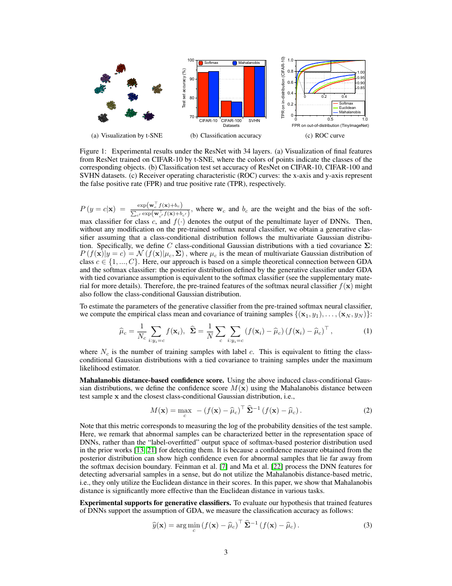
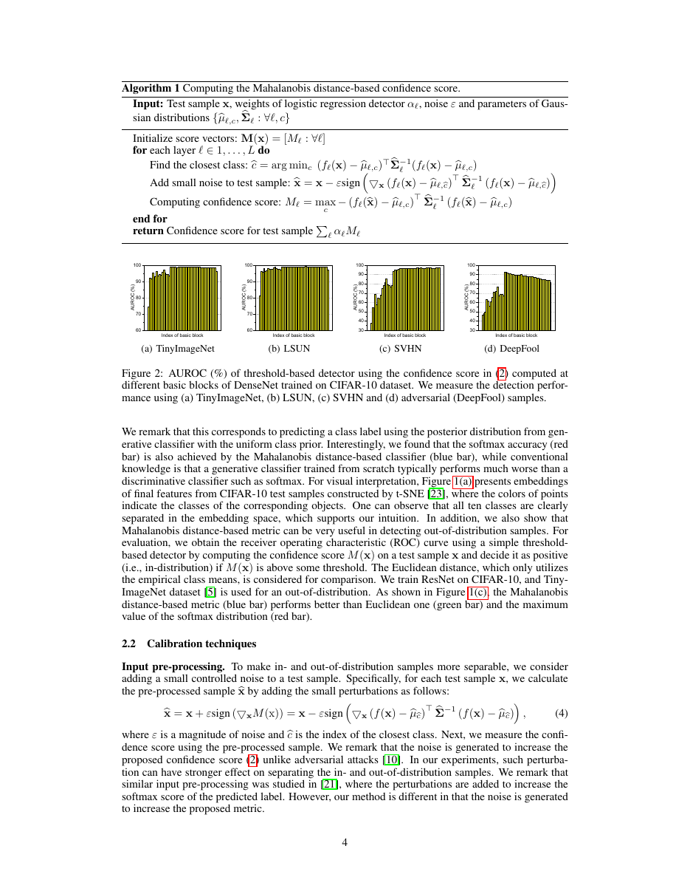
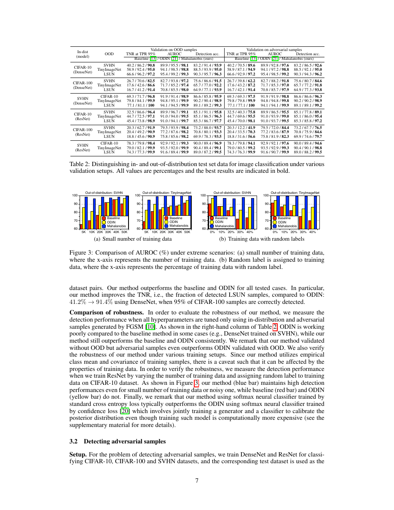

# 번역: 분포 밖 표본과 적대적 공격을 함께 찾는 간단한 통합 틀

- 원제: A Simple Unified Framework for Detecting Out-of-Distribution Samples and Adversarial Attacks
- 저자: Kimin Lee (KAIST), Kibok Lee (University of Michigan), Honglak Lee (Google Brain, University of Michigan), Jinwoo Shin (KAIST, AItrics)
- 원문: 같은 폴더의 `Lee2018_arXiv_Mahalanobis_OOD.pdf` (arXiv:1807.03888v2, 2018-10-27, 20쪽)
- 게재: 원문 1쪽 아래에 "32nd Conference on Neural Information Processing Systems (NIPS 2018), Montréal, Canada"라고 적혀 있다. arXiv API의 comment도 "Accepted in NIPS 2018"이다.
- 번역 범위: 초록, 본문 1~4절, 그림과 표 캡션, 보충 자료 A~F 전체. 참고문헌은 원문 그대로 둔다. 표의 숫자는 원문을 그대로 옮겼다. 그래프 안의 숫자는 옮기지 않았다.
- 번역 메모: 원문 19쪽 그림 10 위에는 리뷰 메모 이미지("Review comment", "Generating the garbage images matching mean & variance" 같은 글)가 겹쳐 인쇄되어 있다. 본문이 아니라서 옮기지 않았다.

---

## 초록

학습 분포에서 통계적으로, 또는 적대적으로 충분히 멀리 떨어진 시험 표본을 찾아내는 일은, 실제 기계학습 응용에 좋은 분류기를 배치하려면 꼭 필요하다. 그런데 소프트맥스 분류기를 쓰는 심층 신경망은 이런 비정상 표본에도 지나치게 확신하는 사후 분포를 내는 것으로 알려져 있다. 이 논문은 어떤 비정상 표본이든 찾아내는 간단하지만 효과적인 방법을 제안한다. 이 방법은 미리 학습된 어떤 소프트맥스 신경 분류기에도 쓸 수 있다. 가우스 판별 분석(GDA) 아래에서, 심층 모델의 (하위 층과 상위 층) 특징에 대해 클래스별 조건부 가우스 분포를 얻는다. 그 결과 마할라노비스 거리에 기반한 신뢰 점수가 나온다. 기존 방법은 대부분 분포 밖 표본이나 적대적 표본 중 하나만 평가했고 둘 다 평가하지는 않았다. 제안 방법은 실험에서 두 경우 모두 최고 성능을 냈다. 또한 학습 자료에 잘못된 레이블이 섞였거나 표본 수가 적은 것 같은 가혹한 경우에도 더 강건했다. 끝으로 이 방법을 클래스 점진 학습에 적용해 쓰임이 더 넓다는 것을 보인다. 분포 밖 표본이 발견될 때마다, 우리의 분류 규칙은 심층 모델을 다시 학습하지 않고도 새 클래스를 잘 받아들인다.

## 1 서론

심층 신경망(DNN)은 음성 인식 [1], 물체 검출 [9], 영상 분류 [12] 같은 많은 분류 과제에서 높은 정확도를 얻었다. 하지만 예측 불확실성을 재는 일은 여전히 어려운 문제다 [20, 21]. 잘 교정된 예측 불확실성을 얻는 것은 꼭 필요하다. 능동 학습 [8], 새로움 탐지 [18] 같은 많은 기계학습 응용에 쓸모가 있고, 자율주행차나 보안 인증 시스템 [6, 30] 같은 실제 시스템에 DNN을 배치할 때 [2]에도 쓸모가 있기 때문이다.

DNN의 예측 불확실성은, 분포 안(즉 학습 표본의 분포)에서 통계적으로 또는 적대적으로 멀리 떨어진 비정상 표본을 찾는 문제와 밀접하다. 분포 밖(OOD) 표본을 찾기 위해 최근 연구들은 사후 분포의 신뢰도를 써 왔다 [13, 21]. 예를 들어 Hendrycks와 Gimpel [13]은 분류기 사후 분포의 최댓값을 기준선 방법으로 제안했고, 이는 DNN의 입력과 출력을 가공해 개선되었다 [21]. 적대적 표본을 찾기 위해서는, DNN 특징 공간에서 이를 특징짓는 밀도 추정 기반 신뢰 점수가 제안되었다 [7]. 더 최근에 Ma 등 [22]은 국소 내재 차원(LID)을 제안하고, 시험 표본의 특성을 LID로 효과적으로 추정할 수 있음을 실험으로 보였다. 하지만 이 계열의 기존 연구는 대개 OOD 표본과 적대적 표본을 함께 평가하지 않는다. 우리가 아는 한, 두 과제 모두에서 잘 되는 범용 탐지기는 알려져 있지 않다.

**기여.** 이 논문은 OOD 표본과 적대적 표본을 포함한 비정상 시험 표본을 찾는, 간단하지만 효과적인 방법을 제안한다. 이 방법은 미리 학습된 어떤 소프트맥스 신경 분류기에도 (다시 학습하지 않고) 쓸 수 있다. 큰 생각은 "생성형"(거리 기반) 분류기 개념을 써서 DNN 특징 공간에서 시험 표본의 확률 밀도를 재는 것이다. 구체적으로, 미리 학습된 특징이 클래스별 조건부 가우스 분포에 잘 맞는다고 가정한다. 가우스 판별 분석 아래에서는 그 사후 분포가 소프트맥스 분류기와 같다는 것을 보일 수 있기 때문이다(근거는 2.1절). 이 가정 아래, 가장 가까운 클래스 조건부 분포에 대한 마할라노비스 거리로 신뢰 점수를 정의한다. 이때 모수는 학습 표본의 클래스별 경험 평균과 공유(tied) 경험 공분산으로 고른다. 통념과 달리, 이에 대응하는 생성형 분류기를 써도 소프트맥스 분류 정확도는 거의 떨어지지 않았다. 놀랍게도, 그 신뢰 점수는 여러 과제(OOD 표본 탐지, 적대적 표본 탐지, 클래스 점진 학습)에서 소프트맥스 기반 점수보다 매우 크게 앞섰다.

우리는 CIFAR [15], SVHN [28], ImageNet [5], LSUN [32] 등 여러 자료로 영상 분류를 학습한 DenseNet [14], ResNet [12] 같은 심층 합성곱 신경망으로 효과를 보인다. 먼저 OOD 표본 탐지에서, 제안 방법은 기존 최고 방법인 ODIN [21]을 모든 시험 경우에서 앞섰다. 특히 분포 안(예: CIFAR-100) 표본의 95%를 바르게 찾을 때, OOD(예: LSUN) 표본을 찾아낸 비율인 참 음성률(TNR)이 ResNet에서 ODIN의 45.6%에서 90.9%로 올랐다. 다음으로 FGSM [10], BIM [16], DeepFool [26], CW [3] 네 가지 공격으로 만든 적대적 표본 탐지에서, 제안 방법은 기존 최고 탐지 지표인 LID [22]를 앞섰다. 특히 정상 CIFAR-10 표본의 95%를 바르게 찾을 때, ResNet에서 CW의 TNR이 LID의 82.9%에서 95.8%로 올랐다.

또한 제안 방법은 초매개변수 선택에, 그리고 학습 자료에 무작위 잘못된 레이블이 섞이거나 표본 수가 적은 극단 상황에 더 강건했다. 특히 Liang 등 [21]은 ODIN의 초매개변수를 OOD 표본의 검증 집합으로 맞추는데, OOD 표본은 미리 알 수 없으므로 이는 흔히 불가능하다. 우리는 제안 방법의 초매개변수를 분포 안(학습) 표본만으로 맞추어도 성능이 유지됨을 보인다. 나아가 간단한 공격(FGSM)으로 맞춘 제안 방법이 BIM, DeepFool, CW 같은 더 복잡한 공격도 찾아냄을 보인다.

끝으로 이 방법을 클래스 점진 학습 [29]에 적용한다. 이는 미리 학습된 분류기에 새 클래스를 차례로 더하는 과제다. 새 클래스 표본은 학습 분포 밖에서 나오므로, 심층 모델을 다시 학습하지 않고 제안 지표로 분류할 수 있으리라 기대하는 것이 자연스럽다. 그래서 새 클래스의 평균을 계산하고 모든 클래스의 공유 공분산을 갱신하기만 하면 언제든 새 클래스를 받아들이는 간단한 방법을 제시한다. 이 방법은 유클리드 거리 기반 분류기나 다시 학습한 소프트맥스 분류기 같은 기준 방법보다 낫다. 이는 우리 접근이 능동 학습 [8], 앙상블 학습 [19], 소수 표본 학습 [31] 같은 다른 많은 관련 과제에도 쓰일 가능성을 보여 준다.

## 2 생성형 분류기에서 얻는 마할라노비스 거리 기반 점수

소프트맥스 분류기를 가진 DNN이 주어졌을 때, OOD 표본과 적대적 표본 같은 비정상 표본을 찾는 간단하지만 효과적인 방법을 제안한다. 먼저 가우스 판별 분석(GDA) 아래 유도한 생성형 분류기에 기반한 신뢰 점수를 제시하고, 이어 성능을 높이는 추가 기법을 소개한다. 또 이 신뢰 점수를 점진 학습에 쓰는 방법도 다룬다.

### 2.1 왜 마할라노비스 거리 기반 점수인가?

**소프트맥스 분류기에서 생성형 분류기 유도.** x ∈ X를 입력, y ∈ Y = {1, ..., C}를 레이블이라 하자. 미리 학습된 소프트맥스 신경 분류기가 다음처럼 주어졌다고 하자.

P(y = c | x) = exp(w_cᵀ f(x) + b_c) / Σ_c' exp(w_c'ᵀ f(x) + b_c')

여기서 w_c와 b_c는 클래스 c에 대한 소프트맥스 분류기의 가중치와 편향이고, f( )는 DNN의 끝에서 두 번째 층 출력이다. 그러면 미리 학습된 소프트맥스 분류기를 전혀 고치지 않고, 클래스 조건부 분포가 다변량 가우스 분포를 따른다고 가정해 생성형 분류기를 얻는다. 구체적으로 공유 공분산 Σ를 갖는 C개의 클래스 조건부 가우스 분포 P(f(x) | y = c) = N(f(x) | μ_c, Σ)를 정의한다. 여기서 μ_c는 클래스 c ∈ {1, ..., C}의 다변량 가우스 분포 평균이다. 이 접근은 GDA와 소프트맥스 분류기 사이의 간단한 이론적 연결에 기대고 있다. 공유 공분산 가정 아래 GDA로 정의한 생성형 분류기의 사후 분포는 소프트맥스 분류기와 같다(자세한 내용은 보충 자료). 따라서 소프트맥스 신경 분류기의 미리 학습된 특징 f(x)도 클래스 조건부 가우스 분포를 따를 수 있다.

미리 학습된 소프트맥스 신경 분류기로부터 생성형 분류기의 모수를 추정하려고, 학습 표본 {(x_1, y_1), ..., (x_N, y_N)}의 클래스별 경험 평균과 공분산을 계산한다.

μ̂_c = (1/N_c) Σ_{i: y_i = c} f(x_i),  Σ̂ = (1/N) Σ_c Σ_{i: y_i = c} (f(x_i) − μ̂_c)(f(x_i) − μ̂_c)ᵀ   (1)

여기서 N_c는 레이블 c를 가진 학습 표본 수다. 이는 공유 공분산을 갖는 클래스 조건부 가우스 분포를 학습 표본에 최대우도 추정으로 맞춘 것과 같다.



그림 1: 34층 ResNet에서의 실험 결과. (a) CIFAR-10으로 학습한 ResNet의 마지막 특징을 t-SNE로 시각화한 것. 점의 색은 해당 물체의 클래스를 나타낸다. (b) CIFAR-10, CIFAR-100, SVHN에서 ResNet의 시험 집합 분류 정확도. (c) 수신자 조작 특성(ROC) 곡선. x축은 거짓 양성률(FPR), y축은 참 양성률(TPR)이다.

**마할라노비스 거리 기반 신뢰 점수.** 위에서 유도한 클래스 조건부 가우스 분포를 써서, 시험 표본 x와 가장 가까운 클래스 조건부 분포 사이의 마할라노비스 거리로 신뢰 점수 M(x)를 정의한다.

M(x) = max_c −(f(x) − μ̂_c)ᵀ Σ̂⁻¹ (f(x) − μ̂_c)   (2)

이 지표는 시험 표본의 확률 밀도 로그를 재는 것에 해당한다. 여기서, 비정상 표본은 기존 연구 [13, 21]가 탐지에 쓴 소프트맥스 사후 분포의 "레이블에 과적합된" 출력 공간보다, DNN의 표현 공간에서 더 잘 특징지어진다는 점을 짚어 둔다. 사후 분포에서 얻은 신뢰도는 소프트맥스 결정 경계에서 멀리 떨어진 비정상 표본에도 높은 신뢰를 보일 수 있기 때문이다. Feinman 등 [7]과 Ma 등 [22]은 적대적 표본을 찾으려고 어떤 의미에서 DNN 특징을 가공하지만, 마할라노비스 거리 기반 지표는 쓰지 않는다. 즉 그들의 점수는 유클리드 거리만 쓴다. 이 논문은 여러 과제에서 마할라노비스 거리가 유클리드 거리보다 훨씬 효과적임을 보인다.

**생성형 분류기에 대한 실험적 근거.** DNN의 학습된 특징이 GDA 가정을 지지한다는 가설을 평가하려고, 다음과 같이 분류 정확도를 잰다.

ŷ(x) = argmin_c (f(x) − μ̂_c)ᵀ Σ̂⁻¹ (f(x) − μ̂_c)   (3)

이는 클래스 사전 확률이 균등한 생성형 분류기의 사후 분포로 클래스 레이블을 예측하는 것에 해당한다. 흥미롭게도 소프트맥스 정확도(빨간 막대)는 마할라노비스 거리 기반 분류기(파란 막대)로도 달성되었다. 통념은 처음부터 학습한 생성형 분류기가 소프트맥스 같은 판별형 분류기보다 대개 훨씬 못하다는 것이다. 시각적으로 해석하기 위해, 그림 1(a)는 CIFAR-10 시험 표본의 마지막 특징을 t-SNE [23]로 임베딩해 보여 준다. 점의 색은 해당 물체의 클래스다. 열 개 클래스가 모두 임베딩 공간에서 뚜렷하게 나뉘는 것을 볼 수 있으며, 이는 우리의 직관을 지지한다. 또 마할라노비스 거리 기반 지표가 분포 밖 표본 탐지에 매우 쓸모 있음을 보인다. 평가를 위해, 시험 표본 x에 대해 신뢰 점수 M(x)를 계산하고 그 값이 어떤 임계값보다 크면 양성(즉 분포 안)으로 정하는 간단한 임계값 탐지기로 ROC 곡선을 얻는다. 비교 대상으로 클래스 경험 평균만 쓰는 유클리드 거리를 둔다. ResNet을 CIFAR-10으로 학습하고 TinyImageNet 자료 [5]를 분포 밖으로 쓴다. 그림 1(c)처럼 마할라노비스 거리 기반 지표(파란색)가 유클리드 거리(초록색)와 소프트맥스 분포 최댓값(빨간색)보다 낫다.

> 알고리즘 1: 마할라노비스 거리 기반 신뢰 점수 계산
>
> 입력: 시험 표본 x, 로지스틱 회귀 탐지기의 가중치 α_ℓ, 잡음 ε, 가우스 분포의 모수 {μ̂_ℓ,c, Σ̂_ℓ : 모든 ℓ, c}
>
> 점수 벡터 초기화: M(x) = [M_ℓ : 모든 ℓ]
>
> 각 층 ℓ ∈ 1, ..., L 에 대해
>
> 1. 가장 가까운 클래스 찾기: ĉ = argmin_c (f_ℓ(x) − μ̂_ℓ,c)ᵀ Σ̂_ℓ⁻¹ (f_ℓ(x) − μ̂_ℓ,c)
> 2. 시험 표본에 작은 잡음 더하기: x̂ = x − ε sign(∇_x (f_ℓ(x) − μ̂_ℓ,ĉ)ᵀ Σ̂_ℓ⁻¹ (f_ℓ(x) − μ̂_ℓ,ĉ))
> 3. 신뢰 점수 계산: M_ℓ = max_c −(f_ℓ(x̂) − μ̂_ℓ,c)ᵀ Σ̂_ℓ⁻¹ (f_ℓ(x̂) − μ̂_ℓ,c)
>
> 반복 끝. 시험 표본의 신뢰 점수 Σ_ℓ α_ℓ M_ℓ 를 돌려준다.



그림 2: CIFAR-10으로 학습한 DenseNet의 서로 다른 기본 블록에서 식 (2)의 신뢰 점수로 계산한 임계값 기반 탐지기의 AUROC(%). (a) TinyImageNet, (b) LSUN, (c) SVHN, (d) 적대적(DeepFool) 표본으로 탐지 성능을 쟀다.

### 2.2 교정 기법

**입력 전처리.** 분포 안과 밖의 표본을 더 잘 가르려고, 시험 표본에 통제된 작은 잡음을 더하는 방법을 생각한다. 구체적으로, 각 시험 표본 x에 대해 다음처럼 작은 섭동을 더해 전처리한 표본 x̂를 계산한다.

x̂ = x + ε sign(∇_x M(x)) = x − ε sign(∇_x (f(x) − μ̂_ĉ)ᵀ Σ̂⁻¹ (f(x) − μ̂_ĉ))   (4)

여기서 ε는 잡음 크기이고 ĉ는 가장 가까운 클래스의 번호다. 그다음 전처리한 표본으로 신뢰 점수를 잰다. 이 잡음은 적대적 공격 [10]과 달리 제안 신뢰 점수 (2)를 높이도록 만든다는 점을 짚어 둔다. 실험에서 이런 섭동은 분포 안과 밖의 표본을 가르는 데 더 강한 효과를 냈다. 비슷한 입력 전처리가 [21]에서 연구되었는데, 거기서는 예측 레이블의 소프트맥스 점수를 높이도록 섭동을 더한다. 우리 방법은 제안 지표를 높이도록 잡음을 만든다는 점이 다르다.

> 알고리즘 2: 클래스 점진 학습을 위한 마할라노비스 거리 기반 분류기 갱신
>
> 입력: 새 클래스의 표본 집합 {x_i : i = 1 ... N_{C+1}}, 지금까지 본 클래스들의 평균 {μ̂_c : c = 1 ... C}와 공분산 Σ̂
>
> 1. 새 클래스 평균 계산: μ̂_{C+1} ← (1/N_{C+1}) Σ_i f(x_i)
> 2. 새 클래스 공분산 계산: Σ̂_{C+1} ← (1/N_{C+1}) Σ_i (f(x_i) − μ̂_{C+1})(f(x_i) − μ̂_{C+1})ᵀ
> 3. 공유 공분산 갱신: Σ̂ ← (C/(C+1)) Σ̂ + (1/(C+1)) Σ̂_{C+1}
>
> 모든 클래스의 평균 {μ̂_c : c = 1 ... C+1}와 공분산 Σ̂를 돌려준다.

**특징 앙상블.** 성능을 더 높이려고, 마지막 특징뿐 아니라 DNN의 다른 하위 층 특징에서도 신뢰 점수를 재서 합치는 방법을 생각한다. 형식적으로, 학습 자료가 주어지면 DNN의 ℓ번째 은닉 특징 f_ℓ(x)를 뽑고 그 클래스별 경험 평균과 공유 공분산 μ̂_ℓ,c, Σ̂_ℓ를 계산한다. 그다음 각 시험 표본 x에 대해 식 (2)로 ℓ번째 층의 신뢰 점수를 잰다. 이 간단하고 자연스러운 방식은 하위 층 특징에서 입력에 고유한 정보를 더 뽑아, 더 잘 교정된 점수를 얻는 데 이득을 줄 것으로 기대할 수 있다. CIFAR-10으로 학습한 DenseNet [14]의 여러 기본 블록에서 식 (2)의 신뢰 점수로 임계값 기반 탐지기의 ROC 곡선 아래 넓이(AUROC)를 쟀다. ResNet의 전체 경향도 비슷하다. 그림 2는 SVHN [28], LSUN [32], TinyImageNet 같은 여러 OOD 표본과 DeepFool [26]로 만든 적대적 표본에서의 성능을 보여 준다. 중간 특징의 차원은 평균 풀링으로 줄였다(자세한 내용은 3절). 그림 2처럼 하위 층 특징에서 계산한 신뢰 점수가 마지막 특징보다 더 잘 교정된 경우가 많다(예: LSUN, TinyImageNet, DeepFool). 성능을 더 높이려고 알고리즘 1의 특징 앙상블 방법을 설계했다. 먼저 모든 층에서 신뢰 점수를 뽑은 뒤, 가중 평균 Σ_ℓ α_ℓ M_ℓ(x)로 합친다. 여기서 M_ℓ( )와 α_ℓ는 ℓ번째 층의 신뢰 점수와 그 가중치다. 실험에서는 [22]와 비슷한 전략으로, 검증 표본으로 로지스틱 회귀 탐지기를 학습해 각 층의 가중치 α_ℓ를 고른다. 이런 가중 평균은 일부 층의 신뢰 점수가 효과가 없을 때에도 전체 성능이 떨어지는 것을 막는다. 효과 없는 층의 학습된 가중치(검증으로 정함)는 거의 0이 되기 때문이다.

### 2.3 마할라노비스 거리 기반 점수를 쓴 클래스 점진 학습

자연스러운 확장으로, 마할라노비스 거리 기반 신뢰 점수를 클래스 점진 학습 과제 [29]에 쓸 수 있음도 보인다. 이 과제는 기본 클래스로 미리 학습된 분류기를, 새 클래스와 그 표본이 생길 때마다 차례로 갱신한다. 제한된 메모리로 파국적 망각 [24]을 다뤄야 하므로 어려운 과제로 알려져 있다. 이를 위해 최근 연구들은 생성 모델이나 자료 표집을 포함하는 새 학습 방법을 개발하는 쪽으로 가고 있지만, 그런 학습 방법은 비싼 왕복 비용을 낳을 수 있다. 우리는 제안 신뢰 점수에 기반해, 복잡한 학습 없이 간단한 분류 방법을 만든다. 이를 위해 먼저 분류기가 어느 정도의 기본 클래스로 잘 학습되어 있다고 가정한다. 이는 많은 실제 상황에서 꽤 합리적인 가정이다.¹ 이 경우 분류기는 OOD 표본을 잘 찾을 뿐 아니라, 기본 클래스로 학습한 표현이 새 클래스도 특징지을 수 있으므로 새 클래스를 가르는 데도 좋을 것으로 기대할 수 있다. 이에 따라 식 (3)에 기반한 마할라노비스 거리 기반 분류기를 제시한다. 이 분류기는 알고리즘 2처럼 클래스 평균과 공분산을 계산하고 갱신하기만 해서 새 클래스를 받아들인다. 우리 신뢰 점수의 클래스 점진 적응은 앞으로 넓은 범위의 새 응용에 쓰일 가능성을 보여 준다.

¹ 예를 들어 대규모 영상 자료로 학습한 최신 CNN은 기성품으로 구할 수 있고 [12, 14], 많은 컴퓨터 비전 과제의 출발점이 된다 [9, 18, 25].

표 1: 제안한 각 기법이 분포 안과 밖의 시험 자료를 가르는 데 기여하는 정도. CIFAR-10으로 학습한 ResNet에서 SVHN을 OOD로 쓸 때의 탐지 성능을 쟀다. 모든 값은 백분율이며 최고 결과는 굵게 표시했다.

| 방법 | 특징 앙상블 | 입력 전처리 | TPR 95%에서 TNR | AUROC | 탐지 정확도 | AUPR in | AUPR out |
|---|---|---|---|---|---|---|---|
| Baseline [13] | - | - | 32.47 | 89.88 | 85.06 | 85.40 | 93.96 |
| ODIN [21] | - | - | 86.55 | 96.65 | 91.08 | 92.54 | 98.52 |
| Mahalanobis (제안) | - | - | 54.51 | 93.92 | 89.13 | 91.56 | 95.95 |
| Mahalanobis (제안) | - | O | 92.26 | 98.30 | 93.72 | 96.01 | 99.28 |
| Mahalanobis (제안) | O | - | 91.45 | 98.37 | 93.55 | 96.43 | 99.35 |
| Mahalanobis (제안) | O | O | 96.42 | 99.14 | 95.75 | 98.26 | 99.60 |

## 3 실험 결과

이 절에서는 DenseNet [14], ResNet [12] 같은 심층 합성곱 신경망과 CIFAR [15], SVHN [28], ImageNet [5], LSUN [32] 같은 여러 비전 자료로 제안 방법의 효과를 보인다. 지면 제약으로 더 자세한 실험 설정과 결과는 보충 자료에 둔다. 코드는 https://github.com/pokaxpoka/deep_Mahalanobis_detector 에 있다.

### 3.1 분포 밖 표본 탐지

**설정.** 분포 밖(OOD) 표본 탐지 문제를 위해, 100층 DenseNet과 34층 ResNet을 CIFAR-10, CIFAR-100, SVHN 분류용으로 학습한다. 학습에 쓴 자료가 분포 안(양성) 자료이고 나머지는 OOD(음성)로 본다. 평가에는 시험 자료만 쓴다. 또 TinyImageNet(ImageNet의 부분집합)과 LSUN 자료도 OOD로 시험한다. 평가에는 시험 표본의 신뢰 점수를 재서 그 값이 어떤 임계값보다 크면 분포 안으로 분류하는 임계값 기반 탐지기를 쓴다. 다음 지표를 잰다. 참 양성률(TPR) 95%에서의 참 음성률(TNR), 수신자 조작 특성 곡선 아래 넓이(AUROC), 정밀도-재현율 곡선 아래 넓이(AUPR), 탐지 정확도. 비교 대상으로, 사후 분포의 최댓값을 신뢰 점수로 정의하는 기준선 방법 [13]과, 가공한 사후 분포의 최댓값을 신뢰 점수로 정의하는 기존 최고 방법 ODIN [21]을 둔다. 제안 방법은 DenseNet(또는 ResNet)의 모든 dense(또는 residual) 블록 끝에서 신뢰 점수를 뽑는다. 계산 효율을 위해 각 합성곱 층의 특징 맵 크기를 평균 풀링으로 줄인다. F × H × W → F × 1 이며, F는 채널 수, H × W는 공간 차원이다. 알고리즘 1처럼 로지스틱 회귀 탐지기의 출력을 최종 신뢰 점수로 쓴다. 모든 초매개변수는 별도의 검증 집합으로 맞추며, 이 집합은 분포 안과 밖 쌍마다 1,000장씩으로 이루어진다. Ma 등 [22]과 비슷하게, 로지스틱 회귀 탐지기의 가중치는 검증 집합 안에서 중첩 교차 검증으로 학습한다. 이때 분포 안 표본에는 양성, OOD 표본에는 음성 레이블을 준다. 실제로는 OOD 검증 자료가 없을 수 있으므로, 분포 안(양성) 표본과 FGSM [10]으로 만든 대응 적대적(음성) 표본만으로 초매개변수를 맞추는 경우도 따져 본다.

**각 기법의 기여와 ODIN과의 비교.** 표 1은 기준선 방법, ODIN과 비교해 우리가 제안한 기법들의 기여를 확인한다. CIFAR-10으로 학습한 ResNet에서 SVHN을 OOD로 쓸 때의 탐지 성능을 쟀다. 각 구성 요소에 따른 단계적 개선을 보려고 기법을 하나씩 더했다. 특징 앙상블과 입력 전처리 없이도 제안 방법이 기준선 방법을 크게 앞선다. 이는 제안 방법이 사후 분포에 비해 OOD 표본을 매우 효과적으로 특징지음을 뜻한다. 특징 앙상블과 입력 전처리를 쓰면 탐지 성능이 ODIN보다 더 좋아진다. 표 2의 왼쪽 열은 모든 분포 안과 밖 자료 쌍에 대해 ODIN과의 탐지 성능을 보여 준다. 제안 방법은 모든 시험 경우에서 기준선과 ODIN을 앞섰다. 특히 CIFAR-100 표본의 95%를 바르게 찾을 때, DenseNet에서 LSUN 표본을 찾아낸 비율인 TNR이 ODIN 대비 41.2%에서 91.4%로 올랐다.

표 2: 여러 검증 설정에서 영상 분류의 분포 안과 밖 시험 자료 구분. 모든 값은 백분율이며 최고 결과는 굵게 표시했다. 각 칸은 Baseline [13] / ODIN [21] / Mahalanobis (제안) 순서다.

| 분포 안 (모델) | OOD | OOD로 검증: TPR 95%에서 TNR | AUROC | 탐지 정확도 | 적대적 표본으로 검증: TPR 95%에서 TNR | AUROC | 탐지 정확도 |
|---|---|---|---|---|---|---|---|
| CIFAR-10 (DenseNet) | SVHN | 40.2 / 86.2 / 90.8 | 89.9 / 95.5 / 98.1 | 83.2 / 91.4 / 93.9 | 40.2 / 70.5 / 89.6 | 89.9 / 92.8 / 97.6 | 83.2 / 86.5 / 92.6 |
| CIFAR-10 (DenseNet) | TinyImageNet | 58.9 / 92.4 / 95.0 | 94.1 / 98.5 / 98.8 | 88.5 / 93.9 / 95.0 | 58.9 / 87.1 / 94.9 | 94.1 / 97.2 / 98.8 | 88.5 / 92.1 / 95.0 |
| CIFAR-10 (DenseNet) | LSUN | 66.6 / 96.2 / 97.2 | 95.4 / 99.2 / 99.3 | 90.3 / 95.7 / 96.3 | 66.6 / 92.9 / 97.2 | 95.4 / 98.5 / 99.2 | 90.3 / 94.3 / 96.2 |
| CIFAR-100 (DenseNet) | SVHN | 26.7 / 70.6 / 82.5 | 82.7 / 93.8 / 97.2 | 75.6 / 86.6 / 91.5 | 26.7 / 39.8 / 62.2 | 82.7 / 88.2 / 91.8 | 75.6 / 80.7 / 84.6 |
| CIFAR-100 (DenseNet) | TinyImageNet | 17.6 / 42.6 / 86.6 | 71.7 / 85.2 / 97.4 | 65.7 / 77.0 / 92.2 | 17.6 / 43.2 / 87.2 | 71.7 / 85.3 / 97.0 | 65.7 / 77.2 / 91.8 |
| CIFAR-100 (DenseNet) | LSUN | 16.7 / 41.2 / 91.4 | 70.8 / 85.5 / 98.0 | 64.9 / 77.1 / 93.9 | 16.7 / 42.1 / 91.4 | 70.8 / 85.7 / 97.9 | 64.9 / 77.3 / 93.8 |
| SVHN (DenseNet) | CIFAR-10 | 69.3 / 71.7 / 96.8 | 91.9 / 91.4 / 98.9 | 86.6 / 85.8 / 95.9 | 69.3 / 69.3 / 97.5 | 91.9 / 91.9 / 98.8 | 86.6 / 86.6 / 96.3 |
| SVHN (DenseNet) | TinyImageNet | 79.8 / 84.1 / 99.9 | 94.8 / 95.1 / 99.9 | 90.2 / 90.4 / 98.9 | 79.8 / 79.8 / 99.9 | 94.8 / 94.8 / 99.8 | 90.2 / 90.2 / 98.9 |
| SVHN (DenseNet) | LSUN | 77.1 / 81.1 / 100 | 94.1 / 94.5 / 99.9 | 89.1 / 89.2 / 99.3 | 77.1 / 77.1 / 100 | 94.1 / 94.1 / 99.9 | 89.1 / 89.1 / 99.2 |
| CIFAR-10 (ResNet) | SVHN | 32.5 / 86.6 / 96.4 | 89.9 / 96.7 / 99.1 | 85.1 / 91.1 / 95.8 | 32.5 / 40.3 / 75.8 | 89.9 / 86.5 / 95.5 | 85.1 / 77.8 / 89.1 |
| CIFAR-10 (ResNet) | TinyImageNet | 44.7 / 72.5 / 97.1 | 91.0 / 94.0 / 99.5 | 85.1 / 86.5 / 96.3 | 44.7 / 69.6 / 95.5 | 91.0 / 93.9 / 99.0 | 85.1 / 86.0 / 95.4 |
| CIFAR-10 (ResNet) | LSUN | 45.4 / 73.8 / 98.9 | 91.0 / 94.1 / 99.7 | 85.3 / 86.7 / 97.7 | 45.4 / 70.0 / 98.1 | 91.0 / 93.7 / 99.5 | 85.3 / 85.8 / 97.2 |
| CIFAR-100 (ResNet) | SVHN | 20.3 / 62.7 / 91.9 | 79.5 / 93.9 / 98.4 | 73.2 / 88.0 / 93.7 | 20.3 / 12.2 / 41.9 | 79.5 / 72.0 / 84.4 | 73.2 / 67.7 / 76.5 |
| CIFAR-100 (ResNet) | TinyImageNet | 20.4 / 49.2 / 90.9 | 77.2 / 87.6 / 98.2 | 70.8 / 80.1 / 93.3 | 20.4 / 33.5 / 70.3 | 77.2 / 83.6 / 87.9 | 70.8 / 75.9 / 84.6 |
| CIFAR-100 (ResNet) | LSUN | 18.8 / 45.6 / 90.9 | 75.8 / 85.6 / 98.2 | 69.9 / 78.3 / 93.5 | 18.8 / 31.6 / 56.6 | 75.8 / 81.9 / 82.3 | 69.9 / 74.6 / 79.7 |
| SVHN (ResNet) | CIFAR-10 | 78.3 / 79.8 / 98.4 | 92.9 / 92.1 / 99.3 | 90.0 / 89.4 / 96.9 | 78.3 / 79.8 / 94.1 | 92.9 / 92.1 / 97.6 | 90.0 / 89.4 / 94.6 |
| SVHN (ResNet) | TinyImageNet | 79.0 / 82.1 / 99.9 | 93.5 / 92.0 / 99.9 | 90.4 / 89.4 / 99.1 | 79.0 / 80.5 / 99.2 | 93.5 / 92.9 / 99.3 | 90.4 / 90.1 / 98.8 |
| SVHN (ResNet) | LSUN | 74.3 / 77.3 / 99.9 | 91.6 / 89.4 / 99.9 | 89.0 / 87.2 / 99.5 | 74.3 / 76.3 / 99.9 | 91.6 / 90.7 / 99.9 | 89.0 / 88.2 / 99.5 |



그림 3: 극단 상황에서의 AUROC(%) 비교. (a) 학습 자료가 적은 경우. x축은 학습 자료 수다. (b) 학습 자료에 무작위 레이블을 준 경우. x축은 무작위 레이블을 받은 학습 자료의 비율이다.

**강건성 비교.** 제안 방법의 강건성을 평가하려고, 모든 초매개변수를 분포 안 표본과 FGSM [10]으로 만든 적대적 표본만으로 맞출 때의 탐지 성능을 쟀다. 표 2의 오른쪽 열처럼, ODIN은 어떤 경우(예: SVHN으로 학습한 DenseNet)에 기준선 방법보다 못하지만, 제안 방법은 여전히 기준선과 ODIN을 꾸준히 앞선다. OOD 없이 적대적 표본으로만 검증한 제안 방법이, OOD로 검증한 ODIN보다도 낫다는 점을 짚어 둔다. 여러 학습 설정에서의 강건성도 확인했다. 제안 방법은 학습 표본의 클래스 경험 평균과 공분산을 쓰므로, 학습 자료의 성질에 영향을 받을 수 있다는 주의점이 있다. 강건성을 확인하려고, CIFAR-10에서 학습 자료 수를 바꾸거나 학습 자료에 무작위 레이블을 주며 ResNet을 학습해 탐지 성능을 쟀다. 그림 3처럼 제안 방법(파란색)은 학습 자료가 적거나 잡음이 있어도 높은 탐지 성능을 유지하지만, 기준선(빨간색)과 ODIN(노란색)은 그렇지 못하다. 끝으로, 표준 교차 엔트로피 손실로 학습한 소프트맥스 신경 분류기에 제안 방법을 쓰면, 신뢰 손실 [20](생성기와 분류기를 함께 학습해 사후 분포를 교정함)로 학습한 소프트맥스 신경 분류기에 ODIN을 쓰는 것보다 대개 낫다는 점을 짚어 둔다. 신뢰 손실 모델은 학습 계산이 더 비싼데도 그렇다(자세한 내용은 보충 자료).

### 3.2 적대적 표본 탐지

**설정.** 적대적 표본 탐지 문제를 위해 DenseNet과 ResNet을 CIFAR-10, CIFAR-100, SVHN 분류용으로 학습하고, 해당 시험 자료를 성능 측정용 양성 표본으로 쓴다. 다음 공격 방법으로 만든 적대적 영상을 음성 표본으로 쓴다. FGSM [10], BIM [16], DeepFool [26], CW [3]. 자세한 설명은 보충 자료에 있다. 비교 대상으로 커널 밀도(KD) [7]와 예측 불확실성(PU, 사후 분포 최댓값)을 조합한 로지스틱 회귀 탐지기를 둔다. 기존 최고인 국소 내재 차원(LID) 점수 [22]와도 비교한다. [7, 22]와 비슷한 전략으로, 원래 시험 표본의 10%를 무작위로 골라 로지스틱 회귀 탐지기 학습에 쓰고 나머지 시험 표본을 평가에 쓴다. 모든 초매개변수는 학습 집합 안의 중첩 교차 검증으로 맞춘다.

표 3: 여러 검증 설정에서의 AUROC(%) 비교. 알려지지 않은 공격의 평가에서는 "seen"으로 표시한 FGSM 표본을 검증에 쓴다. 제안 방법은 특징 앙상블과 입력 전처리를 모두 쓴다. 최고 결과는 굵게 표시했다.

| 모델 | 자료 | 점수 | 알려진 공격: FGSM | BIM | DeepFool | CW | 알려지지 않은 공격: FGSM (seen) | BIM | DeepFool | CW |
|---|---|---|---|---|---|---|---|---|---|---|
| DenseNet | CIFAR-10 | KD+PU [7] | 85.96 | 96.80 | 68.05 | 58.72 | 85.96 | 3.10 | 68.34 | 53.21 |
| DenseNet | CIFAR-10 | LID [22] | 98.20 | 99.74 | 85.14 | 80.05 | 98.20 | 94.55 | 70.86 | 71.50 |
| DenseNet | CIFAR-10 | Mahalanobis (제안) | 99.94 | 99.78 | 83.41 | 87.31 | 99.94 | 99.51 | 83.42 | 87.95 |
| DenseNet | CIFAR-100 | KD+PU [7] | 90.13 | 89.69 | 68.29 | 57.51 | 90.13 | 66.86 | 65.30 | 58.08 |
| DenseNet | CIFAR-100 | LID [22] | 99.35 | 98.17 | 70.17 | 73.37 | 99.35 | 68.62 | 69.68 | 72.36 |
| DenseNet | CIFAR-100 | Mahalanobis (제안) | 99.86 | 99.17 | 77.57 | 87.05 | 99.86 | 98.27 | 75.63 | 86.20 |
| DenseNet | SVHN | KD+PU [7] | 86.95 | 82.06 | 89.51 | 85.68 | 86.95 | 83.28 | 84.38 | 82.94 |
| DenseNet | SVHN | LID [22] | 99.35 | 94.87 | 91.79 | 94.70 | 99.35 | 92.21 | 80.14 | 85.09 |
| DenseNet | SVHN | Mahalanobis (제안) | 99.85 | 99.28 | 95.10 | 97.03 | 99.85 | 99.12 | 93.47 | 96.95 |
| ResNet | CIFAR-10 | KD+PU [7] | 81.21 | 82.28 | 81.07 | 55.93 | 83.51 | 16.16 | 76.80 | 56.30 |
| ResNet | CIFAR-10 | LID [22] | 99.69 | 96.28 | 88.51 | 82.23 | 99.69 | 95.38 | 71.86 | 77.53 |
| ResNet | CIFAR-10 | Mahalanobis (제안) | 99.94 | 99.57 | 91.57 | 95.84 | 99.94 | 98.91 | 78.06 | 93.90 |
| ResNet | CIFAR-100 | KD+PU [7] | 89.90 | 83.67 | 80.22 | 77.37 | 89.90 | 68.85 | 57.78 | 73.72 |
| ResNet | CIFAR-100 | LID [22] | 98.73 | 96.89 | 71.95 | 78.67 | 98.73 | 55.82 | 63.15 | 75.03 |
| ResNet | CIFAR-100 | Mahalanobis (제안) | 99.77 | 96.90 | 85.26 | 91.77 | 99.77 | 96.38 | 81.95 | 90.96 |
| ResNet | SVHN | KD+PU [7] | 82.67 | 66.19 | 89.71 | 76.57 | 82.67 | 43.21 | 84.30 | 67.85 |
| ResNet | SVHN | LID [22] | 97.86 | 90.74 | 92.40 | 88.24 | 97.86 | 84.88 | 67.28 | 76.58 |
| ResNet | SVHN | Mahalanobis (제안) | 99.62 | 97.15 | 95.73 | 92.15 | 99.62 | 95.39 | 72.20 | 86.73 |

**LID와의 비교와 일반화 분석.** 표 3의 왼쪽 열은 모든 정상과 적대적 쌍에 대한 로지스틱 회귀 탐지기의 AUROC를 보여 준다. 제안 방법은 대부분의 경우에서 시험한 모든 방법을 앞선다. 특히 CIFAR-10으로 학습한 ResNet에서 CW 표본을 찾을 때, AUROC가 LID의 82.2%에서 95.8%로 올랐다. [22]와 비슷하게, 간단한 공격으로 맞춘 제안 방법이 더 복잡한 공격의 탐지로 일반화되는지도 평가한다. 이를 위해 FGSM으로 만든 표본으로 로지스틱 회귀 탐지기를 학습했을 때의 탐지 성능을 쟀다. 표 3의 오른쪽 열처럼, FGSM으로 학습한 제안 방법은 BIM, DeepFool, CW 같은 훨씬 복잡한 공격도 정확하게 찾아낸다. LID도 잘 일반화되지만, 제안 방법은 대부분의 경우 여전히 더 낫다. 자연스럽게 LID가 OOD 표본 탐지에도 쓸모 있는지 의문이 든다. 보충 자료에서 실제로 제안 방법과 LID의 성능을 비교했는데, 제안 방법이 모든 시험 경우에서 여전히 LID를 앞섰다.

### 3.3 클래스 점진 학습

**설정.** 클래스 점진 학습 과제를 위해 34층 ResNet을 CIFAR-100과 축소 ImageNet [4] 분류용으로 학습한다. 2.3절처럼, 분류기는 어느 정도의 기본 클래스로 미리 학습되어 있고, 새 클래스와 그 자료가 하나씩 차례로 주어진다고 가정한다. 구체적으로 두 가지 시나리오를 시험한다. 첫 시나리오에서는 CIFAR-100 클래스의 절반이 기본 클래스이고 나머지가 새 클래스다. 둘째 시나리오에서는 CIFAR-100의 모든 클래스가 기본 클래스이고 ImageNet의 100개 클래스가 새 클래스다. 모든 시나리오를 다섯 번 시험해 평균했다. 클래스 분할은 시도마다 무작위로 만든다. 비교 대상으로 새 클래스 자료가 들어올 때마다 미세 조정하는 소프트맥스 분류기와, 클래스 평균만 계산해 새 클래스를 받아들이는 유클리드 분류기 [25]를 둔다. 소프트맥스 분류기는 거의 0에 가까운 학습 비용 [25]을 위해 소프트맥스 층만 갱신하고, Rebuffi와 Kolesnikov [29]의 메모리 관리를 따른다. 즉 이전 클래스의 표본 일부를 제한된 메모리에 보관하며, 그 메모리 크기는 마할라노비스 거리 기반 분류기의 모수를 보관하는 메모리와 맞춘다. 다시 말해 소프트맥스 분류기 학습을 위해 보관하는 이전 견본 수는 학습한 클래스 수와 은닉 특징 차원(실험에서는 512)의 합으로 정한다. 평가는 [18]과 비슷하게, 먼저 새 클래스 점수에 추가 편향을 조절하며 기본 클래스와 새 클래스의 정확도 곡선을 그리고 곡선 아래 넓이(AUC)를 잰다. 기본 클래스와 새 클래스 정확도를 평균하면 둘 사이의 성능이 불균형하게 측정될 수 있기 때문이다.

그림 4: CIFAR-100과 ImageNet 자료에서의 클래스 점진 학습 실험 결과. 각 실험에서 (왼쪽) 학습한 클래스 수에 따른 AUC와 (오른쪽) 마지막 새 클래스가 더해진 뒤의 기본 클래스 대 새 클래스 정확도 곡선을 보고한다. (a) 기본: CIFAR-100의 절반 / 새: 나머지 절반. (b) 기본: CIFAR-100 / 새: ImageNet.

**다른 분류기와의 비교.** 그림 4는 위의 두 시나리오에서 AUC로 본 점진 학습 성능을 비교한다. 각 하위 그림에 학습한 클래스 수에 따른 AUC(왼쪽)와, 마지막 새 클래스가 더해진 뒤의 기본 대 새 클래스 정확도 곡선(오른쪽)을 그렸다. 제안한 마할라노비스 거리 기반 분류기는 새 클래스 수가 늘수록 다른 방법을 큰 차이로 앞선다. 다만 그림 4(b)의 오른쪽 그림에서 작은 구간에 교차가 있다(파국적 망각 문제 때문). 특히 모든 새 클래스가 더해진 뒤, 제안 방법의 AUC는 첫째(둘째) 실험에서 40.0%(22.1%)로, 소프트맥스 분류기의 32.7%(15.6%), 유클리드 거리 분류기의 32.9%(17.1%)보다 낫다. CIFAR-100 클래스를 기본으로, CIFAR-10 클래스를 새 클래스로 둔 경우의 결과도 보충 자료에 보고하며 전체 경향은 비슷하다. 이 실험 결과는 다른 그럴듯한 점수들에 비해 우리 신뢰 점수가 우수함을 추가로 보여 준다.

## 4 결론

이 논문은 분포 밖 표본과 적대적 표본을 모두 포함하는 비정상 시험 표본을 찾는, 간단하지만 효과적인 방법을 제안했다. 핵심은 LDA 가정 아래 생성형 분류기를 유도하고 그에 기반한 새 신뢰 점수를 정의하는 것이다. 입력 전처리와 특징 앙상블 같은 교정 기법과 함께, 제안 방법은 여러 과제(분포 밖 표본 탐지, 적대적 공격 탐지, 클래스 점진 학습)에서 매우 강한 성능을 낸다. 또한 초매개변수 선택에, 그리고 학습 자료에 무작위 잘못된 레이블이 있거나 표본 수가 적은 극단 상황에 더 강건함을 확인했다. 우리 접근은 능동 학습 [8], 앙상블 학습 [19], 소수 표본 학습 [31] 같은 다른 많은 관련 기계학습 과제에도 쓰일 가능성이 있다고 믿는다.

## 감사의 글

이 연구는 일부 다음의 지원을 받았다. 한국 정부(과학기술정보통신부)가 지원한 정보통신기술진흥센터(IITP) 과제(No.R0132-15-1005, 온라인과 오프라인 환경의 콘텐츠 시각 탐색 기술), 한국 정부(미래창조과학부)가 지원한 국가과학기술연구회(NST) 과제(No. CRC-15-05-ETRI), DARPA 설명 가능한 AI(XAI) 프로그램 #313498, Sloan 연구 펠로십, 관정교육재단 장학금.

## 참고문헌 (원문 그대로)

```
References
[1] Amodei, Dario, Ananthanarayanan, Sundaram, Anubhai, Rishita, Bai, Jingliang, Battenberg,
Eric, Case, Carl, Casper, Jared, Catanzaro, Bryan, Cheng, Qiang, Chen, Guoliang, et al. Deep
speech 2: End-to-end speech recognition in english and mandarin. In ICML, 2016.
[2] Amodei, Dario, Olah, Chris, Steinhardt, Jacob, Christiano, Paul, Schulman, John, and Mané,
Dan. Concrete problems in ai safety. arXiv preprint arXiv:1606.06565, 2016.
[3] Carlini, Nicholas and Wagner, David. Adversarial examples are not easily detected: Bypassing
ten detection methods. In ACM workshop on AISec, 2017.
[4] Chrabaszcz, Patryk, Loshchilov, Ilya, and Hutter, Frank. A downsampled variant of imagenet
as an alternative to the cifar datasets. arXiv preprint arXiv:1707.08819, 2017.
[5] Deng, Jia, Dong, Wei, Socher, Richard, Li, Li-Jia, Li, Kai, and Fei-Fei, Li. Imagenet: A
large-scale hierarchical image database. In CVPR, 2009.
[6] Evtimov, Ivan, Eykholt, Kevin, Fernandes, Earlence, Kohno, Tadayoshi, Li, Bo, Prakash, Atul,
Rahmati, Amir, and Song, Dawn. Robust physical-world attacks on machine learning models.
In CVPR, 2018.
[7] Feinman, Reuben, Curtin, Ryan R, Shintre, Saurabh, and Gardner, Andrew B. Detecting ad-
versarial samples from artifacts. arXiv preprint arXiv:1703.00410, 2017.
[8] Gal, Yarin, Islam, Riashat, and Ghahramani, Zoubin. Deep bayesian active learning with image
data. In ICML, 2017.
[9] Girshick, Ross. Fast r-cnn. In ICCV, 2015.
[10] Goodfellow, Ian J, Shlens, Jonathon, and Szegedy, Christian. Explaining and harnessing ad-
versarial examples. In ICLR, 2015.
[11] Guo, Chuan, Rana, Mayank, Cissé, Moustapha, and van der Maaten, Laurens. Countering
adversarial images using input transformations. arXiv preprint arXiv:1711.00117, 2017.
[12] He, Kaiming, Zhang, Xiangyu, Ren, Shaoqing, and Sun, Jian. Deep residual learning for image
recognition. In CVPR, 2016.
[13] Hendrycks, Dan and Gimpel, Kevin. A baseline for detecting misclassified and out-of-
distribution examples in neural networks. In ICLR, 2017.
[14] Huang, Gao and Liu, Zhuang. Densely connected convolutional networks. In CVPR, 2017.
[15] Krizhevsky, Alex and Hinton, Geoffrey. Learning multiple layers of features from tiny images.
2009.
[16] Kurakin, Alexey, Goodfellow, Ian, and Bengio, Samy. Adversarial examples in the physical
world. arXiv preprint arXiv:1607.02533, 2016.
[17] Lasserre, Julia A, Bishop, Christopher M, and Minka, Thomas P. Principled hybrids of gener-
ative and discriminative models. In CVPR, 2006.
[18] Lee, Kibok, Lee, Kimin, Min, Kyle, Zhang, Yuting, Shin, Jinwoo, and Lee, Honglak. Hierar-
chical novelty detection for visual object recognition. In CVPR, 2018.
[19] Lee, Kimin, Hwang, Changho, Park, KyoungSoo, and Shin, Jinwoo. Confident multiple choice
learning. In ICML, 2017.
[20] Lee, Kimin, Lee, Honglak, Lee, Kibok, and Shin, Jinwoo. Training confidence-calibrated
classifiers for detecting out-of-distribution samples. In ICLR, 2018.
[21] Liang, Shiyu, Li, Yixuan, and Srikant, R. Principled detection of out-of-distribution examples
in neural networks. In ICLR, 2018.


10
[22] Ma, Xingjun, Li, Bo, Wang, Yisen, Erfani, Sarah M, Wijewickrema, Sudanthi, Houle,
Michael E, Schoenebeck, Grant, Song, Dawn, and Bailey, James. Characterizing adversar-
ial subspaces using local intrinsic dimensionality. In ICLR, 2018.
[23] Maaten, Laurens van der and Hinton, Geoffrey. Visualizing data using t-sne. Journal of
machine learning research, 2008.
[24] McCloskey, Michael and Cohen, Neal J. Catastrophic interference in connectionist networks:
The sequential learning problem. In Psychology of learning and motivation. Elsevier, 1989.
[25] Mensink, Thomas, Verbeek, Jakob, Perronnin, Florent, and Csurka, Gabriela. Distance-based
image classification: Generalizing to new classes at near-zero cost. IEEE transactions on
pattern analysis and machine intelligence, 2013.
[26] Moosavi Dezfooli, Seyed Mohsen, Fawzi, Alhussein, and Frossard, Pascal. Deepfool: a simple
and accurate method to fool deep neural networks. In CVPR, 2016.
[27] Murphy, Kevin P. Machine learning: a probabilistic perspective. 2012.
[28] Netzer, Yuval, Wang, Tao, Coates, Adam, Bissacco, Alessandro, Wu, Bo, and Ng, Andrew Y.
Reading digits in natural images with unsupervised feature learning. In NIPS workshop, 2011.
[29] Rebuffi, Sylvestre-Alvise and Kolesnikov, Alexander. icarl: Incremental classifier and repre-
sentation learning. In CVPR, 2017.
[30] Sharif, Mahmood, Bhagavatula, Sruti, Bauer, Lujo, and Reiter, Michael K. Accessorize to a
crime: Real and stealthy attacks on state-of-the-art face recognition. In ACM SIGSAC, 2016.
[31] Vinyals, Oriol, Blundell, Charles, Lillicrap, Tim, Wierstra, Daan, et al. Matching networks for
one shot learning. In NIPS, 2016.
[32] Yu, Fisher, Seff, Ari, Zhang, Yinda, Song, Shuran, Funkhouser, Thomas, and Xiao, Jianxiong.
Lsun: Construction of a large-scale image dataset using deep learning with humans in the loop.
arXiv preprint arXiv:1506.03365, 2015.

```

---

# 보충 자료: 분포 밖 표본과 적대적 공격을 함께 찾는 간단한 통합 틀

## A 가우스 판별 분석의 기초

이 절에서는 판별형 분류기와 생성형 분류기의 기본 개념을 설명한다 [27]. 형식적으로 입력과 레이블의 확률 변수를 각각 x ∈ X, y ∈ Y = {1, ..., C}로 둔다. 분류 과제에서 판별형 분류기는 사후 분포 P(y | x)를 직접 정의한다. 즉 입력 x와 레이블 y 사이의 대응을 직접 학습한다. 판별형 분류기의 대표 모델은 소프트맥스 분류기로, 사후 분포를 P(y = c | x) = exp(w_cᵀ x + b_c) / Σ_c' exp(w_c'ᵀ x + b_c')로 정의한다. 여기서 w_c와 b_c는 클래스 c의 가중치와 편향이다. 이와 달리 생성형 분류기는 클래스 조건부 분포 P(x | y)와 클래스 사전 확률 P(y)를 정의하고, 결합 분포 P(x, y) = P(y) P(x | y)를 통해 사후 분포를 간접적으로 정의한다. 가우스 판별 분석(GDA)은 생성형 분류기를 정의하는 널리 쓰이는 방법으로, 클래스 조건부 분포가 다변량 가우스 분포를 따르고 클래스 사전 확률이 베르누이 분포를 따른다고 가정한다. P(x | y = c) = N(x | μ_c, Σ_c), P(y = c) = β_c / Σ_c' β_c'. 여기서 μ_c와 Σ_c는 다변량 가우스 분포의 평균과 공분산이고, β_c는 클래스 c의 정규화하지 않은 사전 확률이다. 이 분류기는 여러 기계학습 분야(예: 준지도 학습 [17], 점진 학습 [29])에서 연구되어 왔다.

이 논문은 GDA의 특수한 경우인 선형 판별 분석(LDA)에 집중한다. LDA는 가우스 가정에 더해 모든 클래스가 같은 공분산 행렬을 공유한다고, 즉 Σ_c = Σ라고 가정한다. 이 가정으로 이차 항이 지워지므로, 생성형 분류기의 사후 분포는 다음처럼 쓸 수 있다.

P(y = c | x) = P(y = c) P(x | y = c) / Σ_c' P(y = c') P(x | y = c') = exp(μ_cᵀ Σ⁻¹ x − ½ μ_cᵀ Σ⁻¹ μ_c + log β_c) / Σ_c' exp(μ_c'ᵀ Σ⁻¹ x − ½ μ_c'ᵀ Σ⁻¹ μ_c' + log β_c')

μ_cᵀ Σ⁻¹ 과 −½ μ_cᵀ Σ⁻¹ μ_c + log β_c 를 각각 가중치와 편향으로 보면, 이 사후 분포의 꼴은 소프트맥스 분류기와 같다. 이는 소프트맥스 분류기를 학습하는 동안 x가 가우스 분포에 맞춰질 수 있음을 뜻한다.

## B 실험 설정

이 절에서는 3절의 모든 실험을 자세히 설명한다.

### B.1 분포 밖 탐지 실험 설정

**모델 구조와 학습.** 두 가지 최신 신경망 구조 DenseNet [14]과 ResNet [12]을 쓴다. DenseNet은 Huang과 Liu [14]의 설정을 따른다. 100층, 성장률 k = 12, 드롭아웃 비율 0. 또 34층, 드롭아웃 비율 0인 ResNet을 쓴다.² 소프트맥스 분류기를 쓰고, 각 모델은 네스테로프 모멘텀 SGD로 교차 엔트로피 손실을 최소화해 학습한다. 구체적으로 DenseNet은 배치 64, 모멘텀 0.9로 300 에포크, ResNet은 배치 128, 모멘텀 0.9로 200 에포크 학습한다. 학습률은 0.1에서 시작해 학습 진행의 50%와 75%에서 각각 10분의 1로 낮춘다. CIFAR-10, CIFAR-100, SVHN에서 DenseNet과 ResNet의 시험 집합 오류는 표 4에 보고한다.

**자료.** DenseNet과 ResNet을 CIFAR-10(또는 100)과 SVHN 분류용으로 학습한다. 앞의 것은 10(또는 100)개 영상 클래스의 학습 영상 50,000장과 시험 영상 10,000장으로, 뒤의 것은 10개 숫자의 학습 영상 73,257장과 시험 영상 26,032장으로 이루어진다.³ 해당 시험 자료를 분포 안(양성) 표본으로 써서 성능을 잰다. 분포 밖(음성) 표본으로는 실제 영상을 쓴다. TinyImageNet은 ImageNet 영상의 부분집합에서 뽑은 200개 영상 클래스의 시험 영상 10,000장으로 이루어진다. LSUN은 10가지 장면의 시험 영상 10,000장으로 이루어진다. TinyImageNet과 LSUN의 각 영상은 32 × 32로 줄인다.⁴

² ResNet 구조는 https://github.com/kuangliu/pytorch-cifar 에 있다.
³ SVHN의 extra 자료는 학습에 쓰지 않는다.
⁴ LSUN과 TinyImageNet 자료는 https://github.com/ShiyuLiang/odin-pytorch 에 있다.

**시험한 방법.** 이 논문은 비교 대상으로 기준선 방법 [13]과 ODIN [21]을 둔다. Hendrycks와 Gimpel [13]의 신뢰 점수는 소프트맥스 사후 분포의 최댓값 max_y P(y | x)다. ODIN의 핵심은 다음과 같이 정의되는 온도 조정이다.

P(y = ŷ | x; T) = exp(f_ŷ(x)/T) / Σ_y exp(f_y(x)/T)

여기서 T > 0은 온도 조정 매개변수이고 f = (f_1, ..., f_K)는 심층 신경망의 마지막 특징 벡터다. ODIN은 각 자료 x에 대해 먼저 다음처럼 작은 섭동을 더해 전처리한 영상을 계산한다.

x' = x − ε_odin sign(−∇_x log P_θ(y = ŷ | x; T))

여기서 ε_odin은 잡음 크기이고 ŷ는 예측 레이블이다. 그다음 ODIN은 전처리한 자료를 분류기에 넣어 조정된 예측 분포의 최댓값 max_y P_θ(y | x'; T)를 계산하고, 그 신뢰 점수가 어떤 임계값 δ보다 크면 양성(즉 분포 안)으로 분류한다. ODIN의 섭동 잡음 ε_odin은 {0, 0.0005, 0.001, 0.0014, 0.002, 0.0024, 0.005, 0.01, 0.05, 0.1, 0.2}에서, 온도 T는 {1, 10, 100, 1000}에서 고른다.

**제안 방법의 초매개변수.** 제안 방법에는 두 초매개변수가 있다. 식 (4)의 잡음 크기와, 특징 앙상블에 쓸 층 번호다. 모든 실험에서 DenseNet(또는 ResNet)의 모든 dense(또는 residual) 블록 끝에서 신뢰 점수를 뽑는다. 계산 효율을 위해 각 합성곱 층의 특징 맵 크기를 평균 풀링으로 줄인다. F × H × W → F × 1 이며, F는 채널 수, H × W는 공간 차원이다. 식 (4)의 잡음 크기는 {0, 0.0005, 0.001, 0.0014, 0.002, 0.0024, 0.005, 0.01, 0.05, 0.1, 0.2}에서 고른다.

**성능 지표.** 분포 안과 밖 영상을 가르는 신뢰 점수의 효과를 재려고 다음 지표를 쓴다.

- 참 양성률(TPR) 95%에서의 참 음성률(TNR). TP, TN, FP, FN을 각각 참 양성, 참 음성, 거짓 양성, 거짓 음성이라 하자. TPR = TP / (TP+FN)이 95%일 때 TNR = TN / (FP+TN)을 잰다.
- 수신자 조작 특성 곡선 아래 넓이(AUROC). ROC 곡선은 임계값을 바꾸며 TPR을 거짓 양성률 = FP / (FP+TN)에 대해 그린 그래프다.
- 정밀도-재현율 곡선 아래 넓이(AUPR). PR 곡선은 임계값을 바꾸며 정밀도 = TP / (TP+FP)를 재현율 = TP / (TP+FN)에 대해 그린 그래프다. AUPR-IN(또는 -OUT)은 분포 안(또는 밖) 표본을 양성으로 둔 AUPR이다.
- 탐지 정확도. 가능한 모든 임계값 δ에 대한 최대 분류 확률이다. 1 − min_δ {P_in(q(x) ≤ δ) P(x가 P_in에서 옴) + P_out(q(x) > δ) P(x가 P_out에서 옴)}. 여기서 q(x)는 신뢰 점수다. 양성과 음성 표본이 시험 집합에 나타날 확률은 같다고, 즉 P(x가 P_in에서 옴) = P(x가 P_out에서 옴)이라고 가정한다.

AUROC, AUPR, 탐지 정확도는 임계값에 무관한 평가 지표다.

### B.2 적대적 표본 탐지 실험 설정

**적대적 공격.** 적대적 표본 탐지 문제를 위해 다음 공격 방법을 쓴다. 빠른 기울기 부호 방법(FGSM) [10], 기본 반복 방법(BIM) [16], DeepFool [26], Carlini-Wagner(CW) [3]. FGSM은 정상 입력을 손실 기울기 방향으로 직접 흔든다. 형식적으로 비표적 적대적 예는 다음처럼 만든다.

x_adv = x + ε_FGSM sign(∇_x ℓ(y*, P(y | x)))

여기서 ε_FGSM은 잡음 크기, y*는 정답 레이블, ℓ은 예측과 정답 사이의 거리를 재는 손실 함수다. BIM은 FGSM의 반복판으로, 더 작은 보폭으로 FGSM을 여러 번 적용한다. 형식적으로 비표적 적대적 예는 다음처럼 만든다.

x⁰_adv = x,  x^{n+1}_adv = Clip_x^{ε_BIM} { xⁿ_adv + α_BIM sign(∇_{xⁿ_adv} ℓ(y*, P(y | xⁿ_adv))) }

여기서 Clip_x^{ε_BIM}은 결과 영상을 x의 ε_BIM 공 안으로 자르는 것을 뜻한다. DeepFool은 기하 공식으로 가장 가까운 적대적 예를 찾는다. CW는 최적화 기반 방법으로, 아마 가장 효과적인 방법이다. 형식적으로 비표적 적대적 예는 다음처럼 만든다.

argmin_{x_adv} λ d(x, x_adv) − ℓ(y*, P(y | x_adv))

여기서 λ는 벌점 매개변수, d( , )는 원래 영상과 그 적대적 짝 사이의 거리를 재는 지표다. 다만 FGSM, BIM에 비해 이 방법은 실제로 훨씬 느리다. 모든 실험에서 제약으로 L2 거리를 쓴다. 적대적 표본 생성에는 FaceBook의 라이브러리 [11]를 썼다.⁵ 표 4는 적대적 공격의 통계(L∞ 평균 섭동, 적대적 공격에서의 분류 정확도)를 보여 준다.

⁵ 코드는 https://github.com/facebookresearch/adversarial_image_defenses 에 있다.

표 4: 정상 표본과 적대적 표본에서의 L∞ 평균 섭동과 분류 정확도.

| 모델 | 공격 | CIFAR-10 L∞ | CIFAR-10 정확도 | CIFAR-100 L∞ | CIFAR-100 정확도 | SVHN L∞ | SVHN 정확도 |
|---|---|---|---|---|---|---|---|
| DenseNet | Clean | 0 | 95.19% | 0 | 77.63% | 0 | 96.38% |
| DenseNet | FGSM | 0.21 | 20.04% | 0.21 | 4.86% | 0.21 | 56.27% |
| DenseNet | BIM | 0.22 | 0.00% | 0.22 | 0.02% | 0.22 | 0.67% |
| DenseNet | DeepFool | 0.30 | 0.23% | 0.25 | 0.23% | 0.57 | 0.50% |
| DenseNet | CW | 0.05 | 0.10% | 0.03 | 0.16% | 0.12 | 0.54% |
| ResNet | Clean | 0 | 93.67% | 0 | 78.34% | 0 | 96.68% |
| ResNet | FGSM | 0.25 | 23.98% | 0.25 | 11.67% | 0.25 | 49.33% |
| ResNet | BIM | 0.26 | 0.02% | 0.26 | 0.21% | 0.26 | 2.37% |
| ResNet | DeepFool | 0.36 | 0.33% | 0.27 | 0.37% | 0.62 | 13.20% |
| ResNet | CW | 0.08 | 0.00% | 0.08 | 0.01% | 0.15 | 0.04% |

**시험한 방법.** Ma 등 [22]은 국소 내재 차원(LID)으로 적대적 부분 공간을 특징짓자고 제안했다. 시험 표본 x에 대해 LID는 다음처럼 정의된다.

LID^ = −( (1/k) Σ_i log( r_i(x) / r_k(x) ) )

(번역 메모: 원문 식에는 −1 지수가 없다. Ma 등 [22]의 최대우도 LID 추정식은 보통 이 값의 역수 꼴로 쓰인다. 원문 그대로 옮겼다.)

여기서 r_i(x)는 분포 안에서 뽑은 표본들 가운데 x와 i번째로 가까운 이웃 사이의 거리이고, r_k(x)는 k개 최근접 이웃 가운데 최대 거리다. LID 점수도 제안 방법과 비슷하게 DenseNet(또는 ResNet)의 모든 dense(또는 residual) 블록 끝에서 뽑는다. 시험 표본 x와 레이블 c를 가진 학습 표본 집합 X_c가 주어지면, 대역폭 σ의 가우스 커널 밀도는 다음처럼 정의된다.

KD(x) = (1/|X_c|) Σ_{x_i ∈ X_c} k_σ(x_i, x)

여기서 k_σ(x, y) ∝ exp(−||x − y||² / σ²)다. LID와 KD는 Ma 등 [22]의 라이브러리를 썼다.

**초매개변수와 학습.** [7, 22]와 비슷한 전략으로, 원래 시험 표본의 10%를 무작위로 골라 로지스틱 회귀 탐지기 학습에 쓰고 나머지 시험 표본을 평가에 쓴다. 학습 집합은 세 종류의 예로 이루어진다. 적대적, 정상, 잡음 섞인 예다. 잡음 섞인 예는 정상 예에 무작위 잡음을 더해 만든다. 학습 집합 안의 중첩 교차 검증으로, KD의 대역폭 매개변수, LID의 최근접 이웃 수, 제안 방법의 입력 잡음을 포함한 모든 초매개변수를 맞춘다. 구체적으로 k는 크기 100의 미니배치에 대해 {10, 20, 30, 40, 50, 60, 70, 80, 90}에서, 대역폭은 {0.1, 0.25, 0.5, 0.75, 1}에서 고른다. 식 (4)의 잡음 크기는 {0, 0.0005, 0.001, 0.0014, 0.002, 0.0024, 0.005, 0.01, 0.05, 0.1, 0.2}에서 고른다.

그림 5: 서로 다른 학습 자료에서의 AUROC(%) 비교. 제안 방법의 강건성을 평가하려고, CIFAR-10에서 ResNet을 (a) 학습 자료 수를 바꾸며, (b) 학습 자료에 무작위 레이블을 주며 학습했다. 위 줄의 x축은 학습 자료 수(5K~50K), 아래 줄의 x축은 무작위 레이블을 받은 학습 자료 비율(0%~40%)이다. 공격은 FGSM, BIM, DeepFool, CW이고, 비교 대상은 LID와 Mahalanobis(제안)다.

## C 추가 실험 결과

이 절에서는 실험 결과를 더 보여 준다.

### C.1 적대적 표본 탐지에서 제안 방법의 강건성

강건성을 확인하려고, CIFAR-10에서 학습 자료 수를 바꾸거나 학습 자료에 무작위 레이블을 주며 ResNet을 학습해 탐지 성능을 쟀다. 그림 5처럼 제안 방법(파란색)은 모든 실험에서 LID(초록색)를 앞선다.

### C.2 클래스 점진 학습

그림 6은 CIFAR-100으로 미리 학습하고 CIFAR-10을 새 클래스로 쓸 때, 시험한 방법들의 AUC를 비교한다. 제안한 마할라노비스 거리 기반 분류기는 새 클래스 수가 늘수록 다른 방법을 큰 차이로 앞선다. 모든 새 클래스가 더해진 뒤 제안 방법의 AUC는 47.7%로, 소프트맥스 분류기의 41.0%, 유클리드 거리 분류기의 43.0%보다 낫다.

그림 6: CIFAR-100과 CIFAR-10 자료에서의 클래스 점진 학습 실험 결과. (왼쪽) 학습한 클래스 수에 따른 AUC와 (오른쪽) 마지막 새 클래스가 더해진 뒤의 기본 대 새 클래스 정확도 곡선을 보고한다. (a) 기본: CIFAR-100 / 새: CIFAR-10.

### C.3 공동 신뢰 손실에서의 실험 결과

또한, 표준 교차 엔트로피 손실로 학습한 소프트맥스 신경 분류기에 제안 탐지기를 쓰면, 신뢰 손실 [19](생성기와 분류기를 함께 학습해 사후 분포를 교정함)로 학습한 소프트맥스 신경 분류기에 ODIN 탐지기를 쓰는 것보다 대개 낫다는 점을 짚어 둔다. 신뢰 손실로 학습한 모델에 제안 탐지기를 쓰면 더 개선된다. 다시 말해 제안 방법은 미리 학습된 어떤 소프트맥스 신경 분류기도 개선할 수 있다.

(번역 메모: 원문은 여기서 신뢰 손실을 [19]로 인용하지만, 본문 3.1절은 같은 내용을 [20]으로 인용한다. 참고문헌 [20]이 "Training confidence-calibrated classifiers"이므로 [20]이 맞아 보인다. 원문 표기를 그대로 두었다.)

그림 7: 여러 학습 손실에서 기준선 탐지기 [13], ODIN 탐지기 [21], 마할라노비스 탐지기의 성능. (a) 분포 안: CIFAR-10 (OOD: SVHN, TinyImageNet, LSUN). (b) 분포 안: SVHN (OOD: CIFAR-10, TinyImageNet, LSUN). 막대는 교차 엔트로피 손실과 공동 신뢰 손실 각각에 대한 기준선, ODIN, 제안 방법이고, 지표는 TPR 95%에서 TNR, AUROC, 탐지 정확도다.

### C.4 ODIN과의 비교

표 5: 영상 분류의 분포 안과 밖 시험 자료 구분. 초매개변수는 분포 안과 밖의 검증 집합으로 맞춘다. 모든 값은 백분율이며 최고 결과는 굵게 표시했다. 각 칸은 Baseline [13] / ODIN [21] / Mahalanobis (제안) 순서다.

| 분포 안 (모델) | OOD | TPR 95%에서 TNR | AUROC | 탐지 정확도 | AUPR in | AUPR out |
|---|---|---|---|---|---|---|
| CIFAR-10 (DenseNet) | SVHN | 40.2 / 86.2 / 90.8 | 89.9 / 95.5 / 98.1 | 83.2 / 91.4 / 93.9 | 83.1 / 78.8 / 96.6 | 94.7 / 98.3 / 99.2 |
| CIFAR-10 (DenseNet) | TinyImageNet | 58.9 / 92.4 / 95.0 | 94.1 / 98.5 / 98.8 | 88.5 / 93.9 / 95.0 | 95.3 / 98.5 / 98.8 | 92.3 / 98.5 / 98.8 |
| CIFAR-10 (DenseNet) | LSUN | 66.6 / 96.2 / 97.2 | 95.4 / 99.2 / 99.3 | 90.3 / 95.7 / 96.3 | 96.5 / 99.3 / 99.3 | 94.1 / 99.2 / 99.1 |
| CIFAR-100 (DenseNet) | SVHN | 26.7 / 70.6 / 82.5 | 82.7 / 93.8 / 97.2 | 75.6 / 86.6 / 91.5 | 74.3 / 87.1 / 94.8 | 91.0 / 97.3 / 98.8 |
| CIFAR-100 (DenseNet) | TinyImageNet | 17.6 / 42.6 / 86.6 | 71.7 / 85.2 / 97.4 | 65.7 / 77.0 / 92.2 | 74.2 / 85.6 / 97.6 | 69.0 / 84.5 / 97.2 |
| CIFAR-100 (DenseNet) | LSUN | 16.7 / 41.2 / 91.4 | 70.8 / 85.5 / 98.0 | 64.9 / 77.1 / 93.9 | 74.1 / 86.4 / 98.2 | 67.9 / 84.2 / 97.5 |
| SVHN (DenseNet) | CIFAR-10 | 69.3 / 71.7 / 96.8 | 91.9 / 91.4 / 98.9 | 86.6 / 85.8 / 95.9 | 95.7 / 95.2 / 99.6 | 82.8 / 84.5 / 95.8 |
| SVHN (DenseNet) | TinyImageNet | 79.8 / 84.1 / 99.9 | 94.8 / 95.1 / 99.9 | 90.2 / 90.4 / 98.9 | 97.2 / 97.1 / 99.9 | 88.4 / 91.4 / 99.6 |
| SVHN (DenseNet) | LSUN | 77.1 / 81.1 / 100.0 | 94.1 / 94.5 / 99.9 | 89.1 / 89.2 / 99.3 | 97.0 / 97.0 / 99.9 | 87.4 / 90.5 / 99.7 |
| CIFAR-10 (ResNet) | SVHN | 32.5 / 86.6 / 96.4 | 89.9 / 96.7 / 99.1 | 85.1 / 91.1 / 95.8 | 85.4 / 92.5 / 98.3 | 94.0 / 98.5 / 99.6 |
| CIFAR-10 (ResNet) | TinyImageNet | 44.7 / 72.5 / 97.1 | 91.0 / 94.0 / 99.5 | 85.1 / 86.5 / 96.3 | 92.5 / 94.2 / 99.5 | 88.4 / 94.1 / 99.5 |
| CIFAR-10 (ResNet) | LSUN | 45.4 / 73.8 / 98.9 | 91.0 / 94.1 / 99.7 | 85.3 / 86.7 / 97.7 | 92.5 / 94.2 / 99.7 | 88.6 / 94.3 / 99.7 |
| CIFAR-100 (ResNet) | SVHN | 20.3 / 62.7 / 91.9 | 79.5 / 93.9 / 98.4 | 73.2 / 88.0 / 93.7 | 64.8 / 89.0 / 96.4 | 89.0 / 96.9 / 99.3 |
| CIFAR-100 (ResNet) | TinyImageNet | 20.4 / 49.2 / 90.9 | 77.2 / 87.6 / 98.2 | 70.8 / 80.1 / 93.3 | 79.7 / 87.1 / 98.2 | 73.3 / 87.4 / 98.2 |
| CIFAR-100 (ResNet) | LSUN | 18.8 / 45.6 / 90.9 | 75.8 / 85.6 / 98.2 | 69.9 / 78.3 / 93.5 | 77.6 / 84.5 / 98.4 | 72.0 / 85.7 / 97.8 |
| SVHN (ResNet) | CIFAR-10 | 78.3 / 79.8 / 98.4 | 92.9 / 92.1 / 99.3 | 90.0 / 89.4 / 96.9 | 95.1 / 94.0 / 99.7 | 85.7 / 86.8 / 97.0 |
| SVHN (ResNet) | TinyImageNet | 79.0 / 82.1 / 99.9 | 93.5 / 92.0 / 99.9 | 90.4 / 89.4 / 99.1 | 95.7 / 93.9 / 99.9 | 86.2 / 88.1 / 99.1 |
| SVHN (ResNet) | LSUN | 74.3 / 77.3 / 99.9 | 91.6 / 89.4 / 99.9 | 89.0 / 87.2 / 99.5 | 94.2 / 92.1 / 99.9 | 84.0 / 85.5 / 99.1 |

표 6: ODIN과 제안 방법의 초매개변수를 분포 안 표본과 적대적(FGSM) 표본만으로 맞출 때, 영상 분류의 분포 안과 밖 시험 자료 구분. 모든 값은 백분율이며 굵은 값은 상대적으로 더 나은 결과다. 각 칸은 Baseline [13] / ODIN [21] / Mahalanobis (제안) 순서다.

| 분포 안 (모델) | OOD | TPR 95%에서 TNR | AUROC | 탐지 정확도 | AUPR in | AUPR out |
|---|---|---|---|---|---|---|
| CIFAR-10 (DenseNet) | SVHN | 40.2 / 70.5 / 89.6 | 89.9 / 92.8 / 97.6 | 83.2 / 86.5 / 92.6 | 83.1 / 72.1 / 94.5 | 94.7 / 97.4 / 99.0 |
| CIFAR-10 (DenseNet) | TinyImageNet | 58.9 / 87.1 / 94.9 | 94.1 / 97.2 / 98.8 | 88.5 / 92.1 / 95.0 | 95.3 / 94.7 / 98.7 | 92.3 / 97.0 / 98.8 |
| CIFAR-10 (DenseNet) | LSUN | 66.6 / 92.9 / 97.2 | 95.4 / 98.5 / 99.2 | 90.3 / 94.3 / 96.2 | 96.5 / 97.7 / 99.3 | 94.1 / 98.2 / 99.2 |
| CIFAR-100 (DenseNet) | SVHN | 26.7 / 39.8 / 62.2 | 82.7 / 88.2 / 91.8 | 75.6 / 80.7 / 84.6 | 74.3 / 80.8 / 82.6 | 91.0 / 94.0 / 95.8 |
| CIFAR-100 (DenseNet) | TinyImageNet | 17.6 / 43.2 / 87.2 | 71.7 / 85.3 / 97.0 | 65.7 / 77.2 / 91.8 | 74.2 / 85.8 / 96.2 | 69.0 / 84.7 / 97.1 |
| CIFAR-100 (DenseNet) | LSUN | 16.7 / 42.1 / 91.4 | 70.8 / 85.7 / 97.9 | 64.9 / 77.3 / 93.8 | 74.1 / 86.7 / 98.1 | 67.9 / 84.6 / 97.6 |
| SVHN (DenseNet) | CIFAR-10 | 69.3 / 69.3 / 97.5 | 91.9 / 91.9 / 98.8 | 86.6 / 86.6 / 96.3 | 95.7 / 95.7 / 99.6 | 82.8 / 82.8 / 95.1 |
| SVHN (DenseNet) | TinyImageNet | 79.8 / 79.8 / 99.9 | 94.8 / 94.8 / 99.8 | 90.2 / 90.2 / 98.9 | 97.2 / 97.2 / 99.9 | 88.4 / 88.4 / 99.5 |
| SVHN (DenseNet) | LSUN | 77.1 / 77.1 / 100 | 94.1 / 94.1 / 99.9 | 89.1 / 89.1 / 99.2 | 97.0 / 97.0 / 99.9 | 87.4 / 87.4 / 99.6 |
| CIFAR-10 (ResNet) | SVHN | 32.5 / 40.3 / 75.8 | 89.9 / 86.5 / 95.5 | 85.1 / 77.8 / 89.1 | 85.4 / 77.8 / 91.0 | 94.0 / 93.7 / 98.0 |
| CIFAR-10 (ResNet) | TinyImageNet | 44.7 / 69.6 / 95.5 | 91.0 / 93.9 / 99.0 | 85.1 / 86.0 / 95.4 | 92.5 / 94.3 / 98.6 | 88.4 / 93.7 / 99.1 |
| CIFAR-10 (ResNet) | LSUN | 45.4 / 70.0 / 98.1 | 91.0 / 93.7 / 99.5 | 85.3 / 85.8 / 97.2 | 92.5 / 94.1 / 99.5 | 88.6 / 93.6 / 99.5 |
| CIFAR-100 (ResNet) | SVHN | 20.3 / 12.2 / 41.9 | 79.5 / 72.0 / 84.4 | 73.2 / 67.7 / 76.5 | 64.8 / 48.6 / 69.1 | 89.0 / 84.9 / 92.7 |
| CIFAR-100 (ResNet) | TinyImageNet | 20.4 / 33.5 / 70.3 | 77.2 / 83.6 / 87.9 | 70.8 / 75.9 / 84.6 | 79.7 / 84.5 / 76.8 | 73.3 / 81.7 / 90.7 |
| CIFAR-100 (ResNet) | LSUN | 18.8 / 31.6 / 56.6 | 75.8 / 81.9 / 82.3 | 69.9 / 74.6 / 79.7 | 77.6 / 82.1 / 70.3 | 72.0 / 80.3 / 85.3 |
| SVHN (ResNet) | CIFAR-10 | 78.3 / 79.8 / 94.1 | 92.9 / 92.1 / 97.6 | 90.0 / 89.4 / 94.6 | 95.1 / 94.0 / 98.1 | 85.7 / 86.8 / 94.7 |
| SVHN (ResNet) | TinyImageNet | 79.0 / 80.5 / 99.2 | 93.5 / 92.9 / 99.3 | 90.4 / 90.1 / 98.8 | 95.7 / 94.8 / 98.8 | 86.2 / 87.5 / 98.3 |
| SVHN (ResNet) | LSUN | 74.3 / 76.3 / 99.9 | 91.6 / 90.7 / 99.9 | 89.0 / 88.2 / 99.5 | 94.2 / 93.0 / 99.9 | 84.0 / 85.0 / 98.8 |

### C.5 분포 밖 표본 탐지에서의 LID

그림 8과 9는 분포 안과 밖 쌍마다 ODIN [21], LID [22], 마할라노비스 탐지기의 성능을 보여 준다. 제안 방법이 시험한 모든 방법을 앞선다.

그림 8: ResNet으로 영상 분류의 분포 안과 밖 시험 자료 구분. (a) 분포 안: CIFAR-10, (b) 분포 안: CIFAR-100, (c) 분포 안: SVHN. 각 OOD(SVHN 또는 CIFAR-10, LSUN, TinyImageNet)에 대해 TPR 95%에서 TNR, AUROC, 탐지 정확도를 ODIN, LID, Mahalanobis(제안)로 비교한다.

그림 9: DenseNet으로 영상 분류의 분포 안과 밖 시험 자료 구분. 구성은 그림 8과 같다.

## D ImageNet 자료에서의 평가

이 절에서는 1000개 클래스로 이루어진 ImageNet 2012 분류 자료 [5]로 제안 방법의 성능을 확인한다. 모델은 학습 영상 128만 장으로 학습하고 검증 영상 5만 장으로 평가한다. 모든 실험에 https://github.com/pytorch/vision/blob/master/torchvision/models/resnet.py 에 있는 미리 학습된 ResNet [12]을 쓴다. 먼저 미리 학습된 모델에서 생성형 분류기의 분류 정확도를 다음처럼 잰다.

ŷ(x) = argmin_c (f(x) − μ̂_c)ᵀ Σ̂⁻¹ (f(x) − μ̂_c) + log β̂_c

여기서 β̂_c = N_c / N은 경험 클래스 사전 확률이다. 이는 LDA 가정 아래 생성형 분류기의 사후 분포로 클래스 레이블을 예측하는 것에 해당한다. 표 7은 ImageNet 2012 자료에서의 top-1 분류 정확도를 보여 준다. 소프트맥스 분류기가 모든 경우에서 더 낫지만, 제안 생성형 분류기도 꽤 잘 작동한다. 다만 학습 정확도가 높아질수록, 즉 미리 학습된 모델이 더 강한 표현을 배울수록 둘의 차이가 줄어든다는 점을 짚어 둔다.

표 7: ImageNet 2012 자료에서 ResNet의 top-1 정확도(%).

| 모델 | 소프트맥스 (학습) | 소프트맥스 (검증) | 생성형 (검증) |
|---|---|---|---|
| ResNet (101층) | 86.55 | 75.66 | 73.49 |
| ResNet (18층) | 69.06 | 68.69 | 63.32 |

다음으로 18층 ResNet으로 ImageNet 2012 자료에서 마할라노비스 거리 기반 탐지기의 탐지 성능도 평가한다. 평가로 FGSM [10]과 BIM [16]으로 만든 적대적 표본의 탐지 문제를 다룬다. 3.2절과 비슷하게 ResNet의 모든 residual 블록 끝에서 신뢰 점수를 뽑는다. 그림 10(a)와 10(b)는 여러 탐지기의 성능을 보여 준다. 제안한 마할라노비스 거리 기반 탐지기가 LID를 포함한 시험한 모든 방법을 앞선다. 이 결과는 제안 방법이 대규모 자료에서도 잘 작동할 수 있음을 뜻한다.

그림 10: (a)/(b) ImageNet 2012 검증 집합에서 18층 ResNet으로 정상 표본과 적대적 표본(FGSM, BIM) 구분. (c)/(d) CIFAR-10으로 학습한 18층 ResNet으로 정상 표본과 쓰레기 표본 구분(시나리오 1, 2). (번역 메모: 캡션은 18층이라고 하지만 E절 본문은 34층 ResNet이라고 한다. 원문 그대로 두었다.)

## E 마할라노비스 거리 기반 탐지기에 대한 적응형 공격

이 절에서는 화이트박스 설정, 즉 분류기의 모수와 마할라노비스 거리 기반 탐지기의 모수에 접근할 수 있는 설정에서, 마할라노비스 거리 기반 탐지기를 속일 수 있는 쓰레기 영상을 만들어 제안 방법의 강건성을 평가한다. 여기서 마할라노비스 거리 기반 탐지기의 모수(표본 평균과 공분산)에 접근한다는 것은 가벼운 가정이 아님을 짚어 둔다. 그 계산에 학습 자료 정보가 필요하기 때문이다. 제안 방법을 공격하려고, 마할라노비스 거리를 최소화해 쓰레기 영상 x_g를 만든다.

argmin_{x_g} (f(x_g) − μ̂_c)ᵀ Σ̂⁻¹ (f(x_g) − μ̂_c)

여기서 c는 목표 클래스다. CIFAR-10으로 학습한 34층 ResNet으로 두 가지 시나리오를 시험한다. 첫 시나리오에서는 DNN의 끝에서 두 번째 층만 써서 쓰레기 영상을 만든다. 둘째 시나리오에서는 ResNet의 모든 residual 블록 끝을 공격한다. 그림 11은 마할라노비스 거리를 최소화해 만든 표본을 보여 준다. 만든 표본은 무작위 잡음처럼 보이지만, 미리 학습된 분류기를 속이는 데 성공한다. 즉 목표 클래스로 분류된다. 기준선 [13], ODIN [21], LID [22], 제안한 마할라노비스 거리 기반 탐지기의 탐지 성능을 쟀다. 그림 10(c)와 10(d)처럼, 두 시나리오 모두에서 제안 방법이 시험한 다른 방법보다 CIFAR-10 시험 영상과 쓰레기 영상을 더 잘 가른다. 특히 입력 전처리가 이런 쓰레기 표본 탐지에 매우 쓸모 있음을 짚어 둔다. 이 결과는 제안 방법이 이런 공격에 강건함을 뜻한다.

그림 11: 만든 쓰레기 표본과 그 목표 클래스(클래스 0~9). 모델: CIFAR-10으로 학습한 ResNet-34 (성공률 89.00%).

## F 생성형 분류기와 판별형 분류기의 혼합 추론

이 논문은 생성형 분류기가 OOD 표본, 적대적 표본 같은 비정상 표본을 특징짓는 데 매우 쓸모 있음을 보였다. 다만 생성형 분류기가 분류 성능을 떨어뜨릴 수 있다는 주의점이 있다. 이 문제를 다루려고 생성형과 판별형 분류기의 혼합 추론을 소개한다. GDA 가정을 가진 생성형 분류기가 주어지면, 베이즈 규칙에 따른 생성형 분류기의 사후 분포는 다음과 같다.

P(y = c | x) = P(y = c) P(x | y = c) / Σ_c' P(y = c') P(x | y = c') = exp(μ_cᵀ Σ⁻¹ x − ½ μ_cᵀ Σ⁻¹ μ_c + log β_c) / Σ_c' exp(μ_c'ᵀ Σ⁻¹ x − ½ μ_c'ᵀ Σ⁻¹ μ_c' + log β_c')

이를 표준 소프트맥스 분류기의 가중치와 맞추려면, 생성형 분류기의 모수가 다음 조건을 만족해야 한다.

μ_c = Σ w_c,  log β_c − 0.5 μ_cᵀ Σ⁻¹ μ_c = b_c

여기서 w_c와 b_c는 클래스 c의 가중치와 편향이다. 식 (1)의 경험 공분산 Σ̂을 쓰면, 소프트맥스 분류기와 결정 경계가 같은 또 다른 생성형 분류기의 모수를 다음처럼 유도할 수 있다.

μ̃_c = Σ̂ w_c,  β̃_c = exp(0.5 μ̃_cᵀ Σ̂⁻¹ μ̃_c − b_c) / Σ_c' exp(0.5 μ̃_c'ᵀ Σ̂⁻¹ μ̃_c' − b_c')

(번역 메모: 위 조건식에서 β를 풀면 지수 안의 부호는 +b_c여야 자연스럽다. 원문 표기를 그대로 옮겼다.)

여기서 β̃_c는 Σ_c β̃_c = 1이 되도록 정규화한다. 그다음 이 생성형 분류기를 써서, 소프트맥스 분류기와 표본 기반 생성형 분류기를 합친 새 혼합 사후 분포를 정의한다.

P_h(y | x) = exp( λ(μ̂_cᵀ Σ̂⁻¹ x − 0.5 μ̂_cᵀ Σ̂⁻¹ μ̂_c + log β̂_c) + (1 − λ)(μ̃_cᵀ Σ̂⁻¹ x − 0.5 μ̃_cᵀ Σ̂⁻¹ μ̃_c + log β̃_c) ) / Σ_c' exp( λ(μ̂_c'ᵀ Σ̂⁻¹ x − 0.5 μ̂_c'ᵀ Σ̂⁻¹ μ̂_c' + log β̂_c') + (1 − λ)(μ̃_c'ᵀ Σ̂⁻¹ x − 0.5 μ̃_c'ᵀ Σ̂⁻¹ μ̃_c' + log β̃_c') )

여기서 λ ∈ [0, 1]은 초매개변수다. 이 혼합 모델은 소프트맥스 분류기와 생성형 분류기의 앙상블로 해석할 수 있고, 분류 성능을 높이리라 기대할 수 있다. 표 8은 소프트맥스, 생성형, 혼합 분류기의 분류 정확도를 비교한다. 혼합 모델이 분류 정확도를 높이며, 두 목적 사이의 최적 조정 매개변수는 검증 집합으로 정했다. 이런 혼합 모델은 비정상 표본 탐지에도 쓸모 있을 수 있으며, 이는 앞으로의 과제로 둔다.

표 8: DenseNet과 ResNet의 CIFAR-10, CIFAR-100, SVHN 시험 집합 분류 정확도(%).

| 모델 | 자료 | 소프트맥스 | 생성형 | 혼합 |
|---|---|---|---|---|
| DenseNet | CIFAR-10 | 95.16 | 94.76 | 95.00 |
| DenseNet | CIFAR-100 | 77.64 | 74.01 | 77.71 |
| DenseNet | SVHN | 96.42 | 96.32 | 96.34 |
| ResNet | CIFAR-10 | 93.61 | 94.13 | 94.11 |
| ResNet | CIFAR-100 | 78.08 | 77.86 | 77.96 |
| ResNet | SVHN | 96.62 | 96.58 | 96.59 |
