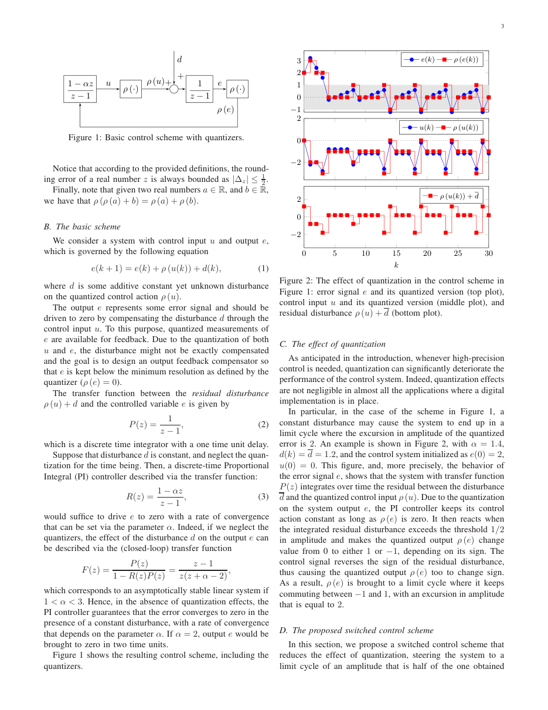
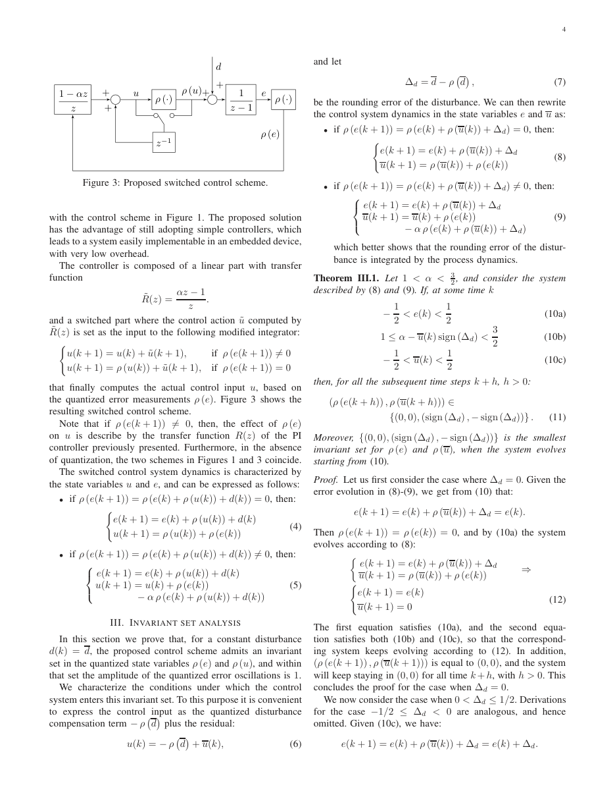
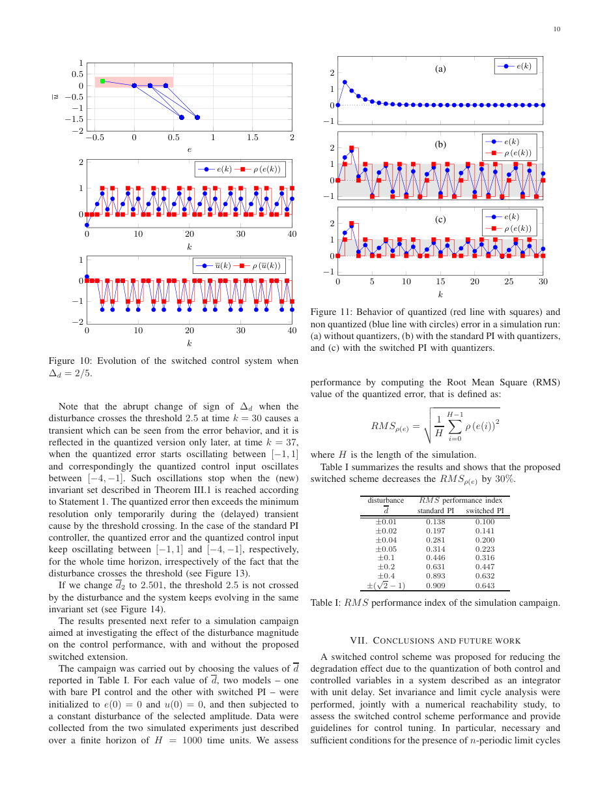

# 양자화 되먹임 계를 위한 전환 제어: 불변 집합과 리밋 사이클 해석

번역 범위: 전문 (초록, 본문 1절부터 7절, 그림과 표 캡션). 참고문헌은 원문 그대로 둔다.

원문: `Papadopoulos2018_arXiv1701.07482_quantized_feedback.pdf` (arXiv:1701.07482v2, 2017-06-12). 학술지판은 IEEE Transactions on Automatic Control 63(11):3775-3786, 2018.

원제: Switched control for quantized feedback systems: invariance and limit cycle analysis

저자: Alessandro Vittorio Papadopoulos, Federico Terraneo, Alberto Leva, Maria Prandini

---

## 초록

제어 입력과 제어 대상 변수의 측정이 모두 양자화된 이산 시간 선형 시불변 계의 되먹임 제어를 다룬다.
어떤 응용에서는 양자화 효과를 무시해도 되지만, 높은 정밀도의 제어가 필요하면 설계 단계에서 양자화를 분명히 고려해야 한다.
이 논문은 제어량과 제어 대상 변수 양쪽의 양자화 효과를 가장 작게 만드는 전환 제어 해법을 제안한다.
대상은 단위 지연을 가진 단순 적분기다. 이 모형은 계산 시스템 분야에서 흔하다. 예를 들어 스레드 스케줄링, 시계 동기화, 자원 배분이 그렇다.
전환 해법이 양자화를 무시하고 설계한 비전환 해법보다 낫다는 것을 보인다.
또 제어 입력에 더해지는 상수 외란이 있을 때 제어계가 주기 해를 가지는 필요충분조건을 해석한다.
모의실험 결과가 이 방법의 효과를 뒷받침한다.

색인어: 양자화 되먹임 제어, 전환 제어, 실용 안정성, 계산 시스템 설계, 리밋 사이클.

---

## I. 들어가며

이 논문은 이산 시간 선형 시불변 제어계의 양자화 되먹임 제어를 다룬다.
특히 측정과 제어 동작이 모두 양자화되는 효과를 본다.

일반적으로 제어계를 디지털로 구현하면 입력과 출력의 양자화가 따라온다.
되먹임에 쓰는 출력 측정과 제어 대상 공정에 주는 제어 동작이 디지털 통신 채널로 오가면 특히 그렇다 [1], [2].
응용에 따라 양자화 효과가 커져서 제어 성능을 크게 바꿀 수 있다.
어떤 응용에서는 무시해도 되지만, 높은 정밀도의 제어가 필요하면 설계에서 양자화를 분명히 고려해야 한다.

양자화가 없을 때 표준 선형 시불변 되먹임 제어기로 안정화되는 계가 있다고 하자.
여기서 다루는 문제는, 제어 입력과 출력이 양자화될 때 원점을 포함하는 가장 작은 불변 집합으로 계를 몰고 가는 전환 제어기를 찾는 것이다.
특히 단위 시간 지연을 가진 적분기로 기술되는 이산 시간 선형계에 집중한다.
이 계는 제어 입력에 더해지는 상수 편향의 영향을 받고, 제어 입력과 제어 출력 측정이 모두 반올림 연산자로 양자화된다.

구조는 단순하지만, 이 꼴은 계산 시스템 분야의 여러 문제에 나타난다.
예를 들어 작업 스케줄링에서 예약량부터 누적 CPU 시간까지의 동특성을 나타낸다. 이때 대표적인 교란원은 선점 인터럽트의 지연이다 [3], [4].
무선 센서망의 시계 동기화에서 교란에서 오차로 가는 동특성을 모형화한다. 여기서 가장 중요한 교란원은 발진 결정의 온도 변화다 [5].
서버 시스템 [6], 대기열 시스템 [7] 등에도 쓰인다. [8]부터 [11]까지의 여러 문제에서 이를 볼 수 있다.
이런 응용에는 거의 모두 양자화기가 있고, 높은 성능이 필요할 때 양자화 효과를 다루는 일이 중요해진다.
실제로 위에 든 문제 가운데 여럿은 상수 입력 아래에서 오차가 0이어야 하므로 양자화의 중요성이 드러난다.
상수에 가까운 교란의 예로는 온도가 조절되는 환경에서 무선 노드가 겪는 열 교란이 있다.
그런 환경에서는 온도 변화가 매우 작고 느리다. 환경의 열 동특성이 변화를 매끈하게 만들고 온도 제어가 이를 억제하기 때문이다.
급격한 변화가 생기기도 하지만 드물다. 예를 들어 하루나 일주일에 한 번 냉방기를 켤 때다.

다루는 선형계는 안정화 가능하다. 양자화가 없으면 표준 비례 적분(PI) 제어기를 써서 상수 부하 교란을 보상하고 상태 궤적을 0 평형점으로 보낼 수 있다.
입력과 출력 양자화기가 있으면 PI 제어기의 성능이 나빠진다. 양자화된 출력에 진폭이 양자화기 분해능의 2배인 진동이 생긴다.
높은 정밀도의 계산 시스템에서는 그런 진동이 허용되지 않을 수 있다.
이 논문의 목표는 PI 와 같은 구조를 유지해 구현과 튜닝을 쉽게 하면서 더 성능이 좋은 제어기를 설계하는 것이다.
설계한 제어 구조의 성질을 평가하는 방법으로 불변 집합 해석과 도달 가능성 해석을 쓴다.

더 구체적으로는 양자화를 다루고 그 효과를 되먹임 제어 성능에서 가장 작게 만들기 위해 PI 제어기의 전환 변형을 제안한다.
그리고 교란이 상수일 때, 전환 제어 해법에서 양자화된 제어 입력과 출력 변수에 대한 불변 집합이 존재하며, 그 안에서 양자화된 출력이 0이거나 크기가 1(최하위 비트, 곧 나타낼 수 있는 최소량)임을 보인다.
수치 도달 가능성 해석을 하면, PI 제어기를 적절히 조율할 때 이 불변 집합이 전역 끌개가 됨을 알 수 있다.
양자화하지 않은 제어 입력과 출력 변수에 주기 해가 존재하는 필요충분조건도 준다.

양자화 선형계의 제어를 다룬 논문은 많다. 대부분은 교란이 없을 때 0 평형점에서의 안정화에 집중한다.
기여들은 채택한 양자화기의 성질로 나눌 수 있다.
이 논문처럼 균일 양자화를 쓰는 유한 분해능 양자화기라면, [12]는 고전적 의미의 안정성을 얻을 수 없음을 보이고 양자화계를 위한 실용 안정성 개념을 도입한다.
더 구체적으로 [12]는, 안정화 가능한 불안정 이산 시간 계에서 상태 측정이 양자화되면 양자화 상태 되먹임계의 모든 궤적을 0으로 점근 수렴시키는 제어 전략이 없고, 0 둘레의 불변 집합으로의 수렴만 얻을 수 있음을 증명한다.
[13], [14]는 상태의 거동에 따라 양자화기의 분해능을 바꾸어, 원점에 다가갈수록 분해능을 점점 높이는 방식으로 원점의 점근 안정성에 대한 고전적 결과를 되살린다.
이 방식은 교란 입력이 있을 때의 입력 대 상태 안정화와 l2 안정화로 각각 [15], [14]에서 확장되었다.
(셀 수 있게) 무한한 양자화 수준을 가진 로그 양자화기를 쓰면 원점 가까이에서 양자화기의 분해능이 무한해지고 전역 점근 안정성을 얻을 수 있다 [16], [17].
그러나 유한 수준 로그 양자화기를 쓰면 실용 안정성 결과만 증명할 수 있다.
실용 안정성 해석과, 실용 안정성을 보장하는 유한 수준 로그 상태 양자화기의 설계에 관한 구성적 결과는 예를 들어 [16], [18]에 있다.

문헌의 대부분은 제어 입력의 양자화(예 [19]부터 [21])나 제어 출력의 양자화(예 [12]부터 [14], [22]부터 [27]) 가운데 하나만 다룬다는 점이 눈에 띈다.
이 논문처럼 제어 입력과 제어 출력이 모두 양자화되는 설정을 다룬 것은 소수다. [17], [28], [29]가 그렇다.
[17]은 무한 양자화 수준의 로그 양자화기를 보고, [28]은 입력과 출력 양자화기가 유한한 수의 양자화 수준을 가진다고 가정한다.
[28]은 2중 적분기 계의 실용 안정화를 다루며, 실용 안정성 결과가 성립하려면 양자화기를 정의하는 매개변수를 어떻게 정해야 하는지 보인다.
더 높은 차수의 적분기 모형으로의 확장도 설명하지만, 계에 작용하는 교란이 없는 안정화에 집중한다.
이 논문에 가장 가까운 연구는 [29]다. 여기서는 입력과 출력에 미리 정한 유한 분해능 양자화기가 주어지고, 어떤 제어 목표를 이루도록 되먹임 제어기를 설계한다.
더 구체적으로 [29]는 불안정한 이산 시간 선형계의 실용 안정화를 다루며, 계의 상태를 유한 걸음 안에 원점 둘레의 어떤 불변 집합으로 보내는 양자화 정적 상태 되먹임 제어기를 설계한다.
이 논문의 방식은 [29]와 다르다. 교란 보상을 다루고, 제어 대상 계의 상태를 원점 둘레의 불변 집합에 도달시키는 전환 출력 되먹임 제어기를 도입한다.
[29]와 관련 연구는 교란 보상과 동적 상태 또는 출력 되먹임 제어를 다루지 않는다.
반대로 [29]의 방법론은 일반적으로 쓸 수 있지만, 이 논문의 설계는 단순한 계 모형에 맞춘 것이고 더 높은 차원의 다른 모형으로 쉽게 확장되지는 않는다.

논문의 남은 부분은 이렇게 구성된다.
2절은 먼저 전환이 없는 제어 구조를 설명하고, 양자화가 제어계의 성능을 어떻게 나쁘게 하는지 보인다. 이어 양자화 효과를 가장 작게 만드는 전환 해법을 같은 절에서 제시한다.
3절은 불변 집합에 들어가는 필요충분조건을 준다.
4절은 그 불변 집합을 전역 끌개로 만드는 제어기 매개변수 조율을 찾기 위한 수치 도달 가능성 해석을 수행한다.
5절은 주기 해가 존재하는 필요충분조건을 준다.
6절은 모의실험으로 이 방법의 효과를 보이고, 7절이 논문을 맺는다.

---

## II. 기본 제어 구조와 그 전환 변형

### A. 표기

논문 전개에 쓸 표기를 소개한다.

**정의 1 (부호 함수).** 실수 z 의 부호 함수는 이렇게 정의한다.

sign(z) := 1 (z > 0), 0 (z = 0), -1 (z < 0)

**정의 2 (수의 정수부).** 실수 z 의 정수부는 이렇게 정의한다.

int(z) := ⌊z⌋ (z ≥ 0), ⌈z⌉ (z < 0)

여기서 ⌊z⌋ 는 z 보다 작거나 같은 가장 큰 부호 있는 정수이고, ⌈z⌉ 는 z 보다 크거나 같은 가장 작은 부호 있는 정수다.

**정의 3 (수의 소수부).** 실수 z 의 소수부는 이렇게 정의한다.

frac(z) := z - int(z)

양자화기는 실수값 함수를 이산 집합에 값을 가지는 조각별 상수 함수로 보낸다. 여기서는 반올림 연산자로 정의한다.

**정의 4 (반올림 연산자).** 실수 z 에 대해 반올림 q: R -> Z 는 이렇게 정의한다.

q(z) := sign(z) × |int(z)|,            0 ≤ |frac(z)| < 1/2
q(z) := sign(z) × (|int(z)| + 1),      1/2 ≤ |frac(z)| < 1

**정의 5 (반올림 오차).** 실수 z 의 반올림 오차는 이렇게 정의한다.

εz := z - q(z)

**그림 1: 양자화기를 포함한 기본 제어 구조.**

**그림 2: 그림 1 제어 구조에서 양자화의 효과.** 오차 신호 e 와 그 양자화판(위 그래프), 제어 입력 u 와 그 양자화판(가운데 그래프), 잔여 교란 q(u) + d(아래 그래프).

위 정의에 따르면 실수 z 의 반올림 오차는 항상 |εz| ≤ 1/2 로 유계다.

끝으로, 두 실수 a ∈ R, b ∈ R 에 대해 q(q(a) + b) = q(a) + q(b) 가 성립한다.

### B. 기본 구조

제어 입력 u 와 출력 e 를 가지는 계를 생각한다. 다음 식을 따른다.

    e(k + 1) = e(k) + q(u(k)) + d(k),                     (1)

여기서 d 는 양자화된 제어 동작 q(u) 에 더해지는, 아직 알려지지 않은 상수 교란이다.

출력 e 는 어떤 오차 신호이고, 제어 입력 u 로 교란 d 를 보상해 0 으로 몰아야 한다.
이를 위해 e 의 양자화된 측정값을 되먹임에 쓸 수 있다.
u 와 e 가 모두 양자화되므로 교란이 정확히 보상되지 않을 수 있다. 목표는 e 가 양자화기가 정한 최소 분해능 아래로 유지되도록(q(e) = 0) 출력 되먹임 보상기를 설계하는 것이다.

잔여 교란 q(u) + d 와 제어 대상 변수 e 사이의 전달 함수는 이렇다.

    P(z) = 1 / (z - 1)                                     (2)

이는 단위 시간 지연을 가진 이산 시간 적분기다.

교란 d 가 상수라 하고 당분간 양자화를 무시하자. 그러면 다음 전달 함수로 기술되는 이산 시간 비례 적분(PI) 제어기면 충분하다.

    R(z) = (1 - α z) / (z - 1)                             (3)

이 제어기는 매개변수 α 로 수렴 속도를 정하면서 e 를 0 으로 몰 수 있다.
실제로 양자화기를 무시하면 교란 d 가 출력 e 에 주는 영향을 (폐루프) 전달 함수로 쓸 수 있다.

    F(z) = P(z) / (1 - R(z) P(z)) = (z - 1) / (z (z + α - 2))

이는 1 < α < 3 일 때 점근 안정인 선형계다.
따라서 양자화 효과가 없으면 PI 제어기는 상수 교란 아래에서 오차가 0 으로 수렴함을 보장하며, 수렴 속도는 매개변수 α 에 달려 있다.
α = 2 이면 출력 e 는 두 시간 단위 만에 0 이 된다.

그림 1 이 양자화기를 포함한 제어 구조를 보여 준다.

### C. 양자화의 효과

머리말에서 말했듯 높은 정밀도의 제어가 필요할 때마다 양자화는 제어계의 성능을 크게 떨어뜨릴 수 있다.
실제로 디지털 구현이 쓰이는 거의 모든 응용에서 양자화 효과는 무시할 수 없다.

특히 그림 1 의 구조에서는 상수 교란 때문에 계가 양자화 오차의 진폭 폭이 2 인 리밋 사이클에 빠질 수 있다.
그 예가 그림 2 에 있다. α = 1.4, d(k) = d = 1.2 이고 제어계는 e(0) = 2, u(0) = 0 으로 초기화했다.
이 그림, 더 정확히는 오차 신호 e 의 거동을 보면, 전달 함수 P(z) 를 가진 계가 교란 d 와 양자화된 제어 입력 q(u) 사이의 잔차를 시간에 따라 적분함을 알 수 있다.
계 출력 e 의 양자화 때문에 PI 제어기는 q(e) 가 0 인 동안 제어 동작을 그대로 유지한다.
그러다 적분된 잔여 교란의 크기가 문턱 1/2 를 넘으면 반응해, 양자화된 출력 q(e) 를 부호에 따라 0 에서 1 또는 -1 로 바꾼다.
제어 신호가 잔여 교란의 부호를 뒤집고, 그 결과 양자화된 출력 q(e) 도 부호가 바뀐다.
이렇게 해서 q(e) 는 -1 과 1 사이를 계속 오가는 리밋 사이클에 들어가고, 진폭 폭은 2 가 된다.

### D. 제안하는 전환 제어 구조

이 절에서는 양자화의 효과를 줄여, 그림 1 의 제어 구조에서 얻는 리밋 사이클의 절반 진폭을 가지는 리밋 사이클로 계를 보내는 전환 제어 구조를 제안한다.
제안하는 해법은 여전히 단순한 제어기를 쓴다는 장점이 있어, 매우 낮은 부담으로 내장 기기에 쉽게 구현된다.

**그림 3: 제안하는 전환 제어 구조.**

제어기는 다음 전달 함수를 가지는 선형부와,

    R̃(z) = (1 - α z) / z

R̃(z) 가 계산한 제어 동작 ũ 를 입력으로 받는 아래의 변형 적분기로 이루어진 전환부로 구성된다.

    u(k + 1) = u(k) + ũ(k + 1),       q(e(k + 1)) = 0 이면
    u(k + 1) = q(u(k)) + ũ(k + 1),    q(e(k + 1)) ≠ 0 이면

이 적분기가 양자화된 오차 측정 q(e) 를 바탕으로 실제 제어 입력 u 를 최종 계산한다. 그림 3 이 그 전환 제어 구조다.

q(e(k + 1)) ≠ 0 이면 q(e) 가 u 에 주는 영향은 앞서 본 PI 제어기의 전달 함수 R(z) 로 기술된다.
또 양자화가 없으면 그림 1 과 그림 3 의 두 구조는 같아진다.

전환 제어계의 동특성은 상태 변수 u 와 e 로 나타내며 다음과 같다.

- q(e(k + 1)) = q(e(k) + q(u(k)) + d(k)) ≠ 0 이면

      e(k + 1) = e(k) + q(u(k)) + d(k)                                   (4)
      u(k + 1) = q(u(k)) + ũ(e(k))

- q(e(k + 1)) = q(e(k) + q(u(k)) + d(k)) = 0 이면

      e(k + 1) = e(k) + q(u(k)) + d(k)
      u(k + 1) = u(k) + ũ(e(k))                                          (5)
                 - q(e(k) + q(u(k)) + d(k))

---

## III. 불변 집합 해석

이 절에서는 상수 교란 d(k) = d 에 대해, 제안한 제어 구조가 양자화 상태 변수 q(e) 와 q(u) 에서 불변 집합을 가지며 그 안에서 양자화 오차 진동의 진폭이 1 임을 증명한다.

제어계가 이 불변 집합에 들어가는 조건을 규정한다. 이를 위해 제어 입력을 양자화된 교란 보상항 -q(d) 와 잔차의 합으로 쓰면 편하다.

    u(k) = -q(d) + ū(k),                                                 (6)

그리고

    εd = d - q(d),                                                       (7)

를 교란의 반올림 오차라 하자. 그러면 제어계의 동특성을 상태 변수 e 와 ū 로 다시 쓸 수 있다.

- q(e(k + 1)) = q(e(k) + q(u(k)) + d) ≠ 0 이면

      e(k + 1) = e(k) + q(ū(k)) + εd                                     (8)
      ū(k + 1) = q(ū(k)) + ũ(e(k))

- q(e(k + 1)) = q(e(k) + q(u(k)) + d) = 0 이면

      e(k + 1) = e(k) + q(ū(k)) + εd
      ū(k + 1) = ū(k) + ũ(e(k))                                          (9)
                 - q(e(k) + q(ū(k)) + εd)

이 꼴은 교란의 반올림 오차가 공정 동특성에 적분된다는 점을 더 잘 보여 준다.

**정리 III.1.** 1 < α < 3/2 라 하고, (8), (9) 로 기술되는 계를 생각하자. 어떤 시각 k 에서

    -1/2 < e(k) < 1/2                                                    (10a)
    1 ≤ α - ū(k) sign(εd) < 3/2                                          (10b)
    -1/2 < ū(k) < 1/2                                                    (10c)

이면, 이후 모든 시각 k + h (h > 0) 에 대해

    (q(e(k + h)), q(ū(k + h))) ∈ {(0, 0), (sign(εd), -sign(εd))}         (11)

이 성립한다. 또 계가 (10) 에서 출발해 전개할 때 {(0, 0), (sign(εd), -sign(εd))} 는 q(e) 와 q(ū) 의 가장 작은 불변 집합이다.

**증명.** 먼저 εd = 0 인 경우를 보자. (8), (9) 의 오차 전개로부터 (10) 에서 다음을 얻는다.

    e(k + 1) = e(k) + q(ū(k)) + εd = e(k).

그러면 q(e(k + 1)) = q(e(k)) = 0 이고, (10a) 에 의해 계는 (8) 을 따라 전개한다.

    e(k + 1) = e(k) + q(ū(k)) + εd
    ū(k + 1) = q(ū(k)) + ũ(e(k))
    =>
    e(k + 1) = e(k)                                                      (12)
    ū(k + 1) = 0

첫 식은 (10a) 를, 둘째 식은 (10b) 와 (10c) 를 모두 만족하므로 계는 계속 (12) 를 따라 전개한다.
또 (q(e(k + 1)), q(ū(k + 1))) 이 (0, 0) 이고, 계는 모든 시각 k + h (h > 0) 에서 (0, 0) 에 머문다. 여기서 εd = 0 인 경우의 증명이 끝난다.

이제 0 < εd ≤ 1/2 인 경우를 보자. -1/2 ≤ εd < 0 인 경우의 유도는 비슷하므로 생략한다. (10c) 로부터 다음을 얻는다.

    e(k + 1) = e(k) + q(ū(k)) + εd = e(k) + εd.

(10a) 에서 -1/2 < e(k) < 1/2 이고 0 < εd ≤ 1/2 이므로,

    -1/2 < e(k) + εd < 1,

따라서

    q(e(k + 1)) = q(e(k) + εd) = 0,   |e(k) + εd| < 1/2 이면              (13)
    q(e(k + 1)) = q(e(k) + εd) = 1,   1/2 ≤ e(k) + εd < 1 이면

여기서 두 경우로 나눌 수 있다.

1) q(e(k + 1)) = q(e(k) + q(ū(k)) + εd) = 0
2) q(e(k + 1)) = q(e(k) + q(ū(k)) + εd) = 1

**경우 1).** 계는 (8) 을 따라 전개한다.

    e(k + 1) = e(k) + εd                                                 (14)
    ū(k + 1) = 0,

그래서 한 걸음 만에 양자화 상태가 0 이 된다. 곧 (q(e(k + 1)), q(ū(k + 1))) = (0, 0).
(14) 의 첫 식이 (10a) 를, 둘째 식이 (10b) 와 (10c) 를 만족하므로 다시 (13) 으로 돌아간다.

**경우 2).** 계는 (9) 를 따라 전개한다.

    e(k + 1) = e(k) + εd                                                 (15)
    ū(k + 1) = ū(k) - α

(10b) 로부터

    -3/2 < ū(k) - α ≤ -1,

따라서

    q(ū(k + 1)) = q(ū(k) - α) = -1,

그래서 (q(e(k + 1)), q(ū(k + 1))) = (1, -1) 이다.

다음으로 계산하면

    e(k + 2) = e(k + 1) + q(ū(k + 1)) + εd = e(k + 1) - 1 + εd,

e(k + 1) = e(k) + εd 이고 이 경우 1/2 ≤ e(k) + εd < 1 이므로

    -1/2 < e(k + 1) - 1 + εd < 1/2,

따라서 q(e(k + 2)) = 0 이다. 그러면 동특성은 (8) 을 따른다. 곧

    e(k + 2) = e(k + 1) - 1 + εd                                         (16)
    ū(k + 2) = -1 + 1 = 0

그래서 (q(e(k + 2)), q(ū(k + 2))) = (0, 0) 이다. 두 걸음 만에 양자화 상태가 0 이 된다.
(16) 의 첫 식이 (10a) 를, 둘째 식이 (10b) 와 (10c) 를 만족하므로 다시 (13) 으로 돌아간다.

지금까지의 내용은 (10) 에서 출발하면 계가 q(e), q(ū) 에 대해 불변 집합 {(0, 0), (1, -1)} 안에서 전개하게 됨을 보인다.
이제 이것이 가장 작은 불변 집합임을 증명해야 한다.

(10) 에서 출발하면 계가 (0, 0) 이나 (1, -1) 로 불변 집합에 들어가고, 뒤의 경우에는 한 걸음 만에 (0, 0) 으로 간다는 것을 방금 보였다.
또 두 경우 모두 계는 ū = 0 인 상태로 집합 (10) 으로 돌아온다((14), (16) 참조).
따라서 양자화 상태가 (0, 0) 에 영원히 머물 수는 없고 언젠가 (1, -1) 로 전환됨을 보이면 된다.
실제로 그렇다. (14) 에 따라 계는 ū = 0 인 채 (10) 안에 머물면서 반올림 오차를 계속 적분하고, e 는 (필연적으로) 1/2 을 넘게 된다.
그러면 q(e) = 1 이므로 경우 2 가 되고, 양자화 상태는 (1, -1) 로 전환된다. ∎

**명제 III.2.** 1 < α < 3/2 라 하고, (8), (9) 로 기술되는 전환 제어계를 생각하자. 어떤 시각 k 에서 상태가 (10) 을 만족하면, 모든 시각 k + h (h > 1) 에 대해

    e(k + h) = e(k + h - 1) + q(ū(k + h - 1)) + εd                       (17)
    ū(k + h) = -α q(e(k + h))                                            (18)

**증명.** (17) 은 (8), (9) 의 계 동특성에서 바로 나온다.
정리 III.1 의 증명으로부터, εd = 0 일 때는 q(e(k)) = 0 이고 계가 (12) 를 따르므로 (18) 이 자명하게 성립한다.
εd ≠ 0 이라 하자. q(e(k + 1)) = 0 이면 ū(k + 1) = 0 이다((14) 참조).
반대로 q(e(k + 1)) = sign(εd) 이면 ū(k + 1) = ū(k) - α sign(εd) 이고, 한 시간 단위 뒤 ū(k + 2) = 0 이 된다((15), (16) 참조).

시각 k + 2 이후 ū 는 q(e) = 0 인 동안 값 0 을 유지한다.
q(e) = sign(εd) 가 되는 즉시 -α sign(εd) 가 되고, 한 시간 단위 만에 다시 ū = 0 으로 돌아온다.
그 결과 h > 1 에 대해 ū(k + h) 를 다음처럼 쓸 수 있다.

    ū(k + h) = -α q(e(k + h)),

여기서 증명이 끝난다. ∎

계의 가능한 전개 하나를 그림 4 에 보인다. α = 1.1, εd = 0.4 이고, 전환 제어계 (8), (9) 를 e(0) = 0.2, ū(0) = 0.6 으로 초기화한 경우다.
그림의 초록 사각형이 초기 조건이고, 빨간 영역이 영역 (10) 이다.
그림 4 의 위 그래프는 계의 위상 평면 그림이다. 상태가 빨간 영역에 들어간 뒤 정리 III.1 에서 규정한 불변 집합에 다다른다.
가운데와 아래 그래프는 상태 변수 e, ū 와 그 양자화판의 시간 전개다.

**그림 4: 정리 III.1 에서 규정한 불변 집합에 들어가는 궤적의 예.** 위 그래프는 상태 변수 e 와 ū 의 위상 평면 그림이다. 아래 그래프들은 상태 변수와 그 양자화판의 시간 전개를 보인다.

정리 III.1 은 양자화 상태 변수 q(e(k)) 와 q(ū(k)) 가 각각 0 과 sign(εd), 그리고 0 과 -sign(εd) 사이를 오가며 진폭 폭이 1 인 불변 집합에 계가 다다르는 조건을 준다.
그러나 α 와 εd 의 값에 따라 계가 다른 불변 집합에 다다를 수도 있다. 이를 다음 절에서 다룬다.

---

## IV. 도달 가능성과 전역 끌림성의 수치 해석

이 절의 목적은 정리 III.1 에서 규정한 불변 집합의 전역 끌림성을 연구하는 것이다.
이를 위해 계가 영역 (10) 에 들어가면 한 걸음 만에 불변 집합에 다다른다는 사실을 이용한다. 따라서 영역 (10) 의 도달 가능성만 연구하면 된다.
이 계에 대해 해석적 도달 가능성 해석을 내놓는 일은 양자화 효과 때문에 꽤 복잡하고 전혀 간단하지 않다.
게다가 그런 해석을 수행하는 도구 대부분(예 SpaceEx [30], Flow* [31], KeYmaera [32], Ariadne [33])은 연속 시간 동역학계를 위한 것이다 [34].

이 해석은 (α, εd) 쌍을 매개변수로 한다. 수치로 수행하기 위해 α 와 εd 를 각각 [1.001, 1.499] 와 [-0.5, 0.5] 안에서 500 개와 1000 개의 균등 간격 값으로 바꾸었다.
고려한 각 (α, εd) 쌍에 대해 계 (8), (9) 를 (e(0), ū(0)) ∈ [-10, 10]² 안에서 좌표마다 1000 개의 균등 간격 값으로 초기화했다.
[-10, 10]² 은 전체 상태 공간을 대표한다고 볼 수 있다. (e, ū) 가 더 큰 값이면 양자화 오차가 무시할 수준이 되기 때문이다.
그 집합 밖에서는 계가 선형으로 거동한다고 가정할 수 있고, 모든 궤적은 그 집합 안으로 들어오게 된다.

**그림 5: 닫힌 곡선으로 둘러싸인 영역은 정리 III.1 의 불변 집합이 전역 끌개가 되는 (α, εd) 격자 쌍의 집합이다.**

그림 5 에서 닫힌 곡선으로 둘러싸인 영역은, 고려한 모든 초기 조건이 영역 (10) 으로, 따라서 정리 III.1 에서 찾은 불변 집합으로 궤적을 보내는 격자 위의 모든 (α, εd) 쌍을 포함한다.
εd = ±0.5 값은 그 영역에 들어 있지 않다.

이로부터 다음 서술이 나온다. 형식 증명이 아니라 수치 해석에 바탕을 두므로 정리라 하지 않는다.

**서술 1.** 5/4 < α < 3/2 이고 |εd| < 0.5 이면, 정리 III.1 의 불변 집합은 전역 끌개다.

|εd| = 0.5 인 경우, 수치 해석에서 양자화 오차의 진폭 폭이 2 인 불변 집합이 존재함을 확인했다. 구체적으로 εd = -0.5 이면

    (q(e), q(ū)) ∈ {(-1, 2), (1, -1)},                                   (19)

εd = 0.5 이면

    (q(e), q(ū)) ∈ {(-1, 1), (1, -2)}.                                   (20)

불변 집합 (19) 와 (20) 은 초기 조건의 일부 부분집합에서만 다다를 수 있다. 정리 III.1 은 어떤 εd 에 대해서도 성립하기 때문이다.

강조할 점은, 양자화 오차 진폭 폭이 2 인 불변 집합은 |εd| = 0.5 일 때만 나타났다는 것이다. 그 예가 그림 6 에 있다.

|εd| ≠ 0.5 일 때, α < 5/4 이면 수치 연구에서 진폭 폭이 모두 1 인 불변 집합 두 개가 존재함을 확인했고, 그 가운데 하나가 정리 III.1 의 것이다.

그림 7 은 정리 III.1 의 것과 다른(그래도 양자화 오차 진폭 폭은 1 인) 불변 집합의 예를 보인다. 그런 불변 집합

    (q(e), q(ū)) ∈ {(0, 1), (1, 0)}

은 α = 1.1 (< 5/4), εd = -0.3 이고 계 (8), (9) 를 e(0) = -0.2, ū(0) = 0.6 으로 초기화할 때 얻는다.

**그림 6: |εd| = 0.5 일 때 제안한 전환 구조로 얻을 수 있는 불변 집합의 예.** 상태 궤적은 양자화 상태 e 의 진폭 폭이 2 인 불변 집합에 다다른다. 위상 평면 그림(위 그래프)과 상태 변수 e, ū 및 그 양자화판의 시간 전개(아래 그래프)를 함께 보인다. 그림에 표시한 빨간 영역이 집합 (10) 이다.

**그림 7: α < 5/4 일 때 제안한 전환 구조로 얻을 수 있는 불변 집합의 예.** 상태 궤적은 양자화 상태 e 와 ū 의 진폭 폭이 1 인 불변 집합에 다다른다. 위상 평면 그림(위 그래프)과 상태 변수 e, ū 및 그 양자화판의 시간 전개(아래 그래프)를 함께 보인다. 그림에 표시한 빨간 영역이 집합 (10) 이다.

그림 7 에 보인 양자화하지 않은 제어 입력의 거동은 예측하기 쉽지 않다.
반대로 정리 III.1 의 불변 집합에 대한 양자화하지 않은 제어 입력의 거동은 α 로 쉽게 예측할 수 있다(명제 III.2 참조).

α 는 설계 매개변수이므로, |εd| = 0.5 인 교란을 뺀 모든 교란에 대해, 완전히 규정된 정리 III.1 의 불변 집합만 나타나게 α 를 고를 수 있다.

---

## V. 리밋 사이클 해석

이 절에서는 정리 III.1 의 불변 집합 안에서 전환 제어계의 전개를 해석하고, 오차 e 와 제어 입력 u 의 주기 해와 그 주기 p 를 구한다.
특히 정리 V.1 에서 주기 해가 존재할 필요충분조건이 교란의 반올림 오차, 따라서 교란이 유리수인 것임을 보인다.
계산 시스템 분야의 응용을 다룰 때, 관련된 신호와 과정이 본래 이산이기 때문에 유리수 교란이 실제로 생길 수 있다.
또한 정리 V.1 은 주기 해 존재의 필요충분조건을 주므로, 무리수 교란에 대해서는 주기 해가 존재하지 않는다고 말할 수 있다. 이로써 전환 제어계의 거동을 더 규정한다.

이제 주기 p 의 n 주기 리밋 사이클 개념을 정의하며 해석을 시작한다.

**정의 6 (주기 p 의 n 주기 리밋 사이클).** 주기 p 의 n 주기 리밋 사이클(n, p ∈ N)은 전환 제어계 (8), (9) 의 해 가운데 어떤 k̄ ≥ 0 에 대해

    e(k + p) = e(k),   u(k + p) = u(k),   ∀k ≥ k̄

이고, 양자화 상태 (q(e), q(u)) 가 한 주기에 n 번 전환되는 것이다.

**정리 V.1.** 전환 제어계가 정리 III.1 의 불변 집합 안에서 주기 m 의 n 주기 리밋 사이클을 따라 전개할 필요충분조건은 교란의 반올림 오차가 유리수이고 다음을 만족하는 것이다.

    |εd| = n/m,     1 ≤ n < m,   n, m ∈ N.

**증명.** 계가 정리 III.1 의 불변 집합 안에 있으면 대수 관계 (18) 이 성립한다. 따라서 상태 변수 e 가 주기 m 의 n 주기 리밋 사이클 위에서 전개함을 보이면 된다.

먼저 이것이 성립하려면 |εd| 가 유리수여야 함을 보인다.

어떤 시각 h 에서 계가 정리 III.1 의 (최소) 불변 집합 안에 있다고 하자. 일반성을 잃지 않고 (q(e(h)), q(ū(h))) = (0, 0) 이라 하자.
그러면 |e(h)| < 0.5 이고, 식 (6) 에서 q(u(h)) = -q(d) 이므로 공정으로 들어가는 입력 q(u(h)) + d 는 εd 와 같다.
실제로 공정 입력은 k̄ 시간 걸음 동안 εd 로 일정하게 유지되다가, εd > 0 이면 |e(h + k̄)| 가 0.5 를 넘거나 같아지고, εd < 0 이면 -0.5 가 된다.
그러면 시각 h + k̄ 에서 q(e(h + k̄)) ≠ 0 이고 쌍 (q(e(h + k̄)), q(ū(h + k̄))) 은 불변 집합 안에서 (sign(εd), -sign(εd)) 로 전환된다.
걸음 수 k̄ 는 다음 식으로 주어진다.

    k̄ = κ(εd, x⁺(0)) := ⌈(0.5 sign(εd) - x⁺(0)) / εd⌉,                   (21)

여기서 e(h) = x⁺(0) 으로 두었다.
κ(εd, x⁺(0)) 은 εd 가 0 으로 갈 때 무한대로 간다. 이는 εd = 0 이면 불변 집합이 값 0 하나로만 이루어진다는 정리 III.1 과 맞는다.

e(h + k̄ + 1) 이 취하는 값 x⁺(1) 은 이렇게 얻는다.

    x⁺(1) = x⁺(0) + κ(εd, x⁺(0)) εd + εd - sign(εd),                     (22)

공정이 k̄ = κ(εd, x⁺(0)) 걸음 동안 εd 로 일정한 입력을 적분하고, 시각 h + k̄ 에서 입력 q(u(h + k̄)) + d = q(ū(h + k̄)) - q(d) + d = -sign(εd) + εd 를 받기 때문이다.

x⁺(1) 이 x⁺(0) 과 같으면 상태 e 의 전개는 주기 κ(εd, x⁺(0)) + 1 로 주기적이고, 1 주기 리밋 사이클이며 주기는 k̄ + 1 이다.
공정 상태를 원래 값으로 되돌리는 데 불변 집합 안에서 전환이 한 번만 필요하고 그에 k̄ + 1 걸음이 들기 때문이다.
x⁺(1) ≠ x⁺(0) 이면 불변 집합 안에서 전환 i > 1 번을 생각해 x⁺(i) (i > 1) 를 계산하며 같은 추론을 이어갈 수 있다.
어떤 정수 N > 1 이 있어 어떤 h̄ ≥ 0 에 대해 x⁺(N + h̄) = x⁺(h̄) 이면, 공정 상태는 N 주기 리밋 사이클을 따라 전개한다.

더 구체적으로는 다음을 계산해야 한다.

    x⁺(N + h̄) = x⁺(h̄) + Σ_{i=0}^{N-1} κ(εd, x⁺(i + h̄)) εd + N (εd - sign(εd)),

그리고 x⁺(N + h̄) = x⁺(h̄) 로 두면 다음 식을 푸는 문제가 된다.

    (Σ_{i=0}^{N-1} κ(εd, x⁺(i + h̄)) + N) |εd| = N.

이 식이 해를 가지려면

    |εd| = N / L

이어야 한다. 여기서 L = Σ_{i=0}^{N-1} κ(εd, x⁺(i + h̄)) + N 으로 두었다.
L 은 N 보다 큰 정수이므로, 공정 상태 e 의 주기 궤적이 존재하려면 교란 양자화 오차의 절댓값 |εd| 가 n < m 인 n/m 꼴의 유리수여야 한다.
따라서 |εd| 가 무리수이면 주기 해와 양립할 수 없다.

이제 |εd| = n/m 이 유리수인 것이 주기 m 의 n 주기 리밋 사이클을 가지기에 충분함을 보인다.

x⁺(0) = e(h) 에서 출발해 q(e(h + k̄)) ≠ 0 이 되는 데 필요한 최소 걸음 수로 κ 를 정의했으므로 다음이 성립한다.

    e(h + k̄) = x⁺(0) + κ(εd, x⁺(0)) εd ∈ [0.5, 0.5 + εd)   (εd > 0)
    e(h + k̄) = x⁺(0) + κ(εd, x⁺(0)) εd ∈ (-0.5 + εd, -0.5]  (εd < 0)

이로부터 (22) 의 x⁺(1) 은 x⁺(0) 과 무관하게 다음을 만족한다.

    x⁺(1) ∈ [-0.5 + εd, -0.5 + 2εd)   (εd > 0)
    x⁺(1) ∈ (0.5 + 2εd, 0.5 + εd]     (εd < 0)

그리고 이는 불변 집합 안에서 i 번 전환한 뒤 e 의 값 x⁺(i) 에 대해 i ≥ 1 이면 모두 성립한다.

|εd| = n/m 이고 n, m 이 서로소인 정수이며 m > n ≥ 1 이라 하자. 그러면 불변 집합 안에서 적어도 한 번 전환이 일어난 뒤 전환 제어계가 주기 m 의 n 주기 리밋 사이클을 따라 전개함을 보인다.
εd > 0 인 경우를 다룬다. εd < 0 에도 같은 추론이 적용된다.

e(h + k̄) = x⁺(1) 인 시각 h + k̄ 이후 더 이상 전환이 없다면, 계가 m 걸음 동안 상수 입력 εd 를 적분하므로 e(h + k̄ + m) 은 [x⁺(1), x⁺(1) + m εd] = [x⁺(1), x⁺(1) + n] 안의 값을 가질 것이다.
그러나 e 가 문턱 0.5 보다 크거나 같아지는 즉시 그 값은 1 만큼 줄어든다. 따라서 시간 구간 [h + k̄, h + k̄ + m] 에서 전환이 정확히 n 번 있었다면 e(h + k̄ + m) = x⁺(1) = e(h + k̄) 이고 주기 해가 성립한다.
이제 그 시간 구간에 전환이 정확히 n 번 있음을 보이려면, [x⁺(1), x⁺(1) + n] 이 {0.5 + i, i = 0, 1, ..., n - 1} 을 포함하고 0.5 + n 을 포함하지 않음만 확인하면 된다.
x⁺(1) > -0.5 이므로 0.5 + i 는 i = 0 과 i = n - 1 에 대해 [x⁺(1), x⁺(1) + n] 에 분명히 들어 있다.
이제 [x⁺(1), x⁺(1) + n] 이 0.5 + n 을 포함하지 않음을 결론짓기 위해 x⁺(1) + n < 0.5 + n 임을 보여야 한다.
실제로 x⁺(1) < -0.5 + 2εd 이므로 x⁺(1) + n < n + 2εd - 0.5 이고, εd ≤ 0.5 이므로 x⁺(1) + n < n + 0.5 가 된다.

여기서 증명이 끝난다. ∎

그림 8 은 εd = √2/3, α = 1.1, e(0) = 0.2, ū(0) = 0.6 일 때 제어계 상태의 전개를 그린 것이다.
εd 가 무리수이므로 얻은 궤적은 주기적이지 않다.

그림 9 는 εd = 0.2 = 1/5 에 대해, 초기 조건 e(0) = -0.4, ū(0) = 0.2 에서 얻은 주기 5 의 1 주기 리밋 사이클의 예다.
그림 10 은 같은 초기 조건 e(0) = -0.4, ū(0) = 0.2 에서 εd = -0.4 = -2/5 일 때의 주기 5 의 2 주기 리밋 사이클이다.

**그림 8: εd = √2/3 일 때 전환 제어계의 전개.**

**그림 9: εd = 1/5 일 때 전환 제어계의 전개.**

**그림 10: εd = 2/5 일 때 전환 제어계의 전개.**

다음 따름정리는 정리 III.1 과 정리 V.1 에서 바로 나오며, 리밋 사이클 해석의 결과를 요약한다.

**따름정리 V.2.** 1 < α < 3/2 이고 |εd| = n/m (n, m ∈ N, 1 ≤ n < m, |εd| < 1/2) 이면, 전환 제어계 (8), (9) 는 오차 e 가 εd > 0 일 때 [-0.5 + εd, 0.5 + εd) 안에, εd < 0 일 때 (-0.5 + εd, 0.5 + εd] 안에 유지되는 리밋 사이클을 가지며, 그에 대응하는 양자화판의 진폭 폭은 1 이다.

**증명.** e 가 εd > 0 일 때 [-0.5 + εd, 0.5 + εd) 안에, εd < 0 일 때 (-0.5 + εd, 0.5 + εd] 안에 유지됨만 보이면 된다.
εd > 0 이라 하자. 정리 III.1 과 명제 III.2 에 의해, 불변 집합에 들어간 뒤 어떤 시각 k > 1 에서 q(e(k)) = q(ū(k)) = 0 이고 ū(k) = 0 이다.
그러면 오차는 |e(k)| < 1/2 에서 출발해 (17) 에 따라 전개하는데, 이는 다음이 된다.

    e(k + h) = e(k + h - 1) + εd                                         (23)

(q(e) = q(ū) = 0 이므로) 1/2 ≤ e(k + h) < 1/2 + εd 가 될 때까지 그렇다. 이때 q(e(k + h)) = 1 이고 따라서 ū(k + h) = -α q(e(k + h)) = -α 다.
시각 k + h + 1 에서 오차는 e(k + h + 1) = e(k + h) + εd - 1 로 재설정되어 -1/2 + εd ≤ e(k + h + 1) < -1/2 + 2εd 가 되고, q(e) = q(ū) = 0 이므로 다시 적분 동특성 (23) 으로 돌아온다.
이 해석에서 -1/2 + εd ≤ e < 1/2 + εd 가 따라 나온다. εd < 0 인 경우도 비슷하게 유도할 수 있다. ∎

**비고 1.** 4절의 도달 가능성 수치 해석은, α 를 5/4 < α < 3/2 범위로 제한하면 따름정리 V.2 의 리밋 사이클이 전역 끌개임을 보인다.

---

## VI. 모의실험 결과

먼저 세 경우를 비교하는 모의실험 결과를 제시한다. 제어 구조에 양자화가 없는 경우, 양자화가 있고 PI 를 쓴 경우, 양자화가 있고 그 전환 확장을 쓴 경우다.
양자화가 없으면 PI 제어기와 그 전환 확장은 같아진다는 점에 유의한다.

**그림 11: 모의실험 한 번에서 양자화된 오차(사각형 표시의 빨간 선)와 양자화하지 않은 오차(원 표시의 파란 선)의 거동.** (a) 양자화기 없음, (b) 양자화기와 표준 PI, (c) 양자화기와 전환 PI.

그림 11 은 세 경우에 대해 30 시간 단위의 유한 구간 모의실험을 보고한다.
세 그래프 모두 오차를 정규화했다. 곧 분해능을 1 로 가정했다.
α 에 쓴 값은 11/8 이고, d = √2 - 1 이며, 계 상태는 e(0) = 0, u(0) = 0 으로 초기화했다.

양자화가 없으면 설계한 제어기로 오차가 0 으로 수렴하지만, 양자화가 있으면 0 으로의 수렴을 더 이상 보장할 수 없다.
PI 제어의 경우 오차가 [-1, 1] 영역에서 진동하고, 그 전환 확장의 경우 서술 1 과 정리 III.1 에 따라 [0, 1] 영역에서 진동하게 된다.
고른 d 값에 대해 정리 V.1 에 의해 제어계 상태의 전개가 주기적일 수 없다는 점도 주목할 만하다.
이는 e 가 회색 영역 안에서 진동하되 그 집합 안에서 늘 다른 값을 가지는 전개로 나타난다.

이제 시변 교란을 생각한다. 처음에는 상수 d = d1 = 2.6 (εd = -0.4 < 0) 이고, 시각 k = 20 에서 선형으로 줄기 시작해 k = 40 에서 d = d2 = 2.4 (εd = 0.4 > 0) 에 닿은 뒤 상수로 유지된다.

전환 제어기를 쓴 모의실험 결과를 그림 12 에 보인다. 왼쪽 열에 오차 e, 제어 신호 u, 교란 d 가 있고 오른쪽 열에 그 양자화판이 있다.
계는 e(0) = 0, u(0) = 0 으로 초기화했고 α = 11/8 로 두었다.

**그림 12: 시변 교란과 전환 PI 제어기를 쓴 모의실험.**

**그림 13: 그림 12 의 시변 교란과 표준 PI 제어기를 쓴 모의실험.**

**그림 14: 양자화 값이 일정한 시변 교란에 전환 PI 제어기를 쓴 모의실험.**

교란이 시각 k = 30 에서 문턱 2.5 를 지날 때 εd 의 부호가 갑자기 바뀌는 것은 과도 현상을 일으킨다. 오차 거동에서 이를 볼 수 있고, 양자화판에는 나중인 시각 k = 37 에 반영되어 양자화 오차가 [-1, 1] 사이에서 진동하기 시작하고 그에 맞춰 양자화 제어 입력이 [-4, -1] 사이에서 진동한다.
이런 진동은 서술 1 에 따라 정리 III.1 의 (새) 불변 집합에 다다르면 멈춘다.
그러면 양자화 오차는 문턱을 지나며 생긴 (지연된) 과도 구간에만 일시적으로 최소 분해능을 넘는다.
표준 PI 제어기의 경우, 교란이 문턱을 지나는 것과 상관없이 양자화 오차와 양자화 제어 입력이 전체 시간 구간에서 각각 [-1, 1] 과 [-4, -1] 사이를 계속 진동한다(그림 13 참조).

d2 를 2.501 로 바꾸면 교란이 문턱 2.5 를 지나지 않고 계는 같은 불변 집합 안에서 계속 전개한다(그림 14 참조).

다음 결과는 제안한 전환 확장의 유무에 따라 교란 크기가 제어 성능에 주는 영향을 조사하는 모의실험 묶음이다.

이 묶음은 표 I 에 보고한 εd 값을 골라 수행했다.
각 εd 값에 대해 맨 PI 제어 모형과 전환 PI 모형 두 가지를 e(0) = 0, u(0) = 0 으로 초기화하고, 고른 크기의 상수 교란을 주었다.
방금 말한 두 모의실험에서 H = 1000 시간 단위의 유한 구간에 걸쳐 자료를 모았다.
성능은 양자화 오차의 제곱 평균 제곱근(RMS) 값으로 평가한다. 정의는 이렇다.

    RMS(e) = sqrt( (1/H) Σ_{i=0}^{H-1} q(e(i))² )

여기서 H 는 모의실험의 길이다.

표 I 이 결과를 요약하며, 제안한 전환 구조가 RMS(e) 를 30% 줄임을 보인다.

**표 I: 모의실험 묶음의 RMS 성능 지표.**

| 교란 εd | 표준 PI | 전환 PI |
|---|---|---|
| ±0.01 | 0.138 | 0.100 |
| ±0.02 | 0.197 | 0.141 |
| ±0.04 | 0.281 | 0.200 |
| ±0.05 | 0.314 | 0.223 |
| ±0.1 | 0.446 | 0.316 |
| ±0.2 | 0.631 | 0.447 |
| ±0.4 | 0.893 | 0.632 |
| ±(√2 - 1) | 0.909 | 0.643 |

---

## VII. 맺음말과 앞으로의 일

단위 지연을 가진 적분기로 기술되는 계에서, 제어량과 제어 대상 변수 모두의 양자화로 생기는 성능 저하를 줄이는 전환 제어 구조를 제안했다.
전환 제어 구조의 성능을 평가하고 제어 조율 지침을 주기 위해 집합 불변성과 리밋 사이클 해석을 수행했고, 수치 도달 가능성 연구를 함께 했다.
특히 주기 p 의 n 주기 리밋 사이클이 존재할 필요충분조건을 논의했다.
끝으로 모의실험 결과가 제안한 해법의 효과를 확인했다.

앞으로의 일은 양자화 효과가 중요한 구체적 응용 분야에서 제안한 방법을 평가하는 것이다.
결과는 특정 부류의 계에 한정되어 있다. 제안한 방법을 더 넓은 부류의 문제로 확장하기 위한 추가 연구도 필요하다.

---

## 참고문헌 (원문 그대로)

[1] S. Tatikonda and S. Mitter, "Control under communication constraints," IEEE Transactions on Automatic Control, vol. 49, no. 7, pp. 1056-1068, July 2004.

[2] J. Baillieul, Feedback Designs in Information-Based Control. Berlin, Heidelberg: Springer Berlin Heidelberg, 2002, pp. 35-57.

[3] A. Leva and M. Maggio, "Feedback process scheduling with simple discrete-time control structures," IET Control Theory Applications, vol. 4, no. 11, pp. 2331-2342, 2010.

[4] A. V. Papadopoulos, M. Maggio, A. Leva, and E. Bini, "Hard real-time guarantees in feedback-based resource reservations," Real-Time Systems, vol. 51, no. 3, pp. 221-246, 2015.

[5] A. Leva, F. Terraneo, L. Rinaldi, A. V. Papadopoulos, and M. Maggio, "High-precision low-power wireless nodes' synchronization via decentralized control," IEEE Transactions on Control Systems Technology, vol. 24, no. 4, pp. 1-15, July 2016.

[6] M. Kihl, A. Robertsson, M. Andersson, and B. Wittenmark, "Control-theoretic analysis of admission control mechanisms for web server systems," The World Wide Web Journal, Springer, vol. 11, no. 1-2008, pp. 93-116, Aug. 2007.

[7] M. A. Kjær, M. Kihl, and A. Robertsson, "Response-time control of a single server queue," in 46th IEEE Conference on Decision and Control, New Orleans, LA, Dec. 2007.

[8] Y. Diao, J. Hellerstein, S. Parekh, R. Griffith, G. Kaiser, and D. Phung, "Self-managing systems: A control theory foundation," in 12th IEEE Int. Conf. and Workshops on Engineering of Computer-Based Systems, Phoenix, AZ, USA, 2005, pp. 441-448.

[9] J. Hellerstein, Y. Diao, S. Parekh, and D. Tilbury, Feedback Control of Computing Systems. Hoboken, NJ, USA: John Wiley & Sons, 2004.

[10] A. V. Papadopoulos, M. Maggio, F. Terraneo, and A. Leva, "A dynamic modelling framework for control-based computing system design," Mathematical and Computer Modelling of Dynamical Systems, vol. 21, no. 3, pp. 251-271, 2015.

[11] K. J. Åström and R. M. Murray, Feedback Systems: An Introduction for Scientists and Engineers. Princeton university press, 2010.

[12] D. F. Delchamps, "Stabilizing a linear system with quantized state feedback," IEEE Transactions on Automatic Control, vol. 35, no. 8, pp. 916-924, Aug 1990.

[13] R. W. Brockett and D. Liberzon, "Quantized feedback stabilization of linear systems," IEEE Transactions on Automatic Control, vol. 45, no. 7, pp. 1279-1289, Jul 2000.

[14] T. Kameneva and D. Nešić, "On l2 stabilization of linear systems with quantized control," IEEE Transactions on Automatic Control, vol. 53, no. 1, pp. 399-405, Feb 2008.

[15] D. Liberzon and D. Nesic, "Input-to-state stabilization of linear systems with quantized state measurements," IEEE Transactions on Automatic Control, vol. 52, no. 5, pp. 767-781, May 2007.

[16] N. Elia and S. K. Mitter, "Stabilization of linear systems with limited information," IEEE Transactions on Automatic Control, vol. 46, no. 9, pp. 1384-1400, Sep 2001.

[17] D. F. Coutinho, M. Fu, and C. E. de Souza, "Input and output quantized feedback linear systems," IEEE Transactions on Automatic Control, vol. 55, no. 3, pp. 761-766, March 2010.

[18] R. Maestrelli, D. Coutinho, and C. E. de Souza, "Input and output finite-level quantized linear control systems: Stability analysis and quantizer design," Journal of Control, Automation and Electrical Systems, vol. 26, no. 2, pp. 105-114, 2015.

[19] S. Pancanti, L. Leonardi, L. Pallottino, and A. Bicchi, Optimal control of quantized input systems, ser. Lecture Notes in Computer Science. Heidelberg, Germany: Springer-Verlag, 2002, vol. LNCS 2289, pp. 351-363.

[20] M. Fu and L. Xie, "The sector bound approach to quantized feedback control," IEEE Transactions on Automatic Control, vol. 50, no. 11, pp. 1698-1711, Nov 2005.

[21] Q. Tian and S. Weizhou, "Optimal tracking design for a linear system with a quantized control input," in 2008 27th Chinese Control Conference, July 2008, pp. 437-441.

[22] J.-H. Chou, S.-H. Chen, and I.-R. Horng, "Robust stability bound on linear time-varying uncertainties for linear digital control systems under finite wordlength effects," JSME international journal. Ser. C, Dynamics, control, robotics, design and manufacturing, vol. 39, no. 4, pp. 767-771, dec 1996.

[23] X. Feng and K. A. Loparo, "Active probing for information in control systems with quantized state measurements: a minimum entropy approach," IEEE Transactions on Automatic Control, vol. 42, no. 2, pp. 216-238, Feb 1997.

[24] J. Raisch, "Control of continuous plants by symbolic output feedback," in Hybrid Systems II. London, UK, UK: Springer-Verlag, 1995, pp. 370-390.

[25] M. Corradini and G. Orlando, "Robust quantized feedback stabilization of linear systems," Automatica, vol. 44, no. 9, pp. 2458-2462, 2008.

[26] Y. Ishido and K. Takaba, "A new framework for robust stability analysis of quantized feedback systems," in 2010 American Control Conference, June 2010, pp. 3901-3906.

[27] Y. Ishido, K. Takaba, and D. E. Quevedo, "Stability analysis of networked control systems subject to packet-dropouts and finite-level quantization," Systems & Control Letters, vol. 60, no. 5, pp. 325-332, 2011.

[28] A. Cepeda and A. Astolfi, "Control of a planar system with quantized and saturated input/output," IEEE Trans. on Circuits and Systems, vol. 55-I, no. 3, pp. 932-942, 2008.

[29] B. Picasso and A. Bicchi, "On the stabilization of linear systems under assigned i/o quantization," IEEE Transactions on Automatic Control, vol. 52, no. 10, pp. 1994-2000, Oct 2007.

[30] G. Frehse, C. Le Guernic, A. Donzé, S. Cotton, R. Ray, O. Lebeltel, R. Ripado, A. Girard, T. Dang, and O. Maler, "SpaceEx: Scalable verification of hybrid systems," in 23rd International Conference on Computer Aided Verification, ser. CAV'11. Berlin, Heidelberg: Springer-Verlag, 2011, pp. 379-395.

[31] X. Chen, E. Ábrahám, and S. Sankaranarayanan, Flow*: An Analyzer for Non-linear Hybrid Systems. Berlin, Heidelberg: Springer Berlin Heidelberg, 2013, pp. 258-263.

[32] A. Platzer and J.-D. Quesel, KeYmaera: A Hybrid Theorem Prover for Hybrid Systems (System Description). Berlin, Heidelberg: Springer Berlin Heidelberg, 2008, pp. 171-178.

[33] P. Collins, D. Bresolin, L. Geretti, and T. Villa, "Computing the evolution of hybrid systems using rigorous function calculus," in Analysis and Design of Hybrid Systems, 2012, pp. 284-290.

[34] X. Chen, S. Schupp, I. B. Makhlouf, E. Ábrahám, G. Frehse, and S. Kowalewski, A Benchmark Suite for Hybrid Systems Reachability Analysis. Cham: Springer International Publishing, 2015, pp. 408-414.

---

## 번역 메모

- 원문의 수식은 pdftotext 로 뽑은 글자를 바탕으로 다시 적었다. 표기가 흐려진 곳은 본문 서술과 맞추어 복원했다. 수식 기호를 그대로 쓸 때는 원문 PDF 를 함께 본다.
- 원문의 양자화 연산자는 q(x), 반올림 오차는 ε 로 적었다. 원문 PDF 에서는 다른 기호를 쓴다.
- 그림 4 부터 10, 12 부터 14 는 캡션만 옮겼다. 본문 이해에 가장 필요한 그림 1, 2, 3, 11 만 이미지로 넣었다.
