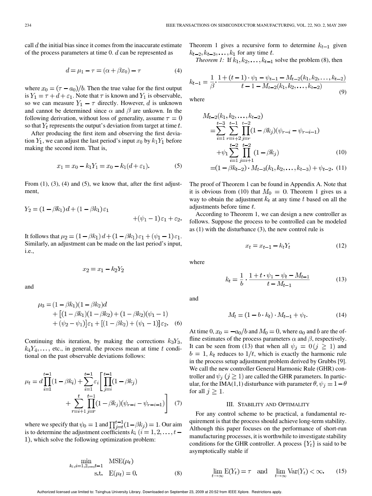
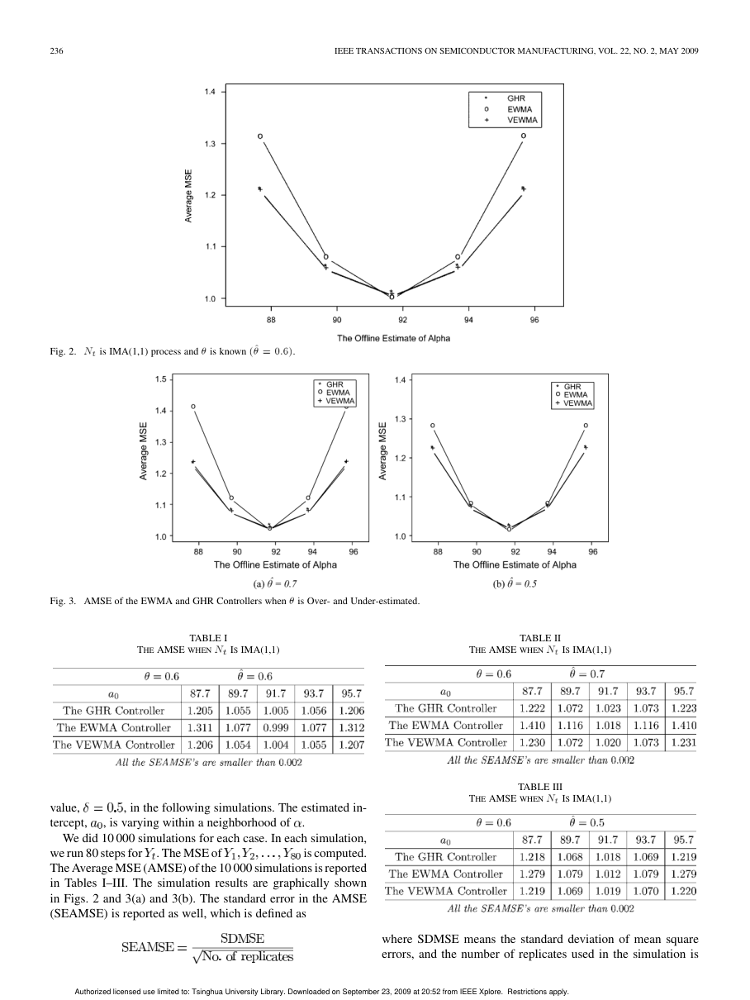
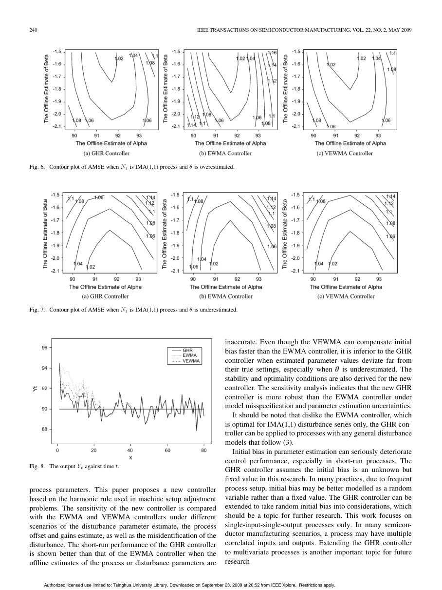

# 번역: 런투런 공정 제어를 위한 일반 조화 규칙 제어기

- 원제: A General Harmonic Rule Controller for Run-to-Run Process Control
- 저자: Fangyi He, Kaibo Wang, Wei Jiang
- 출처: IEEE Transactions on Semiconductor Manufacturing, 22(2), pp. 232-244, 2009년 5월
- 원문 파일: 같은 폴더의 `He2009_일반조화규칙.pdf` (13쪽)
- 번역 범위: 전문. 초록, 본문 1절에서 6절, 그림과 표 캡션, 부록 A에서 D의 요지. 참고문헌은 원문 그대로 둔다.
- 기호 표기: 원문 수식을 본문 안에 풀어 적었다. 아래첨자는 `x_t` 처럼 쓴다.

---

## 초록

반도체 제조에서 단기 생산 공정을 제어할 때, 모수 추정에 들어 있는 초기 편차는 중요한 문제다.
조화 규칙은 기계 셋업 조정 문제에서 널리 쓰여 왔다.
이 논문은 조화 규칙을 런투런 공정 제어로 일반화하여 일반 조화 규칙(GHR, general harmonic rule) 제어기라는 새 제어기를 만든다.
넓은 범위의 확률적 외란에 대해 GHR 제어기의 안정성과 최적성을 논한다.
수치 연구로 GHR 제어기, 지수가중이동평균(EWMA) 제어기, 가변 EWMA(VEWMA) 제어기의 민감도를 비교한다.
공정 모수를 불확실하게 추정했을 때 GHR 제어기가 EWMA 제어기보다 더 강건함을 보인다.

색인어: 자동 공정 제어, EWMA, 강건 제어, 최악의 경우.

---

## I. 서론

많은 반도체 제조 공정은 갑작스러운 부품 고장, 초기 셋업 편차, 부품의 점진적 마모나 노화를 겪는다.
규격에 맞는 제품을 만들려면, 그런 공정에 되먹임 제어기를 두어 제어 동작을 만들고 출력을 목표에 유지해야 한다.

문헌에서는 다양한 반도체 공정을 나타내는 데 다음 모형을 널리 써 왔다.

> (1) `Y_t = α + β · x_{t-1} + N_t`

여기서 `x_{t-1}` 은 런 t-1 의 끝(런 t 의 시작)에서의 공정 입력 레시피다.
`N_t` 는 백색 잡음(WN)이 아닐 수도 있는 공정 외란으로, 공정의 변동을 설명한다.
모수 α 는 오프셋 또는 절편이라 하고, 모수 β 는 공정 이득 또는 기울기라 한다.
외란 `N_t` 는 앞에서 든 여러 종류의 공정 결함을 모형화한다.
초기 편차, 갑작스러운 공정 이동, 점진적 공정 드리프트를 모두 이 모형으로 나타낼 수 있다.

IMA(1,1) 모형은 반도체 공정 제어에서 흔히 쓰는 구조다(Box 등 [2], Box와 Kramer [4], Janakiram과 Keats [12], Montgomery 등 [14], Tsung 등 [23], Tsung과 Apley [22], Vander Wiel 등 [26], Vander Wiel [25], Del Castillo와 Hurwitz [7], Box와 Luceño [3], Luceño [13], Chen과 Guo [5], Apley와 Kim [1]).
IMA(1,1) 외란 모형은 비정상 공정의 거동을 나타낼 수 있다.

> (2) `N_t = N_{t-1} + ε_t − θ ε_{t-1}`, 단 `0 < θ < 1`

여기서 `ε_t` 는 평균 0, 분산 `σ_ε²` 인 독립 동일 분포(i.i.d.) 잡음열이다. 즉 `{ε_t} ~ WN(0, σ_ε²)` 이다.
θ 는 IMA 모수다.
어떤 잡음열이 IMA(1,1) 모형을 따르는지 확인하려면, 그 열의 1단계 차분을 취하고 차분에 MA(1) 모형을 맞춰 보면 된다.

여러 방법 가운데 지수가중이동평균(EWMA) 제어기가 공정 편차나 결함을 보상하는 데 널리 쓰였다.
공정 출력 `Y_{t+1}` 을 목표값 τ 로 맞추기 위해 EWMA 제어기는 다음을 제안한다.

> `x_t = (τ − α) / β`

Sachs 등 [24]은 제어를 시작하기 전에 공정 이득 β 의 추정치 b 를 쓸 수 있다고 가정한다.
다만 공정 외란 `N_t` 를 반영하기 위해 절편 α 를 EWMA 식으로 되풀이 추정한다.
이 제어기에서 런 t 의 α 추정치를 `a_t` 라 하고, 다음 EWMA 식으로 갱신한다.

> `a_t = ω (Y_t − b x_{t-1}) + (1 − ω) a_{t-1}`

여기서 ω 는 `0 ≤ ω ≤ 1` 인 모수로, 1 에 가까울수록 가장 최근에 관측한 예측 오차에 더 큰 무게를 준다.
제어 법칙은 다음과 같다.

> `x_t = (τ − a_t) / b`

공정 이득을 정확히 추정했고(`b = β`), 시각 0 의 공정 출력이 목표 위에 있으면(`α + β x_0 = τ`),
EWMA 모수 ω 를 `1 − θ` 로 두었을 때 EWMA 제어기는 최소 MSE(MMSE) 제어기가 된다(Box 등 [2], Sachs 등 [24]).

그러나 반도체 제조 현장에는 두 가지 결정적 제약이 있다.
첫째, 공정 모수의 추정은 결코 정확하지 않다. 모수 추정의 불확실성은 늘 있다.
따라서 제어기는 부정확한 모수값에 강건해야 하고, 어떤 상황에서도 공정 안정성과 제어 성능을 보장해야 한다.
둘째, 단기 공정은 조정할 여유가 좁아서 과도 응답을 빨리 개선하는 동작이 필요하다.
그러므로 초기 셋업 편차나 결함이 있을 때, 그런 이동이나 결함에 느리게 반응하는 제어기는 새로운 제조 환경에 맞지 않는다.

Patel과 Jenkins [16]는 계단 외란과 드리프트 외란을 보상하려고 EWMA 가중치를 적응적으로 바꾸는 방식을 제시했다.
Chen 등 [6]은 연구 대상인 금속 스퍼터 증착 공정에 ARI(3,1) 모형이 더 맞음을 보였고, 이 특수한 외란을 다루려고 확장 칼만 필터 제어기를 만들었다.
Wu 등 [28]은 계측 지연이 제어 성능에 주는 영향을 조사했고, 공정 외란이 비정상이거나 자기회귀성이 강할 때 계측 지연의 나쁜 영향을 보상하는 대안도 제시했다.
그러나 이 연구들 가운데 초기 편차 보상과 단기 공정에 초점을 맞춘 것은 없다.

높은 수준의 맞춤 생산, 잦은 공정 보전, 반도체 제조의 혼류 생산 추세 때문에 단기 공정은 점점 흔해지고 있다(Sullo와 Vandeven [18], Pan [15], Tsiamyrtzis와 Hawkins [21]).
예를 들어 웨이퍼 준비 공정에서는 주문마다 다른 기술 규격을 맞추려고 모든 설비를 날마다, 때로는 하루에 몇 번씩 조정해야 한다.
식각 공정은 임계 치수가 다른 새 웨이퍼 배치가 오면 자주 다시 설정해야 한다.
최근에는 빠른 전환 능력을 갖추도록 설계된 생산 라인도 자주 보인다.
작은 배치로 공정을 돌리면 제어기의 단기 성능이 중요한 관심사가 된다.

그런데 EWMA 제어기의 단기 성능은 다음 이유로 나빠질 수 있다.
첫째, 공정의 초기 셋업 편차가 클 수 있다. 즉 `|α + β x_0 − τ| ≫ 0` 이다.
둘째, 공정 이득 모수를 부정확하게 추정한 영향(`b ≠ β`)이 초기 구간에서 두드러진다.
셋째, 외란 열을 잘못 식별할 수 있다.
`N_t` 가 IMA(1,1) 이 아닐 때, 그리고 `N_t` 가 IMA(1,1) 을 따르더라도 θ 추정이 부정확해 EWMA 모수 ω 를 `1 − θ` 로 두지 못했을 때, EWMA 제어기의 성능은 예측할 수 없게 된다.

Tseng 등 [20]은 ω 가 매 단계 변할 수 있게 한 가변 EWMA(VEWMA) 제어기를 제안했다. 즉 `a_t` 를 다음처럼 갱신한다.

> `a_t = ω_t (Y_t − b x_{t-1}) + (1 − ω_t) a_{t-1}`

여기서 `ω_t = ω_0 + δ^t` 이고 δ 는 할인 인자다.
저자들은 VEWMA 가 EWMA 제어기보다 초기 편차를 더 빨리 보상할 수 있음을 보인다.
그러나 최적 VEWMA 제어기를 세우려면 초기 편차의 크기를 미리 알아야 한다.
이 모수를 정확히 추정하지 못하면 VEWMA 제어기의 성능은 나빠질 수 있다.

이 논문에서 우리는 일반 조화 규칙(GHR) 제어기라는 새 제어 방식을 제안한다.
이 제어기는 모수 추정 불확실성이 있을 때 더 강건하고, 공정 출력에 큰 초기 편차가 있을 때 EWMA 제어기보다 단기 성능이 낫다.
우리는 `N_t` 가 백색 잡음이고 `b = β` 일 때 GHR 제어기가 최적임을 보인다.
EWMA 제어기의 최적성과 견주면, GHR 제어기의 최적성은 공정 초기 조건에 대한 어떤 가정도 없이 얻어진다. 즉 초기 편차를 0 이 아니라 알 수 없는 값으로 둔다.
우리는 GHR 과 EWMA 제어기의 민감도도 조사하여, 특히 θ 를 과대추정했을 때 GHR 제어기가 EWMA 제어기보다 더 강건함을 보인다.
민감도 분석은 공정 이득 β 의 추정이 불완전한 경우로도 이어진다.
즉 β 를 오프라인에서 과대추정했을 때(`|b| > |β|` 이고 `b · β > 0`), GHR 제어기의 성능이 EWMA 제어기보다 훨씬 낫다.
이 결과는 매우 중요하다. 실무에서 사람들은 EWMA 제어기의 안정 조건 `0 < ω β / b < 2` 때문에 β 를 과소추정하기보다 과대추정하는 쪽을 택하는 경향이 있기 때문이다(Ingolfsson과 Sachs [11], Sachs 등 [24]).
이 안정 조건은 β 를 너무 많이 과소추정하지만 않으면 제어계가 발산(bursting)하지 않도록 보장한다.

논문의 나머지 구성은 다음과 같다.
2절은 동기와 문제 설명을 제시한다.
3절은 GHR 제어기의 안정성과 최적성을 다룬다.
4절은 GHR 제어기와 EWMA 제어기의 민감도 분석을 제공한다.
5절에서 수치 예를 제시하고, 6절에서 논문을 맺는다.

---

## II. GHR 제어기

셋업 조정 문제는 Grubbs [9]가 처음 연구했다.
측정값 `Y_t` 가 이산 시각 `t = 1, 2, …` 에 생산되는 품목의 어떤 품질 특성을 나타낸다고 하자.
Grubbs [9]는 시작할 때 공정이 목표에서 d 단위만큼 벗어나 있을 때(d 는 알 수 없는 값), 공정을 목표로 되돌리는 기계 조정 방법을 제안했다.
이 절에서는 런투런 제어에 쓰는 공정 모형 (1)을 생각한다.
α 와 β 는 모두 알 수 없고 오프라인 절차로 추정해야 하므로, 공정 출력의 초기 편차는 알 수 없는 값이다.
Grubbs 와 비슷한 유도로, 아래에서 알 수 없는 초기 편차에 기반한 최적 제어기를 유도한다.

모형 (1)의 외란 `N_t` 가 다음으로 나타낼 수 있는 공정족을 따른다고 하자.

> (3) `N_t = ε_t + ψ_1 ε_{t-1} + ψ_2 ε_{t-2} + ⋯`

여기서 `t > 0` 에 대해 `ε_t ~ WN(0, σ_ε²)` 이고, 모든 `j ≤ 0` 에 대해 `ε_j = 0` 이다.
이 식은 흔한 확률 과정을 많이 포함한다. 예를 들어
`j ≥ 1` 에서 `ψ_j = 0` 이면 백색 잡음,
`j ≥ 1` 에서 `ψ_j = 1 − θ` 이면 모수 θ 의 IMA(1,1),
`j ≥ 1` 에서 `ψ_j = φ^{j-1}(φ − θ)` 이면 모수 (φ, θ)의 ARMA(1,1),
`j ≥ 1` 에서 `ψ_j = 1 + φ − θ/1 − φ(1 − φ^j)` 이면 모수 (φ, θ)의 ARIMA(1,1,1)이다.

임의 시각 t 에서 과거 출력에 조건부인 공정 평균을 `μ_t = E(Y_t | Y_1^{t-1})` 라 한다.
여기서 `Y_1^{t-1}` 은 관측 `{Y_{t-1}, Y_{t-2}, …, Y_1}` 을 뜻하며, `t ≤ 1` 이면 공집합으로 둔다.
d 는 `μ_1` 이 목표값 τ 에서 벗어난 양을 뜻한다.

위 그림은 원문 234쪽이다. 식 (4)에서 (15)까지와 정리 1, 정리 2의 서술이 있다.

d 를 초기 편차라 부른다. 시각 0 에서 공정 모수를 부정확하게 추정한 데서 오기 때문이다. d 는 다음처럼 쓸 수 있다.

> (4) `d = μ_1 − τ = (α + β x_0) − τ`

여기서 `x_0 = (τ − a_0)/b` 다.
그러면 첫 출력의 참값은 `Y_1 = τ + d + ε_1` 이다.
τ 는 알고 있고 `Y_1` 은 관측되므로 `Y_1 − τ` 는 바로 잴 수 있다.
그러나 α 와 β 를 모르므로 d 는 알 수 없고 정할 수 없다.
아래 유도에서는 일반성을 잃지 않고 `τ = 0` 으로 두어, `Y_t` 가 시각 t 에서 목표로부터의 출력 편차를 나타내게 한다.

첫 품목을 만들고 첫 편차 `Y_1` 을 관측한 뒤, 둘째 품목을 만들기 전에 직전 주기의 입력 `x_0` 을 `k_1 Y_1` 만큼 조정할 수 있다. 즉

> (5) `x_1 = x_0 − k_1 Y_1 = x_0 − k_1 (d + ε_1)`

(1), (3), (4), (5)로부터 첫 조정 뒤 다음을 안다.

> `Y_2 = (1 − β k_1) d + (1 − β k_1) ε_1 + (ψ_1 − 1) ε_1 + ε_2`

따라서 `μ_2 = (1 − β k_1) d + (1 − β k_1) ε_1 + (ψ_1 − 1) ε_1` 이다.
비슷하게 직전 주기의 입력에 조정을 가할 수 있다. 즉 `x_2 = x_1 − k_2 Y_2` 이고

> (6) `μ_3 = (1 − β k_1)(1 − β k_2) d + [(1 − β k_1)(1 − β k_2) + (1 − β k_2)(ψ_1 − 1) + (ψ_2 − ψ_1)] ε_1 + [(1 − β k_2) + (ψ_1 − 1)] ε_2`

이 되풀이를 이어 `k_3 Y_3`, `k_4 Y_4` 등의 보정을 하면, 일반적으로 시각 t 에서 과거의 관측 가능한 편차에 조건부인 공정 평균은 (7)을 따른다.

> (7) `μ_t = d ∏_{i=1}^{t-1} (1 − β k_i) + Σ_{i=1}^{t-1} ε_i [ ∏_{j=i}^{t-1} (1 − β k_j) + Σ_{r=i+1}^{t} ∏_{j=r}^{t-1} (1 − β k_j)(ψ_{r-i} − ψ_{r-i-1}) ]`

여기서 `ψ_0 = 1` 이고 `∏_{j=t}^{t-1}(1 − β k_j) = 1` 로 정한다.
우리 목표는 다음 최적화 문제를 푸는 조정 계수 `k_i` (`i = 1, 2, …, t-1`)를 정하는 것이다.

> (8) `min_{k_i} MSE(μ_t)`, 제약 `E(μ_t) = 0`

정리 1은 임의 시각 t 에 대해 `k_{t-2}, k_{t-3}, …, k_1` 이 주어졌을 때 `k_{t-1}` 을 정하는 되풀이 형태를 준다.

**정리 1**: `k_1, k_2, …, k_{t-1}` 이 문제 (8)을 풀면

> (9) `k_{t-1} = (1/β) · [ 1 + (t-1)·ψ_1 − ψ_{t-1} − M_{t-2}(k_1, …, k_{t-2}) ] / [ t − 1 − M_{t-2}(k_1, …, k_{t-2}) ]`

여기서

> (10) `M_{t-2}(k_1, …, k_{t-2}) = Σ_{i=1}^{t-3} Σ_{r=i+2}^{t-1} ∏_{j=r}^{t-2} (1 − β k_j)(ψ_{r-i} − ψ_{r-i-1}) + ψ_1 Σ_{i=1}^{t-2} ∏_{j=i+1}^{t-2} (1 − β k_j)`
>
> (11) `= (1 − β k_{t-2}) · M_{t-3}(k_1, …, k_{t-3}) + ψ_{t-2}`

정리 1의 증명은 부록 A 에 있다.
(10)에서 `M_0 = 0` 임은 분명하다.
정리 1은 시각 t 이전의 모든 조정에 기반해 임의 시각 t 의 조정량 `k_t` 를 얻는 방법을 준다.

정리 1에 따라 다음처럼 새 제어기를 설계할 수 있다.
제어할 공정을 외란 (3)과 함께 (1)로 모형화할 수 있다고 하자. 새 제어 규칙은

> (12) `x_t = x_{t-1} − k_t Y_t`

여기서

> (13) `k_t = (1/b) · [ 1 + t·ψ_1 − ψ_t − M_{t-1} ] / [ t − M_{t-1} ]`
>
> (14) `M_t = (1 − b · k_t) · M_{t-1} + ψ_t`

시각 0 에서 `x_0 = −a_0 / b` 이고 `M_0 = 0` 이다.
여기서 `a_0` 와 b 는 공정 모수 α 와 β 의 오프라인 추정치다.

(13)에서 볼 수 있듯이, 모든 `ψ_j = 0` (`j ≥ 1`)이고 `b = 1` 이면 `k_t` 는 `1/t` 로 줄어든다.
이는 Grubbs [9]가 유도한 공정 셋업 조정 문제의 조화 규칙 바로 그것이다.
새 제어기를 일반 조화 규칙(GHR) 제어기라 부르고, `ψ_j` (`j ≥ 1`)를 GHR 모수라 부른다.
특히 모수 θ 의 IMA(1,1) 외란에서는 모든 `j ≥ 1` 에 대해 `ψ_j = 1 − θ` 다.

---

## III. 안정성과 최적성

어떤 제어 방식이든 실용적이려면, 공정이 장기 안정성을 달성한다는 기본 요건을 채워야 한다.
이 논문은 단기 생산 공정의 성능에 초점을 맞추지만, GHR 제어기의 안정 조건을 살피는 것도 가치가 있다.
공정 `{Y_t}` 가 다음을 만족하면 점근 안정이라 한다.

> (15) `lim_{t→∞} E(Y_t) = τ` 이고 `lim_{t→∞} Var(Y_t) < ∞`

공정의 안정성은 공정 출력의 평균이 원하는 목표로 수렴하고, 그 점근 분산이 유계로 남음을 보장한다.
다음 정리는 외란이 IMA(1,1) 과정일 때 GHR 제어기의 안정 조건을 준다.

**정리 2**: 외란 `N_t` 가 IMA(1,1) 과정일 때, (12)에서 (14)로 정의한 GHR 제어기는 `0 < β/b < 2` 이면 점근 안정이다.

정리 2의 증명은 부록 B 에 있다.
이 조건이 뜻하는 바는 이렇다.
b 가 β 와 부호가 같고 절댓값이 β 보다 크면 안정성이 보장된다.
b 가 β 와 부호가 같고 절댓값이 β 보다 작으면, 안정하려면 절댓값이 `β/2` 보다는 커야 한다.
b 와 β 의 부호가 다르면 공정은 언제나 불안정하다.

다음 정리는 GHR 제어기가 최적이 되는 조건을 준다.

**정리 3**: `b = β` 이고 `N_t` 가 백색 잡음이면(모든 `j ≥ 1` 에서 `ψ_j = 0`), GHR 제어기는 최적이다.

정리 3의 증명은 부록 C 에 있다.
우리 증명은 Grubbs [9]의 것과 매우 비슷하지만 제어기 관점에서 했다.
EWMA 제어기의 최적성과 견주면, GHR 제어기는 `a_0` 에 대한 가정 없이 유도된다.
즉 공정 외란이 백색 잡음이고 `b = β` 이면, 공정 초기 상태가 무엇이든 GHR 제어기가 최적 제어기다.

---

## IV. 민감도 분석

이 절에서는 반도체 제조의 심부 반응성 이온 식각(DRIE) 공정을 예로 들어 새로 제안한 GHR 제어기의 성능을 살핀다.
DRIE 공정은 마이크로, 나노 규모 제작에서 웨이퍼 위에 원하는 패턴을 만드는 중요한 단계이며, 복잡한 화학 기계 반응을 포함한다.
식각할 웨이퍼를 챔버에 넣는다.
먼저 챔버에 식각 플라스마를 풀어 설계된 마스크 패턴에 따라 트렌치를 만든다.
다음 증착 단계에서 다른 기체를 챔버에 넣어 측벽에 보호막을 만든다.
식각과 증착 단계는 미리 정한 처리 시간에 이르거나 종점 검출 모듈이 올바른 식각 깊이를 확인할 때까지 번갈아 되풀이된다.
식각 공정의 더 자세한 설명은 Wang과 Tsung [27]을 참고한다.
DRIE 는 광결정, 자성 나노구조, MEMS 공진기 생산에 성공적으로 쓰였다(STS [17]).

DRIE 공정이 만드는 핵심 품질 특성 하나는 식각 프로파일이다.
그림 1 에 보인 대로다.
이상적인 프로파일은 수직이어야 하며, 수평선에 대해 90도 각을 이룬다(`τ = 90`).
과식각이나 미식각 웨이퍼를 보상해 수직 측벽을 만들려고 보통 식각 대 증착 시간 비를 조정한다.
Wang과 Tsung [27]의 분석에서 저자들은 DRIE 공정을 연구해 생산된 프로파일의 기울기를 다음처럼 모형화할 수 있다고 제안했다.

> `Y_t = 91.7 − 1.8 x_{t-1} + N_t`

여기서 `N_t` 는 `θ = 0.6` 인 IMA(1,1) 시계열이다. 모수는 설계 실험으로 추정했다.

**그림 1**: 식각 프로파일 그림.

생산 런 한 번이 매우 오래 걸려서 실제 공정을 조정하며 제안 제어기의 성능을 연구하기는 현실적이지 않다.
그래서 위 식을 참 공정 모형으로 보고 GHR 제어기의 성능을 연구한다.
비교를 위해 같은 모의 공정에 EWMA 와 VEWMA 제어기도 설정한다.
비교는 β 를 아는 경우와 모르는 경우로 나눈다.

### A. β 를 아는 경우

셋업 조정 문헌 다수에서 공정 이득 β 는 보통 알려진 것으로 보고 1 로 둔다(Grubbs [9], Trietsch [19], Del Castillo 등 [8]).
이 절에서는 먼저 β 를 알거나 오프라인에서 정확히 추정할 수 있다고 본다(`b = β`).
그리고 α 의 오프라인 추정치 `a_0` 를 달리 주었을 때 GHR 과 EWMA 제어기의 성능을 살핀다.
먼저 외란이 IMA 모형을 따른다고 보고, 다음으로 더 일반적인 ARIMA(1,1,1) 모형을 쓴다.

#### 1) `N_t` 가 IMA(1,1) 과정인 경우

IMA(1,1) 모형은 다양한 응용에서 외란을 나타내는 데 널리 쓰여 왔다.
통상적 EWMA 제어기는 그런 외란열을 보상하는 데 최적임이 증명되었다(Box 등 [2]).
그러나 EWMA 제어기가 최적 성능을 내려면 조건이 있다.
첫째, 공정 모수 α 와 β 를 모두 알거나 오프라인에서 정확히 추정해야 한다(`a_0 = α`, `b = β`).
둘째, EWMA 모수 ω 를 `1 − θ` 로 두어야 하며, 이는 IMA 모수 θ 를 알거나 오프라인에서 정확히 추정해야 함을 뜻한다.

그러나 단기 생산 상황에서 이 모수들을 정확히 추정하는 일은 흔히 불가능하다.
다음 모의실험에서 DRIE 공정의 참 모수로 `α = 91.7`, `β = −1.8`, `θ = 0.6`, `σ_ε² = 1` 을 쓴다.
그리고 EWMA, VEWMA, GHR 제어기를 여러 가정 설정에서 세워 공정을 조정한다.

아래 세 경우를 본다.
경우 1 은 θ 를 정확히 추정한 경우(`θ̂ = θ`),
경우 2 는 θ 를 과대추정한 경우(`θ̂ > θ`),
경우 3 은 θ 를 과소추정한 경우(`θ̂ < θ`)다.
각 경우에서 EWMA 모수 ω 와 GHR 모수 `ψ_j` (`j ≥ 1`)는 모두 `1 − θ̂` 로 둔다.
VEWMA 제어기에서는 평활 모수의 초기값 `ω_0` 를 `1 − θ̂` 로 둔다.
VEWMA 제어기의 할인 인자 선택은 초기 공정 편차에 달려 있는데, 실제 상황에서는 이를 모른다.
그래서 아래 모의실험에서는 중간값 `δ = 0.5` 를 고른다.
추정 절편 `a_0` 는 α 의 근방에서 변하게 한다.

각 경우마다 10,000 회 모의실험을 했다.
각 모의실험에서 `Y_t` 를 80 단계 돌린다.
`Y_1, Y_2, …, Y_80` 의 MSE 를 계산한다.
10,000 회 모의실험의 평균 MSE(AMSE)를 표 I 에서 III 에 보고한다.
모의 결과는 그림 2, 그림 3(a), 그림 3(b)에 그림으로 보인다.
AMSE 의 표준오차(SEAMSE)도 보고하며, 다음으로 정의한다.

> `SEAMSE = SDMSE / sqrt(반복 횟수)`

여기서 SDMSE 는 평균 제곱 오차의 표준편차이고, 모의실험에 쓴 반복 횟수는 10,000 이다.
본질적으로 SEAMSE 는 모든 제어기 사이 AMSE 값 차이의 유의성을 재는 값이다.

위 그림은 원문 236쪽이다. 그림 2, 그림 3(a)(b)와 표 I 에서 III 이 있다.

**그림 2**: `N_t` 가 IMA(1,1) 과정이고 θ 를 아는 경우(`θ̂ = 0.6`). 가로축은 α 의 오프라인 추정치, 세로축은 평균 MSE. 세 곡선은 GHR, EWMA, VEWMA.

**그림 3**: θ 를 과대추정, 과소추정했을 때 EWMA 와 GHR 제어기의 AMSE. (a) `θ̂ = 0.7`. (b) `θ̂ = 0.5`.

**표 I**: `N_t` 가 IMA(1,1) 일 때의 AMSE (`θ = 0.6`, `θ̂ = 0.6`)

| 제어기 | a_0 = 87.7 | 89.7 | 91.7 | 93.7 | 95.7 |
|---|---|---|---|---|---|
| GHR | 1.205 | 1.055 | 1.005 | 1.056 | 1.206 |
| EWMA | 1.311 | 1.077 | 0.999 | 1.077 | 1.312 |
| VEWMA | 1.206 | 1.054 | 1.004 | 1.055 | 1.207 |

모든 SEAMSE 는 0.002 보다 작다.

**표 II**: `N_t` 가 IMA(1,1) 일 때의 AMSE (`θ = 0.6`, `θ̂ = 0.7`)

| 제어기 | a_0 = 87.7 | 89.7 | 91.7 | 93.7 | 95.7 |
|---|---|---|---|---|---|
| GHR | 1.222 | 1.072 | 1.023 | 1.073 | 1.223 |
| EWMA | 1.410 | 1.116 | 1.018 | 1.116 | 1.410 |
| VEWMA | 1.230 | 1.072 | 1.020 | 1.073 | 1.231 |

모든 SEAMSE 는 0.002 보다 작다.

**표 III**: `N_t` 가 IMA(1,1) 일 때의 AMSE (`θ = 0.6`, `θ̂ = 0.5`)

| 제어기 | a_0 = 87.7 | 89.7 | 91.7 | 93.7 | 95.7 |
|---|---|---|---|---|---|
| GHR | 1.218 | 1.068 | 1.018 | 1.069 | 1.219 |
| EWMA | 1.279 | 1.079 | 1.012 | 1.079 | 1.279 |
| VEWMA | 1.219 | 1.069 | 1.019 | 1.070 | 1.220 |

모든 SEAMSE 는 0.002 보다 작다.

표 I 과 그림 2 는 `θ̂ = θ` 일 때의 결과를 보인다.
`a_0 = α` 일 때 EWMA 제어기가 MMSE 제어기여서 가장 낮은 MSE 를 내지만,
`a_0` 가 α 에서 벗어나면 GHR 제어기가 EWMA 제어기보다 더 강건함을 볼 수 있다.
VEWMA 제어기는 그 중간이다.
`a_0` 가 α 에 가까우면 GHR 제어기보다 낫고, `a_0` 가 α 에서 멀리 벗어나면 GHR 제어기보다 못하다.
`a_0` 가 참값 α 에서 벗어날 때 GHR 제어기의 AMSE 는 EWMA 제어기보다 훨씬 천천히 커진다.

θ 를 과대추정하거나 과소추정했을 때도 비슷한 양상이 나타난다.
경우 2 처럼 θ 를 과대추정하면(`θ̂ = 0.7`), 그림 3(a)와 표 II 는 GHR 제어기의 AMSE 가 어떤 `a_0` 값에서도 EWMA 제어기보다 거의 일관되게 작고, `a_0 ≠ α` 일 때 그 차이가 최대 13.3% 까지 벌어질 수 있음을 보인다.
VEWMA 제어기는 Tseng 등 [20]이 보인 대로 초기 편차 보상 능력을 보인다.
θ 를 과대추정했을 때 VEWMA 제어기는 `a_0` 가 α 에 가까우면 GHR 제어기보다 조금 낫거나 비슷하고, `a_0` 와 α 의 차이가 커지면 덜 선호된다.

이 결과는 실무에 매우 중요한 뜻이 있다.
Hunter [10]가 제안했듯이 EWMA 모수 ω 는 보통 0.1 에서 0.3 사이로 둔다.
이는 θ̂ 를 보통 0.7 에서 0.9 사이로 가정한다는 뜻인데, 실제로는 θ 가 0.7 보다 작은 경우도 많다.
경험칙으로 θ 를 과대추정하면, GHR 제어기가 EWMA 제어기보다 나은 정도가 더 뚜렷해진다.

표 III 과 그림 3(b)는 θ 를 과소추정한 경우(`θ̂ = 0.5`)의 결과를 보인다.
여기서도 `a_0` 가 α 에서 벗어날 때 GHR 제어기의 증가 추세가 느려 강건함이 확인된다.
이 경우 VEWMA 제어기는 시험한 모든 `a_0` 값에서 GHR 제어기보다 조금 못하다.

#### 2) `N_t` 가 ARIMA(1,1,1) 과정인 경우

우리가 살피는 공정은 IMA(1,1) 외란열을 갖지만, 다른 종류의 외란열에서 GHR 제어기의 성능을 보는 것도 뜻이 있다.
다음 모의실험에서는 외란이 모수 φ 와 θ̃ 의 일반 ARIMA(1,1,1) 과정을 따르는데, 이를 모수 θ̂ 의 IMA(1,1) 과정으로 잘못 식별한다고 본다.
부록 D 는 IMA 모수의 추정치 θ̂ 가 대략 `|φ − θ̃| / sqrt(1 − φ²)` 근처가 됨을 보인다.
다음 두 경우를 본다.
경우 1 은 φ 를 0.2, θ̃ 를 0.6 으로 두고,
경우 2 는 φ 를 0.6, θ̃ 를 0.2 로 둔다.
이 ARIMA(1,1,1) 과정을 IMA(1,1) 으로 잘못 식별하면 θ̂ 는 경우 1 에서 약 0.4, 경우 2 에서 약 0.5 다.
위 실험과 비슷하게 각 경우마다 10,000 회 모의실험을 되풀이했다.
각 모의실험에서 `Y_t` 를 80 단계 돌리고 10,000 회의 AMSE 를 계산해 표 IV 와 V 에 보였다.

**그림 4**: `N_t` 가 ARIMA(1,1,1) 과정인데 IMA(1,1) 으로 잘못 식별되었을 때 EWMA 와 GHR 제어기의 AMSE. (a) `φ = 0.2`, `θ̃ = 0.6` 인 ARIMA. (b) `φ = 0.6`, `θ̃ = 0.2` 인 ARIMA.

**표 IV**: `N_t` 가 ARIMA(1,1,1) 일 때의 AMSE (`θ̃ = 0.6`, `φ = 0.2`, `θ̂ = 0.4`)

| 제어기 | a_0 = 87.7 | 89.7 | 91.7 | 93.7 | 95.7 |
|---|---|---|---|---|---|
| GHR | 1.210 | 1.060 | 1.010 | 1.061 | 1.211 |
| EWMA | 1.245 | 1.067 | 1.008 | 1.067 | 1.246 |
| VEWMA | 1.214 | 1.063 | 1.012 | 1.063 | 1.215 |

GHR 제어기의 모든 SEAMSE 는 0.00002 보다 작다. EWMA 와 VEWMA 제어기의 모든 SEAMSE 는 0.002 보다 작다.

**표 V**: `N_t` 가 ARIMA(1,1,1) 일 때의 AMSE (`θ̃ = 0.2`, `φ = 0.6`, `θ̂ = 0.5`)

| 제어기 | a_0 = 87.7 | 89.7 | 91.7 | 93.7 | 95.7 |
|---|---|---|---|---|---|
| GHR | 2.840 | 2.690 | 2.641 | 2.691 | 2.841 |
| EWMA | 2.935 | 2.736 | 2.669 | 2.736 | 2.936 |
| VEWMA | 2.831 | 2.681 | 2.631 | 2.682 | 2.832 |

GHR 제어기의 모든 SEAMSE 는 0.00002 보다 작다. EWMA 와 VEWMA 제어기의 모든 SEAMSE 는 0.008 보다 작다.

그림 4 는 경우 1 과 경우 2 에 대해 AMSE 를 `a_0` 에 대해 그린다.
여기서도 GHR 제어기가 두 경우 모두에서 더 강건한 성능을 보인다.
α 의 부정확한 오프라인 추정이 GHR 제어기에 주는 영향은 EWMA 제어기에 주는 영향보다 작다.
VEWMA 제어기와 GHR 제어기는 비슷한 성능을 보인다.
VEWMA 제어기의 AMSE 는 θ 를 과소추정했을 때 대체로 더 크고, 과대추정했을 때 더 작다.

### B. β 를 모르는 경우

대부분의 런투런 생산 공정에서 오프라인 표본은 모수 추정, 특히 공정 이득 β 의 정확도를 보장할 만큼 크지 않다.
β 를 모르고 오프라인 실험으로 추정해야 할 때, 모든 모수를 불확실하게 추정한 상태에서 GHR 제어기의 성능을 살피는 일이 중요하다.

다음 연구에서도 공정은 `N_t` 가 IMA(1,1) 열인 (1)을 따른다고 본다.
참 공정 모수는 `α = 91.7`, `β = −1.8`, `θ = 0.6`, `σ_ε² = 1` 로 고른다.
β 를 아는 경우와 비슷하게 여기서도 세 경우를 분석한다.
θ 를 아는 경우, θ 를 과대추정한 경우, θ 를 과소추정한 경우다.
각 경우에서 EWMA 모수 ω 와 GHR 모수 `ψ_j` (`j ≥ 1`)는 모두 `1 − θ̂` 로 둔다.
VEWMA 제어기의 할인 인자는 여전히 0.5 로 둔다.
추정 모수 `a_0` 와 b 는 각자의 근방에서 변하게 한다.
모의 결과는 표 VI 에서 VIII 에 보고한다.

그림 5 는 θ 를 알 때 GHR 과 EWMA 제어기 각각의 AMSE 등고선도를 보인다.
두 제어기 모두 AMSE 가 직선 `b = β/(α − τ) · (a_0 − τ)` 를 따라 천천히 변하고, `a_0 = α` 이고 `b = β` 일 때 최소가 됨을 쉽게 볼 수 있다.
GHR 제어기와 견주면 EWMA 제어기의 등고선이 더 촘촘하다.
이는 α 와 β 의 오프라인 추정이 나빠 `b/(a_0 − τ)` 가 `β/(α − τ)` 에서 벗어날 때 AMSE 값이 더 빨리 커진다는 뜻이다.
즉 오프라인 모수 추정이 정확하지 않을 때, 특히 `|b|` 가 `|β|` 보다 클 때, GHR 제어기가 EWMA 제어기보다 더 강건하다.
VEWMA 제어기는 추정값이 각자의 참값에 가까울 때만 GHR 제어기보다 낫다.
앞서 제어기 안정성에서 논했듯이 실무에서 β 를 과대추정하는 경향이 있으므로, 이는 GHR 제어기의 장점이 된다.

실무에서 EWMA 제어기에 작은 ω 값을 쓰는 것이 경험칙이므로(Hunter [10]), 그림 6 과 7 은 θ 를 과대추정, 과소추정했을 때 세 제어기의 AMSE 등고선도를 더 보인다.
모든 제어기의 성능이 그림 5 보다 나쁘지만, EWMA 제어기의 성능이 더 크게 나빠진다.
θ 를 과소추정했을 때 시험한 대부분의 경우에서 VEWMA 제어기도 GHR 제어기보다 못하다.
GHR 제어기가 모수 편차에 가장 강건하며, 특히 `|b|` 가 `|β|` 보다 클 때 그렇다.

**그림 5**: `N_t` 가 IMA(1,1) 과정이고 θ 를 알 때 AMSE 등고선도. (a) GHR 제어기. (b) EWMA 제어기. (c) VEWMA 제어기. 가로축은 α 의 오프라인 추정치(90 에서 93), 세로축은 β 의 오프라인 추정치(-2.1 에서 -1.5).

**그림 6**: `N_t` 가 IMA(1,1) 과정이고 θ 를 과대추정했을 때 AMSE 등고선도. (a) GHR. (b) EWMA. (c) VEWMA.

**그림 7**: `N_t` 가 IMA(1,1) 과정이고 θ 를 과소추정했을 때 AMSE 등고선도. (a) GHR. (b) EWMA. (c) VEWMA.

**표 VI**: θ 를 알 때의 AMSE (`θ̂ = 0.6`)

GHR 제어기

| b | a_0 = 89.7 | 90.7 | 91.7 | 92.7 | 93.7 |
|---|---|---|---|---|---|
| -2.1 | 1.057 | 1.023 | 1.009 | 1.013 | 1.036 |
| -2.0 | 1.055 | 1.020 | 1.006 | 1.013 | 1.040 |
| -1.9 | 1.054 | 1.018 | 1.005 | 1.014 | 1.046 |
| -1.8 | 1.055 | 1.018 | 1.005 | 1.018 | 1.056 |
| -1.7 | 1.058 | 1.019 | 1.008 | 1.025 | 1.070 |
| -1.6 | 1.064 | 1.022 | 1.013 | 1.035 | 1.089 |
| -1.5 | 1.074 | 1.028 | 1.020 | 1.050 | 1.117 |

EWMA 제어기

| b | a_0 = 89.7 | 90.7 | 91.7 | 92.7 | 93.7 |
|---|---|---|---|---|---|
| -2.1 | 1.089 | 1.031 | 1.006 | 1.013 | 1.052 |
| -2.0 | 1.084 | 1.026 | 1.002 | 1.013 | 1.058 |
| -1.9 | 1.080 | 1.021 | 1.000 | 1.015 | 1.066 |
| -1.8 | 1.077 | 1.018 | 0.999 | 1.018 | 1.077 |
| -1.7 | 1.076 | 1.017 | 1.000 | 1.025 | 1.092 |
| -1.6 | 1.077 | 1.017 | 1.003 | 1.035 | 1.111 |
| -1.5 | 1.080 | 1.020 | 1.010 | 1.048 | 1.136 |

VEWMA 제어기

| b | a_0 = 89.7 | 90.7 | 91.7 | 92.7 | 93.7 |
|---|---|---|---|---|---|
| -2.1 | 1.058 | 1.023 | 1.008 | 1.012 | 1.036 |
| -2.0 | 1.055 | 1.020 | 1.005 | 1.012 | 1.040 |
| -1.9 | 1.054 | 1.017 | 1.004 | 1.013 | 1.046 |
| -1.8 | 1.054 | 1.017 | 1.004 | 1.017 | 1.055 |
| -1.7 | 1.057 | 1.017 | 1.006 | 1.023 | 1.068 |
| -1.6 | 1.062 | 1.020 | 1.011 | 1.033 | 1.086 |
| -1.5 | 1.070 | 1.026 | 1.018 | 1.047 | 1.112 |

세 제어기의 모든 SEAMSE 는 0.002 보다 작다.

**표 VII**: θ 를 과대추정했을 때의 AMSE (`θ̂ = 0.7`)

GHR 제어기

| b | a_0 = 89.7 | 90.7 | 91.7 | 92.7 | 93.7 |
|---|---|---|---|---|---|
| -2.1 | 1.093 | 1.059 | 1.045 | 1.049 | 1.072 |
| -2.0 | 1.085 | 1.050 | 1.036 | 1.043 | 1.070 |
| -1.9 | 1.078 | 1.042 | 1.029 | 1.038 | 1.070 |
| -1.8 | 1.072 | 1.035 | 1.023 | 1.035 | 1.073 |
| -1.7 | 1.068 | 1.029 | 1.018 | 1.035 | 1.080 |
| -1.6 | 1.067 | 1.024 | 1.015 | 1.037 | 1.092 |
| -1.5 | 1.067 | 1.022 | 1.014 | 1.043 | 1.111 |

EWMA 제어기

| b | a_0 = 89.7 | 90.7 | 91.7 | 92.7 | 93.7 |
|---|---|---|---|---|---|
| -2.1 | 1.150 | 1.077 | 1.045 | 1.054 | 1.104 |
| -2.0 | 1.138 | 1.065 | 1.035 | 1.048 | 1.105 |
| -1.9 | 1.126 | 1.053 | 1.026 | 1.045 | 1.109 |
| -1.8 | 1.116 | 1.042 | 1.018 | 1.043 | 1.116 |
| -1.7 | 1.106 | 1.033 | 1.012 | 1.043 | 1.126 |
| -1.6 | 1.098 | 1.024 | 1.007 | 1.046 | 1.141 |
| -1.5 | 1.091 | 1.017 | 1.004 | 1.052 | 1.161 |

VEWMA 제어기

| b | a_0 = 89.7 | 90.7 | 91.7 | 92.7 | 93.7 |
|---|---|---|---|---|---|
| -2.1 | 1.097 | 1.060 | 1.043 | 1.048 | 1.074 |
| -2.0 | 1.088 | 1.050 | 1.035 | 1.042 | 1.071 |
| -1.9 | 1.080 | 1.041 | 1.027 | 1.037 | 1.071 |
| -1.8 | 1.072 | 1.033 | 1.020 | 1.033 | 1.073 |
| -1.7 | 1.067 | 1.026 | 1.014 | 1.032 | 1.078 |
| -1.6 | 1.062 | 1.020 | 1.011 | 1.033 | 1.087 |
| -1.5 | 1.060 | 1.016 | 1.009 | 1.037 | 1.102 |

세 제어기의 모든 SEAMSE 는 0.002 보다 작다.

**표 VIII**: θ 를 과소추정했을 때의 AMSE (`θ̂ = 0.5`)

GHR 제어기

| b | a_0 = 89.7 | 90.7 | 91.7 | 92.7 | 93.7 |
|---|---|---|---|---|---|
| -2.1 | 1.053 | 1.019 | 1.005 | 1.009 | 1.032 |
| -2.0 | 1.056 | 1.021 | 1.007 | 1.014 | 1.041 |
| -1.9 | 1.061 | 1.025 | 1.012 | 1.021 | 1.053 |
| -1.8 | 1.068 | 1.031 | 1.018 | 1.031 | 1.069 |
| -1.7 | 1.078 | 1.039 | 1.028 | 1.045 | 1.090 |
| -1.6 | 1.092 | 1.050 | 1.041 | 1.063 | 1.117 |
| -1.5 | 1.111 | 1.066 | 1.058 | 1.087 | 1.155 |

EWMA 제어기

| b | a_0 = 89.7 | 90.7 | 91.7 | 92.7 | 93.7 |
|---|---|---|---|---|---|
| -2.1 | 1.071 | 1.022 | 1.001 | 1.007 | 1.040 |
| -2.0 | 1.072 | 1.023 | 1.003 | 1.012 | 1.050 |
| -1.9 | 1.074 | 1.025 | 1.006 | 1.019 | 1.063 |
| -1.8 | 1.079 | 1.029 | 1.012 | 1.029 | 1.079 |
| -1.7 | 1.085 | 1.035 | 1.020 | 1.042 | 1.099 |
| -1.6 | 1.095 | 1.044 | 1.032 | 1.059 | 1.125 |
| -1.5 | 1.109 | 1.057 | 1.048 | 1.081 | 1.158 |

VEWMA 제어기

| b | a_0 = 89.7 | 90.7 | 91.7 | 92.7 | 93.7 |
|---|---|---|---|---|---|
| -2.1 | 1.053 | 1.020 | 1.005 | 1.009 | 1.032 |
| -2.0 | 1.057 | 1.022 | 1.008 | 1.015 | 1.041 |
| -1.9 | 1.062 | 1.026 | 1.013 | 1.022 | 1.054 |
| -1.8 | 1.069 | 1.032 | 1.019 | 1.032 | 1.070 |
| -1.7 | 1.080 | 1.040 | 1.029 | 1.046 | 1.091 |
| -1.6 | 1.094 | 1.052 | 1.042 | 1.064 | 1.119 |
| -1.5 | 1.113 | 1.068 | 1.060 | 1.089 | 1.156 |

세 제어기의 모든 SEAMSE 는 0.002 보다 작다.

---

## V. 초기 편차가 있는 예시

앞 절은 GHR 제어기의 성능과 강건성을 연구했다.
이 절에서는 특정 모수 설정을 써서 초기 추정 편차가 새 제어기에 주는 영향을 연구한다.

공정은 다시 (1)을 따르고 외란 `N_t` 는 IMA(1,1) 시계열이라고 본다.
참 모수 설정은 `α = 91.7`, `β = −1.8`, `θ = 0.6` 이고,
추정값은 각각 `a_0 = 85`, `b = −3.0`, `θ̂ = 0.8` 로 둔다.
즉 모형의 모든 모수 추정에 초기 편차가 있다.
목표값은 `τ = 90` 이다.

위 그림은 원문 240쪽이다. 그림 6, 그림 7 등고선도와 그림 8 의 출력 추이가 있다.

**그림 8**: 시각 t 에 대한 출력 `Y_t`. 가로축 0 에서 80 런, 세로축 88 에서 96. 목표선은 90. 세 곡선은 GHR, EWMA, VEWMA.

그림 8 은 세 제어기를 적용했을 때 시각 t 에 대한 공정 출력 `Y_t` 를 보인다.
곡선을 보면, 공정에 큰 초기 편차 `(α + β(τ − a_0))/b − τ = 4.7` 이 있을 때 EWMA 제어기는 공정 출력을 목표로 되돌리는 데 상당히 많은 런이 필요하다.
VEWMA 제어기는 초기 편차를 없애는 데 EWMA 제어기보다 효율적이다.
그러나 공정 출력을 목표로 되돌리는 데 가장 빠른 것은 GHR 제어기다.
처음 30 런이 지나면 두 제어기의 공정 출력은 거의 같다.
이것은 제어 과정의 한 번의 실현일 뿐이지만, 초기 편차가 클 때 GHR 제어기의 효과를 보여 준다.

VEWMA 와 GHR 제어기의 차이를 더 잘 드러내려고, `α = 91.7` 과 `β = −1.8` 인 공정의 평균 응답을 더 조사했다.
추정한 α 와 β, 즉 `a_0` 와 b 가 치우친 여러 경우를 본다.
그림 9 는 서로 다른 초기 편차에서 VEWMA 와 GHR 제어기가 제어한 공정의 평균 응답을 보인다.
모든 경우의 초기 편차는 `d = 2` 로 같다.
(a)에서 보듯 α 만 치우쳤을 때 GHR 은 출력을 곧바로 목표로 되돌리는 반면, VEWMA 는 목표에 다가가는 데 몇 단계를 더 쓴다.
(b)처럼 β 도 치우쳤을 때는 GHR 과 VEWMA 가 비슷하게 동작하고, (c)에서는 GHR 이 초기 편차 보상에서 VEWMA 보다 낫다.

**그림 9**: 초기 편차가 있을 때 GHR 과 VEWMA 제어기가 제어한 공정의 평균 응답.

정리하면 이렇다.
외란열이 IMA 모형을 따르고 모수를 정확히 추정했다면 EWMA 제어기를 늘 권한다.
이는 이론과 모의 결과가 모두 뒷받침한다.
반면 외란 모형이 IMA 가 아니거나 모수를 정확히 추정할 수 없다면 VEWMA 나 GHR 을 권한다.
더 구체적으로, GHR 제어기가 대부분의 경우에 더 강건하므로, 초기 편차나 추정 불확실성이 클 때 GHR 이 더 낫다.

---

## VI. 결론

단기 생산 공정에서 EWMA 제어기의 성능은 공정 모수의 오프라인 추정에 결정적으로 달려 있다.
이 논문은 기계 셋업 조정 문제에 쓰는 조화 규칙에 기반한 새 제어기를 제안한다.
외란 모수 추정, 공정 오프셋과 이득 추정, 외란의 오식별 등 여러 상황에서 새 제어기의 민감도를 EWMA, VEWMA 제어기와 비교한다.
공정이나 외란 모수의 오프라인 추정이 부정확할 때 GHR 제어기의 단기 성능이 EWMA 제어기보다 낫다는 것을 보였다.
VEWMA 가 EWMA 제어기보다 초기 편차를 빨리 보상할 수 있지만, 추정 모수값이 참 설정에서 멀리 벗어나면, 특히 θ 를 과소추정하면 GHR 제어기보다 못하다.
새 제어기의 안정성과 최적성 조건도 유도했다.
민감도 분석은 모형 오설정과 모수 추정 불확실성 아래에서 새 GHR 제어기가 EWMA 제어기보다 더 강건함을 가리킨다.

IMA(1,1) 외란열에만 최적인 EWMA 제어기와 달리, GHR 제어기는 (3)을 따르는 어떤 일반 외란 모형의 공정에도 적용할 수 있음을 밝혀 둔다.

모수 추정의 초기 편차는 제어 성능을 크게 나쁘게 할 수 있으며, 특히 단기 공정에서 그렇다.
이 연구에서 GHR 제어기는 초기 편차를 알 수 없지만 고정된 값으로 가정한다.
실무에서는 잦은 공정 셋업 때문에 초기 편차를 고정값보다 확률 변수로 모형화하는 편이 나을 수 있다.
GHR 제어기를 확률적 초기 편차까지 다루도록 확장하는 것은 앞으로의 연구 주제다.
이 연구는 단일 입력 단일 출력 공정만 다룬다.
반도체 제조 상황에서는 공정에 상관된 입력과 출력이 여럿 있을 수 있다.
GHR 제어기를 다변량 공정으로 확장하는 것도 중요한 앞으로의 연구 주제다.

---

## 부록

- **부록 A** (정리 1의 증명): 문제 (8)을 `MSE(μ_t)` 최소화와 `E(μ_t) = 0` 제약의 라그랑주 문제로 바꾼다. (7)에서 `E(μ_t)` 와 `Var(μ_t)` 를 `k_i` 의 함수로 적고, 라그랑주 승수 λ 를 두어 `k_{t-1}` 에 대한 편미분을 0 으로 놓는다. 식 (16)에서 (24)를 거쳐 (9)의 되풀이 형태를 얻는다.
- **부록 B** (정리 2의 증명): 외란이 IMA(1,1) 일 때 `0 < β/b < 2` 이면 `lim E(Y_t) = τ` 이고 `lim Var(Y_t) < ∞` 임을 보인다.
- **부록 C** (정리 3의 증명): `b = β` 이고 `N_t` 가 백색 잡음일 때 GHR 제어기가 (8)의 해임을 보인다. Grubbs [9]의 증명과 비슷하되 제어기 관점으로 적었다.
- **부록 D**: `N_t` 가 모수 (φ, θ̃)의 ARIMA(1,1,1) 과정일 때, 이를 IMA(1,1) 으로 잘못 식별하면 IMA 모수 추정치가 `|φ − θ̃| / sqrt(1 − φ²)` 근처가 됨을 식 (38), (39)로 보인다.

부록의 수식 전개는 원문 241쪽에서 243쪽에 있다. 기호가 많아 여기서는 각 부록이 증명하는 내용만 옮겼다.

---

## 감사의 글

저자들은 이 논문의 질을 높여 준 심사자들에게 감사한다.

---

## 참고문헌 (원문 그대로)

[1] D. W. Apley and J. Kim, "Cautious control of industrial process variability with uncertain input and disturbance model parameters," Technometrics, vol. 46, no. 2, pp. 188-199, May 2004.

[2] G. E. P. Box, G. M. Jenkins, and G. C. Reinsel, Time Series Analysis: Forecasting and Control, 3rd ed. Upper Saddle River, NJ: Prentice Hall, 1994.

[3] G. E. P. Box and A. Luceno, Statistical Control by Monitoring and Feedback Adjustment. New York: Wiley, 1997.

[4] G. E. P. Box and T. Kramer, "Statistical process monitoring and feedback adjustment-a discussion," Technometrics, vol. 34, pp. 251-267, 1992.

[5] A. Chen and R. Guo, "Age-based double EWMA controller and its application to CMP processes," IEEE Trans. Semicond. Manuf., vol. 14, no. 1, pp. 11-19, Feb. 2001.

[6] J. H. Chen, T. W. Kuo, and A. C. Lee, "Run-by-run process control of metal sputter deposition: Combining time series and extended kalman filter," IEEE Trans. Semicond. Manuf., vol. 20, no. 3, pp. 278-285, Aug. 2007.

[7] E. Del Castillo and A. M. Hurwitz, "Run-to-Run process control: Literature review and extensions," J. Quality Technol., vol. 29, no. 2, pp. 184-196, 1997.

[8] E. Del Castillo, R. Pan, and B. M. Colosimo, "A unifying view of some process adjustment methods," J. Quality Technol., vol. 35, no. 3, Jul. 2003.

[9] F. E. Grubbs, "An optimum procedure for setting machines or adjusting processes," Indust. Quality Control, July, 1957. Reprinted in J. Quality Technol., vol. 15, pp. 186-189, 1983.

[10] J. S. Hunter, "The exponentially weighted moving average," J. Quality Technol., vol. 18, pp. 203-210, 1986.

[11] A. Ingolfsson and E. Sachs, "Stability and sensitivity of an EWMA controller," J. Quality Technol., vol. 25, no. 4, pp. 271-287, Oct. 1993.

[12] M. Janakiram and J. B. Keats, "Combining SPC and EPC in a hybrid industry," J. Quality Technol., vol. 30, pp. 189-200, 1998.

[13] A. Luceno, "Performance of discrete feedback adjustment schemes with dead band, under stationary versus nonstationary stochastic disturbances," Technometrics, vol. 40, pp. 223-233, 1998.

[14] D. C. Montgomery, J. B. Keats, G. C. Runger, and W. S. Messina, "Integrating statistical process control and engineering process control," J. Quality Technol., vol. 26, no. 2, pp. 79-87, 1994.

[15] R. Pan, "Statistical Process Adjustment Methods for Quality Control in Short-Run Manufacturing," Ph.D. dissertation, Pennsylvania State Univ., 2002.

[16] N. S. Patel and S. T. Jenkins, "Adaptive optimization of run-to-run controllers: The EWMA example," IEEE Trans. Semicond. Manuf., vol. 13, no. 1, pp. 97-107, Feb. 2000.

[17] STS Innovations STS, STS in Nanotechnology, 2006.

[18] P. Sullo and M. Vandeven, "Optimal adjustment strategies for a process with run-to-run variation and 0-1 quality loss," IIE Trans., vol. 31, no. 12, pp. 1135-1145, 1999.

[19] D. Trietsch, "The harmonic rule for process setup adjustment with quadratic loss," J. Quality Technol., vol. 30, no. 1, pp. 75-84, 1998.

[20] S.-T. Tseng, A.-B. Yeh, F. Tsung, and Y.-Y. Chan, "A study of variable EWMA controller," IEEE Trans. Semicond. Manuf., vol. 16, no. 4, pp. 633-643, Nov. 2003.

[21] P. Tsiamyrtzis and D. M. Hawkins, "A bayesian scheme to detect changes in the mean of a short-run process," Technometrics, vol. 47, no. 4, pp. 446-456, 2005.

[22] F. Tsung and D. W. Apley, "The dynamic T chart for monitoring feedback-controlled processes," IIE Trans., vol. 34, pp. 1043-1053, 2002.

[23] F. Tsung, H. Wu, and V. N. Nair, "On the efficiency and robustness of discrete proportional-integral control schemes," Technometrics, vol. 40, no. 3, pp. 214-222, Aug. 1998.

[24] E. Sachs, A. Hu, and A. Ingolfsson, "Run by run process control: Combining SPC and feedback control," IEEE Trans. Semicond. Manuf., vol. 8, no. 1, pp. 26-43, Feb. 1995.

[25] S. A. Vander Wiel, "Monitoring processes that wander using integrated moving average models," Technometrics, vol. 38, pp. 139-151, 1996.

[26] S. A. Vander Wiel, W. T. Tucker, F. W. Faltin, and N. Doganaksoy, "Algorithmic statistical process control: Concepts and an application," Technometrics, vol. 34, pp. 286-297, 1992.

[27] K. Wang and F. Tsung, "Run-to-Run process adjustment using categorical observations," J. Quality Technol., vol. 39, no. 4, pp. 312-325, 2007.

[28] M. F. Wu, C. H. Lin, D. S. H. Wong, S. S. Jang, and S. T. Tseng, "Performance analysis of EWMA controllers subject to metrology delay," IEEE Trans. Semicond. Manuf., vol. 21, no. 3, pp. 413-425, Aug. 2008.
