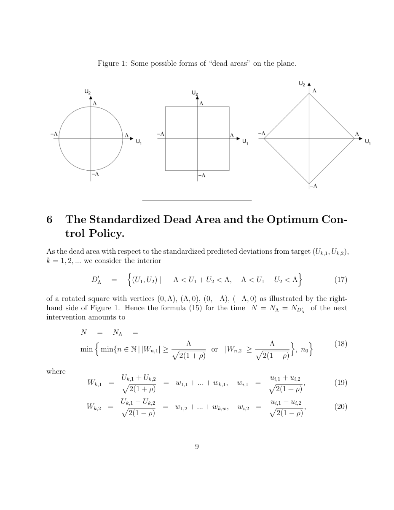
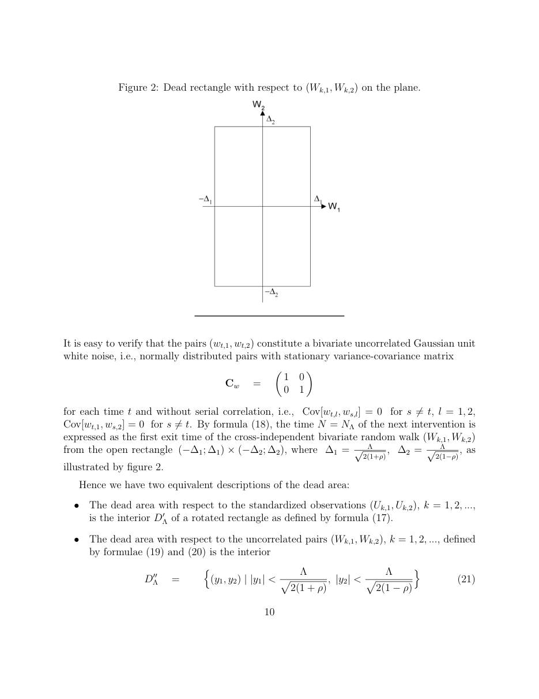
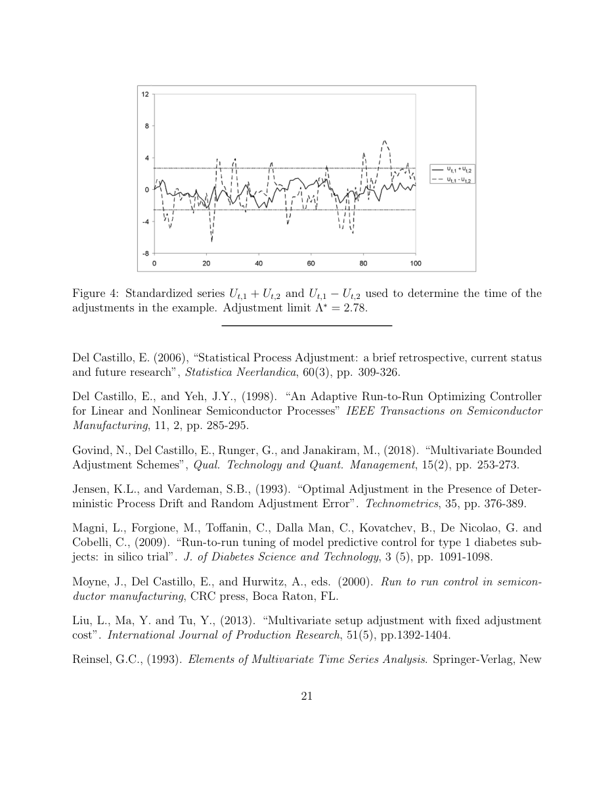

# 2변수 데드밴드 공정 조정 정책 (전문 번역)

- 원제: A Bivariate Dead Band Process Adjustment Policy
- 저자: Enrique Del Castillo (펜실베이니아 주립대, 산업제조공학과 및 통계학과), Rainer Göb (뷔르츠부르크 대학교 응용수학통계연구소)
- 2019년 12월. arXiv:1912.08337v1 [stat.ME] 2019-12-18
- 원문 파일: `delCastillo2019_arXiv1912.08337_bivariate_dead_band.pdf` (27쪽)
- 번역 범위: 전문. 초록, 본문 1장부터 11장, 그림 설명, 표 1, 부록 A, B, C. 참고문헌은 원문 그대로 둔다.
- 번역 메모: 수식 기호는 원문 표기를 그대로 쓴다. Λ 는 데드 영역의 크기, ρ 는 두 축의 교차상관, N 은 다음 조정까지의 시간, AAI 는 평균 조정 간격이다.

---

## 초록

Box 와 Jenkins (1963) 의 되먹임 조정 문제를 2변수로 넓힌 모형을 제시한다.
이 모형은 조정 1회에 드는 고정 비용과, 공정이 목표에서 벗어난 채 돌아가는 비용을 맞바꾼다.
고정 비용은 조정량의 크기와 무관하다고 본다. 목표 이탈 비용은 2차식이라고 본다.
두 반응의 목표 이탈을 보상할 수 있는 조절 인자가 두 개 있고, 외란은 2변수 IMA(1,1) 을 따른다고 본다.
최적 정책은 "데드밴드" 꼴이 된다. 즉 예측한 공정 반응이 R² 평면 위의 어떤 경계를 벗어날 때만 조정이 정당화된다.
이 경계는 반응이 목표에서 충분히 멀어질 것으로 예측되어 추가 조정이나 개입이 정당해지는 시점을 알려 준다.
원래는 공작기계를 제어하려고 만들었지만, 데드밴드 제어 정책은 다른 분야에도 쓸 수 있다.
예를 들어 몸속 어떤 물질의 양에 따라 약을 주어 병을 제어하는 데 쓸 수 있다(당뇨 관리 등).
이 논문은 목표 이탈 비용과 조정 비용을 단위 시간당으로 합친 손실 함수를 계산하는 해석식을 제시한다.
평균 조정 간격과, 목표로부터의 표준화 평균제곱편차에 대한 식도 유도한다.
손실 함수의 최소화와 그 결과 얻은 데드밴드 조정 전략의 실제 사용을, 반도체 제조 공정 사례로 보인다.

키워드: 시계열 제어, 되먹임 조정, 고정 조정 비용, 2변수 IMA 모형.

---

## 1. 서론

획기적인 논문에서 Box 와 Jenkins (1963) 는 "화학" 공정의 조정 정책과 "공작기계" 공정의 조정 정책을 대비했다.
뒤쪽은 보통 조정량 크기와 무관한 큰 조정 비용이 든다. 앞쪽은 목표 이탈 비용이 주로 지배한다.
목표 이탈 비용이 2차식이라고 두면, 단위 시간당 목표 이탈 비용과 고정 조정 비용의 합은 이 논문에서 데드밴드 조정 정책이라 부를 형태의 정책으로 최소가 된다는 것을 Box 와 Jenkins 가 보였다.
이 정책의 1변수 판에서는, 조정을 하지 않았을 때의 한 걸음 앞 최소평균제곱오차(MMSE) 예측값이 목표 주위로 대칭하게 놓인 두 "관리선" 안에 있는 한 공정을 조정하지 않는다.
이 두 선이 띠, 즉 공정을 제어하지 않고 두는 영역(데드밴드)을 정한다.
제어하지 않으면 공정은 IMA(1,1) 과정을 따라 목표에서 흘러간다고 본다.
최적 정책은 예측값에 적용한 Shewhart 관리도와 닮았다. 다만 관리(또는 조정) 한계의 폭은 목표 이탈 비용과 조정 비용을 맞바꿔 정한다.
이런 제어 문제의 기원과 다른 공정 제어 문제와의 관계는 Del Castillo (2002, 2006) 와 Woodall and Del Castillo (2014) 를 보라.

데드밴드 제어에 대한 관심은 원래 다룬 공작기계 문제를 훨씬 넘는다.
생명과학, 경영학, 금융공학 등에도 비슷한 문제가 있다.
예를 들어 데드밴드 제어 정책은, 몸속 한 가지 이상 물질의 양에 따라 환자에게 약을 주는 정책과 같은 형태다(집중 당뇨 관리에서 혈당 감시와 인슐린 공급, Magni et al. (2009) 참조).
또 다른 관심 분야는 현금 흐름 제어다. 예를 들어 투자 흐름, 회사의 부서나 지점 사이의 이체가 있다.
뒤쪽의 경우 조정에 비교적 비싼 조직 개입이 필요한 때가 많다. 즉 조정 비용이 크다.

1변수 데드밴드 조정 정책의 성질은 다른 저자들도 연구했다.
Crowder (1992) 는 계획 기간의 기간 수가 유한할 때 Box 와 Jenkins 의 1변수 공작기계 문제를 동적 계획법으로 푼다.
이는 갱신 보상 과정으로 장기 단위 시간당 평균 비용을 최소화한 Box 와 Jenkins (1963) 와 대비된다.
Crowder 는 생산 구동이 끝나 갈수록(공정 갱신이 일어난다고 볼 때) 최적 데드밴드 관리 한계가 나팔처럼 벌어짐을 보인다.
초기 기간에서는, 계획 기간이 길어질수록 데드밴드 한계 폭이 Box-Jenkins 의 장기 해에 가까워진다.
Box 와 Kramer (1992) 는 1변수 공작기계 모형에 표본 추출 비용 항을 더하고, 매 기간 표본을 뽑지 않을 때의 데드밴드 정책을 논한다.
Jensen 과 Vardeman (1993) 은 Crowder (1992) 의 유한 기간 모형을 연구하되, 조절 인자를 맞출 때 조정 오차가 생길 가능성을 고려했다.
이들은 고정 조정 비용이 전혀 없어도(2차 목표 이탈 비용만 있어도), 조정 오차가 있으면 데드밴드 같은 정책이 최적임을 보인다.
Srivastava 와 Wu (1991) 는 원래 Box 와 Jenkins 모형에 없던 검사 비용이 있을 때의 공작기계 문제를 다룬다.
최적 데드밴드 정책이 나오는 관련 문제로 셋업 조정 문제가 있다. 여기서는 i.i.d. 잡음 아래(즉 흐름이 없이) 갑작스런 교란, 공정 시작 시의 교란을 보상하는 데 고정 조정 비용이 든다. Zilong and Del Castillo (2006) 를 보라. 다변량 일반화는 Liu et al. (2013) 을 보라.

이 논문에서는 Box-Jenkins 1변수 데드밴드 모형을, 서로 상관될 수 있는 두 개의 관심 반응이 있고 공정을 조정할 조절 인자가 두 개 있는 경우로 넓힌다.
1변수 데드밴드 제어 모형의 다변량 확장은 분명히 실무 가치가 있다. 실제 공정 대부분은 제어할 반응이 여럿이고 조절 인자도 여럿이기 때문이다.
이 논문은 비교적 다루기 쉬우면서 실무에서 꽤 쓸모 있는 특수한 경우, 즉 두 반응이 두 조절 인자의 영향만 받는 경우에 대한 첫 시도다.
최근 Govind et al. (2018) 의 논문은 다변량 데드밴드 제어 접근을 제시한다. 거기서는 조정 빈도와 목표 이탈 비용을 맞바꾸는 최적 문턱값을, 여러 문턱값으로 공정을 모의실험해 얻는다.
이 논문은 대신 해석적으로 다룬다. 원래 Box-Jenkins 유도를 2변수로 자연스럽게 일반화한다.
논문 구성은 다음과 같다. 2장과 3장은 공정 가정과 제어 정책("제어기") 가정을 제시한다.
4장과 5장은 최소화할 손실 함수와 비용 가정을 다룬다.
6장은 최적(데드밴드) 2변수 정책의 형태를 준다.
최적 해는 표준화한 2변수 시계열의 2차, 4차 적률을 알아야 하므로 7장과 8장에서 이를 유도한다.
적률식을 얻은 뒤 9장에서 손실 함수의 근사를 주고, 10장에서 그 근사의 정확도를 살핀다.
11장은 손실 함수의 수치 최소화를 다룬다. 이 장에는 반도체 제조에서 가져온 현실적인 상황이 들어 있다. 거기서는 보통 두 개의 반응이 관심 대상이다.

## 2. 공정 모형

1변수 Box-Jenkins 공작기계 모형을 넓혀, 외란 쌍 z_t = (z_{t,1}, z_{t,2})' 가 2변수 IMA(1,1) 과정을 따른다고 본다. 즉

    z_t − z_{t−1} = ε_t − Θ ε_{t−1}        (1)

여기서 Θ = (θ_ij), 1 ≤ i, j ≤ 2 는 알려진 2×2 행렬이다.
쌍 ε_t = (ε_{t,1}, ε_{t,2})' 는 2변수 교차상관 가우스 백색잡음이다. 즉 정상 분산공분산 행렬

    C_ε = [ σ²_{1,α}   σ_α ;  σ_α   σ²_{2,α} ]

를 갖는 정규분포 쌍이며, 시간에 따른 자기상관은 없다. 즉 s ≠ t, l, m ∈ {1,2} 에 대해 Cov[ε_{t,l}, ε_{s,m}] = 0 이다.
분산공분산 행렬의 성분은 알려져 있다고 본다.
3장의 제어 정책을 위해서는 외란을 예측해야 한다.
외란 벡터 z_{t+1} 에 대해 시점 t 에서 계산한 한 걸음 앞 MMSE 예측 ẑ_{t+1} 은 다음 EWMA 점화식을 따른다.

    ẑ_{t+1} = L z_t + (I − L) ẑ_t        (2)

여기서 L = I − Θ 다. 시점 t+1 에 대한 한 걸음 앞 예측 오차 벡터는 시점 t+1 의 백색잡음 벡터 그 자체다. 즉

    z_{t+1} − ẑ_{t+1} = ε_{t+1}        (3)

## 3. 제어 모형

공정은 두 개의 제어 인자 X_{s+1,1}, X_{s+1,2} 로 제어할 수 있다고 본다. 이들은 조정 시점(개입 시점) s 에 설정된다. 즉 조정이 효과를 내기까지 한 시간 단위의 지연이 있다.
X = (X_{s+1,1}, X_{s+1,2})' 가 제어 벡터다.
제어 변수는 시점 t = s+1, s+2, ... 에서 두 공정 성분에 작용하는 외란 z_{t,1}, z_{t,2} 를 보상한다고 본다.
시점 s+1, ..., t 에 조정을 하지 않았다면, 제어 변수 효과 아래 목표 이탈 벡터는 d_t = z_t − X_{s+1} 이다.
이 모형은 각 제어 인자 X_{s+1,l} 의 단위 변화가 반응, 즉 목표 이탈 d_{t,l} 에 단위 변화를 일으킨다는 뜻이다.
다시 말해 d_t = z_t − G X_{s+1} 에서 "이득" 행렬 G 는 단위행렬이다.
이렇게 두어도 일반성을 잃지 않는다. G 가 단위행렬이 아니면 X_i = G X_i^(0) 으로 두면 되기 때문이다. 여기서 X_i^(0) 는 원래 제어 인자 벡터다.

시점 s 의 공정 개입(또는 조정)이란 두 제어 변수를 값 X_{s+1,1}, X_{s+1,2} 로 맞추는 것이다.
제조 응용에서 개입은 인력, 자재, 공정 정지, 생산량 손실 같은 요인 때문에 비용을 일으킨다.
환자에게 약을 주어 병을 제어하는 경우, 조정 비용은 약을 반복 투여해 환자가 겪는 신체적, 정서적 문제를 모형화한다.
11장에서 보이듯, 목표 이탈 비용이나 조정 비용을 명시적으로 정의하지 않고도 실용적인 2변수 데드밴드 정책을 정할 수 있다(1변수의 경우에 대해 Box 와 Luceño, 1997 이 강조했다).
C > 0 을 개입 1회의 비용이라 하자. 이는 조정 크기와 무관한 고정 조정 비용이다.
개입 비용을 줄이려면 늘 개입하지 않고 고른 개입 시점 s 에서만 개입하는 것이 합리적이다.

한편 조정을 거르면 외란의 영향이 커지고, 따라서 목표 이탈과 목표 이탈 비용이 커진다.
많은 경우 목표 이탈 비용은 목표로부터의 제곱 편차의 1차 함수로 잴 수 있다.
l 번째 생산 성분에서 목표 제곱 편차 단위당 비용을 a_l > 0 이라 하자. 즉 시점 t = s+1, s+2, ... 에서 성분 l 의 목표 이탈 비용은 a_l (z_{t,l} − X_{s+1,l})² 이다.

목표 이탈 비용을 보면, 예측한 목표 이탈량을 개입 기준으로 삼는 것이 합리적이다.
마지막 조정이 시점 s 에 있었고 그 결과 시점 s+1 의 조정 벡터가 X_{s+1} 이라 하자.
시점 s+k, k = 1, 2, ... 에서는 예측 목표 이탈 벡터

    d̂_{s+k+1} = ẑ_{s+k+1} − X_{s+1}        (4)

가 평면의 비임계 영역 D ⊂ R² 안에 있는 한 개입하지 않는다. 이 영역을 데드 영역이라 부른다.

    d̂_{s+n+1} ∉ D  또는  n ≥ n_0        (5)

가 되는 첫 시점 s+n 에서 경보가 울리고, 제어 변수를 시점 s+n+1 의 예측 외란을 보상하도록 조정한다. 즉 X_{s+n+1} = ẑ_{s+n+1} 로 둔다.
조정 없이 지날 수 있는 기간의 상한 n_0 는 기술적 또는 안전상 이유로 정해지거나, 설비 수명 같은 자명한 상한이다.
어느 쪽이든 n_0 는 큰 상한이고 경보는 대개 (5) 의 첫 번째 조건에서 나온다.
마지막 기록된 개입 시점 s 이후 다음 개입까지의 확률적 시간은

    N = N_D = min( min{ n ∈ N | d̂_{s+n+1} ∉ D }, n_0 )        (6)

기간 s+1, s+2, ..., s+N 동안 제어 벡터는 X_{s+1} 로 고정되고 목표 이탈 벡터는 다음과 같다.

    z_{s+1} − X_{s+1},  z_{s+2} − X_{s+1},  ...,  z_{s+N} − X_{s+1}        (7)

2변수에서의 데드 영역 D ⊂ R² 는 Box 와 Jenkins (1963) 의 1변수 데드 구간에 대응한다.
시간 축을 따라 평행이동하면 데드 구간은 데드밴드를 이룬다.
2변수에서 데드 영역 D 의 알맞은 모양은 5장에서 다룬다.

## 4. 손실 함수

좋은 제어 정책은 조정 비용과 목표 이탈 비용 사이에서 균형을 잡아야 한다.
경보가 드물면 조정 비용은 줄지만 목표 이탈 비용은 는다. 반대도 마찬가지다.
경제적으로 보면 가장 좋은 정책은 조정과 목표 이탈에서 생기는 단위 시간당 전체 손실을 최소로 하는 정책이다.
3장의 가정 아래 구체적인 제어 정책은 데드 영역 D ⊂ R² 로 정해진다.
따라서 3장의 정책으로 공정을 돌릴 때의 손실을 데드 영역 D 의 함수 L(D) 로 평가해야 한다.

시점 0 에서 시작해 3장의 정책으로 제어되는 공정 구동을 생각하자.
조정은 길이가 확률적인 기간 1, 2, 3, ... (길이 N_1, N_2, N_3, ...) 의 끝, 즉 시점 S_1 = N_1, S_2 = N_1 + N_2, S_3 = N_1 + N_2 + N_3 등에서 이루어진다.
연속한 두 조정 시점 S_k 와 S_{k+1} = S_k + N_{k+1} 사이의 각 시간 단위 S_k + 1, ..., S_k + N_{k+1} 에 대해 목표 이탈 비용은 2차 비용 함수 a_l (z_{S_k+i,l} − X_{S_k+1,l})² 로 계산한다.
따라서 k 번째 기간의 전체 손실은

    V_k = Σ_{l=1..2} Σ_{i=1..N_{k+1}} a_l (z_{S_k+i,l} − X_{S_k+1,l})² + C        (8)

시점 t 까지 지난 기간 수를 K(t) 라 하면, 시점 t 까지의 단위 시간당 손실은 V(t) = (1/t) Σ_{k=1..K(t)} V_k 다.
공정은 오래 돌아간다고 본다. 따라서 기대 전체 단위 시간당 손실을 극한 lim_{t→∞} E[V(t)] 로 평가하는 것이 합리적이다.
이 양을 계산하려면 쌍 (N_k, V_k), k = 1, 2, ... 가 시간에 따라 독립이고 같은 분포임을 보면 된다. 즉 이들은 갱신 보상 과정을 이룬다(증명은 부록 A).
따라서 갱신 보상 정리(Ross (1970) 참조)를 쓰면 극한은 lim_{t→∞} E[V(t)] = E[V] / E[N] 이 된다.
기대 도달 시간 E[N] 은 Box 와 Luceño (1997) 가 말하는 평균 조정 간격(AAI) 이다.
(8) 에서 E[V] 를 계산하면 다음 손실 함수를 얻는다.

    L(D) = E[V]/E[N]
         = (1/E[N]) Σ_{l=1..2} a_l E[ Σ_{i=1..N} (z_{i,l} − X_{1,l})² ] + C/E[N]
         = (1/E[N]) Σ_{l=1..2} a_l E[ Σ_{i=1..N} (ẑ_{i,l} − X_{1,l})² ] + C/E[N] + a_1 σ²_{1,α} + a_2 σ²_{2,α}        (9)

이는 데드 영역 D ⊂ R² 의 함수다.
편의를 위해 (9) 와 이후 계산에서는 시점 s = 0 의 조정 뒤 시점 1 에서 시작하는 첫 기간으로 E[V] 를 표현한다.
L 은 연속한 개입 사이의 시간 N = N_D 를 통해 D 에 의존한다. 여기서 N_D 는 (6) 으로 정의된다.

## 5. 표준화한 손실 함수

손실 함수 (9) 로 최적 제어 정책, 즉 최적 데드 영역 D* 를 D ⊂ R² 전체에서 L(D) 를 최소로 하는 것으로 정의할 수도 있다.
그러나 데드 영역의 허용 모양에 제한을 두지 않고 최적해를 정하기는 번거롭다.
손실 함수 L(D) 를 적절히 표준화한 판을 보면 D 의 합리적인 모양에 대해 더 분명한 생각을 얻는다.
이로부터 구체적인 최적 제어 정책을 정하기에 알맞은 간결한 제한이 나온다.

손실 함수 L(D) 계산에 필요한 확률변수 ẑ_{i,l} − X_{1,l}, l = 1, 2 는 벡터 ẑ_i − X_1 의 성분이다.
(2), (3) 과 X_1 = ẑ_1 로부터

    ẑ_i − X_1 = Σ_{j=1..i−1} L ε_j        (10)

확률벡터 β_j = L ε_j = (β_{j,1}, β_{j,2})' 의 성분은 분산공분산 행렬

    C_β = [ σ²_{1,β}  σ_β ; σ_β  σ²_{2,β} ] = L C_ε L'        (11)

를 가지며 시간에 따라 상관이 없다. 교차공분산 C_β 에 대해 두 경우를 나눈다.

먼저 det C_β = 0 인 경우를 보자. 그러면 β_{j,1} 과 β_{j,2} 사이에 확률 1 로 선형 관계가 성립한다. 즉 P(c_1 β_{j,1} + c_2 β_{j,2} = c_3) = 1 인 실수 c_1, c_2, c_3 가 있다(Schmetterer (2012) 참조).
이 경우 본질적으로 1변수 문제 하나를 다루는 것이며 Box 와 Jenkins (1963) 의 결과로 풀 수 있다.

이후로는 det C_β ≠ 0 이라고 본다. 그러면 각 확률벡터 β_j = L ε_j 는 분산공분산 행렬 C_β 를 갖는 2변수 정규분포를 따른다(Schmetterer (2012)).
벡터 u_j = (u_{j,1}, u_{j,2})', u_{j,l} = β_{j,l} / σ_{l,β} 는 2변수 교차상관(단 시간 자기상관은 없는) 가우스 단위 백색잡음을 이룬다. 즉 정상 분산공분산 행렬

    C_u = [ 1  ρ ; ρ  1 ]

을 갖는 정규분포 쌍이고, 여기서 ρ = σ_β / (σ_{1,β} σ_{2,β}) 이며 s ≠ t 에 대해 Cov[u_{t,l}, u_{s,m}] = 0 이다.
det C_β ≠ 0 이라는 가정은 |ρ| < 1 이라는 가정과 같다.

U_i = u_1 + ... + u_i 라 두면 (10) 으로부터

    ẑ_{i,l} − X_{1,l} = σ_{l,β} U_{i−1,l},   i = 1, 2, ...,  l = 1, 2        (12)

따라서 손실 함수 L(D) 를 다음 꼴로 쓸 수 있다.

    L(D) = a_1 σ²_{1,α} + a_2 σ²_{2,α} + a_1 σ²_{1,β} G_1(D) + a_2 σ²_{2,β} G_2(D) + C/E[N]        (13)

여기서

    G_l(D) = E[ Σ_{j=1..N_D} U²_{j−1,l} ] / E[N_D],   l = 1, 2        (14)

를 표준화 평균제곱편차(MSD) 라 부른다.
예측 목표 이탈 d̂_{k+1,l} = ẑ_{k+1,l} − X_{1,l} (식 4) 은 d̂_{k+1,l} = σ_{l,β} U_{k,l} 로 쓸 수 있다.
따라서 (5) 와 같은 뜻으로, 다음 개입 시간 N 은

    N = N_{D'} = min( min{ n ∈ N | U_n ∉ D' }, n_0 )        (15)

여기서

    D' = { (x_1/σ_{1,β},  x_2/σ_{2,β}) | (x_1, x_2) ∈ D }        (16)

이제 데드 영역 D' 의 모양에 합리적인 제한을 둘 수 있다.
경보 신호 U_n ∉ D' 는 두 보상 변수를 모두 조정하게 만든다는 점을 기억하자.
따라서 두 성분 중 어느 쪽도 경보를 더 잘 일으키는 쪽으로 치우치면 안 된다.
벡터 U_k = (U_{k,1}, U_{k,2})' 의 2변수 분포가 대칭이므로, 데드 영역 D' 에도 대칭성이 있어야 한다.

(DA) D' ⊂ R² 는 좌표 바꿈 (x_1, x_2) → (x_2, x_1) 에 대해 불변이어야 한다.

산업 현장(또는 환자의 병 제어)에서 실제로 쓰려면, D' 가 평면 위의 단순한 기하 모양의 볼록 영역이어야 한다는 요구도 합리적이다.
D' 를 고르는 단순한 세 가지 방법을 그림 1 에 보인다. 원, 정사각형, 회전한 정사각형이다.
셋 다 위 요구를 만족하며, 각각 Box 와 Jenkins (1963) 의 1변수 데드 구간을 2변수로 옮긴 합리적인 방법이다.
경제적으로 보면 셋 중 가장 좋은 것은, 손실 함수를 정해진 수준 c = L(D) = L(D') 로 둔 채 데드 영역을 최대, 즉 개입을 최소로 하는 것이다.
그런 뜻에서 최적 모양은 원이라고 추측한다.
그러나 원 D' 에 대한 L(D') 값을 정하기는 수학적으로 어렵다.
제어 정책을 실제로 쓸 수 있는 해를 주기 위해, 정사각형 모양의 데드 영역 D' 를 쓴다.
6장에서 보듯, 그림 1 의 오른쪽 같은 회전한 정사각형 D' 가 계산에 가장 편하다.

**그림 1: 평면 위 "데드 영역"의 가능한 몇 가지 모양.** 왼쪽은 원, 가운데는 정사각형, 오른쪽은 꼭짓점이 (0, Λ), (Λ, 0), (0, −Λ), (−Λ, 0) 인 회전한 정사각형이다.

## 6. 표준화한 데드 영역과 최적 제어 정책

표준화한 예측 목표 이탈 (U_{k,1}, U_{k,2}), k = 1, 2, ... 에 대한 데드 영역으로 다음 내부를 쓴다.

    D'_Λ = { (U_1, U_2) | −Λ < U_1 + U_2 < Λ,  −Λ < U_1 − U_2 < Λ }        (17)

이는 그림 1 오른쪽처럼 꼭짓점이 (0, Λ), (Λ, 0), (0, −Λ), (−Λ, 0) 인 회전한 정사각형이다.
따라서 다음 개입 시간 N = N_Λ = N_{D'_Λ} 에 대한 (15) 는 다음과 같이 된다.

    N = N_Λ = min( min{ n ∈ N | |W_{n,1}| ≥ Λ/√(2(1+ρ))  또는  |W_{n,2}| ≥ Λ/√(2(1−ρ)) }, n_0 )        (18)

여기서

    W_{k,1} = (U_{k,1} + U_{k,2}) / √(2(1+ρ)) = w_{1,1} + ... + w_{k,1},   w_{i,1} = (u_{i,1} + u_{i,2}) / √(2(1+ρ))        (19)
    W_{k,2} = (U_{k,1} − U_{k,2}) / √(2(1−ρ)) = w_{1,2} + ... + w_{k,2},   w_{i,2} = (u_{i,1} − u_{i,2}) / √(2(1−ρ))        (20)

**그림 2: 평면 위 (W_{k,1}, W_{k,2}) 에 대한 데드 직사각형.**

쌍 (w_{t,1}, w_{t,2}) 가 2변수 무상관 가우스 단위 백색잡음임을 쉽게 확인할 수 있다. 즉 정상 분산공분산 행렬

    C_w = [ 1  0 ; 0  1 ]

을 갖는 정규분포 쌍이며 시간 자기상관이 없다. 즉 s ≠ t 에 대해 Cov[w_{t,1}, w_{s,1}] = 0, Cov[w_{t,2}, w_{s,2}] = 0 이고, s ≠ t 에 대해 Cov[w_{t,1}, w_{s,2}] = 0 이다.

(18) 로부터 다음 개입 시간 N = N_Λ 는, 교차독립인 2변수 확률보행 (W_{k,1}, W_{k,2}) 가 열린 직사각형 (−Δ_1; Δ_1) × (−Δ_2; Δ_2) 를 처음 벗어나는 시간으로 표현된다.
여기서 Δ_1 = Λ/√(2(1+ρ)), Δ_2 = Λ/√(2(1−ρ)) 이며 그림 2 에 나타냈다.

따라서 데드 영역을 두 가지로 똑같이 설명할 수 있다.

- 표준화 관측 (U_{k,1}, U_{k,2}), k = 1, 2, ... 에 대한 데드 영역은 (17) 로 정의한 회전 직사각형의 내부 D'_Λ 다.
- (19), (20) 으로 정의한 무상관 쌍 (W_{k,1}, W_{k,2}), k = 1, 2, ... 에 대한 데드 영역은, 축에 평행한 직사각형의 내부다.

    D''_Λ = { (y_1, y_2) | |y_1| < Λ/√(2(1+ρ)),  |y_2| < Λ/√(2(1−ρ)) }        (21)

손실 함수는 매개변수 Λ 가 (0; +∞) 를 움직이는 함수 L(Λ) = L(D'_Λ) = L(D''_Λ) 로 쓸 수 있다.
따라서 최적 제어 정책은 모든 Λ > 0 에 대해 L(Λ) 를 최소로 하는 값 Λ* 로 정의할 수 있다.
1변수의 경우와 마찬가지로, 데드 영역 D'_Λ (원점 중심의 회전한 정사각형) 와 D''_Λ (원점 중심의 축평행 직사각형) 는 시간 축을 따라 평행이동하면 데드 막대를 이룬다.
실용적으로는, U_{t,1} + U_{t,2} 와 U_{t,1} − U_{t,2} 를 한계선 ±Λ 를 둔 "조정 차트"에 그리는 것이 아마 더 낫다. 11장에서 이를 보인다.
먼저 표준화 손실 함수를 계산하는 데 필요한 적률을 본다.

## 7. U_{N,l} 과 W_{N,m} 의 적률 사이 관계

손실 함수 L(D'_Λ) = L(Λ) 를 계산하려면 표준화 누적 목표 이탈의 적률 E[U²_{N,l}], E[U⁴_{N,l}] 이 필요하다. 9장에서 쓴다.
데드 영역 D'_Λ 의 선택으로 U_{N,1} 과 U_{N,2} 는 같은 분포를 갖는다. 따라서

    E[|U_{N,1}|^q] = E[|U_{N,2}|^q],  q ∈ N_0        (22)

2변수 정규분포의 대칭성과 데드 영역의 대칭성으로부터 분명히

    E[U^q_{N,1}] = 0 = E[U^q_{N,2}],  q = 1, 3, 5, ...        (23)

변수 U_{k,1}, U_{k,2} 사이 상관 때문에 적률 E[U^q_{N,l}], q = 2, 4, ... 을 직접 계산하기는 꽤 복잡하다.
적률 E[W^q_{N,m}] 을 먼저 계산하고(8장) 거기서 E[U²_{N,l}] 과 E[U⁴_{N,l}] 를 유도하는 편이 편하다.
이를 위해 U_{N,l} 의 적률과 W_{N,m} 의 적률 사이 관계를 세운다. (19), (20) 으로부터

    E[U²_{N,l}] = (1/2) ( (1+ρ) E[W²_{N,1}] + (1−ρ) E[W²_{N,2}] )        (24)
    E[U⁴_{N,l}] + 3 E[U²_{N,1} U²_{N,2}] = (1+ρ)² E[W⁴_{N,1}] + (1−ρ)² E[W⁴_{N,2}]        (25)
    E[U⁴_{N,l}] − E[U²_{N,1} U²_{N,2}] = 2(1 − ρ²) E[W²_{N,1} W²_{N,2}]        (26)

(25) 와 (26) 을 합치면

    E[U⁴_{N,l}] = (1/4) ( (1+ρ)² E[W⁴_{N,1}] + 6(1 − ρ²) E[W²_{N,1} W²_{N,2}] + (1−ρ)² E[W⁴_{N,2}] )        (27)

## 8. W_{N,m} 의 적률

변수 W_{k,1}, W_{k,2} 가 독립이므로, Box 와 Jenkins (1963) 가 1변수에서 쓴 방법을 적용해 적률 E[W^q_{N,m}] 과 E[W^p_{N,1} W^r_{N,2}] 의 근사를 구할 수 있다.
이 유도에서는 조정 없이 지날 수 있는 기간의 상한 n_0 를 무시한다. n_0 에 대한 설명은 3장을 보라.

데드 영역과 정규분포의 대칭성으로부터 분명히

    E[W^q_{N,1}] = 0 = E[W^q_{N,2}],  q = 1, 3, 5, ...        (28)

6장처럼 Δ_1 = Λ/√(2(1+ρ)), Δ_2 = Λ/√(2(1−ρ)) 로 줄여 쓴다. k ∈ N 에 대해 h_k 를 W_{1,m}, ..., W_{k,m} 의 결합밀도라 하고, g_{k,m} 을 다음으로 정의한다.

    g_{k,m}(y) = ∫...∫_{|y_1|<Δ_m, ..., |y_{k−1}|<Δ_m} h_k(y_1, ..., y_{k−1}, y) dy_1...dy_{k−1}        (29)

W_{k,m} = w_{k,m} + W_{k−1,m} 이고 w_{k,m} 이 N(0,1) 을 따르므로, 함수 g_{k,m} 은 다음 점화식을 따른다.

    g_{k,m}(x_m) = ∫_{|y_m|<Δ_m} g_{k−1,m}(y_m) φ(x_m − y_m) dy_m        (30)

여기서 φ(z) = (1/√(2π)) exp(−z²/2) 는 정규분포 N(0,1) 의 밀도함수다.
g_{k,m} 은 사건 {|W_{1,m}| < Δ_m, ..., |W_{k−1,m}| < Δ_m} 에서 W_{k,m} 의 밀도다. 즉 보렐 집합 B 에 대해

    P(W_{k,m} ∈ B, |W_{1,m}| < Δ_m, ..., |W_{k−1,m}| < Δ_m) = ∫_B g_{k,m}(x_m) dx_m        (31)

(31) 로부터

    g_{n−1,1} · g_{n−1,2} · 1I_{(−Δ_1;Δ_1)×(−Δ_2;Δ_2)} / P(N ≥ n)

이 조건 N ≥ n 아래 W_{n−1,1} 과 W_{n−1,2} 의 결합 조건부 밀도임이 따라 나온다. 여기서 1I_B 는 집합 B 의 지시함수다.
Box 와 Jenkins (1963) 가 1변수에서 쓴, 직관적으로 합리적인 방법을 따른다. 즉 조건 N ≥ n 아래 W_{n−1,1} 과 W_{n−1,2} 의 결합 조건부 분포를 데드 직사각형 (−Δ_1; Δ_1) × (−Δ_2; Δ_2) 위의 2변수 균등분포로 근사한다. 즉

    g_{n−1,1} · g_{n−1,2} · 1I_{(−Δ_1;Δ_1)×(−Δ_2;Δ_2)} / P(N ≥ n)  ≈  1 / (4 Δ_1 Δ_2)        (32)

이 근사의 정확도는 10장에서 살핀다.
이 근사 아래 p, r ∈ N_0 에 대해 다음을 얻는다.

    E[W^p_{N,1} W^r_{N,2} | N = n] P(N = n)
      ≈ ( P(N ≥ n) / (4 Δ_1 Δ_2) ) ( I(Δ_1, p) [ I(Δ_2, r) + J(Δ_2, r) ] + J(Δ_1, p) I(Δ_2, r) )

여기서 Δ ≥ 0, q ∈ N_0 에 대해

    I(Δ, q) = ∫_{|x|≥Δ} x^q [ Φ(x + Δ) − Φ(x − Δ) ] dx        (33)
    J(Δ, q) = ∫_{|x|<Δ} x^q [ Φ(x + Δ) − Φ(x − Δ) ] dx        (34)

적분 I(Δ, q) 와 J(Δ, q) 는 부록 B 의 명제 B.1 로 계산한다. 특히

    I(Δ, 0) = 2 [ φ(0) − φ(2Δ) ] + 2Δ [ 1 − Φ(2Δ) ],   J(Δ, 0) = 2Δ − I(Δ, 0)        (35)

위 유도에서 p = 0 = r 로 두고 (35) 를 쓰면

    P(N = n) ≈ ( P(N ≥ n) / (4 Δ_1 Δ_2) ) ( 2Δ_2 I(Δ_1, 0) + [ 2Δ_1 − I(Δ_1, 0) ] I(Δ_2, 0) )

끝으로 p, r ∈ N_0 에 대해

    E[W^p_{N,1} W^r_{N,2}] = Σ_{n=1..∞} E[W^p_{N,1} W^r_{N,2} | N = n] P(N = n)
      ≈ ( I(Δ_1, p) [ I(Δ_2, r) + J(Δ_2, r) ] + J(Δ_1, p) I(Δ_2, r) ) / ( 2Δ_2 I(Δ_1, 0) + [ 2Δ_1 − I(Δ_1, 0) ] I(Δ_2, 0) )        (36)

특히 q ∈ N_0 에 대해

    E[W^q_{N,1}] ≈ ( I(Δ_1, q) 2Δ_2 + J(Δ_1, q) I(Δ_2, 0) ) / ( 2Δ_2 I(Δ_1, 0) + [ 2Δ_1 − I(Δ_1, 0) ] I(Δ_2, 0) )        (37)

## 9. 손실 함수 L(Λ) 의 근사

표준화 누적 목표 이탈 Σ_{j=1..N_D} U²_{j−1,1} 과 Σ_{j=1..N_D} U²_{j−1,2} 는 같은 분포를 갖는다.
따라서 (14) 로부터 G_1(D'_Λ) = G_2(D'_Λ) 다.
부록 C 의 (52), (53) 으로 정의한 마팅게일 (R_{n,l}), (Y_{n,l}), (Z_{n,l}) 을 생각하자.
N_D 는 이 마팅게일들의 정지시간이고 N_D ≤ n_0 로 균등 유계다.
따라서 선택적 정지 정리(Rogers and Williams (1994) 참조)로부터

    E[N] = E[U²_{N,l}],    E[ Σ_{j=1..N_D} U²_{j−1,l} ] = E[U⁴_{N,l}]/6 − E[N]/2        (38)

이 식들은 근사가 아니라 정확한 값임을 짚어 둔다. Box 와 Jenkins (1963) 는 근사로 보았다.

(14) 에 넣으면 표준화 MSD 를 얻는다.

    G_1(D'_Λ) = G_2(D'_Λ) = E[U⁴_{N,l}] / (6 E[U²_{N,l}]) − 1/2        (39)

따라서 (13) 으로부터

    L(Λ) = L(D'_Λ) = a_1 σ²_{1,α} + a_2 σ²_{2,α} + (a_1 σ²_{1,β} + a_2 σ²_{2,β}) ( E[U⁴_{N,l}]/(6 E[U²_{N,l}]) − 1/2 ) + C / E[U²_{N,l}]        (40)

손실 함수 L(Λ) = L(D'_Λ) 의 근사를 얻으려면, (24), (27), (36), (37) 로 구한 적률 E[U²_{N,l}], E[U⁴_{N,l}] 의 근사를 (40) 에 넣는다.

## 10. 근사의 정확도

적률식 (24) 와 (27) 은 근사 (32) 에 기대고 있다.
Box 와 Jenkins (1963) 가 1변수에서 보고한 것과 비슷하게, 공정이 데드 영역을 벗어나기 전 표준화 2변수 과정 W_{n−1} 이 균등분포를 따른다는 가정은 부정확한 것으로 나타났다. 특히 Λ 가 클 때 그렇다.
기하학적 이유는, Λ 가 크면 점 (W_{n−1,1}, W_{n−1,2}) 이 영역 중심보다 데드 영역 경계 쪽에 더 몰리기 때문이다.
그래서 보정 회귀식을 경험적으로 만들었다. 모의실험으로 "실제" 적률 E_r[U²_{N,l}], E_r[U⁴_{N,l}] 을 계산하고, 차이 D_2 = E[U²_{N,l}] − E_r[U²_{N,l}] 와 D_4 = E[U⁴_{N,l}] − E_r[U⁴_{N,l}] 를 계산했다.
여기서 E_r[U²_{N,l}] 과 E_r[U⁴_{N,l}] 은 |ρ| ∈ {0.1, 0.25, 0.5, 0.75, 0.85, 0.95} 와 Λ ∈ {1, 2, ..., 15} 에 대해 갱신 50,000 회를 모의실험해 추정했다.
적률 E[U²_{N,l}] 과 E[U⁴_{N,l}] 은 (24), (27) 로 계산했다.
(18) 부터 (20) 에서 적률은 교차상관계수 ρ 의 부호와 무관함에 유의하라.

2차 적률 오차 자료에 맞춘 보정 모형은 다음과 같다.

    D_2^0.337 = 0.385 + 0.133Λ − 0.840|ρ| − 0.00172Λ² + 0.90ρ² + 0.0375Λ|ρ|        (41)

즉 자료에 Box-Cox 거듭제곱 변환을 적용한 뒤 Λ 와 ρ 의 2차 다항 모형을 맞췄다(그래서 왼쪽에 지수가 붙었다).
이 모형은 Λ > 2 에 대해 맞췄다. Λ 가 작으면 해석식이 실제 적률을 잘 근사하기 때문이다.
다행히 모형 (41) 의 적합은 아주 좋다. R² = 0.997 이고, 각 설명변수의 유의성 검정 p 값은 모두 소수 셋째 자리까지 0 이다.

4차 적률 오차에 맞춘 모형은 다음과 같다.

    D_4^0.224 = 0.515 + 0.386Λ − 1.25|ρ| + 0.00118Λ² + 1.44ρ² + 0.0768Λ|ρ|        (42)

앞과 마찬가지로 오차에 Box-Cox 변환을 적용한 뒤 Λ 와 ρ 의 완전 2차 다항식을 맞췄다.
Λ ≤ 2 인 값은 앞처럼 회귀에서 제외했다.
적합은 다시 아주 좋아 R² = 0.999 이고, 각 모형 모수의 개별 유의성 검정 p 값은 모두 0.001 이하다.

표준화 비용 함수를 최소화할 때, 보정식 (41), (42) 는 Λ ≥ 2 에 썼다.
Λ < 2 에서는 보정을 쓰지 않고 해석식 (24), (27) 을 그대로 썼다.

## 11. 표준화 손실 함수의 최소화

(40) 에서 보듯 최적해 Λ* 는 상대 비용 모수

    C' = C / (a_1 σ²_{1,β} + a_2 σ²_{2,β})

에 의존한다.
최적해가 의존하는 다른 모수는 2변수 계열 β_j = L ε_j 의 교차상관 |ρ| 뿐이다.
Λ* 를 찾기 위해 비용 함수

    L'(Λ) = L(Λ)/(a_1 σ²_{1,β} + a_2 σ²_{2,β}) − (a_1 σ²_{1,α} + a_2 σ²_{2,α})/(a_1 σ²_{1,β} + a_2 σ²_{2,β})
           = E[U⁴_{N,l}]/(6 E[U²_{N,l}]) − 1/2 + C'/E[U²_{N,l}]

을 Matlab 의 fminbnd 함수로 최소화했다. 이 함수는 경계가 있는 비선형 함수를 최소화한다(아래 표에서는 모두 경계 0.1 과 20 을 썼다).
Λ > 2 에서는 두 적률을 (41), (42) 로 보정했다.
이 장에서 보고한 해는 그 구간 안에서 함수의 유일한 최소점임을 확인했다(이 장에서 쓴 Matlab 코드는 제1저자에게 요청하면 받을 수 있다).

표 1 은 여러 |ρ| 와 C' 값에 대한 최적해 Λ*, 그에 대응하는 손실 함수 값 L'(Λ*), 표준화 MSD 값 G_l(D'_Λ), 평균 조정 간격(AAI = E[N]) 을 보인다.
여기서 사용자는 비용 C' 를 명시적으로 정의하지 않고도 받아들일 만한 MSD 와 AAI 값을 찾아 해를 고를 수 있다.
대체로 최적 한계 Λ* 는 상대 고정 조정 비용 C' 가 커질수록, 그리고 상관 |ρ| 가 커질수록 커진다.
비용 함수는 최소점 주변에서 꽤 평평했다. 따라서 Λ 가 최적값 Λ* 에서 조금 벗어나도 실무상 중요하지 않다.

**표 1. 몇 가지 최적해.**

| C' | \|ρ\| | Λ* | L'(Λ*) | 표준화 MSD | AAI |
|---|---|---|---|---|---|
| 1 | 0.0 | 1.01 | 0.63 | 0.10 | 1.91 |
| 1 | 0.3 | 1.02 | 0.63 | 0.11 | 1.91 |
| 1 | 0.6 | 1.21 | 0.63 | 0.16 | 2.11 |
| 1 | 0.9 | 1.39 | 0.54 | 0.22 | 2.69 |
| 4 | 0.0 | 2.85 | 1.66 | 0.69 | 4.10 |
| 4 | 0.3 | 2.73 | 1.69 | 0.71 | 4.06 |
| 4 | 0.6 | 2.73 | 1.65 | 0.68 | 4.12 |
| 4 | 0.9 | 2.99 | 1.44 | 0.56 | 4.57 |
| 7 | 0.0 | 3.40 | 2.30 | 0.99 | 5.35 |
| 7 | 0.3 | 3.29 | 2.33 | 1.02 | 5.33 |
| 7 | 0.6 | 3.33 | 2.28 | 1.00 | 5.47 |
| 7 | 0.9 | 3.61 | 2.00 | 0.84 | 6.01 |
| 10 | 0.0 | 3.79 | 2.81 | 1.24 | 6.35 |
| 10 | 0.3 | 3.69 | 2.85 | 1.27 | 6.35 |
| 10 | 0.6 | 3.74 | 2.78 | 1.24 | 6.51 |
| 10 | 0.9 | 4.04 | 2.46 | 1.06 | 7.14 |
| 20 | 0.0 | 4.66 | 4.12 | 1.87 | 8.88 |
| 20 | 0.3 | 4.58 | 4.15 | 1.92 | 8.93 |
| 20 | 0.6 | 4.64 | 4.05 | 1.87 | 9.17 |
| 20 | 0.9 | 5.00 | 3.63 | 1.63 | 10.02 |
| 50 | 0.0 | 6.06 | 6.76 | 3.16 | 13.91 |
| 50 | 0.3 | 6.00 | 6.76 | 3.21 | 14.06 |
| 50 | 0.6 | 6.11 | 6.59 | 3.14 | 14.47 |
| 50 | 0.9 | 6.56 | 5.95 | 2.78 | 15.75 |
| 80 | 0.0 | 6.91 | 8.66 | 4.10 | 17.54 |
| 80 | 0.3 | 6.86 | 8.65 | 4.14 | 17.76 |
| 80 | 0.6 | 7.01 | 8.42 | 4.05 | 18.30 |
| 80 | 0.9 | 7.52 | 7.64 | 3.62 | 19.90 |
| 100 | 0.0 | 7.35 | 9.74 | 4.63 | 19.58 |
| 100 | 0.3 | 7.31 | 9.71 | 4.67 | 19.85 |
| 100 | 0.6 | 7.47 | 9.45 | 4.57 | 20.47 |
| 100 | 0.9 | 8.02 | 8.59 | 4.09 | 22.24 |
| 400 | 0.0 | 10.71 | 19.98 | 9.73 | 39.04 |
| 400 | 0.3 | 10.74 | 19.79 | 9.72 | 39.74 |
| 400 | 0.6 | 11.04 | 19.21 | 9.48 | 41.13 |
| 400 | 0.9 | 11.89 | 17.56 | 8.62 | 44.75 |
| 700 | 0.0 | 12.44 | 26.59 | 13.06 | 51.71 |
| 700 | 0.3 | 12.52 | 26.28 | 13.00 | 52.70 |
| 700 | 0.6 | 12.89 | 25.47 | 12.66 | 54.64 |
| 700 | 0.9 | 13.90 | 23.31 | 11.56 | 59.57 |
| 1000 | 0.0 | 13.67 | 31.87 | 15.72 | 61.91 |
| 1000 | 0.3 | 13.79 | 31.46 | 15.62 | 63.15 |
| 1000 | 0.6 | 14.22 | 30.47 | 15.21 | 65.55 |
| 1000 | 0.9 | 15.36 | 27.89 | 13.92 | 71.58 |

### Box 와 Jenkins 의 1변수 최적해와의 관계

ρ = 0 (이는 ρ_β = 0 을 뜻한다) 이고 Θ 와 G 가 모두 대각행렬이면, 이 논문의 정식화는 반응마다 하나씩 Box 와 Jenkins (1963) 식 1변수 문제 두 개를 따로 푸는 것으로 줄어든다. 이때 두 반응은 분리되었다고 말한다.
2변수 모형과 1변수 모형의 관계를 더 보기 위해, 이 논문의 절차로 1변수 문제 하나를 풀어 볼 수 있다.
백색잡음이 σ², IMA(1,1) 모수가 θ, 목표 이탈 비용이 a, 조정 비용이 C 인 Box-Jenkins (1963) 1변수 데드밴드 규칙의 최적해를 구한다고 하자.
그러면 코드에 a_1 = a_2 = a, σ²_{1,β} = σ²_{2,β} = (1 − θ)² σ² 로 두고 ρ = 0 으로 둔다.
L'(Λ) 를 최소화해 얻은 해는 Box 와 Jenkins 가 찾은 최적해 Λ_BJ 와 Λ_BJ = Λ*/√2 의 관계로 이어진다.
이유는 이 논문의 데드 영역이 회전한 모양이기 때문이다(그림 1). Λ_BJ 는 정사각형의 폭이지만 여기서는 대각선 길이의 절반인 Λ 를 푼다.
이제 2변수 절차를 실제 예로 보인다.

### 예시

개발한 조정 방법과 얻은 최적해의 실제 응용으로, 반도체 제조에서 매우 중요한 화학기계연마(CMP) 공정을 생각하자.
이것은 연마 공정이며 보통 두 개의 반응이 관심 대상이다(예: Moyne et al, 2000).
실리콘 산화물의 제거율(이하 z_{t,1}) 은 여기서 목표를 2700 이라 하고, 웨이퍼의 비균일도(이하 z_{t,2}) 는 목표를 500 이라 한다.
조절 인자 두 개, 즉 하향력 X_{t,1}^(0) 과 테이블 속도 X_{t,2}^(0) 을 조정해 목표에 더 잘 맞출 수 있다. 인자는 부호화 단위다.
여기서 시간 지표 t 는 웨이퍼 번호다. 단일 웨이퍼 CMP 장비를 쓴다고 본다.
방법을 보이기 위해, Del Castillo and Yeh (1998) 가 보고한 실제 실험에서 얻은 모형을 조금 고쳐 이 공정을 모의실험한다.
공정을 모의실험하면 조정을 하지 않았을 때 무슨 일이 일어났을지 볼 수 있다.

이 예시에서 모의실험한 모형의 이득 행렬은

    G = [ 547.6   616.3 ; −62.3  −128.6 ]

IMA 모수 행렬은

    Θ = [ 0.4  0.1 ; 0.3  0.5 ]

2변수 정규 백색잡음의 공분산 행렬은

    C_ε = [ 3600  −1500 ; −1500  900 ]

실무에서는 앞의 모수 추정값을 다변량 시계열 기법으로 얻을 수 있다(Reinsel (1993) 참조).

위 자료로부터

    C_β = (I − Θ) C_ε (I − Θ)' = [ 1501  −1268 ; −1268  1399 ]

따라서 ρ = ρ_β = −0.8750 이다.
제거율이 원하는 목표 2700 에서 한 단위(여기서는 단위 시간당 옹스트롬) 벗어난 채 웨이퍼 한 장을 처리하는 데 a_1 = 0.1 달러가 든다고 하자.
마찬가지로 비균일도가 목표 500 에서 한 단위(여기서는 옹스트롬) 벗어난 웨이퍼 한 장에 a_2 = 0.1 달러가 든다고 하자.
각 웨이퍼 처리에 쓰는 "레시피" 를 조정하는 비용이 C = 1000 달러라고 하자. 여기에는 장비 재시동 비용(조정 뒤 시험 웨이퍼를 넣기도 한다), 장비 정지, 작업자 시간이 들어간다.
주어진 비용 구조와 공정 정보로부터 C' = C / (a_1 σ²_{1,β} + a_2 σ²_{2,β}) = 3.448 이다.
L'(Λ) 를 Λ 에 대해 최소화하면 최적 한계 Λ* = 2.78, 손실 L'(2.78) = 1.3451, AAI = E[N] = 4.1589 (조정 사이 웨이퍼 수) 를 얻는다. 즉 웨이퍼 100 장을 생산할 때 평균 약 24 회 조정한다.

그 결과 얻은 공정 조정 절차는 다음과 같다.
모수 행렬 L = I − Θ 를 쓰는 벡터 EWMA 가, 두 반응의 측정값에 기반해 한 걸음 앞 예측 ẑ_{k+1,1}, ẑ_{k+1,2} 를 준다.
각 시점 k 에서 표준화 2변수 계열 U_k 를 다음과 같이 계산한다.

    U_k = ( U_{k,1}, U_{k,2} )' = ( (ẑ_{k+1,1} − X_{s,1})/σ_{1,β},  (ẑ_{k+1,2} − X_{s,2})/σ_{2,β} )'

여기서 s < k 는 마지막으로 조정한 기간이고, X_k = G X_k^(0) 를 쓴다. X_k^(0) 는 하향력과 테이블 속도를 성분으로 갖는 벡터다.
|U_{k,1} + U_{k,2}| > 2.78 = Λ* 이거나 |U_{k,1} − U_{k,2}| > 2.78 이면, 조절 인자를 X_{k+1} = ẑ_{k+1} 이 되도록 바꾼다. 원래 조절 인자로 말하면 새 설정은 X_{k+1}^(0) = G^(−1) ẑ_{k+1} 이다.

그림 3 은 제어하지 않은 공정과 제어한 공정을 보인다.
그림 4 는 표준화량 U_{k,1} + U_{k,2} 와 U_{k,1} − U_{k,2} 를 한계선 ±Λ* = ±2.78 을 둔 "조정 차트"에 보인다.
끝으로 그림 5 는 조절 인자의 값을 보인다. 수평 구간은 그 기간에 조정이 없었다는 뜻이다.
그림에 나온 이 모의실험에서는 조정이 30 회 있었다.
모의 자료에서 보듯, 제어 구간 내내 하향력은 줄고 테이블 속도는 마지막 몇 번의 구동에서 늘었다.

**그림 3: 반도체 예시에서 제어하지 않은(왼쪽) 품질 특성과 제어한(오른쪽) 품질 특성 (d_{t,l} + T_l, l = 1, 2) 의 실현.** 목표 T_l 은 l = 1, 2 에 대해 각각 2700 과 500 단위다.

**그림 4: 예시에서 조정 시점을 정하는 데 쓴 표준화 계열 U_{t,1} + U_{t,2} 와 U_{t,1} − U_{t,2}.** 조정 한계 Λ* = 2.78 이다.

**그림 5: 예시의 조절 인자 X_{t,1} 과 X_{t,2} 의 수준.** 조정은 30 회 있었다.

---

## 참고문헌 (원문 그대로)

Åström, K.J., (1970). Introduction to Stochastic Control Theory. Academic Press, San Diego, CA.

Box, G.E.P., and Jenkins, G., (1963). "Further Contributions to Adaptive Quality Control: Simultaneous Estimation of Dynamics: Nonzero Costs", Bulletin of the International Statistical Institute, 34, pp. 943-974.

Box G.E.P., G.M. Jenkins, and Reinsel, G. (1994). Time Series Analysis, Forecasting, and Control 3rd. ed., Englewood Cliffs: Prentice Hall.

Box, G.E.P., and Kramer, T., (1992). "Statistical Process Monitoring and Feedback Adjustment - a Discussion", Technometrics, 34, 3, pp. 251-267.

Box, G.E.P., Luceño, A. (1997). Statistical Control by Monitoring and Feedback Adjustment. John Wiley & Sons, New York, NY.

Crowder, S.V., (1992). "An SPC Model for Short Production Runs: Minimizing Expected Cost," Technometrics, 34, pp. 64-73.

Del Castillo, E., (2002). Statistical Process Adjustment for Quality Control, New York: John Wiley & Sons (Probability and Statistics Series).

Del Castillo, E. (2006), "Statistical Process Adjustment: a brief retrospective, current status and future research", Statistica Neerlandica, 60(3), pp. 309-326.

Del Castillo, E., and Yeh, J.Y., (1998). "An Adaptive Run-to-Run Optimizing Controller for Linear and Nonlinear Semiconductor Processes" IEEE Transactions on Semiconductor Manufacturing, 11, 2, pp. 285-295.

Govind, N., Del Castillo, E., Runger, G., and Janakiram, M., (2018). "Multivariate Bounded Adjustment Schemes", Qual. Technology and Quant. Management, 15(2), pp. 253-273.

Jensen, K.L., and Vardeman, S.B., (1993). "Optimal Adjustment in the Presence of Deterministic Process Drift and Random Adjustment Error". Technometrics, 35, pp. 376-389.

Magni, L., Forgione, M., Toffanin, C., Dalla Man, C., Kovatchev, B., De Nicolao, G. and Cobelli, C., (2009). "Run-to-run tuning of model predictive control for type 1 diabetes subjects: in silico trial". J. of Diabetes Science and Technology, 3 (5), pp. 1091-1098.

Moyne, J., Del Castillo, E., and Hurwitz, A., eds. (2000). Run to run control in semiconductor manufacturing, CRC press, Boca Raton, FL.

Liu, L., Ma, Y. and Tu, Y., (2013). "Multivariate setup adjustment with fixed adjustment cost". International Journal of Production Research, 51(5), pp.1392-1404.

Reinsel, G.C., (1993). Elements of Multivariate Time Series Analysis. Springer-Verlag, New York, Berlin.

Rogers, L.C.G., and Williams, D. (1994) Diffusions, Markov Processes, and Martingales. 2nd Edition. John Wiley & Sons, Chichester, New York.

Ross, S.M., (1970). Applied Probability Models with Optimization Applications. Holden-Day, San Francisco, Cambridge, London, Amsterdam.

Schmetterer, L., (1974). Introduction to mathematical statistics (Vol. 202). Springer Science & Business Media.

Srivastava, M. S., and Wu, Y. (1991). "A Second Order Approximation to Taguchi's Online Control Procedure". Communications in Statistics - Theory and Methods, 20, 7, pp. 2149-2168.

Woodall, W.H., and Del Castillo, E. (2014). "An overview of George Box's contributions to process monitoring and feedback adjustment", Applied Stochastic Models in Business and Industry, 30(1), pp. 53-61.

---

## 부록 A. 갱신 보상 과정 성질

시점 s 의 조정을 생각하자.
한 걸음 앞 예측의 EWMA 점화식 (2) 와 조정식 X_{s+1,l} = ẑ_{s+1,l} 로부터, k = 1, 2, ... 에 대해 귀납법으로 다음을 얻는다.

    d̂_{s+k} = ẑ_{s+k} − ẑ_{s+1} = Σ_{j=1..k−1} L ε_{s+j}        (43)

(43) 과 경보 규칙 (5) 로부터, 조정 사이 기간의 길이 N_1, N_2, N_3, ... 가 독립이고 같은 분포임이 분명하다.
(1) 로부터 i = 1, 2, ... 에 대해

    z_{s+i,l} = z_{s+1,l} + Σ_{m=1..i−1} (ε_{s+m+1,l} − θ_l ε_{s+m,l})

따라서

    z_{s+i,l} − ẑ_{s+1,l} = ε_{s+1,l} + Σ_{m=1..i−1} (ε_{s+m+1,l} − θ_l ε_{s+m,l})        (44)

백색잡음 변수 ε_{t,l} 에 대한 가정과 (44) 로부터, s_1 < s_2, 1 ≤ i ≤ s_2 − s_1, j ≥ 1 에 대해 차이 z_{s_1+i,l} − ẑ_{s_1+1,l} 과 z_{s_2+j,l} − ẑ_{s_2+1,l} 은 독립이고 정규분포를 따른다.
조정식이 X_{s+1,l} = ẑ_{s+1,l} 임을 고려하면, 목표 이탈 벡터 (z_{S_k+1,l} − X_{S_k+1,l}, ..., z_{S_k+N_{k+1},l} − X_{S_k+1,l}) 가 k ∈ N 에 대해 독립임을 보일 수 있다.
따라서 정의 (8) 에 의해 개입 사이 기간의 전체 손실 V_k, k = 1, 2, ... 는 독립이다.
조정 사이 기간 길이 N_1, N_2, N_3, ... 이 같은 분포이므로 손실 V_k, k = 1, 2, ... 도 같은 분포다.

따라서 쌍 (N_k, V_k), k = 1, 2, ... 는 시간에 따라 독립이고 같은 분포다. 즉 갱신 보상 과정을 이룬다(Ross (1970) 참조).

## 부록 B. 정규분포 함수의 적분

불완전 감마 적분은 다음으로 정의한다.

    Γ(y, a) = ∫_a^{+∞} u^{y−1} exp(−u) du,   a ∈ [0; +∞)        (45)

a = 0 이면 보통의 감마 함수 Γ(y) = Γ(y, 0) 을 얻는다.
정규 확률밀도함수 φ(y) = (1/√(2π)) exp(−y²/2) 의 적분은 불완전 감마 적분으로 쓸 수 있다.

    ∫_b^{+∞} x^j φ(x) dx = ( 2^{(j−1)/2} / √(2π) ) Γ( (j+1)/2, b²/2 ),   b ∈ [0; +∞), j ∈ N_0        (46)

(46) 을 증명하려면 u = x²/2 로 치환한다. 부분적분으로 다음을 얻는다.

    ∫_A^{+∞} y^j [1 − Φ(y)] dy = −(A^{j+1}/(j+1)) [1 − Φ(A)] + (1/(j+1)) ∫_A^{+∞} y^{j+1} φ(y) dy        (47)

j ∈ N_0, A ≥ 0 에 대해 성립하고, 특히

    ∫_0^{+∞} y^j [1 − Φ(y)] dy = (1/(j+1)) ∫_0^{+∞} y^{j+1} φ(y) dy,   j ∈ N_0        (48)

(46), (47), (48) 로부터 정규분포 함수 Φ(x) = ∫_{−∞}^x φ(y) dy 의 적분식을 얻는다.

**B.1 명제.** Δ ≥ 0, q ∈ N_0 에 대해

    I_{1,1}(Δ, q) = ∫_Δ^{+∞} x^q [1 − Φ(x − Δ)] dx,   I_{1,2}(Δ, q) = ∫_Δ^{+∞} x^q [1 − Φ(x + Δ)] dx        (49)
    I_{2,1}(Δ, q) = ∫_{−∞}^{−Δ} x^q Φ(x + Δ) dx,   I_{2,2}(Δ, q) = ∫_{−∞}^{−Δ} x^q Φ(x − Δ) dx        (50)
    J_0(Δ, q) = ∫_0^{2Δ} (x − Δ)^q φ(x) dx        (51)

라 하고, I(Δ, q), J(Δ, q) 는 (33), (34) 로 정의한다. 그러면 다음이 성립한다.

(a) (−1)^q I_{2,1}(Δ, q) = I_{1,1}(Δ, q) = Σ_{j=0..q} [ C(q,j) Δ^{q−j} / (j+1) ] · [ 2^{(j−1)/2} / √(2π) ] Γ( (j+2)/2 )

(b) (−1)^q I_{2,2}(Δ, q) = I_{1,2}(Δ, q) = Σ_{j=0..q} [ C(q,j) (−Δ)^{q−j} / (j+1) ] · { −(2Δ)^{j+1} [1 − Φ(2Δ)] + [ 2^{(j−1)/2} / √(2π) ] Γ( (j+2)/2, 2Δ² ) }

(c) J_0(Δ, q) = [ Δ^{q+1}/(q+1) ] { Φ(2Δ) + (−1)^q/2 } − (1/(q+1)) Σ_{j=0..q+1} C(q+1, j) (−Δ)^{q+1−j} [ 2^{(j−1)/2}/√(2π) ] { Γ( (j+1)/2 ) − Γ( (j+1)/2, 2Δ² ) }

(d) I(Δ, q) = [1 + (−1)^q] [ I_{1,1}(Δ, q) − I_{1,2}(Δ, q) ]. 여기서 I(Δ, q) 는 (33) 으로 정의한다.

(e) J(Δ, q) = [1 + (−1)^q] [ J_0(Δ, q) − Δ^{q+1}/(q+1) ]. 여기서 J(Δ, q) 는 (34) 로 정의한다.

번역 메모: 명제 B.1 의 (a), (b), (c) 는 원문에서 분수와 합 기호가 겹겹이 쌓인 식이다. 위 표기는 원문 수식을 한 줄로 옮긴 것이며, 실제 계산에 쓸 때는 원문 PDF 24 쪽을 직접 본다.

**명제 B.1 (a) 의 증명.** y = −x 로 치환하면

    (−1)^q ∫_{−∞}^{−Δ} x^q Φ(x + Δ) dx = −∫_{+∞}^{Δ} (−1)(−x)^q [1 − Φ(−x − Δ)] dx = I_{1,1}(Δ, q)

z = y − Δ 로 치환하면

    I_{1,1}(Δ, q) = ∫_0^{+∞} (z + Δ)^q [1 − Φ(z)] dz
                  = Σ_{j=0..q} [ C(q,j) Δ^{q−j} / (j+1) ] ∫_0^{+∞} y^{j+1} φ(y) dy        ((48) 적용)
                  = Σ_{j=0..q} [ C(q,j) Δ^{q−j} / (j+1) ] [ 2^{(j−1)/2} / √(2π) ] Γ( (j+2)/2 )        ((46) 적용)

명제 B.1 의 (b) 도 비슷하게 증명한다. 첫 등식은 y = −x 치환으로, 둘째 등식은 z = y + Δ 치환 뒤 (46) 과 (47) 을 써서 얻는다.

**명제 B.1 (c) 의 증명.** 부분적분으로

    J_0(Δ, q) = [ ((x − Δ)^{q+1}/(q+1)) Φ(x) ]_0^{2Δ} − (1/(q+1)) ∫_0^{2Δ} (x − Δ)^{q+1} φ(x) dx
              = [ Δ^{q+1}/(q+1) ] { Φ(2Δ) + (−1)^q/2 } − (1/(q+1)) Σ_{j=0..q+1} C(q+1, j) (−Δ)^{q+1−j} ∫_0^{2Δ} x^j φ(x) dx

(45) 와 (46) 으로부터 J_0(Δ, q) 에 대한 주장을 얻는다.

**명제 B.1 (d) 의 증명.** 표준정규분포 함수의 대칭 관계 Φ(−y) = 1 − Φ(y) 로부터

    I(Δ, q) = I_{1,1}(Δ, q) − I_{1,2}(Δ, q) + I_{2,1}(Δ, q) − I_{2,2}(Δ, q) = [1 + (−1)^q] [ I_{1,1}(Δ, q) − I_{1,2}(Δ, q) ]

**명제 B.1 (e) 의 증명.** u = −z 치환으로

    ∫_{−2Δ}^0 (z + Δ)^q φ(z) dz = (−1)^q ∫_0^{2Δ} (u − Δ)^q [1 − Φ(u)] du = (−1)^q { [Δ^{q+1}/(q+1)] [1 − (−1)^{q+1}] − J_0(Δ, q) }

이 결과를 쓰고 (51) 의 J(Δ, q) 정의에서 y = x + Δ, z = x − Δ 로 치환하면

    J(Δ, q) = ∫_0^{2Δ} (y − Δ)^q φ(y) dy − ∫_{−2Δ}^0 (z + Δ)^q φ(z) dz
            = J_0(Δ, q) − (−1)^q { [Δ^{q+1}/(q+1)] [1 − (−1)^{q+1}] − J_0(Δ, q) }
            = [1 + (−1)^q] [ J_0(Δ, q) − Δ^{q+1}/(q+1) ]        (증명 끝)

## 부록 C. 세 개의 마팅게일

5장에서 도입한 변수 모임 (u_{n,1}, u_{n,2}) 가 자신의 자연 여과 (A_n) 에 적합하다고 하자.
즉 (A_n) 을 A_1 ⊂ A_2 ⊂ ... 인 가장 작은 시그마 대수들의 수열이라 하고, (u_{n,1}, u_{n,2}) 는 A_n 에 대해 보렐 가측이라 하자.
그러면 U_{n,l} = u_{1,l} + ... + u_{n,l} 도 n ∈ N, l = 1, 2 에 대해 A_n 에 대해 보렐 가측이다.
여과 (A_n) 에 대한 마팅게일 성질은 조건부 기댓값 E[ · |A_n] = E[ · | u_{n,1}, u_{n,2}, ..., u_{1,1}, u_{1,2}] 로 정해진다.
이런 뜻에서 다음 수열 (R_{n,l}), (Y_{n,l}), (Z_{n,l}) 은 마팅게일이다.

    R_{n,l} = U²_{n,l} − n,    Y_{n,l} = Σ_{k=1..n−1} U²_{k,l} − n U²_{n,l} + n(n+1)/2        (52)
    Z_{n,l} = (1/6) U⁴_{n,l} − n U²_{n,l} + n²/2        (53)

증명을 위해 다음을 본다.

    E[ u^q_{k+1,l} U^r_{k,l} | A_k ] = U^r_{k,l} E[ u^q_{k+1,l} ] = U^r_{k,l} × { q 가 홀수면 0,  q 가 짝수면 q! / ((q/2)! 2^{q/2}) }        (54)

U^r_{k,l} 은 A_k 에 대해 가측이고 u^q_{k+1,l} 은 A_k 와 독립이기 때문이다. 따라서

    E[R_{n+1,l} | A_n] = E[ R_{n,l} + 2 u_{n+1,l} U_{n,l} + u²_{n+1,l} − 1 | A_n ] = R_{n,l}        ((54) 적용)
    E[Y_{n+1,l} | A_n] = E[ Y_{n,l} − (n+1) u²_{n+1,l} − 2 u_{n+1,l} U_{n,l} + n + 1 | A_n ] = Y_{n,l}        ((54) 적용)

그리고

    Z_{n+1,l} = Z_{n,l} + (2/3) u_{n+1,l} U³_{n,l} + u²_{n+1,l} U²_{n,l} + (2/3) u³_{n+1,l} U_{n,l}
                + (1/6) u⁴_{n+1,l} − U²_{n,l} − 2(n+1) u_{n+1,l} U_{n,l} − (n+1) u²_{n+1,l} + n + 1/2        (55)

따라서 (54) 에 의해 E[Z_{n+1,l} | A_n] = Z_{n,l} 이다.
