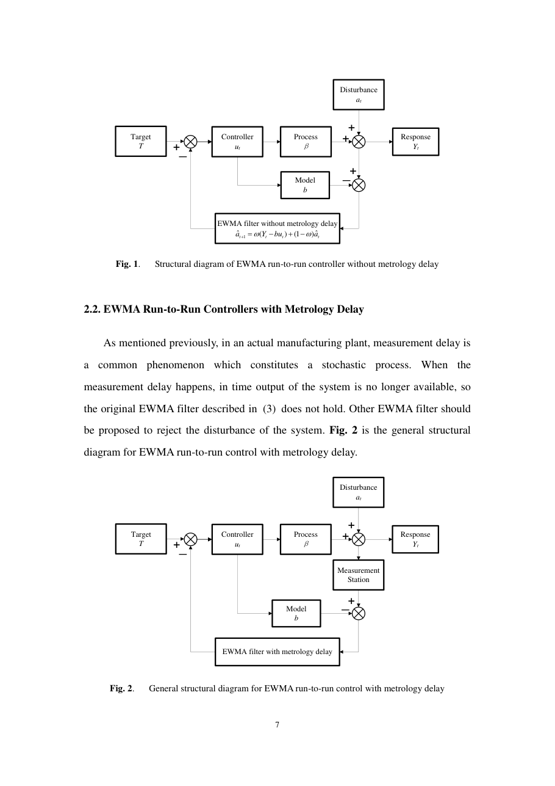
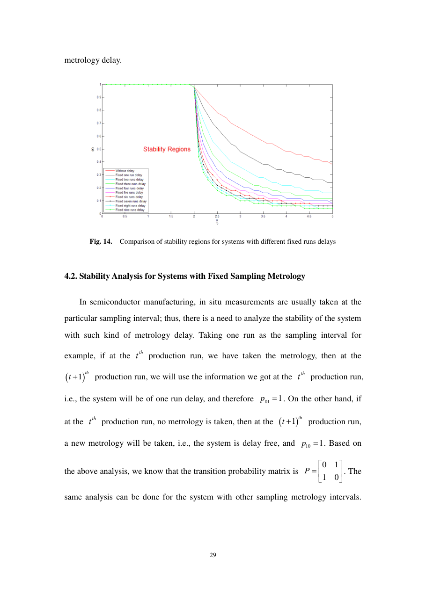
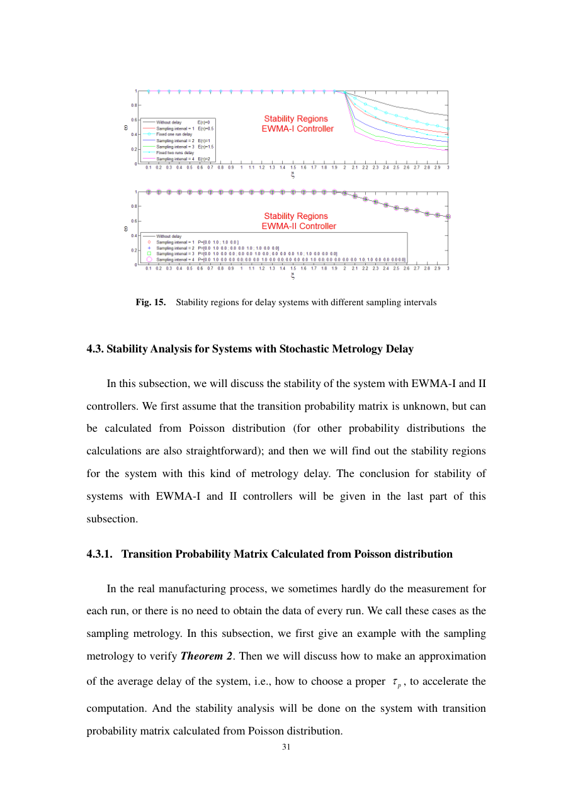

# EWMA 런투런 제어기를 쓰는 반도체 제조 공정의 안정성 분석

원제: Stability analysis of semiconductor manufacturing process with EWMA run-to-run controllers
저자: Bing Ai (텍사스대 오스틴 전산학과), David Shan-Hill Wong, Shi-Shang Jang (국립칭화대 화학공학과)
출처: arXiv:1510.08946 (2015). 저널판은 확인하지 못했다.
원문 파일: `Ai2015_arXiv1510.08946_EWMA_R2R_stability.pdf` (62쪽)

번역 범위: 전문. 초록, 본문 1~6절, 정리와 명제의 진술, 비고, 수치 예제, 그림과 표 캡션, 결론을 옮겼다.
정리와 명제의 긴 대수 증명은 흐름과 결론만 줄여 옮기고 그 사실을 표시했다.
참고문헌은 원문 그대로 둔다.

기호
- Y_t: t번째 런의 공정 출력(제어 대상 값)
- u_t: t번째 런의 조작 변수(명령)
- a_t: t번째 런의 외란(오프셋)
- β: 참 공정 이득(입력 1 변화당 출력 변화)
- b: 모형 이득(우리가 안다고 가정한 이득)
- ξ = β / b: 공정과 모형의 이득 불일치. ξ = 1 이면 모형이 정확하다
- ω: EWMA 할인 계수. 0과 1 사이
- τ_t: t번째 런의 계측 지연(런 수)
- E(τ): 평균 계측 지연
- p_NM: 어떤 런이 아예 측정되지 않을 확률

---

## 초록

반도체 제조의 배치 공정에서는 각 단계가 복잡한 물리화학 배치 공정이다.
대개 온라인 측정이나 런마다 측정을 하기 어렵고, 그래서 되먹임에 지연이 생긴다.
이 지연이 계의 안정성에 어떤 영향을 주는지는 꼭 이해해야 할 문제다.

지수가중이동평균(EWMA) 알고리즘을 바탕으로, 이 논문은 단일 제품 공정과 혼합 제품 공정을 위한 두 가지 제어기, EWMA-I 제어기와 EWMA-II 제어기를 제안한다.
단일 제품 공정에서는 여러 종류의 계측 지연을 겪는 두 제어기의 안정성을 조사한다.
확률적 안정성의 필요충분조건을 세운다.
고정 계측 지연이 있는 계의 안정 영역은 Routh-Hurwitz 판별법과 Lyapunov 직접법으로 구한다.
고정 표본 계측을 하는 계와 확률적 계측 지연을 겪는 계의 안정 영역은 Lyapunov 직접법으로 세운다.
단일 제품 공정의 정리를 혼합 제품 공정으로도 확장한다.
제안한 정리를 바탕으로 지연 계의 안정성을 보이는 수치 예제를 준다.

주제어: 지수가중이동평균(EWMA), 런투런 제어, 계측 지연, 확률적 안정성, 단일 제품 공정, 혼합 제품 공정

---

## 1. 서론

반도체 제조 산업에서 런투런 제어는 생산 효율을 높이고 낭비를 줄이는 수단으로 널리 받아들여졌다.
런투런 제어는 이산 공정과 장비 제어의 한 형태로, 특정 장비 공정의 제품 레시피를 공정 밖에서, 즉 장비 "런"과 런 사이에서 바꾸어 공정의 드리프트, 시프트, 변동을 줄인다 [1].

오늘날 반도체 제조에서 가장 기본인 런투런 제어 알고리즘 둘은 EWMA 알고리즘과 예측-보정 제어기(이중 EWMA) 알고리즘이다.
둘 다 공정 출력의 즉시 정보를 필요로 한다.
그러나 반도체 제조에서 각 단계는 복잡한 물리화학 배치 공정이고, 측정은 거의 전부 오프라인으로 이루어진다.
측정은 느리고, 일관되지 않고, 작업자가 건너뛰기도 한다.
그 결과 공정 출력의 측정이 지연되고, 들쭉날쭉하고, 드물어진다.
그래서 런투런 제어 적용의 한 문제는 계측 지연이 공정 안정성에 어떤 영향을 주는가이다.

시간 지연 계는 최근 몇 해 동안 널리 연구되었다.
확률적 시간 지연을 가진 계에 대해서는 [2]가 지적했듯이 많은 제조 공정을 마르코프 점프 선형계로 모형화할 수 있다.
그런 계의 최적 제어, 강건 제어, 안정성 결과는 [3]-[7] 같은 최근 문헌에서 널리 볼 수 있다.
다만 마르코프 점프 선형계의 최적화, 강건 제어, 안정성 문제는 보통 선형행렬부등식(LMI) 묶음을 푸는 문제로 바뀌며, LMI를 푸는 자세한 알고리즘은 [8]-[11]에 있다.

지연 없는 EWMA 런투런 제어기의 안정성에 관한 선구 연구는 Ingolfsson과 Sachs가 했다 [12].
그들은 공정의 안정을 보장하려면 **예측한 공정 이득이 참 공정 이득에 비해 "너무 작아서는 안 된다"**는 것을 찾아냈다.

R. Good 등은 제품 제조와 제품 계측 사이에 플랜트-모형 불일치와 지연이 있을 때, 단입력단출력(SISO)과 다입력다출력(MIMO) 이중 EWMA 런투런 제어기의 할인 계수 안정 한계를 조사했다 [13].
그들의 연구는 SISO 계에서 **계측 지연과 플랜트-모형 불일치가 커질수록, 그리고 할인 계수가 작아질수록 안정 영역의 크기가 줄어든다**는 것을 보였다.
또 계에 계측 지연이 있을 때는 지연이 없는 계와 달리 **공정 이득을 일부러 과대평가하면 불안정해질 수 있다**고 지적했다.
한편 MIMO 계에서는 플랜트-모형 불일치가 클 때 할인 계수를 키운다고 반드시 안정성이 좋아지지는 않는다.

몇 해 뒤 Good 등은 일반화된 Routh-Hurwitz 안정성 판별법으로 계측 지연이 있는 MIMO EWMA 런투런 제어기의 안정성을 분석했다 [15].
그들은 두 런까지의 계측 지연에 대한 안정성의 필요충분조건을 끌어냈고, 두 런보다 긴 계측 지연에 대해서는 MIMO 계 안정성의 충분조건을 만들었다.
그 충분조건은, 모형 불일치 행렬의 고윳값이 모두 복소평면에서 {1, 0}을 중심으로 하는 반지름 1인 원 안에 들어가면 폐루프 계가 안정이라는 것이다.

M.F. Wu 등은 초기 편향과 확률적 ARMA 외란을 가진 선형계가 EWMA 런투런 제어를 받을 때, 계측 지연이 제품 품질의 과도 특성과 점근 특성에 주는 영향을 분석했다.
그들은 계측 지연이 중요한 것은 비정상(nonstationary) 확률 외란을 겪는 공정뿐이라고 지적했다.
폐루프 출력 응답의 수치 최적화 결과를 바탕으로 할인 계수를 조율하는 지침을 만들었다.

위 연구들은 모두 계측 지연이 고정이라는 가정에 바탕을 둔다.
그러나 반도체 제조 산업은 물리화학 환경의 특성상 측정이 어렵거나 오래 걸린다.
많은 공정 장비가 현장 센서를 덧붙이도록 설계되지 않았다는 점과 합쳐져, 측정은 런마다가 아니라 더 드물게, 또는 임의의 런에서 이루어진다.

저자들이 아는 한 지금까지 EWMA 런투런 제어 분야에서 확률적 계측 지연 문제를 다룬 연구는 하나뿐이다 [16].
[16]의 선구 연구는 계가 확률적 계측 지연을 겪는다고 가정하고, 이 논문에서 EWMA-I 제어기라고 부르는 제어기 하나를 제안해 외란을 제거한다.
그러나 새 정보가 없으면 EWMA-I 제어기를 갱신하지 않는 편이 나을 때가 있다.
그래서 이 논문에서는 EWMA-I 제어기를 고친다.
또 [16]에서는 전이확률행렬이 주어진 것으로 두었지만, 실제 제조 공정에서는 전이확률행렬을 직접 알 수 없고 받은 자료의 확률분포에서 계산해야 한다.
그래서 특정 확률분포로부터 전이확률행렬을 어떻게 계산하는지도 다룬다.

지금까지는 생산 라인에 제품이 한 종류뿐이라는 가정이었는데 이는 현실과 거리가 멀다.
공정 장비의 자본 비용이 커서, 오늘날 반도체 제조에서는 한 장비에서 여러 제품과 공정을 돌리는 것이 보통이다(고혼합 제조).

고혼합 제조의 안정성에 관한 첫 연구는 Y. Zheng 등이 했다 [20].
그들은 같은 장비에서 두 제품을 만드는 모형을 연구했고, "장비 기준(tool-based)"과 "제품 기준(product-based)" 두 제어 방법을 제안했다.
플랜트가 비정상이고 플랜트-모형 불일치 모수가 제품마다 다르면 장비 기준 방식은 불안정하고 제품 기준 방식은 안정하다는 것을 찾았다.
다만 그들은 제품 기준 제어의 출력 유도에서 실수를 했다([20]의 Lemma 2, 식 (22)와 (23) 참고).
또 두 제품만 만든다는 가정도 현실과 거리가 멀다.

그래서 B. Ai 등은 Y. Zheng의 연구를 고치고 확장해 [21]-[27], 한 장비에서 여러 종류의 제품을 가변 제조 주기로 만들고 주기마다 캠페인 길이와 휴지 길이도 달라지는 더 복잡한 경우를 다루었다.
그들은 혼합 제품 드리프트 공정에서 어떤 제품의 휴지 길이가 길면 각 주기의 초기 런에서 공정 출력이 목표값에서 크게 벗어난다는 것을 찾았다.
그 큰 이탈을 줄이면서 점근 분산을 최소로 하려고 할인 계수 주기 재설정(CR-EWMA) 알고리즘과 주기 예측 EWMA(CF-EWMA)를 제안했다.
또 계단 결함을 다루려고 할인 계수 재설정 내결함(RFT) 접근과 내결함 주기 예측 EWMA(FTCF-EWMA)를 제안했다.
모형을 더 정교한 조건으로 넓혔지만 여전히 실제 제조 상황에 잘 맞지는 않는다.

역시 저자들이 아는 한, 반도체 제조 분야에서 확률적 계측 지연을 겪는 혼합 제품 공정의 안정성을 다룬 연구는 없다.
그래서 이 논문에서는 확률적 계측 지연이 있는 혼합 제품 공정의 모형을 세우고, 단일 제품 공정에서 얻은 정리를 혼합 제품 공정으로 확장한다.

논문 구성
- 2절: 단일 제품 공정을 위한 EWMA-I, EWMA-II 제어기 제안
- 3절: 특정 확률분포에서 전이확률행렬을 얻는 방법
- 4절: 여러 계측 지연에 대한 안정 영역의 수치 예제
- 5절: 혼합 제품 공정으로 정리 확장
- 6절: 결론

---

## 2. 단일 제품 공정의 EWMA 런투런 제어기

반도체 제조에서는 같은 제품을 같은 장비에서 만드는 일이 흔하다(단일 제품 공정).
이 공정에서 가장 널리 쓰이는 알고리즘이 EWMA이고, 이는 되먹임을 위해 계 출력 정보를 필요로 한다.
그러나 측정이 보통 오래 걸려 출력이 제때 오지 않고, 그래서 계에 지연이 생긴다.
이 절에서는 먼저 계측 지연이 없는 EWMA 제어기를 다루고, 다음에 계측 지연이 있는 계를 위한 두 가지 EWMA 제어기를 제안한다.
마지막 부분에서 제어기의 안정성을 살핀다.

### 2.1. 계측 지연이 없는 EWMA 런투런 제어기

전형적인 EWMA 런투런 관측기는 제어 변수 Y_t 와 조작 변수 u_t 사이에 정적 선형 모형을 가정한다.

> Y_t = β u_t + a_t  … (1)

여기서 β는 공정 입력과 출력 사이의 공정 이득, a_t 는 런 t 의 순간 외란이다.

공정의 예측 모형은

> Ŷ_t = b u_t + â_t  … (2)

여기서 b 는 모형 이득, â_t 는 런 t 에서 추정한 공정 오프셋이다.

현재 런의 정보를 지연 없이 쓸 수 있을 때 오프셋의 EWMA 갱신은

> â_{t+1} = ω (Y_t − b u_t) + (1 − ω) â_t  … (3)

여기서 ω 는 0과 1 사이의 할인 계수다.

다음 런의 제어 레시피는 제어 법칙으로 정한다.

> u_t = (T − â_t) / b  … (4)

T 는 바라는 목표값이다. 일반성을 잃지 않고 이 논문에서는 T = 0 으로 둔다.

**그림 1.** 계측 지연이 없는 EWMA 런투런 제어기의 구조도
목표 → 제어기 u_t → 공정 모형 b → 외란 a_t 합산 → 응답 Y_t → 계측 지연 없는 EWMA 필터 â_{t+1} = ω(Y_t − b u_t) + (1 − ω) â_t → 되먹임.

### 2.2. 계측 지연이 있는 EWMA 런투런 제어기

실제 공장에서 측정 지연은 흔한 현상이고 하나의 확률 과정을 이룬다.
측정 지연이 생기면 계의 출력을 제때 쓸 수 없으므로 식 (3)의 EWMA 필터는 성립하지 않는다.
다른 EWMA 필터가 필요하다.

**그림 2.** 계측 지연이 있는 EWMA 런투런 제어의 일반 구조도.
그림 1과 같되 되먹임 경로에 "측정 스테이션"이 끼어 있고, 필터가 "계측 지연이 있는 EWMA 필터"로 바뀐다.

런 t 에 확률적 계측 지연 τ_t 가 있다고 하자. 외란을 추정하는 두 가지 EWMA 런투런 제어기를 쓸 수 있다.

**EWMA-I 제어기** ([16]에서 처음 제안). 제어 동작은 (4)와 같고 EWMA 필터는

> â_{t+1} = ω (Y_{t−τ_t} − b u_{t−τ_t}) + (1 − ω) â_t  … (5)

(1), (2), (4), (5)를 합치면 EWMA-I 제어기를 (6)의 꼴로 다시 쓸 수 있다.

> â_{t+1} = (1 − ω) â_t + ω (1 − ξ) â_{t−τ_t}  … (6)

여기서 ξ = β / b 는 공정 이득의 플랜트-모형 불일치다.
식 (5), (6)에서 보듯 **EWMA-I 제어기는 출력 Y_t 를 쓸 수 있든 없든 언제나 상태 â_t 를 갱신한다**.
즉 매 재귀에서 â_t 는 쓸 수 있는 출력으로 갱신되는데, 그 출력이 계의 최신 출력이 아닐 수 있다.

그러나 어떤 공정에서는 최신 출력을 쓸 수 없으면 제어기가 상태를 갱신하지 않는 편이 낫다.
이 제어기를 **EWMA-II 제어기**라고 부른다.

> â_{t+1} = (1 − ω) â_t + ω (1 − ξ) â_{t−τ_t},  τ_{t−1} ≥ τ_t 이면
> â_{t+1} = â_t,  그 밖에는  … (7)

예를 들어 t 번째 생산 런에서 되먹임으로 쓸 출력이 Y_{t−3} 이면 τ_t = 3 이다.
τ_{t+1} ≥ 3 이면, 즉 t+1 번째 런에서 새 출력이 없으면 상태를 갱신하지 않는다.
그러나 τ_{t+1} = 2 이면 t+1 번째 런에서 최신 출력은 Y_{t−1} 이므로 그것으로 상태를 갱신한다.

**비고 1:** 고정 계측 지연에 대해서는 EWMA-I 과 EWMA-II 제어기가 같다.
둘 다 고정 f 런 지연에 대해 다음 꼴이기 때문이다.

> â_{t+1} = ω (Y_{t−f} − b u_{t−f}) + (1 − ω) â_t  … (8)

### 2.3. EWMA 런투런 제어기의 안정성

안정성은 어떤 계에도 기본 요구 조건이다. 불안정한 제어 방식은 쓰면 안 된다.
이 소절에서는 고정 계측 지연과 확률적 계측 지연을 겪는 EWMA 런투런 제어기의 안정성을 살핀다.

#### 2.3.1. 고정 계측 지연

고정 f 런 계측 지연이 있는 계에서 (1), (2), (4), (8)을 합치면 폐루프 출력은

> Y_t = [1 − (1 − ω) B − ω B^{f+1}] / [1 − (1 − ω) B − ω (1 − ξ) B^{f+1}] · a_t  … (9)

여기서 B 는 후방 이동 연산자다. 식 (9)에서 폐루프 특성 방정식이 나온다.

> G(B) = 1 − (1 − ω) B − ω (1 − ξ) B^{f+1} = 0

(1), (2), (4), (8)로 기술되는 계는 **G(B) 의 근이 모두 단위원 바깥에 있을 때, 그리고 그때만 안정**이다.
잘 알려진 쌍일차 변환

> B = (1 − W) / (1 + W)  … (10)

으로 단위원 바깥이 열린 좌반평면으로 옮겨지고, 그다음 (11)에 Routh-Hurwitz 판별법을 써서 f 런 계측 지연 계의 안정 경계를 찾는다.

> G(W) = 1 − (1 − ω)·(1−W)/(1+W) − ω(1 − ξ)·[(1−W)/(1+W)]^{f+1} = 0  … (11)

**비고 2:** Jury 판별법을 G(B) 에 바로 적용해 근이 단위원 바깥에 있는지 확인할 수도 있다.

#### 2.3.2. 확률적 계측 지연

확률적 계측 지연이 있는 계에는 Routh-Hurwitz 판별법도 Jury 판별법도 안정 영역을 구하는 데 쓸 수 없다.
다른 길을 찾아야 한다.

런 t 의 상태 변수 â_t 를 벡터로 확장한다.

> X_t = [ â_t  â_{t−1}  …  â_{t−τ_t}  …  â_{t−τ_max} ]^T  … (12)

τ_max 는 가능한 최대 지연이다. (6) 또는 (7)의 갱신식을 다음처럼 다시 쓸 수 있다.

> X_{t+1} = Φ(τ_{t+1}, τ_t) X_t  … (13)

Φ(τ_{t+1}, τ_t) 는 제어기 종류와 계의 최대 지연으로 정해진다.

예를 들어 EWMA-I 제어기이면 계 행렬 Φ 는 τ_t 에만 관계하고 τ_{t+1} 에는 관계하지 않는다.
지연이 없으면(τ_t = 0) Φ = [1 − ξω] 이다.
최대 지연이 1이면 τ_t = 0 일 때 Φ(0,0) = Φ(1,0) = [[1 − ξω, 0], [1, 0]] 이고, τ_t = 1 일 때 Φ(0,1) = Φ(1,1) = [[1 − ω, ω(1 − ξ)], [1, 0]] 이다.

EWMA-II 제어기이면 계 행렬이 τ_{t+1} 과 τ_t 둘 다에 관계한다.
지연이 없으면 Φ(0,0) = [1 − ξω].
최대 지연이 1이면
Φ(0,0) = [[1 − ξω, 0], [1, 0]], Φ(0,1) = [[1, 0], [1, 0]], Φ(1,0) = [[1 − ξω, 0], [1, 0]], Φ(1,1) = [[1 − ω, ω(1 − ξ)], [1, 0]].
최대 지연이 2이면 3×3 행렬 Φ(0,0), Φ(0,1), Φ(1,0), Φ(1,1), Φ(1,2), Φ(2,0), Φ(2,1), Φ(2,2) 를 같은 방식으로 적는다.
원문에 이 아홉 행렬이 모두 적혀 있다.
공통 꼴은, 갱신이 일어나는 경우 첫 행이 [1 − ω, …, ω(1 − ξ), …] 이고, 갱신이 없는 경우 첫 행이 [1, 0, …, 0] 인 것이다.

**비고 3:** 상태 확장 기법 덕분에, (1), (2), (4)와 (6) 또는 (7)로 기술되는 확률적 계측 지연 계는 (13)처럼 동차 마르코프 연쇄로 모형화되는 **지연 없는 이산 시간 점프 선형계**로 바뀐다.

#### 2.3.3. 가변 지연 계의 안정성 판별

**정의 1:** 계 (13)이 **확률적으로 안정(stochastically stable)**이라는 것은, 모든 유한한 X_0 와 초기 모드 τ_0 ∈ S (S = {0, 1, …, τ_max} 는 가능한 모든 지연의 집합)에 대해

> E[ Σ_{t=0}^{∞} ‖X_t‖² | X_0, τ_0 ] < ∞  … (14)

이 성립하는 것이다.

계측 지연 사이의 전이확률행렬을 P = [p_ij] 라 하고

> p_ij = Prob(τ_{t+1} = j | τ_t = i)  … (15)

로 정의한다. i, j ∈ {0, 1, …, ∞} 이고 0 ≤ p_ij ≤ 1, Σ_j p_ij = 1 이다.

**정리 1:** 계 (13)은 모든 τ_{t−1}, τ_t ∈ {0, 1, …, τ_max} 에 대해 다음 행렬부등식을 만족하는 양정부호 행렬 Q(τ_{t−1}, τ_t) > 0 이 있을 때, 그리고 그때만 확률적으로 안정이다.

> L(τ_{t−2}, τ_{t−1}) = Σ_{τ_t = 0}^{τ_max} p_{τ_{t−1}, τ_t} Φ(τ_{t−1}, τ_t)^T Q(τ_{t−1}, τ_t) Φ(τ_{t−1}, τ_t) − Q(τ_{t−2}, τ_{t−1}) < 0  … (16)

*증명(요지).*
충분성: 확률적 Lyapunov 함수 V(X_t, τ_{t−2}, τ_{t−1}) = X_t^T Q(τ_{t−2}, τ_{t−1}) X_t 를 세운다 … (17).
기댓값의 한 단계 차이를 계산하면 E[ΔV] = X_t^T L(τ_{t−2}, τ_{t−1}) X_t ≤ −λ_min ‖X_t‖² … (18) 가 되고, λ_min 은 L 의 최소 고윳값의 하한이다.
이 부등식을 t 에 대해 재귀로 쌓으면 … (19), (20) Σ_{t=1}^{T} ‖X_t‖² ≤ (1/λ_min) V(X_0, τ_0) 이고, T → ∞ 에서 E[Σ ‖X_t‖²] ≤ (1/λ_min) X_0^T Q(τ_0) X_0 < ∞ 이므로 (13)은 확률적으로 안정이다.
필요성: 확률적 안정이면 E[Σ_{k≥t} X_k^T R(τ_{k−2}, τ_{k−1}) X_k] 가 유한하다 … (21)-(23).
X_k^T R X_k ≤ c_max ‖X_k‖² 로 위에서 눌리므로 E[X_t^T Q X_t] 가 유계이고, 점근값이 (24)로 주어진다.
(25)에서 (24)를 빼면 바로 R(τ_{t−2}, τ_{t−1}) = −L(τ_{t−2}, τ_{t−1}) > 0, 즉 L < 0 이 나온다 … (26), (27).

L 이 계 행렬에 대해 비선형이어서 (16)이 풀 수 있는지 확인하기 어렵다. 그래서 동치 조건을 준다.

**명제 1:** (16)의 행렬부등식 L(τ_{t−2}, τ_{t−1}) < 0 은 다음 행렬부등식과 동치다.

> [ −Q(τ_{t−2}, τ_{t−1})   Φ̄(τ_{t−1})^T V(τ_{t−1}) Q̂(τ_{t−1}) ;
>   Q̂(τ_{t−1})^T V(τ_{t−1})^T Φ̄(τ_{t−1})   −Q̂(τ_{t−1}) ] < 0  … (28)

여기서
Φ̄(τ_{t−1}) = [ Φ(τ_{t−1}, 0)^T  Φ(τ_{t−1}, 1)^T  …  Φ(τ_{t−1}, τ_max)^T ]^T,
Q̂(τ_{t−1}) = diag{ Q(τ_{t−1}, 0), …, Q(τ_{t−1}, τ_max) },
V(τ_{t−1}) = diag{ √p_{τ_{t−1},0} I, …, √p_{τ_{t−1},τ_max} I }, I 는 알맞은 크기의 단위행렬이다.

*증명(요지).* Schur 보원(Schur complement) [28]을 쓴다.
대칭 행렬 M = [[M11, M12],[M12^T, M22]] 에 대해 다음 세 조건이 동치다.
1. M < 0;  2. M11 < 0 이고 M22 − M12^T M11^{-1} M12 < 0;  3. M22 < 0 이고 M11 − M12 M22^{-1} M12^T < 0.
L 의 합을 Φ̄, V, Q̂ 로 묶어 쓰면 L = Φ̄^T V Q̂ V^T Φ̄ − Q < 0 이 된다.
M11 = −Q(τ_{t−2}, τ_{t−1}), M12 = Φ̄^T V Q̂, M22 = −Q̂ 로 두면 Schur 보원의 세 번째 조건이 만족되고 (28)이 나온다.

**비고 4:** 확률적 계측 지연을 겪는 EWMA 런투런 제어기(이 논문의 EWMA-I)의 확률적 안정성 필요충분조건은 B. Ai 등이 [16]에서 처음 제안했다.
그러나 그들은 전이확률행렬과 계 행렬의 관계를 세우는 데서 실수를 했고([16]의 정리 참고), 그래서 행렬부등식을 푸는 명제도 틀렸다.
사실 (28)은 선형행렬부등식 묶음이므로 Matlab Robust Control Toolbox로 풀 수 있다.

---

## 3. 단일 제품 공정의 전이확률행렬

실제 공장에서 계측 지연은 고정이 아니라 확률 변수이므로, 계측 지연 사이의 관계를 어떻게 세우는지 다룬다.
먼저 원래 계측 지연 수열에서 실제 계측 지연 수열을 얻는 과정을 보이고, 그다음 특정 확률분포에서 전이확률행렬을 끌어내고, 마지막으로 평균 지연을 계산하는 법을 다룬다.

### 3.1. 원래 계측 지연과 관측된 계측 지연

표본 추출, 측정, 결과 보고의 과정은 확률 과정이라서 "원래" 또는 "실제" 계측 지연은 확률 함수가 만드는 확률 변수의 수열이다.
런 t 의 원래 계측 지연을 OMD_t 라 하면, 이 런의 정보는 런 OMD_t + t 에서 쓸 수 있다.
런 t 에서 계측 결과를 쓸 수 있는 가장 최근 런의 번호를 LRA_t 라 하면

> LRA_t = arg min_{k=1,…,t−1} (OMD_k + k)  … (29)

또 계측 결과를 쓸 수 있는 가장 최근 런이 지난 런보다 더 최근이면 제어기가 새 지연과 계측을 통보받고, 그렇지 않으면 지연이 1 늘어난다.

> τ_t = t − LRA_t  … (30)

표 1은 원래 지연 수에서 재표본된 지연 수를 계산하는 예다.
첫 생산 런의 정보는 곧바로 쓸 수 있어 지연이 0이다.
2번째 런에서 쓸 수 있는 가장 새 자료는 아직 1번째 런의 자료라서 지연이 1이다.
3번째 런에서는 2번째 런의 정보를 받았으므로 지연이 여전히 1이다.
6번째 런에서는 앞선 두 런(4번째와 5번째)을 쓸 수 있는데 최신인 5번째만 쓰므로 지연이 1이다.
6번째와 8번째 런은 표본을 뽑지 않았고 7번째 런은 긴 지연 뒤에야 보고되어, 7번째와 8번째 런에서는 5번째 런의 자료가 여전히 최신이다.
그래서 지연이 각각 2와 3이다.

**표 1: 원래 계측 지연과 제어기가 실제로 겪는 계측 지연의 관계**

| 런 번호 t | 원래 계측 지연 OMD_t | 계측을 쓸 수 있는 런 OMD_t + t | 쓸 수 있는 최신 런 LRA_t | EWMA 제어기의 실제 지연 τ_t |
|---|---|---|---|---|
| 1 | 0 | 1 | 1 | 0 |
| 2 | 1 | 3 | 1 | 1 |
| 3 | 2 | 5 | 2 | 1 |
| 4 | 2 | 6 | 2 | 2 |
| 5 | 1 | 6 | 3 | 2 |
| 6 | NM¹ | NM¹ | 5 | 1 |
| 7 | 5 | 12 | 5 | 2 |
| 8 | NM¹ | NM¹ | 5 | 3 |

¹ 그 런은 표본을 뽑지 않았다는 뜻이다.

앞의 분석에서, 실제 계측 지연 τ_t 는 런마다 많아야 1만 늘 수 있다는 결론이 나온다.
즉 τ_{t+1} ≤ τ_t + 1 이고 Prob(τ_{t+1} ≥ τ_t + 2) = 0 이다.
τ_{t+1} 은 τ_t 에만 영향을 받으므로 τ_t 는 마르코프 연쇄다.
이 제약을 넣으면 전이확률행렬 P = [p_ij] 는 (31)처럼 **대각 바로 위 한 칸까지만 값이 있는** 구조가 된다.

각 행은 한 상태에서 모든 상태로 가는 전이확률이다.
대각 성분은 지연이 같은 계측 수열의 확률, 대각 아래 성분은 더 짧은 지연, 대각 위 성분은 더 긴 지연을 만날 확률이다.

**그림 3.** 세 상태 전이 그림.
그림에서 τ = 1 과 τ = 2 에서는 어느 상태로도 갈 수 있지만, τ = 0 에서 τ = 2 로는 갈 수 없음을 볼 수 있다.

### 3.2. 특정 확률분포에서 전이확률행렬 계산

α_j = Prob(OMD_t = j) 를 계측이 j 런 뒤에 보고될 확률, p_NM 을 어떤 런이 아예 표본으로 뽑히지 않을 확률이라 하자.

**정리 2:** 전이확률행렬 p_ij 는 계측 지연의 확률분포 α_j 와 p_NM 으로부터 다음처럼 계산된다.

> p_ij = 0,  (j > i + 1 일 때)
> p_ij = p_NM + (1 − p_NM) Σ_{k ≥ i+1} α_k,  (j = i + 1 일 때)
> p_ij = (1 − p_NM) α_j,  (0 ≤ j ≤ i 일 때)  … (32)

*증명(요지).*
τ_t = i 이면 런 t 에서 쓸 수 있는 최신 자료는 런 t − i 의 자료다.
즉 런 t − i 는 i 런 지연으로 표본이 뽑혀 보고되었고, 런 t − i + 1, …, t 는 표본이 안 뽑혔거나 각각 i, …, 1 런 이상의 지연으로 보고되었다.
이 확률을 모두 곱한 꼴로 Prob(τ_t = i) 를 쓰고 … (33)-(39), τ_{t+1} = j 인 사건과의 결합확률을 나눈 뒤 정리하면 (32)가 나온다.

**비고 5:** 한 고정 상태에서 모든 상태로 가는 전이확률의 합은 1이다.

**비고 6:** 주어진 확률분포로부터 전이확률행렬을 계산하는 일은 Z.X. Yu 등이 네트워크 제어계(NCS)의 데이터 패킷 전송 문제에서 처음 끌어냈고 [17]-[18], Y. Zheng 등이 패킷이 때때로 손실되는 더 일반적인 경우로 넓혔다.
그러나 Yu 와 Zheng 등이 얻은 정리는 틀렸다([17]-[19]의 정리 1 참고).

### 3.3. 점근 확률과 평균 지연

동차 마르코프 연쇄이면 절대확률분포와 초기확률분포의 관계에서

> P̄_j = Σ_{i=0}^{∞} P̄_i p_ij  … (40)
> 제약: Σ_{j=0}^{∞} P̄_j = 1  … (41)

여기서 P̄_j 는 상태 j 의 평균 확률이다.

평균 지연 E(τ) 는 상태 집합의 기댓값으로 얻는다.

> E(τ) = Σ_{j=0}^{∞} j P̄_j  … (42)

α_i = 0 (i > τ_p) 이면 위 식들을 유한한 지연 상태 {0, 1, …, τ_p} 로 잘라 쓸 수 있다.

> P̄_j = Σ_{i=0}^{τ_p} P̄_i p̄_ij  … (43)
> p̄_ij = p_ij  (0 ≤ i < τ_p, 0 ≤ j ≤ τ_p),
> p̄_ij = p_ij / (1 − p_NM)  (i = τ_p, 0 ≤ j ≤ τ_p)  … (44)

*증명(요지).* α_i = 0 (i > τ_p) 이면 i > τ_p 인 모든 행은 Prob(τ_t = i) = 0 이라 자를 수 있다.
또 j ≥ τ_p + 1 인 열을 다 자르면 남은 전이확률행렬을 다시 정규화해야 한다 … (45).
그런데 i < τ_p, j ≥ τ_p + 1 에서는 p_ij = 0 이므로 0 ≤ i < τ_p 구간에서는 p̄_ij = p_ij 다.
i = τ_p 일 때는 p_{τ_p, τ_p+1} = p_NM + (1 − p_NM) Σ_{j>τ_p} α_j = p_NM … (46) 이므로
p̄_{τ_p, j} = p_{τ_p, j} / (1 − p_NM) = α_j … (47) 가 되어 (44)가 성립한다.

점근 평균 지연은

> E(τ) = Σ_{j=0}^{τ_p} j P̄_j  … (48)

τ_p 는 그 값을 키워도 E(τ) 의 변화가 무시할 만해지도록 고르면 된다.

---

## 4. 단일 제품 공정의 수치 예제

### 4.1. 고정 계측 지연 계의 안정성 분석

정리 1은 Lyapunov 직접법에 바탕을 둔다.
이 소절에서는 고정 계측 지연 계에 대해 Lyapunov 직접법과 Routh-Hurwitz 판별법(또는 Jury 판별법)이 주는 안정 영역을 비교한다.

그림 4 ~ 그림 13은 계측 지연이 없는 계와 고정 1런 ~ 고정 9런 계측 지연을 가진 계의 시뮬레이션 결과다.
그림들에서 **같은 계측 지연이면 EWMA-I 제어기를 쓰든 EWMA-II 제어기를 쓰든 안정 영역이 같다**는 것이 분명하다.
이는 2.3절의 이론 결과와 들어맞는다.
또 **Lyapunov 직접법과 Routh-Hurwitz 판별법이 같은 계에 대해 같은 안정 영역**을 준다.

- **그림 4.** 계측 지연이 없는 계의 안정 영역
- **그림 5.** 고정 1런 계측 지연 계의 안정 영역
- **그림 6.** 고정 2런 계측 지연 계의 안정 영역
- **그림 7.** 고정 3런 계측 지연 계의 안정 영역
- **그림 8.** 고정 4런 계측 지연 계의 안정 영역
- **그림 9.** 고정 5런 계측 지연 계의 안정 영역
- **그림 10.** 고정 6런 계측 지연 계의 안정 영역
- **그림 11.** 고정 7런 계측 지연 계의 안정 영역
- **그림 12.** 고정 8런 계측 지연 계의 안정 영역
- **그림 13.** 고정 9런 계측 지연 계의 안정 영역

그림 14는 서로 다른 고정 계측 지연을 가진 계들의 안정 영역을 함께 놓은 비교 그림이다.
지연이 달라도 안정 영역에 공통점이 있다.

> **추정한 공정 이득이 참 공정 이득의 절반보다 크면(ξ < 2), 0과 1 사이 어떤 할인 계수 ω 에 대해서도 폐루프가 안정임이 보장된다.**
> 그러나 ξ > 2 이면 폐루프를 안정하게 두기 위해 ω 를 ξ 가 커질수록 줄여야 한다.
> 그리고 계측 지연이 커질수록 안정 영역의 크기가 줄어든다.

**그림 14.** 고정 지연 런 수가 다른 계들의 안정 영역 비교.
가로축 ξ = β/b 0 ~ 5, 세로축 할인 계수 ω 0 ~ 1. 각 곡선 아래가 안정 영역이다.
그림에서 읽은 경계값 보기(근사치):
지연 없음은 ξ = 2.5 에서 ω ≈ 0.78, ξ = 3 에서 ≈ 0.70, ξ = 5 에서 ≈ 0.38.
고정 1런 지연은 ξ = 2.5 에서 ≈ 0.57, ξ = 3 에서 ≈ 0.47, ξ = 5 에서 ≈ 0.24.
고정 2런 지연은 ξ = 3 에서 ≈ 0.34, ξ = 5 에서 ≈ 0.16.
고정 9런 지연은 ξ = 2.5 에서 ≈ 0.10, ξ = 5 에서 ≈ 0.04.

### 4.2. 고정 표본 계측 계의 안정성 분석

반도체 제조에서 현장 측정은 보통 일정한 표본 간격으로 이루어지므로 이런 계측 지연을 가진 계의 안정성도 분석해야 한다.
표본 간격이 1런이면, t 번째 생산 런에서 계측을 했으면 t+1 번째 런에서는 t 번째 런의 정보를 쓰므로 계는 1런 지연이고 p_01 = 1 이다.
반대로 t 번째 런에서 계측을 안 했으면 t+1 번째 런에서 새 계측을 하므로 지연이 없고 p_10 = 1 이다.
따라서 전이확률행렬은 P = [[0, 1], [1, 0]] 이다.
표본 간격 2와 3에 대해서도 같은 방식으로
P = [[0,1,0],[0,0,1],[1,0,0]], P = [[0,1,0,0],[0,0,1,0],[0,0,0,1],[1,0,0,0]] 이 된다.

**그림 15.** 표본 간격이 다른 지연 계들의 안정 영역.
위: EWMA-I 제어기. 지연 없음 E(τ)=0, 표본 간격 1 E(τ)=0.5, 고정 1런 지연 E(τ)=1, 표본 간격 2 E(τ)=1, 표본 간격 3 E(τ)=1.5, 고정 2런 지연, 표본 간격 4 E(τ)=2.
아래: EWMA-II 제어기. 표본 간격 1 ~ 4의 곡선이 지연 없음 곡선과 겹친다.
가로축 ξ 0.1 ~ 3, 세로축 ω 0 ~ 1.

그림에서 모형 불일치 ξ < 2 이면 어느 제어기든 0과 1 사이 어떤 ω 에 대해서도 폐루프 안정이 보장된다.
EWMA-I 제어기는 표본 계측 간격이 클수록 안정 영역이 작아진다.
반면 **EWMA-II 제어기의 안정 영역은 표본 간격 길이와 무관**하고, 이는 직관과 맞지 않는다.

사실 고정 표본 계측 지연에 대해 EWMA-II 제어기 (7)은 EWMA-III 제어기와 같다.

> x_{t+1} = (1 − ξω) x_t,  τ_t = 0 이면
> x_{t+1} = x_t,  그 밖에는

계측이 고정 표본 형태로 이루어지면 EWMA-III 제어기의 안정 조건은 계측 지연이 없는 계와 같다.
까닭은 둘이다.
첫째, 제어기를 갱신하는 데 쓰는 자료는 지연이 없는 측정 자료이고 이것이 확률 1로 일어난다.
둘째, 지연이 나타나면 EWMA-III 제어기는 갱신하지 않는다.

고정 표본 계측에서 표본 간격이 d 이면 (40)과 (42)에서 평균 계측 지연은 E(τ) = d/2 이고 P̄_0 = P̄_1 = … = P̄_d = 1/(d+1) 이다.
그림 15에서 보듯, EWMA-I 제어기의 안정 영역을 구할 때 ceil(E(τ)) 를 계의 지연으로 쓰는 것은 틀렸다.
반면 EWMA-II 제어기에 그렇게 하면 보수적인 안정 영역을 얻는다.

¹ ceil(A) 는 A 보다 크거나 같은 가장 가까운 정수로 올림한다.

### 4.3. 확률적 계측 지연 계의 안정성 분석

전이확률행렬을 모른다고 두고 푸아송 분포에서 계산한다(다른 확률분포도 계산은 바로 된다).

#### 4.3.1. 푸아송 분포로 계산한 전이확률행렬

실제 제조 공정에서는 런마다 측정하기 어렵거나 그럴 필요가 없을 때가 있다. 이를 표본 계측이라 부른다.
먼저 표본 계측 예로 정리 2를 검증하고, 그다음 계산을 빠르게 하려고 알맞은 τ_p 를 골라 평균 지연을 근사하는 법을 다룬다.

표 1의 계산 과정을 바탕으로 50000개의 푸아송 난수를 만들어 모의한다.
계산할 때마다 P 를 3×3 행렬로 자른다.
정리 2로 계산한 전이확률행렬을 p_Calculated,ij, 모의에서 센 것을 p_Observed,ij 라 하면 둘의 관계가 기울기 1의 직선이다.
이 모의 결과가 정리 2를 검증한다.

- **그림 16.** P 와 E(τ) 의 모의 검증
- **그림 17.** 전이확률행렬의 절단과 계의 평균 지연의 관계
- **그림 18.** p_NM 과 E(τ) 의 관계

**비고 7:** τ_p 가 5보다 크면 LMI 를 푸느라 안정 영역을 얻는 데 시간이 오래 걸린다.
그래서 평균 지연 E(τ) 를 근사하는 τ_p 를 쓴다. 표 2가 p_NM 마다 쓸 만한 τ_p 를 준다.

**표 2: E(τ)_Calculated 의 E(τ)_Approximated 근사** (쌍은 (τ_p, 근사 E(τ)))

| p_NM | (τ_p, 근사 E(τ)) | 계산한 E(τ) | (τ_p, 근사 E(τ)) |
|---|---|---|---|
| 0.1 | (6, 0.9389) | 0.94 | (4, 0.9369) |
| 0.2 | (6, 1.093) | 1.1 | (4, 1.079) |
| 0.3 | (8, 1.288) | 1.3 | (5, 1.27) |
| 0.4 | (13, 1.544) | 1.5 | (5, 1.477) |
| 0.5 | (15, 1.895) | 1.9 | (8, 1.859) |
| 0.6 | (22, 2.414) | 2.4 | (11, 2.371) |
| 0.7 | (31, 3.267) | 3.3 | (20, 3.251) |
| 0.9 | (123, 9.977) | 10 | |

원문 표에서 읽은 값이다. 표 조판이 흐트러져 있어 일부 칸은 비어 있다.

- **그림 19.** τ_min 과 τ_p 를 계의 최대 지연으로 써서 얻은 안정 영역 비교

#### 4.3.2. 단일 제품 공정의 안정 영역

그림 20은 푸아송 분포(λ = 1)로 계산한 P 를 가진 확률적 계측 지연 계의 안정 영역이다.
p_NM = 0 일 때와 p_NM = 0.3 일 때의 전이확률행렬 예가 원문에 적혀 있고, 각각 평균 지연이 다르다.
p_NM = 0.3 인 예에서 E(τ) = 1.2695 다.

그림 20(a), 즉 EWMA-I 제어기 계에서는 p_NM 이 커질수록 안정 영역이 줄어든다.
확률적 경우에는 E(τ) 가 커지면 안정 영역이 나빠진다.
그러나 ceil(E(τ)) 를 계의 지연으로 삼아 안정 영역을 구하는 것은 때때로 틀린다. p_NM = 0.1 이나 0.5 에서 그렇다.

EWMA-II 제어기 계의 결과인 그림 20(b)는 직관을 배반한다.
첫째, p_NM (또는 E(τ)) 이 커져도 안정성에 주는 영향이 작다.
둘째, p_NM (또는 E(τ)) 이 무엇이든 **안정 영역이 지연 없는 계와 고정 1런 지연 계의 안정 영역 사이에 놓인다**.
즉 p_NM 이나 E(τ) 는 EWMA-II 제어기 계의 안정성에 관해 거의 정보를 주지 않는다.
ceil(E(τ)) 를 지연으로 써서 안정 영역을 구하면 보수적인 영역을 얻고, E(τ) 가 클 때 특히 그렇다.

그림 20(a)와 (b)를 비교하면, **ξ < 2 이고 ω 가 0과 1 사이이면 어떤 전이확률행렬에서도 두 제어기 모두 안정**이다.
또 같은 확률적 계측 지연이면 EWMA-II 제어기 계가 EWMA-I 제어기 계보다 안정 영역이 넓다.

- **그림 20.** 푸아송 분포로 계산한 P 를 가진 계들의 안정 영역

표 2에서 보듯 E(τ) 를 근사해도 p_NM > 0.6 인 계의 안정 영역은 얻을 수 없다. τ_p 가 커서 Matlab 이 LMI 를 못 풀기 때문이다.
그래도 EWMA-II 제어기 계의 안정 영역은 지연 없는 계와 고정 1런 지연 계의 안정 영역 사이에 있다고 단언할 수 있다.
EWMA-I 제어기 계의 안정 영역은 ceil(E(τ)) 를 고정 지연으로 써서 얻은 영역 근처에 놓일 수 있다.

예로 그림 21은 푸아송 분포(λ = 1, p_NM = 0.9, 근사 E(τ) = 10)를 따르는 같은 확률적 계측 지연에서 두 제어기 상태 변수의 응답을 준다.

- 그림 21(a): EWMA-I, (ξ, ω) = (2.6, 0.34). 고정 9런 지연 계가 불안정해지는 조합이고, 상태 변수가 발산한다.
- 그림 21(b): EWMA-I, (ξ, ω) = (2.6, 0.14). 고정 10런 지연 계의 안정을 보장하는 조합이고, 상태 변수가 0으로 수렴한다.
  이 두 그림에서, 이런 확률적 계측 지연을 겪는 EWMA-I 제어기 계의 안정 영역을 **고정 10런 지연 계의 안정 영역으로 근사**해도 된다는 확신을 얻는다.
- 그림 21(c): EWMA-II, (ξ, ω) = (2.6, 0.78). 지연 없는 계조차 불안정해지는 조합이라 EWMA-II 계도 반드시 불안정하고, 상태 변수가 발산한다.
- 그림 21(d): EWMA-II, 고정 1런 지연 계가 안정해지도록 고른 (ξ, ω). 상태 변수가 수렴한다.
  두 그림을 합치면, 지연이 푸아송 분포를 따르면 p_NM 이 무엇이든 EWMA-II 계의 안정 영역은 늘 지연 없는 계와 고정 1런 지연 계의 안정 영역 사이에 떨어진다는 것을 알 수 있다.

- **그림 21.** p_NM = 0.9 일 때 상태 변수의 응답

다른 종류의 계측 지연에 대해서도 2절의 정리로 안정 영역을 얻을 수 있다.

**비고 8:** 그림 20(b)와 그림 21(d)의 모의 결과는, 전이확률행렬을 푸아송 분포로 계산하면 EWMA-II 제어기 계의 안정 영역이 지연 없는 계와 고정 1런 지연 계 사이에 놓인다는 것을 말해 준다.
그러나 **어떤 전이확률행렬에 대해서도** 그렇다고 단언할 수는 없다. 다음 예들이 그 반례다.

그림 22는 임의로 고른 네 전이확률행렬에서 EWMA-I, II 제어기 계의 안정 영역을 모의한 결과다.

> P = [[0.8, 0.2, 0.0], [0.5, 0.3, 0.2], [0.6, 0.3, 0.1]], E(τ) = 0.3291
> P = [[0.2, 0.8, 0.0], [0.2, 0.3, 0.5], [0.1, 0.3, 0.6]], E(τ) = 1.3176
> P = [[0.1, 0.9, 0.0], [0.1, 0.2, 0.7], [0.1, 0.2, 0.7]], E(τ) = 1.5300
> P = [[0.1, 0.9, 0.0], [0.1, 0.1, 0.8], [0.0, 0.2, 0.8]], E(τ) = 1.7609

그림 22(a)에서 평균 지연 E(τ) 가 커질수록 EWMA-I 제어기 계의 안정 영역이 줄어든다.
EWMA-II 제어기 계에서는 계가 확률적 계측 지연을 겪을 때에만 이 결과가 성립한다.
ceil(E(τ)) 를 계의 지연으로 쓰면 두 제어기 모두 보수적인 안정 영역을 얻는데, EWMA-II 쪽이 훨씬 더 보수적이다.

같은 전이확률행렬(같은 평균 지연)에서 두 제어기의 안정 영역을 그림 23에서 비교한다.
EWMA-II 제어기 계의 안정 영역이 더 넓다.
또 두 제어기 모두 ξ < 2 이고 0 < ω < 1 이면 안정이 보장된다.

- **그림 22.** 전이확률행렬이 다른 계들의 안정 영역
- **그림 23.** 전이확률행렬이 다를 때 EWMA-I, II 제어기 계의 안정 영역 비교

#### 4.3.3. 확률적 계측 지연 계에 대한 결론

1. 확률적 계측 지연이 있는 계에서는 지연된 자료를 쓰게 되고, 이 지연된 자료가 계의 안정성을 떨어뜨린다.
2. 확률적 경우에 EWMA-I 제어기 계의 안정 영역은 평균 지연이 커질수록 줄어든다.
   그러나 EWMA-II 제어기 계의 안정 영역은 평균 지연을 기준으로 늘 판단할 수 있는 것이 아니다.
3. ceil(E(τ)) 를 계의 지연으로 쓰면 EWMA-II 제어기 계에는 보수적인 안정 영역을 주지만, EWMA-I 제어기 계에는 때때로 틀린 결과를 준다.
4. **ξ < 2 이면 두 제어기 모두 0과 1 사이 어떤 ω 에 대해서도 안정이다.**

---

## 5. 혼합 제품 공정의 EWMA 런투런 제어기

앞 절들은 단일 제품 공정을 다뤘다.
그러나 오늘날 반도체 제조에서는 한 장비에서 여러 제품과 공정을 돌리는 것이 보통이다(고혼합 제조).
엔지니어는 특정 장비에서 제품마다의 안정성에 관심이 있다.

### 5.1. 계 모형

여러 제품이 특정 장비에서 무작위로 만들어진다고 하자.
제품 N 을 예로 들어, 제품 N 의 런 번호를 n, 전체 공정의 런 번호를 t_n 이라 한다.

- **그림 24.** 혼합 제품 공정의 예

제품 N 의 입출력 관계가 기울기 β_N 인 선형이라고 하면 공정 모형은

> Y_{t_n} = β_N u_{t_n} + a_{t_n}  … (49)
> 또는 Y_{N,n} = β_N u_{N,n} + a_{N,n}  … (50)

예측 모형은

> Ŷ_{t_n} = b_N u_{t_n} + â_{t_n}  … (51)
> 또는 Ŷ_{N,n} = b_N u_{N,n} + â_{N,n}  … (52)

b_N 과 â 는 제품 N 에 대해 추정한 모형 이득과 오프셋이다.

런 t_n 에 확률적 계측 지연 τ_{t_n} = τ_{N,n} ∈ S 가 있다고 하고, 두 EWMA 제어기를 쓴다.

EWMA-I 제어기의 제어 동작은

> u_{t_n} = (T_N − â_{t_n}) / b_N  … (53)

이고, 제품 N 의 할인 계수 ω_N 을 가진 EWMA 필터는

> â_{t_n+1} = ω_N (Y_{t_n−τ} − b_N u_{t_n−τ}) + (1 − ω_N) â_{t_n−τ}  … (54)

(51)-(54)를 합치면

> â_{t_n+1} = (1 − ω_N) â_{t_n} + ω_N (1 − ξ_N) â_{t_n−τ}  … (55)

ξ_N 은 제품 N 의 플랜트-모형 불일치다.

단일 제품 공정과 같은 까닭으로 EWMA-II 제어기도 생각한다.

> â_{t_n+1} = (1 − ω_N) â_{t_n} + ω_N (1 − ξ_N) â_{t_n−τ},  τ_{t_n−1} ≥ τ_{t_n} 이면
> â_{t_n+1} = â_{t_n},  그 밖에는  … (56)

2.3절처럼 상태를 확장하면 (55) 또는 (56)의 지연 계는 지연 없는 계가 된다.

> X_{t_n+1} = Φ_N(τ_{t_n−1}, τ_{t_n}) X_{t_n}  … (57)

(57)의 안정성 문제도 2.3.2절의 정리 1로 풀 수 있다.

**비고 9:** 같은 제품 N 만 같은 장비에서 만들면 t_n = n = t 이고 t_{n+1} = n + 1 = t + 1 이므로, 혼합 제품 공정 속 제품 N 의 모형은 단일 제품 공정의 모형과 같아진다.

### 5.2. 전이확률행렬

혼합 제품 공정의 안정 영역을 얻으려면 제품마다 계측 지연의 전이확률행렬을 알아야 한다.
제품 N 을 예로 들고, 전체 공정에서 이 제품을 만들 확률을 q_N 이라 한다.
전체 공정에서 시각 t 의 자료가 i 런 지연될 확률을 α_i, 현재 런이 측정되지 않을 확률을 p_NM 이라 한다.

**정리 3:** 제품 N 에 대해, 현재 런의 자료가 지연되거나 지연되지 않을 확률을 q_N, α_i, p_NM 으로 계산할 수 있고, 이로부터 제품 N 의 전이확률행렬을 얻는다.
원문에 자세한 식과 긴 증명이 있다.
뼈대는 제품 N 의 이웃한 두 런 사이에 다른 제품의 런이 몇 개 끼는지의 분포를 q_N 으로 구하고, 그 구간 동안 계측이 끝날 확률을 α 와 p_NM 으로 합치는 것이다.

**비고 10:** q_N = 1 이면 장비가 제품 N 만 만드는 것이므로 단일 제품 공정이 된다.

**비고 11:** 현재 런이 지연되거나 지연되지 않을 확률도 같은 방식으로 끌어낼 수 있다.

**비고 12:** 제품 N 의 계측 지연 확률을 끌어냈으므로 전이확률행렬을 세울 수 있다.

**비고 13:** 제품 N 의 평균 지연 E(τ)_N 도 같은 방식으로 계산할 수 있다.

**비고 14:** 정리 3은 다른 제품에도 그대로 적용된다.

### 5.3. 수치 예제

#### 5.3.1. 푸아송 분포로 계산한 전이확률행렬

모의에서 센 확률이 정리 2와 정리 3으로 얻은 값과 가깝고, 이것이 두 정리를 검증한다.

#### 5.3.2. 혼합 제품 공정의 안정성 분석

제품 M 을 만들 확률이 0.3, 제품 N 이 0.7 인 경우와, 제품 M 이 0.05, 제품 N 이 0.95 인 경우를 p_NM = 0.3 에서 비교한다.
뒤 경우에 두 제품의 전이확률행렬 P_M, P_N 이 원문에 6×6 행렬로 적혀 있고, 평균 지연은 E(τ)_M = 1.1, E(τ)_N = 1.3 이다.
제품 M 의 평균 지연은 q_M = 0.3 일 때보다 작아지고, 제품 N 의 평균 지연은 q_N = 0.7 일 때보다 커진다.

그림 33은 생산 확률 q 가 다를 때의 안정 영역을 비교한다.
q 가 커질수록 EWMA-I 제어기 계의 안정 영역은 줄어든다.
EWMA-II 제어기 계에서는 q 가 커져도 안정성에 주는 영향이 작다.
즉 같은 계측 지연 아래에서 EWMA-I 제어기를 쓰면 자주 만드는 제품의 안정 영역이 드물게 만드는 제품보다 좁다.
EWMA-II 제어기를 쓰면 q 가 안정성에 거의 영향이 없다.

- **그림 30.** q_M = 0.3, q_N = 0.7 일 때 두 제품의 안정 영역
- **그림 31.** p_NM 이 다를 때 두 제품의 안정성 비교
- **그림 32.** q_M = 0.05, q_N = 0.95 (p_NM = 0.3) 일 때 두 제품의 안정 영역
- **그림 33.** p_NM = 0.3 일 때 생산 확률이 다른 제품의 안정성 비교

**비고 15:** 4.3.1절에서 다룬 것과 마찬가지로, 혼합 제품 공정에서도 계측 지연이 푸아송 분포를 따르면 제품의 생산 분포가 EWMA-II 제어기 계의 안정성에 주는 영향이 작다고 단언할 수 있다.
또 어떤 제품이든 EWMA-II 제어기 계의 안정 영역은 고정 1런 지연 계와 계측 지연이 없는 계의 안정 영역 사이에 놓인다.

---

## 6. 결론

이 논문은 반도체 제조의 단일 제품 공정과 혼합 제품 공정을 위해 EWMA-I 과 EWMA-II 두 제어기를 제안했다.

단일 제품 공정에서는 여러 계측 지연을 겪는 두 제어기 계의 안정성 문제를 연구했다.
고정 계측 지연 계의 안정 영역은 Routh-Hurwitz 판별법과 Lyapunov 직접법으로 구했다.
고정 표본 계측 계와 확률적 계측 지연 계의 확률적 안정성 필요충분조건은 Lyapunov 직접법으로 끌어냈다.
수치 계산 결과로 다음 결론을 얻었다.

**(A) 고정 계측 지연**
- a. EWMA-I 제어기는 EWMA-II 제어기와 같다.
- b. 서로 다른 고정 런 지연의 안정 영역을 구하는 데 Routh-Hurwitz 판별법과 Lyapunov 직접법이 동등하다.
- c. 계측 지연이 커질수록 안정 영역의 크기가 줄어든다.

**(B) 고정 표본 계측**
- a. EWMA-I 제어기 계는 표본 간격이 커질수록 안정 영역이 줄어든다. 안정 영역을 구하는 데 ceil(E(τ)) 를 계의 지연으로 쓰는 것은 틀렸다.
- b. EWMA-II 제어기 계는 자료가 더 적지만 최신 자료를 쓴다. 안정 영역이 표본 간격의 영향을 받지 않아 안정성이 가장 좋다.

**(C) 확률적 계측 지연**
- a. EWMA-I 제어기 계는 평균 지연이 커질수록 안정 영역이 줄어든다. ceil(E(τ)) 를 지연으로 쓰는 것은 때때로 틀렸다.
- b. EWMA-II 제어기 계는 평균 지연이 커져도 안정성에 거의 영향이 없을 때가 있다. ceil(E(τ)) 를 지연으로 쓰면 보수적인 안정 영역이 나온다.

**(D) 모든 종류의 계측 지연에 공통**
- a. **추정한 공정 이득이 참 공정 이득의 절반보다 크면, 0과 1 사이 어떤 할인 계수에 대해서도 폐루프 안정이 보장된다.**
- b. 같은 종류의 계측 지연에서 EWMA-II 제어기 계가 EWMA-I 제어기 계보다 늘 더 나은 안정 영역을 갖는다.

단일 제품 공정의 정리를 혼합 제품 공정으로도 확장해 다음을 얻었다.

**(A)** 많이 만드는 제품일수록, 즉 자주 돌리는 제품일수록 그 제품에 대한 계의 평균 지연이 크다.
적게 만드는 제품일수록 평균 지연이 작다.
자주 돌리는 제품과 드물게 돌리는 제품의 계측 지연이 같다면, 드물게 돌리는 제품은 같은 제품의 이웃한 런 사이에 다른 제품의 런이 많이 끼어, 그동안 측정을 마칠 가능성이 높아 평균 지연이 작아진다. 자주 돌리는 제품은 반대다.

**(B)** 측정 지연이 푸아송 분포를 따르면, EWMA-I 제어기 계에서는 자주 돌리는 제품의 안정 영역이 드물게 돌리는 제품보다 나쁘다.
그러나 EWMA-II 제어기 계에서는 제품의 생산 분포가 안정성에 주는 영향이 작다.
ceil(E(τ)) 를 지연으로 쓰면 어떤 제품의 계에도 보수적인 안정 영역이 나오고, EWMA-II 제어기 계에서 훨씬 더 보수적이다.

**(C)** 측정 지연이 같다면 어떤 제품이든 EWMA-II 제어기 계가 EWMA-I 제어기 계보다 늘 안정 영역이 넓다.

**(D)** 어떤 제품의 계든 어느 제어기든, 추정한 공정 이득이 참 공정 이득의 절반보다 크면 0과 1 사이 어떤 할인 계수 ω 에 대해서도 안정이 보장된다.

---

## 7. References (원문 그대로)

[1] J. Moyne, E. D. Castillo, A. M. Hurwitz, Run-to-Run control in semiconductor manufacturing, CRC Press, Florida, 2001.

[2] Y. Ji and H. J. Chizeck, Jump linear quadratic Gaussian control in continuous time, IEEE Transactions on Automatic Control, 37 (12) (1992) 1884-1892.

[3] O. L. V. Costa and R. P. Marques, Robust H2-control of discrete-time Markovian jump linear systems, International Journal of Control, 73 (1) (2000) 11-21.

[4] L. Q. Zhang, B. Huang, and J. Lam, H model reduction of Markovian jump linear systems, System and Control Letters, 50 (2003) 103-118.

[5] L. Q. Zhang, Y. Shi, T. W. Chen, and B. Huang, A New Method for stabilization of networked control systems with random delays, IEEE Transactions on Automatic Control, 50 (8) (2005) 1177-1181.

[6] Y. Shi and B. Yu, Output feedback stabilization of networked control systems with random delays modeled by Markov chains, IEEE Transactions on Automatic Control, 54 (7) (2009) 1668-1674.

[7] L. Xiao, A. Hassibi, and J. P. How, Control with random communication delays via a discrete-time jump system approach, in the Proceedings of American Control Conference, (3) (2000) 2199-2204.

[8] K. M. Grigoriadis, Optimal H model reduction via linear matrix inequalities: Continuous- and discrete-time cases, System and Control Letters, 26 (5) (1995) 321-333.

[9] J. C. Geromel, C. C. D. Souza, and R. E. Skelton, LMI numerical solution for output feedback stabilization, in the Proceedings of IEEE Conference on Decision and Control, (1994) 40-44.

[10] L. E. Ghaoui, F. Oustry, and M. Aitrami, A cone complementarity linearization algorithm for static output-feedback and related problems, IEEE Transactions on Automatic Control, 42 (8) (1997) 1171-1176.

[11] M. C. D. Oliveria and J. C. Geromel, Numerical comparison of output feedback design methods, in the Proceedings of American Control Conference, Albuquerque, NM, (1997) 72-76.

[12] A. Ingolfsson, E. Sachs, Stability and sensitivity of an EWMA controller, Journal of Quality Technology, 25 (4) (1993) 271-287.

[13] R. Good and S. J. Qin, Stability analysis of double EWMA run-to-run control with metrology delay, in the Proceedings of American Control Conference, Anchorage, AK, (2002) 2156-2161.

[14] R. P. Good and S. J. Qin, On the stability of MIMO EWMA run-to-run controllers with metrology delay, IEEE Transactions on Semiconductor Manufacturing, 19 (1) (2006) 78-86.

[15] M. F. Wu, C. H. Lin, D. S. H. Wong, S. S. Jang, and S. T. Tseng, Performance analysis of EWMA controllers subject to metrology delay, IEEE Transactions on Semiconductor Manufacturing, 21 (3) (2008) 413-425.

[16] B. Ai, D.S.H. Wong, S.S. Jang, and Y. Zheng, Stability Analysis of EWMA Run-to-Run Controller Subject to Stochastic Metrology Delay, the 18th International Federation of Automatic Control World Congress, August 2011, Italy, Milano.

[17] Z.X. Yu, H.T. Chen, and Y.J. Wang, Research on control of network system with Markov delay characteristic, the Proceedings of the 3rd World Congress on Intelligent Control and Automation, June 28-July 2, 2000, Hefei, P.R. China.

[18] Z.X. Yu, H.T. Chen, and Y.J. Wang, Research on Markov Delay Characteristic-Based Closed Loop Network Control System, Control Theory and Applications, 19 (2) (2002) 263-267.

[19] Y. Zheng, H. Fang, H. Wang, Takagi-Sugeno Fuzzy Model-Based Fault Detection for Networked Control Systems with Markov Delays, IEEE Transactions on Systems, Man, and Cybernetics, Part B: Cybernetics, 2006, 36(3): 924-929.

[20] Y. Zheng, Q.H. Lin, D.S.H. Wong, S.S J, K. Hui, Stability and performance analysis of mixed product run-to-run control, Journal of Process Control, 16 (2006) 431-443.

[21] B. Ai, Y. Zheng, S.S. Jang, Y.W. Wang, L. Ye, and C.J. Zhou, The optimal drift-compensatory and fault tolerant approach for mixed product run-to-run control, Journal of Process Control, 19 (2009) 1401-1412.

[22] Y. Zheng, B. Ai, Y.W. Wang, H. Zhang, The dEWMA Fault Tolerant Approach For Mixed Product Run-To-Run Control, IEEE International Symposium on Industrial Electronics, July 2009, Seoul, Korea.

[23] B. Ai, Y. Zheng, H. Zhang, Z. Wang and Z. Zhang, Cycle Prediction EWMA Run-to-Run Controller For Mixed product Drifting Process, IEEE Conference on Decision and Control, December 2009, Shanghai, China.

[24] Y. Zheng, B. Ai, Y. Zheng and L. Ye, An EWMA Algorithm With Cycled Resetting (CR) Discount Factor to Deal with Disturbance in High-Mix Run-to-Run Control, Chinese Journal of Scientific Instrument, 30 (6) (2009) 419-424.

[25] B. Ai, Y. Zheng and Z. Zhang, A Fault-Tolerant Algorithm with Cycled Resetting Discount Factor in Semiconductor Manufacturing Industry, the Seventh IEEE International Conference on Control & Automation, December 2009, Christchurch, New Zealand.

[26] Y. Zheng, B. Ai, D.S.H. Wong, S.S. Jang and J. Zhang. An EWMA algorithm with a cycled resetting (CR) discount factor for drift and fault of high-mix Run-To-Run Control, IEEE Transactions on Industrial informatics, 6 (2) (2010) 229-242.

[27] B. Ai, Y. Zheng, Y.W. Wang S.S. Jang and S. Tao, Enhanced Cycle Forecasting EWMA (ECF-EWMA) Approach For Drift and Fault in Mixed product Run-to-Run Process, Journal of Process Control, 20 (2010) 689-708.

[28] R.A. Horn and C.R. Johnson, Matrix analysis, Cambridge University Press, New York, 2006.
