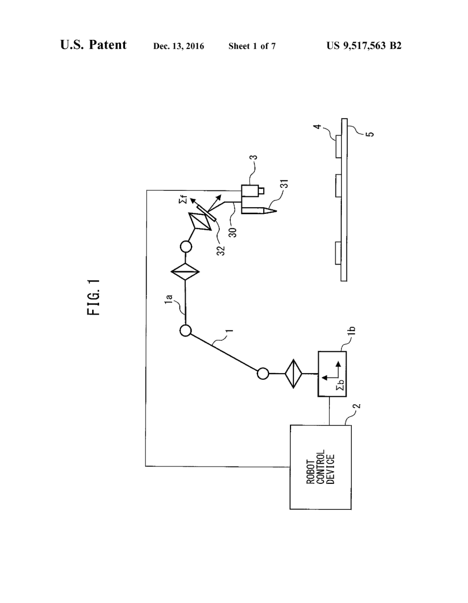
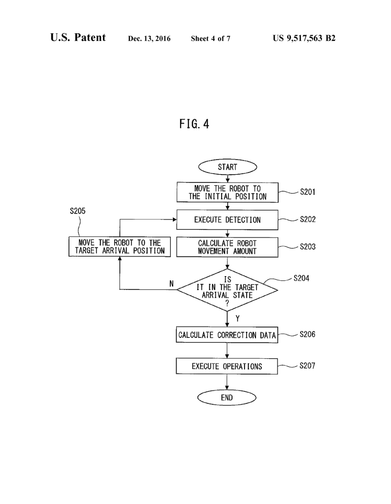
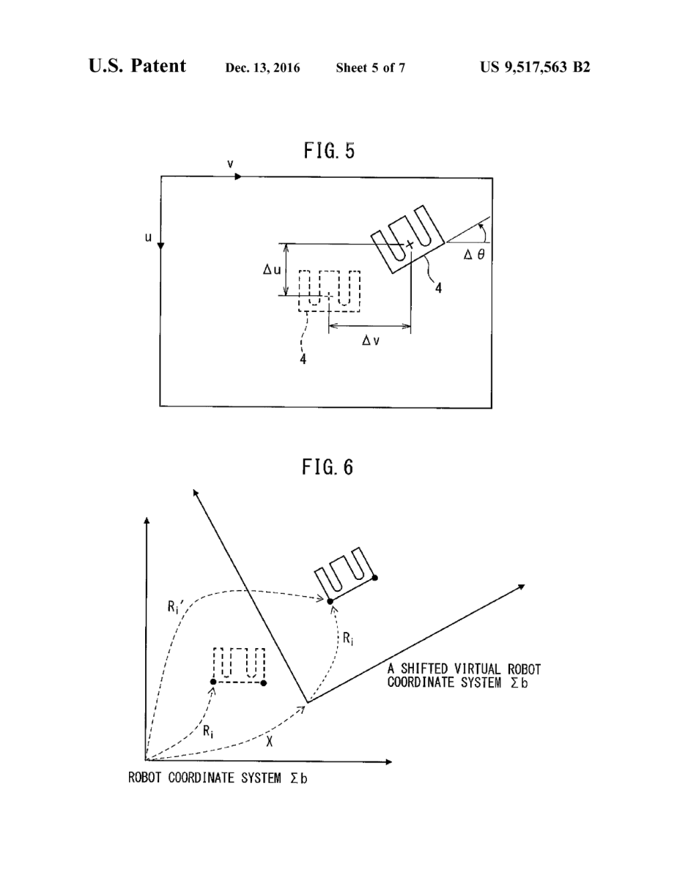

# US 9,517,563 B2, 시각 되먹임을 쓰는 로봇 시스템 (전문 번역)

- 원제: Robot system using visual feedback
- 출원인: FANUC Corporation (일본 야마나시)
- 발명자: Keisuke Watanabe
- 출원 2015-02-10, 등록 2016-12-13, 우선권 JP 2014-025600 (2014-02-13)
- 원문 파일: 같은 폴더의 `US9517563B2.pdf`
- 번역 범위: 전문 (초록, 본문, 도면 설명, 청구항 6개). 인용 문헌 목록은 원문 표기를 그대로 둔다.
- 번역 기준: 미국 특허 공보 PDF와 Google Patents 본문 텍스트를 대조했다.

---

## 초록

이 로봇 시스템은 다음을 포함한다.
제1 물체 위치에 놓인 물체에 정해진 작업을 하는 로봇.
제1 물체 위치에 대해 정해진 위치 관계로 놓인 팔 끝의 위치를 저장하는 제1 로봇 위치 저장부.
카메라 영상에서 물체의 특징량을 저장하는 목표 도달 상태 자료 저장부.
제2 물체 위치에 놓인 물체의 특징량을 목표 도달 상태 자료의 특징량과 일치시키기 위한 이동량을 계산하는 로봇 이동량 계산기.
그 이동량만큼 팔 끝을 움직였을 때의 제2 로봇 위치와 제1 로봇 위치의 차이로 보정 자료를 계산하는 보정 자료 계산기.

청구항 6개, 도면 7장.

---

## 관련 출원

이 출원은 2014-02-13에 낸 JP 2014-025600의 이익을 주장한다. 그 전체 내용을 참조로 넣는다.

## 발명의 분야

카메라로 로봇 동작을 보정하는 로봇 시스템에 관한 것이다.
특히 로봇 좌표계와 카메라 좌표계 사이의 등록(위치 맞춤)을 하지 않아도 되게 하는 시각 되먹임 로봇 시스템이다.

## 배경 기술

많은 산업용 로봇은 티칭 플레이백 방식으로 움직인다.
즉 사용자가 원하는 동작을 미리 프로그램으로 가르쳐 두고, 그 프로그램을 재생해 원하는 작업을 시킨다.
로봇은 가르친 동작을 똑같이 되풀이할 수 있다.
그러나 물체가 가르친 자리와 다른 자리에 놓이면 로봇은 올바른 작업을 하지 못한다.

이를 다루려고, 카메라 같은 비전 센서로 물체 위치를 인식해서 그 위치 정보로 로봇 동작을 보정하는 기술이 알려져 있다.
이 방법을 쓰면 물체가 가르친 자리와 다른 자리에 있어도 정확한 작업을 할 수 있다.

비전 센서가 알아낸 물체 위치는 비전 센서의 측정 기준 좌표계(이하 "비전 좌표계")로 표현된다.
비전 센서가 알아낸 위치 정보로 로봇 동작을 보정하려면, 비전 좌표계로 표현된 위치 정보를 로봇 제어 기준 좌표계(이하 "로봇 좌표계")의 위치 정보로 바꿔야 한다.
이 변환에 쓰는 자료를 "카메라 보정 자료"라 하고, 그 자료를 얻는 작업을 "카메라 보정"이라 한다 (예: JP-A-10-49218).

한편 카메라 보정을 하지 않고 비전 센서로 로봇 위치를 보정하는 방법으로 시각 되먹임이라는 기법이 알려져 있다 (예: JP-A-2003-211381, 이하 "특허문헌 2").
예를 들어 로봇을 물체를 집는 자리로 옮기고, 로봇에 붙인 카메라로 물체를 찍어 그 모습을 목표 자료로 저장한다.
실제 작업에서는 로봇을 움직일 때마다 물체를 찍고, 물체의 모습이 목표 자료와 일치하도록 로봇의 위치와 자세를 제어한다.
이 과정을 되풀이한다.
오차가 0으로 수렴하면 손으로 집는다.

특허문헌 2의 방법에서는 오차가 0이 된 자리에서 로봇이 손으로 물체를 집는다.
즉 물체를 집는 자리에 로봇이 있을 때 카메라에 보이는 물체 모습을 목표 자료로 저장해야 한다.
이 요구 때문에 카메라와 팔 끝에 붙인 손 사이의 위치 관계가 제한되고, 자유로운 설계를 못 한다.

이 방법은 오차가 0인 자리에서만 작업을 할 수 있다.
그래서 물체를 집는 단순한 작업에는 문제가 없다.
그러나 정해진 경로를 따라 접착제를 바르는 것처럼 복잡한 이동 경로가 필요한 작업에는 쓸 수 없다.

또 다른 방법도 제안되었다.
기준 물체에 대해 목표 자료를 만들 때의 로봇 위치와, 그 기준 물체를 집을 때의 로봇 위치 사이의 차이를 위치 변환 행렬로 저장해 둔다.
로봇을 움직여 오차를 0으로 수렴시킨 다음, 저장해 둔 위치 변환 행렬을 따라 움직여 집는다 (예: JP-B-4265088).
이 발명에서는 특허문헌 2와 달리 카메라와 손의 위치 관계 제한이 없어진다.
그러나 복잡한 경로가 필요한 작업에는 여전히 쓸 수 없다.

또한 물체가 탁자 같은 평평한 받침 위에 놓인 경우를 보자.
물체 모습이 목표 자료와 일치하도록 로봇의 위치와 자세를 제어하려면, 팔 끝에 붙인 카메라와 탁자면 사이의 거리를 바꾸지 않는 편이 좋다.
또 물체의 방향이 바뀌면 물체와 카메라의 상대 방향이 변하지 않도록 제어해야 한다.
이를 위해 카메라가 탁자면에 수직인 축을 중심으로 돌도록 제어해서 카메라의 기울기가 변하지 않게 하는 것이 좋다.

그러나 일반적인 시각 되먹임에서는 카메라와 탁자의 거리가 변하지 않는다는 보장도, 둘의 상대 기울기가 변하지 않는다는 보장도 없다.
그 결과 물체 모습을 목표 자료와 맞추는 제어에 필요 이상으로 긴 시간이 걸리는 경우가 생긴다.

이 문제를 피하려면 탁자면에 평행한 좌표계를 로봇에 설정하고 그 좌표계를 기준으로 카메라를 움직이면 된다.
예를 들어 로봇 손의 임의의 한 점을 TCP(공구 중심점)로 정하고, 그 TCP를 탁자면 위 한 직선에 있지 않은 세 점에 닿게 해서 각 점의 좌표값을 로봇 좌표계에서 읽으면 탁자면 위에 로봇 좌표계를 설정할 수 있다 (예: JP-A-2010-076054).

그러나 이 방법으로 좌표계를 설정하면 작업자의 숙련도에 따라 설정 정밀도가 달라지는 문제가 있다.
또 로봇 손을 탁자에 직접 닿게 하므로 잘못된 조작으로 손과 탁자가 손상될 위험이 있다.

이 발명은 시각 되먹임으로 로봇 동작을 보정하는 시스템을 제공한다.
복잡한 경로가 있는 작업을 할 수 있고, 작업자가 로봇 좌표계를 몰라도 카메라가 탁자면에 평행하게 움직이고 탁자면 법선을 축으로 회전하게 한다.
그래서 카메라를 정해진 자리로 효율적으로 옮긴다.

## 발명의 요약

이 발명의 한 실시예에 따른 로봇 시스템은 다음을 포함한다.

- 평면 위 제1 물체 위치에 놓인 물체에, 로봇 팔 끝에 붙은 장치로 정해진 작업을 하는 동작 명령을 담은 프로그램으로 제어되는 로봇.
- 물체를 찍도록 팔 끝에 붙인 카메라.
- 제1 물체 위치에 대해 정해진 위치 관계로 놓인 팔 끝의 위치를 제1 로봇 위치로 저장하는 제1 로봇 위치 저장부.
- 물체가 제1 물체 위치에 있고 팔 끝이 제1 로봇 위치에 있는 목표 도달 상태에서, 카메라 영상 속 물체의 위치, 자세, 크기 가운데 적어도 하나의 특징량을 목표 도달 상태 자료로 저장하는 저장부.
- 물체가 평면 위 제2 물체 위치에 있고 팔 끝이 임의의 초기 위치에 있을 때 찍은 영상에서, 물체의 위치, 자세, 크기 가운데 적어도 하나의 특징량을 목표 도달 상태 자료의 해당 특징량과 일치시키기 위한, 임의 초기 위치로부터의 이동량을 계산하는 로봇 이동량 계산기.
- 계산한 이동량만큼 팔 끝을 움직였을 때의 위치인 제2 로봇 위치와 제1 로봇 위치의 차이로, 프로그램을 보정할 보정 자료를 계산하는 보정 자료 계산기.

## 도면의 설명

- 도 1: 제1 실시예의 로봇 시스템 전체 구성도
- 도 2: 이 발명에 쓰는 로봇 제어 장치의 블록도
- 도 3: 로봇 시스템을 처음 설정할 때의 흐름도
- 도 4: 로봇 시스템이 작업을 실행할 때의 처리 흐름도
- 도 5: 제1 물체 위치와 제2 물체 위치에 놓인 물체의 평면도
- 도 6: 옮겨진 가상 로봇 좌표계를 보이는 그림
- 도 7: 공구 좌표계의 정의를 설명하는 그림
- 도 8: 공구 좌표계와 카메라의 위치 관계를 보이는 그림
- 도 9: 공구 좌표계와 제2 공구 좌표계의 위치 관계를 보이는 그림
- 도 10: 공구 좌표계가 Z축을 중심으로 회전하는 모습을 보이는 그림

## 상세한 설명

이 발명의 로봇 시스템을 도면과 함께 설명한다.
이 발명의 기술 범위는 실시예에 한정되지 않고, 청구 범위에 적힌 발명과 그 균등물을 포함한다.



도 1은 이 발명 실시예의 로봇 시스템 전체 구성도다.
이 시스템은 다음을 포함한다.
평면 5 위 제1 물체 위치에 놓인 물체 4에, 로봇 1의 팔 끝에 있는 기계 인터페이스부 32에 붙은 공구 30으로 정해진 작업을 하는 동작 명령을 담은 프로그램으로 제어되는 로봇 1.
물체 4를 찍도록 기계 인터페이스부 32에 붙인 카메라 3.
제1 물체 위치에 대해 정해진 위치 관계로 놓인 기계 인터페이스부 32의 위치를 제1 로봇 위치로 저장하는 제1 로봇 위치 저장부(이하 "로봇 위치 저장부") 12a (도 2).
물체 4가 제1 물체 위치에 있고 기계 인터페이스부 32가 제1 로봇 위치에 있는 목표 도달 상태에서, 카메라 3 영상 속 물체 4의 위치, 자세, 크기 가운데 적어도 하나의 특징량을 목표 도달 상태 자료로 저장하는 저장부 12b.
물체가 제2 물체 위치에 있고 팔 끝이 임의 초기 위치에 있을 때의 영상 특징량을 목표 도달 상태 자료의 해당 특징량과 일치시키기 위한 이동량을 계산하는 로봇 이동량 계산기 11b.
이동량만큼 움직인 뒤의 제2 로봇 위치와 제1 로봇 위치의 차이로 보정 자료를 계산하는 보정 자료 계산기 11c.

로봇 1은 잘 알려진 보통 로봇이다. 예를 들어 6축 다관절 로봇이다.
로봇 1은 팔부 1a와 베이스부 1b로 되어 있고, 로봇을 제어하는 로봇 제어 장치 2에 연결된다.

팔부 1a의 팔 끝에 있는 기계 인터페이스부 32에는 공구 30이 달린다.
도 1의 공구 30은 물체에 작업을 하는 기구다. 예를 들어 접착제를 바르는 노즐 31이다.
기계 인터페이스부 32에는 물체 4를 찍는 카메라 3도 달린다.

로봇 1에는 베이스부 1b에 고정된 로봇 좌표계 Σb와, 기계 인터페이스부 32에 고정된 기계 인터페이스 좌표계 Σf가 정의된다.
로봇 제어 장치 2는 로봇 좌표계 Σb에서 본 기계 인터페이스 좌표계 Σf의 위치와 자세 R을 로봇의 현재 위치로 제어한다.
여기서 R은 4×4 동차 변환 행렬이다.
이하 따로 말하지 않으면 "로봇 위치"는 Σb에서 본 Σf의 위치와 자세 R을 뜻한다.

카메라 3은 예를 들어 산업용 CCD 카메라이고, 촬상 기능이 있는 잘 알려진 수광 장치다.
이 실시예에서는 로봇 제어 장치 2가 영상 처리 기능을 갖고 카메라 3이 거기에 연결된다.
다만 이에 한정되지 않는다. PC 같은 영상 처리 장치를 따로 두고 카메라를 거기에 연결한 뒤, 영상 처리 장치와 로봇 제어 장치 2를 통신 케이블로 이어도 된다.

물체 4는 평평한 탁자 5 위에 놓인다.
로봇 1을 움직여 물체 4를 카메라 3의 시야에 넣고 찍을 수 있다.

도 2는 이 발명에 쓰는 로봇 제어 장치의 블록도다.
로봇 제어 장치 2는 주 CPU(이하 "CPU") 11을 포함한다.

CPU 11은 다음을 포함한다.
카메라 3이 찍은 영상 속 물체 4의 위치, 자세, 크기 같은 특징량을 계산하는 영상 처리부 11a.
계산한 특징량과 저장된 목표 도달 상태 자료로 로봇 이동량을 정하는 로봇 이동량 계산기 11b.
제1 로봇 위치와 제2 로봇 위치로 보정 자료를 계산하는 보정 자료 계산기 11c.
여러 제2 로봇 위치로 탁자 5 면의 법선 벡터를 구하는 법선 벡터 계산기 11d.

CPU 11에서 나온 버스 17에는 RAM, ROM, 비휘발성 메모리 등을 담은 메모리 12, 티칭 조작반 인터페이스 13, 카메라 인터페이스 14, 서보 제어부 15, 외부 장치 입출력 인터페이스 16이 연결된다.

티칭 조작반 18은 티칭 조작반 인터페이스 13에 연결된다.
작업자는 티칭 조작반 18로 로봇 프로그램을 만들고 고치고 등록하고 여러 설정값을 정할 수 있다.
또 가르친 프로그램을 재생하고 로봇 위치를 수동으로 조작할 수 있다.
이 실시예에서는 로봇 제어 장치 2가 영상 처리 기능을 가지므로, 작업자는 영상 처리 프로그램도 만들고 고치고 등록하고 설정값을 정하며 검출 시험을 할 수 있다.

로봇 1 제어용 시스템 소프트웨어와 영상 처리용 시스템 소프트웨어는 메모리 12의 ROM에 저장된다.
작업 내용을 가르친 로봇 프로그램과 설정 자료는 메모리 12의 비휘발성 메모리에 저장된다.
메모리 12의 RAM은 CPU 11의 여러 계산에서 자료를 잠시 두는 영역으로 쓴다.
메모리 12는 로봇 위치를 저장하는 로봇 위치 저장부 12a와, 영상 처리부가 계산한 목표 도달 상태 자료를 저장하는 저장부 12b를 포함한다.

서보 제어부 15는 서보 제어기 #1에서 #n까지를 갖는다 (n은 로봇의 총 축 수, 여기서는 n=6으로 본다).
CPU 11에서 동작 명령을 받고, 각 축에 붙은 펄스 코더의 되먹임 신호와 함께 토크 명령을 서보 증폭기 A1에서 An으로 보낸다.
각 서보 증폭기는 토크 명령에 따라 서보 모터 M1에서 Mn에 전류를 공급해 모터를 돌린다.

카메라 인터페이스 14에는 촬상 장치인 카메라 3이 연결된다.
CPU 11이 카메라 인터페이스 14를 통해 촬상 명령을 보내면, 카메라 3은 전자 셔터 기능으로 영상을 찍는다.
영상 신호는 카메라 인터페이스 14를 통해 회색조 신호 형태로 메모리 12에 저장된다.

이 출원의 로봇 시스템에서는, 물체 4를 탁자 5 위 임의의 한 자리에 놓은 상태에서 작업 프로그램을 가르친다.
이 자리를 "기준 위치"라 한다.
물체 4가 기준 위치에 있으면 로봇 프로그램만 돌려도 알맞은 작업을 할 수 있다.

물체 4가 기준 위치와 다른 자리에 놓이면, 이 발명이 밝히는 방법으로 보정 자료를 계산한다.
그 보정 자료로 프로그램을 보정하면서 돌려, 기준 위치가 아닌 자리의 물체 4에도 알맞은 작업을 한다.

### 설정 절차 (도 3)

도 3은 로봇 시스템을 설정할 때의 흐름도다.

먼저 물체 4를 탁자 5 위 기준 위치(이하 "제1 물체 위치")에 둔다 (S101).

다음으로 제1 물체 위치의 물체 4가 카메라 3 시야에 들어오도록 로봇 1을 제1 로봇 위치로 옮긴다 (S102).
제1 로봇 위치는 카메라 3의 광축이 탁자 5 면과 거의 수직이 되도록 잡는 것이 좋다. 다만 꼭 그래야 하는 것은 아니다.
예를 들어 광축이 탁자면에 약간 기울어도 문제없다.
또 렌즈 왜곡 등이 물체 영상에 주는 영향을 줄이려면, 물체 4가 카메라 시야의 거의 가운데에 보이도록 제1 로봇 위치를 잡는 것이 좋다.

다음으로 카메라 3으로 물체 4를 찍고, 그 영상을 모형 자료로 가르친다 (S103).
모형 자료로 무엇을 저장할지는 물체 검출에 쓰는 영상 처리 알고리즘에 달렸다.
이 발명에서는 어떤 영상 처리 알고리즘을 써도 된다.
예를 들어 정규화 상관을 쓰는 템플릿 정합, 에지 정보를 쓰는 일반화 허프 변환 등이 알려져 있고 쓸 수 있다.
정규화 상관 템플릿 정합을 쓰면 템플릿이 모형 자료에 해당한다.

다음으로 가르친 모형 자료로 영상에서 물체 4를 검출한다.
검출된 물체 4의 영상 위 위치, 자세, 크기 같은 특징량을 목표 도달 상태로 저장부 12b에 저장하고, 제1 로봇 위치를 로봇 위치 저장부 12a에 저장한다 (S104).
예를 들어 템플릿 정합을 쓰면, 일치도가 가장 높은 템플릿의 중심 위치, 회전각, 확대 축소 비율을 위치, 자세, 크기의 특징량으로 뽑을 수 있다.

마지막으로 제1 물체 위치의 물체 4에 정해진 작업을 하는 로봇 프로그램을 가르친다 (S105).

### 작업 실행 절차 (도 4)



도 4는 이 발명의 로봇 시스템이 작업을 실행할 때의 처리 흐름도다.
도면 글자: START, 로봇을 초기 위치로 옮긴다(S201), 검출을 실행한다(S202), 로봇 이동량을 계산한다(S203), 목표 도달 상태인가?(S204), 아니오면 로봇을 목표 도달 위치로 옮긴다(S205) 뒤 S202로 돌아간다, 예면 보정 자료를 계산한다(S206), 작업을 실행한다(S207), END.

먼저 로봇을 초기 위치로 옮긴다 (S201).
보통 초기 위치는 제1 로봇 위치로 둔다.
다만 물체 4가 카메라 3 시야에 들어오고 로봇이 제1 로봇 위치와 같은 자세를 잡을 수 있으면, 다른 초기 위치로 두어도 된다.
예를 들어 탁자 5가 넓어 전체가 카메라 시야에 다 들어오지 않으면, 초기 위치를 바꿔 가며 탁자 전체를 여러 시야로 나눠 측정할 수 있다.

다음으로 카메라 3으로 물체 4를 찍고 영상 처리로 물체를 검출한다 (S202).
영상 처리 알고리즘은 S104와 같은 기법을 써도 되고, 그러면 특징량(영상 위 위치, 자세, 크기) 정보를 얻는다.

다음으로 S202에서 얻은 특징량이 저장된 목표 도달 상태 자료와 일치하는 자리로 로봇을 옮길 이동량을 계산한다 (S203).
영상에서 뽑은 특징량으로 로봇 이동량을 계산하는 기법은 여러 가지가 제안되어 있다.
이 발명은 쓰는 기법을 한정하지 않는다. 다만 한 예를 뒤에서 설명한다.

다음으로 현재 로봇 위치가 목표 도달 상태인지 판정한다 (S204).
이 판정은 S203에서 계산한 로봇 이동량의 크기를 미리 정한 임계값과 비교해서 할 수 있다.
예를 들어 임계값이 0.5 mm 이면, 계산한 로봇 이동량이 0.5 mm 미만일 때 목표 도달 상태로 판정할 수 있다.
S204의 평가 기준으로는, S202에서 얻은 특징량 하나와 저장된 목표 도달 상태 자료의 해당 특징량의 차이를 미리 정한 임계값과 비교한 값을 써도 된다.
예를 들어 임계값이 1 화소이면, 계산한 위치의 차이가 1 화소 미만일 때 목표 도달 상태로 판정할 수 있다.

목표 도달 상태가 아니면, S203에서 계산한 이동량만큼 로봇 1을 움직인다 (S205).
한 번의 이동으로 목표 도달 상태에 이른다고 보고 바로 다음 단계(S206)로 갈 수도 있다.
다만 도 4의 흐름도에서는 S204의 목표 도달 조건을 다시 확인하려고 S202로 돌아가도록 했다.

목표 도달 상태로 판정되면, 현재 로봇 위치를 제2 로봇 위치로 등록한다.
동시에 저장된 제1 로봇 위치와 제2 로봇 위치로, 검출된 물체 4에 작업을 할 보정 자료를 계산한다 (S206).

### 보정 원리와 보정 자료 계산



도 5는 제1 물체 위치와 제2 물체 위치에 놓인 물체의 평면도다.
도면 글자: 영상 좌표 u, v, 세로 차이 Δu, 가로 차이 Δv, 회전 차이 Δθ, 물체 4.
도 6은 옮겨진 가상 로봇 좌표계를 보이는 그림이다.
도면 글자: 로봇 좌표계 Σb, 옮겨진 가상 로봇 좌표계 Σb, 변환 X, 프로그램의 로봇 위치 Ri 와 보정된 위치 Ri 프라임.

앞서 말했듯 로봇 위치는 Σb에서 본 Σf의 위치와 자세 R로 나타낼 수 있다.
여기서 R은 4×4 동차 변환 행렬이다.
로봇 프로그램은 로봇을 여러 로봇 위치로 차례로 옮기므로, 프로그램을 여러 로봇 위치의 집합으로 볼 수 있다.
i번째 로봇 위치를 Ri 라 하면, 구할 보정 자료는 다음 식을 만족하는 4×4 동차 변환 행렬 X로 볼 수 있다.

```
Ri' = X · Ri
```

즉 프로그램에 가르친 로봇 위치 Ri 를 보정 자료 X로 Ri' 로 바꾸면서 프로그램을 돌리면 로봇을 보정할 수 있다.
이 변환 행렬 X는 로봇 좌표계 Σb를 X만큼 가상으로 옮겨 놓고 프로그램을 돌리는 효과가 있다.
그래서 경로가 복잡한 작업이라도 물체 4의 위치와 방향에 맞게 프로그램을 알맞게 보정할 수 있다.

이 발명에서 저장된 제1 로봇 위치를 R1, 제2 로봇 위치를 R2 라 하면, 보정 자료 X는 다음 식으로 구한다.

```
X = R2 · R1^-1
```

마지막으로 계산한 보정 자료로 보정하면서 가르친 로봇 프로그램을 돌린다 (S207).

### 자코비안 행렬로 이동량 계산 (S203의 한 예)

먼저 검출된 물체의 특징량과 목표 도달 상태 자료로 저장한 특징량의 차이로 이동량을 계산한다.
도 5에서 제1 물체 위치의 물체 4는 점선으로, 제2 물체 위치의 물체 4는 실선으로 그렸다.
비전 좌표계의 위치를 (u, v)라 하면, Δu는 영상의 세로 위치 차이, Δv는 가로 위치 차이다.

영상 위 겉보기 크기의 특징량을 s라 한다.
예를 들어 템플릿 정합에서는 템플릿 크기를 100% = 1.0으로 두고, 물체가 템플릿보다 크게 보이면 1.0보다 큰 값, 작게 보이면 1.0보다 작은 값으로 나타낼 수 있다.

목표 도달 자료로 저장한 특징량을 (u0, v0, s0), S202에서 얻은 특징량을 (u1, v1, s1)이라 하면 차이는 다음과 같다.

```
Δu = u1 - u0
Δv = v1 - v0
Δs = 1/s1 - 1/s0
```

영상 위 겉보기 크기 s는 물체가 놓인 탁자면에서 카메라 3까지의 거리에 반비례한다.
그래서 비율 자체 대신 거리에 비례하는 값인 역수를 쓴다.

구할 로봇 이동량을 (Δx, Δy, Δz)라 하면, 자코비안 행렬 J를 다음 식으로 정의할 수 있다.

```
[Δx, Δy, Δz]^T = J · [Δu, Δv, Δs]^T        ... (1)
```

로봇 이동량 (Δx, Δy, Δz)는 어느 좌표계로 나타내도 된다.
다만 카메라 3과 Σf의 상대 위치 관계가 고정이라는 점을 생각하면, 이동량은 Σf로 나타내는 것이 좋다.
즉 이 실시예에서 (Δx, Δy, Δz)는 로봇 1을 Σf의 X축, Y축, Z축 방향으로 움직일 양으로 정의한다.

다음으로 자코비안 행렬 J를 정하는 방법이다.

먼저 물체 4가 영상의 거의 가운데에 보이는 원래 자리에 로봇을 둔다.
그 자리에서 카메라 3이 찍은 영상에서 물체 4를 검출해 특징량 (u0, v0, s0)을 얻는다.
그 다음 로봇 1을 원래 자리에서 Σf의 X축 방향으로 거리 m 만큼 옮기고, 그 자리에서 찍은 영상에서 물체를 검출해 특징량 (uX, vX, sX)을 얻는다.
같은 방식으로 Y축 방향으로 m, Z축 방향으로 m 만큼 옮긴 자리에서 (uY, vY, sY)와 (uZ, vZ, sZ)를 얻는다.

X, Y, Z축 방향으로 옮겼을 때의 검출 결과와 원래 자리의 검출 결과로 Δu, Δv, Δs를 다음과 같이 정한다.

```
Δux = ux - u0,  Δvx = vx - v0,  Δsx = 1/sx - 1/s0
Δuy = uy - u0,  Δvy = vy - v0,  Δsy = 1/sy - 1/s0
Δuz = uz - u0,  Δvz = vz - v0,  Δsz = 1/sz - 1/s0
```

이를 식 (1)에 넣으면 자코비안 행렬 J를 다음과 같이 얻는다.

```
diag(m, m, m) = J · [[Δux, Δuy, Δuz], [Δvx, Δvy, Δvz], [Δsx, Δsy, Δsz]]
J = diag(m, m, m) · [[Δux, Δuy, Δuz], [Δvx, Δvy, Δvz], [Δsx, Δsy, Δsz]]^-1
```

자코비안 행렬을 정하고 나면, 임의의 물체 4의 특징량 (u, v, s)를 식 (1)에 넣어 목표 도달 상태로 가는 로봇 이동량을 구할 수 있다.

위 과정으로 로봇 1은 탁자 5 위 임의의 자리에 놓인 물체 4에 대해 프로그램을 보정하며 작업을 할 수 있다.
그러나 구한 이동량 (Δx, Δy, Δz)는 카메라 3과 탁자 5 사이의 거리를 바꾸는 이동일 수 있다.
결국 목표 도달 상태에는 이르지만 효율이 나쁘다.

그래서 다음에는 물체 4가 놓인 탁자 5 면의 법선을 계산하고, 로봇을 탁자면에 평행하게 움직이고 그 법선에 평행한 축으로 돌려서, 로봇 1과 탁자 5의 거리를 바꾸지 않는 이동량을 계산하는 방법을 설명한다.

### 탁자면 법선 벡터 계산

먼저 자코비안 행렬은 이미 정해졌고, 로봇 1은 S201에서 S207까지의 절차대로 탁자 위 임의 자리의 물체 4에 작업할 준비가 되었다고 본다.

3차원의 임의 평면을 정하려면 그 평면 위 서로 다른 세 점을 알아야 한다는 것이 일반적으로 알려져 있다.

S206에서 저장한 제2 로봇 위치의 위치 성분 (x, y, z)를 보자.
(x, y, z)는 로봇 1이 제2 로봇 위치에 있을 때 Σb에서 본 Σf 원점의 위치다.

제2 로봇 위치의 위치 성분 (x, y, z)는 탁자 5 면 위의 점을 가리키지는 않는다.
그러나 여러 제2 로봇 위치의 (xi, yi, zi)를 알면, 이 점들은 사실상 한 평면 위에 있다.
또 그 점들이 만드는 평면은 탁자 5 면에 평행하다.
그래서 (xi, yi, zi)가 만드는 평면의 법선을 계산하면 탁자면의 법선을 구할 수 있다.

3차원의 임의 평면은 다음 식으로 나타낼 수 있다.

```
a x + b y + c z = d
```

여기서 벡터 n = (a, b, c)는 평면의 법선 벡터이고, 스칼라 d는 좌표계 원점에서 평면까지 내린 수선의 길이다.
여러 제2 로봇 위치 (xi, yi, zi)가 있으면 다음 관계를 만족하는 값을 정하면 된다.

```
[[x1, y1, z1], [x2, y2, z2], ..., [xn, yn, zn]] · [a, b, c]^T = [d, d, ..., d]^T
```

여기서 법선 벡터 n은 최소제곱법으로 정한다.

```
X = [[x1, y1, z1], [x2, y2, z2], ..., [xn, yn, zn]]
[a/d, b/d, c/d]^T = (X^T X)^-1 X^T [1, 1, ..., 1]^T
```

이 벡터 (a/d, b/d, c/d)를 정규화하면 여러 제2 로봇 위치가 만드는 평면의 법선 벡터, 곧 탁자 5 면의 법선 벡터 n을 구할 수 있다.

제2 로봇 위치 가운데 하나를 제1 로봇 위치로 대신 써도 된다.

이 실시예는 로봇 1이 정해진 작업을 하는 과정에서 법선 벡터 n을 계산하는 형태다. 그래서 S207도 같이 수행된다.
다만 로봇을 작업시키지 않고 법선 벡터만 먼저 구하고 싶으면, 법선 벡터를 구할 때까지 S207을 미룬다.

### 공구 좌표계로 탁자면 평행 이동 만들기

마지막으로, 계산한 법선 벡터 n을 써서 S203의 이동량이 탁자면에 평행한 병진 운동만 담도록 만드는 방법을 설명한다.

새 좌표계로 공구 좌표계 Σt를 도입한다.
Σt는 Σf에 상대적으로 고정되게 정의된 좌표계다. 로봇 1이 움직이면 Σf와의 상대 위치 관계를 유지하며 같이 움직인다.

도 7처럼 Σt는 한 예로 다음과 같이 정의할 수 있다.
원점은 Σf의 원점과 같고, 로봇 1이 제1 로봇 위치에 있을 때 Z축이 탁자 5 면의 법선 벡터 n에 평행한 좌표계다.
Σt의 X축과 Y축은 Z축과 직교하고 서로 직교하기만 하면 어느 방향이어도 된다.

Σt를 정의한다는 것은 Σf에서 본 Σt의 위치와 자세 T를 정하는 것과 같다. T는 4×4 동차 변환 행렬이다.

먼저 로봇 1이 제1 로봇 위치에 있다는 전제로, Σb에서 본 Σt의 위치와 자세 Tb를 다음 절차로 정한다.

Σb에서 본 Σt의 X축, Y축, Z축 방향 벡터를 각각 Vx, Vy, Vz 라 하면, Z축은 법선 벡터 n과 같은 방향이므로 다음과 같다.

```
Vz = n
```

X축과 Y축은 어느 방향이어도 되므로, X축은 첫 번째 제2 로봇 위치에서 두 번째 제2 로봇 위치로 향하게 정하고, Y축은 X축과 Z축 둘 다에 수직하게 둘 수 있다. 즉 다음과 같다.

```
Vx = [x2 - x1, y2 - y1, z2 - z1]^T / k
Vy = Vz × Vx
k = sqrt((x2 - x1)^2 + (y2 - y1)^2 + (z2 - z1)^2)
```

로봇 1이 제1 로봇 위치 R1에 있을 때 Σt의 원점은 Σb에서 본 Σf 원점과 같은 좌표값을 가진다.
그 원점을 (x0, y0, z0)이라 하면, Σb에서 본 Σt의 위치와 자세 Tb는 다음과 같다.

```
Tb = [[Vx, Vy, Vz, (x0, y0, z0)^T], [0, 0, 0, 1]]
```

또 로봇 1이 제1 로봇 위치 R1에 있으므로 다음 식이 성립한다.

```
Tb = R1 · T
```

따라서 Σf에서 본 Σt의 위치와 자세 T는 다음 식으로 계산한다.

```
T = R1^-1 · Tb
```

T가 정해졌으므로, Σf로 나타낸 이동량 (Δx, Δy, Δz)를 Σt에서 본 이동량 (Δx', Δy', Δz')로 다음 식처럼 바꿀 수 있다.

```
[Δx', Δy', Δz', 1]^T = T^-1 [Δx, Δy, Δz, 1]^T
```

위 식에서 T가 4×4 동차 변환 행렬이므로 이동량 벡터도 4차원으로 늘렸다.
다만 T의 회전 성분을 3×3 회전 행렬 M으로 두면 다음처럼 쓸 수 있다.

```
[Δx', Δy', Δz']^T = M^-1 [Δx, Δy, Δz]^T
```

이렇게 구한 Σt 표현의 이동량 (Δx', Δy', Δz')에서 Δz'는 이상적으로는 0이어야 한다.
Σt의 Z축이 탁자 5 면에 수직이고 물체 4가 탁자 위에 놓였기 때문이다.
그러나 검출 오차, 계산 오차 등 여러 요인 때문에 정확히 0이 되지는 않는다.
그 결과 계산한 이동량대로 움직이면 로봇이 탁자에 조금 가까워지기도 하고 조금 멀어지기도 한다.
이때 Δz'를 0으로 바꿔 이동량을 (Δx', Δy', 0)으로 두면, 탁자 5와의 거리를 정확히 유지하며 움직일 수 있다.

위 식 (1)은 다음과 같다.

```
[Δx, Δy, Δz]^T = J [Δu, Δv, Δs]^T
```

따라서 다음 식을 얻는다.

```
[Δx', Δy', Δz']^T = M^-1 · J [Δu, Δv, Δs]^T
```

그래서 J 프라임은 다음 식으로 계산한다.

```
J' = M^-1 · J
```

위 식으로 미리 계산한 J' 를 S203에서 자코비안 행렬 J 대신 쓰면, Σt로 나타낸 이동량 (Δx', Δy', Δz')를 (Δu, Δv, Δs)에서 바로 계산할 수 있다.

Δθ, 곧 영상 속 물체 4의 겉보기 방향 변화에 대해서는, Σt의 Z축이 탁자면에 수직이므로 로봇 1을 Σt의 Z축을 중심으로 Δθ 만큼 돌리면 된다.

### 제2 공구 좌표계로 시야 이탈 막기

다만 이 경우, 도 8처럼 Σt와 카메라 3의 위치 관계에 따라 Σt의 Z축으로 로봇을 돌리면 물체 4가 카메라 시야를 벗어날 수 있다.

이를 다루려고 도 9처럼 제2 공구 좌표계 Σt' 를 만든다.
물체 4가 제1 물체 위치에 있고 로봇 1이 제1 로봇 위치에 있을 때, 물체 4의 중심을 지나고 법선 벡터 n에 평행한 축 위에 원점이 오도록 Σt의 원점을 평행 이동한 좌표계다.
그 Σt' 의 Z축을 중심으로 Δθ 만큼 돌리면 물체가 시야를 벗어나는 문제를 풀 수 있다.
Σt' 계산 방법은 다음과 같다.

Σt와 Σt' 는 서로 평행하고 원점만 다르다.
Σt의 원점에서 Σt' 의 원점으로 가는 벡터를 Σt 기준으로 나타낸 것을 P라 하자.

물체 4를 탁자 5 위 알맞은 자리(예를 들어 제1 물체 위치)에 두고 로봇 1을 예를 들어 제1 로봇 위치에 둔 상태에서, 영상 처리로 카메라 3 영상에서 물체 4를 검출한다.
Σb에서 본 Σt의 위치와 자세를 Tb, Σb에서 본 Σt 원점의 좌표값을 (x1, y1, z1), 검출된 물체 4의 비전 좌표계 좌표값을 (u1, v1)이라 한다.

다음으로 물체 4를 같은 자리에 둔 채, 로봇 1을 Σt의 Z축을 중심으로 아주 작은 각 φ 만큼 돌린다.
그리고 앞서 말한 방법으로 시각 되먹임을 걸어, 영상 속 물체 4의 특징량이 위 (u1, v1)과 일치하게 만든다.
수렴한 로봇 위치에서 Σb에서 본 Σt 원점의 좌표값을 (x2, y2, z2)라 한다.

도 10은 이 상황을 위에서 본 그림이다.
각이 서로 다른 두 로봇 위치에서 물체 4가 영상의 같은 좌표값 (u1, v1)에 보이므로 다음 식이 성립한다.

```
P = R(φ) · P + Δt        ... (2)
```

여기서

```
R(φ) = [[cos φ, -sin φ, 0], [sin φ, cos φ, 0], [0, 0, 1]]
[Δtx, Δty, Δtz, 1]^T = Tb^-1 [x2 - x1, y2 - y1, z2 - z1, 1]^T
```

식 (2)를 풀면 다음을 얻는다.

```
[[1 - cos φ, sin φ, 0], [-sin φ, 1 - cos φ, 0], [0, 0, 1]] P = [Δtx, Δty, Δtz]^T
P = [[1 - cos φ, sin φ, 0], [-sin φ, 1 - cos φ, 0], [0, 0, 1]]^-1 [Δtx, Δty, Δtz]^T
```

Σt에서 Σt' 로 가는 변환에는 회전 변환이 없으므로, Σt의 원점을 벡터 P만큼 옮기면 Σt' 의 원점을 정할 수 있다.

위 과정으로 이동을 다음 둘로만 제한할 수 있다.
구한 법선에 수직인 평면 안의 평행 이동.
구한 법선에 평행한 축을 중심으로 하는 회전.
그 결과 수렴에 필요한 병진 방향과 회전축을 제한할 수 있어 수렴 시간을 줄일 수 있다.
구체적으로, 물체를 영상 위 목표 위치로 옮길 때 영상 속 물체 크기가 변하지 않으므로 높이 방향의 수렴 동작이 없다.
그래서 수렴 판정에서 크기 차이를 계산하고 수렴을 따질 필요가 없어진다.
그 결과 처리 시간이 줄고 수렴 시간도 짧아진다.

### 효과와 다른 실시예

카메라로 찍은 영상 속 물체의 특징량이 목표 도달 상태 자료와 일치하도록 로봇을 제어하면, 제2 물체 위치의 물체와 제2 로봇 위치의 상대 위치 관계가 제1 물체 위치의 물체와 제1 로봇 위치의 상대 위치 관계와 같아진다고 기대할 수 있다.
따라서 제1 로봇 위치와 제2 로봇 위치의 차이로, 제1 물체 위치의 물체에 작업하도록 가르친 프로그램을 보정하고, 보정한 프로그램을 돌려 제2 물체 위치의 물체에 작업할 수 있다.
즉 프로그램에 가르친 동작이 복잡한 경로를 담고 있어도 제2 물체 위치의 물체에 원하는 작업을 할 수 있다.

이 발명의 다른 실시예는 다음을 특징으로 한다.
팔 끝이 제2 로봇 위치에 있을 때 카메라로 찍은 영상에서, 제2 물체 위치의 물체의 위치, 자세, 크기 가운데 적어도 한 특징량과 저장된 목표 도달 상태 자료의 해당 특징량의 차이가 미리 정한 값보다 크면, 로봇 이동량 계산기는 제2 로봇 위치를 고쳐진 초기 위치로 보고 이동량을 계산한다.
그 이동량만큼 움직인 뒤의 팔 끝 위치를 고쳐진 제2 로봇 위치로 둔다.

목표 도달 상태로 가는 로봇 이동량을 정하는 방법은 여러 가지가 제안되었다.
이 발명은 그 방법을 한정하지 않는다.
다만 단순한 방법을 쓰면, 처음 정한 이동량으로 한 번 움직이는 것만으로는 목표 도달 상태에 이르지 못하는 경우가 있다.
그런 경우에는 제2 로봇 위치를 고쳐진 초기 위치로 삼아 같은 절차를 되풀이해서 목표 도달 상태에 점점 다가가게 할 수 있다.

이 발명의 또 다른 실시예는 다음을 특징으로 한다.
팔 끝이 제2 로봇 위치에 있을 때 로봇 이동량 계산기가 제2 로봇 위치를 고쳐진 초기 위치로 보고 이동량을 계산한다.
그리고 계산한 이동량이 미리 정한 값보다 크면, 그 이동량만큼 움직인 뒤의 팔 끝 위치를 고쳐진 제2 로봇 위치로 둔다.

이 발명의 또 다른 실시예는 다음을 더 포함한다.
서로 다른 제2 물체 위치가 적어도 세 개 있을 때, 각 제2 물체 위치에 물체를 놓아 얻은 여러 제2 로봇 위치를 저장하는 제2 로봇 위치 저장부.
그 제2 로봇 위치들로 물체가 놓인 평면의 법선 벡터를 계산하는 법선 벡터 계산기.
그리고 로봇 이동량 계산기는 이동량으로 법선에 수직인 평면 안의 병진 운동과 법선에 평행한 축 둘레의 회전 운동만 계산한다.

이 발명의 또 다른 실시예는 서로 다른 제2 물체 위치 가운데 하나가 제1 물체 위치와 같고, 제2 로봇 위치 가운데 하나가 제1 로봇 위치인 것을 특징으로 한다.

물체가 놓인 탁자면에 수직인 축의 방향 벡터(법선 벡터)는 제1 로봇 위치와 두 개의 제2 로봇 위치를 알거나, 세 개의 제2 로봇 위치를 알면 계산할 수 있다.
예를 들어 제1 로봇 위치에서 첫 번째 제2 로봇 위치로 가는 벡터와, 제1 로봇 위치에서 두 번째 제2 로봇 위치로 가는 벡터의 외적으로 법선 벡터를 정할 수 있다.
또는 제2 로봇 위치가 셋 이상이면 최소제곱법 등으로 계산할 수 있다.

이때 계산에 쓸 제2 로봇 위치가 모두 한 직선 위에 있으면 평면을 정할 수 없다.
그래서 제1 로봇 위치와 두 제2 로봇 위치, 또는 세 제2 로봇 위치가 예를 들어 정삼각형을 이루도록 제2 물체 위치를 배치하는 것이 좋다.
또 세 제2 로봇 위치가 서로 너무 가까우면 법선 벡터를 바르게 정하지 못할 위험이 있다.
그래서 제2 로봇 위치 저장부에 저장할 제2 로봇 위치는, 이미 저장된 제2 로봇 위치들과 일정 거리 이상 떨어져 있는지 확인한 뒤에 저장하는 것이 좋다.

로봇 이동량 계산기는 제1 물체 위치의 물체 중심을 지나고 법선 벡터에 평행한 직선을, 로봇이 제1 로봇 위치에 있을 때 팔 끝에 대한 상대 직선으로 정의할 수 있다.
그리고 회전 운동은 그 상대 직선을 회전축으로 삼아 수행할 수 있다.

영상 속 물체 특징량을 목표 도달 상태 자료와 같게 만들려고 로봇을 돌릴 때의 회전축은, 물체 중심을 지나고 법선 벡터에 평행한 축으로 정한다.
그 축은 물체가 제1 물체 위치에 있고 로봇이 제1 로봇 위치에 있을 때, 로봇 팔 끝에 대한 상대 직선으로 정의한다.
이 구성은 로봇을 회전시킬 때 물체가 영상을 벗어나는 위험을 없앤다.

지금까지 설명한 대로, 이 발명 실시예의 로봇 시스템에 따르면 다음이 가능하다.
카메라로 물체의 위치와 자세를 인식해 정해진 작업을 하는 로봇 시스템에서, 카메라 보정이 필요 없다는 시각 되먹임의 장점을 지키면서, 복잡한 경로의 작업에는 시각 되먹임을 쓸 수 없다는 제약을 없앨 수 있다.

또한 로봇이 물체가 놓인 탁자면에 가까워지거나 멀어지거나 기울어져 목표 도달 상태에 효율적으로 이르지 못하는 문제를 없앨 수 있다.
그래서 목표 도달 상태를 짧은 시간에 안정되고 확실하게 이룰 수 있다.

---

## 청구항 (6개)

**청구항 1.** 로봇 시스템으로서 다음을 포함한다.
평면 위 제1 물체 위치에 놓인 물체에, 로봇 팔 끝에 붙은 장치로 정해진 작업을 하는 동작 명령을 담은 프로그램으로 제어되는 로봇.
물체 영상을 찍도록 팔 끝에 붙인 카메라.
제1 물체 위치에 대해 정해진 위치 관계로 놓인 팔 끝의 위치를 제1 로봇 위치로 저장하도록 구성된 제1 로봇 위치 저장부.
물체가 제1 물체 위치에 있고 팔 끝이 제1 로봇 위치에 있는 목표 도달 상태에서, 카메라 영상 속 물체의 위치, 자세, 크기 가운데 적어도 한 특징량을 목표 도달 상태 자료로 저장하도록 구성된 저장부.
물체가 평면 위 제2 물체 위치에 있고 팔 끝이 임의의 초기 위치에 있을 때 찍은 영상에서 물체의 위치, 자세, 크기 가운데 적어도 한 특징량을, 목표 도달 상태 자료의 그 특징량과 일치시키기 위한 임의 초기 위치로부터의 이동량을 계산하도록 구성된 로봇 이동량 계산기.
제1 로봇 위치와 제2 로봇 위치의 차이로 프로그램에 가르친 로봇 위치를 보정할 보정 자료를 계산하도록 구성된 보정 자료 계산기. 여기서 제2 로봇 위치는 계산한 이동량만큼 팔 끝을 움직였을 때의 팔 끝 위치다.

**청구항 2.** 청구항 1의 로봇 시스템으로서, 팔 끝이 제2 로봇 위치에 있을 때 카메라로 찍은 영상에서 제2 물체 위치의 물체의 위치, 자세, 크기 가운데 적어도 한 특징량과, 저장된 목표 도달 상태 자료의 그 특징량의 차이가 미리 정한 값보다 크면, 로봇 이동량 계산기는 제2 로봇 위치를 고쳐진 초기 위치로 보고 이동량을 계산하고, 그 이동량만큼 움직인 뒤의 팔 끝 위치를 고쳐진 제2 로봇 위치로 둔다.

**청구항 3.** 청구항 1의 로봇 시스템으로서, 팔 끝이 제2 로봇 위치에 있을 때 로봇 이동량 계산기가 제2 로봇 위치를 고쳐진 초기 위치로 보고 이동량을 계산하고, 계산한 이동량이 미리 정한 값보다 크면 그 이동량만큼 움직인 뒤의 팔 끝 위치를 고쳐진 제2 로봇 위치로 둔다.

**청구항 4.** 청구항 1의 로봇 시스템으로서 다음을 더 포함한다.
서로 다르고 한 직선 위에 있지 않은 제2 물체 위치가 적어도 세 개 있을 때, 각 제2 물체 위치에 물체를 놓아 얻은 여러 제2 로봇 위치를 저장하도록 구성된 제2 로봇 위치 저장부.
저장된 제2 로봇 위치들로 물체가 놓인 평면의 법선 벡터를 계산하도록 구성된 법선 벡터 계산기.
여기서 로봇 이동량 계산기는 이동량으로 법선 벡터에 수직인 평면 안의 병진 운동과, 법선 벡터에 평행한 회전축 둘레의 회전 운동만 계산한다.

**청구항 5.** 청구항 4의 로봇 시스템으로서, 서로 다른 제2 물체 위치 가운데 하나가 제1 물체 위치와 같고, 제2 로봇 위치 가운데 하나가 제1 로봇 위치다.

**청구항 6.** 청구항 4의 로봇 시스템으로서, 로봇 이동량 계산기는 제1 물체 위치의 물체 중심을 지나고 법선 벡터에 평행한 직선을, 팔 끝이 제1 로봇 위치에 있을 때 팔 끝에 대한 상대 직선으로 정의하고, 회전 운동은 그 상대 직선을 회전축으로 삼아 수행한다.
또 물체 중심은 영상 처리 알고리즘으로 템플릿 정합을 써서, 일치도가 가장 높은 템플릿의 중심 위치로 구한다.

---

## 인용 문헌 (원문 표기 그대로)

미국 특허 문헌: US 6,256,560 B1 (Kim), US 7,904,207 B2 (Nagatsuka), US 2005/0102060 A1 (Watanabe et al.), US 2005/0107920 A1 (Ban), US 2006/0063599 A1 (Greenspan), US 2006/0181236 A1 (Brogardh), US 2007/0293987 A1 (Yamada), US 2009/0187276 A1 (Nagatsuka), US 2014/0288710 A1 (Ikenaga).

외국 특허 문헌: CN 1834835 A, CN 102161126 A, DE 602004013107 T2, JP 5-241626, JP 10-49218, JP 2003-211381, JP 2005-138223, JP 2008-132525, JP 4265088, JP 2010-076054.

심사관: Bao Long T Nguyen. 대리인: Hauptman Ham, LLP.
