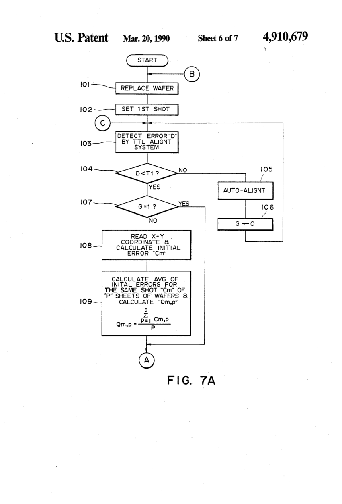
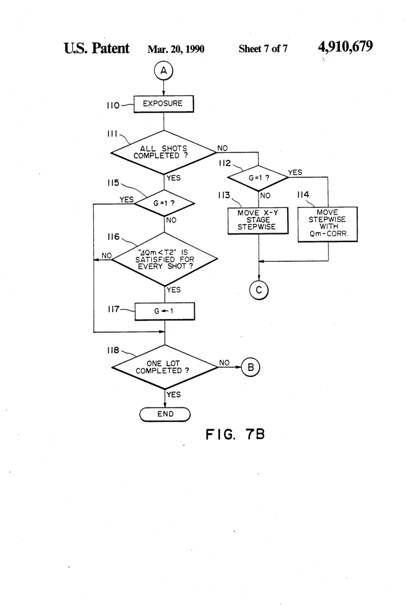

# US 4,910,679 A 전문 번역

번역 범위: 전문(표제면 초록, 명세서 본문, 도면 설명, 청구항).
원문 파일: `US4910679A.pdf` (16쪽, 본문 9~16쪽, 도면 2~8쪽).
원문 텍스트는 공보 스캔본의 OCR 층에서 뽑았다. OCR 오자가 일부 있어, 수식과 단계 번호는 도면 이미지와 대조해 고쳤다.

---

## 표제면

- 발명의 이름: 스텝 앤드 리피트 정렬 및 노광 방법과 장치 (Step-and-repeat alignment and exposure method and apparatus)
- 특허번호: 미국 4,910,679
- 등록일: 1990년 3월 20일
- 발명자: 다카하시 가즈오(가와사키), 고스기 마사오(요코하마), 둘 다 일본
- 출원인: 캐논 주식회사, 도쿄, 일본
- 출원번호: 337,654
- 출원일: 1989년 4월 13일
- 관련 출원: 1988년 8월 24일 출원 제237,620호(미국특허 4,843,563)의 분할출원. 그 출원은 1986년 3월 24일 출원 제843,219호(포기)의 계속출원이다.
- 우선권: 1985년 3월 25일 일본 60-058535, 1985년 4월 30일 일본 60-090891
- 국제특허분류: G01B 11/00, H01L 12/30
- 청구항 3개, 도면 7장

### 초록

반도체 소자 제조에 쓰는 노광 장치로, 레티클의 패턴을 반도체 웨이퍼의 여러 구역에 스텝 앤드 리피트 방식으로 옮긴다.
이 장치에는 웨이퍼의 변위량을 정밀하게 재는 레이저 간섭계가 있고, 웨이퍼의 단계 이동이 끝난 시점에 정해지는, 각 샷 구역의 목표 위치 대비 위치 오차를 저장하는 메모리가 있다.
저장한 위치 오차와 레이저 간섭계의 측정 결과에 따라 웨이퍼의 단계 이동량을 보정한다. 그래서 처리량을 떨어뜨리지 않고 웨이퍼 단계 이송의 정확도를 올린다.
다른 한 측면에서, 이 노광 장치에는 TTL 검출계가 있다. 이것은 웨이퍼의 단계 이동이 끝난 시점에 정해지는, 기준 샷 구역 대비 각 샷 구역의 위치 오차를 검출한다.
TTL 검출계로 검출한 위치 오차의 변동 성분이 미리 정한 수준 이상이면, 웨이퍼의 위치 맞춤을 샷 구역마다 TTL 검출계로 한다.
변동 성분이 미리 정한 수준보다 작으면, 웨이퍼 또는 각 샷 구역의 위치 맞춤을 레이저 간섭계의 측정만으로 한다.

---

## 분야 및 관련 기술

이 발명은 정렬 및 노광 방법과 장치에 관한 것이다. 더 자세히는 반도체 소자(집적회로 등) 제조에 적합한 스텝 앤드 리피트 방식의 정렬 및 노광 방법과 장치에 관한 것이다.

스테퍼라 부르는 스텝 앤드 리피트 방식의 정렬 노광 장치는 반도체 소자 제조에 쓰여 왔다.
이 방식의 장치는, 레티클에 만든 패턴의 상을 투영 렌즈로 축소해 그 아래에 둔 반도체 웨이퍼에 비춘다.
그러면서 웨이퍼를 단계로, 즉 띄엄띄엄 움직여 웨이퍼의 여러 구역을 차례로 레티클 패턴의 상에 노광한다.
이렇게 레티클 패턴의 상이 웨이퍼의 각 구역으로 옮겨진다.

최근 반도체 집적회로의 집적도가 크게 올라 회로 패턴이 작아졌다. 그래서 패턴 전사 때 레티클과 웨이퍼의 겹침 정확도를 더 올려야 했다.
현재는 0.02 마이크론 수준의 정렬 정확도가 필요하다. 전에는 0.1 마이크론 수준이면 되었다.

이런 높은 겹침 정확도는 다이 바이 다이 정렬법으로 효과 있게 얻을 수 있다.
이 방법은 웨이퍼의 각 구역을 레티클 패턴에 노광하기 직전마다 레티클과 웨이퍼의 상대 위치를 맞춘다.
그러나 이 방법은 샷 하나를 처리하는 데 시간이 비교적 오래 걸려 장치의 처리량이 높을 수 없다.

이에 비해 전역 정렬법은 처리량이 더 높다.
이 방법은 첫 샷의 노광을 시작하기 전에 웨이퍼 전체의 레티클 대비 위치를 한 번만 맞춘다.
웨이퍼 전체 위치를 한 번 맞추고 나면, 여러 구역을 되풀이 노광하기 위한 웨이퍼의 단계 이송은 레이저 간섭계 같은 측정 수단으로 웨이퍼 변위를 지켜보며 제어한다.
전역 정렬법은 처리량이 높지만 겹침 정확도는 다이 바이 다이 방법만큼 높지 않다.

다이 바이 다이와 전역 정렬의 절충으로 존 정렬법이 제안되었다.
이 방법은 레티클과 웨이퍼의 상대 위치를 여러 샷마다 한 번씩 맞춘다.
이 방법의 처리량과 겹침 정확도는 다이 바이 다이와 전역 정렬의 중간 수준이다.

---

## 발명의 요약

이 발명의 가장 큰 목적은, 충분히 높은 처리량과 충분히 높은 겹침 정확도를 함께 얻는 노광 방법과 장치를 주는 것이다.

간단히 말하면, 이 발명은 다음을 포함하는 정렬 및 노광 방법을 준다.
첫째 대상물에 대해 스텝 앤드 리피트 방식으로 노광한다.
첫째 대상물에서 실제로 노광한 각 구역의, 그 대상물에 정한 기준 위치 대비 위치 오차를 검출한다.
그리고 둘째 대상물에 대해 스텝 앤드 리피트 방식으로 노광하되, 그 검출 결과에 따라 둘째 대상물의 단계 이동량을 조정한다.

---

## 도면의 간단한 설명

- 그림 1: 이 발명 한 실시예의 노광 장치를 개략으로 그린 사시도.
- 그림 2: 그림 1 실시예에 쓰는 제어계 구성의 블록도.
- 그림 3: 그림 1 실시예의 노광 장치에서 기준 웨이퍼와 함께 쓰기 좋은 레티클의 예를 개략으로 보인 평면도.
- 그림 4A: 그림 1 실시예의 노광 장치에 쓰기 좋은 기준 웨이퍼의 예를 개략으로 보인 사시도.
- 그림 4B: 그림 4A의 기준 웨이퍼 단면도.
- 그림 5: 이 발명 다른 실시예의 노광 장치를 개략으로 그린 사시도.
- 그림 6: 그림 5 실시예에 쓰는 제어계 구성의 블록도.
- 그림 7A와 7B: 그림 5 실시예의 동작 흐름을 보이는 흐름도.

---

## 바람직한 실시예의 설명

### 그림 1 실시예: 장치 구성

그림 1에는 이 발명 한 실시예의 스텝 앤드 리피트형 노광 장치를 보인다.
레티클 1은 아랫면에 집적회로 패턴 1a가 있다. 레티클 1은 레티클 스테이지 2가 잡고 있다(그림 2에 개략으로 보임).
번호 3은 투영 광학계로, 레티클 1의 패턴 1a의 상을 웨이퍼 척 5가 잡은 반도체 웨이퍼 4의 표면에 비춘다.
장치에는 조명계 29도 있다(그림 2에 개략으로 보임). 조명계 29는 정해진 파장의 빛을 보내 레티클 1의 패턴 1a를 비춘다.
레티클 패턴 1a가 조명계 29의 빛을 받으면, 웨이퍼 4 표면의 여러 구역 4a 중 하나가 레티클 패턴 1a와 투영 광학계 3을 지난 빛에 노광된다.
그래서 패턴 1a의 상이 웨이퍼 4의 그 구역으로 옮겨진다. 이 실시예에서 투영 광학계 3은 축소 배율의 투영 렌즈계다.

웨이퍼 4를 잡은 웨이퍼 척 5는 Z축 방향과 θ(회전) 방향으로 움직인다.
웨이퍼 척 5는 X축과 Y축 방향으로 움직이는 웨이퍼 스테이지 6이 받친다.
레이저 간섭계 7a와 7b는 웨이퍼 스테이지 6의 X, Y 방향 변위량을 잰다.
웨이퍼 스테이지 6에 붙인 거울 8a와 8b가 레이저 간섭계 7a, 7b와 짝을 이뤄 스테이지 6의 변위를 검출한다.

장치에는 대물렌즈 9a와 9b 한 쌍을 가진 오프액시스 정렬 현미경계도 있다.
이 대물렌즈 9a와 9b는 서로 정해진 거리만큼 떨어져 있어서, 웨이퍼 4 표면에 정해진 간격으로 만든 오프액시스 정렬 마크 11a와 11b를 동시에 볼 수 있다.
이 마크 11a, 11b는 투영 광학계 3을 쓰지 않는 웨이퍼 4의 오프액시스 정렬에 쓴다.
그림 1처럼 대물렌즈 9a, 9b 각각에는 기준 마크 10a 또는 10b가 있어, 정렬 마크 11a, 11b의 기준 위치 대비 어긋남을 검출한다.

### 그림 2: 제어계

그림 2의 제어계를 보면, 노광 장치에는 마이크로프로세서(MPU) 20, 키보드 21, 읽기전용 메모리(ROM) 22, 임의접근 메모리(RAM) 23, 레티클 스테이지 2를 움직이는 구동부 24, 웨이퍼 스테이지 6을 움직이는 구동부 25가 있다.
번호 26은 알려진 종류의 2차원 좌표 판독기다. 광간섭식 좌표 검출기나 주사전자현미경 같은 것이다.
번호 27은 비휘발성 메모리다.

마이크로프로세서 20은 정렬, 노광, 웨이퍼 단계 이송 같은 장치의 여러 동작을 제어한다.
키보드 21은 동작 지시 신호와 동작에 필요한 자료를 넣는 데 쓴다.
ROM 22는 마이크로프로세서 20의 제어 프로그램을 담는다.
RAM 23은 제어 프로그램이 돌 때 쓰는 여러 자료를 잠시 담는다.

RAM 23의 한 부분에는 위치 오차 표를 담을 영역을 둔다.
이 표에는 웨이퍼에 실제로 옮겨진 패턴들의, 각 목표 위치 대비 위치 오차 자료가 들어간다.
뒤에 설명하듯, 이 위치 오차 표의 자료는 웨이퍼의 각 구역에 대한 웨이퍼 스테이지 단계 이동량을 보정하는 데 쓴다.

2차원 좌표 판독기 26은 기준 웨이퍼에 찍힌 각 패턴의 위치를 정밀하게 검출한다.
비휘발성 메모리 27은 좌표 판독기 26의 측정 결과, 키보드 21로 넣은 자료, 그리고 마이크로프로세서 20이 준 자료 중 필요한 부분(예를 들어 뒤에 설명할 근사 함수)을 담는다.
이 실시예에서 좌표 판독기 26은 비휘발성 메모리 27을 거쳐 마이크로프로세서 20에 전기로 이어진다.
그러나 이것이 꼭 필요하지는 않고, 좌표 판독기 26을 떼어 놓아도 된다.
그런 경우 작업자가 따로 놓인 2차원 좌표 판독기 26으로 기준 웨이퍼의 각 패턴 위치를 읽고, 위치 검출 결과 자료나 목표 위치 대비 오차 자료, 또는 근사 함수 자료를 키보드 21로 손으로 넣는다.

### 동작: 첫 샷 위치 맞춤

그림 1로 돌아가면, 웨이퍼 4는 그림에 없는 웨이퍼 적재/배출 장소에서 웨이퍼 척 5에 놓인다.
그다음 웨이퍼 4를 투영 광학계 3 아래로 옮긴다.
옮기는 중에 웨이퍼 4는 그림에 없는 TV 예비정렬계로 예비정렬을 거친다. 그래서 웨이퍼 4는 10 마이크론을 넘지 않는 위치 오차로 투영 광학계 3 아래에 놓인다.
옮기기가 끝나면 웨이퍼 4의 정렬 마크 11a와 11b가 대물렌즈 9a와 9b의 시야에 들어온다.

대물렌즈 9a, 9b에서 얻는, 웨이퍼 4의 정렬 마크 11a, 11b의 대물렌즈 기준 마크 10a, 10b 대비 상대 위치를 나타내는 신호를 바탕으로, 마이크로프로세서 20은 기준 위치 대비 웨이퍼 4의 위치 어긋남 (Δx, Δy, Δθ)를 계산한다.

투영 렌즈계 3의 광축과 위 기준 위치 사이의 위치 관계 (x, y, θ)는 미리 정해져 있다.
그래서 이 위치 관계 (x, y, θ)와 검출한 위치 어긋남 (Δx, Δy, Δθ)로부터, 웨이퍼 4의 첫 샷 구역을 노광 자리에 놓기 위해 필요한 변위량 (x+Δx, y+Δy, θ+Δθ)를 정할 수 있다.
보통 θ = 0 이다. 회전 오차 Δθ는 웨이퍼 척 5를 돌려 바로잡는다.
이 실시예에서는 회전 오차를 바로잡고 나면, 회전 오차 Δθ 보정 뒤에 오프액시스 대물렌즈 9a, 9b로 웨이퍼 4의 X, Y 방향 위치 오차 Δx, Δy를 다시 잰다.

첫 샷 구역을 노광 자리로 가져오기 위한 웨이퍼 스테이지 6의 X, Y 방향 변위량은 레이저 간섭계 7a, 7b 중 알맞은 쪽으로 제어한다.
첫 샷 구역 노광이 끝난 뒤 둘째, 셋째, …, n번째 샷 구역을 차례로 노광 자리에 가져오는 웨이퍼 단계 이송도 레이저 간섭계 7a, 7b의 측정에 따라 제어한다.
웨이퍼 4의 여러 구역 중 하나가 투영 광학계 3 아래 노광 자리에 놓일 때마다, 그 구역을 조명계 29의 빛으로 레티클 1의 패턴 1a에 노광한다.
이렇게 웨이퍼의 단계 이송과 노광을 스텝 앤드 리피트 방식으로 되풀이한다.

### 겹침 오차가 생기는 까닭

지금까지 설명한 이 실시예의 정렬 과정 부분은 종래의 전역 정렬법과 비슷할 수 있다. 그러나 이 실시예의 정렬 과정에는 중요한 특징이 있고, 이제 그것을 자세히 설명한다.

반도체 집적회로는 같은 웨이퍼의 같은 구역에 서로 다른 패턴을 겹쳐 찍어 만든다.
곧 첫째 패턴(첫째 층 패턴)을 노광 장치로 웨이퍼의 첫째 층에 옮기고, 식각 같은 여러 처리를 거친 뒤 둘째 패턴(둘째 층 패턴)을 이미 찍힌 첫째 층 패턴 위의 둘째 층에 옮긴다.
이런 겹침을 되풀이한다. 그래서 같은 웨이퍼에 서로 다른 패턴을 겹쳐 만들 때, 서로 다른 종류 또는 같은 종류의 별개 노광 장치를 차례로 쓰고 싶을 수 있다.

예를 들어 웨이퍼의 첫째 층 패턴 전사에, 한 번의 노광으로 여러 회로 패턴을 반도체 웨이퍼의 여러 구역에 옮기는 등배 전면 노광형 장치를 쓰고 싶을 수 있다.
그런 경우 웨이퍼 첫째 층에 찍힌 패턴의 간격이 정확히 고르지 않을 수 있다.
장치 고유의 결상 특성이나 온도 변화 등으로 생기는 결상 일그러짐 때문이다.
달리 말하면, 첫째 층에 찍힌 이웃 패턴 중심 사이의 거리가 웨이퍼 표면의 모든 곳에서 일정하지 않다.

그런 경우, 둘째 층 패턴을 첫째 층 패턴 위에 스텝 앤드 리피트로 겹쳐 찍으려고 이 실시예 같은 스텝 앤드 리피트형 노광 장치를 쓰고, 각 샷 구역을 노광 자리로 가져오는 웨이퍼 단계 이송량이 일정하다면, 이미 찍힌 첫째 층 패턴과 그 위에 비추는 둘째 층 패턴의 상 사이에 겹침 오차가 생긴다.
이런 겹침 오차는 제품으로서 반도체 소자의 성질과 수율에 나쁘게 작용한다.

한편 같은 웨이퍼의 서로 다른 층에 서로 다른 패턴을 겹쳐 찍으려고 같은 스텝 앤드 리피트형 장치를 둘 이상 쓰는 경우에도 위와 같은 겹침 오차가 생길 수 있다.
대개 장치마다 웨이퍼 스테이지의 운동 특성이 달라 웨이퍼 변위량(단계 이송량)에 차이가 있고, 또는 장치마다 레이저 간섭계의 거울 면 정밀도에 차이가 있기 때문이다.

여기에 더해, 반도체 소자 제조 과정의 열 주기나 식각 작업으로 웨이퍼가 변형되어 위와 같은 겹침 오차가 생길 수도 있다.

위에서 말한 겹침 오차 문제는 그림 1 실시예 노광 장치의 정렬 과정으로 거의 없애거나 줄일 수 있다.

### 첫째 측면: 기준 웨이퍼로 장치 고유 오차 보정

더 자세히 말하면, 이 실시예에서는 겹침 오차를 억누르려고 작업자가, 또는 작업자의 지시에 따라 다음 준비 작업을 한다.
이 실시예의 첫째 측면에서는, 아래 설명에서 알 수 있듯이 장치 고유 성질로 생기는 웨이퍼 단계 이송 오차를 바로잡을 수 있다.

1. 원하는 패턴이 있는 레티클을 레티클 스테이지 2에 놓는다.
2. 단계 이송량으로 원하는 값(예를 들어 15 mm)을 정한다. 기준 웨이퍼를 장치에 넣어 세팅한다. 그리고 단계 이동량에 아무 보정도 하지 않은 채 스텝 앤드 리피트 방식으로 패턴 전사를 해, 레티클 패턴의 상을 기준 웨이퍼의 여러 구역에 찍는다. 기준 웨이퍼는 평탄도가 좋고 온도 변화에 안정하다. 기준 웨이퍼에는 감광재가 발려 있고, 아직 아무 패턴도 찍혀 있지 않다.
3. 기준 웨이퍼에 위 노광으로 찍힌 각 패턴의 위치를 2차원 좌표 판독기 26으로 검출한다.
4. 웨이퍼에 찍힌 각 패턴의 검출 위치의, 대응하는 목표 위치(정해 둔 단계 이동량 값에 따라 계산으로 구하는 위치) 대비 X, Y 방향 위치 오차 Δx, Δy를 계산으로 검출한다.
5. 각 샷 구역의 단계 이동에 대한, 검출한 오차 Δx, Δy로부터의 함수를 최소제곱법으로 만든다.
6. 이렇게 만든 함수의 자료를 키보드로 장치에 넣어, 제어부의 메모리(RAM)에 담는다.

이어서 실제 회로 패턴 전사를 준비하려고 작업자가 다음을 한다.

7. 키보드를 다뤄, 실제 회로 패턴을 스텝 앤드 리피트로 전사할 때 쓸 원하는 단계 이송량 (x0, y0)의 자료를 장치에 넣는다.

단계 이송량 (x0, y0) 자료를 넣으면 장치에서 다음이 일어난다.

8. 넣은 설정값 (x0, y0)에 따라 모든 샷의 패턴 전사 목표 위치를 계산한다. 또 RAM에 담은 함수를 써서, 각 샷의 대응 목표 위치 대비 예상 위치 오차 Δx, Δy를 계산한다. 이렇게 얻은 "예상" 오차 Δx, Δy를 앞에서 말한 표의 꼴로 RAM 23에 담는다.

실제 회로 패턴 전사 작업 때 장치에서 다음이 일어난다.

9. 어떤 샷을 노광 자리에 놓으려 할 때 그 샷의 위치 오차 Δx, Δy를 RAM 23의 표에서 읽어 낸다. 그리고 웨이퍼 스테이지 6을 설정값 (x0, y0)과 예측한 위치 어긋남 (Δx, Δy)의 합, 곧 "x0+Δx, y0+Δy" 만큼 움직인다. 그러면 웨이퍼의 그 샷을 노광 자리에 정확히 가져올 수 있다.

위 1~9의 작업으로 현재 노광 장치의 단계 이송 특성 고유값을 검출하고 바로잡는다.
같은 웨이퍼를 다루려는 별개의 스텝 앤드 리피트형 장치 각각에 대해 이 작업을 하면, 앞에서 말한 겹침 오차를 거의 다 없앨 수 있다.

### 그림 3, 4A, 4B: 기준용 레티클과 기준 웨이퍼

그림 3은 위 기준 웨이퍼와 함께 쓰기 좋은 레티클의 예다.
그림 3의 레티클은 석영으로 만든 유리판 31로 되어 있고, 그 표면에 장치의 단계 이송 특성 고유값을 검출하는 데 쓸 마크 32를 아홉 개 만들었다.
이 예에서는 레티클 31에 아홉 개를 만들었지만, 검출 목적에는 마크 하나로도 충분하다.
그러나 기준 웨이퍼나 그 감광막 표면의 흠집, 또는 노광과 현상 등의 조건으로 마크 일부가 지워질 수 있으므로 여러 개를 두는 것이 좋다.

앞에서 말한 종류의 2차원 좌표 판독기는 마크를 가려내는 기능이 있어, 서로 다른 패턴 중에서 원하는 것을 쉽게 가려낸다.
그래서 그림 3 같은 특별한 레티클 없이도 장치의 단계 이송 특성 고유값을 검출할 수 있다.
곧 실제 회로 패턴이 있는 보통 레티클로 먼저 스텝 앤드 리피트 패턴 전사를 하고, 현상한 뒤, 실제 회로 패턴 안의 어떤 마크나 패턴 부분을 작업자가 지정해 2차원 좌표 판독기로 패턴 위치를 검출한다.

위치 검출용 마크 32는 레티클의 어느 자리에 만들어도 되지만, 검출 정확도를 생각하면 레티클 패턴 영역의 안쪽에 만드는 것이 좋다.

그림 4A와 4B는 위에서 말한 기준 웨이퍼의 예다. 그림 4A는 사시도, 그림 4B는 단면도다.
이 예에서 기준 웨이퍼는 석영으로 만든 기판 33으로 되어 있다.
웨이퍼를 웨이퍼 스테이지 6에 놓았을 때 투영 광학계 3(그림 1)을 바라보는 기판 33의 한 면에는 진공 증착 등으로 크롬 층 34를 입히고, 그 위에 감광막 35를 만든다.
크롬 층 34는 웨이퍼에 패턴이 찍힌 뒤 그것을 쉽게 보게 해 준다.

### 이 실시예 특징의 정리

**첫째 특징.** 어떤 기준 웨이퍼에 찍힌 패턴들의 위치를 미리 재고, 그다음 기준 웨이퍼에 찍힌 패턴의 검출 위치 각각과, 정해 둔 단계 이송 변위로 계산해 얻는 대응 목표 위치 사이의 위치 어긋남을 미리 계산으로 검출한다.
이어지는 실제 회로 패턴의 스텝 앤드 리피트 전사 작업에서, 웨이퍼 스테이지를 스텝 앤드 리피트로 움직여 웨이퍼를 차례로 단계 이송하되, 각 단계 이송량(각 샷을 노광 자리로 가져오는 이동)을 검출한 위치 어긋남에 해당하는 양만큼 보정한다.
이 특징에 따라 존 정렬 과정과 전역 정렬 과정에서 패턴 겹침 오차를 잘 억누를 수 있다.
또 이 실시예를 다이 바이 다이 정렬법을 쓰는 장치에 적용하면 단계 이송 자체의 놓기 정확도가 좋아진다.
그 결과 다이 바이 다이 정렬 과정에서 정렬에 걸리는 시간이 줄고, 그만큼 처리량이 는다.

위 첫째 특징의 한 측면으로, 그림 4A, 4B 같은, 표면 평탄도가 좋고 온도 변화에 안정한 석영 웨이퍼를 "기준 웨이퍼"로 쓰고, 단계 이송량에 아무 보정도 하지 않은 채 스텝 앤드 리피트로 패턴을 찍으면, 그 장치 X-Y 스테이지의 운동 특성 고유값을 검출할 수 있다.
그리고 찍힌 패턴 결과, 곧 그 고유값으로부터 X-Y 스테이지 단계 이송에 필요한 보정량을 정할 수 있다.
그래서 현재 장치의 고유 성질로 생길 수 있는 패턴 겹침 오차를 잘 억누를 수 있다.

어떤 로트에서 하나 이상의 정해진 제조 공정을 거친 반도체 웨이퍼 하나를 위 "기준 웨이퍼"로 쓸 수도 있다.
곧 앞 공정으로 변형이 생겼을 수 있는 그 웨이퍼에 찍힌 패턴 위치를 검출해, 위에서 말한 단계 이송 변위의 보정량을 정할 수 있다.
다음 층에 대한 스텝 앤드 리피트 전사에서 단계 이송 변위를 보정하면, 웨이퍼에 이미 찍힌 패턴의 고르지 않은 간격(웨이퍼 공정에서 생긴 것) 때문에 생기는 겹침 오차를 잘 억누를 수 있다.

또 위 보정량을, 별개의 스텝 앤드 리피트형 장치나 한 번에 전면을 노광하는 형 장치로 처리한 어떤 웨이퍼에 찍힌 패턴 위치 정보에서 검출하면, 단계 이송 특성의 고유값이나 한 번 노광 때의 결상 일그러짐(주로 광학계 특성 때문) 때문에 생길 수 있는 패턴 겹침 오차를 피할 수 있다.

**둘째 특징.** 찍힌 패턴 위치의 실제 검출값과, 계산으로 얻는 목표 위치값 사이의 차이를 각 샷 구역에 대한 위치 오차의 근사 함수 꼴로 담는다.
곧 어떤 패턴 간격을 가진 "어떤" 기준 웨이퍼에 대해 위치 오차 검출을 한 번 실제로 해 두면, 그 함수를 써서 계산만으로 다른 어떤 간격(단계 이송량)의 실제 회로 패턴에 대한 위치 오차 자료를 얻거나 예측할 수 있다.

**셋째 특징.** 실제 회로 패턴의 스텝 앤드 리피트 전사에 쓸 단계 이송 변위를 한 번 정하면, 웨이퍼 위 각 샷 구역의 목표 위치(더 자세히는 첫 샷 구역 위치 대비 각 샷 구역의 위치)를 계산한다.
이어서 위 위치 오차 함수를 써서, 각 샷 구역의 목표 위치 대비 "예상" 패턴 전사 위치의 오차량을 계산한다. 곧 위치 오차를 예측한다.
계산으로 얻은 자료를 표 꼴로 메모리에 담는다.
이렇게 하면 실제 회로 패턴 전사 작업 때 위치 오차 계산 때문에 위치 어긋남 보정 시간이 늘어나는 것을 막을 수 있어 처리량이 줄지 않으므로 매우 유리하다.

### 그림 5 실시예: TTL 검출계

그림 5를 보며 이 발명의 다른 실시예를 설명한다.
그림 1 실시예와 같거나 비슷한 기능을 하는 요소에는 같은 번호를 붙였다.

그림 5 실시예에서 이 발명은 TTL(through the lens) 정렬 검출 기능을 가진 스텝 앤드 리피트형 노광 장치에 적용된다.
번호 1은 아랫면에 회로 패턴 1a가 있는 레티클이다. 레티클 1에는 마크 영역 12a와 12b도 정해 둔다. 이 영역 12a, 12b에는 정렬 마크(그림에 없음)가 있다.
이 정렬 마크는 그 자체로 알려진 TTL 정렬에 쓴다.
장치에는 알려진 종류의 TTL 검출계 16이 있고(그림 6에 개략으로 보임), 대물렌즈 14a와 14b 한 쌍을 포함한다.
이 대물렌즈 14a, 14b는 레티클 1의 영역 12a, 12b에 만든 정렬 마크를 보고, 또 투영 렌즈 3을 거쳐 웨이퍼 4의 각 샷 구역 4a에 정해 둔 마크 영역 15a, 15b의 정렬 마크를 본다.
대물렌즈 14a, 14b로 레티클 정렬 마크와 웨이퍼 정렬 마크를 검출해, 보고 있는 레티클 1과 웨이퍼 4의 한 샷 구역 4a 사이의 위치 어긋남을 TTL 정렬 검출계 16에서 알려진 방식으로 검출한다.

장치에는 대물렌즈 14a, 14b의 광축을 꺾는 거울 13a와 13b도 있다.
이 거울 13a, 13b는 흔들 수 있어서, 정렬 작업 중에는 그림의 자리에 있고, 노광 작업 중에는 Y축을 중심으로 돌아 조명계 29(그림 6)에서 오는 빛의 경로 밖으로 물러난다.

### 그림 6: 이 실시예의 제어계

그림 6은 이 실시예에 쓰는 제어계 구성이다.
그림 6에서 번호 27은 알려진 종류의 웨이퍼 적재/배출계로, 웨이퍼 4를 웨이퍼 척 5에 싣거나 내린다.
이 실시예에서 제어계에는 그림 2의 메모리 23과 비슷한 RAM 23이 있다.
그러나 이 실시예에서 RAM 23에는 영역이 더 있다. 다이 바이 다이 정렬 모드에서 전역 정렬 모드로 넘어갈 때 쓰는 전역 정렬 플래그 같은 것이다. 이는 뒤에 설명한다.

TTL 정렬 검출계 16은 다이 바이 다이 정렬 모드에서, 레티클 1의 정렬 마크와 노광 자리에 놓인 웨이퍼 샷 구역 4a 중 하나의 정렬 마크를 검출해, 그 샷 구역의 레티클 1 대비 위치 어긋남을 검출한다.
위치 어긋남 검출은 마크에서 되비친 빛으로 한다.
다이 바이 다이 정렬 모드에서는 TTL 정렬 검출계 16의 검출 결과에 따라 웨이퍼 척 5와 웨이퍼 스테이지 6을 각각 움직여, 레티클 1과 웨이퍼 4의 현재 샷 구역 사이의 위치 어긋남이 정해진 허용 범위에 들어오게 한다.

### 그림 7A, 7B: 동작 흐름



그림 7A의 상자 글. 101 웨이퍼 교체, 102 첫 샷 설정, 103 TTL 정렬계로 오차 "D" 검출, 104 D < T1 인가, 105 자동 정렬, 106 G ← 0, 107 G = 1 인가, 108 X-Y 좌표 읽기 및 초기 오차 "Cm" 계산, 109 "P"장의 웨이퍼의 같은 샷 "Cm"에 대한 초기 오차의 평균을 구해 "Qm,p"를 계산. 도면에 적힌 식은 Qm,p = (Σ(p=1..P) Cm,p) / P 이다.

이 실시예 노광 장치의 동작을 그림 7의 흐름도와 함께 설명한다.

먼저 단계 101에서 새 웨이퍼 4를 웨이퍼 적재/배출계로 웨이퍼 척 5에 놓는다.
그다음 단계 102에서 웨이퍼 4를 움직여 첫 샷 구역을 투영 렌즈계 3 아래 노광 자리에 놓는다.
더 자세히는, 그림에 없는 기계식 예비정렬계로 웨이퍼 4를 웨이퍼 척 5에 놓되 위치 오차가 크지 않게 해, 웨이퍼 4에 만든 예비정렬 마크(그림에 없음)가 그림에 없는 TV 예비정렬 현미경의 시야에 들어오게 한다.
웨이퍼 4를 웨이퍼 척 5에 놓은 뒤, TV 예비정렬 현미경으로 웨이퍼 4의 예비정렬 마크를 검출해 TV 예비정렬을 한다.
이때 장치에 다이 바이 다이 정렬 모드가 지정되어 있으면, TV 예비정렬 현미경의 위치 검출 결과에 따라 웨이퍼 4를 움직여, 첫 샷 구역을 투영 렌즈계 3 아래에 10 마이크론을 넘지 않는 위치 오차로 정확히 놓는다.
한편 TTL 전역 정렬 모드가 지정되어 있으면, 웨이퍼 4의 정해진 두 샷 구역에 대해 투영 렌즈계 3으로 위치 검출을 한다.
그 결과로부터 웨이퍼 4 전체의 위치 오차를 검출한다.
두 점 검출, 곧 웨이퍼의 두 샷 구역에 대한 위치 검출은 웨이퍼 4 전체의 회전 어긋남 Δθ를 더 정확히 검출하는 데 효과가 있다.
첫 샷 구역과 위치 검출을 한 두 샷 구역의 위치 관계는 미리 정해져 있다.
그래서 이 위치 관계와 검출한 웨이퍼 4 전체의 위치 오차로부터, 첫 샷 구역을 투영 렌즈계 3 아래에 정확히 놓는 데 필요한 변위량을 계산할 수 있다.

보통 웨이퍼 4 전체의 회전 오차는 웨이퍼 척 5를 돌려 바로잡는다.
첫 샷 구역을 노광 자리에 놓기 위한 웨이퍼 스테이지 6의 변위는 레이저 간섭계 7a, 7b로 지켜보며 제어한다.

단계 103에서 TTL 정렬 검출계 16을 돌려, 투영 렌즈계 3이 비추는 레티클 1의 패턴 1a 상의, 웨이퍼 4의 "현재" 샷 구역(노광 자리에 놓인 샷 구역)에 이미 찍힌 패턴 대비 정렬 오차 또는 겹침 오차 (Δx, Δy, Δθ)를 검출한다.
그다음 단계 104에서, 그림 7에 "D"로 적은 이 검출 정렬 오차를 미리 정한 허용값 T1과 견준다.
허용 안이면 단계 107로 간다. 허용 밖이면 단계 105로 가서 웨이퍼 4의 레티클 1 대비 위치를 맞춘다(자동 정렬).
그리고 전역 정렬 플래그 G를 0으로 되돌린 뒤(단계 106) 단계 103으로 돌아간다.
단계 105의 자동 정렬은 웨이퍼 스테이지 6으로 X-Y 오차를 바로잡고, 레티클 스테이지 2와/또는 웨이퍼 척 5로 θ(회전) 오차를 바로잡아 한다.

단계 107에 오면 전역 정렬 플래그 G의 값을 본다.
G가 0으로 되돌아 있으면 단계 108로 간다. 0은 장치에 다이 바이 다이 정렬 모드가 지정되었다는 뜻이기 때문이다.
한편 G가 1로 서 있으면 단계 108과 109를 건너뛴다. 1은 전역 정렬 모드가 지정되었다는 뜻이기 때문이다.
그래서 바로 단계 110으로 가서 조명계 29로 노광한다.

단계 108의 다이 바이 다이 정렬 모드에서는, 정렬이 끝난 현재 샷 구역 위치의 좌표를 레이저 간섭계 7a, 7b의 측정 결과에서 읽는다.
그리고 이렇게 읽은 현재 샷 위치 좌표와 마지막 정렬 오차 D(< T1)로부터, 현재 샷을 위한 웨이퍼 단계 이송이 끝난 바로 그 시점에 정해져 있던, 목표 위치와 현재 샷 구역에 이미 찍힌 패턴 위치 사이의 차 Cm 을 검출한다.
이 위치 차 Cm 의 검출은 서로 다른 웨이퍼의 같은 샷(m번째 샷)에 대해 되풀이한다.

그다음 단계 109에서, 서로 다른 웨이퍼의 같은 m번째 샷 구역의 차 Cm 의 평균을 "새" 보정량 Qm,p 로 계산한다.
또는 이 새 보정량 Qm,p 를 다음 식으로 구해도 된다.

> Qm,p = (1 − R)·Qm,p−1 + R·Cm   (R ≤ 1/P)

여기서 Cm 은 앞에서 말한, "현재" 웨이퍼의 현재 m번째 샷 구역의 차이고, Qm,p−1 은 "앞선" 웨이퍼들의 같은 m번째 샷 구역에 대한 보정량이다.

또 단계 109에서, "옛" 보정량 Qm,p−1 과 "새" 보정량 Qm,p 의 차 ΔQm 을 계산한다.



그림 7B의 상자 글. 110 노광, 111 모든 샷이 끝났는가, 112 G = 1 인가, 113 X-Y 스테이지를 단계 이동, 114 Qm 보정을 넣어 단계 이동, 115 G = 1 인가, 116 모든 샷에 대해 "ΔQm < T2"가 만족되는가, 117 G ← 1, 118 한 로트가 끝났는가.

그다음 단계 110에서 패턴을 현재 샷 구역에 옮긴다.
이어 단계 111에서 한 웨이퍼의 모든 샷이 끝났는지 가린다.
끝나지 않았으면 단계 112로 가고, 끝났으면 단계 115로 간다.

단계 112에서 다음 샷의 웨이퍼 이송 방식을 정하려고 전역 정렬 플래그 G를 본다.
곧 G가 0으로 되돌아 있으면(다이 바이 다이 정렬 모드가 지정되었다는 뜻) 웨이퍼 스테이지 6을 다음 샷 구역의 목표 위치로 단계 이동한다(단계 113).
한편 G가 1로 서 있으면(전역 정렬 모드가 지정되었다는 뜻) 단계 114로 가서, 다음 샷 구역의 목표 위치에서 위 값 Qm,p 만큼 벗어난 위치를 겨냥해 웨이퍼 스테이지 6을 단계 이동한다.
그다음 단계 103으로 돌아가 위 동작을 되풀이한다.

한 웨이퍼의 모든 샷 구역 노광이 끝나면 단계 115로 간다.
단계 115에서 전역 정렬 플래그 G를 본다. 1로 서 있으면 단계 118로 간다. 0으로 되돌아 있으면 단계 116으로 간다.
단계 116에서는 모든 샷 구역에 대해 위에서 말한 차 ΔQm,p 가 미리 정한 허용값 T2 안에 드는지 가린다.
만족하면 전역 정렬 플래그 G를 1로 세운다(단계 117).
한편 어느 한 샷 구역이라도 허용값 T2를 만족하지 않으면 단계 118로 간다.
단계 118에서는 한 로트의 모든 웨이퍼를 처리했는지 가린다.
한 로트의 모든 웨이퍼 처리가 끝났으면 작업을 마친다.
끝나지 않았으면 단계 101로 돌아가 다음 웨이퍼에 대해 위 동작을 한다.

### 여러 웨이퍼를 처리하는 차례

여러 웨이퍼를 처리하는 차례를 자세히 설명한다.

처음에는 첫째 웨이퍼를 웨이퍼 척 5에 놓고 그 첫 샷 구역을 노광 자리에 놓는다.
첫째 웨이퍼에 대해서는 목표 위치 대비 위치 오차가 아직 검출되지 않았으므로, 전역 정렬 플래그 G를 0으로 둔 채 각 샷 구역의 위치 맞춤을 다이 바이 다이 정렬 과정으로 한다.
각 샷 구역을 이렇게 맞추는 동안 대응 목표 위치로부터의 어긋남 Cm 을 검출한다.
그리고 이렇게 검출한 어긋남 Cm 을 보정량 Qm,1 로 쓴다.

둘째 웨이퍼도 비슷하게 처리한다.
그러나 단계 109에서, 메모리 23에 담긴 값 Qm,1 과 둘째 웨이퍼에서 방금 검출한 값 Cm 에 대한 평균 Qm,2 를 마이크로프로세서 20이 계산한다.
이 평균 Qm,2 를 "새" 보정량으로 쓰고 메모리 23에 담는다.
또 값 Qm,1 과 Qm,2 의 차 ΔQm,2 를 계산한다.

그 뒤 노광을 하고, 남은 샷 구역에 대해서도 비슷한 작업을 한다.
여러 웨이퍼에 대해, 앞 공정에서 찍힌 패턴의 위치 어긋남에 어떤 경향이 있으면, 같은 로트에서 처리한 웨이퍼 수가 늘수록 차 ΔQm,p 의 값이 작아진다.
그래서 웨이퍼 한 장 처리가 끝날 때마다 모든 샷 구역의 차 ΔQm,p 를 살핀다(단계 116).
모든 차 ΔQm,p 가 미리 정한 허용값 T2 보다 작으면, 이는 여러 웨이퍼에 대해 정렬이 끝난 뒤의 목표 위치와 비추는 패턴 위치 사이 어긋남의 흔들림이 적다는 뜻이다.
따라서 전역 정렬 플래그 G를 세워, 정렬 모드를 위에서 말한 TTL 전역 정렬 검출이나 대물렌즈 9a, 9b를 쓰는 오프액시스 전역 정렬 검출에 바탕한 전역 정렬 모드로 바꾼다.
전역 정렬 모드에서는 웨이퍼 스테이지를 단계 이송할 때, 목표 위치에서 계산한 보정량 Qm,p 만큼 벗어난 위치로 웨이퍼 4를 옮기는 데 필요한 변위량을 계산한다.
그리고 이 계산을 바탕으로 웨이퍼 스테이지 6을 단계 이동한다.

### 이 실시예의 중요한 특징 정리

이 실시예에서는, 한 로트의 여러 웨이퍼를 처리할 때 첫째 웨이퍼의 각 샷 구역 위치 맞춤을 다이 바이 다이 정렬법으로 한다.
이때 각 샷 구역의 정렬량, 곧 정해 둔 단계 이송량으로 정해지는 대응 목표 위치로부터의 차 Cm 을 검출한다.
그리고 이렇게 검출한 양 Cm 을 바탕으로, 다음 웨이퍼의 같은 샷 구역에서 예상되는 어긋남의 양, 곧 그 샷 구역을 놓기 위한 단계 이송의 보정량을 계산한다.
위 방식으로 얻은 보정량이 안정되거나 일정해지면, 정렬 모드를 위 보정량을 쓰는 전역 정렬 모드로 바꾼다.

이 실시예의 노광 장치에는 자동 "학습" 기능이 있어서, 단계 이송 특성의 고유값이나 공정 오차 등으로 생기는 여러 웨이퍼의 샷 구역 위치 어긋남 경향을 검출한다.
이 학습 기능은 정렬 모드를 다이 바이 다이에서 전역 정렬로 넘기게 해 주고, 전역 정렬 모드에서 앞선 웨이퍼들에서 검출한 위치 어긋남 경향으로 계산한 보정량을 바탕으로 각 샷 구역의 단계 이송량을 보정하게 해 준다.

이런 특징 덕분에, 같은 로트의 웨이퍼를 묶어 처리할 때 패턴 겹침 정확도를 떨어뜨리지 않고 처리량을 올릴 수 있다. 단, 여러 웨이퍼의 같은 샷 구역에 대해 목표 위치로부터의 위치 어긋남에 어떤 경향이 있어야 한다.
또 별개 노광 장치의 X-Y 스테이지마다 운동 특성이 달라 생기는 패턴 겹침 오차도 위 학습 기능으로 자동으로 바로잡을 수 있다.
따라서 위치 조정 횟수를 줄이면서 TTL 정렬을 이룰 수 있다.
나아가 위 보정량의 흔들림이 적은 곳에서는, 어떤 까닭으로 자동 정렬이 되지 않는 샷 구역에 대해서도 정확한 패턴 겹침을 얻을 수 있다.

이 실시예에서는 값 Qm,p 를 서로 다른 웨이퍼의 같은 샷 구역 m 의 목표 위치와 실제 위치 사이 차 Cm 의 평균으로 검출했다.
그러나 이를 처리한 웨이퍼 수에 따른 가중으로 구해도 된다. 다음과 같다.

> Qm,p = (1 − R)·Qm,p−1 + R·Cm   (R ≤ 1/P)

이 경우 R = 1/P 이면 값 Qm,p 는 이 실시예처럼 차 Cm 의 평균과 같아진다.
또 앞에서는 X, Y 방향 위치 오차에 대한 자동 학습 기능을 설명했지만, θ 방향 위치 오차에 대해서도 본질로 같은 방식으로 비슷한 학습 기능을 얻을 수 있다.

이 실시예에서는 전역 정렬 모드로 넘어간 뒤에도 샷 구역마다 겹침 오차가 허용 안인지 가린다(단계 103과 104).
그러나 처리량을 더 올리려면 이 가리기를 여러 샷 구역마다 한 번, 또는 여러 웨이퍼마다 한 번 해도 된다.
나아가 이 가리기 자체를 빼도 된다.
빼면, 정렬 마크가 지워지는 등의 까닭으로 자동 정렬이 되지 않는 샷 구역에 대해서도 패턴 전사를 할 수 있다.

또 차례를 다음처럼 바꿔도 된다.
다이 바이 다이 정렬 모드에서, "현재" 샷 구역의 노광이 끝난 뒤(단계 110) 다음 샷 구역을 위해 웨이퍼 스테이지를 단계 이동할 때, 다음 샷 구역을 대응 목표 위치에서 위 보정량만큼 벗어난 위치로 옮기도록 웨이퍼 스테이지의 변위량을 보정한다.
그런 경우 단계 112와 113은 뺀다.

### 변형

그림 1에 보이고 앞에서 설명한 실시예는 여러 가지로 바꿀 수 있다.
예를 들어 그림 1 실시예에서는 계산으로 얻은 근사 함수를 키보드 21로 손으로 장치에 넣었지만, 근사 함수를 일반식 꼴로 ROM 22에 담도록 꾸며도 된다.
그런 경우 작업자는 키보드 21로 계수만 넣으면 된다.
또 그림 1 실시예에서 작업자가 하는 계산의 일부나 전부를 장치 안에서 하도록 꾸며도 된다.
그렇게 바꾸면 작업자는 계산에 필요한 자료만 키보드 21로 넣으면 된다.
나아가 측정 결과를 나타내는 2차원 좌표 판독기 26의 출력을 비휘발성 메모리 27에 담아, 노광 장치를 켜거나 되돌릴 때 메모리 27의 자료를 마이크로프로세서 20이 자동으로 읽게 해도 된다. 그러면 패턴 위치 오차, 근사 함수, 스테이지 단계 이송 오차 등을 찾는 위 계산이 자동으로 이루어진다.

이 발명을 여기 밝힌 구조를 들어 설명했지만, 이 발명은 적은 상세에 매이지 않는다. 이 출원은 개량의 목적이나 아래 청구항의 범위에 드는 변경이나 수정을 덮으려는 것이다.

---

## 청구항

**청구항 1.** 스텝 앤드 리피트 정렬 및 노광 장치에 쓰는 정렬 방법으로서, 다음 단계를 포함하는 방법.

- 웨이퍼 스테이지의 단계 이동과 관련해, 첫째 웨이퍼 위 패턴들의 위치 오차를 검출하는 단계,
- 최소제곱 규칙을 써서, 첫째 웨이퍼 패턴들의 위치 오차에 관한 근사 함수를 만드는 단계,
- 그 근사 함수에 관한 자료와 둘째 웨이퍼에 관한 자료를 써서, 둘째 웨이퍼의 스텝 앤드 리피트 노광을 위해 할 웨이퍼 스테이지의 단계 이동에 관한 자료를 정하는 단계, 그리고
- 정해진 그 자료를 바탕으로, 둘째 웨이퍼의 스텝 앤드 리피트 노광 때 웨이퍼 스테이지의 단계 이동을 제어하는 단계.

**청구항 2.** 청구항 1의 방법으로서, 첫째 웨이퍼는 석영 재질로 만들고 둘째 웨이퍼는 반도체 재질로 만든 방법.

**청구항 3.** 청구항 1의 방법으로서, 만든 근사 함수를 노광 장치 안에 둔 메모리에 담는 방법.

---

## 인용 문헌 (원문 그대로)

### 미국 특허 문헌

```
4,063,103  12/1977  Sumi .......................... 250/442.1
4,163,998   8/1979
4,291,231   9/1981  Nakazawa et al. ............... 364/490
4,410,800  10/1983
4,418,467  12/1983  Kawashima et al. .............. 250/442.1
4,553,834  11/1985
4,558,225  12/1985  Yoshikawa ..................... 250/442.1
4,615,621  10/1986  Iwai .......................... 250/491
4,627,010  12/1986  Ayata et al. .................. 364/184
4,672,557   6/1987  Allen et al. .................. 356/400
4,723,221   2/1988  Gotou et al. .................. 250/442.1
                    Kosugi
                    Tamura et al. ................. 364/490
                    Matsuura et al. ............... 364/490
```

표제면 OCR 품질이 낮아 일부 행의 번호와 성명 대응이 흐리다. 정확한 대조가 필요하면 원문 PDF 1쪽을 본다.

### 외국 특허 문헌

```
0033832  4/1981  Japan ........................ 250/442.1
0054319  3/1982  Japan
0127325  7/1983  Japan ........................ 250/442.1
0027525  2/1984  Japan ........................ 250/442.1
```

### 그 밖의 문헌

```
Asai et al. "Distortion Correction and Deflection Calibration by Means of Laser
Interferometry in an Electron-Beam Exposure System", J. Vac. Sci. Technol.,
vol. 16, No. 6, Nov./Dec. 1979, pp. 1710-1713.
```

### 심사관과 대리인

```
Primary Examiner - Parshotam S. Lall
Assistant Examiner - V. N. Trans
Attorney, Agent, or Firm - Fitzpatrick, Cella, Harper & Scinto
```
