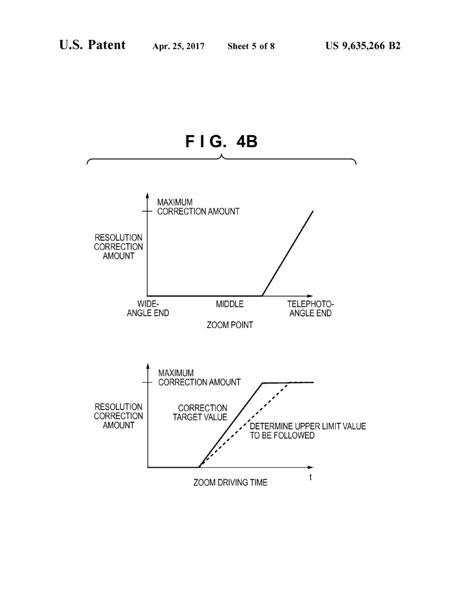
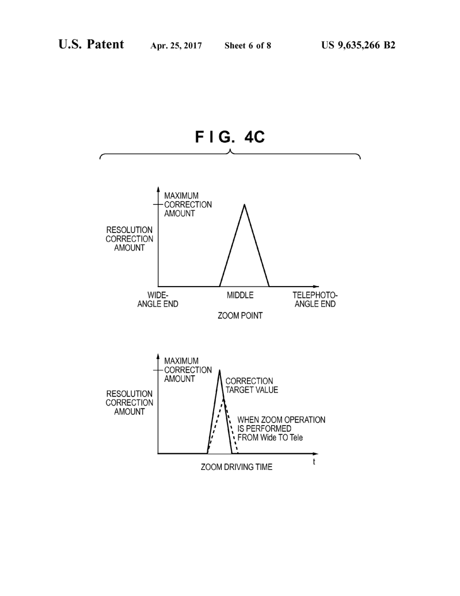
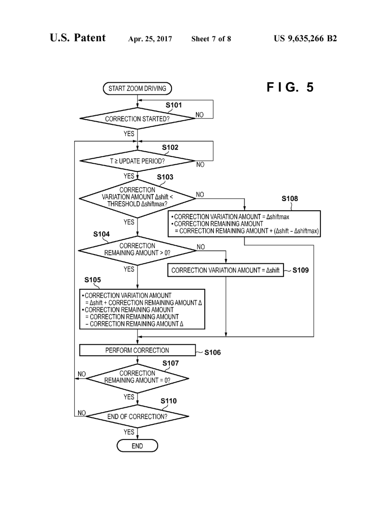

# US9635266B2 번역: 상흔들림 보정 장치와 그 제어 방법, 그리고 저장 매체

- 원제: Image stabilization apparatus and control method thereof, and storage medium
- 원문: 같은 폴더의 `US9635266B2.pdf` (등록 공보, 16쪽, 도면 8장, 청구항 9)
- 번역 범위: 전문 (서지, 초록, 배경, 발명의 요약, 도면의 간단한 설명, 실시예 전체, 청구항 1~9). 인용 문헌 목록은 원문 그대로 둔다.
- 번역 원본 텍스트: 공보 PDF 의 글자층은 옛 OCR 이라 오탈자가 있다. 같은 내용인 Google Patents 공개 본문(https://patents.google.com/patent/US9635266B2/en, 2026-11-04 확인)과 대조해 번역했다. 도면 글자는 공보 PDF 에서 그대로 읽었다.
- 도면 부호(100, 103, 201, 205, S101 등)는 원문 숫자를 그대로 둔다.
- 번역 2026-11-04.

## 서지

| 항목 | 내용 |
|---|---|
| 공보 | US 9,635,266 B2 (등록 2017-04-25) |
| 출원 | US 14/690,082, 2015-04-17 출원 |
| 공개 | US 2015/0304564 A1 (2015-10-22) |
| 출원인, 권리자 | CANON KABUSHIKI KAISHA, 도쿄 |
| 발명자 | Masaaki Noguchi (도쿄) |
| 우선권 | 일본 특허 출원 2014-087589, 2014-04-21 |
| 존속 조정 | 35 U.S.C. 154(b) 에 따라 34일 연장 |
| 분류 | CPC H04N 5/23258, H04N 5/23287, H04N 5/23296 (현행 재분류 H04N 23/68 계열) |
| 인용 문헌 | US 2011/0115929 A1 (2011-05, Noguchi, G03B 5/00), JP 2007-057981 A (2007-03) |
| 심사관 | Stephen Coleman |
| 대리인 | Cowan, Liebowitz & Latman, P.C. |

## 초록

상흔들림 보정 장치는 다음을 포함한다.
흔들림 검출부가 검출한 흔들림을 바탕으로 보정 부재를 움직여, 장치의 흔들림에 따른 상흔들림을 보정하는 상흔들림 보정부.
촬상 광학계의 초점 거리를 바꾸는 줌부.
초점 거리에 따라 변하고 촬상 광학계의 특성에서 오는, 촬상 화면 안의 광량 편차와 해상도 편차 가운데 적어도 하나를 줄이기 위해, 그 초점 거리에 대응하는 보정 부재의 이동량을 계산하는 계산부.
줌부가 초점 거리를 바꿀 때, 계산부가 계산한 이동량에 대해 단위 시간당 이동 위치 변화량의 제한을 걸어서, 실제 이동량이 보정 부재 이동 위치의 목표값을 따라가도록 제어하는 제어부.

## 배경 기술

### 발명의 분야

이 발명은 상흔들림을 보정하는 보정 기구를 써서 화면 주변부의 화질 저하를 고치는 기술에 관한 것이다.

### 관련 기술의 설명

촬상 장치의 흔들림을 검출하고 보정 렌즈를 구동해 흔들림으로 생긴 상흔들림을 보정하는 기능은 예전부터 알려져 있다.
흔들림 검출에는 보통 각속도 센서를 쓴다.
각속도 센서는 압전 소자 같은 진동 재료를 정해진 주파수로 떨게 하고, 회전 운동 성분에서 생기는 코리올리 힘에 대응하는 전압을 각속도 정보로 낸다.
상흔들림 보정 장치는 받은 각속도 정보를 적분해 흔들림의 양과 방향을 얻고, 상흔들림을 지우도록 보정 렌즈를 구동하는 위치 제어 신호를 낸다.
보정 렌즈를 구동할 때는 되먹임 제어를 한다.
즉 보정 렌즈의 현재 위치를 위치 신호로 장치에 되돌려 주고, 장치는 그 위치 신호에 맞는 위치 제어 신호를 낸다.

일반적으로 촬상 장치가 얻은 영상 자료는 중심보다 네 모서리를 포함한 주변부가 어둡고 해상도가 낮아지기 쉽다.
특히 주변부의 광량이 중심보다 작아지는 현상을 셰이딩이라 하고, 한쪽 해상도가 중심보다 낮아지는 현상을 한쪽 흐림(one-sided blur)이라 한다.
네 모서리에서 광량 감소율, 휘도 편차, 해상도 감소가 주변부에서 클수록 영상 자료의 품질이 나빠진다.

광량이나 해상도가 떨어지는 정도는 렌즈가 원래 가진 특성이다.
따라서 네 모서리의 휘도 편차나 해상도 편차는 그 특성에서 온다고 할 수 있다.
이 감소 정도는 초점 거리, 즉 줌 배율에 따라서도 달라진다.
아래에서 해상도 감소의 예를 설명한다.

도 6A 와 도 6B 는 가로축을 광학 중심에서의 거리, 세로축을 해상도의 비율(광학 중심의 해상도를 1로 둔다)로 그린 그래프의 예다.
도 6A 처럼 렌즈 주변부 한쪽의 해상도는 망원 쪽에서 가장 많이 떨어지고 광각 쪽에서는 거의 떨어지지 않는다.
또 도 6B 처럼 주변부 해상도가 크게 떨어질 때는, 예를 들어 각 렌즈군을 묶는 경통의 기계 오차나 유격 때문에 해상도 편차가 더 커진다.

상흔들림 보정 기능의 구성을 써서 광량 감소나 해상도 감소를 줄이는 방법이 있다.
여기서는 보정 기구의 상흔들림 보정 부재로 시프트 렌즈를 쓰는 경우를 설명한다.

광량(또는 해상도) 감소가 가장 큰 초점 거리에서 시프트 렌즈의 중심 위치를 조정하면, 줌 전체 구간에서 네 모서리의 광량(또는 해상도) 감소를 정해진 수준 안으로 둘 수 있다(일본 공개특허 2007-57981).
이렇게 시프트 렌즈의 중심 위치를 조정하는 것을 이 문서에서 셰이딩 보정(또는 해상도 보정)이라 한다.
이 셰이딩 보정(또는 해상도 보정)으로 조정한 중심 위치는, 시프트 렌즈가 기계적으로 움직일 수 있는 가동 범위의 중심과 다를 수 있다.

그런데 일본 공개특허 2007-57981 의 종래 기술에서는, 시프트 렌즈로 셰이딩 보정이나 해상도 보정을 할 때 줌 조작 사이에 보정량이 크게 달라지면 줌 조작 중 화각 변화가 눈에 띈다.

## 발명의 요약

이 발명은 위 문제를 고려해 이루어졌으며, 줌 조작 때 상흔들림 보정 기구를 셰이딩 보정이나 해상도 보정에 쓸 때 화각 변화가 덜 눈에 띄게 만든다.

이 발명의 제1 측면에 따르면 다음을 포함하는 상흔들림 보정 장치가 제공된다.
흔들림 검출부가 검출한 흔들림을 바탕으로, 촬상 광학계의 광축과 다른 방향으로 움직일 수 있는 보정 부재를 움직여 장치의 흔들림에 따른 상흔들림을 보정하는 상흔들림 보정부.
촬상 광학계의 초점 거리를 바꾸는 줌부.
초점 거리에 따라 변하고 촬상 광학계의 특성에서 오는, 촬상 화면 안의 광량 편차와 해상도 편차 가운데 적어도 하나를 줄이도록 그 초점 거리에 대응하는 보정 부재의 이동량을 계산하는 계산부.
줌부로 초점 거리를 바꿀 때, 계산부가 계산한 이동량에 단위 시간당 이동 위치 변화량의 제한을 걸어 실제 이동량이 보정 부재 이동 위치의 목표값을 따라가게 제어하는 제어부.

제2 측면에 따르면 위 상흔들림 보정부와 줌부를 갖춘 장치의 제어 방법이 제공된다.
이 방법은 위 계산 단계와, 줌부로 초점 거리를 바꿀 때 계산 단계에서 계산한 이동량에 단위 시간당 이동 위치 변화량의 제한을 걸어 실제 이동량이 목표값을 따라가게 하는 제어 단계를 포함한다.

이 발명의 다른 특징은 첨부 도면을 참조한 아래 실시예 설명에서 분명해진다.

## 도면의 간단한 설명

- 도 1: 한 실시예에 따른 촬상 장치의 블록도.
- 도 2: 카메라 시스템 제어부와 상흔들림 보정 제어부의 상세 구성 블록도.
- 도 3A, 도 3B: 한 실시예의 셰이딩 보정 또는 해상도 보정 설명도.
- 도 4A ~ 도 4C: 한 실시예의 초점 거리와 해상도 보정량 그래프.
- 도 5: 한 실시예의 보정 처리 흐름도.
- 도 6A, 도 6B: 초점 거리에 따른 주변 해상도 감소의 예 그래프.

## 실시예의 설명

### 장치 구성 (도 1)

도 1 은 이 발명 한 실시예의 촬상 장치 구성 블록도다.
이 실시예에서 촬상 장치 100 은 디지털 스틸 카메라이며, 동영상 촬영 기능을 가질 수 있다.

줌부 101 은 촬상 광학계를 이루는 촬영 렌즈의 일부로, 배율을 바꾸는 줌 렌즈를 포함한다.
줌 구동부 102 는 카메라 시스템 제어부 117 의 제어로 줌부 101 의 구동을 제어한다.
상흔들림 보정 부재인 상흔들림 보정 렌즈(이하 시프트 렌즈) 103 은 촬영 렌즈의 광축에 수직인 방향으로 움직일 수 있다.
상흔들림 구동부 104 는 보정 렌즈 103 의 구동을 제어한다.

조리개, 셔터부 105 는 조리개 기능을 가진 기계식 셔터다.
조리개, 셔터 구동부 106 은 제어부 117 의 제어로 105 를 구동한다.
포커스 렌즈 107 은 촬영 렌즈의 일부로 광축을 따라 위치를 바꿀 수 있다.
포커스 구동부 108 은 제어부 117 의 제어로 107 을 구동한다.

촬상부 109 는 CCD 나 CMOS 같은 영상 센서로 촬영 렌즈가 맺은 광학상을 화소마다 전기 신호로 바꾼다.
촬상 신호 처리부 110 은 그 신호에 A/D 변환, 상관 이중 샘플링, 감마 보정, 화이트 밸런스 보정, 색 보간 등을 하고 영상 신호로 바꾼다.
영상 신호 처리부 111 은 용도에 따라 영상 신호를 처리한다. 더 구체적으로는 표시용 영상을 만들고, 기록용 부호화와 파일 처리를 한다.

표시부 112 는 필요에 따라 111 이 낸 표시용 영상 신호로 영상을 보여 준다.
전원부 113 은 용도에 따라 장치 전체에 전력을 공급한다.
외부 입출력 단자부 114 는 외부 기기와 통신 신호, 영상 신호를 주고받는다.
조작부 115 는 사용자가 지시를 넣는 버튼과 스위치를 포함한다.
저장부 116 은 영상 정보 같은 여러 자료를 저장한다.
카메라 시스템 제어부 117 은 예를 들어 CPU, ROM, RAM 을 포함한다.
117 은 ROM 의 제어 프로그램을 RAM 에 펼쳐 CPU 로 실행해 각 부를 제어하고, 아래 설명할 여러 동작을 수행한다.

조작부 115 는 누르는 정도에 따라 제1 스위치(SW1)와 제2 스위치(SW2)를 차례로 켜는 릴리즈 버튼을 포함한다.
릴리즈 버튼을 반쯤 누르면 SW1 이, 끝까지 누르면 SW2 가 켜진다.
SW1 이 켜지면 117 은 표시부로 가는 영상 신호의 AF 평가값을 바탕으로 포커스 구동부 108 을 제어해 자동 초점 조절을 한다.
또 영상 신호의 휘도 정보와 미리 정한 프로그램 선도를 바탕으로 적정 노출을 얻을 조리개값과 셔터 속도를 정하는 AE 처리를 한다.
SW2 가 켜지면 정해진 조리개값과 셔터 속도로 촬영하고 촬상부 109 가 얻은 영상 자료를 저장부 116 에 저장한다.
릴리즈를 누르지 않은 상태에서 라이브 뷰 영상을 표시할 때도, 117 은 정해진 간격으로 휘도 정보와 프로그램 선도를 바탕으로 정지 영상 촬영용 조리개값과 셔터 속도를 미리 정해 둔다.

조작부 115 는 상흔들림 보정 모드를 고를 수 있는 보정 스위치를 포함한다.
사용자가 이 스위치로 보정 모드를 고르면 117 은 상흔들림 구동부 104 에 보정 동작을 지시한다.
지시를 받은 104 는 보정 끄기 지시를 받을 때까지 보정 동작을 수행한다.
조작부 115 는 정지 영상 촬영 모드와 동영상 촬영 모드를 고르는 스위치도 포함한다. 모드마다 104 의 동작 조건을 바꿀 수 있다.

조작부 115 는 재생 모드를 고르는 스위치도 포함한다. 재생 모드에서는 보정 동작을 멈춘다.
또 줌 지시를 넣는 줌 스위치를 포함한다.
줌 스위치에서 줌 지시가 들어오면 줌 구동부 102 가 117 을 거쳐 지시를 받아 줌부 101 을 지시된 줌 위치로 움직인다.

### 보정 제어 구성 (도 2)

도 2 는 상흔들림 구동부 104 와 카메라 시스템 제어부 117 의 관계를 더 자세히 설명하는 블록도다.
피치 방향과 요 방향의 구성이 같으므로 한 축만 설명한다.

각속도 검출부(자이로) 202 는 각속도를 검출해 전압으로 낸다.
각속도 검출 A/D 변환기 203 은 202 의 전압 신호를 디지털 각속도 자료로 바꾼다.
상쇄량 계산부(구동량 계산부) 204 는 각속도 자료를 적분해 각도 자료를 만들고, 그 반대 방향 자료를 상흔들림을 지우는 자료로 삼으며, 보정 렌즈 103 의 구동 범위에 따라 특성을 바꿔 흔들림 상쇄량(구동량)을 계산한다.
시프트 렌즈 위치 제어부 205 는 204 가 계산한 상쇄량을 통보받는다.
시프트 렌즈 중심 위치 지정부 201 은 초점 거리에 따른 중심 위치 변화를 205 에 통보한다.

시프트 렌즈 위치 검출부 207 은 보정 렌즈 103 의 위치를 검출해 전압으로 낸다.
시프트 렌즈 위치 A/D 변환기 208 은 207 의 출력을 디지털 자료로 바꾼다.

205 는 208 이 검출한 위치 자료와 흔들림 상쇄량의 차이를 구하고, 그 편차가 0 에 가까워지도록 되먹임 제어를 한다.
마지막으로 시프트 렌즈 구동 드라이버부 206 은, 201 이 통보한 초점 거리에 따른 중심 위치만큼의 오프셋이 더해진 구동 신호(시프트량)를 통보받아 보정 렌즈 103 을 구동한다.
206 은 구동 신호를 통보받으면 그 신호에 해당하는 양만큼 보정 렌즈 103 을 구동한다.

중심 위치 계산부 200 은 촬상부 109 를 기준으로 한 보정 렌즈 103 의 중심(이하 중심 위치)이 옮겨 갈 목적지 위치를 계산한다.
이 중심 위치는 미리 정한 위치로 둘 수도 있고, 촬상 화면의 주변 해상도 편차가 정해진 범위 안에 드는 중심 위치를 계산할 수도 있고, 정해진 오차 범위 안에서 보정 렌즈 103 의 가동 범위를 똑같이 나눠 얻을 수도 있다.
아래 설명에서는 주변 해상도 편차가 정해진 범위 안에 드는 중심 위치, 또는 정해진 오차 범위를 똑같이 나눈 중심 위치를 쓴다.
또 이 값들은 공장 출하 때 미리 정한 줌 배율에 대응해 구해지고, 예를 들어 중심 위치 계산부 200 안의 메모리(도시하지 않음)에 저장되어 촬상 장치를 켤 때 읽힌다.

### 보정 중심을 얻는 방법 (도 3A, 도 3B)

해상도 보정의 중심을 얻는 방법을 도 3A 로 설명한다.
먼저 영상 신호 처리부 111 이 낸 영상 자료에서 네 모서리의 주변 해상도를 얻는다(3a-1).
얻은 네 모서리 해상도에 편차가 있으면, 화각 중심에 견줘 편차가 줄어드는 보정 렌즈 103 의 중심 목적지 위치를 구한다(3a-2).
그 중심 위치에 보정 렌즈 103 이 오도록 하는 제어값을 구하고(3a-3), 그 제어값으로 보정 렌즈 103 을 움직인다(3a-4).
이 (3a-1) ~ (3a-4) 과정을 주변 해상도 편차가 정해진 범위 안에 들 때까지 되풀이한다.
이렇게 얻은 보정 렌즈 103 의 중심 위치를 이 문서에서 해상도 보정 중심이라 한다.

기계 중심을 얻는 방법을 도 3B 로 설명한다.
먼저 보정 렌즈 103 을 기계적 구동 범위 면에서 가로와 세로 방향의 한계까지 구동한다(3b-1).
이때 구동 범위의 각 한계점의 중점을 기계 중심으로 정한다(3b-2).
이렇게 얻은 중심 위치를 이 문서에서 기계 중심이라 한다.

### 초점 거리에 따른 중심 위치 이동

시프트 렌즈 중심 위치 지정부 201 은, 중심 위치 계산부 200 이 구한 중심 위치를 바탕으로 줌 렌즈 구동 제어 중의 보정 렌즈 103 중심 위치 이동량을 205 에 통보한다.
중심 위치 계산부 200 과 지정부 201 이 시프트 위치 계산부를 이룬다.
초점 거리에 따라 201 이 중심 위치를 어떻게 옮기는지 설명한다.

해상도 감소가 광각단보다 망원단에서 큰 경우를 예로 든다.
이때 보정 렌즈 103 의 중심 위치는 망원단에서 해상도 보정 중심, 광각단에서 기계 중심이다.
망원단과 광각단 사이의 중간 지점에서는 두 점 사이 중심 위치를 선형 보간, 초점 거리 보간, 또는 둘의 조합으로 구한 위치로 둔다.

반대로 해상도 감소가 망원단보다 광각단에서 크면, 망원단에서 기계 중심, 광각단에서 해상도 보정 중심으로 둔다.
중간 지점에서는 마찬가지로 두 점 사이를 선형 보간이나 초점 거리 보간으로 구한다.
이렇게 하면 줌 렌즈 위치 때문에 생기는 화각 어긋남을 최소로 하면서 라이브 영상의 보임을 매끄럽게 할 수 있다.

### 보정량 변화와 보임에 주는 영향 (도 4A ~ 도 4C)

줌 구동 때 해상도 보정의 변화량과 보임에 주는 영향을 설명한다.
도 4A 와 도 4C 는 줌 지점(초점 거리)과 줌 구동 시간, 그리고 해상도 보정량의 변화를 보여 준다.

도 4A 처럼 광각단부터 망원단까지 모든 줌 위치에서 보정량이 변하는 경우, 줌 구동 때 단위 시간당 해상도 보정량이 그리 크지 않다.
줌 조작 중 해상도 보정 때문에 시프트 렌즈가 기계 중심에서 벗어나도 그다지 눈에 띄지 않는다.



그러나 도 4B 처럼 광각 쪽에서는 해상도 보정을 하지 않고 정해진 중간 위치부터 망원단까지만 보정하는 경우, 같은 양의 해상도 보정이 필요하다면 줌 구동 때 단위 시간당 보정량이 커진다.
그래서 줌 조작 중 초점 거리 변화에 따라 화각이 변하더라도, 시프트 렌즈 이동 때문에 생기는 화각 변화가 눈에 띄게 된다.



또 도 4C 처럼 광각 쪽과 망원 쪽에서는 보정하지 않고 중간 영역에서만 보정하는 경우에도 해상도 보정량의 변화가 커진다.
이때 광각단에서 망원단까지 한 번에 줌 구동을 하면 화각이 세로나 가로로 갑자기 왕복하는 거동이 나타난다.
특히 동영상을 기록하면서 해상도 보정을 할 때, 줌 조작으로 생긴 갑작스러운 화각 변화를 기록하는 것은 바람직하지 않다.

이런 갑작스러운 화각 변화를 막기 위해, 이 실시예는 시프트 렌즈 중심 위치 지정부 201 에서 줌 위치에 따라 단위 시간당 보정량에 제한을 걸어, 실제 보정량이 적절한 보정 목표값을 따라가게 하는 방법을 쓴다.

예를 들어 도 4B 처럼 중간 위치에서 망원단까지 줌 구동을 할 때, 망원단에서 시프트 렌즈를 50 μm 구동해 해상도 보정을 한다고 하자.
이때 중간 위치에서 망원단까지의 줌 구동은 1초가 걸린다.
해상도 보정량을 20 ms 마다 갱신하면 한 번의 평균 보정량은 1 μm 다.
또 해상도 보정량이 초점 거리 보정으로 달라지면, 초점 거리 변화가 큰 줌 지점 근처에서 보정 변화량이 더 커질 수 있다.
20 ms 마다 갱신할 때 보정값 변화량이 정해진 값보다 커지는 이런 경우에, 보정 변화량에 상한을 두고 단위 시간당 보정량을 제한하면 갑작스러운 화각 변화를 막을 수 있다.
이때 상한을 두었기 때문에 보정 목표값(이하 보정 목표값)만큼의 보정이 끝나지 않는다.
그러나 보정 잔여량만큼 보정을 이어 가면 보정 목표값을 따라가는 보정을 할 수 있다.
보정량의 상한값은, 줌 구동 때 갑작스러운 화각 변화를 줄여 눈에 덜 띄게 하면서, 보정 목표값을 따라갈 때의 지연도 눈에 덜 띄게 하는 값으로 두는 것이 바람직하다.

또 도 4C 같은 보정에서는, 광각단에서 망원단까지 한 번에 줌 조작을 하면 보정 목표값을 지연을 두고 따라가므로, 도 4C 아래 그래프의 점선 같은 모양이 된다.
따라서 이 실시예의 방법은 화각 변화량을 억제하면서 보임도 좋게 할 수 있다.

### 보정 처리 흐름 (도 5)



도 5 는 보정 처리의 흐름도다.
줌 구동이 시작된 뒤, 단계 S101 에서 보정을 시작할 줌 위치인지 판단한다.
보정 대상 줌 위치이면 보정을 시작한다.
보정을 시작한 뒤, 갱신 주기(여기서는 20 ms)에 해당하는 시간이 지났는지 판단한다(단계 S102).
갱신 주기가 지났으면 단계 S103 으로 간다.

단계 S103 에서는 먼저 보정 목표량에 대한 현재 보정량에서 보정 변화량(Δshift)을 구한다.
그리고 보정 변화량(Δshift)이 보정 상한 임계값(Δshiftmax)보다 작은지 판단한다.
Δshift 가 Δshiftmax 보다 작으면 단계 S104 로 간다.
단계 S104 에서는 보정 목표값에 대해 아직 끝내지 못한 보정 잔여량이 0 보다 큰지 판단한다.
보정 잔여량이 있으면 단계 S105 로 간다.

단계 S105 에서는 보정 변화량(Δshift)에 보정 잔여량을 더해 새 보정 변화량을 정한다.
이때 보정 변화량의 최댓값은 보정 상한 임계값(Δshiftmax)으로 둔다.
보정 잔여분을 더하면, 더한 만큼을 보정 잔여량에서 빼고 남은 양의 보정은 다음 번과 그 뒤의 보정에서 한다.
단계 S106 에서는 단계 S105 에서 정한 보정 변화량만큼 현재 위치에서 보정을 한다.
단계 S104 에서 보정 잔여량이 0 이면 보정 변화량을 Δshift 로 두고 보정한다.

한편 단계 S103 에서 보정 변화량(Δshift)이 보정 상한 임계값(Δshiftmax)보다 크면, 보정 변화량을 Δshiftmax 로 두고 보정하며, 보정하지 못한 양을 보정 잔여량에 더한다(단계 S108).

단계 S107 에서는 보정 잔여량이 0 인지 판단한다.
보정 잔여분이 있으면 단계 S102 로 돌아가 보정 처리를 이어 간다.
이 보정 잔여량이 보정의 지연 시간이 된다.
따라서 보정 상한 임계값을 지나치게 크지 않게 최적으로 두는 것이 바람직하다.

단계 S107 에서 보정 잔여량이 0 이 되면 단계 S110 으로 가서 보정을 끝낼 줌 위치인지 판단한다.
보정을 끝낼 줌 위치이면 처리를 끝낸다.
아니면 단계 S102 로 돌아가 보정 처리를 이어 간다(보정 잔여량이 0 이면 보정 변화량 Δ = 0 인 대기 상태가 된다).

### 상한값을 바꾸는 변형

위 흐름처럼 단위 시간당 보정 변화량에 상한값을 두면, 갑작스러운 보정으로 생기는 화각 어긋남을 줄일 수 있다.
위 실시예에서는 단위 시간당 보정 변화량에 상한을 둔다.
그러나 다른 예로 줌 속도(줌의 구동 속도)에 따라 보정 변화량에 상한을 둘 수도 있다.
줌 속도가 빠르면, 초점 거리 변화에 따른 화각 변화 때문에 보정으로 생기는 화각 어긋남이 눈에 덜 띄므로 상한값을 키운다.
반대로 줌 속도가 느리면 상한값을 줄인다.

같은 관점에서, 줌 구동 때 초점 거리의 변화량에 따라 보정 변화량의 상한값을 정할 수도 있다.
초점 거리 변화가 크면 상한값을 키우고, 작으면 줄인다.
줌 구동 때 초점 거리 변화에 따른 화각 변화량에 대해서도 마찬가지다.

### 그 밖의 실시예

이 발명의 실시예는, 저장 매체(비일시적 컴퓨터 판독 가능 저장 매체)에 기록된 컴퓨터 실행 가능 명령(예: 하나 이상의 프로그램)을 읽어 실행하는 시스템이나 장치의 컴퓨터로도 구현할 수 있고, 위 실시예의 기능을 수행하는 하나 이상의 회로(예: ASIC)를 포함하는 방식으로도 구현할 수 있다.
컴퓨터는 하나 이상의 프로세서(CPU, MPU)를 포함할 수 있고, 명령을 읽어 실행하는 별도 컴퓨터나 별도 프로세서의 네트워크를 포함할 수 있다.
저장 매체는 하드 디스크, RAM, ROM, 분산 컴퓨팅 시스템의 저장소, 광 디스크(CD, DVD, Blu-ray Disc), 플래시 메모리 장치, 메모리 카드 등을 포함할 수 있다.

이 발명을 예시 실시예로 설명했으나, 발명은 공개된 예시 실시예로 한정되지 않는다.
아래 청구항의 범위는 그러한 모든 변형과 균등한 구조, 기능을 포함하도록 가장 넓게 해석되어야 한다.

이 출원은 2014-04-21 출원한 일본 특허 출원 2014-087589 의 이익을 주장하며, 그 전체를 참조로 여기에 포함한다.

## 청구항 (9개)

청구항 1 ~ 3 은 장치, 4 ~ 6 은 제어 방법, 7 ~ 9 는 저장 매체다.
세 묶음 모두 같은 세 갈래 구성이며, 독립 청구항만 있고 종속 청구항은 없다.
공통 본문은 다음과 같다.

> (공통) 흔들림 검출부가 검출한 흔들림을 바탕으로, 촬상 광학계의 광축과 다른 방향으로 움직일 수 있는 보정 부재를 움직여 상흔들림을 보정하는 상흔들림 보정부.
> 촬상 광학계의 초점 거리를 바꾸는 줌부.
> 초점 거리에 따라 변하고 촬상 광학계의 특성에서 오는, 촬상 화면 안의 광량 편차와 해상도 편차 가운데 적어도 하나를 줄이도록 그 초점 거리에 대응하는 보정 부재의 이동량을 계산하는 계산부.
> 줌부로 초점 거리를 바꿀 때, 계산한 이동량에 단위 시간당 이동 위치 변화량의 제한을 걸어 실제 이동량이 이동 위치 목표값을 따라가게 제어하는 제어부.

갈래별로 더해지는 한정은 다음과 같다.

- 청구항 1, 4, 7 (줌 속도 갈래): 제어부는, 초점 거리를 바꿀 때 줌부의 구동 속도가 제2 임계값보다 빠르면 이동 위치 변화량 제한의 상한값을 제1 임계값보다 크게 두고, 구동 속도가 제2 임계값보다 느리면 상한값을 제1 임계값보다 작게 둔다.
- 청구항 2, 5, 8 (초점 거리 변화량 갈래): 초점 거리를 바꿀 때 초점 거리의 변화량이 제4 임계값보다 크면 상한값을 제3 임계값보다 크게, 작으면 제3 임계값보다 작게 둔다.
- 청구항 3, 6, 9 (화각 변화량 갈래): 초점 거리를 바꿀 때 화각의 변화량이 제6 임계값보다 크면 상한값을 제5 임계값보다 크게, 작으면 제5 임계값보다 작게 둔다.

청구항 4 ~ 6 은 같은 내용을 제어 방법으로, 청구항 7 ~ 9 는 같은 제어 방법을 컴퓨터에 실행시키는 프로그램을 저장한 비일시적 컴퓨터 판독 가능 저장 매체로 적는다.

## 도면 글자 (공보 PDF 에서 읽음)

- 도 4A, 도 4B, 도 4C 위 그래프: 가로축 ZOOM POINT (WIDE-ANGLE END, MIDDLE, TELEPHOTO-ANGLE END), 세로축 RESOLUTION CORRECTION AMOUNT, 점선 MAXIMUM CORRECTION AMOUNT.
- 도 4A, 도 4B, 도 4C 아래 그래프: 가로축 ZOOM DRIVING TIME, 세로축 RESOLUTION CORRECTION AMOUNT, 표시 CORRECTION TARGET VALUE, MAXIMUM CORRECTION AMOUNT. 도 4C 에는 WHEN ZOOM OPERATION IS PERFORMED FROM Wide TO Tele 표시가 더 있다.
- 도 5: START ZOOM DRIVING, CORRECTION STARTED?, T >= UPDATE PERIOD?, S103 CORRECTION VARIATION AMOUNT Δshift < THRESHOLD Δshiftmax?, CORRECTION VARIATION AMOUNT = Δshiftmax 와 CORRECTION REMAINING AMOUNT = CORRECTION REMAINING AMOUNT + (Δshift − Δshiftmax), CORRECTION REMAINING AMOUNT > 0?, CORRECTION VARIATION AMOUNT = Δshift, CORRECTION VARIATION AMOUNT = Δshift + CORRECTION REMAINING AMOUNT_A 와 CORRECTION REMAINING AMOUNT = CORRECTION REMAINING AMOUNT − CORRECTION REMAINING AMOUNT_A, PERFORM CORRECTION, S107 CORRECTION REMAINING AMOUNT = 0?, S110 END OF CORRECTION?.
- 도 6A, 도 6B: 가로축 DISTANCE FROM CENTER, 세로축 RESOLUTION, 곡선 WIDE ANGLE SIDE, MIDDLE, TELEPHOTO-SIDE, 눈금 0.5.

## 인용 문헌 (원문 그대로)

```
U.S. PATENT DOCUMENTS
2011/0115929 A1*  5/2011  Noguchi ..................  G03B 5/00
                                                        348/208.4

FOREIGN PATENT DOCUMENTS
JP   2007-057981 A    3/2007

* cited by examiner
```
