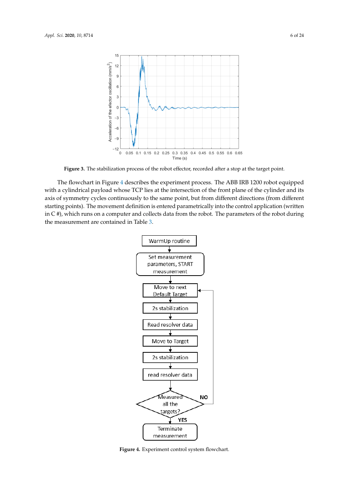
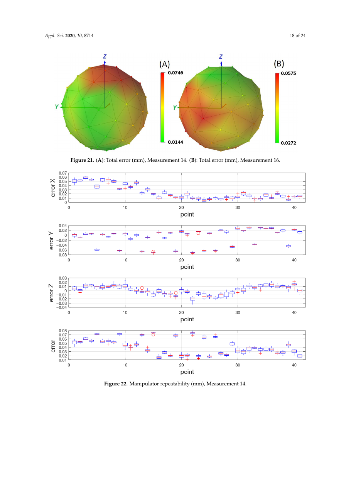
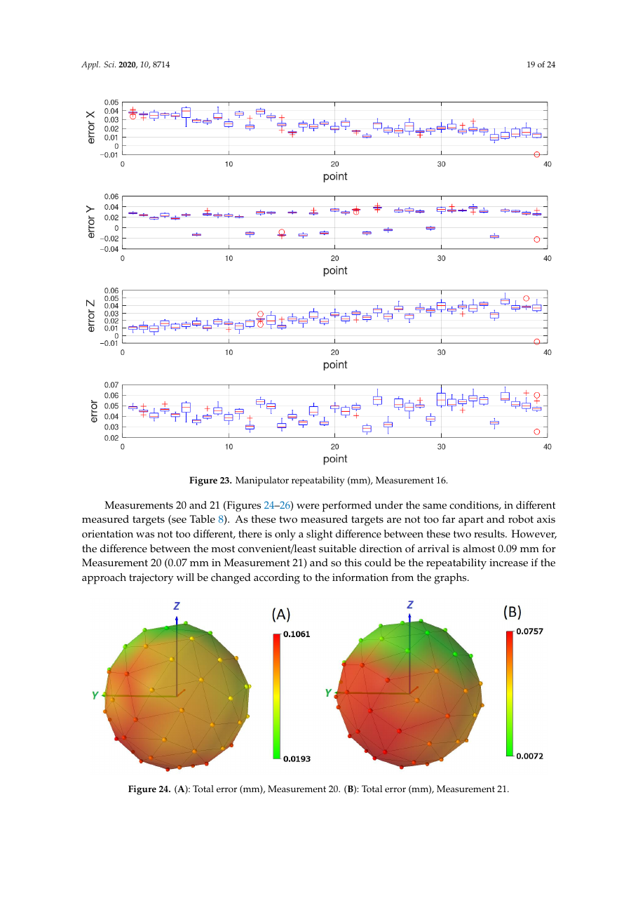

# 접근 방향이 산업용 로봇의 반복정밀도에 주는 영향 (번역)

번역 범위: 전문 (초록, 본문 1~8장, 그림과 표 캡션, 저자 기여, 연구비, 이해 상충). 참고문헌은 원문 그대로 둔다.

원문: Michal Vocetka, Róbert Huňady, Martin Hagara, Zdenko Bobovský, Tomáš Kot, Václav Krys. "Influence of the Approach Direction on the Repeatability of an Industrial Robot". Applied Sciences 2020, 10(23), 8714. doi:10.3390/app10238714. CC BY 4.0.

원문 파일: `Vocetka2020_ApplSci_approach_direction.pdf` (VŠB 오스트라바 공대 기관 저장소 dspace.vsb.cz 사본. 학술지 출판본 24쪽과 같다. MDPI 사이트 PDF는 403으로 받지 못했다.)

번역 메모
- 이 PDF는 그림 안에 심사본(peer review) 글자 층이 겹쳐 있어 pdftotext 결과가 섞여 나온다. 5~24쪽은 쪽 이미지를 직접 읽어 번역했다.
- "repeatability"는 반복정밀도, "accuracy"는 정확도, "default position"은 출발 위치, "target"은 목표점으로 옮겼다.
- 원문 오기로 보이는 곳은 [역자 주]로 표시하고 고치지 않았다.

---

## 저자와 소속

1. 로봇공학과, 기계공학부, VŠB 오스트라바 공과대학교, 체코 (Vocetka, Bobovský, Kot, Krys)
2. 응용역학과 기계공학과, 기계공학부, 코시체 공과대학교, 슬로바키아 (Huňady, Hagara)

교신 저자: michal.vocetka@vsb.cz

접수 2020년 11월 13일, 승인 2020년 12월 1일, 출판 2020년 12월 5일

## 초록

이 논문은 "접근 방향이 궤적 목표점의 반복정밀도에 영향을 준다"는 가설을 증명하는 것을 목표로 한다. 대부분의 연구는 절대 정확도를 다룬다. 이 논문은 이와 달리, 얻을 수 있는 반복정밀도와 그에 대한 접근 방향의 영향을 정하는 데 집중한다. 가설을 증명하려고 산업용 로봇 ABB IRB1200에서 여러 조건으로 측정을 했다. 로봇 각 축의 리졸버에서 얻은 결과를 검증하고 확인하려고, 고속 디지털 영상 상관(DIC) 카메라로 같은 측정을 반복했다. 외부 측정 장치로 로봇 끝점의 실제 반복정밀도를 정했다. 측정은 가설이 맞음을, 곧 반복정밀도가 접근 방향에 따라 달라짐을 증명했다. 또한 실제 편차를 재고, 이 영향이 로봇 반복정밀도에 미치는 크기를 정했다.

키워드: 로봇 반복정밀도, DIC, 로봇 정밀도, 접근 방향의 영향

## 1. 서론

산업용 로봇과 매니퓰레이터는 보통 어떤 산업 조건에서도, 어떤 방식으로도 쓸 수 있는 범용 시스템으로 여겨진다. 그러나 매니퓰레이터의 용도는 장착한 공구가 정하며, 공구를 달면 범용성이 크게 줄어든다. 산업 현장에서는 매니퓰레이터가 단일 목적 기계, 생산 라인, 다른 장비의 일부인 것이 보통이다. 이런 경우 대개 한 가지 방식으로만, 보통 한 가지 작업을 주기적으로 반복한다. 그러므로 매니퓰레이터의 정밀도를 높여야 할 때, 로봇 작업 공간 전체의 절대 정확도를 높일 필요는 없을 수 있고, 특정 목표점에서 반복정밀도만 높이면 충분할 수 있다.

산업용 매니퓰레이터의 정밀도에서는 보통 두 값을 다룬다. 정확도와 반복정밀도다. 정확도는 로봇이 기준 좌표계에 대해 프로그램한 공구 중심점(TCP) 자세에 도달하는 능력이다. 반복정밀도는 로봇이 TCP를 같은 위치로, 같은 방향에서, 반복해서 되돌리는 능력이다.

매니퓰레이터의 정확도는 여러 외부 영향을 받는다. 온도, 제작 부정확성, 축 처짐, 베어링과 감속기의 틈 외에도, 예를 들어 리졸버(또는 엔코더)가 구동부 앞쪽에 있어서 모터와 감속기에서 생기는 오차를 잡지 못한다는 점이 있다 [1]. 반복정밀도는 틈, 위치 센서의 분해능, 열팽창, 기타 영향 때문에 생긴다. 반복정밀도에는 좌표계 설정 오차, 모형화한 팔 길이 외의 제작 및 조립 편차(예: 관절과 안내면의 직각도, 평행도 어긋남)가 들어가지 않는다.

대형 매니퓰레이터의 절대 정확도는 이상적 모형과 최대 15 mm까지 다를 수 있고 [2], 이를 재고 높이려면 레이저 트래커 같은 외부 장치가 필요하다. 반면 반복정밀도는 보통 0.1 mm에서 0.01 mm 수준이다 [1]. 다만 운전 조건에 크게 좌우된다. 제조사가 주는 값은 보통 이상적 조건의 정상 상태와 새 매니퓰레이터에 해당한다. 그럼에도 보통 수준의 반복정밀도로는 부족해 보이는 응용이 있으며, 특히 강성이 낮은 로봇 구조에서 그렇다.

예를 들어 ABB는 자사 로봇에 Absolute Accuracy와 CalibWare 옵션을 제공한다 [2]. 이 기능은 CAD 환경의 이상적 매니퓰레이터와 공장에 설치된 실제 로봇의 차이를 없애는 것이 목적이다. 이 보정은 특정 매니퓰레이터의 기계적 특성과 부정확성뿐 아니라, 부정확하게 정의된 탑재 하중 때문에 생기는 편차도 해결한다. 이 방법으로 보정한 로봇은 정확도가 일정하므로, 필요하면 로봇을 "한 대씩" 바꿔 끼울 수 있다는 장점도 있다. 이상적 가상 매니퓰레이터와 실제 매니퓰레이터의 차이는 로봇 종류와 제작 공차, 편차의 겹침에 따라 보통 8~15 mm다. 이 기법은 레이저 트래커로 로봇 작업 공간 전체의 목표점 100개에서 정확도를 재고, 이를 바탕으로 작업 공간 전체를 보정한다. 결과 정확도는 대개 0.5 mm이며, 보통 그보다 낮아지지는 않는다 [2].

레이저 트래커를 쓰는 보정 방법 [3,4]은 산업 응용에서 흔히 쓰인다. 이 분야의 후속 연구는, 예를 들어 [5]처럼 아주 많은 측정(수만 회)으로 이 방법의 정확도를 더 높이는 데 집중한다. 이는 로봇 제어기, 레이저 트래커와 통신하는 측정 시스템으로 이루어지며, 로봇 자세는 심층 신경망의 도움으로 고른다. 레이저 트래커는 다른 보정 방법의 성질을 평가하는 기준 측정으로도 자주 쓰인다 [6~9]. 레이저를 로봇 보정에 쓰는 또 다른 방식은 [10]에 기술된 레이저 간섭계 기반 감지와 측정이다. 이 방법은 높은 정확도, 높은 샘플링 속도, 넓은 작업 공간으로 실시간 동적 위치 측정을 제공한다. [9]는 시판 텔레스코핑 볼바 시스템으로 된 3D 측정 시스템을 제안했다. 베이스에 대한 끝단 장치의 72개 자세로 로봇을 보정한 뒤, 임의 로봇 자세 10,000개에서 레이저 트래커와 비교해 검증했더니, 보정 전보다 정확도가 약 두 배 좋아졌다. [11]도 기하 보정 방법을 기술하며, 위치 정확도를 가장 크게 높이는 보정 자세를 찾는 데 특히 집중한다. [12]의 저자들은 모든 보정 방법에 해당하는 문제, 곧 로봇 관절의 백래시 영향을 지적한다. 이 논문은 이 효과와 함께, 이 추가 오차원을 없애는 방법을 제안한다. 로봇 보정에 흔히 쓰이는 또 다른 방법군은 사진측량에 바탕을 둔다. 한 가지 접근은 3D 사진측량 측정 장치로 로봇 끝점의 위치와 자세를 실시간으로 추적하고, 이 정보를 로봇 제어기의 피드백으로 쓰는 것이다 [13]. 사진측량은 오프라인 로봇 보정에도 쓰인다 [6]. 시판 휴대형 사진측량 시스템을 산업용 로봇 보정에 쓰는 연구도 있으며, [7]의 저자들은 이 방식을 레이저 트래킹 보정과 비교해 매우 좋은 결과를 얻었다. 사진측량의 정확도는 조금 낮을 뿐이었다. [14]는 로봇 끝단에 카메라를 달고, 카메라가 대부분의 시간 동안 볼 수 있는 곳에 보정판을 둔 방식을 기술한다. 이 보정 방법은 온라인으로도 동작한다. 로봇 끝점 가까이에 카메라 한 대를 단 비슷한 방식이 [15]에도 소개되었으며, 로봇 정확도가 3~6배 좋아졌다. 고속 카메라의 경우 [16]의 저자들은 초당 최대 25,000프레임의 Phantom v2511 카메라로 산업용 로봇의 정확도를 절댓값뿐 아니라 이동 방향에 대해서도 확인했다. 이런 시스템은 동적 움직임, 진동 등을 재는 데도 쓸 수 있다. 로봇 보정에 스테레오 비전을 쓰는 연구도 있으며, 예를 들어 [17]은 스테레오 카메라로 산업용 밀링 로봇의 정확도를 높이는 방법을 기술한다. 그 밖에 저가 시스템 [18]이나 레이저 카메라 삼각측량 [19]을 쓴 연구도 있다.

사진측량과 달리 디지털 영상 상관법은 전역(full-field) 3D 변위 측정을 할 수 있어, 상관 시스템을 부품의 진동 해석과 변형 해석 양쪽에 쓸 수 있다. 점 측정에 비한 주된 장점은 결과 처리에 더 많은 자료를 넣을 수 있다는 점이다. 측정이 면 위에서 이루어지므로 위치 정보 말고도 면 법선 방향 정보를 얻을 수 있다. 고속 카메라를 쓰면 매니퓰레이터의 운동학, 동역학, 진동을 자세히 해석하거나 모드 특성을 잴 수 있다. [20]은 두 팔 서비스 로봇이 두 위치 사이를 지나갈 때의 운동 해석을 기술한다. 이는 공간에서 매니퓰레이터의 움직임을 재구성하도록 설계한 대규모 응용이었다. 측정 결과는 관절 마디 세 곳의 3D 궤적과 로봇 이동 중 그 마디들의 진동 응답이었다. [21]의 저자들은 단일점 점진 판재 성형 공정에서 생기는 기하 오차를 줄이려는 간단한 로봇 반복 학습 제어 알고리즘을 제안했다. 이들은 3D 디지털 영상 상관법으로 공구 경로를 따라 기하 오차를 쟀다. 위치 측정 외에도 DIC는 운전 진동 해석이나 실험 모드 해석에 쓸 수 있다. 이 주제로 여러 논문이 나왔다 [22~27]. [26]의 저자들은 해석 대상 구조의 진동 시간 응답을 나타내는 대량 자료를 처리하는 매우 효율적인 절차를 제안했다. 이 절차는 이후 모드 시험 평가용 DICMAN 3D 소프트웨어에 구현되었다. 다른 연구 [27]에서 저자들은 한 걸음 더 나아가, 물체가 움직이는 동안 DIC 시스템으로 진동 응답을 재는 기법을 제시했다. 이는 강체 운동 성분을 후처리로 수치적으로 없애는 데 바탕을 둔다. 이들은 이 기법으로 회전 원판의 모드 형상과 운전 형상을 쟀다. 이런 접근은 로봇과 매니퓰레이터의 동적 거동 해석에, 예를 들어 가속, 감속 때의 동하중을 줄이거나 궤적을 최적화하는 데 유용하게 쓸 수 있다.

대부분의 학술 출판물은 로봇 절대 정확도의 측정과 향상에 집중한다. 이 논문의 목적에 따라, 반복정밀도 측정을 다룬 연구도 언급할 필요가 있다.

질리나 대학교 연구진은 레이저 간섭계와 디지털 인디케이터를 쓰는 자세 반복정밀도 측정 방법론을 기술했다 [28]. 이 논문은 성능 특성을 어떻게 정하는지 기술한 국제 표준 ISO 9283:1998의 권장 절차를 쓴다 [29]. 로봇 반복정밀도의 실험적 측정은 미국 로버트 모리스 대학교의 논문에도 기술되어 있다 [30].

여러 종류의 방법으로 산업용 로봇을 비교 평가한 논문도 빼놓을 수 없다 [31~33].

위 개관에서 분명하듯이, 매니퓰레이터의 정확도나 반복정밀도를 높이는 분야는 오랫동안 관심을 받았고, 정밀도를 높이는 여러 해법이 제시되었다. 그러나 이 방법들 가운데 어느 것도 원하는 목표점에 도착하는 방향의 영향을 깊이 살피지 않는다.

이 논문은 목표점에 도착하는 방향과 반복정밀도의 관계를 증명하고, 일련의 측정으로 특정 로봇의 방향별 편차 범위를 정하는 것을 목표로 한다.

## 2. 가설 검증의 조건과 절차

- 저자들의 가정에 따르면, 로봇이 목표점에 도착하는 방향과 그 목표점에서 얻을 수 있는 반복정밀도 사이에 관계가 있다. 위 개관을 바탕으로 저자들은, 다른 연구자들이 로봇 반복정밀도를 높이려 할 때 이 영향을 고려하지 않았다고 주장한다.
- 첫 단계에서는 로봇 구동부의 리졸버 자료만 검증에 쓴다. 이 자료만으로도 측정한 목표점에서 로봇 반복정밀도가 접근 방향에 따라 달라진다는 것을 증명할 수 있어야 한다. 이를 위해 관절 변수를 (순기구학으로) 끝점 편차(x, y, z, 총편차)로 바꾼다. 리졸버 자료에는 감속기에서 생기는 오차, 팔 처짐, 열팽창이 들어 있지 않고, 매니퓰레이터 기계 구조 각 부품의 제작 공차와 편차의 영향도 들어 있지 않다. 그래서 두 번째 단계 측정이 뒤따른다.
- 다음 단계에서는 목표점의 위치와 자세를 3D DIC 방법으로 재고, 반복정밀도 범위의 편차를 높은 정밀도로 평가한다.
- 측정 결과로, 측정한 목표점 주변과 각 접근 방향에 해당하는 편차 크기를 그림으로 나타낸다.
- 이 실험 측정 결과는 특정 산업용 로봇, 작업장의 정해진 설치 방식, 특정 목표점에 대해서만 유효하다.

## 3. 측정한 로봇

실험에는 ABB IRB1200 5/0.9 산업용 로봇을 골랐다. 보호 등급 IP40의 소형 6축 수직 다관절 로봇으로, 깨끗한 실내 공간에서 포장, 취급, 조립 같은 작업을 하도록 설계되었다.

제조사에 따르면 이 매니퓰레이터의 반복정밀도는 0.025 mm이고, 로봇을 어떤 방향, 어떤 각도로도 설치할 수 있다. 표 1은 로봇의 기본 기술 사양이다. 로봇의 전방 도달 거리는 901 mm이고, 가반 하중은 5 kg이다(무게 중심이 플랜지에서 최대 100 mm 거리).

표 1. IRB1200 5/0.9 기본 사양 [1]

| 항목 | 값 |
|---|---|
| 위치 반복정밀도 | 0.025 mm |
| 최대 TCP 속도 | 8.9 m/s |
| 최대 TCP 가속도 | 36 m/s² |
| 가속 시간 (1 m) | 0.06 s |
| 로봇 무게 | 54 kg |

실험은 ABB IRB1200 로봇 두 대가 있는 작업대에서 했다. 로봇은 받침대 위에 설치되어, 로봇 베이스가 수평이 아니라 각 로봇 좌표계의 y축 둘레로 40° 기울어져 있다. 이는 표준 설치 자세가 아니다. 이 경우 로봇 1축은 (0° 아닌) 자세를 유지할 때나 등속으로 돌 때도 토크를 받는다. 이 사실은 로봇의 정확도와 반복정밀도에 직접 영향을 준다.

로봇은 매 측정 전에 예열했고, 온도를 가능한 한 일정하게 유지했다. 이는 모든 정밀 로봇 프로그래밍 작업의 표준 절차다. 로봇 목표점을 정밀하게 보정하기 전에, 생산 중에 데워지는 것과 같은 방식으로 구조를 데우려고 로봇을 한동안 움직이게 둔다.

측정을 위해 로봇에 여러 사양의 탑재물을 달았다(그림 1, 표 2). 이는 로봇이 최소 질량만 드는 일이 드문 실제 운전 조건을 흉내 낸다. 탑재물 앞면에는 DIC 방법으로 반복정밀도를 나중에 검증하기 위한 흑백 스페클 무늬를 붙였다.

그림 1. 탑재물 옆모습. (원통. 지름 Ø, 길이 L, 앞면 중심에 TCP)

표 2. 탑재물 사양

| 탑재물 (kg) | L (mm) | Ø (mm) | 무게 중심 z (mm) |
|---|---|---|---|
| 0.04 | 10 | 100 | 5 |
| 2.538 | 42 | 100 | 21 |
| 4.647 | 54 | 120 | 27 |

## 4. 실험

이 장은 측정의 첫 단계를 기술한다. 첫 단계의 목적은 로봇이 끝 목표점에 접근하는 방향과 그 목표점에서 얻을 수 있는 반복정밀도 사이의 영향을 증명하는 것이다.

실험을 시작하기 전에, 로봇이 멈춘 뒤 진동이 가라앉는 최소 안정화 시간을 정해야 했다. 안정화 시간은 로봇 팔이 갑자기 멈추고 출발할 때의 안정화를 동적으로 측정한 결과로 정했다. 필요한 자료는 두 곳에 붙인 3축 가속도계에서 얻었다. 한 곳은 끝단 장치(해석 대상 탑재물 쪽, 그림 2), 다른 곳은 로봇 베이스다. 가속도계 한 축에 기록된 전형적인 끝단 진동은 그림 3과 같다. 이 경우 팔은 약 0.6 s 뒤에 안정되었다고 볼 수 있지만, 측정의 확실성을 높이려고 안정화 시간을 세 배로 잡았다.

그림 2. 흑백 스페클 무늬를 붙인 로봇 탑재물.

그림 3. 목표점에서 멈춘 뒤 기록한 로봇 끝단의 안정화 과정. (세로축: 끝단 진동 가속도 (mm/s²), 가로축: 시간 (s). 약 0.05~0.15 s에 −12~+15 mm/s² 크기로 흔들리고 0.6 s 무렵 거의 0이 된다.)

그림 4의 흐름도는 실험 과정을 기술한다. 원통 탑재물을 단 ABB IRB 1200 로봇이, 원통 앞면과 대칭축의 교점을 TCP로 하여, 같은 점으로 계속 순환해 가되 매번 다른 방향(다른 출발점)에서 간다. 이동 정의는 매개변수로 제어 프로그램(C#으로 작성)에 넣는다. 이 프로그램은 컴퓨터에서 돌며 로봇에서 자료를 모은다. 측정 중 로봇 매개변수는 표 3과 같다.

그림 4. 실험 제어 시스템 흐름도. (예열 루틴 → 측정 매개변수 설정, 측정 시작 → 다음 출발 위치로 이동 → 2 s 안정화 → 리졸버 자료 읽기 → 목표점으로 이동 → 2 s 안정화 → 리졸버 자료 읽기 → 모든 목표를 쟀는가? 아니오면 "다음 출발 위치로 이동"으로, 예면 측정 종료)

표 3. 로봇 측정 이동 매개변수

| 항목 | 값 |
|---|---|
| 이동 속도 (출발 위치로) | 400 mm/s |
| 접근 속도 (측정 목표점으로) | Vmax (최대 8900 mm/s) |
| 안정화 시간 (출발 위치와 목표점 모두) | 2 s |

한 주기 안의 모든 출발 위치는 측정 목표점에서 같은 거리에 있다. 출발 위치들은 지정한 지름과 밀도로 만든 구면을 이루며, 구면 피보나치 격자 원리를 쓴다 [34]. 좌표 (x, y, z)는 제어 프로그램이 갱신하며, 정한 지름의 구면 위 점에 해당한다. 출발 위치에서 자세(방향)는 바꾸지 않는다. 매니퓰레이터의 자세 때문에 앞쪽 반구만 고려한다.

구면 피보나치 격자는 정한 개수의 점을 구면에 고르게 나누는 가장 간단한 방법으로 썼다. 점은 지름과 상관없이 고르게 퍼진다. 고르게 퍼진다는 것은 이웃한 두 점 사이 거리가 모두 같다는 뜻이다.

출발 위치 하나하나를 정밀하게 기술할 필요는 없다. 결과는 목표점에 모든 방향에서 도착하는 것이 얼마나 알맞은지를 여러 점 사이의 색 기울기로 보여 주는 것이어야 한다. 이런 그래프로, 반구 어디서든, 곧 정확히 지정한 점 주변에서도, 점에 접근하는 방향 때문에 생기는 오차를 비교적 정확히 정할 수 있다(그림 5).

그림 5. (A) 구면에 고르게 퍼진 점들. (B) 원점 자세를 가진 반구.

반지름(50, 100, 150, 200, 250, 300 mm), 출발 위치 수(10, 20, 40, 80, 160), 반복 횟수(10, 20, 30)를 바꾸어 모두 24주기를 수행했다. 수행한 측정의 매개변수 조합은 표 4~8에 있다. 반구의 위치는 그림 6과 같다. 측정 목표점은 TCP(공구 좌표계)와 같은 자세이고, WCS(기준 좌표계) 축 방향으로 +500 mm 거리에 있다. WCS는 그림 6 왼쪽에 있다. TCP(공구 좌표계)의 위치와 자세는 로봇 공구에 표시했다. 그림 6 가운데가 반구이며, 그 표면에 출발 위치들이 고르게 퍼져 있다.

표 4. 반복 횟수의 영향을 재는 측정 매개변수

| 측정 | 점 | 반복 | 무게 (kg) | 반지름 (mm) |
|---|---|---|---|---|
| 1 | 10 | 10 | 2.538 | 50 |
| 2 | 9 | 10 | 2.538 | 300 |
| 3 | 9 | 20 | 2.538 | 300 |
| 4 | 11 | 30 | 2.538 | 300 |

표 5. 출발 위치 수의 영향을 재는 측정 매개변수

| 측정 | 점 | 반복 | 무게 (kg) | 반지름 (mm) |
|---|---|---|---|---|
| 5 | 10 | 10 | 2.538 | 300 |
| 6 | 20 | 10 | 2.538 | 300 |
| 7 | 40 | 10 | 2.538 | 300 |
| 8 | 80 | 10 | 2.538 | 300 |
| 9 | 160 | 10 | 2.538 | 300 |

표 6. 반지름 크기의 영향을 재는 측정 매개변수

| 측정 | 점 | 반복 | 무게 (kg) | 반지름 (mm) |
|---|---|---|---|---|
| 10 | 40 | 10 | 2.538 | 50 |
| 11 | 41 | 10 | 2.538 | 100 |
| 12 | 40 | 10 | 2.538 | 150 |
| 13 | 40 | 10 | 2.538 | 200 |
| 14 | 41 | 10 | 2.538 | 250 |
| 15 | 39 | 10 | 2.538 | 300 |

표 7. 탑재물의 영향을 재는 측정 매개변수

| 측정 | 점 | 반복 | 무게 (kg) | 반지름 (mm) |
|---|---|---|---|---|
| 16 | 40 | 10 | 0.04 | 300 |
| 17 | 40 | 10 | 2.538 | 300 |
| 18 | 40 | 10 | 4.647 | 300 |

표 8. 측정 목표점 위치의 영향을 재는 측정 매개변수

| 측정 | 점 | 반복 | 무게 (kg) | 반지름 (mm) | 이동 (WCS) (mm) |
|---|---|---|---|---|---|
| 19 | 41 | 10 | 2.538 | 150 | +150 z |
| 20 | 41 | 10 | 2.538 | 150 | −150 z |
| 21 | 39 | 10 | 2.538 | 150 | −150 x |
| 22 | 39 | 10 | 2.538 | 150 | +150 x |
| 23 | 42 | 10 | 2.538 | 150 | +150 y |
| 24 | 41 | 10 | 2.538 | 150 | −150 y |

그림 6. 로봇 작업 공간과 측정 목표점.

## 5. 실험 결과

끝점 반복정밀도가 무엇보다 그 점에 접근하는 방향에 따라 달라진다는 가설을 확인하려면, 고른 측정을 세 가지 방식으로 해야 했다. 각 측정마다 출발점 묶음을 만들고, 같은 조건에서 세 번 측정했다. 다른 점은 순서뿐이다. 첫 측정은 y축 값이 가장 작은 점부터 큰 점 순서(yMIN → yMAX), 둘째는 반대 순서(yMAX → yMIN), 셋째는 무작위 순서로 점을 골랐다.

관절 변수(j1~j6 (°))를 늘 읽고, 전체 순서를 달리했을 때 같은 점의 값을 비교했다.

그래프(그림 7)에서 분명하듯이, 편차는 끝점에 대한 출발점의 위치에만 달려 있다. 접근 출발점을 한쪽부터 고르든, 반대쪽부터 고르든, 완전히 무작위로 고르든 중요하지 않다. 이 결과는 무엇보다, 이 결과에 무작위성을 일으킬 우연 오차나 다른 영향을 배제한다.

그림 7. 출발 위치를 차례로 고를 때와 무작위로 고를 때의 관절 편차 (°). (관절 1~6 각각, 가로축 측정 번호 0~800)

각 측정의 파형은 거의 완전히 겹치며, 가장 작은 y값에서 가장 큰 값 순서로 점을 실행한 첫 "노란색" 측정(yMIN → yMAX)과의 차이만 아주 작다. 빨간색(yMAX → yMIN)은 반대 순서, 파란색은 완전 무작위 순서다. 세 파형 모두 이 측정들에서 같은 점을 비교할 수 있도록 YMIN에서 YMAX 순으로 정렬했다.

수학 모형에 따르면 공구 중심점의 위치와 편차는 순기구학으로 계산할 수 있지만, 이 값은 절대 부정확성의 범위 안에서 달라진다.

반복정밀도와 고른 목표점에서의 실제 편차를 정하려면 끝점(TCP)에서 정밀도를 재야 한다. 이를 위해 두 번째 단계에서 3D DIC 방법론을 적용해 결과를 검증한다.

각 측정은 상자 그림으로도 보였으며, 그 원리는 그림 8과 같다. 기호는 기본 범위 밖의 값(이상값)을 나타낸다. 값이 사분위 범위의 세 배보다 크면 기호 "o"로, 1.5~3배 범위면 기호 "+"로 표시한다 [35].

그림 8. (A) 측정값의 사분위 [36]. (B) 기본 범위 밖 값을 나타내는 기호.

아래 그래프(그림 9, 10)는 접근 방향이 로봇의 각 관절 변수에 주는 영향을 보여 준다. 앞서 말했듯이 이 자료는 로봇 각 축의 구동부 리졸버에서 나오므로, 구조의 "더 위쪽"에서 생기는 오차는 들어 있지 않다.

그림 9. 측정 14 동안 로봇 각 관절의 오차 (°) 분포.

그림 10. 측정 16 동안 로봇 각 관절의 오차 (°) 분포.

그림 9와 10은 로봇 구동부 리졸버 자료, 곧 표 6, 7에 따른 측정 14와 16의 결과를 보여 준다. 수행한 모든 측정을 이 방식으로 평가했다. 그러나 찾은 사실을 더 잘 이해하고, 특히 매니퓰레이터의 실제 정밀도를 정하려면, 이 자료를 로봇 끝점, 곧 TCP에서의 반복정밀도 값으로 바꿔야 한다(그림 11). 이 환산은 잘 알려진 순기구학 방법으로 하며, 쓴 Denavit-Hartenberg 매개변수는 아래 표 9와 같다.

그림 11. 출발 위치를 차례로 고를 때와 무작위로 고를 때의 편차 (mm). 로봇 플랜지(공구 중심점, TCP) 기준. (노랑 yMIN → yMAX, 빨강 yMAX → yMIN, 파랑 무작위. 세로축 0.742~0.754 mm)

표 9. ABB IRB 1200 5/0.9의 D-H 매개변수 [1]

| i | Theta (°) | d (m) | a (m) | Alpha (°) |
|---|---|---|---|---|
| 0 | 0 | 0.3991 | 0 | 0 |
| 1 | q1 | 0 | 0 | 90 |
| 2 | q2 | 0 | 0.448 | 0 |
| 3 | q3 + 90 | 0 | 0.042 | 90 |
| 4 | q4 | 0.451 | 0 | −90 |
| 5 | q5 | 0 | 0 | 90 |
| 6 | q6 | 0.082 | 0 | 0 |

아래 그림 11은 주어진 D-H 매개변수로 계산한 TCP의 전체 편차를 보여 준다. 세 측정을 보였으며, 생각은 그림 7과 같다. 곧 편차가 측정 목표점에 접근하는 방향의 영향을 받는다는 것을 증명하는 것이다. 그림 11에서도 같은 점끼리 비교하려고 세 파형을 모두 YMIN에서 YMAX 순으로 정렬했다.

TCP 편차로 바꾼 측정 일부를 아래 그림 12, 13에 보였다.

그림 12. 측정 14 동안 TCP의 오차 (mm) 분포. (X, Y, Z 각각. 대략 −0.002~+0.008 mm 범위)

결과를 3D 지도(그림 14)로 나타내면 더 분명해 보일 수 있다. 반복정밀도 관점에서 측정 목표점에 어느 접근 방향이 알맞고 어느 방향이 알맞지 않은지 한눈에 보인다. 색 기울기는 각 출발점에 해당하는 측정 반복정밀도 오차를 나타낸다. 반구 표면을 보는 방향은 늘 양의 x축 방향, 곧 측정 장치 쪽이다. x, y, z축 편차와 그 합성 법선 오차, 총오차를 쟀다. 결과 편차는 대개 10회 측정의 평균이다. 아래 그림(그림 14)에서, 측정 14와 16에서 정한 조건에서는 가장 알맞은 접근 방향이 목표점의 y축 방향에서 오는 것임을 알 수 있다. 그림 14의 편차 값이 큰 것은 로봇 제어 시스템 때문이다. 제어 시스템은 기계 구조가 이 값만큼 묶일(bound) 것이라고 예측한다. 그러나 이 예측은 반복정밀도를 더 높일 여지를 남긴다. 그래프(그림 12, 13)의 점들은 YMIN에서 YMAX 순, 곧 반구 아래에서 위로 정렬했다.

그림 13. 측정 16 동안 TCP의 오차 (mm) 분포.

그림 14. (A) 측정 14의 총오차 (mm) 분포 (색 범위 1.0633~1.0694). (B) 측정 16의 총오차 (mm) 분포 (색 범위 0.8108~0.8190).

## 6. DIC로 결과 검증과 실제 TCP 편차 결정

위에서 기술한 측정(표 4~8)을 로봇 끝부분, 곧 원통 탑재물 앞면에 초점을 맞추어 다시 했다. 목적은 로봇 리졸버에서 얻은 결과를 검증하고, 특히 반복정밀도 범위에서 TCP의 실제 편차를 정하는 것이었다. 실제 편차에는 로봇 각 축 감속기의 틈, 열팽창 효과, 팔 처짐, 제작 부정확성 등이 들어 있다.

이를 위해 Dantec Dynamics Q-450 고속 디지털 영상 상관 시스템을 썼다(그림 15). 이 3D 측정 시스템은 16 GB 메모리를 가진 고속 디지털 카메라 SpeedSense 9070 두 대로 되어 있으며, CMOS 센서로 최대 HD 해상도(1280 × 800 px)에서 초당 3140프레임까지 기록할 수 있다. 카메라는 Istra4D 제어 소프트웨어가 깔린 노트북에 연결된다. 넓은 동적 측정 범위 덕분에 수 마이크로미터에서 수십 센티미터까지의 움직임을 기록할 수 있으며, 높은 영상 해상도와 매우 정확한 시간 분해능을 함께 갖춘다. Q-450 상관 시스템의 다른 기술 사양은 표 10과 같다.

그림 15. DIC Q-450 시스템으로 IRB1200 측정.

표 10. Q-450 Dantec Dynamics 시스템 기술 사양

| 항목 | 값 |
|---|---|
| 측정 영역 | 조절 가능: mm²부터 m²까지 |
| 측정 범위 | 변위: 시야의 약 10⁻⁵, 시야 100 mm에서 1 µm에 해당. 변형률: 0.01%~수백 % |
| 해상도 | 최대 1280 × 800 px, 주사 주파수 3140 FPS까지 |
| 측정 결과 | 물체 표면의 공간 윤곽, 3D 변위, 각 점의 변형률, 스펙트럼 해석 |
| 제어와 감시 전자 장치 | Windows 7 휴대용 노트북, 16비트 아날로그-디지털 변환기 (8채널, 전압 범위 ±0.05 V~±10 V) |
| 조명 | 백색광 할로겐 반사등 |

위 측정 시스템은 디지털 영상 상관 원리, 곧 실험 중 기록한 디지털 영상의 비교로 동작한다. 영상 상관은 퍼싯(facet)이라는 작은 영상 조각에서 한다. 퍼싯은 보통 15 × 15 px에서 30 × 30 px 크기의 정사각 화소 묶음이지만, 과제 종류에 따라 크기를 (줄이거나 늘려) 조절할 수 있다. 올바른 영상 상관을 하려면 각 퍼싯이 유일해야, 곧 회색 밝기가 서로 다른 고유한 화소 분포를 가져야 한다. 그래서 해석 대상 물체 표면에 무작위 흑백 무늬를 만든다. 퍼싯은 맞닿거나 겹칠 수 있지만 사이에 빈 곳이 있으면 안 된다. 해석 대상의 변위 정보는 퍼싯 중심에 해당하는 가상 격자의 마디에서 얻으므로, 퍼싯을 겹치는 것(그림 16)은 영상 해상도를 높이는, 곧 더 많은 자료를 얻어 해석 대상 표면(특히 가장자리 둘레)을 더 잘 재구성하는 한 방법이다. 상관 장치 제조사 Dantec Dynamics는 퍼싯을 퍼싯 크기의 1/3까지 겹치라고 권한다. 그만큼 겹쳐도 자료점들이 여전히 독립이기 때문이다.

그림 16. 퍼싯 겹침으로 영상 해상도가 높아지는 예. (A) 정한 관심 영역. (B) 퍼싯이 맞닿을 때의 측정점. (C) 퍼싯이 겹칠 때의 측정점.

카메라 내부, 외부 보정 매개변수를 정하는 보정 과정은 보정판을 여러 위치에서 자동으로 찍어서 한다. Q-450 Dantec 카메라 보정은 Zhang의 알고리즘에 바탕을 둔다. 보정 뒤, (카메라 좌표의) 3D 점 X의 위치를 센서 좌표로 변환한다(그림 17). 좌표 변환 과정은 [37]에 자세히 기술되어 있다.

그림 17. 해석 대상 점의 기준 좌표를 센서 좌표로 바꾸는 구성도. (기준 좌표계 Rw의 점 X가 카메라 Rc1, Rc2에 원근 투영되고, 두 카메라는 강체 변환으로 이어진다.)

해석 대상 점들의 변환 좌표 정보를 얻으려고, Dantec Dynamics 상관 장치는 유사 아핀(pseudo-affine) 변환에 바탕을 둔 알고리즘을 쓴다 [38]. 퍼싯의 변위, 늘어남, 전단, 뒤틀림의 변환 매개변수 a0~a7(그림 18)을 고려하면, 이 알고리즘에 따라 변환 좌표 (u, v)를 다음처럼 계산한다.

$$u(a_0,a_1,a_2,a_3,\tilde{x},\tilde{y}) = a_0 + a_1\tilde{x} + a_2\tilde{y} + a_3\tilde{x}\tilde{y}$$
$$u(a_4,a_5,a_6,a_7,\tilde{x},\tilde{y}) = a_4 + a_5\tilde{x} + a_6\tilde{y} + a_7\tilde{x}\tilde{y} \qquad (1)$$

[역자 주] 둘째 식의 왼쪽은 원문 그대로 u로 적혀 있으나 문맥상 v다.

그림 18. 유사 아핀 변환 기반 알고리즘에서 쓰는 변환 매개변수.

측정 절차는 로봇 관절 변수 측정 때와 같았다. 흐름도(그림 4)만 다음처럼 늘렸다(그림 19). 영상은 늘 세 장 찍는다.

그림 19. 실험 제어 시스템 흐름도 (DIC). (그림 4와 같고, 목표점 도착 후 2 s 안정화 뒤 "DIC 측정 수행, 리졸버 자료 읽기"로 바뀌었다.)

로봇 드리프트의 영향을 정하려고 측정 4(표 1, 그림 20)를 했다. [역자 주] 측정 4는 표 4에 있다. 원문은 "Table 1"로 적었다. 로봇 구조의 온도가 크게 바뀌면 드리프트가 반복정밀도와 정확도에 심각한 영향을 줄 수 있다. 드리프트는 구조를 최적 운전 온도로 유지하면(예를 들어 주조 공장 응용에서 팬으로 식혀서) 막을 수 있다. 그러나 측정 4의 결과는, 모든 측정이 이루어진 조건에서는 드리프트 영향이 크지 않음을 증명했다. 계통을 최적 운전 온도로 만들려고 매 측정 전에 예열 루틴을 썼다.

그림 20. 매니퓰레이터 반복정밀도 (mm), 측정 4. (점 11개, 각 30회. x, y, z 오차와 총오차의 상자 그림)

"3D 지도"(그림 21)에서, 로봇에 대한 점의 주어진 위치에서는 목표점 접근 방향을 바꾸는 것만으로 반복정밀도를 높일 수 있음이 분명하다. 그림 21은 측정 14와 16(반지름 250/300 mm, 출발 위치 40개, 서로 다른 탑재 무게)의 총오차를 보여 준다. 점들은 YMIN에서 YMAX 순, 곧 반구 아래에서 위로 정렬했다.

그림에서, 정한 조건에서 가장 알맞은 접근 방향은 측정 14에서는 VII 팔분공간이고, 측정 16에서는 위쪽(z축)임을 알 수 있다.

고른 측정에 대해 DIC로 잰 실제 반복정밀도 값(mm)을 그림 22, 23에 보였다. 측정 14 결과(그림 22)에서, 탑재 무게는 주로 가운데 구간(점의 y값 중간 범위) 오차 그래프에서 반복정밀도에 영향을 줌이 분명하다. 측정 16(그림 23)에서는 측정 반구 안의 반복정밀도 값 차이가 크지 않다.

그림 21. (A) 총오차 (mm), 측정 14 (색 범위 0.0144~0.0746). (B) 총오차 (mm), 측정 16 (색 범위 0.0272~0.0575).

그림 22. 매니퓰레이터 반복정밀도 (mm), 측정 14. (점 41개. x, y, z 오차와 총오차의 상자 그림)

그림 23. 매니퓰레이터 반복정밀도 (mm), 측정 16.

측정 20과 21(그림 24~26)은 같은 조건에서 서로 다른 측정 목표점으로 했다(표 8 참조). 두 측정 목표점이 그리 멀지 않고 로봇 축 자세도 크게 다르지 않아서, 두 결과 사이의 차이는 작다. 그러나 가장 알맞은 도착 방향과 가장 덜 알맞은 도착 방향의 차이는 측정 20에서 거의 0.09 mm(측정 21에서 0.07 mm)이며, 따라서 그래프의 정보에 따라 접근 궤적을 바꾸면 이만큼 반복정밀도가 좋아질 수 있다.

그림 24. (A) 총오차 (mm), 측정 20 (색 범위 0.0193~0.1061). (B) 총오차 (mm), 측정 21 (색 범위 0.0072~0.0757).

그림 25. 매니퓰레이터 반복정밀도 (mm), 측정 20.

그림 26. 매니퓰레이터 반복정밀도 (mm), 측정 21.

## 7. 결론

목표점에서 로봇의 반복정밀도가 무엇보다 그 점에 접근하는 방향에 달려 있다는 가설이 증명되었다.

그래프(그림 7, 11)는 오차가 무작위로 생기지 않음을 보여 준다(출발점을 어떤 순서로 평가하든 목표점 접근 편차가 같았다). 관절 변수 측정값을 공구 중심점의 위치 편차로 다시 계산해, 반복정밀도(목표점의 각 접근 방향에 속하는 부정확성)를 정했다.

여러 영향이 반복정밀도 값에 작용한다. 특히 열팽창은 모든 고정밀 장치에 늘 영향을 준다. 그래서 로봇을 매 측정 전에 예열하고 온도를 가능한 한 일정하게 유지했다.

리졸버가 준 자료로는 목표점에 접근하는 가장 정확한 방향을 정할 수 없다. 이 자료에는 팔과 축의 처짐이 들어 있지 않기 때문이다. 리졸버 자료는 가설을 증명하는 데만 썼다. 실제 정확한 자료는 외부 측정 장치, 여기서는 DIC로만 얻을 수 있다.

확인한 사실을 검증하고 특히 실제의 정확한 로봇 반복정밀도 값을 얻으려고, 모든 측정을 3D DIC 방법론으로 반복했다. 이 측정 결과는 상자 그림뿐 아니라, 얻은 결과를 더 잘 보여 주는 3D 지도로도 나타냈다.

접근 방향이 목표점에서 얻을 수 있는 반복정밀도에 주는 영향을 여러 점에서 검증했다. 측정 19~24에서는 목표점을 기준 좌표계 모든 축의 양쪽 방향으로 150 mm씩 옮겼다. 따라서 가설은 로봇 이동의 여러 매개변수에서뿐 아니라 일곱 개의 서로 다른 목표점에서 검증되었다.

이 관계의 크기는 탑재 무게나 접근 속도 같은 다른 매개변수에 따라 달라진다. 예를 들어 측정 20(그림 24, 25)에서 (영, 정확한) 값과의 차이는 +0.019(최대)와 +0.106(최소)이다. 예를 들어 공정과 작업장의 성격에 따라 가장 유리한 방향에서 접근할 수 있다면, 가장 불리한 방향에 비해 반복 정확도 총편차 수준으로 0.087 mm만큼 개선될 수 있다.

[역자 주] "최대", "최소"는 원문 표기 그대로다. 문맥상 +0.019는 가장 좋은 방향, +0.106은 가장 나쁜 방향의 총오차이며, 차이 0.087 mm가 개선 여지다.

이 연구는 어떤 로봇 팔이든 반복정밀도를 높일 새 기회를 보여 준다. 주변 공간과 그것이 공구 중심점 편차에 주는 영향을 알면, 궤적을 조금 바꾸거나 개선해 반복정밀도를 높일 수 있다. 이 연구에서 저자들은 DIC 카메라로 실제 상태를 쟀지만, 충분히 정확한 외부 장치라면 무엇이든 쓸 수 있다.

제시한 측정은 영구적이지 않다. 다른 정밀 장치처럼 정기 보정이 필요할 것이다.

실제 응용, 예를 들어 고정밀 조립 작업에서는 절차가 다음과 같을 것이다.

1. 로봇과 외부 기술을 운전 상태로 준비한다.
2. DIC 카메라를 설치하고, 제어 프로그램 입력(측정 목표점의 자세, 구면 위 점 수, 각 출발점에서의 반복 횟수 등)을 정한다.
3. 로봇을 측정 목표점으로 움직이고, 도달한 위치를 DIC로 잰다.
4. 구면을 평가하고 "3D 지도"를 만든다. 이를 작업장 그림에 넣어 주변 설비에 맞춘 구의 방향을 얻는다.
5. 가장 알맞은 접근 방향과 가장 덜 알맞은 접근 방향 정보로 로봇 동작을 다시 프로그램해 더 좋은 반복정밀도를 얻는다.

## 8. 향후 연구

저자들은 기술한 정밀 측정 방법론으로 궤적을 따라가는 로봇 이동의 정밀도를 잴 계획이다. 부정확성을 정하고 나면 분명히 보상할 수 있겠지만, 문제는 궤적을 따라가는 이동을 어느 정도까지 최적화할 수 있느냐다.

## 저자 기여

M.V.: 소프트웨어, 원고 검토와 편집, 조사. R.H.: 방법론, 검증. M.H.: 소프트웨어, 조사. V.K.: 개념화, 원고 초안 작성, 자원, 연구비 확보. T.K.: 소프트웨어, 원고 검토와 편집, 시각화. Z.B.: 방법론, 감독, 자료 관리, 형식 분석, 검증, 프로젝트 관리. 모든 저자가 출판본 원고를 읽고 동의했다.

## 연구비

이 연구는 운영 프로그램 Research, Development and Education 안의 Research Centre of Advanced Mechatronic Systems 사업(과제 번호 CZ.02.1.01/0.0/0.0/16_019/0000867)에서 유럽 지역개발기금의 지원을 받았고, 슬로바키아 교육과학연구체육부와 슬로바키아 과학원의 과학 연구비 기관 과제 VEGA 1/0355/18(복합재 중심 기계 시스템 수치 모형의 정밀화와 검증을 위한 실험 역학 방법의 활용)의 지원을 받았다.

## 이해 상충

저자들은 이해 상충이 없다고 밝힌다.

## 참고문헌 (원문 그대로)

1. Technical Data for the IRB 1200 Industrial Robot. Available online: https://new.abb.com/products/robotics/industrial-robots/irb-1200/irb-1200-data (accessed on 26 November 2019).
2. ABB Absolute Accuracy: CAlibWare; ABB Inc.: Auburn Hills, MI, USA, 2005; Available online: https://library.e.abb.com/public/0f879113235a0e1dc1257b130056d133/Absolute%20Accuracy%20EN_R4%20US%2002_05.pdf (accessed on 27 November 2019).
3. Marek, P.; Piszczek, Ł. Testing of an industrial robot's accuracy and repeatability in off and online environment. Eksploat. Niezawodn. Maint. Reliab. 2018, 20, 455–464.
4. Albert, N.; Bonev, I. Absolute calibration of an ABB IRB 1600 robot using a laser tracker. Robot. Comput. Manuf. 2013, 29, 236–245.
5. Gang, Z.; Zhang, P.; Ma, G.; Xiao, W. System identification of the nonlinear residual errors of an industrial robot using massive measurements. Robot. Comput. Manuf. 2019, 59, 104–114.
6. Hothmer, J. International archives of photogrammetry and remote sensing. ISPRS J. Photogramm. Remote Sens. 1989, 44, 192.
7. Filion, A.; Joubair, A.; Tahan, A.S.; Bonev, I.A. Robot calibration using a portable photogrammetry system. Robot. Comput. Manuf. 2018, 49, 77–87.
8. Alici, G.; Shirinzadeh, B. A systematic technique to estimate positioning errors for robot accuracy improvement using laser interferometry based sensing. Mech. Mach. Theory 2005, 40, 879–906.
9. Nubiola, A.; Bonev, I. Absolute robot calibration with a single telescoping ballbar. Precis. Eng. 2014, 38, 472–480.
10. Shirinzadeh, B.; Teoh, P.; Tian, Y.; Dalvand, M.M.; Zhong, Y.; Liaw, H. Laser interferometry-based guidance methodology for high precision positioning of mechanisms and robots. Robot. Comput. Manuf. 2010, 26, 74–82.
11. Wu, Y.; Klimchik, A.; Caro, S.; Furet, B.; Pashkevich, A. Geometric calibration of industrial robots using enhanced partial pose measurements and design of experiments. Robot. Comput. Integr. Manuf. 2015, 35, 151–168.
12. Tian, W.; Liu, W.L.S.; Tian, L.Z.W.; Jiao, J. The problem in Accuracy Compensation of Industrial Robot. Int. Robot. Autom. J. 2017, 3, 1–3.
13. Sepehr, G.; Shu, T.; Xie, W.-F.; Joubair, A.; Bonev, I. Accuracy enhancement of industrial robots by on-line pose correction. In Proceedings of the 2017 2nd Asia-Pacific Conference on Intelligent Robot Systems (ACIRS), Wuhan, China, 16–18 June 2017; IEEE: Piscataway, NJ, USA, 2017; pp. 214–220.
14. Du, G.; Zhang, P. Online robot calibration based on vision measurement. Robot. Comput. Integr. Manuf. 2013, 29, 484–492.
15. Motta, J.M.S.; De Carvalho, G.C.; McMaster, R. Robot calibration using a 3D vision-based measurement system with a single camera. Robot. Comput. Manuf. 2001, 17, 487–497.
16. Jerzy, J.; Ostrowski, D.; Jarosz, P.; Mika, D. Industrial robot repeatability testing with high speed camera phantom v2511. Adv. Sci. Technol. Res. J. 2016, 10, 86–96.
17. Möller, C.; Schmidt, H.C.; Shah, N.H.; Wollnack, J. Enhanced Absolute Accuracy of an Industrial Milling Robot Using Stereo Camera System. Procedia Technol. 2016, 26, 389–398.
18. Martin, G.; Joubair, A.; Bonev, I. Local and closed-loop calibration of an industrial serial robot using a new low-cost 3D measuring device. In Proceedings of the 2016 IEEE International Conference on Robotics and Automation (ICRA), Stockholm, Sweden, 16–21 May 2016; IEEE: Piscataway, NJ, USA, 2016; pp. 4312–4319.
19. Heiko, K.; Konig, A.; Kleinmann, K.; Weigl-Seitz, A.; Suchy, J. Predictive robotic contour following using laser-camera-triangulation. In Proceedings of the 2011 IEEE/ASME International Conference on Advanced Intelligent Mechatronics (AIM), Budapest, Hungary, 3–7 July 2011; IEEE: Piscataway, NJ, USA, 2011; pp. 422–427.
20. Trebuňa, F.; Huňady, R.; Hagara, M.; Virgala, I. High-speed Digital Image Correlation as a Tool for 3D Motion Analysis of Mechanical Systems. Am. J. Mech. Eng. 2015, 3, 195–200.
21. Fischer, J.D.; Woodside, M.R.; Gonzalez, M.M.; Lutes, N.A.; Bristow, D.A.; Landers, R.G. Iterative learning control of single point incremental sheet forming process using digital image correlation. Procedia Manuf. 2019, 34, 940–949.
22. Wang, W.; Mottershead, J.E.; Ihle, A.; Siebert, T.; Schubach, H.R. Finite element model updating from full-field vibration measurement using digital image correlation. J. Sound Vib. 2011, 330, 1599–1620.
23. Results and Experiences from the Application of Digital Image Correlation in Operational Modal Analysis. Acta Polytech. Hung. 2013, 10, 159–174.
24. Reu, P.L.; Rohe, D.P.; Jacobs, L.D. Comparison of DIC and LDV for practical vibration and modal measurements. Mech. Syst. Signal Process. 2017, 86, 2–16.
25. Beberniss, T.J.; Ehrhardt, D.A. High-speed 3D digital image correlation vibration measurement: Recent advancements and noted limitations. Mech. Syst. Signal Process. 2017, 86, 35–48.
26. Huňady, R.; Hagara, M. A new procedure of modal parameter estimation for high-speed digital image correlation. Mech. Syst. Signal Process. 2017, 93, 66–79.
27. Huňady, R.; Pavelka, P.; Lengvarský, P. Vibration and modal analysis of a rotating disc using high-speed 3D digital image correlation. Mech. Syst. Signal Process. 2019, 121, 201–214.
28. Kuric, I.; Tlach, V.; Ságová, Z.; Císar, M.; Gritsuk, I. Measurement of industrial robot pose repeatability. MATEC Web Conf. 2018, 244, 01015.
29. STN ISO 9283. Manipulating Industrial Robots–Performance Criteria and Related Test Methods; IOS: Geneva, Switzerland, 1995.
30. Şirinterlikçi, A.; Tiryakioğlu, M.; Bird, A.; Harris, A.; Kweder, K. Repeatability and Accuracy of an Industrial Robot: Laboratory Experience for a Design of Experiments Course. Technol. Interface J. 2009, 9, 53–63.
31. Nubiola, A.; Slamani, M.; Joubair, A.; Bonev, I. Comparison of two calibration methods for a small industrial robot based on an optical CMM and a laser tracker. Robotica 2014, 32, 447–466.
32. Slamani, M.; Joubair, A.; Bonev, I. A comparative evaluation of three industrial robots using three reference measuring techniques. Ind. Robot. Int. J. 2015, 42, 572–585.
33. Slamani, M.; Nubiola, A.; Bonev, I.A. Assessment of the positioning performance of an industrial robot. Ind. Robot. Int. J. 2012, 39, 57–68.
34. Keinert, B.; Innmann, M.; Sänger, M.; Stamminger, M. Spherical fibonacci mapping. ACM Trans. Graph. 2015, 34, 1–7.
35. Octave Forge: Produce A Box Plot. Available online: https://octave.sourceforge.io/statistics/function/boxplot.html (accessed on 21 May 2020).
36. Understanding and Interpreting Box Plots: How to Read a Box Plot/Introduction to Box Plots. Available online: https://www.wellbeingatschool.org.nz/information-sheet/understanding-and-interpreting-box-plots. (accessed on 2 June 2020).
37. Burger, W. Zhang's Camera Calibration Algorithm: In-Depth Tutorial and Implementation, Technical Report HGB16-05, University of Applied Sciences Upper Austria, School of Informatics, Communications and Media, Dept. of Digital Media, Hagenberg, Austria. May 2016. Available online: https://www.researchgate.net/publication/303233579_Zhang's_Camera_Calibration_Algorithm_In-Depth_Tutorial_and_Implementation (accessed on 11 November 2020).
38. Trebuňa, F.; Huňady, R.; Hagara, M. Experimental Methods of Mechanics-Digital Image Correlation (In Slovak), 1st ed.; Technical University of Košice: Košice, Slovakia, 2015; pp. 49–50.

© 2020 by the authors. Licensee MDPI, Basel, Switzerland. CC BY 4.0.
