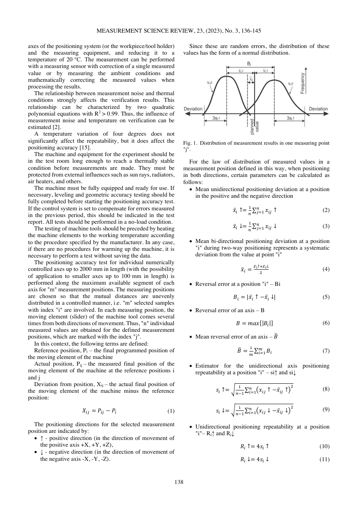
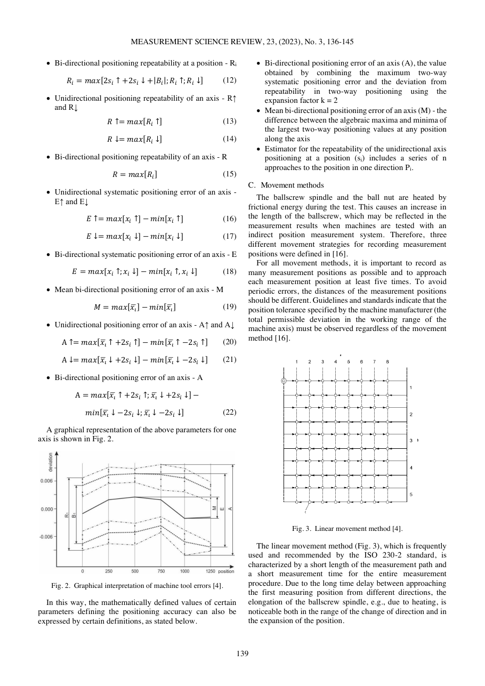
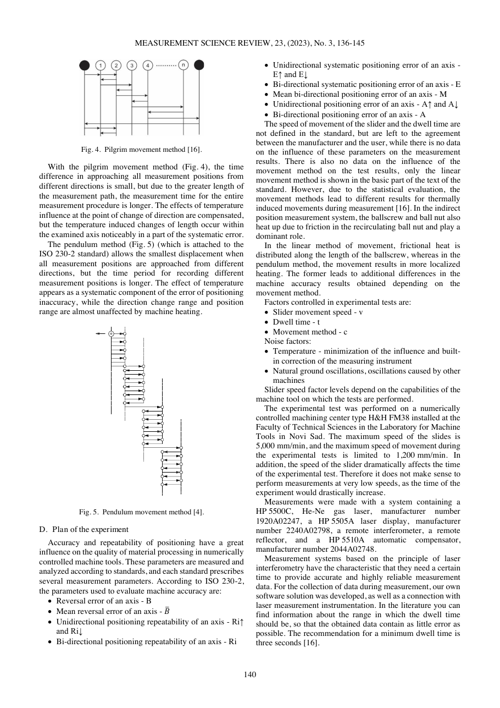

# 번역: 이동 방식이 공작기계 위치 정확도 분석 결과에 주는 영향

- 원제: The Influence of the Movement Method on the Results of Machine Tool Positioning Accuracy Analysis
- 저자: Alexander Budimir, Slobodan Tabaković(교신), Milan Zeljković. 노비사드 대학교 기술과학부 생산공학과(세르비아)
- 서지: Measurement Science Review 23(3), 136-145쪽, 2023. doi:10.2478/msr-2023-0018. CC BY-NC-ND 4.0
- 원문: 같은 폴더의 `Budimir2023_MSR_movement_method_positioning_accuracy.pdf` (10쪽)
- 번역 범위: 전문(초록, 본문, 그림과 표 캡션, 표 수치). 참고문헌은 원문 그대로 둔다.
- 번역 메모: 수식은 원문 표기를 그대로 옮겼다. 원문 식 (8), (9)의 평균 기호 아래 첨자, 식 (22) 뒷부분은 원문 인쇄 그대로이며 오타로 보이는 곳은 [역주]로 표시했다. 2023년 2월 2일 접수, 2023년 6월 26일 채택.

---

## 초록

공작기계를 개선하고, 그래서 산업 생산을 개선하려면, 가공물과 기계 자체의 여러 치수에 맞추면서도 높은 가공 정확도가 필요하다. 그 결과, 시험 절차의 개선과 위치 정확도 결과의 분석은 현대 생산공학의 중요한 연구 과제다. 이 논문은 위치 정확도 표준 시험의 변수 선택이 측정 결과에 주는 영향을, 작업 공간과 기계 크기라는 관점의 기계 특성과 관련지어 알아내려고 한 연구 결과를 보인다. 이렇게 하면 기존 표준 안에서, 기계의 기하 특성과 시험 조건에 따라 알맞은 시험 변수를 고를 수 있다.

핵심어: ISO 230-2, 공작기계, 위치 정확도, 이동 전략, NC 기계.

## 1. 서론

정밀공학 이론의 발전은 생산의 품질 관리 효율을 높이고, 마이크로, 메소, 매크로 수준의 가공 기술을 개발하는 과정에서 가공 정확도를 보장하는 데 중요한 역할을 한다. 그래서 첨단 산업의 새 발명이 요구하는 좁은 공차를 만족하면서 서브마이크론 정확도로 가공할 수 있는 특수 기계의 필요가 커지고 있다 [1].

투자는 적게 하면서 높은 정확도의 부품을 원하는 수요가 늘어, 기존 자원을 최대한 써야 하게 되었다. 검증과 보상은 공작기계(MT)의 정확도를 높여 능력을 늘리는 효과적인 방법이다. MT 정확도는 가공 조건, 공구, 환경 조건, 기계 설계와 부품, 조립 과정 같은 여러 오차원에 영향을 받는다. 검증은 MT 시스템 오차, 곧 기하 오차가 운동 제어 부품에 주는 영향을 찾아내려는 시도다. 이 오차는 천천히 변하며, 하중이 없을 때도 가공물과 공구 사이에 차이를 만든다 [2].

수치 제어 공작기계의 각 축의 정확도 상태, 그래서 앞으로의 생산 품질을 평가하는 바탕은 위치 정확도 시험이다 [3]. 위치 정확도 시험 절차는 많은 국가, 국제 표준 [4]-[7]과 전문 단체의 권고 [8]로 정해져 있다. 이 시험 결과는 현대 공작기계 제어 시스템에서 오차를 수치로 보상하는 데 쓰인다 [9]. 지금까지 공작기계 위치 정확도 시험 절차를 개선하려는 연구가 많이 이루어졌다. 주로 측정 장비의 각 구성 요소가 결과에 주는 영향 분석 [10]과, 그것을 공작기계 교정에 적용하는 것 [11]이다.

이 논문은 노비사드 기술과학부에서 측정 변수가 위치 정확도 결과에 주는 영향을 살피려고 한 연구의 한 부분을 설명한다. 이 논문은 이동 속도와 이동 방식, 그리고 시험 위치에서 머무는 시간(정지 시간)이 ISO 230-2 표준에 따른 시험 결과의 특성 변수에 주는 영향을 분석한다. 이 변수들은 위치 정확도의 정량 값을 정하는 데 핵심이다. 그러나 표준은 그 한계값도, 치수, 용도, 특성이 다른 공작기계에 쓸 권장값도 정하지 않는다. 이 연구는 크기가 다른 기계에 대해, 최소 시험 시간으로, ISO 230-2에 맞게 위치 정확도 시험을 하고 보조 운동 요소의 특성 오차를 정할 수 있게 하는 권고를 만드는 것을 목표로 한다.

## 2. 수치 제어 공작기계의 시험 방법

[12]에 따르면 정확도, 반복정밀도, 분해능의 개념과 차이를 분명히 해야 한다.

- 정확도는 실제값과 공칭값의 차이다. "오차"라고도 한다. 통계적 정확도는 측정값의 평균으로 잰다.
- 반복정밀도는 우연 오차원 때문에 같은 위치 값에서 생기는 편차의 범위다.

일부 문헌에서는 반복정밀도를 정밀도(precision)라고 부른다. 그러나 일반적인 뜻에서 정밀도는 정확도와 반복정밀도를 함께 포함하는 정성적 측면을 말한다.

문헌에는 공작기계 오차의 분류가 여럿 있다 [13]. 계통 오차와 우연 오차에 바탕을 둔다. 더 넓은 분류로는 다음이 있다.

- 기하 오차와 운동학 오차
- 열로 생기는 오차
- 가공력으로 생기는 오차
- 소재 고정(클램핑)으로 생기는 오차
- 운전 시스템 오차

공작기계 기하 정확도 시험의 한 부분은 하중 없는 상태에서 간단한 위치 결정 시험을 여러 번 해 정확도와 반복정밀도를 다룬다. 표준은 측정 방법을 정하고 직선 축과 회전 축의 허용 공차를 준다.

기하 정확도 시험의 두 번째 묶음은 목표점 여러 개를 정하고, 각 목표점에 여러 번 접근해 정확도와 반복정밀도를 재는 절차다. 결과는 평면도, 평행도, 직선 축의 직각도, 회전 축의 동심도 오차다. 이 오차는 레이저 간섭계, 시준기, 교정된 자 같은 높은 정확도의 장치와 게이지로 재므로 측정이 간단하다.

### A. 표준과 권고

공작기계 정확도와 반복정밀도의 시험과 분석을 일반화해 표준화하려고 몇몇 국제 표준이 만들어졌다. 가장 중요한 것은 ISO 230-2, JISB6201-1993, VDI/DGQ 3441, ASME B5.54다. 이 표준들은 밀링, 선반, 방전가공 기계의 직선 축과 회전 축에 대해, 정확도와 반복정밀도를 계산하는 시험 절차와 통계 변수를 정한다. 그러나 표준 사이에 큰 차이가 있다. 특히 기계 정확도를 정하는 데 필요한 목표 위치 수와 측정 횟수가 다르다.

그래서 한 기계에 주어진 위치 정확도와 반복정밀도 값은 어떤 표준을 썼는지에 따라 달라질 수 있다. 모든 표준이 똑같이 유효하므로, 표준끼리 어떻게 다르고 계산값끼리 어떻게 비교되는지 아는 것이 도움이 된다 [14].

ISO 230-2는 가장 널리 쓰이는 표준 가운데 하나로, 내용상 운전 중인 가장 흔한 기계, 곧 중형과 경량 기계를 대상으로 한다. 이 표준으로 시험할 때 다음 조건을 지켜야 한다.

- 고른 온도: 모든 시험은 20 °C에서 한다.
- 예열 주기: 모든 시험은 기계의 실제 운전 조건을 흉내 내는 예열 주기를 포함한다.
- 한 방향 및 두 방향 측정: 모든 시험은 목표 위치에 한 방향 접근과 두 방향 접근을 포함한다.
- 목표 위치 수: 직선 축은 미터당 최소 5개 목표 위치(2000 mm 이하 축), 회전 축은 90°마다 최소 3개 목표 위치가 필요하다. [역주: 원문 "minimum of 3 target positions at 90"를 그대로 옮겼다.]
- 목표 위치당 측정 횟수: 각 시험은 목표 위치마다, 이동 방향마다 최소 5회가 필요하다.

일본 산업 표준 JISB6201은 정확도와 반복정밀도를 비통계적으로 계산하며 ISO 230-2와 크게 다르다. 예를 들어 각 축을 시험할 때 축 전체에서 목표 위치 3개, 곧 양 끝점과 축 방향 경로의 가운데 점을 쓴다. 목표점으로 위치를 잡을 때 슬라이드는 한 방향으로만 움직이고, 실제 위치를 레이저 간섭계로 재서 제어 시스템(CNC)의 위치 읽음값과 비교한다. 오차는 두 값의 차이다 [5].

JISB6201 표준으로 정확도와 반복정밀도를 평가하면 ISO 230-2보다 수치가 작게 나온다. 목표 위치 수가 적고 측정값을 비통계적으로 계산하기 때문이다. 그러나 공작기계의 운전 오차는 통계 분포를 따르므로, 실제 공작기계 정확도(넓은 뜻의 정확도) 면에서는 ISO 점수가 훨씬 쓸모 있다.

ISO 230은 기계 종류별로 더 구체적인 시험을 정하는 여러 ISO 표준의 기본이다. 그래서 ISO 230-1은 평면도와 진직도의 일반 개념을 설명하고 기본 측정 방법을 정한다. ISO 230-2는 앞에서 말했듯 정확도와 반복정밀도를 정한다. CNC 선반(ISO 13041), 드릴링과 밀링용 머시닝 센터(ISO 10791), 브리지형 밀링 기계(ISO 8636), 와이어 방전가공기(ISO 14137), 형조 방전가공기(ISO 11090), 수직 연삭 주축 평면 연삭기(ISO 1985) 등 여러 기계 종류에 대한 ISO 표준이 있다.

### B. ISO 230-2

ISO 230-2 표준은 기계 축 하나하나를 직접 측정해 수치 제어 공작기계의 위치 정확도와 반복정밀도를 시험하고 평가하는 방법을 정한다. 이 방법은 직선 축과 회전 축에 똑같이 적용된다. ISO 230의 이 부분은 형식 시험, 공작기계 인수 시험, 비교 시험, 주기 점검, 기계 부정확도 보상 등에 쓸 수 있다.

표준의 시험 조건은 환경 조건, 기계 상태, 올바른 시험 절차를 정한다.

실험실 조건에서 측정은 측정 대상 온도 20 °C에서 한다. 필요한 주위 온도를 보장할 수 없으면, 위치 결정 시스템(또는 공작물/공구 홀더) 축과 측정 장비 사이 팽창 계수 차이를 보정해 20 °C로 환산하는 방식으로 측정 결과를 맞춘다. 측정은 측정값 하나하나를 보정하는 측정 센서로 하거나, 주위 조건을 재서 결과 처리 때 측정값을 수학적으로 보정하는 방식으로 할 수 있다.

측정 잡음과 열 조건의 관계는 검증 결과에 크게 영향을 준다. 이 관계는 R² > 0.99인 2차 다항식 두 개로 나타낼 수 있다. 그래서 측정 잡음과 온도가 검증에 주는 영향을 추정할 수 있다 [2].

4도의 온도 변화는 반복정밀도에는 크게 영향을 주지 않지만 위치 정확도에는 영향을 준다 [15].

실험에 쓸 기계와 장비는 측정 전에 열적으로 안정될 만큼 시험실에 충분히 오래 두어야 한다. 햇빛, 난방기, 온풍기 같은 외부 영향에서 보호해야 한다.

기계는 완전히 갖추어져 사용할 준비가 되어 있어야 한다. 필요하면 위치 정확도 시험 전에 수평 맞춤과 기하 정확도 시험을 모두 끝내야 한다. 제어 시스템이 이전에 잰 오차를 보상하도록 설정되어 있으면 시험 보고서에 적어야 한다. 모든 시험은 하중 없는 상태에서 한다.

공작기계 시험 전에, 제조사가 정한 절차에 따라 기계 요소를 운전 온도까지 데워야 한다. 어떤 경우든 예열 절차가 없으면, 자료를 저장하지 않는 시험을 한 번 해야 한다.

길이 2000 mm 이하(100 mm 이하의 짧은 축에도 적용 가능) 수치 제어 축의 위치 정확도 시험은 각 축에서 쓸 수 있는 가장 긴 구간을 따라 "m"개 측정 위치에서 한다. 측정 위치는 서로의 간격이 통제된 방식으로 고르지 않게 나뉘도록 고른다. 곧 지수 "i"로 표시한 "m"개 표본이 쓰인다. 각 측정 위치에 기계의 움직이는 요소(슬라이더)가 이동의 두 방향에서 여러 번 온다. 그래서 정한 측정 위치마다 "n"개의 개별 측정값을 얻고, 이는 지수 "j"로 표시한다.

이 맥락에서 다음 용어를 정의한다.

- 기준 위치 Pi: 기계 움직이는 요소의 최종 프로그램 위치
- 실제 위치 Pij: 기준 위치 i와 j에서 잰 움직이는 요소의 최종 위치
- 위치 편차 Xij: 움직이는 요소의 실제 최종 위치에서 기준 위치를 뺀 값

  Xij = Pij − Pi  (1)

정한 측정 위치에서 위치 결정 방향은 다음과 같이 표시한다.

- ↑: 양의 방향(양의 축 +X, +Y, +Z 이동 방향)
- ↓: 음의 방향(음의 축 −X, −Y, −Z 이동 방향)

우연 오차이므로, 이 값들의 분포는 정규분포 꼴이다.

그림 1. 측정점 "j" 하나에서 측정 결과의 분포.

이렇게 정한 측정 위치에서 측정값의 분포 법칙에 대해, 두 방향으로 위치를 잡을 때 다음 변수를 계산할 수 있다.

- 한 위치에서 양의 방향과 음의 방향의 평균 단방향 위치 편차

  x̄i↑ = (1/n) Σ(j=1..n) xij↑  (2)

  x̄i↓ = (1/n) Σ(j=1..n) xij↓  (3)

- 위치 "i"에서 양방향 위치 결정 때의 평균 양방향 위치 편차. 점 "i"에서 값의 계통 편차를 나타낸다.

  x̄i = (x̄i↑ + x̄i↓) / 2  (4)

- 위치 "i"의 역전 오차 Bi

  Bi = |x̄i↑ − x̄i↓|  (5)

- 축의 역전 오차 B

  B = max[|Bi|]  (6)

- 축의 평균 역전 오차 B̄

  B̄ = (1/m) Σ(i=1..m) Bi  (7)

- 위치 "i"의 단방향 축 위치 반복정밀도 추정량 si↑, si↓

  si↑ = √( (1/(n−1)) Σ(i=1..n) (xij↑ − x̄ij↑)² )  (8)

  si↓ = √( (1/(n−1)) Σ(i=1..n) (xij↓ − x̄ij↓)² )  (9)

  [역주: 원문 표기 그대로다. 합의 지수는 j, 평균은 x̄i↑, x̄i↓로 읽어야 뜻이 맞는다.]

- 위치 "i"의 단방향 위치 반복정밀도 Ri↑, Ri↓

  Ri↑ = 4 si↑  (10)

  Ri↓ = 4 si↓  (11)

- 위치 "i"의 양방향 위치 반복정밀도 Ri

  Ri = max[2si↑ + 2si↓ + |Bi|; Ri↑; Ri↓]  (12)

- 축의 단방향 위치 반복정밀도 R↑, R↓

  R↑ = max[Ri↑]  (13)

  R↓ = max[Ri↓]  (14)

- 축의 양방향 위치 반복정밀도 R

  R = max[Ri]  (15)

- 축의 단방향 계통 위치 오차 E↑, E↓

  E↑ = max[xi↑] − min[xi↑]  (16)

  E↓ = max[xi↓] − min[xi↓]  (17)

- 축의 양방향 계통 위치 오차 E

  E = max[xi↑; xi↓] − min[xi↑, xi↓]  (18)

- 축의 평균 양방향 위치 오차 M

  M = max[x̄i] − min[x̄i]  (19)

- 축의 단방향 위치 오차 A↑, A↓

  A↑ = max[x̄i↑ + 2si↑] − min[x̄i↑ − 2si↑]  (20)

  A↓ = max[x̄i↓ + 2si↓] − min[x̄i↓ − 2si↓]  (21)

- 축의 양방향 위치 오차 A

  A = max[x̄i↑ + 2si↑; x̄i↓ + 2si↓] − min[x̄i↓ − 2si↓; x̄i↓ − 2si↓]  (22)

  [역주: 원문 인쇄 그대로다. ISO 230-2의 정의대로라면 뒤쪽 min 안의 첫 항은 x̄i↑ − 2si↑이어야 뜻이 맞는다.]

한 축에 대한 위 변수들의 그림 표현은 그림 2에 있다.

그림 2. 공작기계 오차의 그림 해석 [4]. (가로축: 위치 0~1250, 세로축: 편차 −0.006~0.006. 가운데 실선이 평균 양방향 편차, 바깥 점선들이 방향별 평균 ±2s 범위. 오른쪽에 M, E, A, 왼쪽에 Ri, Bi가 표시된다.)

이렇게 위치 정확도를 정의하는 일부 변수의 수학적 정의는 아래처럼 말로도 나타낼 수 있다.

- 축의 양방향 위치 오차(A): 최대 양방향 계통 위치 오차와 양방향 위치 결정 반복정밀도 편차를 확장 계수 k = 2로 합쳐 얻은 값
- 축의 평균 양방향 위치 오차(M): 축 위 어느 위치에서든 가장 큰 양방향 위치 값의 대수적 최대와 최소의 차이
- 위치에서 단방향 축 위치 결정 반복정밀도의 추정량(si): 위치 Pi로 한 방향에서 n번 접근한 계열을 포함한다.

### C. 이동 방식

볼스크루 축과 볼 너트는 시험 중 마찰 에너지로 데워진다. 그러면 볼스크루 길이가 늘어나고, 간접 위치 측정 시스템을 가진 기계를 시험할 때 측정 결과에 나타날 수 있다. 그래서 [16]에서 측정 위치를 기록하는 세 가지 이동 전략을 정했다.

모든 이동 방식에서, 측정 위치를 되도록 많이 기록하고 각 측정 위치에 최소 다섯 번 접근하는 것이 중요하다. 주기 오차를 피하려면 측정 위치 사이 간격을 서로 다르게 해야 한다. 지침과 표준은 이동 방식과 상관없이 제조사가 정한 위치 공차(기계 축 작업 범위의 총 허용 편차)를 지켜야 한다고 말한다 [16].

그림 3. 선형 이동 방식 [4]. (위 그림 2와 같은 쪽에 있다. 목표 1~8을 한 방향으로 차례로 지나간 뒤, 반대 방향으로 8~1을 지나는 왕복을 1~5회 되풀이한다.)

선형 이동 방식(그림 3)은 자주 쓰이고 ISO 230-2 표준이 권하는 방식으로, 측정 경로가 짧고 전체 측정 절차의 시간이 짧은 것이 특징이다. 첫 측정 위치에 서로 다른 방향으로 접근하는 사이의 시간 간격이 길기 때문에, 예를 들어 가열로 생긴 볼스크루 축의 늘어남이 방향 전환 범위와 위치 범위 모두에 눈에 띄게 나타난다.

그림 4. 순례(pilgrim) 이동 방식 [16]. (위 그림. 이웃한 목표 사이를 앞으로 가고 조금 되돌아오는 동작을 섞으며 축을 따라 나아간다.)

순례 이동 방식(그림 4)에서는 모든 측정 위치에 서로 다른 방향으로 접근하는 시간 차이가 작다. 그러나 측정 경로가 길어서 전체 측정 절차 시간이 더 길다. 방향 전환 지점에서 온도 영향은 상쇄되지만, 온도로 생긴 길이 변화는 시험 축 안에서 계통 오차의 일부로 눈에 띄게 나타난다.

진자(pendulum) 방식(그림 5, ISO 230-2 표준의 부속에 실려 있다)은 모든 측정 위치에 서로 다른 방향으로 접근할 때 변위가 가장 작다. 그러나 서로 다른 측정 위치를 기록하는 시간 간격이 더 길다. 온도 영향은 위치 결정 부정확도의 계통 오차 성분으로 나타나고, 방향 전환 범위와 위치 범위는 기계 가열에 거의 영향을 받지 않는다.

그림 5. 진자 이동 방식 [4]. (위 쪽의 아래 그림. 한 목표 위치에서 양쪽 방향 접근을 여러 번 되풀이한 뒤 다음 목표로 옮긴다.)

### D. 실험 계획

위치 결정의 정확도와 반복정밀도는 수치 제어 공작기계에서 재료 가공 품질에 큰 영향을 준다. 이 변수들은 표준에 따라 재고 분석하며, 각 표준은 여러 측정 변수를 정한다. ISO 230-2에 따르면 기계 정확도를 평가하는 변수는 다음과 같다.

- 축의 역전 오차 B
- 축의 평균 역전 오차 B̄
- 축의 단방향 위치 반복정밀도 Ri↑, Ri↓
- 축의 양방향 위치 반복정밀도 Ri
- 축의 단방향 계통 위치 오차 E↑, E↓
- 축의 양방향 계통 위치 오차 E
- 축의 평균 양방향 위치 오차 M
- 축의 단방향 위치 오차 A↑, A↓
- 축의 양방향 위치 오차 A

슬라이더 이동 속도와 정지 시간은 표준에 정해져 있지 않고 제조사와 사용자의 합의에 맡겨져 있다. 이 변수들이 측정 결과에 주는 영향에 대한 자료는 없다. 이동 방식이 시험 결과에 주는 영향에 대한 자료도 없다. 표준 본문의 기본 부분에는 선형 이동 방식만 나온다. 그러나 통계적 평가 때문에, 측정 중 열로 생기는 움직임에 대해 이동 방식마다 결과가 달라진다 [16]. 간접 위치 측정 시스템에서는 순환 볼 너트 안의 마찰로 볼스크루와 볼 너트도 데워지며, 이것이 지배적인 역할을 한다.

선형 이동 방식에서는 마찰열이 볼스크루 길이 전체에 퍼지는 반면, 진자 방식에서는 움직임이 더 국소적인 가열을 낳는다. 앞의 것은 이동 방식에 따라 얻는 기계 정확도 결과에 추가 차이를 만든다.

실험 시험에서 통제한 요인은 다음과 같다.

- 슬라이더 이동 속도 v
- 정지 시간 t
- 이동 방식 c

잡음 요인은 다음과 같다.

- 온도: 영향을 최소화하고 측정기의 내장 보정을 쓴다.
- 자연 지반 진동, 다른 기계가 일으킨 진동

슬라이더 속도 요인의 수준은 시험하는 공작기계의 능력에 따라 정한다.

실험 시험은 노비사드 기술과학부 공작기계 실험실에 설치된 H&H FM38 형 수치 제어 머시닝 센터에서 했다. 슬라이드의 최대 속도는 5,000 mm/min이고, 실험 시험 때 최대 이동 속도는 1,200 mm/min으로 제한했다. 또 슬라이더 속도는 실험 시험 시간에 크게 영향을 준다. 그래서 아주 느린 속도로 측정하는 것은 의미가 없다. 실험 시간이 크게 늘기 때문이다.

측정은 HP 5500C He-Ne 기체 레이저(제조 번호 1920A02247), HP 5505A 레이저 표시기(제조 번호 2240A02798), 원격 간섭계, 원격 반사경, HP 5510A 자동 보정기(제조 번호 2044A02748)로 이루어진 시스템으로 했다.

레이저 간섭 원리에 바탕을 둔 측정 시스템은 정확하고 믿을 만한 측정 자료를 주기까지 일정 시간이 필요하다는 특성이 있다. 측정 중 자료 수집을 위해 자체 소프트웨어와 레이저 측정 장비 연결을 개발했다. 문헌에서, 얻은 자료의 오차가 되도록 작게 하려면 정지 시간이 어느 범위여야 하는지에 대한 정보를 찾을 수 있다. 최소 정지 시간 권장값은 3초다 [16].

표준, 권고, 문헌에 따라 세 가지 이동 방식을 볼 수 있으며, 이미 2장 C절에서 설명했다.

이 논문에서는 이 요인들 사이의 상호작용을 다루지 않는다. 앞서 말한 요인들의 수준은 표 1에 있다.

표 1. 요인과 해당 수준 목록.

| 요인 | 수준 1 | 수준 2 | 수준 3 |
|---|---|---|---|
| v, 슬라이더 이동 속도 [mm/min] | 200 | 500 | 1200 |
| t, 정지 시간 [s] | 3 | 5 | 7 |
| c, 이동 방식 | 선형 | 순례 | 진자 |

앞서 정한 절차에 따라 실험 시험은 다음과 같이 했다.

- 측정은 ISO 230-2 표준의 요구에 따라 한다.
- 위치 정확도는 "X" 축 위에 서로 같은 간격으로 놓인 m = 8개 측정 위치에서 재고, 한 위치에서 모두 n = 6회 잰다.
- 측정은 실험 설정에서, 곧 정해진 요인 수준에서 5번 하여 통계 분석에 충분히 많은 결과를 얻는다.
- 그래서 표준에 따라 모두 9 x 5 = 45회 측정을 했다.
- 얻은 결과를 바탕으로, 표준에 따라 공작기계 위치 정확도 변수를 정한다.
- 그림 6과 그림 7은 머시닝 센터에 설치한 시험 장비를 보여 준다.
- 위치 정확도 변수는 다구치 방법에 따라 분석하고 분류한다. S/N 비 계산에는 "작을수록 좋다" 원칙을 골랐다.
- 실험에는 직교 배열 L9(3⁴) 다구치 배열을 쓴다.

그림 6. 실험 구성.

그림 7. 작업대 위의 간섭계와 반사경.

## 3. 결과

기계를 시험하는 과정의 원시 측정값은 10개 표에 6000개 수치가 들어 있으므로 논문에 싣지 않는다. 아래에서는 ISO 230-2에 따른 결과와 통계 분석을 준다.

표 2는 실험 설정별 변수의 S/N 비를 보여 준다.

변수 B(표 3, 그림 8), Bav(표 4, 그림 9), R(표 5, 그림 10), A(표 6, 그림 11)에 대한 요인 순위를 보인다.

표 2. 변수별 S/N 비.

| 실험 | B | Bav | R↑ | R↓ | R | E↑ | E↓ | E | M | A↑ | A↓ | A |
|---|---|---|---|---|---|---|---|---|---|---|---|---|
| 1 | -18.95 | -14.92 | -8.96 | -8.83 | -9.17 | -15.56 | -16.54 | -21.71 | -14.62 | -18.20 | -18.68 | -23.02 |
| 2 | -17.89 | -14.07 | -22.02 | -20.67 | -22.05 | -27.16 | -26.01 | -28.87 | -26.60 | -30.29 | -29.25 | -31.20 |
| 3 | -17.83 | -14.59 | -9.88 | -9.81 | -10.69 | -29.58 | -28.61 | -30.78 | -29.11 | -30.04 | -29.06 | -31.20 |
| 4 | -18.29 | -13.89 | -20.71 | -20.22 | -20.88 | -24.48 | -22.45 | -26.47 | -23.43 | -26.64 | -25.27 | -28.16 |
| 5 | -17.87 | -14.28 | -9.02 | -8.38 | -9.49 | -27.59 | -26.05 | -28.90 | -26.85 | -28.17 | -26.64 | -29.32 |
| 6 | -18.07 | -13.75 | -5.75 | -5.38 | -5.95 | -28.75 | -30.75 | -30.98 | -29.68 | -29.19 | -31.06 | -31.32 |
| 7 | -18.66 | -14.02 | -9.06 | -8.82 | -9.76 | -31.10 | -29.82 | -31.92 | -30.48 | -31.56 | -30.27 | -32.28 |
| 8 | -18.17 | -14.02 | -11.06 | -9.84 | -11.06 | -27.67 | -29.96 | -30.18 | -28.76 | -28.66 | -30.68 | -30.91 |
| 9 | -16.72 | -11.36 | -10.63 | -6.19 | -10.63 | -22.93 | -20.95 | -24.24 | -21.95 | -24.22 | -21.94 | -24.93 |

(역주: 원문에는 실험 1~9가 각각 어떤 v, t, c 수준 조합인지 표로 따로 주지 않았다. 표준 L9 배열을 썼다고만 적었다.)

- 평균값 편차 범위의 최대값 B [역주: 원문 소제목 표기 그대로다. 앞의 정의로는 "축의 역전 오차 B"다.]

표 3. B의 순위.

| 수준 | 1-v | 2-t | 3-c |
|---|---|---|---|
| 1 | -18.22 | -18.63 | -18.40 |
| 2 | -18.08 | -17.98 | -17.63 |
| 3 | -17.85 | -17.54 | -18.12 |
| Δ | 0.37 | 1.09 | 0.77 |
| 순위 | 3 | 1 | 2 |

그림 8. 변수 B의 S/N 응답 그림.

- 축의 평균 역전 오차 Bav

표 4. Bav의 순위.

| 수준 | 1-v | 2-t | 3-c |
|---|---|---|---|
| 1 | -14.53 | -14.28 | -14.23 |
| 2 | -13.97 | -14.12 | -13.11 |
| 3 | -13.13 | -13.23 | -14.29 |
| Δ | 1.40 | 1.05 | 1.19 |
| 순위 | 1 | 3 | 2 |

그림 9. 변수 Bav의 S/N 응답 그림.

- "X" 축의 양방향 위치 반복정밀도

표 5. R의 순위.

| 수준 | 1-v | 2-t | 3-c |
|---|---|---|---|
| 1 | -13.97 | -13.27 | -8.73 |
| 2 | -12.11 | -14.20 | -17.85 |
| 3 | -10.49 | -9.09 | -9.98 |
| Δ | 3.49 | 5.11 | 9.13 |
| 순위 | 3 | 2 | 1 |

그림 10. 변수 R의 S/N 응답 그래프.

- "X" 축의 양방향 위치 오차 A

표 6. A의 순위.

| 수준 | 1-v | 2-t | 3-c |
|---|---|---|---|
| 1 | -28.47 | -27.82 | -28.42 |
| 2 | -29.60 | -30.48 | -28.10 |
| 3 | -29.38 | -29.15 | -30.93 |
| Δ | 1.12 | 2.66 | 2.84 |
| 순위 | 3 | 2 | 1 |

그림 11. 변수 A의 S/N 응답 그림.

S/N 변수의 순위를 보면, 평균값 편차의 최대 범위(B)에는 정지 시간이, 평균값 편차 범위의 평균(Bav)에는 슬라이더 이동 속도가, 나머지 모든 변수에는 이동 방식이 가장 큰 영향을 준다.

변수 B, Bav, R, A에 대한 ANOVA 분석은 표 7~표 10에 있다.

표 7. 변수 B의 ANOVA 표.

| 요인 | 자유도 | 제곱합 | 분산 | F 검정 | 비율 |
|---|---|---|---|---|---|
| v | 2 | 0.1813 | 0.0906 | 1.6653 | 7% |
| t | 2 | 1.4459 | 0.7229 | 13.2838 | 59% |
| c | 2 | 0.7163 | 0.3581 | 6.5808 | 29% |
| 오차 | 2 | 0.1088 | 0.0544 | | 4% |
| 합계 | 8 | 2.4523 | | | |

표 8. 변수 Bav의 ANOVA 표.

| 요인 | 자유도 | 제곱합 | 분산 | F 검정 | 비율 |
|---|---|---|---|---|---|
| v | 2 | 0.8361 | 0.4181 | 6.5973 | 38% |
| t | 2 | 0.5080 | 0.2540 | 4.0085 | 23% |
| c | 2 | 0.7262 | 0.3631 | 5.7301 | 33% |
| 오차 | 2 | 0.1267 | 0.0634 | | 6% |
| 합계 | 8 | 2.1972 | | | |

표 9. 변수 R의 ANOVA 표.

| 요인 | 자유도 | 제곱합 | 분산 | F 검정 | 비율 |
|---|---|---|---|---|---|
| v | 2 | 8.0452 | 4.0226 | 0.8073 | 11% |
| t | 2 | 12.0672 | 6.0336 | 1.2109 | 16% |
| c | 2 | 45.9767 | 22.9884 | 4.6136 | 60% |
| 오차 | 2 | 9.9655 | 4.9827 | | 13% |
| 합계 | 8 | 76.0545 | | | |

표 10. 변수 A의 ANOVA 표.

| 요인 | 자유도 | 제곱합 | 분산 | F 검정 | 비율 |
|---|---|---|---|---|---|
| v | 2 | 13.0751 | 6.5375 | 0.0279 | 2% |
| t | 2 | 58.8943 | 29.4472 | 0.1255 | 9% |
| c | 2 | 141.9110 | 70.9555 | 0.3024 | 21% |
| 오차 | 2 | 469.3242 | 234.6621 | | 69% |
| 합계 | 8 | 683.2045 | | | |

표 7~표 10은 F 검정으로 각 요인의 유의성을 보인다. 다구치 방법으로 얻은 결과는 대체로 ANOVA 분석 결과와 일치한다.

F 값이 F(0.05, 2, 8) = 4.46보다 큰 요인이 유의하다.

## 4. 논의

수행한 연구와 일련의 실험 측정을 바탕으로, 측정 변수 선택이 결과에 주는 영향에 대해 결론을 낼 수 있다.

슬라이더 이동 속도, 정지 시간, 이동 방식을 고려 대상 요인으로 삼았다. 표준은 이들 어느 것에도 미리 정한 값이나 한계를 주지 않는다. 실험은 다구치 방법으로 계획했다. 측정 횟수를 줄이면서 이 세 요인이 출력 변수에 주는 영향의 전체 그림을 얻을 수 있기 때문이다. 시험 변수 값은 이전 경험과, 기하 특성상 경량과 중형으로 분류되는 공작기계에 알맞을 것으로 예상되는 값에 따라 골랐다.

시험 결과, 이동 방식의 선택은 위치 정확도를 정하는 다음 변수에 가장 큰 영향을 준다.

- 축의 단방향 위치 반복정밀도 R↑, R↓
- 축의 양방향 위치 반복정밀도 R
- 축의 단방향 계통 위치 오차 E↑, E↓
- 축의 양방향 계통 위치 오차 E
- 축의 평균 양방향 위치 오차 M
- 축의 단방향 위치 오차 A↑, A↓
- 축의 양방향 위치 오차 A

정지 시간은 축의 역전 오차 B에 가장 큰 영향을 준다.

슬라이더 이동 속도는 축의 평균 역전 오차 Bav에 가장 큰 영향을 준다.

다구치 방법으로, 얻은 변수들 사이에 유의한 차이가 있음을 찾았다.

ANOVA 분석은 요인들이 우연 오차, 곧 변수 B, Bav, R, R↑에 유의한 영향을 준다는 것을 보였다. 살펴본 요인 가운데 슬라이더 속도가 가장 큰 영향을 주며, 이는 다구치 방법 분석으로도 확인되었다.

앞서 분석한 요인들과 달리, 변수 A, A↑, A↓, M, E, E↓, R↓에는 유의한 영향이 없었다.

전체적으로 보면 이동 방식이 일반적으로 가장 큰 영향을 준다. 표 11은 위치 정확도를 나타내는 12개 변수 모두에 대해, 다구치 방법 "작을수록 좋다"에 따라 이동 방식이 결과에 준 영향을 가장 좋음과 가장 나쁨으로 정리한다. 표 11에서, 가장 좋은 결과는 진자 방식으로 움직일 때 얻고, 선형과 순례 이동 방식은 비슷하게 나쁜 영향을 준다고 결론지을 수 있다.

표 11. 이동 방식별 측정에서 얻은 변수 결과의 최악과 최선 분포 행렬.

| 결과 | 선형 | 순례 | 진자 |
|---|---|---|---|
| 최악 | 5 | 7 | 0 |
| 최선 | 1 | 3 | 8 |

보인 결과의 분석을 바탕으로, 우연 오차는 슬라이더 이동 속도 변수와 정지 시간에 영향을 받는다고 결론지을 수 있다. 동시에 정지 시간은 축의 역전 오차(B)에 더 큰 영향을, 슬라이더 이동 속도는 축의 평균 역전 오차(Bav)에 더 큰 영향을 준다. 통제하지 못한 변수의 영향이 비교적 작으므로(4%와 6%), 언급한 변수들이 유의하다고도 결론지을 수 있다. 최대 정지 시간과 최소 정지 시간에서 평균값 편차 범위의 상대 차이는 5.866%이고, 슬라이더 최대 이동 속도와 최소 이동 속도에서 평균값 편차 범위의 평균의 상대 차이는 9.596%다.

고려한 변수 가운데 이동 주기는 계통 성격의 오차, 곧 축의 양방향 계통 위치 오차(E)와 축의 평균 양방향 위치 오차(M)에 가장 큰 영향을 준다. 동시에 부정확도가 가장 작은 것은 진자 주기로 움직일 때이고, 다른 두 이동 주기 사이에는 정확도 면에서 유의한 차이가 없다.

이번 경우 시험은 작업 공간이 비교적 작고, 미끄럼 기술에 바탕을 둔 안내면과 슬라이더, 예압된 볼스크루를 가진 중형 기계에서 했다. 이런 특징 때문에 이 기계는 시험 변수의 영향을 알아내기에 알맞다. 시험 중 관찰한 출력 위치 오차에 대해, 가장 작은 측정 오차는 진자 방식을 쓰고, (계의 기계적 안정을 위해) 정지 시간을 더 길게 하고, (이 변수가 결과에 가장 적게 영향을 주는) 최소 이동 속도로 할 때 얻는다고 결론지을 수 있다. 반면 이 변수 선택은 시험 시간을 약 4배 늘리면서 결과 값에는 비교적 적은 효과를 준다. 그래서 중형과 대형 작업 공간을 가진 기계의 교정에는 비경제적이지만, 메소와 마이크로 기계에는 쓸모 있다.

수행한 시험은, 무작위 오차와 계통 오차의 영향을 모두 포함하는 변수인 한 축의 양방향 위치 오차 A에 대해, 고려한 변수들이 유의하지 않고 통제하지 못한 변수의 영향이 훨씬 크다는 결론을 낸다. 제시한 시험은, 쓰인 표준이 왜 이 변수들의 한계에 대한 권고를 담지 않고 그 선택을 시험자의 솜씨에 맡기는지에 대한 답을 준다고 결론지을 수 있다.

또 서로 다른 방식, 이동 속도, 정지 시간의 시험 결과를 보면, 대형 기계뿐 아니라 소형과 마이크로 기계를 시험할 때 써야 할 변수에 대해 결론을 낼 수 있다. 앞으로의 연구는 진자 이동 시험이 더 알맞은 기계 크기의 한계를 확인하고, 이동 속도와 정지 시간의 권장값을 주어야 한다. 한편, 연구가 보여 주었듯 선형 이동 방식이 더 알맞은 대형 기계에 대해서는, 기계의 설계와 운용 특성에 맞는 최대 이동 속도와 최소 정지 시간을 정하는 것이 기대된다.

## 5. 결론

해당 위치 정확도 변수로 나타낸 수치 제어 공작기계의 정확도는 기계를 고르는 가장 중요한 기준 가운데 하나다. 가공물 생산 품질은 기계의 현재 상태에 크게 달려 있으며, 이는 정확도를 분석해 평가할 수 있다.

국제, 국가 표준에 바탕을 둔 시험 절차는, 정해진 절차를 쓴 정기 점검과 교정 과정을 통해, 특정 기계 구조와 내장 요소에 대해 가장 높은 수준의 정확도를 보장하는 데 도움이 된다.

## 참고문헌 (원문 그대로)

[1] Ibrahim, S. M., Saedon, J., Radzi, A., Omar, R. (2019). Improvement of positional accuracy of developed dicing machine. International Journal of Mechanical Engineering and Robotics Research, 8 (5), 680-684. http://dx.doi.org/10.18178/ijmerr.8.5.680-684

[2] Aguado, S., Pérez, P., Albajez, J. A., Velázquez, J., Santolaria, J. (2022). Inaccuracy of machine tools due to verification conditions. Measurement, 188, 110629. https://doi.org/10.1016/j.measurement.2021.110629

[3] Kureková, E., Halaj, M., Palenčár, R.. (2011). The positional deviation in two numerically controlled axes. In Measurement 2011: Proceedings of the 8th International Conference. Slovakia: IMS SAS, 88-91. ISBN 9788096967247.

[4] ISO. (2014). Test code for machine tools – Part 2: Determination of accuracy and repeatability of positioning of numerically controlled axes. Standard 230-2:2014.

[5] Japanese Standards Association (JSA). (1980). Тest code for performance and accuracy of numerically controlled machine tools. Standard JIS B 6330.

[6] China National Standards. (2016). Test code for machine tools -- Part 2: Determination of accuracy and repeatability positioning numerically controlled axes. Standard GB/T 17421.2-2016.

[7] АSМЕ. (2005). Methods for performance evaluation of computer numerically controlled machining centers. Standard B5.54 - 2005.

[8] Deutsches Institut fur Normung E.V. (DIN). (1977). Statistical testing of the operational and positional accuracy of machine tools. Standard VDI/DGQ 3441.

[9] Sokolov, V., Basalaev, K. (2014). Laser measurements based for volumetric accuracy improvement of multi-axis systems. Physics Procedia, 56, 1297-1304. https://doi.org/10.1016/j.phpro.2014.08.054

[10] Aguado, S., Santolaria, J., Samper, D., Aguilar, J. J. (2013). Influence of measurement noise and laser arrangement on measurement uncertainty of laser tracker multilateration in machine tool volumetric verification. Precision Engineering, 37, 929-943. https://doi.org/10.1016/j.precisioneng.2013.03.006

[11] Linares, J.-M., Chaves-Jacob, J., Schwenke, H., Longstaff, A., Fletcher, S., Flore, J., Uhlmann, E., Wintering, J. (2014). Impact of measurement procedure when error mapping and compensating a small CNC machine using a multilateration laser interferometer. Precision Engineering, 38, 578-588. https://doi.org/10.1016/j.precisioneng.2014.02.008

[12] López de Lacalle, L. N., Lamikiz, A. (eds.). (2008). Machine Tools for High Performance Machining. Springer. https://doi.org/10.1007/978-1-84800-380-4

[13] Mekid, S. (ed.) (2008). Introduction to Precision Machine Design and Error Assessment. CRC Press. ISBN 978-0849378867.

[14] Mullany, B. (2007). Evaluation and comparison of the different standards used to define the positional accuracy and repeatability of numerically controlled machining center axes. Ph.D. Dissertation, University of North Carolina, Charlotte, US.

[15] Artimon, F. P. G., Stochioiu, C., Popan, G. (2021). Thermal influence on positioning error and position repeatability at a machining center axes. UPB Scientific Bulletin, Series D: Mechanical Engineering, 83 (2), 181-188. ISSN 1454-2358.

[16] Weck, M., Brecher, C. (2013). Werkzeugmaschinen 5: Messtechnische Untersuchung und Beurteilung, dynamische Stabilität. Springer. https://doi.org/10.1007/978-3-540-32951-0
