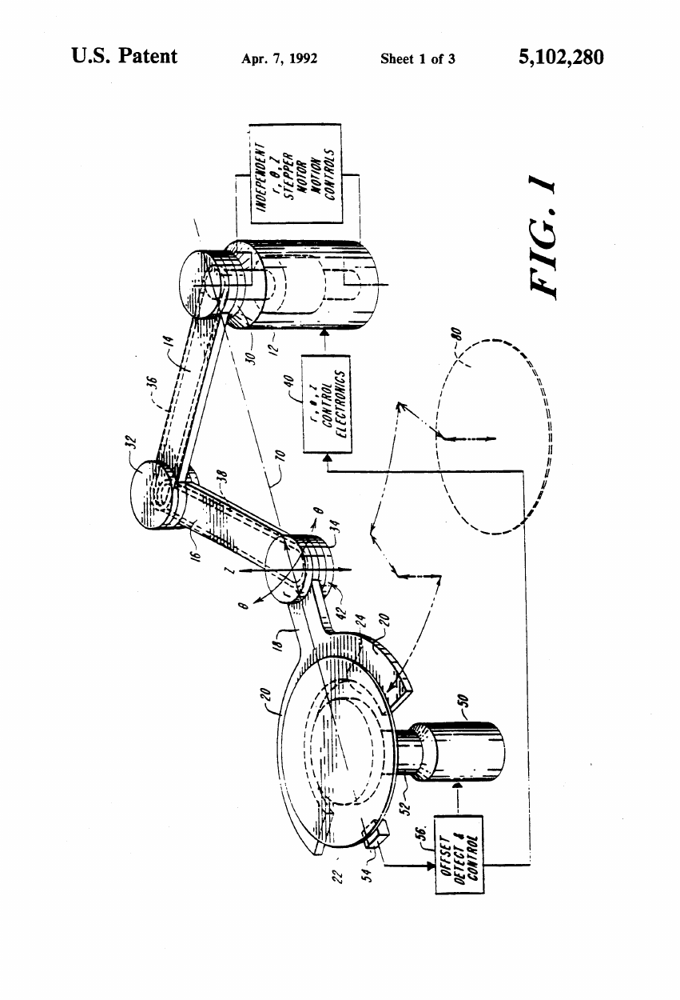
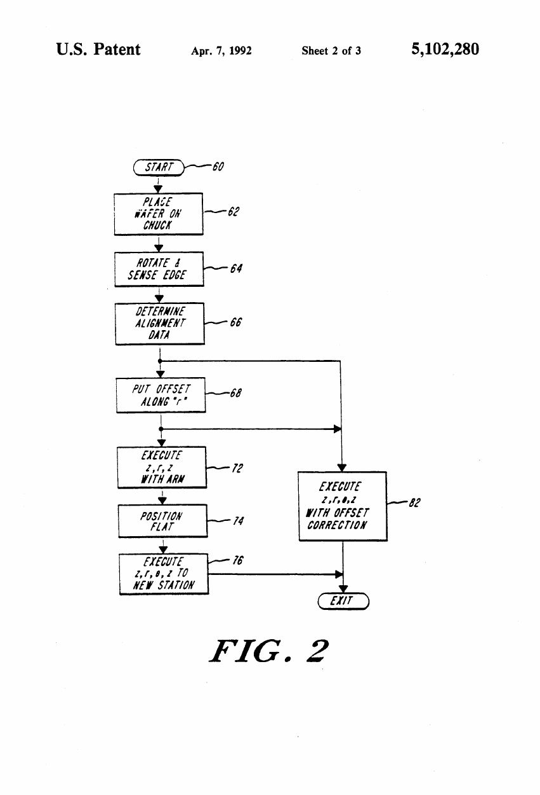
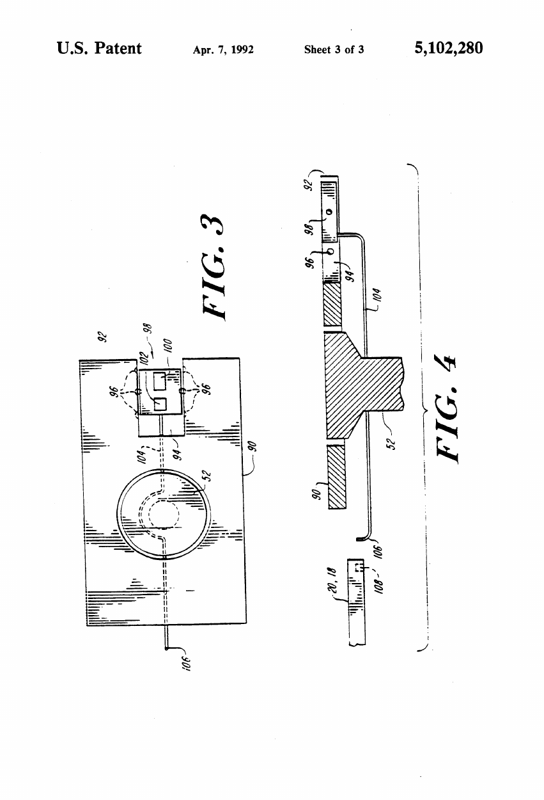

# US5102280A 로봇 프리얼라이너 (Robot prealigner) 번역

번역 범위: 전문 (서지, 요약, 발명의 상세한 설명, 도면 설명, 청구항 28개)

- 원문 파일: 같은 폴더의 `US5102280A_ADE_Robot_prealigner.pdf` (9쪽, 도면 3장)
- 원문 텍스트: Google Patents 본문 텍스트(https://patents.google.com/patent/US5102280A/en)와 `pdftotext -layout` 결과를 대조했다. 공보 스캔본의 OCR 오자(예: "seniconduc tor", "Clains")는 Google Patents 텍스트로 바로잡았다.
- 원문의 오타(청구항의 "sysyem", "staight", "accomodate", "th legs" 등)는 뜻대로 옮겼다.

## 서지

| 항목 | 내용 |
|---|---|
| 공보 번호 | US 5,102,280 (A) |
| 등록일 | 1992-04-07 |
| 출원 번호 | 320,276 |
| 출원일 | 1989-03-07 |
| 발명자 | Noel S. Poduje (Needham Heights, MA), Roy S. Mallory (Bedford, MA) |
| 권리자 | ADE Corporation, Newton, MA |
| 국제 분류 | B65G 47/24 |
| 미국 분류 | 414/225, 414/744.5, 414/744.6, 414/749, 414/757, 414/783, 198/394 |
| 청구항 | 28개 |
| 도면 | 3장 |
| 심사관 | Sherman Basinger |
| 대리인 | Weingarten, Schurgin, Gagnebin & Hayes |

인용 문헌 (원문 그대로)

- U.S. PATENT DOCUMENTS: 3,694,741 9/1972 Abbe; 3,706,919 12/1972 Abbe; 3,771,051 1973 Abbe; 3,775,678 1/1973 Abbe; 3,775,679 1/1973 Abbe; 3,805,150 4/1974 Abbe; 3,812,424 5/1974 Abbe; 3,815,111 6/1974 Abbe; 3,986,109 10/1976 Poduje; 3,990,005 11/1976 Abbe et al.; 4,158,171 6/1979 Abbe et al.; 4,217,542 8/1980 Abbe et al.; 4,228,392 10/1980 Abbe et al.; 4,353,029 10/1982 Abbe et al.; 4,457,664 7/1984 Judell et al.; 4,619,575 10/1986 Summa et al.; 4,620,831 11/1986 Poncet et al.; 4,646,009 2/1987 Mallory; 4,692,695 9/1987 Poduje; 4,746,256 5/1988 Boyle et al.; 4,749,330 6/1988 Hine; 4,750,141 6/1988 Judell et al.; 4,789,294 12/1988 Sato et al.; 4,836,733 6/1989 Hertel et al.; 4,880,348 11/1989 Baker et al.
- FOREIGN PATENT DOCUMENTS: 1108668 9/1981 Canada; 659376 4/1979 U.S.S.R.
- (스캔 OCR이 흐린 번호는 Google Patents의 인용 목록과 대조해 확인했다. 미국 25건, 외국 2건 모두 일치한다.)

## 요약 (Abstract)

로봇 팔 위의 반도체 웨이퍼 같은 요소를 위한 정렬 스테이션이다. 회전 지지대와 에지 검출기를 쓴다. 둘이 함께 동작하여 웨이퍼를 회전 지지대에 올리고, 웨이퍼 정렬 상태를 검출하고, 웨이퍼를 움직여 정렬되게 한다. 정렬은 회전 지지대 위에서 하거나, 별도 스테이션으로 옮기면서 한다.

## 발명의 분야와 배경

이 발명은 요소를 다루는 로봇 팔 조작기, 그리고 로봇 팔 위의 물체를 미리 정한 위치로 정렬하는 수단에 관한 것이다.

로봇 팔은 물체를 한 곳에서 다른 곳으로 옮기는 데 점점 더 많이 쓰인다. 반도체 웨이퍼 처리에 로봇을 쓰는 예가 같은 권리자의 미국 출원 07/051,090(1987-05-15 출원, 현재 미국 특허 4,897,015)에 있다. 거기서 로봇 팔은 독립적으로 제어되는 반경, 원주, 높이 방향 운동으로 반도체 웨이퍼를 한 곳에서 다른 곳으로 옮긴다. 그러나 많은 용도에서, 로봇 팔이 옮기는 웨이퍼는 중심(도심)과 기준 표시(fiducial)에 대해 미리 정한 정렬 상태로 놓여야 한다.

## 발명의 간단한 요약

이 발명에서 로봇 팔은 정렬 스테이션과 함께 동작한다. 로봇 팔 위 웨이퍼(또는 다른 요소)의 방향을 미리 정한 정렬로 맞춘다. 그래서 로봇 팔이 웨이퍼를 이웃 스테이션에 원하는 방향으로 놓을 수 있게 한다.

구체적 구현에서 로봇 팔은 반경, 원주, 높이 운동(r, θ, z)을 각각 독립적으로, 서로 분리하여 제어하는 조작기를 가진다. 로봇 팔이 웨이퍼를 놓을 수 있는 범위 안에 회전 지지대가 있다. 회전 지지대에는 에지 검출기가 딸려 있어, 웨이퍼가 회전 지지대 위에서 돌 때 웨이퍼 가장자리 위치를 잰다.

로봇 팔은 r, θ, z 독립 명령을 실행하여 첫 위치에서 웨이퍼를 말단 장치(손)에 받친다. 그 다음 웨이퍼를 회전 지지대에 놓는다. 웨이퍼는 거기서 돌고, 가장자리가 에지 검출기 위를 지난다. 전자 회로가 가장자리 위치를 검출한다. 이 회로는 회전 지지대 위에서 웨이퍼를 정렬하려면 중심을 얼마나 옮겨야 하는지, 그리고/또는 웨이퍼 기준 표시를 미리 정한 자리에 두려면 어떻게 해야 하는지를 정한다.

첫째 경우, 로봇 팔을 조작하여 회전 지지대 위의 웨이퍼를 움직여 정렬을 확보하고, 기준 표시를 미리 정한 자리로 다시 둔다. 그 다음 로봇 팔이 웨이퍼를 다시 집어 미리 정한 정렬 상태로 다음 스테이션에 전달한다.

둘째 경우, 로봇 팔은 어긋남(misalignment)을 아는 상태로 웨이퍼를 집는다. 그리고 다음 스테이션에 전달하면서 그 어긋남을 보정한다.

## 도면의 간단한 설명

이 발명의 여러 특징은 아래의 예시 상세 설명과 도면에 더 자세히 나온다.

- 도 1: 이 발명에 따른 로봇 팔과 정렬 보조 장치의 사시도
- 도 2: 도 1 시스템의 동작
- 도 3: 서로 다른 웨이퍼에 맞추어 에지 센서 위치를 고를 수 있는 프리얼라이너 조립체의 평면도
- 도 4: 도 3 조립체의 단면도

## 상세한 설명

이 발명은 로봇 팔을 위한 정렬 보조 장치를 생각한다. 이 장치는 팔이 다루고 옮기는 반도체 웨이퍼 같은 요소의 정렬을 조정하여, 미리 정한 자리에 미리 정한 정렬로 전달할 수 있게 한다.

같은 권리자의 미국 출원 07/051,090(1987-05-15 출원, 현재 미국 특허 4,897,015, 여기에 참조로 포함)에는 도 1과 같은 종류의 로봇 팔이 나온다.

도 1에서 로봇 팔은 기본 지지대 12를 가진다. 여기서 바깥쪽으로 다리 여러 개짜리 로봇 팔이 외팔보로 뻗는다. 첫째와 둘째 팔 14, 16과 끝단 말단 장치 18이 있다. 반도체 웨이퍼를 다루는 실시예에서 말단 장치 18은 "Y"자 모양 끝을 가진다. 손가락 20이 반도체 웨이퍼 22를 받치고, 가운데 부분 24는 덮지 않고 비워 둔다. 그래서 웨이퍼를 여러 장비 위에 놓을 수 있다.

다리 14는 피벗 하우징 30을 통해 기본 부재 12와 이어진다. 다리 14와 16은 피벗 하우징 32로 회전 가능하게 이어진다. 다리 16과 손 18은 피벗 하우징 34로 이어진다. 하우징 32 안에 다리 16에 고정된 풀리가 있고, 지름은 정규화 단위 1이다. 벨트 36이 이 풀리를 감고, 하우징 30 안의 지름 2단위 풀리까지 이어진다. 하우징 32 안에는 다리 14에 고정된 지름 1단위 풀리도 있다. 여기에 벨트 38이 감기고, 이 벨트는 손 18에 고정된 지름 2단위 풀리를 감는다.

기본 부재 12에는 운동계 세 개가 있고, r θ z 제어 전자장치 40이 이를 각각 독립적으로 제어한다. 전자장치 40은 기본 부재 12 안의 각 운동계를 제어하여, 대략 42에 있는 축을 따라 독립된 r, θ, z 운동을 만든다.

r 방향 운동은 웨이퍼 22의 중심과 하우징 34, 30의 중심(회전축)을 지나는 직선을 따라 엄밀히 직선이다. 이 r 운동은 하우징 30 안의 지름 2단위 풀리를 고정한 채 다리 14를 하우징 30의 축에 대해 돌려서 얻는다. θ 운동은 하우징 30과 다리 14 전체를 한 덩어리로 돌려서 얻는다. z 운동은 하우징 30과 팔 14를 한 덩어리로 올리거나, 기본 부재 12를 지지대 위로 올려서 얻는다. 풀리 결합비와 배치 덕분에 손 18은 θ나 z 운동과 무관하게 엄밀한 r(반경) 운동을 한다. 또 θ와 z 운동도 기본 부재 12 안의 모터계가 다른 두 축과 독립된 운동으로 만든다.

받침대 50은 진공 척 52를 회전 가능하게 받친다. 웨이퍼 22를 진공 척 위에 올릴 수 있다. 진공 척은 손 18의 손가락 20 사이 영역 24에서 웨이퍼를 잡도록 놓인다. 로봇 팔의 r θ z 복합 운동으로 웨이퍼를 진공 척 위에 둔 뒤 팔을 내리면, 웨이퍼를 받치는 주체가 손 18에서 진공 척 52로 넘어간다.

정전 용량식이나 다른 방식의 에지 센서 54가 있다. 이 센서는 웨이퍼 22가 진공 척 52 위에서 돌 때 웨이퍼 가장자리 위치를 잰다. 이 위치 정보는 어긋남 검출 및 제어 회로 56으로 간다. 회로 56은 앞서 말한 미국 특허 4,457,664의 가르침에 따라, 진공 척 52 위 웨이퍼 22의 어긋남 크기와 각도를 정한다. 이것은 곧 웨이퍼를 처음 손에서 진공 척으로 넘길 때 손 18 위에서 웨이퍼가 얼마나 어긋나 있었는지와 같다.

첫째 경우, 이 정보는 도 2의 처리에 따라 웨이퍼 22를 진공 척 52 위에서 정렬하고, 미리 정한 정렬 상태로 손 18에 돌려주는 데 쓰인다.

도 2를 보면, 시작 상태 60에서 기본 부재 12 안의 운동계가 로봇 팔을 제어하여 단계 62에서 웨이퍼를 진공 척 52에 놓는다. 이어지는 단계 64에서 모터 지지대 50이 진공 척 52를 돌린다. 센서 54가 가장자리 위치를 재고, 전자장치 56이 이를 처리하여 단계 66에서 진공 척 52의 회전 중심에 대한 웨이퍼 중심의 위치를 알아낸다.

다음 단계 68에서 진공 척 52는 어긋남이 축 70을 따라 놓이도록 웨이퍼를 돌려 둔다. 축 70은 진공 척 중심과 하우징 30 중심을 지나는 축이다. 그 다음 단계 72에서 로봇 팔이 움직인다. 손 18이 웨이퍼를 집어 축 70을 따라, 곧 r 방향의 엄밀한 직선 운동으로 옮긴다. 그리고 웨이퍼 중심이 회전축 위에 오도록 진공 척 52 위에 다시 놓는다.

단계 64부터 68까지는 확인이나 오차 최소화를 위해 한 번 이상 되풀이할 수 있다.

그 다음 단계 74에서 웨이퍼 22의 기준 표시나 플랫 같은 표식을 미리 정한 자리에 둔다. 이어지는 단계 76에서 로봇 팔이 움직이고, 웨이퍼는 이제 미리 정한, 알려진 정렬로 손 18에 넘어간다. 기본 부재 12의 운동계가 만드는 r, θ, z 방향의 독립 제어되고 정량화된 정해진 걸음 수로, 웨이퍼 22를 스테이션 80 같은 다음 스테이션에 미리 정한 정렬로 다시 놓을 수 있다.

둘째 경우, 동작은 단계 66이나 68 뒤에 단계 82로 갈라질 수 있다. 단계 82에서는 웨이퍼 22를 진공 척 52 위에서 다시 정렬하기 전에 손 18로 넘긴다. 다만 어긋남 정도는 알고 있다. 그 다음 기본 부재 12 안 운동계의 제어로 로봇 팔이 웨이퍼를 옮긴다. 독립된 r, θ, z 방향으로 정해진 걸음 수만큼 움직이되, 어긋남 보정량을 운동 걸음에 넣어 계산한다. 그래서 웨이퍼를 같은 미리 정한 정렬로 스테이션 80에 둔다.

**도 1의 로봇 팔에는 작은 헐거움(slack)이나 백래시(backlash)가 있을 수 있으므로, 단계 72, 76, 82에서는 특정한 운동 순서가 바람직하다. 일반적으로 로봇 팔은 정렬된 웨이퍼, 또는 어긋남을 아는 웨이퍼를 집기 전에 r과 θ 가운데 하나 또는 둘에서 예비 운동을 한다. 이 예비 운동의 방향은, 정렬된 웨이퍼를 받침대나 원하는 목적지로 전달한 뒤 팔이 운동을 끝맺을 때의 r과 θ 운동 방향과 같다. 팔에 헐거움이 있으면, 이 예비 운동은 정렬된 웨이퍼를 다루는 중요한 운동의 양 끝에서 팔이 헐거움의 같은 끝에 있도록 보장한다. 그래서 운동 중의 헐거움 대부분이 상쇄된다.**

(위 굵은 글씨 문단이 이 단계 질문 3과 직접 관련된 부분이다. 굵게 표시는 번역자가 했다.)

도 1의 로봇 팔처럼, 독립적으로 제어할 수 있는 3축 운동, 특히 독립 제어 r, θ, z 운동으로 웨이퍼를 둘 수 있는 유연한 위치 결정 장치를 쓰면 요소 이송, 특히 반도체 웨이퍼 처리와 검사에 큰 유연성이 생긴다. 또 로봇 팔의 다축 이송 기구 자체가 웨이퍼 어긋남의 일부나 전부를 보정할 수 있다.

도 3과 도 4는 프리얼라이너 지지대 52와 센서 54의 다른 조립 형태를 보여 준다. 지지대 52를 플랫폼 90이 둘러싼다. 플랫폼 90의 한쪽 끝 92에 홈 94가 있다. 홈 94의 마주 보는 옆면을 따라 멈춤 홈(detent) 96이 있다. 에지 센서 98은 홈 94 안에서 수평 방향으로 움직이고, 도시하지 않은 안내 장치가 정확히 그 수평 방향으로만 가도록 제한한다. 센서 98에는 볼과 소켓 조립체 같은 스프링 돌기가 있어, 센서가 수평으로 움직일 때 각 멈춤 홈 96에 딸깍 걸린다. 그래서 센서를 알려진 몇 자리 가운데 하나에 유지한다. 각 자리는, 정해진 크기의 웨이퍼가 지지대 52 위에 대략 중심을 맞춰 놓였을 때 센서 98의 에지 감지 전극 100이 그 웨이퍼 가장자리를 걸치도록 정한다. 멈춤 홈 96은 크기가 다른 웨이퍼에 맞는 자리에 전극 100을 둔다. 전극 102는 앞서 말한 특허에 나온 대로 높이 보상을 한다.

팔 104가 센서 조립체 98에서 플랫폼 90의 말단 장치 18 쪽 면에 있는 고리 106까지 이어진다. 손가락 20의 아랫면에 홈 108이 있어 고리 106의 위로 솟은 부분을 받는다. 중앙 전자장치 40은 다음 웨이퍼 크기를 입력받는다. 이 입력은 수동 입력이거나, 웨이퍼 처리 전체를 맡는 다른 제어기가 준다. 이 제어기는 예를 들어 말단 장치 18이 카세트에서 고를 웨이퍼들의 지름 순서를 알려 준다.

센서 조립체 98을 그 웨이퍼 지름에 맞는 멈춤 홈으로 옮기기 위해, 제어기 40은 지금 조립체 98의 위치를 기억에서 확인하고, 말단 장치 18이 r, θ, z 순서 운동을 하게 한다. 그 운동으로 홈 108에 고리 106을 걸어 조립체 98을 옮긴다. 다른 방법으로, 초기화 뒤 제어기 40은 손가락 20을 정해진 높이로 옮겨 고리 106을, 어디에 있든, 밀어서 조립체 98을 가장 바깥 멈춤 홈으로 보낸다. 그 다음 고리 106을 홈 108에 걸어 조립체를 원하는 자리로 옮긴다.

위에 예로 든 것 말고 다른 기구로도 이 발명과 같은 결과를 낼 수 있다. 따라서 그런 실시예도 아래 청구항 범위 안에 드는 한 포함하려는 것이다.

## 청구항

1. 요소 이송과 정렬을 함께 하는 시스템으로서, 다음을 포함한다.
   - 받침대 위 요소의 어긋남을 치수로 특성화하는 수단
   - 어긋남이 미리 정한 직선 방향을 따라 놓이도록 요소를 위치시키는 수단
   - 관절이 있는 두 다리 팔 위에 요소 홀더를 가진 직선 조작기. 이 조작기는 팔 다리들의 각도를 바꾸어 홀더가 직선을 따라 가는 첫째 운동 방향을 만드는 수단, 축에 대한 둘째 운동 방향과 높이 방향의 셋째 운동 방향을 함께 주는 수단, 그리고 홀더가 첫째 방향으로 움직이는 동안 홀더의 각도 자세를 유지하는 수단을 가진다.
   - 받침대 위의 요소를 스테이션으로 옮기는 수단. 이 이동은 첫째, 둘째, 셋째 방향에서 스테이션까지의 정상 경로를 어긋남만큼 어긋나게 한 함수다.
2. 청구항 1의 시스템에서, 특성화 수단은 요소를 돌리고 회전 중에 요소 가장자리 위치를 검출하는 수단을 포함한다.
3. 청구항 2의 시스템에서, 정렬 수단은 요소를 정렬된 상태로 특성화 수단 위에 다시 놓도록 동작한다.
4. 청구항 3의 시스템에서, 요소는 반도체 웨이퍼다.
5. 청구항 4의 시스템에서, 정렬 수단은 웨이퍼의 기준 표시를 상기 직선 방향에 대해 미리 정한 정렬로 두는 수단을 포함한다.
6. 청구항 1의 시스템에서, 첫째 운동 동안 조작기 다리들이 서로에 대해 움직이는 각속도는 어느 한 다리가 홀더에 대해 움직이는 각속도의 두 배다.
7. 청구항 1의 시스템에서, 다음을 더 포함한다.
   - 특성화 수단에 딸리고, 크기가 다른 요소를 받아들이도록 조작부로 선택 설정할 수 있는 수단
   - 조작기가 그 조작부를 다루어, 특성화 수단이 미리 정한 요소 크기를 받아들이도록 설정하게 하는 수단
8. 청구항 1의 시스템에서, **이동 수단은 요소를 옮기기 전에 r과 θ 방향 가운데 적어도 하나와 같은 방향으로 예비 운동(premotion)을 주는 수단과, 웨이퍼를 옮길 때의 끝맺음 운동(concluding motion)을 포함한다. 예비 운동은 끝맺음 운동과 같은 방향이다.**
9. 청구항 1의 시스템에서, 위치시키는 수단은 요소의 표식을 미리 정한 각도 방향으로 두는 수단을 포함한다.
10. 요소 이송과 정렬을 함께 하는 방법으로서, 다음 단계를 포함한다.
    - 받침대 위 요소의 어긋남을 치수로 특성화하는 단계
    - 어긋남이 미리 정한 직선 방향을 따라 놓이도록 요소를 위치시키는 단계
    - 관절이 있는 두 다리 팔에 요소 홀더를 가지고 팔 다리들의 각도를 바꾸는 수단을 가진 직선 조작기로, 홀더가 직선을 따라 가는 첫째 운동 방향, 축을 따른 둘째 운동 방향, 높이 방향의 셋째 운동 방향을 만드는 단계
    - 홀더가 첫째 방향으로 움직이는 동안 홀더의 각도 자세를 유지하는 단계
    - 홀더 위의 요소를, 첫째, 둘째, 셋째 방향에서 스테이션까지의 정상 경로를 어긋남만큼 어긋나게 한 함수로 스테이션까지 옮기는 단계
11. 청구항 10의 방법에서, 특성화 단계는 요소를 돌리고 회전 중에 요소 가장자리 위치를 검출하는 것을 포함한다.
12. 청구항 10의 방법에서, 조작기가 조작부를 조정하게 하는 단계를 더 포함한다. 그래서 특성화 단계는 그 조작부로 고를 수 있는 여러 크기 가운데 하나의 요소를 특성화한다.
13. 청구항 10의 방법에서, **옮기는 단계는 요소를 옮기기 전에 r과 θ 방향 가운데 적어도 하나와 같은 방향으로 예비 운동을 주는 단계와, 웨이퍼를 옮길 때의 끝맺음 운동을 포함한다. 예비 운동은 끝맺음 운동과 같은 방향이다.**
14. 청구항 10의 방법에서, 위치시키는 단계는 요소의 표식을 미리 정한 각도 방향으로 두는 단계를 포함한다.
15. 요소 정렬 시스템으로서, 다음을 포함한다.
    - 요소를 치수로 특성화하는 수단
    - 특성화 수단에 딸리고, 조작부에 반응하여 여러 크기 가운데 하나의 요소를 받아들이도록 특성화 수단을 선택 조정하는 수단
    - 그 조작부를 다루어 특성화 수단이 미리 정한 크기의 요소를 받아들이도록 조정하고, 요소를 특성화 수단에 전달하여 치수 특성화를 받게 하는 수단
16. 청구항 15의 시스템에서, 요소는 웨이퍼이고, 특성화 수단은 웨이퍼를 돌리는 수단과 웨이퍼 가장자리 위치를 감지하는 수단을 포함한다.
17. 청구항 15의 시스템에서, 조작 수단은 특성화 수단으로부터 알려진 정렬로 요소를 받는 수단을 포함한다.
18. 요소 이송과 정렬을 함께 하는 시스템으로서, 다음을 포함한다.
    - 받침대 위 요소의 어긋남을 치수로 특성화하는 수단
    - 어긋남이 미리 정한 직선 방향을 따라 놓이도록 요소를 위치시키는 수단
    - 관절이 있는 두 다리 팔 위에 요소 홀더를 가지고, 팔 다리들의 각도를 바꾸어 홀더가 직선을 따라 가는 첫째 운동 방향을 만드는 수단을 가진 직선 조작기
    - 요소 어긋남이 그 직선을 따라 있을 때 첫째 운동 방향을 그 직선에 맞추고, 받침대 위 요소를 그 직선 방향으로 어긋남의 함수만큼 옮기는 수단
    - 특성화 수단에 딸리고, 크기가 다른 요소를 받아들이도록 조작부로 선택 설정할 수 있는 수단
    - 조작기가 그 조작부를 다루어 특성화 수단이 미리 정한 요소 크기를 받아들이도록 설정하게 하는 수단
19. 스테이션으로, 그리고 스테이션에서 요소를 이송하고 정렬하는 시스템으로서, 다음을 포함한다.
    - 받침대 위 요소의 어긋남을 치수로 특성화하는 수단
    - 관절이 있는 두 다리 팔 위에 요소 홀더를 가지고, 팔 다리들의 각도를 바꾸어 홀더가 직선을 따라 가는 첫째 운동 방향을 만드는 수단을 가진 직선 조작기
    - 직선 조작기에 결합되고 스테이션 및 받침대와 협동하여, 홀더와 스테이션 사이, 홀더와 받침대 사이에 축에 대한 둘째 운동 방향과 높이 방향 셋째 운동 방향의 제어된 상대 운동을 주는 수단
    - 받침대 위 요소를 첫째, 둘째, 셋째 방향에서 스테이션까지의 정상 경로를 어긋남만큼 어긋나게 한 함수로 스테이션까지 옮기는 수단
    - 특성화 수단에 딸리고, 크기가 다른 요소를 받아들이도록 조작부로 선택 설정할 수 있는 수단
    - 조작기가 그 조작부를 다루어 특성화 수단이 미리 정한 요소 크기를 받아들이도록 설정하게 하는 수단
20. 스테이션으로, 그리고 스테이션에서 요소를 이송하고 정렬하는 시스템으로서, 다음을 포함한다.
    - 받침대 위 요소의 어긋남을 치수로 특성화하는 수단
    - 관절이 있는 두 다리 팔 위에 요소 홀더를 가진 직선 조작기. 팔 다리들의 각도를 바꾸어 홀더가 직선을 따라 가는 첫째 운동 방향을 만드는 수단, 축에 대한 둘째 운동 방향과 높이 방향 셋째 운동 방향을 함께 주는 수단, 홀더가 첫째 방향으로 움직이는 동안 홀더의 각도 자세를 유지하는 수단을 가진다.
    - 받침대 위 요소를 첫째, 둘째, 셋째 방향에서 스테이션까지의 정상 경로를 어긋남만큼 어긋나게 한 함수로 스테이션까지 옮기는 수단
21. 스테이션으로, 그리고 스테이션에서 요소를 이송하고 정렬하는 시스템으로서, 다음을 포함한다.
    - 받침대 위 요소의 어긋남을 치수로 특성화하는 수단
    - 관절이 있는 두 다리 팔 위에 요소 홀더를 가진 직선 조작기. 팔 다리들의 각도를 바꾸어 홀더가 직선을 따라 가는 첫째 운동 방향을 만드는 수단과, 홀더가 첫째 방향으로 움직이는 동안 홀더의 각도 자세를 유지하는 수단을 가진다.
    - 직선 조작기에 결합되고 스테이션 및 받침대와 협동하여, 홀더와 스테이션 사이, 홀더와 받침대 사이에 축에 대한 둘째 운동 방향과 높이 방향 셋째 운동 방향의 제어된 상대 운동을 주는 수단
    - 받침대 위 요소를 첫째, 둘째, 셋째 방향에서 스테이션까지의 정상 경로를 어긋남만큼 어긋나게 한 함수로 스테이션까지 옮기는 수단
22. 스테이션으로, 그리고 스테이션에서 요소를 이송하고 정렬하는 시스템으로서, 다음을 포함한다.
    - 받침대 위 요소의 어긋남을 치수로 특성화하는 수단
    - 관절이 있는 두 다리 팔 위에 요소 홀더를 가진 직선 조작기. 팔 다리들의 각도를 바꾸어 홀더가 직선을 따라 가는 첫째 운동 방향을 만드는 수단과, 홀더가 첫째 방향으로 움직이는 동안 홀더의 각도 자세를 유지하는 수단을 가진다.
    - 어긋남이 첫째 운동 방향과 대체로 일치하는 미리 정한 직선 방향을 따라 놓이도록 요소를 위치시키는 수단
    - 직선 조작기에 결합되고 스테이션 및 받침대와 협동하여, 홀더와 스테이션 사이, 홀더와 받침대 사이에 축에 대한 둘째 운동 방향과 높이 방향 셋째 운동 방향의 제어된 상대 운동을 주는 수단
    - 받침대 위 요소를 첫째, 둘째, 셋째 방향에서 스테이션까지의 정상 경로를 어긋남만큼 어긋나게 한 함수로 스테이션까지 옮기는 수단
23. 스테이션으로, 그리고 스테이션에서 요소를 이송하고 정렬하는 시스템으로서, 다음을 포함한다.
    - 받침대 위 요소의 어긋남을 치수로 특성화하는 수단
    - 관절이 있는 두 다리 팔 위에 요소 홀더를 가진 직선 조작기. 팔 다리들의 각도를 바꾸어 홀더가 직선을 따라 가는 첫째 운동 방향을 만드는 수단과, 홀더의 축에 대한 둘째 운동 방향과 높이 방향 셋째 운동 방향을 함께 주는 수단을 가진다.
    - 받침대 위 요소를 첫째, 둘째, 셋째 방향에서 스테이션까지의 정상 경로를 어긋남만큼 어긋나게 한 함수로 스테이션까지 옮기는 수단
24. 요소 이송과 정렬을 함께 하는 시스템으로서, 다음을 포함한다.
    - 받침대 위 요소의 어긋남을 치수로 특성화하는 수단
    - 관절이 있는 두 다리 팔 위에 요소 홀더를 가진 직선 조작기. 팔 다리들의 각도를 바꾸어 홀더가 직선을 따라 가는 첫째 운동 방향을 만드는 수단과, 홀더의 축에 대한 둘째 운동 방향과 높이 방향 셋째 운동 방향을 함께 주는 수단을 가진다.
    - 어긋남이 첫째 운동 방향과 대체로 일치하는 미리 정한 직선 방향을 따라 놓이도록 요소를 위치시키는 수단
    - 받침대 위 요소를 첫째, 둘째, 셋째 방향에서 스테이션까지의 정상 경로를 어긋남만큼 어긋나게 한 함수로 스테이션까지 옮기는 수단
25. 스테이션으로, 그리고 스테이션에서 요소를 이송하고 정렬하는 방법으로서, 다음 단계를 포함한다.
    - 받침대 위 요소의 어긋남을 치수로 특성화하는 단계
    - 어긋남이 미리 정한 직선 방향을 따라 놓이도록 요소를 위치시키는 단계
    - 관절이 있는 두 다리 팔에 요소 홀더를 가지고 팔 다리들의 각도를 바꾸는 수단을 가진 직선 조작기로, 홀더가 직선을 따라 가는 첫째 운동 방향, 축에 대한 둘째 운동 방향, 그리고 홀더와 스테이션 사이, 홀더와 받침대 사이의 높이 방향 셋째 상대 운동 방향을 만드는 단계
    - 요소 어긋남이 그 직선을 따라 있을 때 첫째 운동 방향을 그 직선에 맞추고, 홀더 위 요소를 그 직선 방향으로 어긋남의 함수만큼 옮기는 단계
    - 조작기가 조작부를 조정하게 하여, 특성화 단계가 그 조작부로 고를 수 있는 여러 크기 가운데 하나의 요소를 특성화하게 하는 단계
26. 스테이션으로, 그리고 스테이션에서 요소를 이송하고 정렬하는 방법으로서, 다음 단계를 포함한다.
    - 받침대 위 요소의 어긋남을 치수로 특성화하는 단계
    - 어긋남이 미리 정한 직선 방향을 따라 놓이도록 요소를 위치시키는 단계
    - 관절이 있는 두 다리 팔에 요소 홀더를 가지고 팔 다리들의 각도를 바꾸는 수단을 가진 직선 조작기로, 홀더가 직선을 따라 가는 첫째 운동 방향, 축에 대한 둘째 운동 방향, 그리고 홀더와 스테이션 사이, 홀더와 받침대 사이의 높이 방향 셋째 상대 운동 방향을 만드는 단계
    - 홀더 위 요소를 첫째, 둘째, 셋째 방향에서 스테이션까지의 정상 경로를 어긋남만큼 어긋나게 한 함수로 스테이션까지 옮기는 단계
    - 조작기가 조작부를 조정하게 하여, 특성화 단계가 그 조작부로 고를 수 있는 여러 크기 가운데 하나의 요소를 특성화하게 하는 단계
27. 요소 이송과 정렬을 함께 하는 시스템으로서, 다음을 포함한다.
    - 받침대 위 요소의 어긋남을 치수로 특성화하는 수단
    - 어긋남이 미리 정한 직선 방향을 따라 놓이도록 요소를 위치시키는 수단
    - 관절이 있는 두 다리 팔 위에 요소 홀더를 가진 직선 조작기. 팔 다리들의 각도를 바꾸어 홀더가 직선을 따라 가는 첫째 운동 방향을 만드는 수단, 축에 대한 둘째 운동 방향과 높이 방향 셋째 운동 방향을 함께 주는 수단, 홀더가 첫째 방향으로 움직이는 동안 홀더의 각도 자세를 유지하는 수단을 가진다.
    - 요소 어긋남이 그 직선을 따라 있을 때 첫째 운동 방향을 그 직선에 맞추고, 받침대 위 요소를 직선 방향으로 어긋남의 함수만큼 옮기는 수단
    - 특성화 수단에 딸리고, 크기가 다른 요소를 받아들이도록 조작부로 선택 설정할 수 있는 수단
    - 조작기가 그 조작부를 다루어 특성화 수단이 미리 정한 요소 크기를 받아들이도록 설정하게 하는 수단
28. 요소 이송과 정렬을 함께 하는 방법으로서, 다음 단계를 포함한다.
    - 받침대 위 요소의 어긋남을 치수로 특성화하는 단계
    - 어긋남이 미리 정한 직선 방향을 따라 놓이도록 요소를 위치시키는 단계
    - 관절이 있는 두 다리 팔에 요소 홀더를 가지고 팔 다리들의 각도를 바꾸는 수단을 가진 직선 조작기로, 홀더가 직선을 따라 가는 첫째 운동 방향, 축에 대한 둘째 운동 방향, 높이 방향 셋째 운동 방향을 만드는 단계
    - 홀더가 첫째 방향으로 움직이는 동안 홀더의 각도 자세를 유지하는 단계
    - 요소 어긋남이 그 직선을 따라 있을 때 첫째 운동 방향을 그 직선에 맞추고, 홀더 위 요소를 그 직선 방향으로 어긋남의 함수만큼 옮기는 단계
    - 조작기가 조작부를 조정하게 하여, 특성화 단계가 그 조작부로 고를 수 있는 여러 크기 가운데 하나의 요소를 특성화하게 하는 단계
