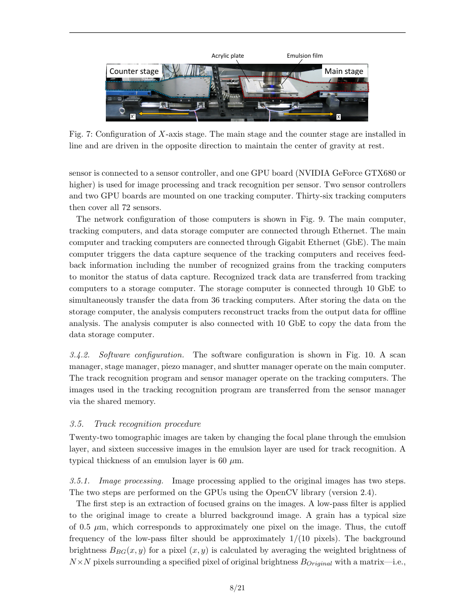
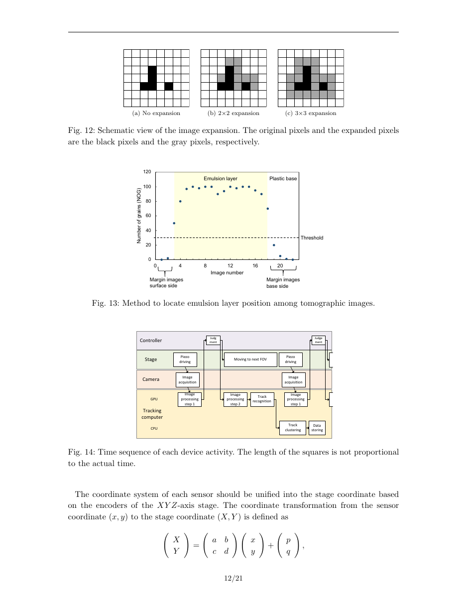
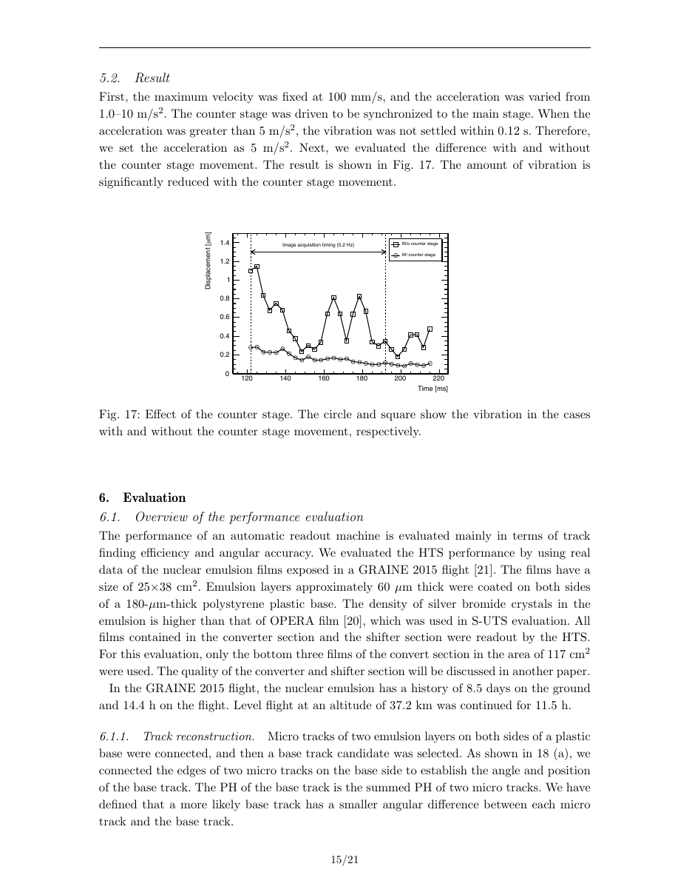

# 1000 m² 판독을 목표로 한 Hyper-track selector 원자핵 건판 판독 시스템 (번역)

번역 범위: 전문 (초록, 본문, 그림과 표 캡션, 감사의 글. 참고문헌은 원문 그대로)
원문: [Yoshimoto2017_PTEP_hyper_track_selector.pdf](Yoshimoto2017_PTEP_hyper_track_selector.pdf) (arXiv:1704.06814v3, 2017-11-12판)
서지: Masahiro Yoshimoto, Toshiyuki Nakano, Ryosuke Komatani, Hiroaki Kawahara. Progress of Theoretical and Experimental Physics (PTEP), 2017(10), 103H01, 2017. doi:10.1093/ptep/ptx131 (arXiv 초록 페이지와 Crossref로 확인)
번역 메모
- arXiv 판의 머리글은 "Prog. Theor. Exp. Phys. 2015, 00000", "DOI: 10.1093/ptep/0000000000"로 된 서식 틀 그대로다. 실제 게재 DOI는 arXiv 초록 페이지에 적힌 10.1093/ptep/ptx131이다.
- 수식은 원문 표기를 살렸다. 번역자 주석은 [역주]로 표시했다.
- 우리 과제(정지 단계)와 직접 닿는 곳은 2절 둘째 문단, 3.3.1절, 3.5.4절, 5절이다.

---

**1000 m² 판독을 목표로 한 Hyper-track selector 원자핵 건판 판독 시스템**

Masahiro Yoshimoto¹*, Toshiyuki Nakano¹, Ryosuke Komatani¹, Hiroaki Kawahara¹

¹ 나고야 대학 대학원 이학연구과, 일본 나고야시 지쿠사구 후로초 464-8602
\* E-mail: yoshimoto@flab.phys.nagoya-u.ac.jp
† 현 소속: 기후 대학 교육학부 물리학과, 일본 기후시 야나기도 1-1, 501-1193

## 초록

원자핵 건판(nuclear emulsion) 자동 판독 시스템은 처음 착상된 뒤 거의 40년 동안 눈에 띄게 발전했다.
대규모 중성미자 실험 OPERA에 본격 적용되어 성공한 뒤, 훨씬 빠른 판독 시스템인 hyper-track selector(HTS)를 개발했다.
HTS는 시야가 매우 넓은 대물렌즈를 쓰며, 판독 속도 4700 cm²/h에 이르렀다.
이는 이전 시스템보다 거의 100배 빠르며, 그래서 많은 새 실험 계획을 크게 앞당긴다.
이 논문에서는 HTS의 착상, 사양, 시스템 구조, 달성한 성능을 설명한다.

주제 색인: H01, H34

## 1. 서론

원자핵 건판은 서브마이크론 공간 분해능을 가진 3차원 입자 궤적 검출기다.
우주선 연구에 쓰였고 π 중간자 [1]와 맵시 입자 [2]의 발견에 기여했다.
이런 우주선 실험에서 기록된 궤적을 서브마이크론 정확도로 알아보려고, 건판 필름을 현미경으로 눈으로 훑었다.
그래서 이 시간이 많이 드는 방법이 통계량을 크게 제한했다.
이를 개선하려고 나고야 대학에서 Track Selector라는 자동 원자핵 건판 판독 시스템을 개발했고 [3][4][5], WA75 [6], E653 [7], E176 [8], CHORUS [9], DONUT [10] 같은 여러 고에너지 실험에 적용했다.
특히 DONUT에서 이 판독 시스템이 타우 중성미자를 발견했다.
이 실험 덕분에 자동 원자핵 건판 판독 시스템의 타당성이 입증되었다.
2006년에는 대규모 중성미자 진동 실험 OPERA [12]를 위해 판독 속도 약 10 m²/년/시스템의 S-UTS를 내놓았다 [11].
S-UTS 말고도 유럽에서 비슷한 판독 시스템이 개발되었다 [13].
5년 넘는 OPERA 분석에서 이 판독 시스템들의 판독 면적은 100 m² 규모에 이르렀고, 그 결과 출현 방식의 νµ → ντ 진동 발견에 기여했다 [14][15].

OPERA 실험의 성공, 곧 원자핵 건판의 대면적 적용과 자동 판독 시스템의 성공은 원자핵 건판 기술의 여러 응용으로 이어졌다.
예를 들면 GRAINE 계획, NINJA 계획, 우주선 뮤온 투시(radiography) 계획이 있다.
GRAINE 계획 [16][17]은 기구(balloon)에 실은 망원경으로 우주 감마선을 관측하는 것이 목표다.
원자핵 건판의 각도 분해능은 Fermi LAT [18]보다 한 자릿수 좋다.
그래서 초신성 잔해 같은 감마선 방출 천체를 더 선명하게 찍을 수 있다.
과학 관측은 여러 번의 비행과, 기구에 실을 약 10 m²의 큰 구경으로 할 것이다.
시험 비행은 2011년과 2015년에 했고, 총 1000 m²의 원자핵 건판을 쓰는 관측 비행을 계획하고 있다.
NINJA 계획 [19]은 J-PARC에서 저에너지 중성미자와 원자핵의 상호작용을 정밀하게 재고, 비활성 중성미자를 찾는 것이 목표다.
짧은 궤적과 큰 각도의 궤적, 곧 되튐 양성자나 원자핵 증발 파편처럼 4π 가까이로 나가는 저에너지 하전 입자는 원자핵 건판만 검출할 수 있다.
우주선 뮤온 투시 계획은 화산, 용광로, 원자력 발전소, 그리고 피라미드 같은 고고학 건물을 포함한 큰 물체의 내부 구조를 관측하는 것이 목표다.
원자핵 건판은 작고, 전원이 필요 없고, 받아들이는 각도 범위가 넓다는 장점이 있다.
또한 규모를 키우기 쉬워서, 같은 비용으로 섬광 검출기 같은 다른 기술보다 거의 100배 넓은 면적을 만들 수 있다.

이런 실험의 요구에 맞추려고, 우리는 판독 속도 약 1000 m²/년, 곧 S-UTS보다 100배 빠른 차세대 원자핵 건판 판독 시스템을 개발해 왔다.
이 논문에서는 Hyper Track Selector(HTS)의 착상, 기본 구성, 핵심 장치의 평가, 궤적 검출 성능, 달성한 판독 속도, 더 빠른 시스템을 위한 앞으로의 전망을 제시한다.

## 2. 자동 원자핵 건판 판독 시스템과 HTS의 착상

원자핵 건판 안에서 하전 입자의 궤적은 현상된 은 입자(grain)가 3차원으로 늘어선 점으로 기록된다.
그림 1처럼 판독 시스템은 건판 층 안에서 단층 영상을 찍고, 단층 영상들을 가로질러 이어진 입자들을 궤적으로 알아본다.
궤적 찾기 알고리즘 "Track Selector"는 특히 곧게 늘어선 점, 곧 운동량이 큰 궤적을 찾는다.

보통 시스템은 건판 필름을 훑는 3축 스테이지, 건판 영상을 확대하는 대물렌즈, 단층 영상을 찍는 영상 센서, 그리고 받은 영상을 처리하고 전체 시스템을 관리하는 전용 처리기나 컴퓨터로 이루어진다.
대물렌즈와 영상 센서는 서브마이크론 분해능 요구를 만족해야 한다.
판독 속도를 높이려면 각 장치의 성능을 균형 있게 높여야 한다.

그림 2는 Track Selector 계열의 판독 속도 발전을 보여 준다.
그때그때 가장 알맞은 디지털 기술을 써서 처리 속도를 높였다.
받아들이는 각도 범위도 Track Selector 계열마다 넓어졌다.
TS와 NTS는 받아들이는 각도가 좁아서, 한 시야에서 특정 궤적만 찾는다.
UTS부터는 tan θ < 0.6 범위의 기록된 궤적을 모두 찾기 시작했다. 여기서 θ는 건판 필름 표면에 대한 입사각이다.

스테이지 구동 방식도 개선되었다.
UTS 이전에는 모터로 XY 스테이지를 목표 위치까지 한 걸음 옮긴 뒤, 초점면을 광축 방향, 곧 Z축으로 바꾸며 단층 영상을 찍었다.
**XY 스테이지의 진동이 가라앉기를 기다리는 죽은 시간이 있다.**
이 진동은 XY 스테이지의 가속과 감속 때문에 생긴다. 그래서 S-UTS에서는 스테이지를 멈추지 않고 계속 움직이는 방식을 썼다.
피에조로 구동하는 대물렌즈 두 축을 달았다. Z축은 초점면을 바꾸는 데, X축은 X 스테이지의 움직임을 상쇄하는 데 쓴다.
그 결과 X 스테이지의 "한 걸음 가고 멈추기(step and go)" 동작을 없앴다.
연속 스테이지 이동이 속도 향상의 병목을 넘었다.
또한 3000 fps 고속 카메라로 판독 빈도를 50 view/s로 높였는데, 이전 시스템보다 열 배 넘게 빠르다.
이 높은 자료 속도를 처리하려고 FPGA 기반 고속 영상 처리기도 개발했다.

더 빨라지려면 연속 스테이지 이동에서 대물렌즈를 더 높은 빈도로 움직여야 하는데, 이는 비현실적으로 보인다.
판독 빈도 500 view/s를 이루려면 가속도가 약 100 m/s²가 되기 때문이다.
그래서 새 Track Selector인 HTS에서는 전략을 판독 빈도를 높이는 쪽에서 시야(FOV)를 넓히는 쪽으로 바꾸었다.
이를 위해 이전 시스템보다 약 500배 넓은 5.1×5.1 mm² 시야의 전용 대물렌즈를 개발했다.
이 넓은 시야를 서브마이크론 분해능으로 덮으려고, 200만 화소 센서 72개로 된 모자이크 카메라 시스템을 개발했다.
넓은 시야를 72개 센서가 나란히 읽고, 찍은 영상 하나하나를 스테이지 이동에 걸리는 시간과 비슷한 시간 안에 처리해야 한다.
**한 걸음씩 가고 멈추는 동작을 다시 쓰게 되었으므로, 앞에서 말한 진동 병목이 되살아났다.**
그래서 스테이지 진동의 근원으로 보이는 무게중심 이동을 막으려고, 이동을 상쇄해 스테이지의 무게중심을 붙잡아 두는 카운터 스테이지를 넣었다.
높은 가속과 감속으로 스테이지를 움직이려고 리니어 모터를 썼다.
영상 처리와 궤적 인식에는 일반 소비자용 GPU를 썼다.
GPU는 쉽게 구할 수 있고, 널리 쓰이며, 설계가 유연하다.

그림 3은 HTS 시스템, 전용 렌즈, 카메라, 받침대 위의 XYZ 스테이지, 영상 처리용 컴퓨터 묶음(cluster)의 사진이다.
각 부분은 다음 절에서 자세히 설명한다.

그림 1: 원자핵 건판 자동 판독 시스템의 개요. [역주: 조명기, 집광 렌즈, 건판(위아래 건판 층과 가운데 플라스틱 받침), 대물렌즈, 초점면, 상면, 영상 센서, 처리기나 컴퓨터의 배치를 그린 그림이다.]

그림 2: Track Selector 계열의 판독 속도 발전. TS와 NTS 값은 UTS와 같은 받아들임 각도에서의 속도다. [역주: 세로축 cm²/h 로그 눈금. TS(1983) 0.003, NTS(1994) 0.082, UTS(1998) 1, S-UTS(2006) 72, HTS(2015) 4700.]

그림 3: HTS 사진. [역주: 컴퓨터, 카메라, 대물렌즈, 조명기, 스테이지, X, Y, Z 축 표시.]

## 3. HTS 시스템

### 3.1. 광학계: 대물렌즈와 조명기

광학계, 곧 대물렌즈, 조명기, 빔 분할기는 KONICA MINOLTA사가 설계하고 만들었다.
사양은 표 1, 겉모습은 그림 4에 있다.
시야는 5.1×5.1 mm², 배율은 12.1배, 작동 거리는 1.5 mm다.
광학적 정합을 위해 대물렌즈와 건판 사이에 굴절률 1.505의 액침 기름을 넣어야 한다.

넓은 시야 대물렌즈를 적당한 비용으로 만들려고 개구수(NA)를 0.65로 제한했다.
이 NA는 시야 0.2×0.2 mm²인 이전 대물렌즈의 0.85보다 작다.
작은 NA로 나빠진 광학 분해능을 되찾으려고, 이전의 550 nm보다 짧은 파장 λ = 436 nm 빛을 썼다.
원자핵 건판 재료의 투과율이 작아서 400 nm보다 짧은 파장은 쓸 수 없다.
레일리 기준으로 정한 가로 분해능(δx = 0.61 λ/NA)은 410 nm가 되었다.
이는 이전 렌즈의 390 nm와 거의 같다.
광원은 시야 전체에 충분한 밝기를 얻으려고 수은 제논 램프를 썼고, 색수차를 무시할 수 있게 중심 436 nm, 반치폭 10 nm의 대역 통과 광학 필터를 썼다.
또한 NA가 작아져서 피사계 심도(DOF, δz = λ/(2 NA²)), 곧 광축 방향 분해능은 2.1 µm가 되었는데, 이전 렌즈보다 약 1.5배 넓다.

표 1: S-UTS [11]와 HTS의 대물렌즈와 조명기 사양 비교. 피사계 심도는 δz = λ/(2 NA²)로 정의한다.

| 항목 | S-UTS | HTS |
|---|---|---|
| 대물렌즈 제조사 | TIYODA | KONICA MINOLTA |
| 배율 | 35× | 12.1× |
| 개구수 | 0.85 | 0.65 |
| 최적 파장 | 녹색 (550 nm) | 청색 (436 nm) |
| 작동 거리 | 1.1 mm | 1.5 mm |
| 피사계 심도 | 1.5 µm | 2.1 µm |
| 시야 | 0.230×0.228 mm² | 5.1×5.1 mm² |
| 조명기 집광 NA | 0.85 | 0.66 |
| 광원 | Hg-Xe 램프 | Hg-Xe 램프 |
| 필터 | 녹색 필터 | 436±10 nm |

그림 4: 광학계 사진. (a) 대물렌즈와 빔 분할기 (b) 조명기의 집광 렌즈. [역주: 그림 안 치수 844 mm, 300 mm.]

### 3.2. 카메라

HTS는 영상 센서 72개를 쓴다.
표 2처럼 센서 하나는 220만 화소(가로 2048×세로 1088)다.
물리 화소 간격 5.5 µm는 물체 위에서 0.45 µm에 해당한다.
이 0.45 µm는 3.1절에서 말한 회절 한계 0.41 µm와 거의 같다.

영상 센서 12개를 그림 5처럼 배열한 모자이크 카메라 모듈 6개를, 빔 분할기로 나눈 6개 상면에 설치했다.
카메라를 이루는 센서들은 그림 6처럼 5.1×5.1 mm² 시야의 서로 다른 부분을 맡아, 다른 카메라의 빈 곳을 메운다.
센서와 카메라의 정렬 오차를 견디고 센서 가장자리에서 궤적을 놓치지 않도록, 각 센서는 이웃 센서와 (물체 위에서) 50 µm 넘게 겹친다.

센서의 프레임 속도는 300 fps로 S-UTS보다 열 배 느리다.
전체 영상 전송 속도는 48 GB/s로 S-UTS보다 60배 크다.

표 2: S-UTS [11]와 HTS의 영상 센서 사양 비교.

| 항목 | S-UTS | HTS |
|---|---|---|
| 제품명 | MEMCAMfx RX-6 custom | CMV2000 |
| 영상 센서 | CMOS | CMOS |
| 해상도 | 512 × 508 화소 | 2048 × 1088 화소 |
| 프레임 속도 | 3000 fps | 300 fps |
| 화소 간격 | 16 µm × 16 µm | 5.5 µm × 5.5 µm |
| 전자 셔터 | 있음 | 있음 |

그림 5: 모자이크 카메라 단위 사진. 한 단위에 영상 센서 12개가 달려 있다. 빨간 굵은 테두리는 센서 하나의 감광부를 보여 준다. [역주: 그림 안 치수 80 mm, 100 mm.]

그림 6: 창 6개가 있는 빔 분할기 단위의 모식도(왼쪽)와, 모자이크 카메라 단위 6개로 만든 시야 배치(오른쪽).

### 3.3. XYZ 스테이지

#### 3.3.1. XY 스테이지

XY 스테이지는 크기 2×1 m², 무게 약 700 kg의 금속 정반 위에 놓인다.
스테이지 이동 범위는 OPERA 필름 크기 125×100 mm² [20]에 맞췄다.
X 방향을 주 주사 방향으로 설계했고, 이동 범위는 130 mm다.
**X 스테이지는 리니어 모터로 구동하며, 35 kg인 X 스테이지를 20 ms에 5 mm씩 한 걸음 옮길 수 있다.**
그림 7처럼 카운터 스테이지를 달았고, 시스템 무게중심의 이동 때문에 생기는 진동을 억누르도록 카운터 스테이지를 구동한다.
Y 스테이지의 이동 범위는 100 mm다.
Y 스테이지는 회전 모터와 볼나사로 구동한다.
각 스테이지에 리니어 엔코더 세 개(X에 두 개, Y에 한 개)를 달았고, 엔코더로 스테이지 위치를 감시하고 각 구동기에 되먹인다.

그림 7: X 스테이지 구성. 주 스테이지와 카운터 스테이지는 한 줄로 설치되고, 무게중심을 가만히 유지하도록 서로 반대 방향으로 구동된다. [역주: 그림 안 표시 Acrylic plate, Emulsion film, Counter stage(X'), Main stage(X).]

#### 3.3.2. Z 스테이지

Z 스테이지는 두 구동 기구, 곧 거친 렌즈 이동과 미세 필름 이동을 가진다.
거친 렌즈 이동은 무게 200 kg인 렌즈와 그 지지대를 움직여, 건판 층을 바꾸고 판독할 필름을 교환한다.
거친 이동은 회전 엔코더와 볼나사가 달린 회전 모터 네 개로 이루어지며, 이동 범위는 20 mm다.
미세 필름 이동은 필름을 움직여 건판 층의 단층 영상을 얻는다.
미세 이동은 Z 위치 되먹임용 리니어 엔코더가 달린 피에조 구동기로 이루어진다.

### 3.4. 컴퓨터 묶음

#### 3.4.1. 컴퓨터 구성

HTS 시스템 구성은 그림 8에 있다.
시스템은 컴퓨터 38대가 제어한다. 주 컴퓨터 1대, 자료 저장 컴퓨터 1대, 궤적 처리(tracking) 컴퓨터 36대다.

주 컴퓨터는 모션 컨트롤러와 피에조 컨트롤러를 통해 스테이지 이동을 제어한다.
카메라 단위 6개에 영상 센서 72개가 있고, 5.1×5.1 mm² 시야를 덮는다.
각 센서는 센서 컨트롤러에 연결되고, 센서마다 GPU 보드 하나(NVIDIA GeForce GTX680 이상)를 영상 처리와 궤적 인식에 쓴다.
궤적 처리 컴퓨터 한 대에 센서 컨트롤러 두 개와 GPU 보드 두 개를 단다.
그래서 궤적 처리 컴퓨터 36대가 센서 72개를 모두 맡는다.

컴퓨터들의 네트워크 구성은 그림 9에 있다.
주 컴퓨터, 궤적 처리 컴퓨터, 자료 저장 컴퓨터는 이더넷으로 연결된다.
주 컴퓨터와 궤적 처리 컴퓨터는 기가비트 이더넷(GbE)으로 연결된다.
주 컴퓨터는 궤적 처리 컴퓨터의 자료 획득 순서를 시작시키고, 자료 획득 상태를 감시하려고 인식된 입자 수 같은 되먹임 정보를 궤적 처리 컴퓨터에서 받는다.
인식된 궤적 자료는 궤적 처리 컴퓨터에서 저장 컴퓨터로 보낸다.
저장 컴퓨터는 궤적 처리 컴퓨터 36대의 자료를 동시에 받으려고 10 GbE로 연결된다.
저장 컴퓨터에 자료를 저장한 뒤, 분석 컴퓨터가 출력 자료에서 궤적을 다시 만들어 오프라인 분석을 한다.
분석 컴퓨터도 자료 저장 컴퓨터에서 자료를 복사하려고 10 GbE로 연결된다.

그림 8: HTS 시스템 구성 모식도. [역주: X 주 스테이지, X 카운터 스테이지, Y 스테이지가 각각 모터와 리니어 엔코더를 가지고 모션 컨트롤러에 연결된다. 거친 Z는 모터와 엔코더 4벌, 미세 Z는 피에조 소자와 엔코더 3벌로 피에조 컨트롤러에 연결된다. 카메라 단위(센서 12개, 모두 6단위)의 영상은 궤적 처리 컴퓨터(모두 36대)의 센서 컨트롤러와 GPU 보드로 가고, 궤적은 저장 컴퓨터 디스크로 간다.]

그림 9: HTS 시스템의 네트워크 구성. [역주: 온라인 노드(컴퓨터 모두 36대)와 오프라인 노드. 주 컴퓨터와 궤적 처리 컴퓨터는 1 GbE, 저장 컴퓨터와 분석 컴퓨터는 10 GbE 스위치로 묶인다.]

#### 3.4.2. 소프트웨어 구성

소프트웨어 구성은 그림 10에 있다.
주 컴퓨터에서는 주사 관리자, 스테이지 관리자, 피에조 관리자, 셔터 관리자가 돈다.
궤적 처리 컴퓨터에서는 궤적 인식 프로그램과 센서 관리자가 돈다.
궤적 인식 프로그램이 쓰는 영상은 공유 메모리를 거쳐 센서 관리자에게서 받는다.

그림 10: HTS 시스템의 소프트웨어 구성. [역주: 주 컴퓨터의 주사 관리자, 스테이지 관리자, 피에조 관리자, 셔터 속도 관리자와 밝기 값, 궤적 처리 컴퓨터의 궤적 처리 프로그램, 센서 관리자, 공유 메모리, 저장 컴퓨터의 SSD와 HDD.]

### 3.5. 궤적 인식 절차

건판 층을 지나도록 초점면을 바꾸며 단층 영상 22장을 찍고, 건판 층 안의 연속 영상 16장을 궤적 인식에 쓴다.
건판 층의 보통 두께는 60 µm다.

#### 3.5.1. 영상 처리

원본 영상에 하는 영상 처리는 두 단계다.
두 단계는 OpenCV 라이브러리(버전 2.4)로 GPU에서 한다.

첫 단계는 영상에서 초점이 맞은 입자를 뽑는 것이다.
원본 영상에 저역 통과 필터를 걸어 흐린 배경 영상을 만든다.
입자 크기는 보통 0.5 µm로, 영상에서 약 한 화소에 해당한다.
그러므로 저역 통과 필터의 차단 주파수는 약 1/(10 화소)여야 한다.
화소 (x, y)의 배경 밝기 B_BG(x, y)는, 원래 밝기 B_Original인 지정 화소를 둘러싼 N×N 화소의 밝기를 커널 K로 가중 평균해 계산한다.

  B_BG = Σ_{i=1..N} Σ_{j=1..N} B_Original(x + i, y + j) · K(i, j)

차단 주파수 1/(12.5 화소), 15×15 행렬 커널을 썼다.
이 평균 영상을 원본 영상에서 빼면, 그림 11처럼 고주파 성분만 남은 영상을 얻는다.
마지막으로 문턱값을 적용해 영상의 입자를 얻는다.

둘째 단계에서는 초점 깊이가 다른 영상들에 번져 있는 초점 밖 입자를 지운다.
이 처리는 앞뒤 영상과 함께 BG 영상에 대해 한다.

  B'_M = B_M − (a/2) (B_{M−1} + B_{M+1})

인자 a는 초점 맞은 입자의 번짐이 영상 간격보다 작도록 조정했고, M은 단층 영상 번호다.
이 처리 뒤 문턱값을 적용해 이진 영상을 얻는다.
그다음 원래 적중 화소의 위, 오른쪽, 오른쪽 위로 2×2 확장(그림 12 (b))이나 원래 적중 화소를 둘러싸는 3×3 확장(그림 12 (c))을 한다.
입자 적중의 크기가 보통 궤적 인식 알고리즘의 허용 폭보다 작기 때문이다.
신호 대 잡음비를 높이려고 보통 2×2 확장을 썼다.

#### 3.5.2. 영상 획득 성공 판정

다음 시야로 옮기기 전에, 얻은 단층 영상이 건판 층을 제대로 덮는지 판정해야 한다.
표준 설정에서는 22장을 찍는다. 연속 16장을 궤적 인식에 쓰고, 6장은 여유 영상으로 쓴다.

각 영상에서 인식된 입자 수(NOG)를 영상 처리 1단계로 계산한다.
NOG가 정해 둔 문턱값보다 크면 영상에 건판 층이 있다고 판정한다.

지금은 건판 필름 표면이 완전히 평평해도, 물체 위 각 센서의 Z 위치가 영상 약 두 장만큼 퍼져 있다.
그림 13처럼 NOG 정보로 각 센서의 받침 쪽과 표면 쪽 여유 영상 수를 계산한다.
여유 영상 수의 두 평균을 모든 센서에 대해 계산한다.
두 평균 중 하나라도 1보다 작으면 영상 자료 획득을 다시 시도한다.
또 두 평균 중 하나라도 1보다 크고 1.5 이하이면, 다음 시야에서 영상 촬영을 시작할 Z 위치를 보정한다.
이런 처리로 자료를 다시 얻는 데 드는 시간 손실을 최소로 줄인다.

#### 3.5.3. 궤적 인식

이진화한 단층 영상 16장을 지나는 곧게 늘어선 입자를 이전 논문 [11]의 방법으로 찾는다.
이른바 Track Selector 알고리즘이라는 이 방법은 단순한 밀기(shift)와 더하기(sum)를 쓴다.
지정한 각도의 궤적이 초점면에 수직이 되도록 이진 영상들을 X와 Y로 밀고, 수직으로 더한다.
더한 값을 펄스 높이(PH)라 하며, 궤적다움의 지표다.
문턱값을 정해 두면 지정한 각도의 궤적을 알아낸다.
지정 각도를 바꿔 가며, 곧 필요한 각도 범위를 훑으며 이 과정을 되풀이한다.
첫 영상에서 16번째 영상까지의 상대 밀기 값은, 표준 조건에서 X와 Y 각각 ±180 화소 안에서 3화소마다 준다.
두께 60 µm인 건판 층에서 이 범위는 ±53°에 해당한다.
판독은 느려지지만 상대 밀기를 ±360 화소, 곧 ±70°까지 고를 수도 있다.
이 궤적 처리 프로그램은 추가 처리 시간 없이 약 10⁶ 궤적/cm²까지 다룰 수 있다.
GPU에 올린 궤적 처리 프로그램의 속도 향상이 HTS를 실현한 열쇠 중 하나다.
자세한 내용은 다음 논문에서 설명한다.

문턱값을 적용한 뒤, 한 궤적이 각도와 위치 공간에 걸쳐 여러 적중을 가지므로, 인식된 궤적들을 각도와 위치 공간에서 묶는다(clustering).
묶기는 궤적 처리 컴퓨터의 CPU에서 한다.
이 묶기 과정에서 위치 공간에 걸친 적중의 부피(PHvol)도 계산한다.
이 값은 궤적의 진하기, 곧 단위 길이당 이온화 에너지 손실(dE/dx)을 나타낸다.
최종 확인된 궤적을 마이크로 궤적(micro track)이라 하며, 이후 궤적 재구성의 바탕이 된다.

#### 3.5.4. 절차 흐름도

주사 시간표는 그림 14에 있다.
**판정하는 때를 빼면, 스테이지, 카메라, 궤적 처리 컴퓨터는 나란히 일한다.**
궤적 인식의 표준 설정에서는 다음 시야로 옮기는 시간이 영상 처리 2단계와 궤적 인식을 합친 시간보다 길다.

그림 11: 입자를 뽑는 영상 처리의 모식도. 원본 영상에서 저주파 배경 BG를 뽑는다. 입자는 원본에서 BG를 뺀 신호의 봉우리로 나타난다. [역주: 가로축 위치(화소) 0~30, 세로축 밝기, 원본, BG, 신호(원본 − BG) 세 곡선.]

그림 12: 영상 확장의 모식도. 원래 화소와 확장된 화소는 각각 검은 화소와 회색 화소다. (a) 확장 없음 (b) 2×2 확장 (c) 3×3 확장.

그림 13: 단층 영상 가운데 건판 층의 위치를 찾는 방법. [역주: 가로축 영상 번호 0~20, 세로축 입자 수(NOG). 건판 층과 플라스틱 받침, 문턱값, 표면 쪽 여유 영상과 받침 쪽 여유 영상 표시.]

그림 14: 각 장치 동작의 시간 순서. 네모의 길이는 실제 시간에 비례하지 않는다. [역주: 컨트롤러(판정), 스테이지(피에조 구동, 다음 시야로 이동, 피에조 구동), 카메라(영상 획득), GPU(영상 처리 1단계, 2단계, 궤적 인식), CPU(궤적 묶기, 자료 저장) 줄이 있다. 판정 뒤 스테이지 이동과 영상 처리, 궤적 인식이 겹쳐 돈다.]

## 4. 센서 사이 정렬

독립 영상 센서 72개를 한 좌표로 통합한 것은 원자핵 건판 판독 시스템의 역사에서 처음 시도한 일이다.

대물렌즈는 5.1×5.1 mm²의 넓은 시야에서 "방사 왜곡" 같은 왜곡을 가진다.
이 왜곡은 인식된 궤적의 위치와 각도에 영향을 준다고 생각되지만, 시야를 센서 72개로 잘게 나누었기 때문에 그 효과는 무시할 수 있다.
각 센서의 아핀 변환 파라미터가 센서별 배율 차이와 위치 어긋남을 보정할 수 있다.

각 센서의 좌표계는 XYZ 스테이지의 엔코더를 기준으로 한 스테이지 좌표로 통합해야 한다.
센서 좌표 (x, y)에서 스테이지 좌표 (X, Y)로의 좌표 변환은 다음처럼 정의한다.

  [X, Y]ᵀ = [[a, b], [c, d]] [x, y]ᵀ + [p, q]ᵀ

아핀 파라미터 a, b, c, d는 회전과 변형 보정용, p, q는 변위 보정용이다.
여기서 p, q는 기준 센서 하나에서 어떤 센서까지의 상대 변위 벡터로 정의한다.

### 4.1. 실제 건판에 기록된 입자를 쓰는 센서 정렬

각 센서의 아핀 파라미터를 정하려고, 별 목록으로 망원경의 분할 센서를 교정하듯 원자핵 건판에 든 실제 입자를 쓴다.
아핀 파라미터는 다음처럼 계산한다.
먼저, 스테이지를 X와 Y 방향으로 움직이며 센서 좌표와 스테이지 좌표에서의 이동량을 비교해 a_i, b_i, c_i, d_i를 얻는다.
다음으로, 기준 센서로 5×5 mm²의 주 입자 목록을 만들고, 다른 센서들로 1×0.5 mm²의 부 입자 목록을 만든다.
이 목록들은 위에서 얻은 a_i, b_i, c_i, d_i로 보정한다.
끝으로, 각 부 목록을 주 목록과 비교해 변위 파라미터 p_i, q_i를 얻는다.
파라미터를 다시 잴 때 이 목록들을 고친다.

평균 배율(mag = ½ (√(a² + b²) + √(c² + d²)))은 모든 센서에 대해 0.4545 µm/화소다.
최소 배율에 대한 각 센서 mag의 비가 그림 15에 있다.
방사 왜곡 때문에 최대 mag는 최소 mag보다 0.39% 크며, 이 두 센서는 3.0 mm 떨어져 있다.
이는 시야 중심에서 모서리까지 0.234%의 방사 왜곡에 해당한다.
이 값으로 계산하면, 표준 설정에서 가장 긴 궤적인 80 µm 궤적의 왜곡은 0.1 화소로, 요구값 1 화소보다 충분히 작다.

### 4.2. 실제 주사 자료를 쓰는 교정 방법

아핀 파라미터는 노화, 카메라 지지대의 열팽창 등으로 가끔 바뀐다.
이웃 센서 사이 겹친 영역(전체 면적의 27%)에 있는 궤적은 두 위치에서 검출된다.
4.1절 방법은 시간이 꽤 들기 때문에, 평소 자료 획득에서 얻은 실제 궤적을 쓰는 새 방법을 고안해 구현했다.

실제 궤적으로 각 센서의 상대 변위를 정하려고, 동시에 인식된 궤적의 위치 차이를 비교해 각 센서에 대해 이웃 네 센서에 대한 위치 변위 벡터 (D1, D2, D3, D4)를 계산한다.
그다음 다음 잔차 σ를 최소로 하여 가장 그럴듯한 상대 변위 벡터 P_i(x, y)를 계산한다.

  σ² = Σ_{i=1..72} Σ_{j=1..4} (D_ij − P_i)²

P_1을 (0, 0)으로 두고 해석적으로 계산하며, i는 센서 번호다.
잔차는 X와 Y 방향으로 따로 계산한다.
이 처리 뒤 새 아핀 파라미터로 궤적 위치를 다시 변환한다.
그러면 모든 이웃 센서 사이 궤적 위치 차이의 분포를 그림 16처럼 얻는다.
dx와 dy의 시그마 값은 X축과 Y축에서 각각 0.23 µm, 0.26 µm다.
이 정확도는 화소 크기 0.45 µm에 비해 충분히 정밀하다.

그림 15: 각 센서의 배율 비. 최솟값은 가장 왼쪽 위 센서에서 나오며, 이를 1로 둔다. [역주: X 0~4.5 mm, Y 0~4.5 mm 격자에 1.00011~1.00386 값이 적혀 있다.]

그림 16: 이웃한 두 센서의 겹친 영역에서 인식된 궤적의 위치 차이 분포. (a) X축 (b) Y축. [역주: 각 4314개. (a) 가우스 적합 평균 −0.0005286 ± 0.0036524, 시그마 0.2336 ± 0.0033 µm. (b) 평균 −0.0008846 ± 0.0040917, 시그마 0.2612 ± 0.0038 µm.]

## 5. 스테이지 조율

HTS는 필름을 훑을 때 한 걸음 가고 멈추는 동작을 쓰고 한 걸음의 거리가 한 자릿수 길어졌기 때문에, **멈춤 동작이 일으키는 진동의 효과를 잘 알아야 한다.**
멈춘 뒤의 잔진동은 입자 영상을 흐리게 하거나 궤적을 휘게 할 수 있고, 그러면 펄스 높이가 줄고 인식된 위치와 각도가 어긋날 수 있다.

### 5.1. 진동 효과의 평가

**진동을 평가하려고, X 스테이지의 엔코더가 목표 위치에 닿은 순간부터 Z 위치를 고정한 채 영상 30장(= 0.1 s)을 찍었다.**
**찍은 영상에서 인식한 입자를 써서, 연속한 프레임 사이의 위치 어긋남을 쟀다.**

### 5.2. 결과

먼저 최대 속도를 100 mm/s로 고정하고 가속도를 1.0~10 m/s²로 바꾸었다.
카운터 스테이지는 주 스테이지와 동기하여 구동했다.
**가속도가 5 m/s²보다 크면 진동이 0.12 s 안에 가라앉지 않았다.**
그래서 가속도를 5 m/s²로 정했다.
다음으로 카운터 스테이지를 움직일 때와 움직이지 않을 때의 차이를 평가했다.
결과는 그림 17에 있다.
카운터 스테이지를 움직이면 진동량이 크게 줄어든다.

그림 17: 카운터 스테이지의 효과. 동그라미와 네모는 각각 카운터 스테이지를 움직일 때와 움직이지 않을 때의 진동을 보여 준다. [역주: 가로축 시간(ms) 약 120~215, 세로축 변위(µm). 약 122 ms에서 192 ms 사이에 "영상 획득 시점(5.2 Hz)" 화살표가 있다. 그림에서 읽으면, 카운터 스테이지가 없을 때(네모)는 약 1.1 µm에서 시작해 0.2~0.8 µm 사이를 오르내리고, 있을 때(동그라미)는 약 0.28 µm에서 시작해 약 0.1 µm로 줄어든다. 이 값들은 그림에서 눈으로 읽은 것이며 본문에 숫자로 적혀 있지 않다.]

## 6. 평가

### 6.1. 성능 평가 개요

자동 판독 장치의 성능은 주로 궤적 찾기 효율과 각도 정확도로 평가한다.
GRAINE 2015 비행 [21]에서 노출된 원자핵 건판 필름의 실제 자료로 HTS 성능을 평가했다.
필름 크기는 25×38 cm²다.
두께 180 µm인 폴리스타이렌 플라스틱 받침의 양면에 약 60 µm 두께의 건판 층을 입혔다.
건판 안의 브로민화은 결정 밀도는 S-UTS 평가에 쓴 OPERA 필름 [20]보다 높다.
변환부(converter section)와 이동부(shifter section)에 든 필름을 모두 HTS로 판독했다.
이 평가에는 면적 117 cm²에서 변환부의 맨 아래 필름 세 장만 썼다.
변환부와 이동부의 품질은 다른 논문에서 다룬다.

GRAINE 2015 비행에서 원자핵 건판은 지상 8.5일, 비행 14.4시간의 이력을 가진다.
고도 37.2 km의 수평 비행이 11.5시간 이어졌다.

#### 6.1.1. 궤적 재구성

플라스틱 받침 양쪽 두 건판 층의 마이크로 궤적을 잇고, 받침 궤적(base track) 후보를 고른다.
그림 18 (a)처럼 받침 쪽 두 마이크로 궤적의 끝을 이어 받침 궤적의 각도와 위치를 정한다.
받침 궤적의 PH는 두 마이크로 궤적 PH의 합이다.
각 마이크로 궤적과 받침 궤적의 각도 차이가 작을수록 더 그럴듯한 받침 궤적으로 정의했다.

마이크로 궤적의 각도 ma는 현상으로 생긴 건판 층의 수축과 왜곡에 영향을 받으므로, 이른바 수축 인자 shr과 왜곡 벡터 dist로 다음처럼 보정해야 한다.

  ma' = shr · ma + dist

여기서 ma는 원래 각도, ma'은 보정된 각도다.
수축 인자와 왜곡 벡터는 연결된 받침 궤적 수가 가장 많아지도록 계산한다.
여러 필름을 가로지르는 받침 궤적은 그림 18 (b)처럼 각도와 위치의 일관성으로 재구성한다.

그림 18: (a) 마이크로 궤적과 받침 궤적의 정의. (b) 두 받침 궤적 사이 각도 차이와 위치 차이의 정의. 각도 차이는 |θ1 − θ2|, 위치 차이는 |P1 − P2|다.

### 6.2. 결과

#### 6.2.1. 받침 궤적 찾기 효율

한 필름의 궤적 찾기 효율을 평가하려고, 대상 필름을 앞뒤로 끼운 필름들로 궤적을 재구성하고, 재구성된 궤적이 대상 필름에 있는지 확인했다.
한 필름의 받침 궤적 찾기 효율은 찾은 예측 궤적 수와 모든 예측 궤적 수의 비로 정의한다.

측정한 궤적 찾기 효율의 각도 의존성은 그림 19에 있다.
tan θ < 1.6 각도 범위에서 효율은 97%보다 컸다.
tan θ가 0.2보다 작은 곳의 효율은 다른 영역보다 조금 높다.
펄스 높이의 각도 의존성은 그림 20 (a)에 있다.
효율은 평균 PH와 상관이 있다.
0.0 < tan θ < 0.1, 0.2 < tan θ < 0.3, 0.9 < tan θ < 1.0에서 찾은 궤적의 PH 분포가 그림 20 (b)에 있다.
0.0 < tan θ < 0.1, 0.2 < tan θ < 0.3, 0.9 < tan θ < 1.0의 PH 평균은 각각 31.2, 28.5, 25.4로 측정되었다.

#### 6.2.2. 각도 정확도

마이크로 궤적의 각도 정확도는 마이크로 궤적과 받침 궤적 사이 각도 차이로 정의하고, 받침 궤적의 각도 정확도는 평가 필름의 받침 궤적과 다음 필름의 받침 궤적 사이 각도 차이로 정의한다.
그림 21처럼 각도 정확도를 "방사(radial)와 측면(lateral)" 성분으로 나누었다. 방사축은 궤적의 수평 방향이고 측면축은 그에 수직한 방향이다.
피사계 심도가 가로 분해능보다 크기 때문에, 각도가 큰 궤적에서는 두 성분이 크게 다르다.
마이크로 궤적의 각도 정확도의 각도 의존성은 그림 22, 받침 궤적의 것은 그림 23에 있다.

그림 19: 받침 궤적의 궤적 찾기 효율의 각도 의존성. [역주: 가로축 tan θ 0~1.6, 세로축 효율 0.9~1.]

그림 20: (a) 받침 궤적의 평균 펄스 높이의 각도 의존성. 평균의 오차는 표준편차다. (b) 0.0 < tan θ < 0.1, 0.2 < tan θ < 0.3, 0.9 < tan θ < 1.0인 받침 궤적의 펄스 높이 분포.

그림 21: 두 궤적 사이 각도 차이의 "방사와 측면" 성분 정의 모식도.

#### 6.2.3. 판독 반복 빈도에 따른 궤적 찾기 효율

위 평가에서 반복 빈도는 4.2 view/s였고, 판독 속도 3800 cm²/h에 해당한다.

반복 빈도 4 view/s에서 5.5 view/s까지의 함수로 궤적 찾기 효율을 조사했다.
**빈도는 영상 자료 획득 시점을 바꾸어 바꾸었고, X 스테이지의 최고 속도와 가속도는 바꾸지 않았다.**
결과는 그림 24에 있다.
**빈도가 높아지면 효율이 낮아진다.**
예를 들어 빈도를 4.0 view/s에서 5.2 view/s로 바꾸면, 각도 0.9 < tan θ < 1.0 궤적의 효율이 1% 나빠졌다.
1% 감소를 받아들일 수 있다면, 5.2 view/s로 4700 cm²/h의 판독 속도를 낼 수 있다.

그림 22: 마이크로 궤적 각도 정확도의 각도 의존성. [역주: 가로축 tan θ_Radial 0~1.6, 세로축 각도 정확도(rad) 0~0.04, 방사와 측면 두 곡선.]

그림 23: 받침 궤적 각도 정확도의 각도 의존성. [역주: 세로축 0~0.02 rad.]

그림 24: 판독 속도에 따른 궤적 찾기 효율의 의존성. 여기서 5.2 view/s는 4700 cm²/h에 해당한다. [역주: 가로축 view/s 4~5.6, 세로축 효율 0.9~1. 범례는 원문에 "0.0<tanθ<0.1, 0.2<tanθ<0.1, 0.9<tanθ<0.1"로 인쇄되어 있으나, 본문으로 보아 0.2<tanθ<0.3, 0.9<tanθ<1.0의 오기로 보인다.]

### 6.3. 논의

각도가 작은 궤적의 펄스 높이는 초점 깊이 때문에 더 높다.
찍은 이웃 영상 두 장 사이 Z 방향 거리는 HTS의 초점 깊이와 거의 같은 약 4 µm로 정했다.
두 입자가 Z 방향, 곧 광축 방향으로 늘어서면, 입자들이 서로 다른 깊이의 영상들에 번진다.
그 결과 작은 각도에서 PH가 커지는 것으로 생각된다.

|tan θ| < 0.1 범위 마이크로 궤적의 각도 정확도는 HTS에서 7 mrad, S-UTS [11]에서 13 mrad이고, 0.4 < |tan θ| < 0.5 범위에서는 HTS 11 mrad, S-UTS 23 mrad다.
건판 층 두께가 달라 바로 비교하기는 어렵지만, HTS의 각도 정확도가 S-UTS보다 좋아 보인다.

|tan θ| < 0.1 범위 받침 궤적의 각도 정확도는 HTS 2.5 mrad, S-UTS 2.5 mrad이고, 0.4 < |tan θ| < 0.5 범위에서는 HTS 5.4 mrad, S-UTS 4.2 mrad다.
하전 입자에 대한 감도, 입사 입자, 플라스틱 받침 두께, 두께 균일성, 수축과 왜곡의 편차가 달라 이것도 바로 비교하기는 어렵다.
그래도 작은 각도에서 HTS의 각도 정확도는 S-UTS와 거의 같고, 큰 각도에서는 조금 낮아 보인다.

큰 각도에서도 받침 궤적의 각도 정확도를 높이려면 Z 방향 위치 정확도를 높여야 한다.
영상을 찍을 때 센서 72개의 클럭이 동기되어 있지 않아서, 영상 촬영의 초점면에 약 4 µm의 오차가 있다.
게다가 입자 하나의 영상은 초점 깊이 때문에 깊이 방향으로 4 µm의 오차를 가진다.
동기 신호를 넣고 영상 처리를 발전시키면 각도 정확도 문제를 풀 수 있을 것이다.

HTS에서는 시야를 넓혀 판독 속도를 높였다.
2절에서 말했듯, 판독 속도를 높이는 길은 둘이다. 하나는 판독 반복 빈도를 높이는 것이고, 다른 하나는 시야를 넓히는 것이다.
HTS는 둘째 길을 택했다.
더 빠르게 하려고, 두 길을 모두 따르는 새 판독 시스템 HTS-2를 설계하고 있다.
시야가 두 배 넓은 대물렌즈와, 비스듬한 초점면을 쓴 연속 이동을 적용할 것이다. [역주: 원문 "contentious movement"는 "continuous movement"의 오기로 보고 옮겼다.]
HTS-2는 HTS(HTS-1)보다 약 5배 빠른 25,000 cm²/h의 판독 속도에 이를 것으로 기대한다.

## 7. 결론

원자핵 건판은 100년 넘는 역사를 가진 3차원 입자 궤적 검출기지만, 자동 판독 시스템의 발명 덕분에 여전히 넓은 응용 분야를 가진다.
이 논문에서 설명한 최신 장치 HTS는 현대의 응용을 위한 것이다.
HTS는 5.1×5.1 mm² 시야의 넓은 시야 렌즈와, 이 시야를 덮는 200만 화소 센서 72개로 개발되었다.
영상 처리에는 GPU 72개와 CPU 36개를 썼다.
**카운터 스테이지를 써서 5 mm 걸음 이동으로 5.2 view/s의 판독을 이루었다.**
마침내 HTS는 약 0.5 m²/h의 판독 속도를 이루었는데, OPERA 실험에 쓴 이전 시스템보다 거의 두 자릿수 빠르다.
이 속도는 약 1000 m²/년의 판독 면적에 해당한다.

HTS의 주된 과제는 둘이다.
하나는 서브마이크론 정확도를 유지하며 여러 센서로 넓은 시야를 나란히 읽는 것이다.
**다른 하나는 걸음 이동 뒤의 진동 억제다.**
앞에서 말했듯, 여러 센서 위치 정렬의 새 방법은 실제 입자와 궤적 자료로 이루었다.
**진동 억제를 위해서는 카운터 스테이지를 쓰며 현실적인 가속도 값을 조율했다.**

이전 GRAINE 2015 비행의 약 50 m² HTS 판독 면적은 각도 tan θ < 1.0 궤적에서 궤적 찾기 효율이 97%보다 크다는 것을 보였고, 우주 감마선 관측에 기여했다.
뮤온 투시에서는 약 80 m²를 판독했고, 피라미드에서 새 내부 구조를 찾아냈다.
NINJA 계획에서 HTS는 약 20 m²를 판독했고, 저에너지 중성미자 상호작용 연구에 기여했다.
또한 HTS가 있다는 것이 새 계획을 자극하고 새 공동 연구를 일으키고 있으며, HTS는 앞으로의 방사선 측정에 꼭 필요한 도구가 되어 가고 있다.

## 감사의 글

HTS를 만들어 준 T. Kawai에게 감사한다.
교정 방법에 대해 귀한 논의를 해 준 S. Kukita에게 감사한다.
이 연구는 JSPS KAKENHI 과제 번호 JP22340057과 일본 과학기술진흥기구(JST)의 JST-SENTAN 프로그램의 지원을 받았다.
일부 기기는 나고야 대학 Kobayashi-Maskawa 입자우주기원연구소(KMI)가 제공했다.
M. Yoshimoto와 H. Kawahara는 JSPS 특별연구원 연구비의 지원을 받았다.
HTS를 실험에 써 준 모든 공동 연구자에게 감사한다.

## 참고문헌 (원문 그대로)

[1] R. Brown et al., Nature, 163, 82 (1949).
[2] K. Niu et al., Prog. Theor. Phys., 46(5), 1644–1646 (1971).
[3] K. Niwa et al., The Proceedings of the International Cosmic Ray Symposium of High Energy Phenomena, Tokyo, p. 149 (1974).
[4] S. Aoki et al., Nucl. Instrum. Meth., B51, 466–472 (1990).
[5] T. Nakano, Ph.D. Thesis, Nagoya University, Japan (1997) (in Japanese).
[6] J. P. Albanese et al., Phys. Lett., B158, 186–192 (1985).
[7] K. Kodama et al., Nucl. Instrum. Meth., A289, 146–167 (1990).
[8] S. Aoki et al., Prog. Theor. Phys., 85, 1287–1298 (1991).
[9] E. Eskut et al., Nucl. Instrum. Meth., A401, 7–44 (1997).
[10] K. Kodama et al., Phys. Lett., B504, 218–224 (2001), arXiv:hep-ex/0012035.
[11] K. Morishima and T. Nakano, JINST, 5, P04011 (2010).
[12] R. Acquafredda et al., New J. Phys., 8, 303 (2006), arXiv:hep-ex/0611023.
[13] N. Armenise et al., Nucl. Instrum. Meth., A551, 261–270 (2005).
[14] N. Agafonova et al., PTEP, 2014(10), 101C01 (2014), arXiv:1407.3513.
[15] N. Agafonova et al., Phys. Rev. Lett., 115(12), 121802 (2015), arXiv:1507.01417.
[16] S. Aoki et al. (2012), arXiv:1202.2529.
[17] S. Takahashi et al., PTEP, 2016(7), 073F01 (2016).
[18] WB Atwood et al., The Astrophysical Journal, 697(2), 1071 (2009).
[19] T. Fukuda et al. (2017), arXiv:1703.03659.
[20] T. Nakamura et al., Nucl. Instrum. Meth., A556, 80–86 (2006).
[21] K. Ozaki et al., JINST, 10(12), P12018 (2015).
