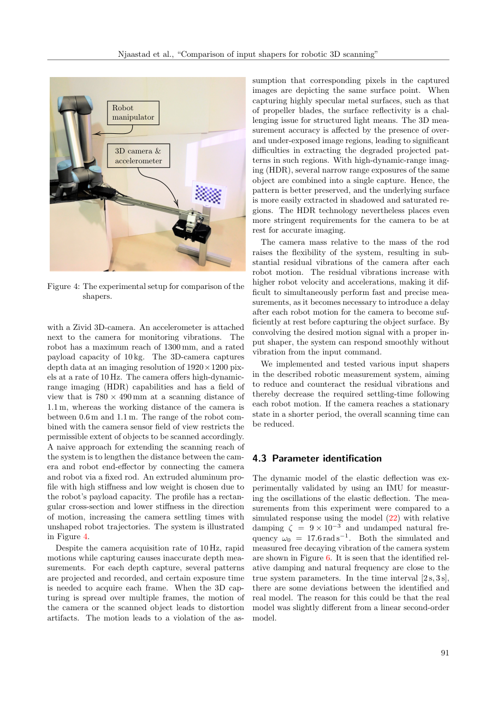
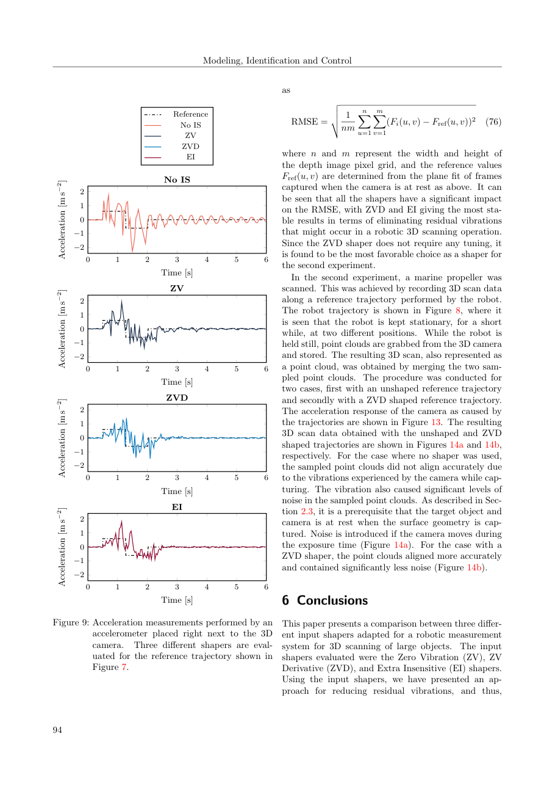
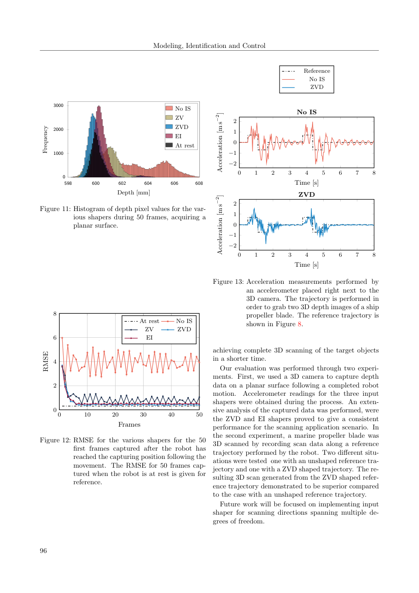

# 로봇 3D 스캐닝의 잔진동 제어, 선박 프로펠러 검사 적용 (번역)

번역 범위: 전문 (초록, 본문, 그림과 표 캡션, 감사의 글. 참고문헌은 원문 그대로)
원문: [Njaastad2021_MIC_residual_vibration_3D_scanning.pdf](Njaastad2021_MIC_residual_vibration_3D_scanning.pdf)
서지: E.B. Njaastad, G.O. Tysse, O. Egeland. Modeling, Identification and Control, 42(2), pp. 83-98, 2021. ISSN 1890-1328. doi:10.4173/mic.2021.2.3 (오픈액세스)

번역 메모
- 수식은 원문 표기를 살렸다. 원문 PDF에서 수식 추출이 깨진 곳은 식 번호와 뜻을 적고 기호를 복원했다.
- 원문 쪽머리의 제목은 "Comparison of input shapers for robotic 3D scanning"으로, 표제면 제목과 다르다.
- 번역자 주석은 [역주]로 표시했다.
- 우리 과제(정지 단계)와 직접 닿는 곳은 1절 셋째 문단, 2.3절 끝, 4.2절, 4.3절, 4.4절, 5절이다.

---

**로봇 3D 스캐닝의 잔진동 제어, 선박 프로펠러 검사 적용**

E.B. Njaastad(1), G.O. Tysse(2), O. Egeland(1)

(1) 노르웨이 과학기술대학교(NTNU) 기계산업공학과, N-7491 트론헤임, 노르웨이. E-mail: {eirik.njaastad,olav.egeland}@ntnu.no
(2) SINTEF Manufacturing AS 생산기술부, N-7465 트론헤임, 노르웨이. E-mail: geir.ole.tysse@sintef.no

## 초록

이 논문은 산업용 로봇에 단 3D 카메라로 큰 선박 프로펠러 날개를 3D 스캔하는 시스템을 제시한다.
구조광 방식의 산업용 3D 카메라를 쓰며, 정확도는 0.1 mm 수준이다.
프로펠러를 스캔할 만큼 팔이 닿게 하려고, 카메라를 로봇 끝단에 붙인 막대 위에 달았다.
이 막대는 로봇이 새 스캔 자세로 옮겨갈 때 기계 진동을 일으킨다.
빠르고 효율적인 스캔은 입력 성형(input shaping)에 바탕을 둔 피드포워드 방식의 진동 상쇄로 이룬다.
로봇에 넣는 자세 증분 명령을 다시 성형해서, 카메라를 옮긴 뒤의 진동 정착 시간을 짧게 만든다.
입력 성형 기법을 쓰면 물체 표면을 찍는 스캔 동작 동안 촬영 장치가 멈춰 있게 된다.
세 가지 입력 성형기를 살핀다. 무진동(ZV), 무진동 미분(ZVD), 추가 둔감(EI) 성형기다.
잔진동을 최소로 만들어 시스템의 정확도와 정밀도를 높이고, 물체의 3D 스캔 전체를 더 짧은 시간에 끝낸다.
그 결과 스캔 품질도 좋아진다.
제안한 방법의 효과는 모의 실험과 실제 실험으로 확인했으며, ZVD와 EI 성형기가 이 스캔 응용에 가장 알맞은 것으로 나타났다.
실험 확인은 선박 프로펠러 날개의 전체 스캔 작업으로 했고, UR10 로봇을 원래의 산업용 제어 시스템 그대로 썼다.
제안한 시스템은 프로펠러 날개 표면을 정하기에 충분한 정확도를 주는 것으로 나타났다.

키워드: 입력 성형, 로봇 3D 스캐닝

## 1. 서론

정확한 3차원(3D) 자료를 얻는 일은 설계, 가공, 검사, 항법, 제어 같은 제조 작업에서 매우 중요하다.
정확도가 높은 상용 센서를 쉽게 구할 수 있게 되면서 표면 스캔에 3D 센서를 점점 많이 쓴다.
2D 카메라에 견준 3D 카메라의 장점은 깊이 정보를 같이 얻는다는 점이다.
그래서 장면 안 물체의 치수와 자세에 대한 정보가 더 생긴다.
3D 카메라의 시야가 제한되므로, 3D 카메라를 로봇에 붙여 여러 자세로 옮겨 가며 찍고, 그 자료로 대상 물체 전체를 재구성하는 방식을 쓰게 된다.
3D 카메라는 스캔 시야 순서의 자세마다 로봇이 위치와 방향을 다시 잡아 주어야 한다.
물체 표면을 충분히 나타낼 시야 집합을 만들려면 계획 시스템이 필요하다.
계획 결과로 스캔 자세 수가 많아질 수 있고, 그러면 스캔 작업에 시간이 많이 든다.
특히 스캔은 보통 카메라를 세워 놓고, 곧 로봇이 멈춰 있는 상태에서 해야 한다는 점이 문제다.
이 주제의 개관은 Chen 외(2000), Savio 외(2007), Perez 외(2016), Schmitt 외(2016)의 리뷰 논문에 있다.

배의 프로펠러처럼 큰 물체를 스캔할 때는 산업용 로봇의 운동 범위가 제한 요소가 된다.
그래서 카메라를 팔의 연장 구조에 붙여 3D 스캔이 닿는 범위를 넓히는 방법이 끌린다.
이런 배치의 문제는 팔을 연장하면 로봇 팔에 탄성이 더해진다는 점이다.
그리고 이렇게 생긴 기계 진동에 **상당한 정착 시간**이 걸릴 수 있다.
카메라가 스캔 중에 멈춰 있어야 하므로 이 효과는 치명적이다.
산업 현장에서 카메라 스캔 자세가 꽤 많으면, **쌓인 정착 시간이 생산 주기 시간 요구를 어길 수 있다**.

팔의 기계적 연장이 일으키는 기계 진동은 피드백 제어를 쓰는 능동 진동 감쇠로 다룰 수 있다. 이는 잘 확립된 기법이다.
센서와 구동기를 같은 자리(collocated)에 두면 단순한 수동 피드백 제어기만으로도 튼튼하고 효율적인 진동 감쇠가 된다는 것은 잘 알려져 있다(Joshi, 1989; Kanestrom and Egeland, 1994; Preumont, 2011).
이 논문이 다루는 응용에서는 산업용 로봇을 원래의 로봇 제어 시스템 그대로 쓴다.
그러면 구동기는 로봇 관절에 있고 같은 자리 배치를 보장할 수 없다.
게다가 산업용 로봇 제어 시스템의 입력은 능동 진동 제어에 꼭 알맞지도 않다.

이 응용에서 기계 진동은 주로 스캔 위치 사이의 이동이 일으킨다.
그래서 로봇에 넣는 궤적 입력을 고쳐 생기는 진동을 줄이는 입력 성형 방법을 살펴볼 만하다.
입력 성형은 피드포워드 방법이다. 그래서 안정성 문제가 없지만, 탄성 진동의 동역학을 충분히 정확히 아는 모형이 있어야 한다.
입력 성형 방법은 Singer and Seering(1990), Kamel 외(2008), Yu Zhao 외(2016)가 자세히 발전시켰다.
이 성형기들은 로봇, 크레인, 우주 조작기, 우주 안테나의 진동 감쇠에 쓰였다.
입력 성형은 검사 작업에서도 잔진동을 줄이는 데 성공적으로 쓰였다. 고속 백색광 간섭계(Mun 외, 2015; Song 외, 2018)와 원자힘 현미경(Schitter 외, 2008)이 그 예다.

이 논문에서는 이미 있는 입력 성형기를 쓴다.
이 논문의 기여는 로봇 스캐닝 응용에서 입력 성형기의 효율을 살피는 것이다.
여기서는 선박 프로펠러의 형상을 얻고 재구성하는 일을 다룬다.
또 상용 제어 시스템을 쓰는 산업용 로봇에서 이를 어떻게 구현할지 살핀다.
그리고 로봇에 단 산업용 3D 카메라로 큰 선박 프로펠러를 충분한 정확도로 스캔할 수 있는지 살핀다.

이 논문의 나머지 구성은 이렇다.
2절은 구조광을 쓰는 로봇 3D 스캐닝의 기하를 제시한다.
3절은 입력 성형기를 소개한다.
4절은 로봇 계측 시스템에서 입력 성형기를 구현하고 쓰는 방법을 논한다.
5절은 실험 확인을 제시하고, 6절에서 결론을 맺는다.

## 2. 로봇 3D 스캐닝의 기하

### 2.1 머리말

이 절은 로봇 위의 3D 카메라로 표면을 정하는 일의 기하학 배경을 제시한다.
배 프로펠러처럼 큰 물체를 스캔하려면 스캔 자료를 모두 같은 세계 좌표계에 맞춰야 한다.
그러려면 손눈 보정(hand-eye calibration)이 필요하다. 로봇 끝단에 대한 카메라의 상대 자세를 정하는 일이다.
이 상대 자세는 스캔 작업 동안 알려져 있어야 하고 변하지 않아야 한다.
그런데 **진동이 있으면 이 조건이 깨질 수 있다**.
구조광을 쓰는 3D 스캐닝의 기하는 스테레오 비전의 기하와 비슷하다. 표면을 정하는 3D 스캐닝의 요구 조건을 이해하기 쉽게 아래에 설명한다.

[역주] 위 그림은 원문 91쪽(PDF 9쪽) 전체다. 그림 4(실험 장치)와 4.2절, 4.3절 본문이 같이 보인다.

### 2.2 손눈 보정

로봇에 단 카메라로 대상 표면의 기하를 카메라 좌표로 잴 수 있다.
로봇의 이동 명령은 로봇의 좌표계로 적는다.
그래서 카메라의 광학 좌표계와 로봇 좌표계 사이의 외부 보정이 표면 스캔을 정렬하는 데 결정적이다.
조작기의 끝단 좌표계와 카메라 좌표계 사이의 변환을 찾는 일을 손눈 보정이라 한다.
이 문제는 Shiu and Ahmad(1989)와 Tsai and Lenz(1989)가 처음 정식화했다.
손눈 변환은 로봇의 여러 감지 동작 작업에 필요하다. 끝단 좌표계 e에 대한 카메라 좌표계 c의 변환 eT_c를 분명히 알고 싶을 때다.

0T_e 를 기저 좌표계 0에서 끝단 좌표계 e로 가는 동차 변환 행렬이라 하자. 이는 관절 변수 벡터 q의 함수다.
그리고 cT_w 를 카메라 좌표계 c에서 대상 좌표계 w로 가는 변환이라 하자.
그러면 기저 좌표계 0에 대한 대상 좌표계 w의 위치와 방향은

    0T_w = 0T_e * eT_c * cT_w

로 주어진다. 이는 그림 1에 나타냈다.

로봇이 두 자세 q_i와 q_j 사이를 움직이는 경우를 보자.
로봇 쪽 동차 변환 행렬은 0T_ei와 0T_ej이고, 비전 쪽은 ciT_w와 cjT_w다.
좌표계 w는 움직이지 않고 X = eT_c는 두 자세에서 같으므로 다음이 성립한다.

    0T_w = 0T_ei * X * ciT_w = 0T_ej * X * cjT_w     (1)

그러면 미지 변환에 대한 식은 다음을 정의해서 얻는다.

    A = (0T_ej)^-1 * 0T_ei = ejT_ei     (2)
    B = cjT_w * (ciT_w)^-1 = cjT_ci     (3)

이로부터

    AX = XB     (4)

가 된다.
n >= 2 쌍의 자세를 쓰면 각 쌍 k = 1, ..., n 마다 A_k X = X B_k 식이 하나씩 생기고, X의 해는

    A_1 X = X B_1
    ...
    A_n X = X B_n     (5)

에서 구한다. 이는 Park and Martin(1994)에 적힌 대로 풀 수 있다.
A_k와 B_k로 주어지는 쌍 k의 두 자세 사이 변위는, 선 L_k 둘레의 회전 theta_k와 같은 선 방향의 평행 이동 d_k로 적을 수 있다(Daniilidis, 1999).
자세 쌍은 각 theta_k가 크도록 고르고, 선 L_k들 사이의 각이 크도록 고르는 것이 좋다(Tsai and Lenz, 1989).
행렬 A_k = ejT_ei는 두 자세 q_i와 q_j에서 조작기의 순기구학으로 구할 수 있다.

행렬 B_k = cjT_ci는 2D 카메라로는 자세 추정 기법으로 구할 수 있다. 보정 지그의 자세 ciT_w와 cjT_w를 정하는 방식이다(Tsai and Lenz, 1989).
이 연구에서는 Umeyama(1991)의 방법을 써서 B_k를 추정한다. cjT_ci를 3D 카메라로 바로 정한다.
3D 카메라는 대상 물체 표면 위 점들의 위치를 바로 재 준다.
카메라 좌표계 ci와 cj 사이의 변위 cjT_ci는, 대상 물체에 고정된 N개 점의 위치를 기준 좌표계 ci에서 재고, 같은 N개 점의 위치를 다른 카메라 좌표계 cj에서 재어 견주면 계산할 수 있다.
그러면 cj에서 ci로 가는 변위

    cjT_ci = T = [R t ; 0 1]     (6)

는 일반 위치에 있는 점이 충분히 많으면 정할 수 있다.

점 l의 카메라 좌표계 ci에서의 위치를 x_l이라 하고, 같은 점이 기준 좌표계 cj에서

    y_l = R x_l + t     (7)

의 위치를 가진다고 하자.
점 위치 x_l과 y_l이 l = 1, ..., N 에 대해 주어지면, 문제는 T를 찾는 일이 되고 다음 비용 함수로 푼다.

    F_1 = sum_{l=1..N} || y_l - (R x_l + t) ||^2     (8)

최소화는 두 단계로 한다. 먼저 R을 찾고, 그 R에 대해 t를 찾는다.
다음처럼 쓰면 문제가 간단해진다.

    y_j = y_bar + dy_j,   x_j = x_bar + dx_j     (9)

여기서

    y_bar = (1/N) sum_j y_j,   x_bar = (1/N) sum_j x_j     (10)

는 두 점 집합의 무게중심이다.
y_bar = R x_bar + t 가 성립하므로

    dy_j = R dx_j     (11)

가 된다.
그러면 R은 다음을 최소화해서 찾는다.

    F_2 = sum_{j=1..m} || dy_j - R dx_j ||^2     (12)

이는 프로크루스테스 문제로 알려져 있다(Golub and Van Loan, 1996).
최적해는 tr(RH)를 최대로 만들어 찾는다. 여기서 H = B A^T, A = (dy_1, ..., dy_m), B = (dx_1, ..., dx_m)이다.
최적해는

    R = V S U^T     (13)

이고, U와 V 행렬은 특이값 분해

    H = U Sigma V^T     (14)

로 주어진다. 여기서 S = diag[1, 1, det(V U^T)]는 R이 회전 행렬이 되게 한다.
평행 이동은 다음으로 구한다.

    t = y_bar - R x_bar     (15)

위 보정 절차는 **카메라 좌표계와 로봇 끝단 사이의 변환이 변하지 않는다고 가정한다**.
카메라와 로봇 끝단 사이 거리가 큰 시스템에서는 그 사이 구조물의 변형이 이 변환에 영향을 줄 가능성이 크다.
얻은 점구름을 하나의 모형으로 합칠 때, 카메라와 로봇 끝단 사이 변위가 일정하지 않으면 오차가 생긴다.

### 2.3 구조광 원리

구조광 카메라 시스템은 능동 스테레오 비전 방법을 쓴다. 프로젝터로 알려진 무늬를 차례로 비춰 물체를 밝힌다.
동시에 대상 물체를 카메라 센서로 관측해 장면의 2D 영상으로 저장한다.
물체가 평면이면 보이는 무늬는 비춘 구조광 무늬와 닮는다.
그런데 관측 물체에 평면이 아닌 면이 있으면, 카메라가 보는 무늬는 물체의 기하 모양으로 일그러진다.
그래서 처음 비춘 무늬와의 어긋남을 분석해 3D 깊이 정보를 뽑을 수 있다.
이 방법은 그림 2에 그렸다.

깊이 정보를 뽑으려면 잰 영상 좌표와 3D 세계 좌표의 관계를 적어야 한다.
카메라 센서는 카메라 광심에 고정한 좌표계 c로 모형화할 수 있다. x_c y_c 평면이 초점면이고, z_c 축이 광축이며 렌즈 밖 대상 물체 쪽을 가리킨다.
세계 점 P의 좌표계 c 원점에 대한 위치를 r이라 하자. 좌표계 c의 좌표로 적은 벡터 r은

    r = [x, y, z]^T,   r~ = [x, y, z, 1]^T     (16)

이다. 여기서 r은 유클리드 좌표 벡터이고, 물결 표시는 동차 표현이다.
스테레오 비전 기법과 비슷하게(Hartley and Zisserman, 2004) 카메라와 프로젝터 모형은 다음으로 주어진다.

    lambda_1 s~_1 = P_1 r~,   lambda_2 s~_2 = P_2 r~     (17)
    p~_1 = K_1 s~_1,   p~_2 = K_2 s~_2     (18)

여기서 세계 점 P는 카메라의 정규화 영상 좌표 s_1과 프로젝터의 정규화 좌표 s_2로 사상된다.
카메라와 프로젝터의 화소 좌표는 각각 p_1과 p_2다.
lambda_1과 lambda_2는 깊이 인자, K_1은 카메라 파라미터 행렬, K_2는 프로젝터 파라미터 행렬이다.
P_1 = [I | 0]은 카메라 행렬이고 P_2 = [R | t]는 프로젝터 행렬이다.
따라서 카메라와 프로젝터의 동차 정규화 좌표는 다음으로 주어진다.

    lambda_1 s~_1 = r     (19)
    lambda_2 s~_2 = R r + t     (20)

프로젝터 화소 좌표 p_2를 가지는 광선에 대해 카메라 화소 좌표 p_1이 정해지면, 동차 정규화 좌표는 s~_1 = K_1^-1 p~_1 과 s~_2 = K_2^-1 p~_2 로 구한다.

광선, 곧 직선 l_1은 동차 정규화 좌표 s_1과 카메라 중심으로 정의된다.
비슷하게 직선 l_2는 s_2와 프로젝터 중심으로 정의된다.
두 직선은 세계 점 P에서 만난다. 이 과정을 삼각 측량이라고도 한다(Hartley and Zisserman, 2004).
**직선 l_1과 l_2의 교점은, 카메라가 물체를 비추는 무늬 차례를 찍는 데 걸리는 노출 시간 동안 고정되어 있어야 한다.**
**그러므로 대상 물체와 카메라가 획득 시간 동안 멈춰 있어야 한다는 것이 전제 조건이다.**

보통의 구조광 카메라 시스템은 대상 물체 표면의 각 점에 딸린 반사율 같은 스칼라 값 하나를 얻을 수 있다.
얻은 자료의 표면 점 r_k = [x_k, y_k, z_k]^T 마다의 스칼라 값 I_k는 점구름 P_k = [x_k, y_k, z_k, I_k]^T, k = 1, ..., N 으로 합친다.
또 색 세기 값 r_k, g_k, b_k를 점마다 얻어 점구름 P_k = [x_k, y_k, z_k, I_k, r_k, g_k, b_k]^T 로 합칠 수도 있다.

## 3. 입력 성형

3D 카메라가 한 방향으로 탄성이 있는 기계 연결로 로봇에 붙어 있다고 하자.
탄성 연결의 모형은

    m x_c'' + c (x_c' - x_0') + k (x_c - x_0) = 0     (21)

이다. 여기서 x_c는 카메라의 위치, x_0는 붙인 점의 위치, c는 감쇠 계수, k는 스프링 강성이다. 이로부터

    x'' + 2 zeta omega_0 x' + omega_0^2 x = u     (22)

를 얻는다. 여기서 x = x_c - x_0는 탄성 처짐, omega_0 = sqrt(k/m)은 비감쇠 고유 진동수, zeta = c/(2 sqrt(km))은 상대 감쇠, u = x_0''는 붙인 점의 가속도다.
시스템은 상대 감쇠가 0 <= zeta <= 1 인 저감쇠 상태라고 가정한다.
(22)의 라플라스 변환은

    H(s) = x(s)/u(s) = 1/(s^2 + 2 zeta omega_0 s + omega_0^2)     (23)

이고, 극점은 lambda = -zeta*omega_0 ± j*omega_d 에 있다. 여기서

    omega_d = omega_0 sqrt(1 - zeta^2)     (24)

는 감쇠 고유 진동수다.
H(s)에 해당하는 임펄스 응답 h(t)는 (23)의 역라플라스 변환으로 구하며

    h(t) = (1/omega_d) exp(-zeta*omega_0*t) sin(omega_d*t)     (25)

가 된다.

Singer(1989)에 적힌 대로, 입력 성형은 시스템의 임펄스 응답을 써서 설계한다.
단위 펄스 함수를 Robinett 외(2002)처럼 정의한다.

    Delta_eps(t) = 0 (t <= 0),  1/eps (0 < t <= eps),  0 (t > eps)     (26)

그러면 단위 임펄스 함수라고도 하는 디랙 델타 함수 delta(t)는 펄스 너비가 0으로 갈 때 단위 펄스 함수의 극한으로 볼 수 있다. 곧

    delta(t) = lim_{eps->0} Delta_eps(t)     (27)

적분값이 1이고, 단위 임펄스 함수의 라플라스 변환은 1임을 적어 둔다.

t = t_i 에서의 단위 임펄스 u(t) = delta(t - t_i)에 대한 응답은

    x(t) = h(t) * delta(t - t_i) = h(t - t_i)     (28)

이다. 여기서 *는 합성곱 연산자다.

Singer(1989)처럼, N개의 임펄스 함수 A_i delta(t - t_i)가 차례로 시스템에 들어가는 경우를 보자. 여기서 t_1 < ... < t_N 이다.
그러면 t >= t_N 에 대한 시스템 응답은

    x(t) = sum_i A_i h(t - t_i)
         = sum_i (A_i/omega_d) exp(-zeta*omega_0*(t - t_i)) sin(omega_d (t - t_i))
         = exp(-zeta*omega_0*t) sum_i B_i sin(omega_d*t - phi_i)     (29)

이고, 여기서

    B_i = (A_i/omega_d) exp(zeta*omega_0*t_i),   phi_i = omega_d*t_i     (30)

이다. 삼각 함수 항등식

    sin(omega_d*t - phi_i) = cos(phi_i) sin(omega_d*t) - sin(phi_i) cos(omega_d*t)

로부터

    sum_i B_i sin(omega_d*t - phi_i) = V_1 sin(omega_d*t) - V_2 cos(omega_d*t)     (31)

가 되고, 여기서

    V_1 = sum_i B_i cos(phi_i),   V_2 = sum_i B_i sin(phi_i)     (32)

이다. 이는

    B sin(omega_d*t + psi) = V_1 sin(omega_d*t) - V_2 cos(omega_d*t)     (33)

로 적을 수 있고, 여기서

    B = sqrt(V_1^2 + V_2^2),   psi = -arctan(V_2/V_1)     (34)

이다. 그러면 응답은 다음처럼 적을 수 있음을 알 수 있다(Yu Zhao 외, 2016).

    x(t) = exp(-zeta*omega_0*t) B sin(omega_d*t + psi),   t >= t_N     (35)

곧 **B = 0 은 다음을 고르면 이룬다.**

    V_1 = V_2 = 0     (36)

그 결과 t >= t_N 에서 x(t) = 0 이 된다. 곧 시각 t_N 뒤로는 탄성 처짐이 0이다.

다음 논할 문제는 입력 임펄스 차례 A_i delta(t - t_i)를 만드는 일이다.
붙인 점 x_0를 원하는 점 x_d 에 두려 하고, 가속도의 기준 궤적을 0 <= t <= t_f 에서 x_0''(t) = u_r(t)로 만든다고 하자. 여기서 u_r(t)는 t >= t_f 에서 x_0(t) = x_d 가 되도록 고른다.
N = 2 이고 A_1과 A_2가 양수라고 하자. 그러면

    u(t) = u_r(t) * A_1 delta(t) + u_r(t) * A_2 delta(t - t_2)     (37)
         = A_1 u_r(t) + A_2 u_r(t - t_2)     (38)

이다. 그 결과 t >= t_f + t_2 에서 x_0(t) = (A_1 + A_2) x_d 가 된다.
곧 상수 A_1과 A_2를

    A_1 + A_2 = 1     (39)

이 되게 고르면

    t >= t_f + t_2 에서 x(t) = 0 이고 x_0(t) = x_d 다.     (40)

이제 V_1과 V_2를 (36)대로 고르고 A_1과 A_2를 (39)대로 고르면, 원하는 위치 x_0 = x_d 를 탄성 처짐 0으로 t >= t_f + t_2 에서 이룬다는 것이 확립되었다.
이 방법을 입력 성형이라 한다(Kamel 외, 2008).
원하는 끝단 가속도로는 성형하지 않은 어떤 명령 u_r(t)든 쓸 수 있다는 점을 적어 둔다.

### 3.1 ZV

Robinett 외(2002), Singer(1989), Yu Zhao 외(2016), Kamel 외(2008)에서 무진동(ZV) 입력 성형기는 다음으로 주어진다.

    f_ZV(t) = sum_{i=1..2} A_i delta(t - t_i)     (41)

곧 두 임펄스 A_1 delta(t - t_1)과 A_2 delta(t - t_2)의 차례다.
ZV 성형 필터를 설계하려면 진폭 A_1, A_2와 그에 딸린 시각 t_1, t_2를 끌어내야 한다. 제약은

    t_2 > t_1 이고 A_i > 0     (42)

을 쓴다. 중첩으로, t >= t_2 에서 시스템 응답은

    x(t) = f_ZV(t) * h(t) = sum_{i=1..2} A_i h(t - t_i) = K exp(-zeta*omega_0*t) B sin(omega_d*t + psi)     (43)

이다. 여기서 옮긴 임펄스 응답 h(t - t_i)는 (28)에, 진폭 B와 위상 지연 psi는 (34)에 있다.
진동 진폭 B = sqrt(V_1^2 + V_2^2) 안의 V_1, V_2 항은 (32)에서

    V_1 = sum_{i=1..2} B_i cos(phi_i),   V_2 = sum_{i=1..2} B_i sin(phi_i)     (44)

로 보인다.
마지막(두 번째) 임펄스 뒤 카메라 진동을 없애려면, 두 번째 임펄스가 끝난 시각 t > t_2 에서 진폭 B가 0이어야 한다(Singer, 1989).
곧 (34)에서 제곱되므로 V_1과 V_2가 둘 다 0이기를 바란다(Robinett 외, 2002; Singh and Singhose, 2002).
또 성형한 명령이 성형하지 않은 명령과 같은 결과를 내려면 두 임펄스 진폭의 합이

    A_1 + A_2 = 1     (45)

이어야 하고, 이를 단위 정적 이득이라 한다(Kamel 외, 2008).
일반성을 잃지 않고 시각 t_1은 0으로 둘 수 있다.
V_2 = 0 을 바라므로, (44)에 t_1 = 0 을 넣으면

    V_2 = B_2 sin(phi_2) = 0     (46)

을 얻는다. 여기서 (30)에 t_1 = 0 을 넣어 얻는 B_1 sin(phi_1) = 0 을 썼다.
(46)의 제약은 sin(phi_2) = sin(omega_d*t_2) = 0 이 되게 t_2를 고르면 만족한다. 이는

    phi_2 = omega_d*t_2 = n*pi  ->  t_2 = n*pi/omega_d,   n = 1, 2, ...     (47)

일 때 일어난다.
자연히 진동을 될 수 있는 한 짧은 시간에 상쇄하고 싶으므로 **t_2 = pi/omega_d** 로 둘 수 있다.
다음으로 V_1 = 0 도 되게 하려고 A_2 = 1 - A_1, t_1 = 0, t_2 = pi/omega_d, phi_2 = pi 를 (44)의 V_1에 넣으면

    V_1 = B_1 + B_2 cos(phi_2) = B_1 - B_2 = (1/omega_d)(A_1 - A_2 exp(zeta*omega_0*t_2)) = 0     (48)

이 된다. 상수

    kappa = exp(-zeta*omega_0*t_2) = exp(-zeta*pi/sqrt(1 - zeta^2))     (49)

를 도입하면 exp(zeta*omega_0*t_2) = 1/kappa 임을 알 수 있다.
이를 쓰고 (45)를 A_2 = 1 - A_1 로 고치면 (48)에서 V_1 = 0 은

    A_1 = (1 - A_1)/kappa  ->  A_1 = 1/(1 + kappa)     (50)

일 때이고, 따라서

    A_2 = 1 - A_1 = kappa/(kappa + 1)     (51)

이다. 그러면 ZV 성형기는 다음으로 요약된다(Singh and Singhose, 2002; Zhao and Tomizuka, 2017).

    [A_i ; t_i] = [ 1/(1+kappa)   kappa/(1+kappa) ;  0   pi/omega_d ]     (52)

이 성형기는 고유 진동수 omega_0와 감쇠비 zeta를 정확히 알면 잔진동을 0으로 만든다(Singer and Seering, 1990).

### 3.2 ZVD

임펄스의 진폭 A_i와 시각 t_i는 시스템의 고유 진동수 omega_0와 감쇠비 zeta에 달려 있다.
입력이 끝난 뒤 시스템에 **둔감함(robustness)**을 더하려면 제약을 더 넣을 수 있다.
이 제약은 시스템의 참 고유 진동수와 감쇠비를 정확히 알아내지 못해 생기는 모형 오차에 더 튼튼한 성형기를 준다.

무진동 미분(ZVD) 성형기는 i = 1, 2, 3 의 세 임펄스로

    f_ZVD(t) = sum_{i=1..3} A_i delta(t - t_i)     (53)

로 적는다. 두 임펄스로 적은 ZV 성형기와 다르다. 세 임펄스에 대한 시스템 응답은

    x(t) = f_ZVD(t) * h(t) = sum_{i=1..3} A_i h(t - t_i) = K exp(-zeta*omega_0*t) B sin(omega_d*t + psi)     (54)

이고, 진폭 B는

    B = sqrt(V_1^2 + V_2^2)     (55)

이며, 여기서

    V_1 = sum_{i=1..3} B_i cos(phi_i),   V_2 = sum_{i=1..3} B_i sin(phi_i)     (56)

이다.
ZV 성형기와 마찬가지로 V_1 = V_2 = 0 이면 B = 0 이다(3.1절).
ZVD 성형기로 만드는 추가 제약은, V_1과 V_2를 zeta와 omega_0로 미분한 값이 0이 되게 하는 것이다.
Singer(1989)는 omega_0에 대한 미분이 0이면 zeta에 대한 미분도 0이 된다는 것을 보였다.
그래서 zeta 오차에 대한 둔감함은 omega_0 오차에 대한 둔감함을 풀어서 얻었다.
그러면 잔진동을 없애는 제약은

    V_1 = sum_{i=1..3} B_i cos(phi_i) = 0     (57)
    V_2 = sum_{i=1..3} B_i sin(phi_i) = 0     (58)

이고, omega_0와 zeta 추정 오차에 딸린 제약은 Singer(1989), Singer and Seering(1990), Robinett 외(2002)에서

    dV_1/d(omega_0) = 0,   dV_2/d(omega_0) = 0     (59)

로 주어진다. (59)의 해는 다음과 같음을 증명할 수 있다.

    sum_{i=1..3} B_i t_i cos(phi_i) = 0     (60)
    sum_{i=1..3} B_i t_i sin(phi_i) = 0     (61)

파라미터 A_i와 t_i를 정하는 절차는 처음에 A_1 = 1, t_1 = 0 으로 두고 제약 (57), (58), (60), (61)로 A_2, A_3, t_2, t_3를 푸는 것이다(Singer, 1989).
그다음 진폭 파라미터를 A_1 + A_2 + A_3 = 1 이 되게 정규화한다. 그러면

    [A_i ; t_i] = [ 1/(1+2k+k^2)   2k/(1+2k+k^2)   k^2/(1+2k+k^2) ;  0   pi/omega_d   2*pi/omega_d ]     (62)

가 된다. 여기서 k는 (49)의 kappa다.

### 3.3 EI

ZV와 ZVD 성형기는 잔진동을 0으로 만드는 것이 목표인 딱딱한 제약으로 설계한다.
실제 카메라 시스템은 (22)의 수학 기술과 조금 다를 수 있고, 참 고유 진동수에서도 잔진동이 조금 생길 수 있다.
그래서 3.1절과 3.2절의 딱딱한 제약을 풀어 작은 잔진동을 허용하는 쪽도 살펴볼 만하다.
지정 둔감(SI) 성형기라는 종류는 바라는 둔감 수준에 따라 제약을 바꿔 가며 푼다(Singhose 외, 1996).
이 종류의 예가 추가 둔감(EI) 성형기다.
EI 성형기도 ZVD 성형기처럼 세 임펄스

    f_EI(t) = sum_{i=1..3} A_i delta(t - t_i)     (63)

를 쓰지만, 시각 t_2와 진폭 A_1, A_2, A_3가 다르다.
EI 성형기는 Singhose 외(1994)에서

    [A_i ; t_i] = [ A_1  A_2  A_3 ;  0   t_2   2*pi/omega_d ]     (64)

로 주어지고, 여기서

    A_1 = 0.2497 + 0.2496 V_tol + 0.8001 zeta + 1.233 V_tol zeta + 0.4960 zeta^2 + 3.173 V_tol zeta^2     (65)
    A_2 = 1 - (A_1 + A_3)     (66)
    A_3 = 0.2515 + 0.2147 V_tol - 0.8325 zeta + 1.415 V_tol zeta + 0.8518 zeta^2 - 4.901 V_tol zeta^2     (67)
    t_2 = (0.5 + 0.4616 V_tol zeta + 4.262 V_tol zeta^2 + 1.756 V_tol zeta^3
           + 8.578 V_tol^2 zeta - 108.6 V_tol^2 zeta^2 + 337 V_tol^2 zeta^3) * t_3     (68)

이며, V_tol은 참을 수 있는 진동 수준이다(Vaughan 외, 2008).

## 4. 실험

### 4.1 입력 성형기

명령한 입력 성형 가속도는

    u(t) = f(t) * u_r(t) = sum_{i=1..N} A_i u_r(t - t_i)     (69)

이다. 여기서 f(t)는 입력 성형기, u_r은 원하는 가속도 기준이다.
ZV, ZVD, EI 형식의 입력 성형기 f(t)는 각각 (41), (53), (63)에 있다.
원하는 기준 궤적이 등속 구간이 없는 사다리꼴 속도 프로파일이라고 가정하면, 원하는 가속도는 Siciliano 외(2008)처럼 적을 수 있다.

    u_r(t) = a (0 <= t <= t_c),  0 (t_c < t <= t_f + t_c),  -a (t_f + t_c < t <= t_f),  0 (t > t_f)     (70)

여기서 t_f는 궤적의 마지막 시각, t_c는 가속도가 일정한 포물선 구간의 시간 간격이다.
일정 가속도 a는 설계 파라미터이고

    t_f = sqrt(4 (x_0^f - x_0^i)/a)     (71)
    t_c = (t_f - sqrt(t_f^2 - 4 (x_0^f - x_0^i)/a))/2     (72)

이며, x_0^i와 x_0^f는 붙인 점 x_0의 처음과 마지막 목표 위치다.
[역주] 원문 (71), (72)의 수식 추출이 일부 깨져 있다. 뜻은 사다리꼴 속도 프로파일의 전체 시간과 가속 구간 시간을 이동 거리와 가속도로 정하는 것이다.

로봇 제어기에서 붙인 점의 가속도를 바로 명령하기는 어렵다.
그래서 전기 구동기의 속도 루프를 본뜬 속도 루프를 써서 속도 명령을 얻고, 그 속도 명령을 로봇 제어기의 입력으로 쓰자고 제안한다(Rauscher 외, 2018).
실험에서는 가속도 명령 u를 적분해 속도 명령 w를 얻고 이를 속도 루프의 입력으로 써서 이루었다. 쓴 모형은

    w' = u     (73)
    v' = (1/T_v)(w - v)     (74)

이다. 여기서 1/T_v는 속도 루프의 대역폭이다.
구동 속도 v를 로봇 제어기의 속도 입력으로 썼다.
고른 대역폭 1/T_v가 성형기의 대역폭보다 빠르거나 가까우면, 구동 가속도 v'는 명령 가속도 u에 가까울 것으로 본다.
성형기별 구동 속도 프로파일은 그림 3에 그렸다.

### 4.2 실험 장치

계측 시스템은 **Zivid 3D 카메라**를 단 **Universal Robots UR10** 관절형 로봇 조작기로 이루어진다.
진동을 살피려고 **카메라 바로 옆에 가속도계**를 달았다.
로봇의 최대 도달 거리는 1300 mm, 정격 적재 용량은 10 kg이다.
3D 카메라는 **1920 x 1200 화소** 영상 해상도로 **10 Hz** 속도로 깊이 자료를 찍는다.
카메라는 고다이내믹레인지(HDR) 촬영 기능이 있고, 스캔 거리 1.1 m에서 시야는 780 x 490 mm다. 카메라의 작업 거리는 0.6 m에서 1.1 m 사이다.
로봇의 운동 범위와 카메라 센서 시야가 합쳐져 스캔할 수 있는 물체의 크기를 제한한다.
이 시스템의 스캔 도달 거리를 늘리는 단순한 방법은 카메라와 로봇 끝단 사이를 고정 막대로 이어 거리를 늘리는 것이다.
로봇의 적재 용량 때문에 강성이 높고 가벼운 알루미늄 압출 형재를 골랐다.
이 형재는 단면이 직사각형이고 **운동 방향 쪽 강성이 더 낮아서, 성형하지 않은 로봇 궤적에서는 카메라 정착 시간이 길어진다.**
이 시스템은 그림 4에 그렸다.

카메라 획득 속도가 10 Hz인데도, 찍는 동안 빠르게 움직이면 깊이 측정이 부정확해진다.
깊이 한 장을 찍을 때마다 여러 무늬를 비추고 기록하며, 한 프레임을 얻는 데 일정한 노출 시간이 필요하다.
3D 촬영이 여러 프레임에 걸쳐 이루어지므로, 카메라나 찍히는 물체가 움직이면 일그러짐이 생긴다.
움직임은 찍힌 영상들의 대응 화소가 같은 표면 점을 가리킨다는 가정을 깨뜨린다.
프로펠러 날개처럼 반사가 심한 금속 표면을 찍을 때, 표면 반사율은 구조광에 까다로운 문제다.
3D 측정 정확도는 과다 노출과 과소 노출 영역의 존재에 영향을 받고, 그런 영역에서는 흐려진 투영 무늬를 뽑기가 많이 어렵다.
HDR 촬영에서는 같은 물체를 좁은 범위 노출로 여러 번 찍어 한 장으로 합친다.
그래서 무늬가 더 잘 보존되고, 그늘지거나 포화된 영역에서도 표면을 더 쉽게 뽑는다.
그래도 HDR 기술은 **정확한 촬영을 위해 카메라가 멈춰 있어야 한다는 요구를 더 까다롭게 만든다**.

막대 질량에 견준 카메라 질량이 시스템의 유연성을 키운다. 그래서 **로봇이 움직일 때마다 카메라에 상당한 잔진동이 남는다.**
잔진동은 로봇 속도와 가속도가 클수록 커진다. 그래서 빠르면서 정밀한 측정을 같이 하기가 어렵다.
표면을 찍기 전에 카메라가 충분히 멈추도록 **로봇 운동마다 지연을 넣어야 하기 때문**이다.
원하는 운동 신호를 알맞은 입력 성형기와 합성곱하면, 시스템은 입력 명령에서 오는 진동 없이 부드럽게 반응할 수 있다.

우리는 설명한 로봇 계측 시스템에 여러 입력 성형기를 구현해 시험했다.
목표는 잔진동을 줄이고 상쇄해서 **로봇 운동마다 필요한 정착 시간을 줄이는 것**이다.
카메라가 더 짧은 시간에 정지 상태에 닿으면 전체 스캔 시간을 줄일 수 있다.

### 4.3 파라미터 식별

탄성 처짐의 동역학 모형은 IMU로 탄성 처짐의 진동을 재어 실험으로 확인했다.
이 실험의 측정값을, 상대 감쇠 **zeta = 9 x 10^-3**, 비감쇠 고유 진동수 **omega_0 = 17.6 rad/s** 로 둔 모형 (22)의 모의 응답과 견주었다.
카메라 시스템의 자유 감쇠 진동은 모의값과 측정값을 그림 6에 같이 보였다.
식별한 상대 감쇠와 고유 진동수가 참 시스템 파라미터에 가깝다는 것을 알 수 있다.
[2 s, 3 s] 구간에서는 식별 모형과 실제 모형에 차이가 조금 있다.
그 까닭은 실제 모형이 선형 2차 모형과 조금 달랐기 때문일 수 있다.

[역주] omega_0 = 17.6 rad/s 는 2.80 Hz이고 주기는 약 0.357 s다. zeta = 0.009 는 매우 작아 감쇠가 거의 없다. 지수 시간 상수 1/(zeta*omega_0)는 약 6.3 s다. 곧 성형을 안 하면 진동이 가라앉는 데 수 초가 걸린다. 이 계산은 번역자가 한 것이고 본문에 적힌 값이 아니다.

### 4.4 사례

입력 성형기들을 평가하려고 두 가지 실험을 했다.
첫째, 표준 위치 증분을 수행하면서 성형기별 진동 감쇠를 기록했다.
각 실행마다 확산 반사하는 평면을 스캔하고, 카메라가 찍은 3D 깊이 자료로 스캔 품질을 평가했다.
**스캔은 평면 쪽으로 가는 로봇 운동이 끝난 바로 뒤에 시작했다.**
또 가속도계로 진동 응답을 같이 기록했다.
3절에서 설명한 세 성형기를 우리 스캔 장치로 평가했다.
성형기의 정량 평가는 그림 5의 기준 경로로 했고, 위치, 속도, 가속도 프로파일을 담은 궤적은 그림 7에 있다.

둘째 실험에서는 이 계측 시스템으로 선박 프로펠러 날개를 실제로 3D 스캔했다.
이 방법이 실제 3D 스캔 응용에서 어떤 성능을 내는지 살피고 보이려는 뜻이었다.
이 예에서는 날개 표면을 덮는 데 촬영 자세 두 개가 필요했다.
둘째 실험의 로봇 궤적은 그림 8에 있다.

## 5. 실험 결과와 비교

세 입력 성형기의 진동 응답을 가속도계로 재어 그림 9에 보였다. 성형하지 않은 경우의 응답도 같이 있다.
실험 사례에서 EI 성형기의 최적 허용 진동 수준은 **V_tol = 1%** 로 나왔다.
그림에서 세 입력 성형기 모두 성형하지 않은 경우보다 잔진동을 크게 줄이는 것을 볼 수 있다.
다만 **ZV 성형기는 잔진동이 조금 남아 몇 초 동안 이어졌다.**
ZVD와 EI 성형기는 성능이 거의 같았다.
ZVD와 EI는 같은 시각에 진동이 상쇄되었다.
**EI 성형기는 잔진동이 거의 0에 가까웠고, ZVD는 아주 작은 잔진동이 남았다.**

3D 카메라가 기록한 깊이 값은 성형기별 쓸모를 화소 단위로 보여 준다.
성형기마다 **로봇 운동이 끝난 바로 뒤부터 깊이 프레임 50장을 뽑았다.**
또 성형하지 않은 로봇 운동의 경우와 카메라가 멈춰 있는 경우에 대해서도 같은 수의 깊이 프레임을 찍어 평가했다.
그다음 50장의 평균, 표준 편차, 평균제곱근오차(RMSE)를 카메라 화소마다 계산했다.
결과는 그림 10에 색 프레임 그림으로 보였다. 평균, 표준 편차, RMSE가 각각 왼쪽, 가운데, 오른쪽 열이다.
RMSE 평가의 기준으로는, 카메라와 로봇이 멈춰 있는 동안 찍은 평면의 50장 평균에 **RANSAC으로 평면을 맞췄다.**
그 결과가 기준 깊이 영상 F_ref 다.
그러면 RMSE는 깊이 화소 (u, v)마다 50장에 대해 RANSAC 평면 맞춤에 대한 값으로

    F_RMSE(u, v) = sqrt( (1/50) sum_{i=1..50} (F_i(u, v) - F_ref(u, v))^2 )     (75)

로 계산한다.

그림 10의 화소별 평가에서, 입력 성형 세 가지 모두 성형하지 않은 경우보다 깊이 정확도에 좋은 영향을 준다.
ZVD와 EI 성형기가 ZV보다 조금 낫고, ZVD와 EI는 서로 비슷한 성능을 보인다.
이 효과는 그림 11에서도 알아볼 수 있다. 성형기별로 3D 카메라가 잰 깊이 값의 히스토그램 분포다.

3D 스캔의 획득 속도를 높이려면, **촬영마다 필요한 시간 지연이 될 수 있는 한 작아야 한다.**
그래서 물체 표면을 정확히 찍으려면 카메라의 위치 정확도를 보장하면서 **잔진동이 이어지는 시간을 짧게** 해야 한다.
깊이 측정 오차가 시간에 따라 어떻게 변하는지 보려고, 로봇 운동이 끝난 바로 뒤부터 10 Hz로 찍은 깊이 자료에서 오차 지표를 계산한다.
세 성형기의 프레임별 RMSE 비교는 그림 12에 있다.
이 RMSE는 프레임 F_i 마다 평면의 RANSAC 평면 맞춤에 대해

    RMSE = sqrt( (1/(n m)) sum_{u=1..n} sum_{v=1..m} (F_i(u, v) - F_ref(u, v))^2 )     (76)

로 계산한다. 여기서 n과 m은 깊이 영상 화소 격자의 너비와 높이이고, 기준 값 F_ref(u, v)는 위처럼 카메라가 멈춰 있을 때 찍은 프레임의 평면 맞춤으로 정한다.
성형기 모두 RMSE에 큰 영향을 주고, **ZVD와 EI가 로봇 3D 스캔 작업에서 생길 수 있는 잔진동을 없애는 면에서 가장 안정된 결과**를 주는 것을 볼 수 있다.
ZVD 성형기는 따로 조정할 값이 필요 없으므로, 둘째 실험의 성형기로 가장 알맞은 선택으로 보았다.

둘째 실험에서는 선박 프로펠러를 스캔했다.
이는 로봇이 수행하는 기준 궤적을 따라 3D 스캔 자료를 기록해서 이루었다.
로봇 궤적은 그림 8에 있고, **로봇이 서로 다른 두 위치에서 잠깐 멈춰 있는 것**을 볼 수 있다.
로봇이 멈춰 있는 동안 3D 카메라에서 점구름을 받아 저장한다.
얻은 3D 스캔은 뽑은 두 점구름을 합쳐 만들었다.
이 절차는 두 경우로 했다. 먼저 성형하지 않은 기준 궤적으로, 다음에 ZVD로 성형한 기준 궤적으로 했다.
두 궤적이 일으킨 카메라의 가속도 응답은 그림 13에 있다.
성형하지 않은 궤적과 ZVD로 성형한 궤적에서 얻은 3D 스캔 자료는 각각 그림 14a와 14b에 있다.
성형기를 안 쓴 경우에는 찍는 동안 카메라가 겪은 진동 때문에 뽑은 점구름이 정확히 정렬되지 않았다.
진동은 뽑은 점구름에 큰 잡음도 일으켰다.
2.3절에 적은 대로, 표면 기하를 찍을 때 대상 물체와 카메라가 멈춰 있어야 한다는 것이 전제 조건이다.
**노출 시간 동안 카메라가 움직이면 잡음이 생긴다**(그림 14a).
ZVD 성형기를 쓴 경우에는 점구름이 더 정확히 정렬되었고 잡음이 훨씬 적었다(그림 14b).

## 6. 결론

이 논문은 큰 물체의 3D 스캐닝을 위한 로봇 계측 시스템에 맞춘 세 가지 입력 성형기의 비교를 제시한다.
평가한 입력 성형기는 무진동(ZV), 무진동 미분(ZVD), 추가 둔감(EI) 성형기다.
입력 성형기를 써서 잔진동을 줄이고, 그 결과 대상 물체의 3D 스캔 전체를 더 짧은 시간에 끝내는 방법을 제시했다.

평가는 두 실험으로 했다.
먼저 3D 카메라로 로봇 운동이 끝난 뒤 평면의 깊이 자료를 찍었다.
그 과정에서 세 입력 성형기에 대한 가속도계 기록을 얻었다.
찍은 자료를 폭넓게 분석했고, ZVD와 EI 성형기가 이 스캔 응용 상황에서 한결같은 성능을 주는 것으로 나타났다.
둘째 실험에서는 로봇이 수행하는 기준 궤적을 따라 스캔 자료를 기록해 선박 프로펠러 날개를 3D 스캔했다.
성형하지 않은 기준 궤적과 ZVD로 성형한 궤적, 두 상황을 시험했다.
ZVD로 성형한 기준 궤적에서 만든 3D 스캔이 성형하지 않은 경우보다 뛰어난 것으로 나타났다.

앞으로의 연구는 여러 자유도에 걸친 스캔 방향에 입력 성형기를 구현하는 일에 집중할 것이다.

## 감사의 글

저자들은 OLIVER 과제의 산업 파트너 Oshaug Metall AS에 감사한다.
이 과제는 노르웨이 연구위원회의 BIA 프로그램 지원을 받았다. 과제 번호 261639다.

## 그림과 표 캡션

- 그림 1: 로봇 3D 스캐닝 시스템의 좌표 변환.
- 그림 2: 구조광 방식 3D 카메라의 작동 원리. (카메라, 프로젝터, 기준선(baseline)을 표시)
- 그림 3: 성형기별 구동 속도 프로파일 v(t) 비교. (가로축 시간 0~4 s, 세로축 속도 0~0.5 m/s. 범례: No IS, ZV, ZVD, EI)
- 그림 4: 성형기 비교를 위한 실험 장치. (로봇 조작기, 3D 카메라와 가속도계)
- 그림 5: 첫째 실험의 로봇 경로. (초기 자세, 목표 자세, 궤적, 평면)
- 그림 6: 감쇠하는 자유 진동으로 생긴 카메라의 모의 가속도와 측정 가속도. (가로축 시간 0~6 s)
- 그림 7: 첫째 실험의 기준 궤적. 데카르트 x축 방향의 위치, 속도, 가속도 프로파일. (위치 0~0.3 m, 속도 0~0.5 m/s, 가속도 -1~1 m/s^2, 시간 0~6 s)
- 그림 8: 프로펠러 날개의 3D 깊이 영상 두 장을 받기 위한 궤적. 궤적은 데카르트 y축을 따라 수행한다. (위치 0~0.4 m, 속도 0~0.25 m/s, 가속도 -1~1 m/s^2, 시간 0~6 s)
- 그림 9: 3D 카메라 바로 옆에 둔 가속도계로 한 가속도 측정. 그림 7의 기준 궤적에 대해 세 성형기를 평가한다. (네 칸: No IS, ZV, ZVD, EI. 세로축 가속도 -2~2 m/s^2, 가로축 시간 0~6 s)
- 그림 10: 평면을 찍은 50장의 통계(값 단위 mm). 평균(왼쪽 열), 표준 편차(가운데 열), RANSAC으로 맞춘 평면에 대한 RMSE(오른쪽 열). 1행은 로봇이 멈춰 있을 때 찍은 원 거리 자료, 2행은 로봇이 원래의 성형하지 않은 궤적을 수행했을 때 찍은 것이다. 3행은 ZV 성형기, 4행은 ZVD 성형기, 5행은 EI 성형기를 썼다. (평균 눈금 597~603 mm, 표준 편차 눈금 0.0~1.0 mm, RMSE 눈금 0.0~3.0 mm)
- 그림 11: 평면을 찍은 50장 동안 성형기별 깊이 화소 값의 히스토그램. (가로축 깊이 598~608 mm, 세로축 빈도 0~3000. 범례: No IS, ZV, ZVD, EI, At rest)
- 그림 12: 로봇이 운동을 마치고 촬영 위치에 닿은 뒤 찍은 첫 50장에 대한 성형기별 RMSE. 로봇이 멈춰 있을 때 찍은 50장의 RMSE를 기준으로 같이 보였다. (가로축 프레임 0~50, 세로축 RMSE 0~8. 범례: At rest, No IS, ZV, ZVD, EI)
- 그림 13: 3D 카메라 바로 옆에 둔 가속도계로 한 가속도 측정. 배 프로펠러 날개의 3D 깊이 영상 두 장을 받으려는 궤적을 수행한다. 기준 궤적은 그림 8에 있다. (두 칸: No IS, ZVD. 세로축 -2~2 m/s^2, 가로축 시간 0~8 s)
- 그림 14: 프로펠러 날개의 점구름. (a) 성형하지 않은 기준 궤적으로 얻은 것, (b) ZVD로 성형한 궤적으로 얻은 것.

## 참고문헌 (원문 그대로)

Chen, F., Brown, G. M., and Song, M. Overview of three-dimensional shape measurement using optical methods. Optical Engineering, 2000. 39(1):10. doi:10.1117/1.602438.

Daniilidis, K. Hand-eye calibration using dual quaternions. The International Journal of Robotics Research, 1999. 18(3):286-298. doi:10.1177/02783649922066213.

Golub, G. H. and Van Loan, C. F. Matrix Computations. Johns Hopkins University Press, Baltimore, MD, USA, 3rd edition, 1996.

Hartley, R. and Zisserman, A. Multiple View Geometry in Computer Vision. Cambridge University Press, 2004. doi:10.1017/cbo9780511811685.

Joshi, S. M. Control of large flexible space structures, volume 131 of Lecture Notes in Control and Information Sciences. Springer, 1989. doi:10.1007/BFb0042076.

Kamel, A., Lange, F., and Hirzinger, G. New aspects of input shaping control to damp oscillations of a compliant force sensor. In 2008 IEEE International Conference on Robotics and Automation. pages 2629-2635, 2008. doi:10.1109/ROBOT.2008.4543609.

Kanestrom, R. and Egeland, O. Nonlinear active vibration damping. IEEE Transactions on Automatic Control, 1994. 39(9):1925-1928. doi:10.1109/9.317126.

Mun, J. I., Jo, T., Kim, T., and Pahk, H. J. Residual vibration reduction of white-light scanning interferometry by input shaping. Optics Express, 2015. 23(1):464. doi:10.1364/oe.23.000464.

Park, F. and Martin, B. Robot sensor calibration: solving AX=XB on the euclidean group. IEEE Transactions on Robotics and Automation, 1994. 10(5):717-721. doi:10.1109/70.326576.

Perez, L., Rodriguez, I., Rodriguez, N., Usamentiaga, R., and Garcia, D. Robot guidance using machine vision techniques in industrial environments: A comparative review. Sensors, 2016. 16(3):335. doi:10.3390/s16030335.

Preumont, A. Vibration Control of Active Structures. Springer Netherlands, 2011. doi:10.1007/978-94-007-2033-6.

Rauscher, F., Nann, S., and Sawodny, O. Motion control of an overhead crane using a wireless hook mounted IMU. In 2018 Annual American Control Conference (ACC). IEEE, pages 5677-5682, 2018. doi:10.23919/acc.2018.8431170.

Robinett, R., R. Dohrmann, C., Richard Eisler, G., T. Feddema, J., G. Parker, G., Wilson, D., and Stokes, D. Flexible Robot Dynamics and Controls. Springer, 2002. doi:10.1007/978-1-4615-0539-6.

Savio, E., Chiffre, L. D., and Schmitt, R. Metrology of freeform shaped parts. CIRP Annals, 2007. 56(2):810-835. doi:10.1016/j.cirp.2007.10.008.

Schitter, G., Thurner, P. J., and Hansma, P. K. Design and input-shaping control of a novel scanner for high-speed atomic force microscopy. Mechatronics, 2008. 18(5-6):282-288. doi:10.1016/j.mechatronics.2008.02.007.

Schmitt, R., Peterek, M., Morse, E., Knapp, W., Galetto, M., Hartig, F., Goch, G., Hughes, B., Forbes, A., and Estler, W. Advances in large-scale metrology - review and future trends. CIRP Annals, 2016. 65(2):643-665. doi:10.1016/j.cirp.2016.05.002.

Shiu, Y. and Ahmad, S. Calibration of wrist-mounted robotic sensors by solving homogeneous transform equations of the form AX=XB. IEEE Transactions on Robotics and Automation, 1989. 5(1):16-29. doi:10.1109/70.88014.

Siciliano, B., Sciavicco, L., Villani, L., and Oriolo, G. Robotics: Modelling, Planning and Control. Springer Publishing Company, Incorporated, 1st edition, 2008. doi:10.1007/978-1-84628-642-1.

Singer, N. C. Residual vibration reduction in computer controlled machines. Ph.D. thesis, MIT Artificial Intelligence Laboratory, Cambridge, MA, 1989.

Singer, N. C. and Seering, W. P. Preshaping Command Inputs to Reduce System Vibration. Journal of Dynamic Systems, Measurement, and Control, 1990. 112(1):76-82. doi:10.1115/1.2894142.

Singh, T. and Singhose, W. Tutorial on input shaping/time delay control of maneuvering flexible structures. In Proceedings of the 2002 American Control Conference (IEEE Cat. No.CH37301), volume 3. pages 1717-1731 vol.3, 2002. doi:10.1109/ACC.2002.1023813.

Singhose, W., Seering, W., and Singer, N. Residual vibration reduction using vector diagrams to generate shaped inputs. Journal of Mechanical Design, 1994. 116(2):654-659. doi:10.1115/1.2919428.

Singhose, W. E., Seering, W. P., and Singer, N. C. Input shaping for vibration reduction with specified insensitivity to modeling errors. Japan-USA Sym. on Flexible Automation, 1996. 1:307-13.

Song, Z., Guo, T., Fu, X., and Hu, X. Residual vibration control based on a global search method in a high-speed white light scanning interferometer. Applied Optics, 2018. 57(13):3415. doi:10.1364/ao.57.003415.

Tsai, R. and Lenz, R. A new technique for fully autonomous and efficient 3D robotics hand/eye calibration. IEEE Transactions on Robotics and Automation, 1989. 5(3):345-358. doi:10.1109/70.34770.

Umeyama, S. Least-squares estimation of transformation parameters between two point patterns. IEEE Transactions on Pattern Analysis and Machine Intelligence, 1991. 13(4):376-380. doi:10.1109/34.88573.

Vaughan, J., Yano, A., and Singhose, W. Comparison of robust input shapers. Journal of Sound and Vibration, 2008. 315:797-815. doi:10.1016/j.jsv.2008.02.032.

Yu Zhao, Chen, W., Te Tang, and Tomizuka, M. Zero time delay input shaping for smooth settling of industrial robots. In 2016 IEEE International Conference on Automation Science and Engineering (CASE). pages 620-625, 2016. doi:10.1109/COASE.2016.7743459.

Zhao, Y. and Tomizuka, M. Modified Zero Time Delay Input Shaping for Industrial Robot With Flexibility. American Society of Mechanical Engineers Digital Collection, 2017. doi:10.1115/DSCC2017-5219.
