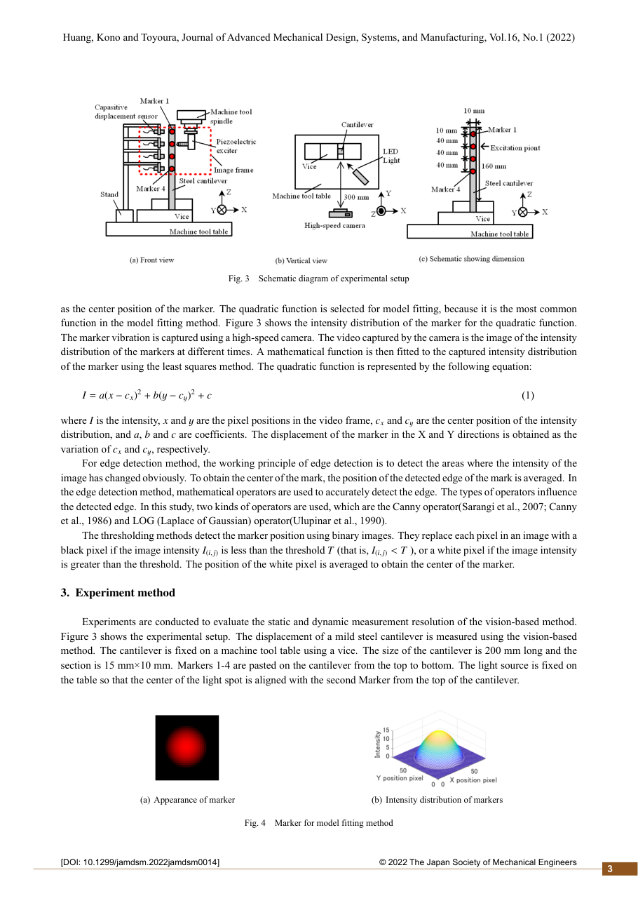
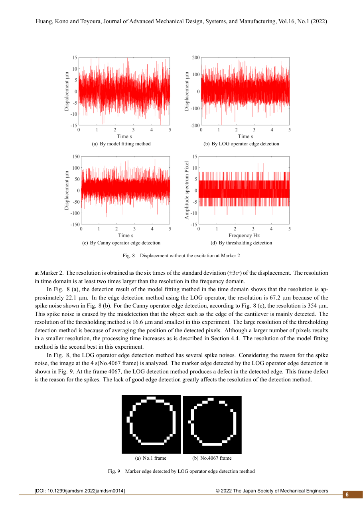
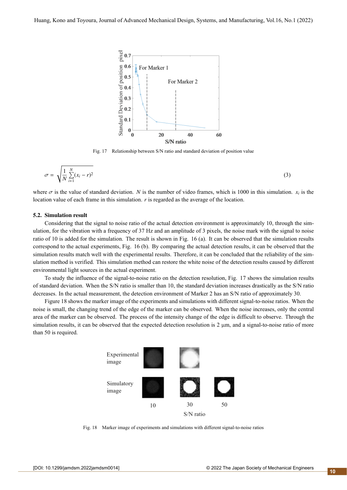

# 전문 번역: 공작기계의 영상 기반 진동 측정

- 원제: Vision-based vibration measurement of machine tool
- 저자: Haochen HUANG, Daisuke KONO, Masahiro TOYOURA
- 게재: Journal of Advanced Mechanical Design, Systems, and Manufacturing, Vol.16, No.1 (2022), JAMDSM0014
- 원문 파일: `Huang2022_JAMDSM_vision_vibration.pdf`
- 번역 범위: 전문 (초록, 본문 1~6절, 그림과 표 캡션, 감사의 글). 참고문헌은 원문 그대로 둔다.

소속
- 교토대학교 마이크로공학과, 교토시 니시쿄구 가쓰라, 615-8540
- 야마나시대학교 종합대학원, 야마나시현 고후시 다케다 4-3-11, 400-8511
- 연락: kono@prec.kyoto-u.ac.jp

접수 2021-10-26, 수정 2021-12-08, 게재 확정 2022-01-31.
논문 번호 21-00358. 오픈액세스(CC BY-NC-ND 4.0).

---

## 초록

이 연구의 목적은 공작기계의 진동과 동적 운동 오차를 재는 영상 기반 측정법을 만드는 것이다.
이 연구에서는 영상 기반 방법이 고분해능 측정에서 어느 정도까지 갈 수 있는지를 평가한다.
기계 진동 측정에 맞는 영상 처리로 모델 적합(model fitting) 방법을 검토한다.
조명이 측정 분해능에 주는 영향도 평가한다.

이 방법에서는 대상에 붙인 마커의 변위를 고속 카메라로 찍은 영상에서 얻는다.
마커 변위를 얻기 위해, 마커의 밝기 분포에 2차 함수를 맞추어 마커의 중심 위치를 추적한다.
모델 적합 방법의 측정 분해능을 평가하는 실험을 했다.
여러 진폭으로 떨리는 외팔보의 진동 변위를, 서로 다른 조명 조건에서 영상 기반 방법으로 쟀다.
측정한 변위를 주파수 영역에서 분석해 측정 분해능과 잡음 수준을 정했다.

모델 적합 방법에 더해, 에지 검출 방법과 이진화(threshold) 검출 방법으로도 마커 위치를 검출해 모델 적합 방법과 비교했다.
실험 결과, 모델 적합 방법은 최소 진폭 1/53 픽셀을 검출할 수 있었고, 이는 120 x 160 mm 범위에서 3.8 마이크로미터 분해능에 해당한다.

키워드: 영상 기반 검출, 모델 적합 검출, 진동 검출, 고속 카메라

---

## 1. 서론

제조업이 고속, 고정밀 가공을 더 많이 요구하면서, 동적 오차가 공작기계의 가공 정밀도에 주는 영향이 점점 뚜렷해지고 있다 (Ibaraki 외 2020, Go 외 2008, Ren 외 2003, McKeown 외 1973, Schwenke 외 2008, Sartori 외 1995).
동적 오차와 정적 오차의 큰 차이는 시간에 따라 변한다는 점이다.
동적 오차는 속도, 가속도 같은 요소와 이어져 있다.
따라서 동적 오차를 평가하려면 높은 주파수의 오차를 잡을 만큼 충분한 표본 주파수가 필요하다.

공작기계 오차 평가에 쓰는 기존 방법으로는 더블 볼 바(DBB), R-test, 격자 엔코더, 레이저 트래커가 있다.
DBB와 R-test는 동적 오차 평가에 쓸 수 있지만, 측정 궤적이 원운동으로 제한되기 때문에 보통은 정적 운동학 오차 측정에 쓴다.

원형 측정 궤적이라는 한계를 넘으려면 격자 엔코더를 쓸 수 있다.
격자 엔코더는 임의의 평면 운동 궤적을 측정할 수 있지만, 읽기 헤드와 격자판이 작은 간격을 일정하게 유지해야 한다.
읽기 헤드의 회전도 고정해야 한다.

레이저 트래커는 유연한 측정을 제공한다.
레이저 간섭계, 2축 조향 각도 측정부, 추적 기구로 이루어져 있다.
그러나 추적 기구의 응답이 동적 오차 측정에 영향을 준다.
레이저 트래커의 각도 측정은 불확도도 크다.
그래서 주로 대형 공작기계의 정적 또는 준정적 오차 측정에 쓴다.

새로운 측정법으로 영상 기반 측정법이 널리 검토되고 있다.
비접촉이고 3차원으로 유연하게 잴 수 있다는 장점 때문이다.
공작기계 오차 측정에서 영상 기반 방법 연구는 아직 초기 단계다.
Ibaraki 외는 단안 비전에 기반한 공작기계 오차 측정법을 제안했다 (Ibaraki 외 2011).
그러나 그 방법은 저속, 소범위 측정에만 맞았다.
공작기계 오차를 재는 기존 비전 측정법은 정적 또는 준정적 측정뿐이고, 동적 오차 측정 연구는 거의 없다.
상용 모션 캡처 시스템도 있다.
그러나 표본 주파수가 1000 Hz로 제한되어 공작기계의 동적 측정에는 모자란다.
높은 프레임률에서 영상 크기가 작아지기 때문에 측정 분해능도 수십 마이크로미터로 제한된다.
고급 고속 카메라와 알맞은 영상 처리 기법을 함께 쓰면, 공작기계에 필요한 고속, 고분해능 측정에 이를 가능성이 있다.

따라서 이 연구는 마이크로미터 수준 분해능과 수천 Hz 표본 주파수를 가진, 공작기계 동적 오차의 영상 기반 측정법을 만드는 것을 목표로 한다.
이 연구에서는 영상 기반 방법이 고분해능 측정에서 어디까지 갈 수 있는지를 평가한다.
대상 마커 위치를 추적하는 영상 처리 알고리즘인 모델 적합 방법을 검토한다.
모델 적합 방법의 측정 분해능을 실험으로 평가하고, 상용 모션 캡처 시스템에서 흔한 다른 영상 처리 방법의 분해능과 비교한다.
잡음이 분해능에 주는 영향도 시뮬레이션으로 평가해 모델 적합 방법의 분해능 한계를 논한다.

---

## 2. 마커 위치 검출을 위한 영상 처리 방법

이 연구에서는 기계 운동을 검출하려고 공작기계에 마커를 붙인다.
그림 1은 마커 위치 검출의 개요다.
마커의 운동을 영상 파일로 찍는다.
영상의 각 프레임마다 마커의 중심 위치를 검출한다.
마커의 운동은 그림 2처럼 중심 위치의 변화로 검출한다.

그림 1 영상 기반 진동 측정의 3차원 개략도
그림 2 마커 위치 검출 개략도

이 연구의 당면 목표는 200 mm x 200 mm 범위에서 검출을 해내는 것이다.
기대 분해능은 약 2 마이크로미터, 기대 정확도는 약 10 마이크로미터, 기대 표본 주파수는 2000 Hz다.
현재 상용 고속 카메라는 2000 x 2000 픽셀 영상을 2000 fps로 찍을 수 있다.
기대 분해능이 0.04 픽셀에 해당하므로, 이 연구에는 부화소(sub-pixel) 검출이 꼭 필요하다.

서로 다른 부화소 검출의 정확도를 비교하려고, 마커 위치를 검출하는 여러 영상 처리 방법이 개발되어 왔다.
주요 기존 방법은 다음 셋으로 나뉜다.

1. 모델 적합 방법
2. 에지 검출 방법
3. 이진화 방법

이 연구에서는 모델 적합 방법을 쓴다.
부화소 검출 분해능이 있고, 영상의 선명도 변화에 강건하기 때문이다.
나머지 둘은 모델 적합 방법과 비교해, 공작기계 진동 검출에서 모델 적합의 이점을 보이는 데 쓴다.

모델 적합 방법에서는 마커의 밝기 분포에 최소제곱법으로 수학 함수를 맞춘다.
오목하거나 볼록한 함수를 쓰는데, 그 꼭대기나 바닥 점을 마커의 중심 위치로 보기 때문이다.
모델 적합에 쓰는 함수로는 2차 함수를 골랐다.
모델 적합 방법에서 가장 흔한 함수이기 때문이다.
그림 3은 2차 함수에 맞춘 마커의 밝기 분포를 보여준다.

그림 3 실험 장치 개략도
그림 4 모델 적합 방법용 마커. (a) 마커의 겉모습, (b) 마커의 밝기 분포

마커의 진동은 고속 카메라로 찍는다.
카메라가 찍은 영상은 서로 다른 시각의 마커 밝기 분포를 담은 그림이다.
그다음 찍힌 마커의 밝기 분포에 최소제곱법으로 수학 함수를 맞춘다.
2차 함수는 다음 식으로 나타낸다.

식 (1):  I = a(x − cx)² + b(y − cy)² + c

여기서 I는 밝기, x와 y는 영상 프레임 안의 픽셀 위치, cx와 cy는 밝기 분포의 중심 위치, a와 b와 c는 계수다.
마커의 X 방향, Y 방향 변위는 각각 cx와 cy의 변화로 얻는다.

에지 검출 방법은 영상의 밝기가 뚜렷하게 바뀐 영역을 찾는 것이 원리다.
마크의 중심을 얻으려면, 검출한 마크 에지의 위치를 평균한다.
에지 검출 방법에서는 에지를 정확히 찾으려고 수학 연산자를 쓴다.
연산자의 종류가 검출되는 에지에 영향을 준다.
이 연구에서는 두 가지 연산자를 쓴다.
캐니(Canny) 연산자와 LOG(가우시안의 라플라시안) 연산자다.

이진화 방법은 이진 영상으로 마커 위치를 검출한다.
영상 밝기 I(i, j)가 문턱값 T보다 작으면 그 픽셀을 검은 픽셀로, 크면 흰 픽셀로 바꾼다.
흰 픽셀들의 위치를 평균해 마커의 중심을 얻는다.

---

## 3. 실험 방법

영상 기반 방법의 정적, 동적 측정 분해능을 평가하는 실험을 했다.
그림 3이 실험 장치다.
연강 외팔보의 변위를 영상 기반 방법으로 잰다.
외팔보는 바이스로 공작기계 테이블에 고정한다.
외팔보 크기는 길이 200 mm, 단면 15 mm x 10 mm다.
마커 1에서 4까지를 외팔보 위에서 아래로 붙인다.
광원은 테이블에 고정해, 빛 점의 중심이 외팔보 위에서 두 번째 마커에 맞도록 한다.

그림 5 에지 검출과 이진화 방법용 마커. (a) 마커의 겉모습, (b) 마커의 밝기 분포

정적 측정 분해능을 평가하려고, 공작기계 테이블에 X 방향 스텝 이송 운동을 준다.
스텝 거리를 바꾸어, 측정 변위에서 스텝을 알아볼 수 있는 한계를 찾는다.
동적 측정 분해능을 평가하려고, 공작기계 주축에 붙인 압전 가진기로 외팔보를 떨게 한다.
가진기에 여러 진폭의 정현파 전압을 넣는다.
가진 지점은 마커 2 자리다.
비교를 위해 정전용량 변위 센서로도 마커 진동을 잰다.
이 실험에서 진동 진폭은 광원의 범위보다 훨씬 작아서, 광원이 진동에 주는 차이는 무시할 수 있다.
520만 화소 CMOS 고속 카메라(DITECT, HAS-EF)를 쓴다.
정전용량 센서의 측정 범위는 250 마이크로미터다.
검출 정확도는 0.2 마이크로미터, 분해능은 0.025 마이크로미터다.

모델 적합 방법을 쓸 때는, 마커의 밝기 분포가 모델의 모양과 되도록 비슷해야 한다.
식 (1)에 맞추어 설계한 마커를 쓴다.
마커의 겉모습은 그림 4 (a), 밝기 분포는 그림 4 (b)에 있다.
에지 검출과 이진화에서는 마크의 에지가 되도록 또렷해야 한다.
마크 자체의 밝기와 배경 밝기 사이에 뚜렷한 차이도 있어야 한다.
그래서 그림 5처럼 단색 마커를 검출에 쓴다.

모델 적합 방법의 검출은 자체 제작한 파이썬 코드로 한다.
Scipy의 곡선 적합 함수로, 관측한 영상에 모델을 맞추어 마커 중심 위치를 추적했다.
에지 검출 방법의 검출은 MATLAB 2019b의 함수로 한다.
이진화 방법의 검출은 상용 소프트웨어 Dippmotion Pro 1.0으로 한다.

정적 측정의 스텝 거리는 10, 20, 50, 100, 200 마이크로미터다.
가진기가 주는 진동 진폭은 마커 1에서 2.2에서 31 마이크로미터이고, 가진기 입력 전압 15 Vpp에서 150 Vpp에 해당한다.
바이스의 조임력은 5 kN으로 둔다.
가진기의 예압은 50 N으로 둔다.
정전용량 변위 센서의 표본 주파수는 10 kHz다.
그림 6 (a)는 실제로 찍은 영상의 한 프레임이다.
실제 영상에서는 마커들 사이에 뚜렷한 밝기 차이가 보인다.
마커 1과 4의 밝기가 마커 2와 3보다 작다.
그림 6 (b)는 그림 6 (a)에 해당하는 장치의 겉모습이다.
다른 자세한 실험 조건은 표 1에 정리했다.

그림 6 장치의 구성과 영상. (a) 실제 촬영 영상의 한 프레임, (b) 장치의 겉모습

표 1 실험 조건

| 항목 | 값 |
|---|---|
| 가진 주파수 | 37 Hz |
| 카메라 프레임률 | 1000 fps |
| 마커 지름 | 3 mm |
| 측정 시간 | 7 s |
| 정전용량 변위 센서 표본 주파수 | 10,000 Hz |
| 압전 가진기 예압 | 50 N |
| 프레임 크기 | 120 x 160 mm, 600 x 800 픽셀 |

---

## 4. 실험 결과

### 4.1 정적 측정 분해능

그림 7은 네 가지 영상 기반 검출 방법으로 잰 마커 2의 변위다.

그림 7 정적 분해능 측정 결과. (a) 모델 적합 방법, (b) LOG 연산자 에지 검출, (c) 캐니 연산자 에지 검출, (d) 이진화 검출

그림 7 (a)에서 모델 적합 방법의 검출 결과를 보면, 변위가 20 마이크로미터일 때 위치 변화를 알아볼 수 있다.
그림 7 (b)와 (c)의 에지 검출 결과에서는 정상 상태의 변위 흔들림이 모델 적합 방법보다 크다.
이 큰 변위 흔들림의 이유는 4.2절에서 논한다.
그림 7 (b), (c)에서는 측정 분해능을 정하기 어렵지만, 분해능은 작아야 200 마이크로미터로 보인다.
에지 검출 방법에서는 측정 변위와 명령 변위의 차이도 모델 적합 방법보다 크다.
외팔보의 모서리가 에지로 검출되었기 때문이다.
마커 변위가 너무 커서 외팔보의 모서리가 검출 영역에 들어왔다.
그림 7 (d)의 이진화 검출 결과는 모델 적합 방법과 비슷하다.
20 마이크로미터 변위를 또렷하게 검출할 수 있다.

### 4.2 시간 영역의 측정 분해능

이 절에서는 시간 영역의 측정 분해능을 평가한다.
가진이 없을 때의 변위 흔들림 진폭을 분해능으로 정한다.
그림 8은 마커 2에서 가진이 없을 때의 변위다.

그림 8 마커 2에서 가진이 없을 때의 변위. (a) 모델 적합 방법, (b) LOG 연산자 에지 검출, (c) 캐니 연산자 에지 검출, (d) 이진화 검출

분해능은 변위 표준편차의 6배(즉 ±3σ)로 얻는다.
시간 영역의 분해능은 주파수 영역의 분해능보다 적어도 2배 크다.

그림 8 (a)에서 모델 적합 방법의 시간 영역 검출 결과를 보면 분해능은 약 22.1 마이크로미터다.
LOG 연산자를 쓴 에지 검출에서는 그림 8 (b)의 스파이크 잡음 때문에 분해능이 67.2 마이크로미터다.
캐니 연산자 에지 검출은 그림 8 (c)에 따르면 분해능이 354 마이크로미터다.
이 스파이크 잡음은 외팔보의 모서리 같은 다른 물체가 주로 검출되는 오검출에서 생긴다.
이진화 방법의 분해능은 16.6 마이크로미터로 이 실험에서 가장 작다.
이진화 검출 방법의 분해능이 좋은 이유는 검출된 픽셀들의 위치를 평균하기 때문이다.
픽셀 수가 많을수록 분해능은 작아지지만, 4.4절에 적은 대로 처리 시간이 늘어난다.
모델 적합 방법의 분해능은 이 실험에서 두 번째로 좋다.

그림 8에서 LOG 연산자 에지 검출 방법에는 스파이크 잡음이 여러 번 나온다.
스파이크 잡음의 이유를 보려고 4초 지점(4067번 프레임)의 영상을 분석했다.
LOG 연산자 에지 검출이 찾은 마커 에지는 그림 9에 있다.
4067 프레임에서 LOG 검출 방법은 검출된 에지에 결손을 만든다.
이 프레임 결손이 스파이크의 원인이다.
좋은 에지 검출이 안 되면 검출 방법의 분해능이 크게 나빠진다.

그림 9 LOG 연산자 에지 검출 방법으로 찾은 마커 에지. (a) 1번 프레임, (b) 4067번 프레임

### 4.3 주파수 영역의 측정 분해능

실험 결과 분석에서는 밝기가 서로 다른 마커 1과 마커 2의 검출 결과를 분석한다.
측정 분해능을 평가하려고 변위 검출의 최소 진폭 한계를 구한다.

그림 10 모델 적합 방법으로 잰 변위의 진폭 스펙트럼. (a) 밝기가 더 높은 마커 1, (b) 밝기가 더 낮은 마커 2
그림 11 LOG 연산자 에지 검출 방법으로 잰 변위의 진폭 스펙트럼. (a) 마커 1, (b) 마커 2

그림 10은 2차 함수를 쓴 모델 적합 방법으로 잰 마커 변위의 진폭 스펙트럼이다.
37 Hz의 봉우리가 가진기가 준 진동이다.
진동이 작을수록 봉우리도 작게 나타난다.
각 결과는 정전용량 변위 센서로 잰 여러 진동 진폭에 대한 진폭 스펙트럼이다.
최소 검출 한계는, 37 Hz의 봉우리가 배경 잡음의 2배 이상일 때 정전용량 변위 센서가 잰 진폭으로 정의한다.
이 정의에 따라 최소 검출 한계는 마커 2에서 3 마이크로미터로 정해진다.
이 최소 한계는 1/67 픽셀에 해당한다.

그림 11은 LOG 연산자 에지 검출로 잰 진폭 스펙트럼이다.
이 실험에서 LOG 연산자의 크기는 0.001로 둔다.
검출 분해능 정의에 따르면 21 마이크로미터보다 큰 진폭의 진동을 검출할 수 있다.
그림 12는 캐니 연산자 에지 검출로 잰 진폭 스펙트럼이다.
캐니 연산자 에지 검출 방법은 몇몇 조건에서 마커 위치를 검출하지 못했다.
맞는 에지를 찾으려면 연산자를 여러 번 조정해야 하기 때문이다.
이 방법의 검출 분해능은 빛 조건이 더 좋은 마커 2에서 약 11.2 마이크로미터다.

그림 12 캐니 연산자 에지 검출 방법으로 잰 변위의 진폭 스펙트럼. (a) 마커 1, (b) 마커 2
그림 13 이진화 검출 방법으로 잰 변위의 진폭 스펙트럼. (a) 마커 1, (b) 마커 2

그림 13은 이진화 검출 방법으로 잰 진폭 스펙트럼이다.
검출 분해능 정의에 따르면 6.8 마이크로미터보다 큰 진폭의 진동을 검출할 수 있다.
얻은 측정 분해능은 표 2에 정리했다.
모델 적합 방법으로 잰 마커 1의 분해능은 이진화 검출 방법과 비슷하지만, 빛 조건이 더 좋은 마커 2의 분해능은 모델 적합 방법이 다른 방법보다 낫다.

### 4.4 검출 시간

마커 위치를 검출하는 영상 처리에 걸리는 시간을 비교한다.
그림 14는 영상 파일 한 개를 한 번 분석하는 데 방법마다 걸린 시간이다.
모델 적합 방법은 영상 한 개를 약 3분 45초에 안정적으로 처리한다.
에지 검출 방법의 1회 검출 시간은 약 40초다.
실제 촬영에서는 빛 조건이 다르면 가장 알맞은 연산자 값도 달라진다.
그래서 요구를 맞추려면 연산자 값을 여러 번 조정해야 한다.
검출 정확도 요구에 따라, 영상 한 개의 검출 시간은 40초의 정수배가 된다.
이진화 검출은 영상 한 개 분석을 마치는 데 17분이 걸린다.
이 긴 처리 시간은 이진화 과정이 많기 때문이다.
마커 영상을 이루는 모든 픽셀마다 이진화를 해야 한다.
다른 방법과 비교해, 모델 적합 방법이 영상 한 개를 검출하는 데 시간과 단계가 가장 적다.

표 2 얻은 분해능

| 검출 방법 | 마커 1 | 마커 2 |
|---|---|---|
| 모델 적합 | 10 마이크로미터 | 3 마이크로미터 |
| LOG 에지 검출 | 16.6 마이크로미터 | 21 마이크로미터 |
| 캐니 에지 검출 | 31 마이크로미터보다 큼 | 11.2 마이크로미터 |
| 이진화 | 10 마이크로미터 | 6.8 마이크로미터 |

---

## 5. 잡음이 측정 분해능에 주는 영향

4절의 결과는 모델 적합 방법이 짧은 처리 시간에 높은 분해능을 낼 가능성이 있음을 보였다.
그러나 얻은 분해능은 아직 목표 분해능에 못 미친다.
표 2는 빛 조건이 좋을수록 백색 잡음이 작아지고 분해능이 높아질 수 있음을 보여준다.
이 절에서는 목표 분해능에 필요한 신호 대 잡음비를 밝히려고, 백색 잡음이 측정 분해능에 주는 영향을 시뮬레이션으로 살핀다.
같은 신호 대 잡음비 조건에서 시뮬레이션과 실험 결과를 비교해 검증한다.
시뮬레이션 방법을 검증한 뒤, 서로 다른 신호 대 잡음비에서 백색 잡음이 측정 분해능에 주는 영향을 살피고, 실험 환경의 조명 조건에 대한 요구를 제시한다.

그림 14 검출 시간 비교
그림 15 시뮬레이션용 마커 밝기의 3차원 그림

### 5.1 시뮬레이션 방법

이 시뮬레이션에서 마커 밝기의 모델은 회색조 모델이다.
식 (1)로 마커 영상을 만들어 시뮬레이션한다.
정해진 범위 안의 무작위 잡음을 더한다.
잡음을 넣은 마커 영상을 독립적으로 1000번 이어 붙여 인공 마커 영상을 만든다.
2차 함수를 쓴 모델 적합 방법으로 마커의 위치를 얻는다.
이 시뮬레이션을 여러 잡음 수준에서 되풀이해, 잡음 수준이 검출 위치의 흔들림에 주는 영향을 평가한다.
촬영 환경과 마커 2의 실제 촬영 결과를 분석해, 설계한 밝기 모델은 식 (2)와 같다.

식 (2):  I = −17.31 d² + 1731

I는 각 픽셀에서 모델의 밝기이고, d는 그 픽셀에서 마커 중심까지의 거리다.

이 시뮬레이션에서 영상 취득 영역은 30 x 30 픽셀이고 마커 반지름은 10.49 픽셀이다.
계산해 보면 상한 255에 닿는 마커 꼭대기는 원 모양이다.
그 원의 반지름은 8.062 픽셀로, 실제 상황과 거의 같다.
그림 15는 시뮬레이션에서 잡음이 없을 때의 마커 밝기 분포로, 실험의 것과 비슷하다.
중심 부근의 밝기는 최대 한계로 포화한다.
중심부의 밝기가 카메라의 수광 범위를 넘기 때문이다.
잡음을 여러 정도로 넣으면 검출 분해능과 신호 대 잡음비의 관계를 살필 수 있다.
회색조 값의 단위는 순백에서 순흑까지 256단계 중 하나다.
넣은 잡음의 범위는 10에서 250이다.
검출 위치에서 잡음의 크기는 표준편차로 평가한다.
표준편차는 다음 식으로 얻는다.

식 (3):  σ = sqrt( (1/N) Σ (xi − r)² )

σ는 표준편차 값이다.
N은 영상 프레임 수로, 이 시뮬레이션에서는 1000이다.
xi는 이 시뮬레이션에서 각 프레임의 위치 값이다.
r은 위치의 평균으로 본다.

그림 16 시뮬레이션과 실험 결과 비교. (a) 시뮬레이션 결과, (b) 실험 결과

### 5.2 시뮬레이션 결과

실제 검출 환경의 신호 대 잡음비가 약 10임을 고려해, 주파수 37 Hz, 진폭 3 픽셀의 진동에 신호 대 잡음비 10의 잡음 표시를 넣어 시뮬레이션했다.
결과는 그림 16 (a)에 있다.
시뮬레이션 결과가 실제 실험인 그림 16 (b)와 맞는 것을 볼 수 있다.
실제 검출 결과와 견주어 보면 시뮬레이션 결과가 실험 결과와 잘 맞는다.
따라서 시뮬레이션 방법의 신뢰성이 검증되었다고 할 수 있다.
이 시뮬레이션 방법은 실제 실험에서 환경 광원에 따라 생기는 검출 결과의 백색 잡음을 되살릴 수 있다.

그림 17 S/N 비와 위치 값 표준편차의 관계

신호 대 잡음비가 검출 분해능에 주는 영향을 살피려고, 그림 17에 표준편차의 시뮬레이션 결과를 보였다.
S/N 비가 10보다 작아지면 S/N 비가 줄어들수록 표준편차가 급격히 커진다.
실제 측정에서 마커 2의 검출 환경은 S/N 비가 약 30이다.

그림 18은 서로 다른 신호 대 잡음비에서의 실험과 시뮬레이션 마커 영상이다.
잡음이 작으면 마커 에지의 변화 흐름을 볼 수 있다.
잡음이 커지면 마커의 중심 영역만 보인다.
에지의 밝기 변화 과정은 보기 어렵다.
시뮬레이션 결과로 보면, 기대 검출 분해능 2 마이크로미터에는 50보다 큰 신호 대 잡음비가 필요하다.

그림 18 서로 다른 신호 대 잡음비에서의 실험과 시뮬레이션 마커 영상

---

## 6. 결론

기계 진동의 영상 기반 측정 가능성을 살폈다.
평면 마커 스티커를 붙이고 마커의 밝기 분포 중심을 검출해 마커 위치의 변위를 얻었다.
부화소 분해능과 영상 선명도에 대한 강건성 때문에 모델 적합 방법에 초점을 두었다.

스텝 이송 운동의 측정 결과에서, 모델 적합 방법과 이진화 방법은 20 마이크로미터 스텝을 검출했다.
에지 검출 방법은 측정 분해능을 정하기 어려웠지만, 분해능은 작아야 200 마이크로미터로 보였다.
측정 오차는 마커 에지의 오검출에서 생겼다.
시간 영역에서 모델 적합 방법의 분해능은 22.1 마이크로미터로 1/9 픽셀에 해당했고, 시험한 검출 방법 중 두 번째로 좋았다.
주파수 영역에서 모델 적합 방법은 3.8 마이크로미터, 즉 1/53 픽셀의 진동을 검출해 가장 좋았다.
모델 적합 방법의 검출 시간은 약 4000장에 약 240초였다.
이 결과는 모델 적합 방법이 분해능과 처리 시간의 균형이 좋음을 보여준다.

모델 적합 방법이 더 높은 분해능에 이를 가능성을 보려고, 백색 잡음이 측정 분해능에 주는 영향을 시뮬레이션했다.
만든 시뮬레이션은 실험 결과에서 잡음의 영향을 잘 재현했다.
시뮬레이션 결과, 목표 분해능 1/50 픽셀에는 신호 대 잡음비 50이 필요했다.

이 연구에서 얻은 실험 분해능은 목표 분해능보다 컸지만, 결과는 기계 진동 측정의 가능성을 보여주었다.
앞으로는 자체 발광 마커로 신호 대 잡음비를 높여 더 높은 분해능에 이르려 한다.
촬영 방향이 달라져도 마커의 밝기 분포가 고르게 되는 것이 유연한 측정을 위한 또 다른 과제다.

## 감사의 글

이 연구는 미쓰토요 과학기술진흥재단(MAST)의 지원을 받았다.
저자들은 이 지원에 감사한다.

---

## 번역 메모

- 본문 4.3절은 모델 적합 방법의 마커 2 최소 검출 한계를 3 마이크로미터, 1/67 픽셀로 적었다. 초록과 결론은 3.8 마이크로미터, 1/53 픽셀로 적었다. 표 2는 3 마이크로미터다. 원문 안에서 수치가 서로 어긋난다.
- 프레임 크기 120 x 160 mm가 600 x 800 픽셀이므로 1 픽셀은 200 마이크로미터다. 이 환산으로 22.1 마이크로미터는 1/9 픽셀, 3.8 마이크로미터는 1/53 픽셀, 3 마이크로미터는 1/67 픽셀로 각각 맞는다.
- 그림은 원문 쪽을 그대로 이미지로 넣었다. 그림 3이 든 쪽, 그림 8이 든 쪽, 그림 17이 든 쪽이다.

## 참고문헌 (원문 그대로)

Abe, G., Aritoshi, M., Tomita, T. and Shirase, K., Machining error compensation based on 3D surface model modified by measured accuracy, Journal of Advanced Mechanical Design, Systems, and Manufacturing, Vol.2, No.4 (2008), pp.792-799.

Aguado, S., Samper, D. and Santolaria, J., Identification strategy of error parameter in volumetric error compensation of machine tool based on laser tracker measurements, International Journal of Machine Tools and Manufacture, Vol.53, No.1 (2012), pp.160-169.

Aguado, S., Influence of measurement noise and laser arrangement on measurement uncertainty of laser tracker multilateration in machine tool volumetric verification, Precision Engineering, Vol.37, No.4 (2013), pp.929-943.

Alessandro, V., Gianni, C. and Antonio, S., Axis geometrical errors analysis through a performance test to evaluate kinematic error in a five axis tilting-rotary table machine tool, Precision Engineering, Vol.39 (2015), pp.224-233.

Alexander, M. A., Jonathan, S. D. and William, S. M., Accuracy map of an optical motion capture system with 42 or 21 cameras in a large measurement volume, Journal of Biomechanics, Vol.58 (2017), pp.237-240.

Chen, J., Lin, S. and He, B., Geometric error measurement and identification for rotary table of multi-axis machine tool using double ballbar, International Journal of Machine Tools and Manufacture, Vol.77 (2014), pp.47-55.

Du, Z. C., Lv, C. F. and Hong, M. S., Research on error modelling and identification of 3 axis NC machine tools based on cross grid encoder measurement, Journal of Physics: Conference Series, Vol.48, No.1 (2006), pp.17.

Florussen, G. and Spaan, H., Static R-test: allocating the centreline of rotary axes of machine tools, Laser Metrology and Machine Performance VIII, Lamdamap, Vol.8 (2007), pp.196-202.

Hideaki, T., Yoshiyuki, M., Kayoko, T., Hideki, A. and Kazuo, Y., Development of a three-dimensional encoder for highly accurate positioning, Journal of the Japan Society of Precision Engineering, Vol.85, No.10 (2019), pp.891-895.

Hong, C. and Ibaraki, S., Non-contact R-test with laser displacement sensors for error calibration of five-axis machine tools, Precision Engineering, Vol.37, No.1 (2013), pp.159-171.

Hong, C., Ibaraki, S. and Oyama, C., Graphical presentation of error motions of rotary axes on a five-axis machine tool by static R-test with separating the influence of squareness errors of linear axes, International Journal of Machine Tools and Manufacture, Vol.59 (2012), pp.24-33.

Ibaraki, S. and Andreas, A., Special issue on machine accuracy evaluation, International Journal of Automation Technology, Vol.14, No.3 (2020), pp.359.

Ibaraki, S., Oyama, C. and Otsubo, H., Construction of an error map of rotary axes on a five-axis machining center by static R-test, International Journal of Machine Tools and Manufacture, Vol.51, No.3 (2011), pp.190-200.

Ibaraki, S. and Tanizawa, Y., Vision-based measurement of two-dimensional positioning errors of machine tools, Journal of Advanced Mechanical Design, Systems, and Manufacturing, Vol.5, No.4 (2011), pp.315-328.

Jiang, X. and Cripps, R. J., A method of testing position independent geometric errors in rotary axes of a five-axis machine tool using a double ball bar, International Journal of Machine Tools and Manufacture, Vol.89 (2015), pp.151-158.

John, C., A computational approach to edge detection, IEEE Transactions on Pattern Analysis and Machine Intelligence, Vol.6 (1986), pp.679-698.

Kahlmann, T., Remondino, F. and Ingensand, H., Calibration for increased accuracy of the range imaging camera swissranger TM, Image Engineering and Vision Metrology (IEVM), Vol.36, No.3 (2006), pp.136-141.

Leardini, A., Sawacha, Z., Paolini, G., Ingrosso, S., Nativo, R. and Benedetti, M. G., A new anatomically based protocol for gait analysis in children, Gait Posture, Vol.26, No.4 (2007), pp.560-571.

Lee, K. and Yang, S., Measurement and verification of position-independent geometric errors of a five-axis machine tool using a double ball-bar, International Journal of Machine Tools and Manufacture, Vol.70 (2013), pp.45-52.

Mardia, K. V. and Hainsworth, T. J., A spatial thresholding method for image segmentation, IEEE Transactions on Pattern Analysis and Machine Intelligence, Vol.10, No.6 (1988), pp.919-927.

McKeown, P. A. and Loxham, J., Some aspects of the design of high precision measuring machines, CIRP Annals - Manufacturing Technology, Vol.22, No.1 (1973), pp.139-140.

Noriyuki, K., Masaomi, T., Yu, T., Ryuta, S. and Yukitoshi, I., Sensitivity Analysis in Ball Bar Measurement of Three-Dimensional Circular Movement Equivalent to Cone-Frustum Cutting in Five-Axis Machining Centers, Journal of Advanced Mechanical Design, Systems, and Manufacturing, Vol.7, No.3 (2013), pp.317-332.

Otsuki, T., Sasahara, H. and Sato, R., A method for the evaluation and magnified representation of two-dimensional contouring error, Precision Engineering, Vol.50 (2017), pp.433-439.

Sarangi, S. and Rath, N. P., Performance analysis of fuzzy-based canny edge detector, International Conference on Computational Intelligence and Multimedia Applications (ICCIMA 2007), Vol.3 (2007), pp.272-276.

Sartori, S. and Zhang, G., Geometric error measurement and compensation of machines, CIRP Annals - Manufacturing Technology, Vol.44, No.2 (1995), pp.599-609.

Schwenke, H., Knapp, W. and Haitjema, H., Geometric error measurement and compensation of machines-An update, CIRP Annals - Manufacturing Technology, Vol.57, No.2 (2008), pp.660-675.

Tsuboi, K. and Ibaraki, S., C002 Estimation of machine tool volumetric error based on the multi-lateration principle using machine tool rotary axes: two-dimensional case, Proceedings of International Conference on Leading Edge Manufacturing in 21st century: LEM21, Vol.7, No.2 (2013), pp.308-312.

Ulupinar, F. and Medioni, G., Refining edges detected by a LoG operator, Computer Vision, Graphics, and Image Processing, Vol.51, No.3 (1990), pp.275-298.

Wanner, S. and Goldluecke, B., Globally consistent depth labeling of 4D light fields, 2012 IEEE Conference on Computer Vision and Pattern Recognition (2012), pp.41-48.

Weikert, S., R-Test, a new device for accuracy measurements on five axis machine tools, CIRP Annals-Manufacturing Technology, Vol.53, No.1 (2004), pp.429-432.

Westfeld, P. and Maas, H. G., Integrated 3D range camera self-calibration, Photogrammetrie-Fernerkundung-Geoinformation, Vol.6, No.6 (2013), pp.589-602.

Yaoqing, Y., Chen, F., Yiru, S. and Dong, T., Foldingnet: point cloud auto-encoder via deep grid deformation, Proceedings of the IEEE Conference on Computer Vision and Pattern Recognition (2018), pp.206-215.

Yongqiang, R., Jianguo, Y. and Xiaolong, D., Analysis on the error synthesis model of a five-axis machine center, Journal of Shanghai Jiao tong University, Vol.37, No.1 (2003), pp.70-75.
