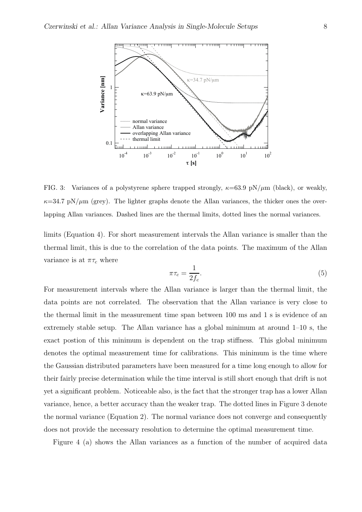
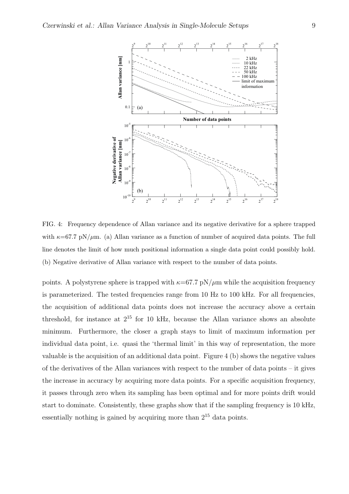
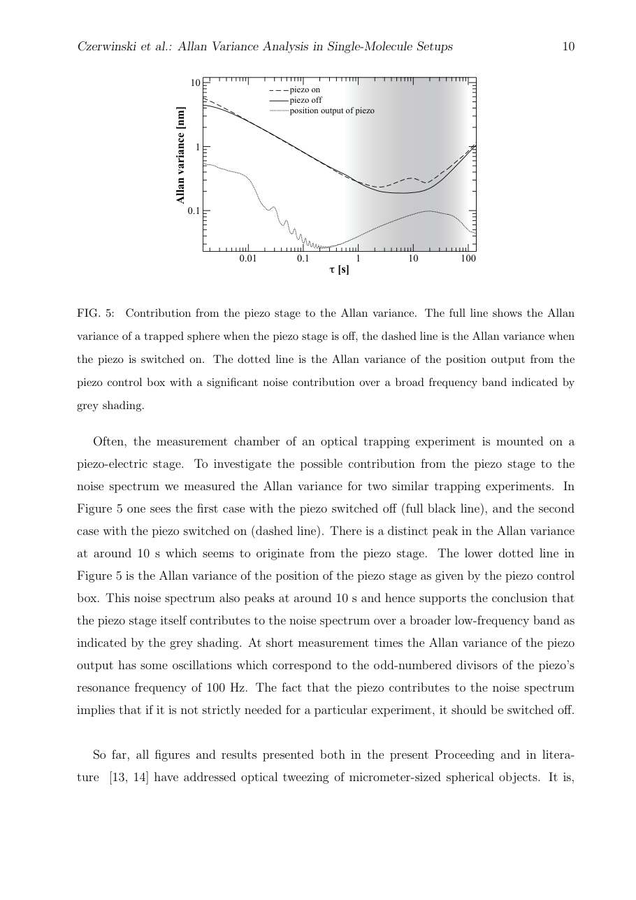

# 번역: 앨런 분산으로 광집게의 잡음을 정량화하기

번역 범위: 초록만

- 원제: Quantifying Noise in Optical Tweezers by Allan Variance
- 저자: Fabian Czerwinski, Andrew C. Richardson, Lene B. Oddershede (코펜하겐대 닐스보어연구소)
- 서지: Optics Express 17(15), 13255-13269, 2009-07-17
- DOI: https://doi.org/10.1364/oe.17.013255

원문 PDF 미확보 사유
- 2026-11-04 확인. Optica(opg.optica.org)의 viewmedia와 fulltext 주소 모두 Radware 캡차 화면(HTML)을 돌려주었다. 봇 차단은 우회하지 않았다.
- Unpaywall과 OpenAlex는 gold OA라고 표시하지만 저장소 사본이 없고 url_for_pdf도 비어 있다.
- OpenAlex가 알려 준 다른 위치는 PubMed 기록(19654731), 애들레이드대 handle(2440/67285, 404), 코펜하겐대 CURIS 기록 페이지뿐이다.
- arXiv에 이 논문은 없다(제목, 저자 검색 0건).
- 공개 논문이라 브라우저로 DOI 주소를 열면 받을 수 있다. [원문_받을_목록.md](../../../../원문_받을_목록.md)에 적었다.

## 초록 (전문 번역)

광집게 실험에서는 잡음을 줄이려고 많은 노력을 들인다.
잡음과 드리프트가 단분자 실험 같은 계의 본질적 거동을 가릴 수 있기 때문이다.
잡음을 줄이거나 없애려는 여러 시도가 있었지만, 그 효과를 정량화하기는 어려웠다.
우리는 광집게 장치의 잡음을 정량화하는 간단하고 효율적인 방법으로 앨런 분산을 쓸 것을 제안한다.
이 방법을 적용해 최적 측정 시간, 최적 주파수, 검출 방식을 정하고, 실험실 음향 잡음의 영향을 정량화한다.
이 방법은 실행 중인 실험의 최적 조건을 실시간으로 정하는 데에도 쓸 수 있다.

(원문 영어 초록은 OpenAlex와 Unpaywall 기록에서 확인했다.)

---

# 부록: 같은 저자들의 동반 프로시딩 (전문 번역)

아래는 위 Optics Express 논문이 아니다.
같은 저자들이 같은 해에 같은 방법을 정리해 낸 SPIE 프로시딩이고, 본문 안에서 위 논문을 참고문헌 [14]로 인용한다.
원문 PDF를 받을 수 있어 전문을 번역해 둔다.
수치를 인용할 때는 이 프로시딩으로 적어야 한다.

- 원제: Allan Variance Analysis as Useful Tool to Determine Noise in Various Single-Molecule Setups
- 저자: Fabian Czerwinski, Andrew C. Richardson, Christine Selhuber-Unkel, Lene B. Oddershede
- 서지: arXiv:0908.4484v1 [physics.data-an], 2009-08-31. SPIE Optics+Photonics 2009 프로시딩. 14쪽.
- 원문 파일: 같은 폴더의 `Czerwinski2009_arXiv0908.4484_동반_프로시딩.pdf`
- 링크: https://arxiv.org/abs/0908.4484

## 초록

광집게 성능을 제한하는 하나는 모든 장치에 본래 들어 있는 잡음이다.
그래서 대부분의 실험자는 광 포획 실험에서 잡음을 최소화하고 가능하면 없애고 싶어 한다.
그 첫걸음은 계의 실제 잡음을 정량화하고, 각 부품이 전체 잡음에 얼마나 보태는지 평가하는 것이다.
이를 위해 우리는 앨런 분산 분석을 간단한 방법으로 제시한다.
특히 저주파 잡음을 낳는 드리프트의 영향을 판정할 수 있게 해 준다. 드리프트는 다른 방법으로는 집어내기가 매우 어렵다.
교정에 쓸 최적 표본 시간, 원하는 실험에 필요한 최적 데이터 점 수를 정하는 방법을 보이고, 데이터 점을 더 모을 때 정확도가 얼마나 더해지는지 측정값으로 보여 준다.
마이크로미터 크기의 구와 비대칭 나노미터 막대의 앨런 분산을 함께 다룬다.

주제어: 광집게, 광 포획, 잡음, 드리프트, 교정, 앨런 분산, 피에조 스테이지, 나노막대

## 서론

광집게는 단분자를 다루고 관찰하는 데 알맞은 나노 도구다 [1].
파장을 잘 고르면 거의 비침습이라 살아 있는 미생물을 통째로 다루거나 [2, 3] 세포 안 소기관을 추적할 수 있다 [4].
단분자 실험에서는 보통 손잡이, 예를 들어 마이크로미터 크기의 유전체 구를 관심 분자에 붙인다.
그러면 광집게가 손잡이의 움직임을 따라가며 손잡이에 걸린 힘을 피코뉴턴 이하 분해능으로 계산한다.
손잡이는 흔히 지름 몇 마이크로미터의 폴리스티렌 구지만, 금 구 [5], 금 나노막대 [6], 은 나노입자 [7], 개별 양자점 [8] 같은 나노입자도 하나씩 붙잡아 힘 변환자로 쓸 수 있다.

단분자 실험에서는 분자가 움직인 거리와 가한 힘을 되도록 정확히 재는 것이 매우 중요하다 [9].
그래서 잡음과 드리프트를 줄이거나 없애고, 힘 교정을 되도록 정확히 하는 일이 핵심이다.
잡음을 줄이려는 노력은 많았다.
예를 들어 압력 변동을 없애려고 장치 전체를 덮기도 하고, 장비를 광학 테이블에, 때로는 건물과 분리된 기초 위에 놓기도 한다.
드리프트를 없애는 한 가지 성공한 방법은, 포획 레이저와 나란한 또 하나의 레이저빔으로 관심 손잡이 가까이 붙인 기준 표지의 움직임을 추적하는 것이다. 이 표지는 비슷한 드리프트를 겪는다 [10].
다만 이 방식은 레이저빔 둘과 독립된 검출계 둘이 필요하다.
광 포획 장치에서 드리프트를 줄이려고 자주 쓰는 또 하나는, 드리프트가 큰 표면에서 계를 멀리 떼어 놓는 것이다.
덫을 둘 쓰고 관심 분자를 두 손잡이 사이에 매다는 식이다.
그런데 이런 방법들이 얼마나 효과가 있는가?
광 포획 실험에서 정말 걱정해야 할 잡음은 어느 종류인가?
이 질문에 답하려면 장비 각 부분과 주변이 넣는 잡음을 정량화할 수 있어야 한다.

푸리에 분석은 광집게를 실시간으로 교정하는 데 훌륭한 도구다.
또 전력 스펙트럼의 고주파 쪽에 나타나는 봉우리는 특정 잡음원으로 거슬러 올라가기 쉽다.
그러나 푸리에 분석은 저주파 잡음, 곧 실험에 본래 있는 드리프트가 만드는 잡음을 찾아 정량화하는 데는 알맞지 않다.
푸리에 분석으로 특정 실험 조건에서 오는 잡음을 판정한 예는 있지만 [11, 12], 그런 분석은 적분 대역폭에 여러 가정을 두어야 한다.
또 보통의 위치 분산도 잡음 척도로 자주 쓴다.
그러나 보통 분산은 백색 잡음 같은 순수한 확률 잡음에 대해 수렴하지 않는다.

이 프로시딩에서 우리는 광 포획 설비의 잡음을 집어내고 정량화하는 간단하고 효율적인 도구로 앨런 분산 분석을 제안한다.
광으로 붙잡힌 입자가 지나간 위치들의 앨런 분산은 실험 중에 실시간으로 계산할 수 있고, 예를 들어 정확한 교정에 필요한 시계열 길이를 정하는 데 쓸 수 있다 [13, 14].
드리프트가 없는 모의 자료와 비교해, 앨런 분산이 저주파 드리프트를 집어내고 정량화하는 훌륭한 도구임을 명시적으로 보인 바 있다 [14, 15].
앨런 분산 분석은 CMOS 카메라가 광으로 붙잡힌 입자를 추적하기에 충분한 시간 분해능을 가졌는지 확인하는 데 쓰이기도 했다 [13].
또 광 포획 실험에서 흔히 쓰는 광다이오드 검출계의 잡음 기여를 드러낼 수 있어 [14], 어떤 실험에 위치 민감 다이오드를 쓸지 보통의 4분할 광다이오드를 쓸지 근거 있게 고르는 바탕이 된다.
나아가 앨런 분산은 피에조 스테이지, 실험실 음향 잡음, 시료 챔버의 모양과 안정성이 잡음 스펙트럼에 주는 영향을 드러냈다.
푸리에 분석을 보완하고 더해, 앨런 분산 분석은 최적 장치 설계의 바탕이 된다 [14].
이 프로시딩에서는 그 결과 일부를 정리한다.
더해 데이터 점을 더 모아 측정의 앨런 분산을 얼마나 개선할 수 있는지, 비대칭 금 나노막대의 앨런 분산은 어떤지 보인다.

## 방법

레이저빔을 역상 현미경(Leica DMIRBE) 안 피에조 스테이지에 올린 측정 챔버 속으로 모아 광 덫을 만든다.
폴리스티렌 구(Bangs Laboratories, 지름 (800 ± 10) nm)를 붙잡을 때는 수침 대물렌즈(Leica, HCX, 63x, NA=1.20)를 색 보정 최저값(0.13 mm)으로 썼고, 커버 글라스 둘(아래 두께 0.13~0.16 mm, 위 1 mm)을 양면 테이프로 붙인 측정 챔버를 썼다.
실제 덫은 챔버 가운데(전체 높이 (95 ± 5) μm)에 만들었다.
금 나노막대를 붙잡을 때는 [6] 유침 대물렌즈(Leica, HCX PL Apo, 63x, NA=1.32)를 썼고, 구면 수차를 상쇄하도록 침지유를 골랐다 [16].
여기서는 커버 글라스 둘(아래 0.16~0.19 mm, 위 1 mm)을 파라필름으로 붙여 챔버를 만들었다.
나노막대는 바닥에서 5 μm 위에 붙잡았다.
막대 치수는 긴 축 x = (63.8 ± 7.4) nm, 짧은 축 y = (37.3 ± 5.0) nm였다(측정 전에 투과 전자현미경으로 확인).
모든 경우 측정 챔버는 증발을 막으려고 진공 그리스로 봉했다.
레이저빔의 지향 안정성을 최적으로 하려고 실험 최소 1시간 전에 레이저를 켰다.
모든 측정은 실온에서 했다.

그림 1 캡션: 실험 개요도. 세게 모은 적외선 레이저빔이 직접 만든 측정 챔버 안에서 폴리스티렌 구를 붙잡는다. 챔버는 피에조 스테이지 위에 있다. 전방 산란광은 광다이오드에 모이고, 광다이오드가 구의 위치를 수집 장치로 보낸다.

전방 산란광은 위치 민감 광다이오드(Pacific Silicon Sensor, DL100-7PCBA3)나 4분할 광다이오드(Hamamatsu, S5981)에 모인다.
그 전압 출력은 증폭기, 100 kHz 저역 통과 필터, 수집 카드(National Instruments, PCI-6251)를 거쳐 컴퓨터로 들어간다.
Labview로 직접 만든 데이터 스트리밍 소프트웨어 [17] 덕분에 수집 자료량에 제한을 받지 않았다(1 kHz에서 2시간, 100 kHz에서 22분 시험).

붙잡힌 구에 대해서는 보통 여러 수집 주파수에서 얻은 2^24개 위치의 연속 시계열에 분석을 적용했다.
나노막대는 22 kHz에서 얻은 2^21개 위치 시계열을 썼다.
추가 필터링은 모두 수집 뒤에 했다.
실험 직전과 직후에 구를 눈으로 확인할 때는 CCD 카메라(Sony, XC-ES50, 25 Hz)를 썼고, 나노막대는 광학적으로 볼 수 없었다.

### 교정

광으로 붙잡힌 물체는 조화 힘 F = -κx 를 받는다. κ는 덫 강성, x는 평형 위치에서의 거리다.
따라서 κ가 붙잡힌 물체의 열 운동을 특징짓는다.
분석에서는 보통 랑주뱅 방정식을 풀어 푸리에 변환한다.
그 결과인 위치 전력 스펙트럼에서 κ와 마찰 계수 γ의 비, 곧 코너 주파수 f_c를 찾는다.

  f_c = κ / (2πγ)   (1)

구가 어떤 표면에서도 멀리 떨어져 붙잡혀 있으면 스토크스 법칙으로 γ = 6πηr 다. r은 구의 반지름, η는 주변 매질의 점도다. 여기서는 모든 실험에서 탈이온수로 η = 8.9 × 10^-4 다.
나노막대는 구형 실린더 모양이다. 끌림 계수를 계산하려고 실린더로 근사했다 [6].
전압으로 잰 거리를 붙잡힌 물체가 실제로 간 미터 거리로 바꾸는 환산 계수 β는 이론 확산 계수와 실험 확산 계수를 견주어 구했다 [18].

첫 단계로 앨런 분산을 계산해 교정에 쓸 최적 측정 시간을 얻었다.
둘째로 그 길이의, 조건부로 독립인 구간들을 교정했다.
앞서 설명한 전력 스펙트럼 방법 [19]을 공개 프로그램 [20]으로 썼다.
마지막으로 여러 종류의 분산을 계산했다.

자연에서 흔한 잡음 현상에 대해 고전적 분산은 수렴하지 않는다.
예를 들어 순수한 확률 잡음은 보통 분산에서 수렴하지 않는다.

  σ²(τ) = ⟨ (x_i - x̄)² ⟩   (2)

여기서 x̄는 시계열의 평균, x_i는 길이 τ 구간 안 위치들의 평균이다.

앨런 분산은 자연에서 생기는 대부분의 잡음에 대해 수렴하도록 만들어졌다 [21].
N개 원소로 된 시계열과 전체 측정 시간 t_acq = N / f_acq 가 주어질 때 앨런 분산은 이렇게 정의된다.

  σ_x²(τ) = (1/2) ⟨ (x_{i+1} - x_i)² ⟩   (3)

여기서 x_i는 측정 구간 τ의 평균이다.
말로 하면, 앨런 분산은 주어진 길이의 이웃한 두 구간 평균의 차를 제곱해 평균한 값의 절반이다.

이웃 구간의 조건부 독립성을 버리는 대신 통계 오차를 훨씬 줄일 수 있다.
겹치는 앨런 분산에서는 주어진 시계열 안에서 이웃 구간의 가능한 모든 차를 계산한다.
자세한 논의는 다른 글을 보라 [14].

공간적으로 갇힌 덫 안 물체에 대해, 시간 구간 τ로 평균한 위치의 표준 오차의 열적 한계는 이렇다 [14].

  SE_x = (1/n) ( 2 k_B T γ / κ² )^(1/2) τ^(-1/2)   (4)

k_B T는 열에너지다.
이 한계는 단일 빔으로 붙잡은 물체의 어떤 측정으로도 넘을 수 없다.
다만 이른바 이중 빔 덫에서는 이 한계가 약 1.19배 작다 [13].

앨런 분산은 직접 만든 Matlab 프로그램으로 계산했다 [22].
여러 물체와 조건(덫 강성, 수집 주파수, 피에조)에 대해 시계열 셋씩 모아 앨런 분산을 쟀다.
그다음 조건을 바꾸고 측정을 되풀이했다.
따로 밝히지 않으면 겹치는 앨런 분산을 로그-로그 그래프로 그렸다.
아래 절의 결과는 모두 명시적이고 재현 가능하다. 보기 좋게 하려고 일부 자료만 그렸을 뿐이다.

## 결과와 논의

대부분의 실험에서 폴리스티렌 구를 수용액 안 측정 챔버 가운데에 붙잡았다. 어떤 표면까지의 거리도 구 지름보다 훨씬 크도록 했다.
위치 민감 다이오드로 구의 시계열을 기록하고 교정 절차에 넣어 코너 주파수 f_c, 덫 강성 κ, 환산 계수 β를 얻었다.
그림 2 (a)는 붙잡힌 입자가 지나간 위치의 시계열이다.
지나간 모든 위치의 히스토그램은 (b)에 그렸고 가우스 분포로 아주 잘 맞는다.
그림 2 (c)는 그에 맞는 전력 스펙트럼이다.
여기서 밝은 회색 부분을 로런츠 함수(검은 실선)로 맞췄고, 이 맞춤은 광다이오드의 필터링 효과 [23]와 에일리어싱 [19]을 앞서 말한 프로그램 [20]으로 함께 고려한다.
이 계는 저주파 드리프트를 겪고 있지만, 시계열에도 히스토그램에도 전력 스펙트럼에도 그 드리프트가 드러나지 않는다. 비슷한 물리 조건에서 드리프트 없는 모의 자료와 견주어도 그렇다 [14].

그림 2 캡션: 광으로 붙잡힌 폴리스티렌 구의 시계열 분석, κ = 67.7 pN/μm. (a) 시간에 따른 위치. (b) 위치의 히스토그램, 가우스 분포 맞춤. (c) 위치의 전력 스펙트럼. 실선은 회색 영역에 대한 맞춤으로 에일리어싱과 필터링 효과를 넣었다.

그림 2 같은 시계열에서 식 (3)으로 앨런 분산을 계산할 수 있다 [22].
전형적인 결과가 그림 3이다. 강한 덫 κ=63.9 pN/μm(검정)과 약한 덫 κ=34.7 pN/μm(회색)에 대해, 자료 수집 시간의 함수로 앨런 분산을 그렸다.
굵은 선은 같은 시계열의 겹치는 앨런 분산이다.
기울기 -1/2인 점선 둘은 열적 한계(식 4)다.

그림 3 캡션: 강하게 붙잡은(κ=63.9 pN/μm, 검정) 또는 약하게 붙잡은(κ=34.7 pN/μm, 회색) 폴리스티렌 구의 분산들. 옅은 그래프는 앨런 분산, 굵은 그래프는 겹치는 앨런 분산. 파선은 열적 한계, 점선은 보통 분산.

측정 구간이 짧으면 앨런 분산이 열적 한계보다 작다. 데이터 점들이 서로 상관되어 있기 때문이다.
앨런 분산의 최대는 πτ_c 에 있고

  π τ_c = 1 / (2 f_c)   (5)

이다.
앨런 분산이 열적 한계보다 큰 측정 구간에서는 데이터 점들이 상관되어 있지 않다.
100 ms에서 1 s 사이 구간에서 앨런 분산이 열적 한계에 아주 가깝다는 관찰은 장치가 매우 안정하다는 증거다.
앨런 분산은 대략 1~10 s에서 전역 최소를 가지며, 그 정확한 위치는 덫 강성에 달려 있다.
이 전역 최소가 교정에 쓸 최적 측정 시간이다.
이 최소는, 가우스 분포를 따르는 모수를 꽤 정확히 정할 만큼 오래 쟀으면서도 드리프트가 아직 큰 문제가 되지 않을 만큼 구간이 짧은 시간이다.
또 눈에 띄는 것은 강한 덫의 앨런 분산이 더 낮다는 점이다. 곧 약한 덫보다 정확도가 좋다.
그림 3의 점선은 보통 분산(식 2)이다.
보통 분산은 수렴하지 않으므로 최적 측정 시간을 정할 분해능을 주지 못한다.

그림 4 (a)는 수집한 데이터 점 수의 함수로 그린 앨런 분산이다.
폴리스티렌 구를 κ=67.7 pN/μm로 붙잡고 수집 주파수를 바꿨다.
시험한 주파수는 10 Hz에서 100 kHz까지다.
모든 주파수에서, 데이터 점을 더 모아도 어떤 문턱을 넘으면 정확도가 더 좋아지지 않는다. 예를 들어 10 kHz에서는 2^15에서 그렇다. 앨런 분산이 절대 최소를 갖기 때문이다.
또 그래프가 데이터 점 하나가 담을 수 있는 최대 정보 한계, 곧 이 표현에서의 열적 한계에 가까이 붙어 있을수록 데이터 점 하나를 더 모을 값어치가 크다.
그림 4 (b)는 데이터 점 수에 대한 앨런 분산 도함수의 음수값이다. 점을 더 모을 때 정확도가 얼마나 좋아지는지 보여 준다.
어떤 수집 주파수에서 이 값이 0을 지나면 표본 수집이 최적이었다는 뜻이고, 그보다 점을 더 모으면 드리프트가 지배하기 시작한다.
일관되게, 표본 주파수가 10 kHz면 2^15개를 넘겨 모아 봐야 사실상 얻는 것이 없다.

그림 4 캡션: κ=67.7 pN/μm로 붙잡은 구의 앨런 분산과 그 음의 도함수의 주파수 의존성. (a) 수집한 데이터 점 수의 함수로 본 앨런 분산. 실선은 데이터 점 하나가 담을 수 있는 위치 정보의 한계. (b) 데이터 점 수에 대한 앨런 분산의 음의 도함수.

광 포획 실험의 측정 챔버는 흔히 피에조 스테이지에 올린다.
피에조 스테이지가 잡음 스펙트럼에 얼마나 보태는지 보려고 비슷한 포획 실험 둘의 앨런 분산을 쟀다.
그림 5에서 첫째는 피에조를 끈 경우(검은 실선), 둘째는 켠 경우(파선)다.
앨런 분산에 대략 10 s 근처에서 뚜렷한 봉우리가 있고, 이는 피에조 스테이지에서 온 것으로 보인다.
그림 5의 아래 점선은 피에조 제어 상자가 알려 준 피에조 스테이지 위치의 앨런 분산이다.
이 잡음 스펙트럼도 대략 10 s에서 봉우리를 가지므로, 피에조 스테이지 자체가 회색으로 표시한 넓은 저주파 대역에 걸쳐 잡음을 보탠다는 결론을 뒷받침한다.
측정 시간이 짧은 쪽에서 피에조 출력의 앨런 분산에는 진동이 보이는데, 피에조 공진 주파수 100 Hz의 홀수 약수에 해당한다.
피에조가 잡음 스펙트럼에 보탠다는 사실은, 특정 실험에 꼭 필요하지 않다면 꺼야 한다는 뜻이다.

그림 5 캡션: 피에조 스테이지가 앨런 분산에 보태는 몫. 실선은 피에조를 껐을 때 붙잡힌 구의 앨런 분산, 파선은 피에조를 켰을 때. 점선은 피에조 제어 상자의 위치 출력의 앨런 분산으로, 회색으로 표시한 넓은 주파수 대역에 걸쳐 뚜렷한 잡음을 보탠다.

여기까지 이 프로시딩과 문헌 [13, 14]의 모든 그림과 결과는 마이크로미터 크기의 구형 물체에 대한 광 포획을 다뤘다.
그러나 훨씬 작고 구형이 아닌 물체, 예를 들어 금 나노막대도 붙잡을 수 있다.
두께 8 nm까지, 가로세로비 5.6까지의 금 나노막대를 광으로 붙잡은 바 있다 [6].
이 비대칭 나노막대는 덫 안에서 가장 긴 방향을 포획 레이저의 전기장 벡터 방향으로 맞추고, 스프링 상수는 막대의 분극률과 바로 상관된다.
그림 6은 개별 금 나노막대(긴 축 (63.8 ± 7.4) nm, 짧은 축 (37.3 ± 5.0) nm)를 광으로 붙잡은 실험에서 계산한 앨런 분산이다.
검은 자취는 막대의 가장 긴 방향, 회색 자취는 가장 짧은 방향의 앨런 분산이다.
짧은 방향의 열적 한계가 더 낮은 것은 여기서 r을 짧은 축으로 보기 때문이다(식 4).
그림 6은 또 측정 시간이 길 때 덫 강성이 셀수록 앨런 분산이 작다는 점을 보여 준다.
나아가 최적 측정 구간은 덫 강성보다 열적 한계가 낮을수록 짧아진다는 점을 보여 준다.
최적 측정 구간은 0.1초쯤으로, 훨씬 큰 폴리스티렌 구의 최적 측정 시간(보통 수 초, 그림 3)보다 뚜렷이 짧다.
절대 최소보다 긴 측정 시간에서는 두 방향 모두 앨런 분산에 뚜렷한 봉우리가 있다.
측정 챔버가 30 mm × 5 mm로 좁았으므로, 이 봉우리는 챔버 모양에서 왔을 수도 있다 [14].
점선은 그래프의 보통 분산인데, 여기서도 최적 측정 시간이나 드리프트의 영향 같은 정보를 전혀 드러내지 못한다.

그림 6 캡션: 광으로 붙잡은 금 나노막대의 분산들. 검은 곡선은 막대의 가장 긴 방향(κ = 2.3 pN/μm), 회색 곡선은 가장 짧은 방향(κ = 2.1 pN/μm). 점선은 각각의 보통 분산, 파선은 열적 한계.

## 결론

마이크로미터와 나노미터 크기의 입자를 광으로 붙잡는 실험에서 잡음을 정량화하는 훌륭한 도구로 앨런 분산 분석을 제시했다.
또 교정에 쓸 최적 측정 시간이나 특정 실험 조건에 맞는 최적 데이터 점 수 같은 중요한 측정 조건을 실시간 분석으로 정할 수 있는 우리 소프트웨어를 가리켰다.

푸리에 분석은 교정 절차를 수행하는 데 알맞게 쓸 수 있다.
고주파 잡음을 집어내는 데도 훌륭하다.
그러나 모든 실험에 본래 있는 저주파 잡음에 대해서는 앨런 분산 분석이 낫다.
이 방법은 광다이오드 검출계의 잡음 기여, 챔버 안정성과 모양이 잡음에 주는 영향 [14], 그리고 여기서 정리한 피에조 스테이지의 잡음 기여를 정량화하는 데 쓰였다.
앨런 분산 분석은 주로 구형 마이크로미터 폴리스티렌 구의 위치 시계열에 썼지만, 나노미터 크기의 금 막대에도 쓸 수 있다.
여기서 전체 잡음 기여는 비대칭이었고, 덫 안 나노막대의 정렬과 강하게 상관되었다.

앨런 분산 분석은 푸리에 분석을 보완하고 더해, 서로 다른 실험, 설정, 장치, 나아가 다른 실험실 사이의 잡음과 드리프트를 견줄 수 있게 하므로, 광집게를 쓰는 연구에서 공통 기준을 세우는 길이 된다고 본다.

## 감사의 글

M. Andersson, P. M. Bendix, K. Berg-Sørensen과의 논의에 감사한다.
금 나노막대를 제공한 C. Sönnichsen과 I. Zins에게 감사한다.
이 연구는 코펜하겐대 우수연구비의 지원을 받았다.
C.S.U.는 독일 레오폴디나 과학아카데미 BMBF-LPD 9901/8-164의 지원을 받았다.

## 참고문헌 (원문 그대로)

 [1] J. Moffitt, Y. Chemla, S. Smith, and C. Bustamante, "Recent advances in optical tweezers," Ann. Rev. Biochem. 77, pp. 205-228, 2008.
 [2] A. Ashkin, J. Dziedzic, and T. Yamane, "Optical trapping and manipulation of single cells using infrared laser beams," Nature 330, pp. 769-771, 1987.
 [3] M. Rasmussen, L. B. Oddershede, and H. Siegumfeldt, "Optical tweezers cause physiological damage to E. coli and listeria bacteria," Appl. Environ. Microbiol. 74, pp. 2441-2446, 2008.
 [4] I. M. Tolić-Nørrelykke, E.-L. Munteanu, G. Thon, L. B. Oddershede, and K. Berg-Sørensen, "Anomalous diffusion in living yeast cells," Phys. Rev. Lett. 93, p. 078102-, 2004.
 [5] P. M. Hansen, V. Bhatia, N. Harrit, and L. B. Oddershede, "Expanding the optical trapping range of gold nanoparticles," Nano Lett. 5, pp. 1937-1942, 2005.
 [6] C. Selhuber-Unkel, I. Zins, O. Schubert, C. Sönnichsen, and L. B. Oddershede, "Quantitative optical trapping of single gold nanorods," Nano Lett. 8, pp. 2998-3003, 2008.
 [7] L. Bosanac, T. Aabo, P. M. Bendix, and L. B. Oddershede, "Efficient optical trapping and visualization of silver nanoparticles," Nano Lett. 8, pp. 1486-1491, 2008.
 [8] L. Jauffred, A. C. Richardson, and L. B. Oddershede, "Three-dimensional optical control of individual quantum dots," Nano Lett. 8, pp. 3376-3380, 2008.
 [9] E. Abbondanzieri, W. Greenleaf, J. Shaevitz, R. Landick, and S. Block, "Direct observation of base-pair stepping by RNA polymerase," Nature 438, pp. 460-465, 2005.
[10] A. R. Carter, Y. Seol, and T. T. Perkins, "Precision surface-coupled optical-trapping assay with one-basepair resolution," Biophys. J. 96, pp. 2926-2934, 2009.
[11] F. Gittes and C. Schmidt, "Signals and noise in micromechanical measurements," Methods Cell. Biol. 55, pp. 129-156, 1998.
[12] M. Klein, M. Andersson, O. Axner, and E. Fallman, "Dual-trap technique for reduction of low-frequency noise in force measuring optical tweezers," Appl. Opt. 46, pp. 405-412, 2007.
[13] G. M. Gibson, J. Leach, S. Keen, A. J. Wright, and M. J. Padgett, "Measuring the accuracy of particle position and force in optical tweezers using high-speed video microscopy," Opt. Express 16, pp. 14561-14570, 2008.
[14] F. Czerwinski, A. C. Richardson, and L. B. Oddershede, "Quantifying noise in optical tweezers by Allan variance," Opt. Express 17, pp. 13255-13269, 2009.
[15] F. Czerwinski, "BeadFluct v1.0," MatlabCentral 24196, 2009, http://www.mathworks.com/matlabcentral/fileexchange/24196.
[16] S. N. S. Reihani and L. B. Oddershede, "Optimizing immersion media refractive index improves optical trapping by compensating spherical aberrations," Opt. Lett. 32, pp. 1998-2000, 2007.
[17] F. Czerwinski and L. B. Oddershede, "Reliable data-streaming software for photodiode readout in Labview," in prep., 2009.
[18] L. B. Oddershede, S. Grego, S. Nørrelykke, and K. Berg-Sørensen, "Optical tweezers: probing biological surfaces," Probe Microsc. 2, pp. 129-137, 2001.
[19] K. Berg-Sørensen and H. Flyvbjerg, "Power spectrum analysis for optical tweezers," Rev. Sci. Instrum. 75, pp. 594-612, 2004.
[20] P. M. Hansen, I. Tolić-Nørrelykke, H. Flyvbjerg, and K. Berg-Sørensen, "tweezercalib 2.1: Faster version of Matlab package for precise calibration of optical tweezers," Comput. Phys. Commun. 175, pp. 572-573, 2006.
[21] D. W. Allan, "Statistics of atomic frequency standards," Proc. IEEE 54, 221-230, 1966.
[22] F. Czerwinski, "allan v1.71," MatlabCentral 21727, 2008, http://www.mathworks.com/matlabcentral/fileexchange/21727.
[23] K. Berg-Sørensen, L. B. Oddershede, E. Florin, and H. Flyvbjerg, "Unintended filtering in a typical photodiode detection system for optical tweezers," J. Appl. Phys. 93, pp. 3167-3176, 2003.
