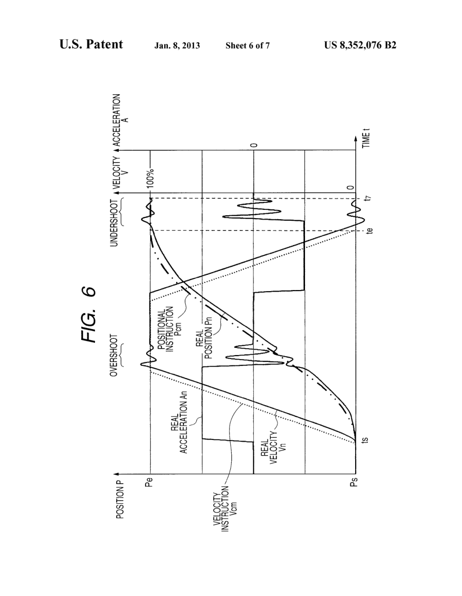
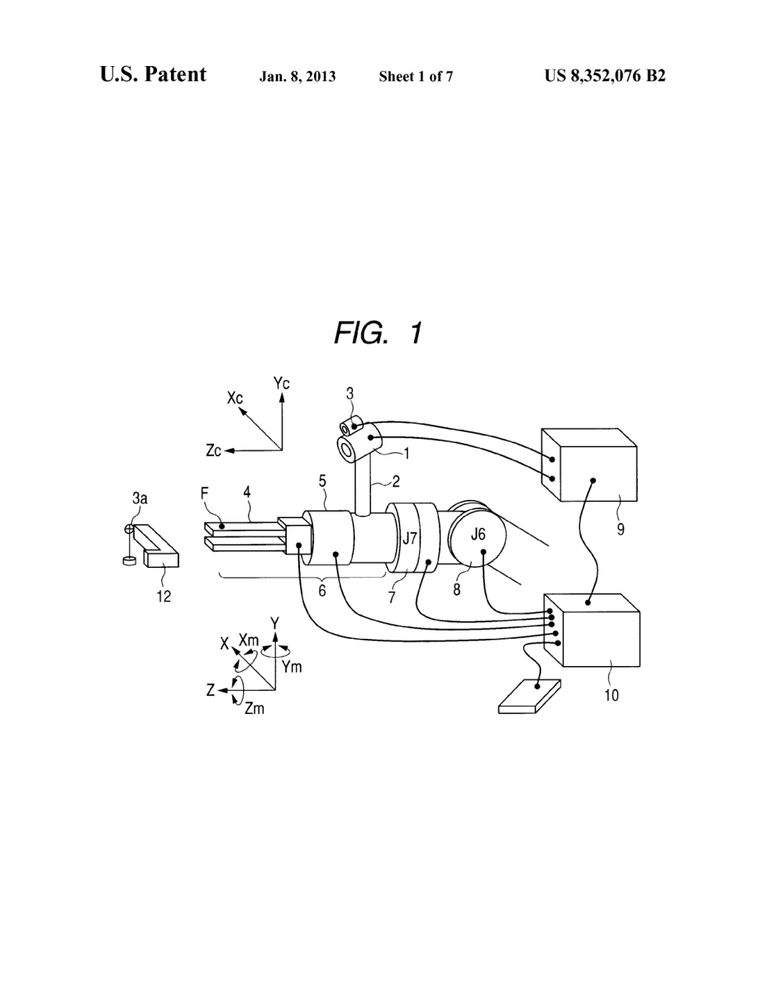
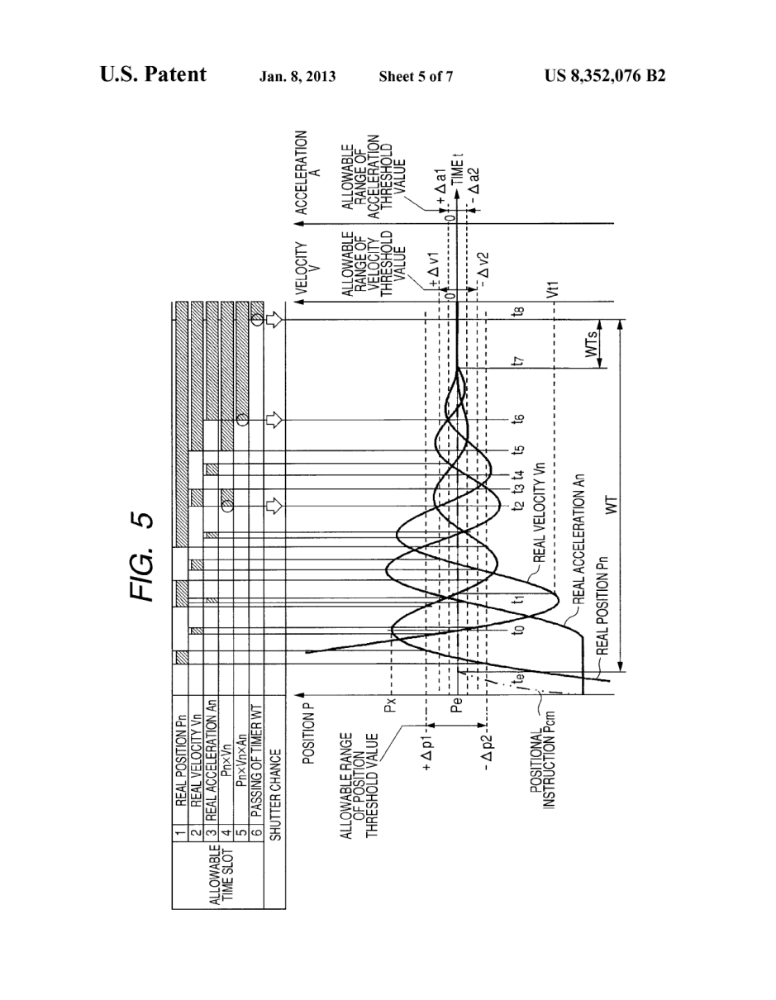

# US 8,352,076 B2 카메라 달린 로봇 (전문 번역)

- 원제: Robot with Camera
- 원문 파일: 같은 폴더의 `US8352076B2.pdf` (미국 등록 공보 12쪽)
- 번역 범위: 전문 (표제부 서지, 초록, 배경, 요약, 도면 설명, 실시예 1~3, 청구항 1~4). 인용 문헌 목록은 원문 그대로 둔다.
- 번역 메모: 원문의 shutter release는 "셔터를 연다"로 옮긴다. 원문도 전자 카메라이므로 실제로는 영상 취득이라고 본문에서 밝힌다.

---

## 표제부 (서지)

- 미국 특허 번호: US 8,352,076 B2
- 등록일: 2013년 1월 8일
- 발명의 명칭: ROBOT WITH CAMERA (카메라 달린 로봇)
- 발명자: Yuichi Someya, 도쿄 (일본)
- 출원인(양수인): Canon Kabushiki Kaisha, 도쿄 (일본)
- 출원 번호: 12/786,554
- 출원일: 2010년 5월 25일
- 공개: US 2010/0312393 A1, 2010년 12월 9일
- 우선권: 일본 특허 출원 2009-133764, 2009년 6월 3일
- 국제 특허 분류: G05B 15/00 (2006.01)
- 미국 분류: 700/259, 700/245, 700/250, 901/2, 901/15, 901/47
- 청구항 4개, 도면 7장

인용 문헌 (원문 그대로)

```
U.S. PATENT DOCUMENTS
5,150,150 A * 9/1992  Enomoto .......................... 396/53
5,708,863 A * 1/1998  Satoh et al. ..................... 396/52
7,313,464 B1* 12/2007 Perreault et al. ................ 700/245
7,975,284 B2 * 7/2011 Takano et al. ................... 725/105

FOREIGN PATENT DOCUMENTS
JP 2603871 B      4/1997
JP 2001-252883 A  9/2001
* cited by examiner
```

## 초록

카메라 달린 로봇은 손가락이 있는 핸드, 핸드에 놓인 카메라, 핸드를 포함하는 로봇 팔, 그리고 카메라가 얻은 영상으로 작업물을 찾아 로봇 팔을 제어하는 제어부를 갖는다.
여기에 더해, 카메라의 속도를 검출하는 수단과, 카메라의 예상 정지 위치를 기준으로 한 카메라의 위치를 검출하는 수단을 둔다.
제어부는 카메라의 속도가 미리 정한 속도 임계값 이하이고, 예상 정지 위치를 기준으로 한 카메라의 위치가 미리 정한 위치 임계값 이하일 때에만, 카메라가 작업물 탐색용 영상을 찍도록 허가한다.

---

## 발명의 배경

### 1. 발명의 분야

본 발명은 카메라 달린 로봇에 관한 것이다. 이 카메라는 조립 대상인 작업물을 확인하는 데 쓴다.

### 2. 관련 기술 설명

일반적으로 영상 처리에 필요한 카메라 촬영 조건은 두 가지다.
하나는 진동에 의한 흐림이 없을 것이다.
다른 하나는 찍힌 영상에서 피사체 위치의 재현성이 있을 것, 즉 카메라 좌표와 피사체가 있는 좌표 사이의 상대 위치를 알고 있을 것이다.

진동 대책으로 셔터 속도만 올리면 빛의 양이 모자라 촬영 감도가 떨어진다.
특히 피사계 심도(초점이 맞는 깊이 방향 범위)를 넓히려고 렌즈 조리개를 조이면 이 문제가 두드러진다.

요즘 자동 조립 FA 분야에서 흔한 방식대로 카메라를 로봇 팔에 다는 경우, 진동 대책으로 진동 정착 예상 시간이 지난 뒤에 셔터를 연다는 방법이 알려져 있다 (일본 공개특허 2001-252883 참조).

카메라 자체의 진동에 대한 일반적인 대책으로는, XY 평면에서 각가속도 센서의 적분으로 각속도를 구하고(예를 들어 자이로스코프에 작용하는 관성력), 계산한 값이 임계값 이하이면 셔터 동작을 허용하는 기술이 알려져 있다 (일본 특허 2603871 참조).
각속도를 W, 진동 중심에서 임의의 점 F까지의 회전 반지름을 R이라 하면, 점 F의 속도는 V = R × W로 나타낸다.

카메라를 조립 로봇에 달면 다음 문제가 생길 수 있다.
아래에서는 본 발명을 깊이 이해하도록 관련 기술을 첨부 도면으로 설명한다.
예를 들어 도 7A는 손목을 돌리는 J7축 107, 하완용 J6축 108, 그리고 (그림에 없는) J1~J5축을 포함하는 7축 수직 다관절 로봇(로봇 팔)의 팔을 보여 준다.
J7축 107 끝에 핸드 106이 달리고, 핸드 106의 밑 부분에 카메라 지지대 102를 거쳐 카메라 101이 달린다.
핸드 106의 끝 부분은 작업물 112를 쥐는 손가락 104로 되어 있다.
작업물 112의 조립은 카메라 101의 영상을 처리하는 영상 처리부 109와, 로봇 제어부 110에 쓰인 조립 프로그램으로 수행한다.

카메라 101은 패턴 매칭 같은 영상 처리 방법으로 작업물 112를 찾고, 그 결과를 손가락 104가 작업물 112를 쥐는 데 쓴다.
카메라 좌표(Xc, Yc, Zc)의 기준이 되는 점 F를 손가락 104 위에 둔다.
점 F의 위치는 도 7B의 파선 안에서 패턴 매칭 같은 영상 처리 방법으로 인식한다.

핸드 106이 시작점 Ps와 끝점 Pe 사이를 도 6과 같은 사다리꼴 속도 지령 Vcm으로 움직인다고 하자.
순서는 정지, 가속 이동, 등속 이동, 감속 이동, 정지다.
그러면 주로 7축 기구의 기계적 탄성 때문에 핸드 106이 진동한다.
가속이 끝나는 곳에서 오버슈트가, 감속이 끝나는 곳에서 언더슈트가 생긴다.



도 6. 팔을 구동했을 때 핸드 위치, 속도, 가속도의 변화.
위치 지령 Pcm(일점쇄선)과 실제 위치 Pn, 속도 지령 Vcm과 실제 속도 Vn, 실제 가속도 An을 함께 그렸다.
가속 끝에 오버슈트, 감속 끝에 언더슈트가 보인다.
ts는 시작, te는 지령이 끝나는 시각, t7은 진동이 실제로 가라앉는 시각이다.

언더슈트의 진동이 남으면 점 F와 작업물의 상대 위치가 변해서 정밀한 영상 처리가 어렵다.
설명을 쉽게 하기 위해, 시작점 Ps와 끝점 Pe가 로봇 좌표(X, Y, Z, Xm, Ym, Zm)의 X축 위에 있다고 하자.

도 5는 언더슈트와 셔터 찬스의 관계를 보여 주는 그래프다.
언더슈트에 의한 진동의 대책으로는, 셔터를 열지 않고 로봇의 진동이 충분히 가라앉기를 기다렸다가, 진동이 충분히 가라앉았음을 검출한 뒤 검출 신호로 셔터를 여는 방법을 생각할 수 있다.
다시 말해, 도 5에 보인 위치 지령 Pcm이 끝나는 시각 t0을 시작점으로 하여 실제 위치 Pn에 대한 진동 정착 예상 시간 WT를 기다린 뒤에 셔터를 열 수 있다.
그러나 이 방법은 조립 택트 타임이 늘어나는 등 산업 생산에 나쁜 영향을 줄 수 있다.
진동 정착 예상 시간 WT는 대략 1초 정도일 수 있고, 진동이 실제로 가라앉는 시각 t7을 시작점으로 한 여유 시간 WTs가 많은 경우에 포함된다.
이렇게 진동 정착을 기다리기 때문에, 셔터를 열기 전에 버리는 시간이 생긴다.

진동 정착 예상 시간 WT가 지난 뒤의 시간 구간은 도 5 윗부분 "6 PASSING OF TIMER WT" 줄의 검은 띠로 표시했다.
셔터는 그 검은 띠 머리의 작은 동그라미로 표시한 시각 t3에 열린다.

진동 정착 예상 시간 WT는 팔의 이동 거리에 따라 달라진다.
그래서 행렬 모양으로 집고 놓는(픽 앤 플레이스) 용도에서는 이동 거리가 매번 달라진다.
그 때문에 최대 진동에 해당하는 정착 여유 시간 WTs를 미리 잡아 두어야 하고, 버리는 시간이 더 늘어날 수 있다.

카메라 자체의 진동 대책으로, 각속도가 낮을 때 셔터를 열어 진동을 억제하는 방법도 생각할 수 있다.
그러나 이 경우 찍힌 영상 안에서 피사체의 특정 점 위치가 보장되지 않는다.
따라서 이 방법은 조립 로봇에 그대로 쓸 수 없다.

## 발명의 요약

본 발명은, 영상 처리에 필요한 정확도를 만족하는 범위 안에서 작업물 탐색용 카메라의 셔터를 되도록 빨리 열 수 있는, 카메라 달린 로봇을 제공한다.

본 발명이 제공하는 카메라 달린 로봇은 다음을 포함한다.
손가락이 있는 핸드, 핸드에 놓인 카메라, 핸드를 포함하는 로봇 팔, 카메라가 얻은 영상으로 작업물을 찾고 로봇 팔을 제어하는 제어부, 카메라의 속도를 검출하는 수단, 그리고 카메라의 위치를 검출하는 수단이다.
여기서 제어부는 카메라의 속도가 미리 정한 속도 임계값 이하이고 카메라의 위치가 미리 정한 위치 임계값 이하일 때, 카메라가 작업물 탐색용 영상을 찍도록 허가한다.

셔터는 조립에 필요한 정확도에 해당하는 최소 범위 안으로 진동이 가라앉았다고 판정한 순간에 열린다.
따라서 작업물 탐색용 영상의 흐림을 줄일 수 있다.
또한 셔터를 되도록 빨리 열어 버리는 시간을 줄이고, 조립 효율을 높일 수 있다.

본 발명의 다른 특징은 첨부 도면을 참조한 아래 실시예 설명에서 드러난다.

## 도면의 간단한 설명

- 도 1: 실시예 1에 따른 카메라 달린 로봇의 구조를 보여 주는 사시도.
- 도 2A, 2B, 2C: 실시예 1에서 찍은 영상들.
- 도 3: 실시예 2에 따른 카메라 달린 로봇의 구조를 보여 주는 사시도.
- 도 4: 실시예 2에 따른 힘 센서의 구조를 보여 주는 개략도.
- 도 5: 언더슈트와 셔터 찬스의 관계를 보여 주는 그래프.
- 도 6: 팔을 구동했을 때 핸드 위치, 속도, 가속도의 변화를 보여 주는 그래프.
- 도 7A, 7B: 관련 기술에 따른 카메라 달린 로봇.

## 실시예 설명

### 실시예 1

도 1은 실시예 1의 카메라 달린 로봇을 보여 준다.



도 1. 실시예 1의 카메라 달린 로봇 구조.
카메라 1, 카메라 지지대 2, 속도 센서 3, 정렬 마크 3a, 손가락 4, 브래킷 5, 핸드 6, J7축 7, J6축 8, 영상 처리부 9, 제어부 10, 작업물 12, 카메라 좌표 Xc/Yc/Zc, 로봇 좌표 X/Y/Z와 Xm/Ym/Zm.

손목을 돌리는 J7축 7, 하완용 J6축 8, 그리고 (그림에 없는) J1~J5축을 포함하는 로봇 팔을 쓴다.
브래킷과 손가락 4로 된 핸드 6이 J7축 7 끝에 달리고, 카메라 지지대 2를 거쳐 카메라 1이 핸드 6의 밑 부분에 달린다.
속도를 검출하는 수단인 속도 센서 3을 카메라 1에 단다.
속도 센서 3의 속도 정보는 영상 처리부 9를 거쳐 제어부 10이 받는다.
핸드 6의 끝 부분은 작업물 12를 쥐는 손가락 4로 되어 있다.
작업물 12의 조립은 카메라 1의 영상을 처리하는 영상 처리부 9와, 로봇 제어부 10에 쓰인 조립 프로그램으로 수행한다.

작업물 12의 위치는 카메라 1이 찍은 영상에서 패턴 매칭 같은 영상 처리 방법으로 찾고, 작업물 12는 손가락 4로 쥔다.
카메라 좌표(Xc, Yc, Zc)의 기준이 되는 점 F를 손가락 4 위에 둔다.
속도 센서 3은 가속도를 검출하고, 가속도의 적분으로 속도를 구한다.

카메라 위치를 검출하기 위한 위치 기준으로 정렬 마크 3a를 로봇 팔이 놓인 같은 받침대 위에 둔다.
이렇게 하면 카메라 1의 위치를 카메라 1의 영상에서 검출할 수 있다.
정렬 마크 3a의 로봇 좌표를 알고 있으면 카메라 1의 로봇 좌표를 구할 수 있다.

도 2A~2C는 카메라 1이 찍은 영상의 예다.
아래 줄의 X와 Y는 로봇 좌표를, 가운데 줄의 Xc와 Yc는 카메라 좌표를 나타낸다.
도 2A는 핸드 6을 구동해 완전히 멈춘 뒤의 영상이다.
예를 들어 작업물 12를 찾기 위해 도 5의 시각 t8에 제어부 10이 영상 처리부 9를 거쳐 셔터를 열어 얻은 영상이다.
핸드가 완전히 멈춰 있으므로, 정렬 마크 3a와 점 F 사이의 카메라 X 좌표상 위치 좌표 편차 Px는 0이다.
위치 좌표 편차 Px는 카메라 1이 얻은 영상에서 간단한 연산으로 계산할 수 있다.

도 2B는 실제 속도 Vn이 처음 0이 되는 시각 t0에 셔터를 열어 얻은 영상이다.
이 시점에는 실제 위치 Pn의 언더슈트가 매우 커서, 카메라 1의 위치가 X 좌표에서 오른쪽으로 밀려 있다.
그래서 원래 0이어야 할, 정렬 마크 3a와 점 F 사이의 위치 좌표 편차 Px가 커진다.

도 2C는 실제 위치 Pn의 언더슈트가 작아진 뒤에 셔터를 열어 얻은 영상이다.
예를 들어 도 5의 시각 t4의 영상이다.
정렬 마크 3a와 점 F 사이의 거리는 카메라 1이 얻은 영상에서 오차 ΔPx로 구해지며, 이 값은 도 2B보다 작다.

언더슈트가 작은 상태에서 셔터를 열면 측정 오차가 작아진다.
예를 들어 언더슈트가 작은 상태란, 도 5의 실제 위치 Pn 축에서 +Δp1과 -Δp2 사이에 드는 상태로 보고, 이 값들을 위치 임계값으로 정의한다.



도 5. 언더슈트와 셔터 찬스의 관계.
아래쪽에는 위치 지령 Pcm, 실제 위치 Pn, 실제 속도 Vn, 실제 가속도 An의 시간 궤적이 겹쳐 있다.
위치 임계값 허용 범위는 +Δp1과 -Δp2, 속도 임계값 허용 범위는 +Δv1과 -Δv2, 가속도 임계값 허용 범위는 +Δa1과 -Δa2다.
윗부분의 줄 1~6은 각각 "1 실제 위치 Pn", "2 실제 속도 Vn", "3 실제 가속도 An", "4 Pn×Vn", "5 Pn×Vn×An", "6 타이머 WT 경과"이고, 검은 띠가 허용 시간 구간이다.
맨 아래 줄이 셔터 찬스다.
WT는 진동 정착 예상 시간, WTs는 t7부터의 여유 시간이다.

위치 임계값 Δp1과 Δp2의 구체적 값은 영상 처리 시스템에 필요한 정확도에 따라 달라진다.
자동 조립 FA 분야에서 필요한 정확도는 경우에 따라 다르지만 대략 0.1~1 mm이고, 사용자는 그 몇 분의 1쯤 되는 값을 정할 수 있다.
예를 들어 영상 처리 시스템에 필요한 정확도 Rp를 0.5 mm로 정하고, 허용 측정 오차와 Rp의 비를 나타내는 실제 위치 Pn의 임계값 계수 Kp를 5로 정한다.
그러면 위치 임계값 Δp1과 Δp2는 식 (1)에서 각각 0.1 mm가 된다.

```
Δp1 = Δp2 = Rp/Kp = (0.5 mm / 5) = 0.1 mm        ... (1)
```

필요한 정확도가 높지 않으면 Δp1과 Δp2를 크게 잡을 수 있고, 셔터를 더 이른 시점에 열 수 있다.
Δp1과 Δp2가 같은 값일 필요는 없다.

어느 순간 언더슈트가 작더라도, 그 순간 카메라 1의 속도가 크면 카메라 1이 적절한 고속 셔터를 쓰지 않는 한 영상이 흐려질 수 있다.
예를 들어 도 5의 시각 t1에서 실제 위치 Pn은 끝점 Pe에 닿아 있다.
이 시점의 속도 Vt1은 빠르므로 흐림이 매우 높은 확률로 생긴다.
따라서 셔터를 여는 조건으로, 허용 속도의 상한을 도 5의 속도 V 축에서 +Δv1과 -Δv2 사이로 정하고, 이 값들을 속도 임계값으로 정의한다.

속도 임계값 Δv1과 Δv2의 구체적 값도 위치 임계값 Δp1, Δp2와 마찬가지로 영상 처리 시스템에 필요한 정확도에 따라 달라진다.
예를 들어 셔터 속도 Ss(즉 셔터가 열려 있는 시간)를 1/100초(0.01초)로 두고, 필요한 정확도 Rp는 앞서처럼 0.5 mm로 두고, 허용 측정 오차와 Rp의 비를 나타내는 실제 속도 Vn의 임계값 계수 Kv를 5로 둔다.
그러면 카메라 1의 속도 상한을 정하는 속도 임계값 Δv1과 Δv2는 식 (2)에서 각각 10 mm/s가 된다.

```
Δv1 = Δv2 = (Rp/Kv)/Ss = (0.5 mm / 5) / 0.01 s = 10 mm/s        ... (2)
```

필요한 정확도가 높지 않으면 Δv1과 Δv2를 크게 잡을 수 있고, 셔터를 더 이른 시점에 열 수 있다.
Δv1과 Δv2가 같은 값일 필요는 없다.
도 5 윗부분에서, 위치 임계값 아래인 시간 구간은 "1 실제 위치 Pn" 줄의 검은 띠로, 속도 임계값 아래인 시간 구간은 "2 실제 속도 Vn" 줄의 검은 띠로 표시했다.
둘 다 만족하는 시간 구간이 "4 Pn×Vn"이다.

위 결과에서, 위치 임계값 아래이면서 속도 임계값 아래인 시간 구간이 셔터를 여는 시점, 즉 셔터 찬스다.
진동 정착 예상 시간 WT를 기다리는 것보다 이른 셔터 찬스는 도 5의 시각 t2와 t3 사이, 또는 시각 t5와 t8 사이에 있다.
가장 이른 기회는 "4 Pn×Vn" 줄의 검은 띠 머리에 작은 동그라미로 표시한 시각 t2다.
위치 임계값과 속도 임계값에 들었는지의 판정은 제어부 10이 하고, 제어부 10이 영상 처리부 9를 거쳐 셔터를 여는 촬영 지령을 낸다.

위와 같이, 핸드의 위치와 속도가 각각 임계값 이하가 되었을 때 셔터를 연다.
그래서 진동 정착 예상 시간 WT를 기다리는 방법보다 버리는 시간을 줄일 수 있다.

설명에서는 관용적으로 셔터를 연다고 적었다.
그러나 카메라는 전자 카메라이므로 CCD나 CMOS 같은 촬상 소자로 연속 영상을 찍을 수 있다.
따라서 셔터를 연다는 말은 작업물을 찾기 위한 영상 처리에 쓸 영상을 얻는다는 뜻이다.

### 실시예 2

실시예 2는 도 3과 같이 주로 다음 세 가지 물리 구조 요소에서 실시예 1과 다르다.

1. 핸드 6 대신, 브래킷 5와 전체 길이가 같은 6축 힘 센서 13이 달린 핸드 50을 쓴다.
2. 속도 센서 3을 쓰지 않는다.
3. 손가락 4 대신, 점 F와 같은 위치에 정렬 마크 14a를 둔 손가락 14를 쓴다.

힘 센서 13은 손가락 14에 작용하는 힘을, 로봇 좌표의 직교 축 성분(X, Y, Z)과 모멘트 축 성분(Xm, Ym, Zm)의 6축 방향으로, 손가락 14의 변위로서 검출한다.
검출 결과는 조립에서 컴플라이언스 제어 등에 쓴다.
힘을 검출하는 소자로는 스트레인 게이지가 널리 알려져 있다.
이 실시예에서는 스트레인 게이지 대신 자기 변화를 검출하는 자석식 검출 소자를 쓴다.

힘 센서는 자석과 연산 증폭기 같은 아날로그 회로를 포함하므로 전기적 응답 특성이 대략 수 킬로헤르츠다.
따라서 힘 센서는 약 10 Hz인 언더슈트 진동 주파수에 대해 진동을 정확히 검출할 수 있다.
구체적으로, 힘 센서 13에 연결된 손가락 14가 진동에 해당하는 관성으로 흔들리므로 힘 센서 13이 그 진동에 반응한다.
변위의 진폭은 예를 들어 약 ±100 μm다.
힘 센서 13이 측정한 변위 Xcf의 미분값을 실제 속도 Vn으로 검출할 수 있다.

도 4는 자석을 쓴 힘 센서 13의 구조를 보여 준다.
하우징 23은 탄성체 21과 22를 거쳐, 손가락 14에 고정된 부착부 20에 결합된다.
하우징 23은 자석 24를 지지하고, 부착부 20에 고정된 자석 25가 자석 24와 마주 본다.
진동이 관성을 일으켜 힘 Fx(설명을 위해 한 점에 작용한다고 본다)를 가하면, 회전축에서 거리 L2에 놓인 자석 24와 25 사이의 거리가 변해 자기장이 변하고, 이를 증폭기 26이 증폭한다.

움직임을 매개하는 탄성체 21과 22는 힘 Fx에 대해 선형으로 움직인다.
힘 Fx가 가해졌을 때의 회전각 θf와 증폭기 26의 출력 Vf의 관계는, 계수 Kf를 쓴 1차식인 식 (3)으로 정해진다.
계수 Kf는 탄성체 21과 22, 증폭기 26, 회전축에서의 거리 L1 등으로 하나로 정해진다.

```
θf × Kf = Vf        ... (3)
```

또한 식 (4)가 성립한다.

```
Xcf = L1 × tan θf        ... (4)
```

손가락 14 위의 정렬 마크 14a는 각도 θf만큼 돌아간다.
따라서 강체 구조인 실시예 1의 브래킷 방식과 비교하면, 진동 중의 측정값에는 식 (5)와 (6)으로 정해지는 오차 ΔXcfe와 ΔYcfe가 들어간다.
그러나 변위 θf와 Xcf는 증폭기 26의 출력으로 계산할 수 있다.
따라서 정렬 마크 14a와 촬영 기준 위치 12a 사이의 상대 위치를 보정할 수 있다.

```
ΔXcfe = (Xcf × sin θf) × cos θf        ... (5)
ΔYcfe = (Xcf × sin θf) × sin θf        ... (6)
```

위의 미분 계산과 식 (3)~(6)의 계산은 어떤 처리든 할 수 있는 제어부 10이 수행하고, 계산 결과는 영상 처리부 9와 공유한다.

따라서 힘 센서 13을 갖춘 로봇은 핸드의 속도를 힘 센서 13으로 검출한다.
그 결과 실시예 1에서 설명한 속도 센서 3이 필요 없어진다.
이렇게 낮은 비용과 작은 구조로 버리는 시간을 줄일 수 있다.

### 실시예 3

실시예 3은 도 1에 보인 실시예 1의 카메라 달린 로봇과 비슷한 구조를 갖는다.

물체의 가속도는 속도의 미분값이고, 도 6과 도 5는 실제 속도 Vn과 실제 가속도 An의 시간 궤적을 보여 준다.
설명을 쉽게 하려고 도 6과 도 5에서 실제 가속도 An의 진폭을 과장해 그렸다.

실시예 1에서 설명했듯이 시각 t5 이후 구간은 셔터 찬스이고, 이동의 실제 속도 Vn이 가라앉는 경향이어서 흐린 영상이 잘 생기지 않는다.
그러나 실제 가속도 An은 일시적으로 커진다.

가속도와 로봇 팔 계의 질량의 곱은 로봇 팔 계를 누르는 힘으로 작용하고, 이 힘이 진동의 원인이 된다.
따라서 셔터를 열 때 속도 임계값 Δv1과 Δv2를 낮추더라도 진동이 남아 피사체의 측정 위치 정확도를 떨어뜨릴 수 있다.

진동의 진폭은 로봇 팔 계를 누르는 힘과 로봇 팔 계의 탄성 계수로 추정할 수 있다.
그러나 탄성 계수는 자세나 감속기 구조 때문에 비선형 부분을 갖는다.
그래서 파라미터 계산에 품이 들거나 오차가 생길 수 있다.

따라서 가속도를 측정할 수 있다면, 측정한 가속도를 되먹임해 셔터를 여는 시점 제어에 쓰는 것이 효과적인 방법이다.

가속도는 실시예 1에서 설명한 속도 센서 3의 속도 검출값의 미분값이거나, 실시예 2에서 설명한 힘 센서 13의 속도 검출값의 미분값에 해당한다.
따라서 가속도는 영상 처리부 9 또는 109, 또는 제어부 10 또는 110이 구할 수 있다.

실시예 1에서 설명한 속도 임계값 Δv1, Δv2와 위치 임계값 Δp1, Δp2에 더해, 가속도 임계값 Δa1과 Δa2를 새로 둔다.
셔터는 세 종류 임계값을 모두 밑도는 시각 t6 이후에 열린다.
위치 임계값과 속도 임계값에 들었는지의 판정과 마찬가지로, 가속도 임계값에 들었는지의 판정도 제어부 10이 하고, 제어부 10이 영상 처리부 9를 거쳐 셔터를 여는 촬영 지령을 낸다.

도 5 윗부분에서 가속도 임계값 아래인 시간 구간은 "3 실제 가속도 An" 줄의 검은 띠로 표시했다.
위치, 속도, 가속도 세 종류 임계값을 모두 밑도는 시간 구간은 "5 Pn×Vn×An" 줄의 검은 띠로 표시했다.
가장 이른 셔터 찬스는 그 검은 띠 머리의 작은 동그라미로 표시한 시각 t6이다.
따라서 실시예 1의 셔터 찬스인 시각 t2보다 시점은 늦지만, 진동이 더 낮은 상태를 얻을 수 있다.

가속도 임계값인 구체적 값 Δa1과 Δa2는 예를 들어 아래 식의 지침에 따라 정한다. 여기서 A는 허용 진동 진폭이다.

```
Δa1 = A × ω² / G        ... (7)
여기서 G = 9.8 m/s² 이다.
```

예를 들어 허용 진동 진폭이 0.1 mm이고 진동 주파수가 10 Hz이면, Δa1의 설정값은 다음과 같다.

```
Δa1 = 0.1 mm × (2 × π × 10 Hz)² = 0.39 G
```

따라서 셔터 시점은 핸드 6의 가속도, 위치, 속도의 임계값을 모두 만족하도록 정한다.
이렇게 하면 진동 정착 예상 시간 WT를 기다리는 방법보다 버리는 시간을 줄일 수 있다.
또한 실시예 1보다 진동이 더 낮은 상태에서 셔터를 열 수 있다.

본 발명을 예시 실시예로 설명했으나, 본 발명은 공개된 예시 실시예에 한정되지 않는다.
아래 청구항의 범위는 그러한 모든 변형과 균등 구조 및 기능을 포함하도록 가장 넓게 해석되어야 한다.

본 출원은 2009년 6월 3일 출원된 일본 특허 출원 2009-133764의 이익을 주장하며, 그 전체를 참조로 여기에 포함한다.

## 청구항

1. 카메라 달린 로봇으로서, 다음을 포함한다.
   - 손가락이 있는 핸드
   - 핸드에 놓인 카메라
   - 핸드를 포함하는 로봇 팔
   - 카메라가 얻은 영상으로 작업물을 찾고 로봇 팔을 제어하는 제어부
   - 카메라의 속도를 검출하는 수단
   - 미리 정한 정지 위치를 기준으로 한 카메라의 위치를 검출하는 수단

   그리고 제어부는, 카메라의 속도가 미리 정한 속도 임계값 이하이고 미리 정한 정지 위치를 기준으로 한 카메라의 위치가 미리 정한 위치 임계값 이하일 때, 카메라가 작업물 탐색용 영상을 찍도록 제어하게 구성된다.

2. 청구항 1에 따른 카메라 달린 로봇으로서, 속도를 검출하는 수단은 카메라에 달린 속도 센서다.

3. 청구항 1에 따른 카메라 달린 로봇으로서, 핸드에 놓여 손가락에 작용하는 힘을 측정하는 힘 센서를 더 포함하고, 속도를 검출하는 수단과 위치를 검출하는 수단은 각각 힘 센서의 출력으로 카메라의 속도와 위치를 검출하게 구성된다.

4. 청구항 1에 따른 카메라 달린 로봇으로서, 카메라의 가속도를 검출하는 수단을 더 포함하고, 제어부는 카메라의 가속도가 미리 정한 가속도 임계값 이하이고, 카메라의 속도가 미리 정한 속도 임계값 이하이며, 카메라의 위치가 미리 정한 위치 임계값 이하일 때, 카메라가 작업물 탐색용 영상을 찍도록 제어하게 구성된다.
