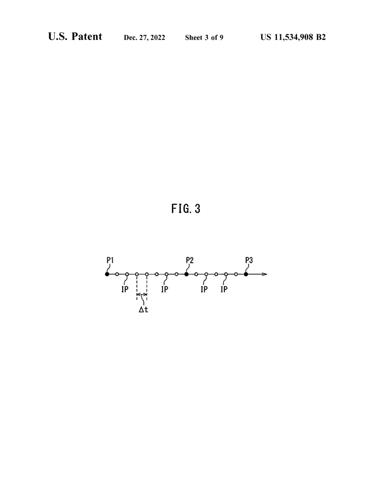
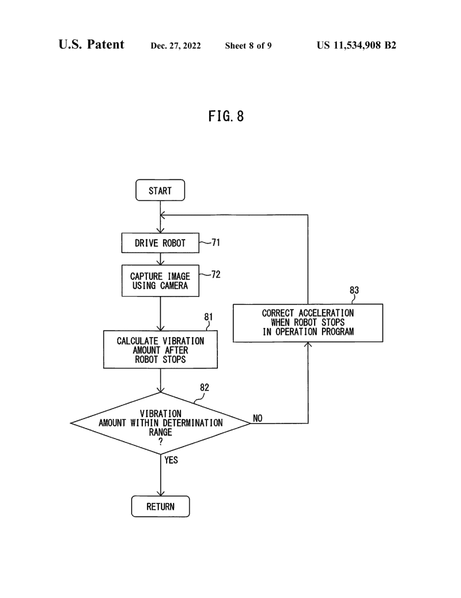
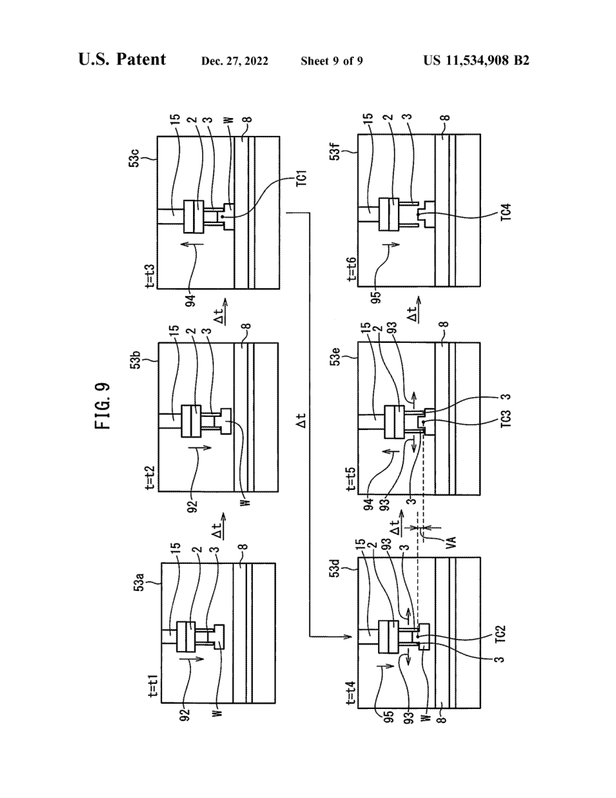

# US 11,534,908 B2 전문 번역

번역 범위: 전문 (서지 첫 면, 초록, 배경, 발명의 요약, 도면의 간단한 설명, 상세한 설명, 청구항 전부).
인용 문헌 목록은 원문 그대로 둔다.

원문 파일: 같은 폴더의 `US11534908B2.pdf` (22쪽, 도면 9장).
출처: patentimages 공보 PDF를 `pdftotext -layout`으로 뽑고, OCR이 깨진 곳은 Google Patents 본문으로 바로잡았다. 받은 날 2026-11-04.

---

## 서지 (첫 면)

- 미국 특허 번호: US 11,534,908 B2
- 등록일: 2022년 12월 27일
- 발명의 명칭: 로봇 장치의 동작을 조정하는 동작 조정 장치 및 로봇 장치의 동작을 조정하는 동작 조정 방법
  (OPERATION ADJUSTMENT APPARATUS FOR ADJUSTING OPERATION OF ROBOT APPARATUS AND OPERATION ADJUSTMENT METHOD FOR ADJUSTING OPERATION OF ROBOT APPARATUS)
- 출원인: FANUC CORPORATION (일본 야마나시)
- 발명자: Kenshirou Oono (야마나시), Makoto Yamada (야마나시)
- 권리자: FANUC CORPORATION (일본 야마나시)
- 출원 번호: 16/823,335
- 출원일: 2020년 3월 19일
- 공개: US 2020/0306957 A1, 2020년 10월 1일
- 우선권: 일본 출원 JP 2019-057062, 2019년 3월 25일
- 국제특허분류: G05B 19/04, G05B 19/18, B25J 9/16, B25J 15/00, B25J 19/02
- 미국 분류 적용: B25J 9/1602, B25J 9/1697, B25J 15/0019, B25J 19/023
- 존속 기간 조정: 35 U.S.C. 154(b)에 따라 197일 연장
- 청구항 5개, 도면 9장
- 심사관: Harry Y Oh. 대리인: Hauptman Ham, LLP

## 초록

동작 조정 장치는 로봇과 핸드의 영상을 찍도록 놓인 카메라를 포함한다.
로봇 제어기는 정해진 제어 주기로 로봇에 동작 명령을 보내는 동작 제어부를 포함한다.
카메라는 그 제어 주기와 일치하는 시간 간격으로 영상을 찍는다.
로봇 제어기의 판정부는 영상 처리부가 한 영상 처리 결과를 바탕으로 핸드의 동작이 적절한지 판정한다.
판정부가 핸드의 동작이 적절하지 않다고 판정하면, 로봇 제어기의 보정부는 핸드의 동작이 적절한 동작이 되도록 동작 프로그램 안의 명령문을 고친다.

## 관련 출원

본 출원은 2019년 3월 25일에 출원된 일본 출원 번호 2019-057062의 우선권을 주장하며, 그 내용 전부를 참조로 여기에 넣는다.

---

## 배경 기술

### 1. 기술 분야

본 발명은 로봇 장치의 동작을 조정하는 동작 조정 장치와, 로봇 장치의 동작을 조정하는 동작 조정 방법에 관한 것이다.

### 2. 관련 기술 설명

로봇을 포함하는 로봇 장치에서는, 작업 종류에 맞는 작업 도구를 로봇에 붙여 여러 가지 작업을 할 수 있다.
작업은 로봇의 동작과 작업 도구의 동작이 함께 움직여 이루어진다.
예를 들어 로봇이 정해진 위치에 닿은 뒤에 핸드가 공작물을 잡거나 놓는다.

로봇과 작업 도구는 미리 만들어 둔 동작 프로그램에 따라 움직인다.
로봇 장치를 동작 프로그램으로 움직이면, 바라던 동작과 조금 다른 동작을 할 때가 있다.
예를 들어 정해진 시각에 로봇이 가지는 위치와 자세가 바라던 위치, 자세에서 조금 어긋날 수 있다.
작업자는 실제로 움직이는 로봇의 상태를 보고 로봇 장치의 동작을 고칠 수 있다.

종래 기술에서는 로봇 장치에 놓여 로봇의 동작을 감시하는 카메라가 알려져 있다(예: 일본 공개특허공보 2011-19058A).
카메라가 찍은 영상을 처리하면 로봇의 위치와 자세를 검출할 수 있다.
예를 들어, 실제로 움직이는 로봇을 찍어 로봇의 실제 위치와 자세를 검출하고, 로봇의 이상 동작을 찾아내어 위치와 자세를 고치는 제어가 알려져 있다(예: 일본 공개특허공보 60-16386A, 61-118810A).

또한 로봇 둘레에 놓인 주변 장치가 로봇의 동작에 맞추어 움직일 수 있다.
이 점에서, 로봇의 동작과 주변 장치의 동작이 알맞게 이루어지도록 카메라가 찍은 영상을 바탕으로 주변 장치의 동작을 제어하는 것이 알려져 있다(예: 일본 공개특허공보 2011-154656A).

---

## 발명의 요약

최근 제품 생산 효율을 높이려고 로봇의 동작 속도가 빨라졌다.
로봇의 동작 속도가 느릴 때에는 작업자가 로봇의 동작을 눈으로 볼 수 있다.
그러나 빠른 속도로 움직이는 로봇의 동작을 눈으로 확인하기는 어렵다.
그래서 로봇 장치를 움직일 때, 작업자가 로봇 장치의 동작이 적절한지 판단하기 어렵다.
또 로봇 장치가 바라는 대로 작업하지 않을 때, 로봇이나 작업 도구 같은 장치의 동작을 조정하기 어렵다.

예를 들어 로봇 장치가 공작물을 한 위치에서 다른 위치로 옮기는 작업을 한다고 하자.
로봇 장치는 핸드로 공작물을 잡고 로봇을 움직여 공작물을 옮길 수 있다.
공작물을 핸드로 잡을 때, 핸드를 움직이기 시작하는 시각이 이르면 공작물을 바라는 상태로 잡지 못할 수 있다.
반대로, 로봇이 목표 위치에 닿기 전에 핸드가 움직이기 시작하면 핸드가 공작물을 공중으로 튀어 오르게 할 수 있다.

그래서 움직이는 로봇의 상태에 맞추어 핸드를 움직이기 시작하는 시각을 조정해야 한다.
그러나 빠른 속도로 움직이는 로봇의 상태를 확인하기는 어렵다.
이처럼 로봇을 포함하는 로봇 장치의 동작을 조정하기는 어려울 수 있다.

### 제1 측면

본 개시의 제1 측면에 따른 동작 조정 장치는 로봇을 포함하는 로봇 장치의 동작을 조정한다.
동작 조정 장치는 로봇과, 로봇의 동작에 맞추어 움직이는 장치 가운데 적어도 하나를 찍도록 놓인 고속 카메라를 포함한다.
동작 조정 장치는 로봇과 그 장치의 동작을 제어하고 고속 카메라가 찍은 영상을 받는 제어기를 포함한다.
제어기는 정해진 제어 주기로 로봇에 동작 명령을 보내는 동작 제어부와, 로봇과 장치의 동작 프로그램을 저장하는 저장부를 포함한다.
고속 카메라는 제어 주기와 일치하는 시간 간격으로 영상을 찍도록 만들어진다.
제어기는 제어 주기와 일치하는 시간 간격으로 찍은 영상을 처리하는 영상 처리부를 포함한다.
제어기는 영상 처리부의 처리 결과를 바탕으로, 로봇의 동작과 장치의 동작 가운데 적어도 하나가 정해진 동작인지 판정하는 판정부를 포함한다.
제어기는 동작 프로그램 안의 명령문을 고치는 보정부를 포함한다.
판정부가 로봇의 동작과 장치의 동작 가운데 적어도 하나가 정해진 동작이 아니라고 판정하면, 보정부는 로봇의 동작과 장치의 동작이 정해진 동작에 맞도록 동작 프로그램 안의 명령문을 고친다.

### 제2 측면

본 개시의 제2 측면에 따른 동작 조정 장치도 로봇을 포함하는 로봇 장치의 동작을 조정한다.
구성은 제1 측면과 같되, 제어기는 영상 처리부의 처리 결과를 바탕으로 로봇이 그 장치의 동작을 시작할 목표 위치에 닿았는지 판정하는 판정부를 포함한다.
제어기는 동작 제어부에 동작 명령을 보내는 지령부를 포함한다.
판정부가 로봇이 목표 위치에 닿았다고 판정하면, 지령부는 그 장치의 동작을 시작하라는 명령을 동작 제어부에 보낸다.

### 방법 측면

본 개시의 한 측면에 따른 동작 조정 방법은 고속 카메라가 찍은 영상을 바탕으로 로봇 장치의 동작을 조정한다.
로봇 장치는 로봇과, 로봇의 동작에 맞추어 움직이는 장치를 포함한다.
고속 카메라는 로봇에 동작 명령을 보내는 제어 주기와 일치하는 시간 간격으로 영상을 찍도록 만들어진다.
동작 조정 방법은 다음을 포함한다.

- 촬영 단계: 고속 카메라가 제어 주기와 일치하는 시간 간격으로 로봇과 장치 가운데 적어도 하나를 찍는다.
- 영상 처리 단계: 고속 카메라가 찍은 영상을 처리한다.
- 판정 단계: 영상 처리 결과를 바탕으로 로봇의 동작과 장치의 동작 가운데 적어도 하나가 정해진 동작인지 판정한다.
- 보정 단계: 판정 단계에서 적어도 하나가 정해진 동작이 아니라고 판정되면, 로봇의 동작과 장치의 동작이 정해진 동작에 맞도록 동작 프로그램 안의 명령문을 고친다.

---

## 도면의 간단한 설명

- 도 1: 실시예의 로봇 장치를 옆에서 본 개략도.
- 도 2: 실시예의 로봇 장치 블록도.
- 도 3: 제어기의 동작 제어부가 로봇 동작 명령을 보내는 제어 주기를 나타낸 도면.
- 도 4: 바라던 시각에 움직이기 시작해 공작물을 컨베이어에 놓는 핸드를 찍은 영상들.
- 도 5: 실시예의 첫째 제어 흐름도.
- 도 6: 바라던 시각보다 이른 시각에 움직이기 시작해 공작물을 컨베이어에 놓는 핸드를 찍은 영상들.
- 도 7: 실시예의 동작 프로그램 예.
- 도 8: 실시예의 둘째 제어 흐름도.
- 도 9: 공작물을 컨베이어에 놓을 때 로봇이 진동하는 상태를 찍은 영상들.

---

## 상세한 설명

도 1에서 도 9를 보며 실시예의 동작 조정 장치와 동작 조정 방법을 설명한다.
본 실시예의 로봇 장치는 로봇과 로봇에 붙은 작업 도구를 포함한다.
로봇 장치는 로봇 둘레에 놓인 주변 장치를 포함할 수 있다.
본 실시예에서는 공작물을 옮기는 로봇 장치를 예로 설명한다.

### 로봇 장치의 구성 (도 1, 도 2)

도 1은 본 실시예의 로봇 장치 개략도다.
로봇 장치 5는 작업 도구(엔드 이펙터)인 핸드 2와, 핸드 2를 움직이는 로봇 1을 포함한다.
본 실시예의 로봇 1은 관절 여러 개를 가진 다관절 로봇이다.

로봇 1은 베이스 14와, 베이스 14가 받치는 회전 베이스 13을 포함한다.
베이스 14는 설치면에 고정된다.
회전 베이스 13은 베이스 14에 대해 돌도록 만들어진다.
로봇 1은 상부 암 11과 하부 암 12를 포함한다.
하부 암 12는 관절을 통해 회전 베이스 13에 돌 수 있게 받쳐진다.
상부 암 11은 관절을 통해 하부 암 12에 돌 수 있게 받쳐진다.
또 상부 암 11은 자신이 뻗은 방향과 나란한 회전축 둘레로 돈다.
로봇 1은 상부 암 11의 끝에 이어진 손목 15를 포함한다.
손목 15는 관절을 통해 상부 암 11에 돌 수 있게 받쳐진다.
손목 15는 돌 수 있게 만들어진 플랜지 16을 가진다.
핸드 2는 손목 15의 플랜지 16에 고정된다.
본 실시예의 로봇 1은 구동축 6개를 가지지만 여기에 한정되지 않는다.
작업 도구를 움직일 수 있는 로봇이면 무엇이든 쓸 수 있다.

핸드 2는 공작물 W를 잡고 놓는 작업 도구다.
핸드 2는 클로(발톱) 3을 여러 개 가진다.
클로 3은 공작물 W를 양쪽에서 끼워 잡는다.
핸드 2는 클로 3이 열리고 닫히도록 만들어진다.
본 실시예의 핸드 2는 클로 3을 가지지만 여기에 한정되지 않는다.
공작물을 잡을 수 있는 구성이면 무엇이든 쓸 수 있다.
예를 들어 흡착이나 자력으로 공작물을 잡는 핸드를 써도 된다.

본 실시예의 로봇 장치 5는 로봇 1 둘레에 놓인 주변 장치로 컨베이어 8을 포함한다.
컨베이어 8은 공작물 W를 다른 위치로 옮기도록 만들어진다.

본 실시예의 로봇 장치 5는 작업대(도시 생략)에 놓인 공작물 W를 잡는다.
로봇 1은 핸드 2가 작업대 위의 공작물 W를 잡을 수 있도록 위치와 자세를 바꾼다.
핸드 2의 클로 3이 닫혀 공작물 W를 잡는다.
이어서 로봇 1이 위치와 자세를 바꾸어 공작물 W를 컨베이어 8의 적재면으로 옮긴다.
이어서 핸드 2가 클로 3을 열어 공작물 W를 놓는다.
컨베이어 8은 공작물 W가 놓인 뒤 움직이기 시작해 공작물 W를 정해진 위치로 옮긴다.
이처럼 로봇 1의 동작과 핸드 2의 동작은 이어져 있다.
핸드 2는 로봇 1의 동작에 맞추어 움직이는 장치에 해당한다.

본 실시예의 로봇 1은 빠른 속도로 움직인다.
빠른 속도로 움직이는 로봇의 예로는 공구 중심점(tool center point)이 **초속 2000 mm 이상**으로 움직일 수 있는 로봇을 들 수 있다.
이렇게 빠르게 움직이는 로봇의 상태를 눈으로 보기는 어렵다.

본 실시예의 로봇 장치 5는 로봇 1과 핸드 2 가운데 적어도 하나를 찍도록 놓인 카메라 7을 포함한다.
카메라 7은 지지 부재가 받친다.

로봇 1의 베이스 14에 기준 좌표계 56이 놓인다.
기준 좌표계 56은 월드 좌표계라고도 한다.
기준 좌표계 56은 원점의 위치가 고정되고 좌표축의 방향도 고정된 좌표계다.
로봇 1의 위치와 자세가 바뀌어도 기준 좌표계 56의 위치와 방향은 바뀌지 않는다.
기준 좌표계 56은 서로 직교하는 X축, Y축, Z축을 좌표축으로 가진다.
또 X축 둘레의 좌표축으로 W축을, Y축 둘레의 좌표축으로 P축을, Z축 둘레의 좌표축으로 R축을 둔다.

본 실시예에서는 작업 도구의 임의 위치에 원점을 둔 공구 좌표계 57을 설정한다.
로봇 1이 위치와 자세를 바꾸면 공구 좌표계 57의 위치와 방향도 바뀐다.
공구 좌표계 57도 서로 직교하는 X축, Y축, Z축을 가진다.
도 1의 예에서 공구 좌표계 57의 원점은 공구 중심점에 둔다.
또 공구 좌표계 57은 Z축이 뻗은 방향이 핸드 2의 클로 3이 뻗은 방향과 나란하도록 설정한다.
공구 좌표계 57도 X축 둘레의 W축, Y축 둘레의 P축, Z축 둘레의 R축을 가진다.
예를 들어 로봇 1의 위치는 공구 중심점의 위치에 해당한다.
또 로봇 1의 자세는 기준 좌표계 56에 대한 공구 좌표계 57의 방향에 해당한다.

도 2는 본 실시예의 로봇 장치 블록도다.
도 1과 도 2를 함께 본다.
로봇 1은 로봇 1의 위치와 자세를 바꾸는 로봇 구동 장치를 포함한다.
로봇 구동 장치는 암이나 손목 같은 부품을 움직이는 로봇 구동 모터 22를 포함한다.
로봇 구동 모터 22가 돌면 각 부품의 방향이 바뀐다.

핸드 2는 핸드 2를 움직이는 핸드 구동 장치를 포함한다.
핸드 구동 장치는 핸드 2의 클로 3을 움직이는 핸드 구동 모터 21을 포함한다.
핸드 구동 모터 21이 돌면 핸드 2의 클로 3이 열리거나 닫힌다.
클로는 공기압으로 움직이도록 만들어도 된다.
이 경우 핸드 구동 장치는 에어 펌프나 에어 실린더 같은 장치를 포함할 수 있다.

로봇 장치 5의 제어기는 로봇 제어기 4를 포함한다.
로봇 제어기 4는 프로세서인 CPU를 가진 연산 처리 장치(컴퓨터)를 포함한다.
연산 처리 장치는 버스를 통해 CPU에 이어진 RAM과 ROM을 포함한다.
로봇 1, 핸드 2, 컨베이어 8을 제어하려고 미리 만든 동작 프로그램 41이 로봇 제어기 4에 입력된다.
로봇 제어기 4는 로봇 1, 핸드 2, 컨베이어 8의 제어와 관련된 정보를 저장하는 저장부 42를 포함한다.
저장부 42는 휘발성 메모리, 비휘발성 메모리, 하드디스크 같은 저장 매체로 만들 수 있다.
동작 프로그램 41은 저장부 42에 저장된다.
동작 제어부 43은 동작 프로그램 41에 따라 움직이는 프로세서에 해당한다.
프로세서는 동작 프로그램 41을 읽어 그 안에 정의된 제어를 수행함으로써 동작 제어부 43으로 기능한다.

동작 제어부 43은 동작 프로그램 41을 바탕으로 로봇 1을 움직이는 동작 명령을 로봇 구동부 45에 보낸다.
로봇 구동부 45는 로봇 구동 모터 22를 움직이는 전기 회로를 포함한다.
로봇 구동부 45는 동작 명령을 바탕으로 로봇 구동 모터 22에 전기를 공급한다.
또 동작 제어부 43은 동작 프로그램 41을 바탕으로 핸드 2를 움직이는 동작 명령을 핸드 구동부 44에 보낸다.
핸드 구동부 44는 핸드 구동 모터 21을 움직이는 전기 회로를 포함한다.
핸드 구동부 44는 동작 명령을 바탕으로 핸드 구동 모터 21에 전기를 공급한다.
또 동작 제어부 43은 동작 프로그램 41을 바탕으로 영상을 찍으라는 명령을 카메라 7에 보낸다.

로봇 1은 로봇 1의 위치와 자세를 검출하는 상태 검출기를 포함한다.
본 실시예의 상태 검출기는 암을 포함한 부품의 구동축에 해당하는 로봇 구동 모터 22에 붙은 위치 검출기 18을 포함한다.
상태 검출기의 출력으로 각 구동축에서 부품의 방향을 얻을 수 있다.
예를 들어 위치 검출기 18은 움직이는 로봇 구동 모터 22의 회전각을 검출한다.
위치 검출기 18의 출력을 바탕으로 로봇 1의 위치와 자세를 검출한다.

로봇 장치 5의 제어기는 컨베이어 8의 동작을 제어하는 컨베이어 제어기 9를 포함한다.
컨베이어 제어기 9는 CPU와 RAM을 포함하는 연산 처리 장치(컴퓨터)를 포함한다.
컨베이어 제어기 9는 로봇 제어기 4와 서로 통신할 수 있게 만들어진다.
컨베이어 제어기 9는 로봇 제어기 4에서 명령을 받아 컨베이어 8을 움직인다.
또 컨베이어 제어기 9는 컨베이어 8이 공작물 W를 정해진 위치까지 옮기면 컨베이어 8을 멈춘다.
컨베이어 제어기 9는 컨베이어 8이 멈췄다는 신호를 로봇 제어기 4에 보낸다.

본 실시예의 로봇 장치 5의 제어기는 로봇 1과 핸드 2를 제어하는 로봇 제어기 4와, 컨베이어 8을 제어하는 컨베이어 제어기 9를 포함하지만 여기에 한정되지 않는다.
로봇 장치 5는 로봇 1, 핸드 2, 컨베이어 8을 제어기 하나로 제어하도록 만들어도 된다.

### 제어 주기와 보간점 (도 3)



도 3은 제어기의 동작 제어부가 보내는 제어 주기를 나타낸 도면이다.
도 3에는 동작 프로그램에 적힌 이동점 P1, P2, P3이 보인다.
예를 들어 로봇 1은 공구 중심점이 이동점 P1에서 이동점 P2로 움직이도록 제어된다.
또 로봇 1은 공구 중심점이 이동점 P2에서 이동점 P3으로 움직이도록 제어된다.
동작 프로그램 41에는 이동점 P1, P2, P3의 위치와 각 위치에서 로봇 1의 자세가 정의되어 있다.

동작 제어부 43은 정해진 제어 주기 Δt로 로봇 1에 동작 명령을 보낸다.
제어 주기 Δt는 로봇 1의 성능에 맞추어 미리 정한다.
또는 작업자가 제어 주기 Δt를 로봇 제어기에 입력해도 된다.
**로봇 1의 제어 주기 Δt는 예를 들어 1 msec 이상 8 msec 이하 범위의 시간이다.**

동작 제어부 43은 이동점 P1, P2, P3에서 로봇 1의 위치와 자세를 동작 프로그램 41에서 얻는다.
이어서 동작 제어부 43은 각 이동점 P1, P2, P3 사이에 보간점 IP를 더한다.
보간점 IP는 서로 이웃한 이동점 사이에 놓인다.
보간점 IP는 로봇 1의 제어 주기 Δt의 시간 간격을 바탕으로 만들어진다.
또 보간점 IP는 구동 속도나 직선 이동 같은 로봇 1의 구동 방식을 바탕으로 만들어진다.

동작 제어부 43은 각 보간점 IP에서 로봇 1의 위치와 자세를 계산한다.
동작 제어부 43은 보간점 IP마다 동작 명령을 보낸다.
로봇 1의 위치와 자세는 공구 중심점이 이동점 P1, P2, P3과 그 사이에 놓인 보간점 IP를 지나가도록 제어된다.
또는 로봇 1은 공구 중심점이 이동점 P1, P2, P3 근처와 보간점 IP 근처를 지나가도록 제어된다.

### 촬영 주기

도 1을 보면, 본 실시예의 로봇 장치 5는 화살표 91처럼 공작물 W를 옮긴다.
로봇 1과 핸드 2의 동작으로 공작물 W가 컨베이어 8 벨트의 적재면에 놓인다.
로봇 1이 위치와 자세를 바꾸어 공작물 W의 위치와 방향을 바꾼다.
본 실시예에서는 도 1의 상태에서 공구 좌표계 57의 Z축 둘레로 90도 돌아간 공작물 W가 컨베이어 8에 놓인다.

도 1과 도 2를 함께 본다.
본 실시예의 카메라 7은 로봇 1의 제어 주기 Δt와 일치하는 시간 간격으로 영상을 찍도록 만들어진다.
예를 들어 카메라는 제어 주기 Δt와 같은 시간 간격으로 영상을 찍도록 만들어진다.
다시 말해 **제어 주기가 5 msec이면 카메라는 5 msec마다(200 fps) 영상을 찍도록 만들어진다.**
또는 카메라가 제어 주기의 약수인 시간 간격으로 영상을 찍도록 만들어도 된다.
**예를 들어 제어 주기가 4 msec이면 카메라가 1 msec나 2 msec 간격으로 영상을 찍도록 만들어도 된다.**
이 경우에도 카메라는 제어 주기와 같은 시간 간격으로 영상을 찍을 수 있다.

### 정상 동작 영상 (도 4)

도 4는 공작물을 컨베이어로 옮길 때 카메라가 찍은 영상을 보여 준다.
도 4는 시각 t1에서 시각 t6까지 찍은 영상 51a에서 51f까지를 보여 준다.
영상 51a에서 51f는 제어 주기 Δt와 일치하는 시간 간격 Δt로 찍은 영상이다.
다시 말해 도 4는 동작 제어부 43이 로봇 1의 위치와 자세를 바꾸려고 동작 명령을 보낼 때마다 찍은 영상이다.
동작 제어부 43은 로봇 1의 동작 명령을 내는 것과 같은 시각에 촬영 명령을 카메라 7에 보낼 수 있다.
다시 말해 로봇 1의 동작 명령 발행과 카메라 7의 촬영 명령 발행을 동기화할 수 있다.
또는 동작 제어부 43이 로봇 1의 동작 명령이 나가는 시각과 다른 시각에, 제어 주기 Δt와 같은 시간 간격으로 영상을 찍으라는 명령을 카메라 7에 보낼 수도 있다.
영상 51a에서 51f 각각에는 로봇 1과 핸드 2의 동작 상태가 담긴다.

도 4의 영상 51a에서 51f에서는 로봇 1과 핸드 2가 작업자가 바라는 대로 움직여, 공작물 W가 컨베이어 8에 놓인다.
영상 51a에서는 시각 t1에 공작물 W가 컨베이어 8 쪽으로 옮겨지고 있다.
로봇 1은 정해진 목표 위치와 목표 자세를 향해 위치와 자세를 바꾼다.
공작물 W는 핸드 2의 클로 3에 잡혀 있다.
손목 15와 핸드 2는 화살표 92처럼 컨베이어 8의 적재면 쪽으로 움직이고 있다.
영상 51b에서는 시각 t2에 공작물 W가 컨베이어 8 쪽으로 옮겨지고 있다.
공작물 W가 컨베이어 8에 더 가까워지고 로봇 1의 속도가 줄어든다.

영상 51c는 시각 t3에 찍은 영상이다.
로봇 1이 정해진 목표 위치와 목표 자세에 닿았다.
공작물 W는 컨베이어 8의 적재면에 닿아 있고 로봇 1의 동작은 끝난다.
핸드 2의 클로 3은 공작물 W를 잡고 있다.

영상 51d는 시각 t4에 찍은 영상이다.
동작 제어부 43의 명령에 따라 핸드 2의 클로 3이 화살표 93처럼 서로 멀어지기 시작한다.
영상 51e는 시각 t5에 찍은 영상이다.
클로 3이 화살표 93처럼 서로 멀어져 공작물 W를 놓는다.
영상 51f는 시각 t6에 찍은 영상이다.
핸드 2의 클로 3이 완전히 열렸다.
클로 3이 정해진 위치에 닿으면 클로 3의 움직임이 끝난다.
공작물 W는 컨베이어 8의 적재면에 놓인다.
그 뒤 로봇 1이 움직여 핸드 2를 공작물 W에서 떼어 놓는다.
로봇 1은 다음 공작물 W를 잡으려고 위치와 자세를 바꾼다.
그 뒤 컨베이어 8이 공작물 W를 옮기려고 움직이기 시작한다.

도 4에 보인 로봇 장치 5의 동작에서는, 로봇 1이 공작물 W를 바라는 위치에 놓은 뒤 핸드 2가 공작물 W를 놓는다.
또 **로봇 1은 멈출 때 진동하지 않는다.**
그래서 로봇 장치 5는 공작물 W를 컨베이어 8 위 바라는 위치에 놓을 수 있다.
한편 핸드 2처럼 로봇 1의 동작에 맞추어 움직이는 장치가, 로봇 1에 대해 바라는 동작에서 벗어날 수 있다.

### 첫째 제어: 핸드 동작 시작 시각 조정 (도 5, 도 6, 도 7)

먼저 로봇 장치의 동작을 조정하는 동작 조정 방법으로, 제어기가 하는 첫째 제어를 설명한다.
첫째 제어에서는 로봇 1의 동작에 대한 핸드 2의 동작 시작 시각을 조정한다.

도 2를 본다.
본 실시예의 로봇 장치 5는 로봇 장치의 동작을 조정하는 동작 조정 장치 10을 포함한다.
동작 조정 장치 10은 로봇 제어기 4와 카메라 7을 포함한다.
로봇 제어기 4는 위치 검출기 18의 신호와 카메라 7의 신호를 받아 처리하는 신호 처리부 31을 포함한다.
신호 처리부 31은 카메라 7이 찍은 영상을 처리하는 영상 처리부 32를 포함한다.
영상 처리부 32는 카메라 7이 찍은 영상을 받는다.
영상 처리부 32는 제어 주기와 일치하는 시간 간격으로 찍은 영상을 처리한다.

신호 처리부 31은 영상 처리부 32의 처리 결과를 바탕으로 로봇 1의 동작과 핸드 2의 동작 가운데 적어도 하나가 정해진 동작인지 판정하는 판정부 33을 포함한다.
판정부 33은 로봇 장치 5의 동작이 적절한지 판정한다.
이 예에서 판정부 33은 로봇 1에 붙은 핸드 2가 공작물 W를 놓는 시각이 적절한지 판정한다.

신호 처리부 31은 동작 프로그램 안의 명령문을 고치는 보정부 34를 포함한다.
판정부 33이 로봇 1의 동작과 핸드 2의 동작 가운데 적어도 하나가 정해진 동작이 아니라고 판정할 수 있다.
이때 보정부 34는 로봇 1의 동작과 핸드 2의 동작이 정해진 동작에 맞도록 동작 프로그램 41 안의 명령문을 고친다.

신호 처리부 31, 영상 처리부 32, 판정부 33, 보정부 34, 지령부 35 각각은 동작 프로그램 41에 따라 움직이는 프로세서에 해당한다.
프로세서는 동작 프로그램 41을 읽어 그 안에 정의된 제어를 수행함으로써 각 부로 기능한다.

첫째 제어에서는, 공작물 W를 컨베이어 8의 적재면에 놓을 때 핸드 2의 클로 3이 이른 시각에 열리는 예를 설명한다.
보정부 34는 로봇 1이 목표 위치에 닿았을 때 클로 3이 더 늦은 시각에 열리도록 동작 프로그램 41 안의 명령문을 고친다.

도 5는 본 실시예의 첫째 제어 흐름도다.
도 6은 바라던 시각보다 이른 시각에 열리는 클로를 찍은 영상들이다.
도 5와 도 6을 함께 본다.

단계 71에서 동작 제어부 43은 동작 프로그램 41을 바탕으로 공작물 W가 컨베이어 8 쪽으로 옮겨지도록 로봇 1을 움직이는 구동 단계를 수행한다.
동작 제어부 43은 작업대에 놓인 공작물 W를 잡도록 로봇 1과 핸드 2를 제어한다.
동작 제어부 43은 공작물 W가 컨베이어 8의 적재면에 놓이도록 로봇 1의 위치와 자세를 제어한다.

단계 72에서 동작 제어부 43은 카메라 7을 써서 공작물 W가 컨베이어 8에 놓이는 영역을 찍는 촬영 단계를 수행한다.
카메라 7은 제어 주기와 일치하는 시간 간격으로 로봇 1과 핸드 2를 찍는다.

도 6은 촬영 단계에서 찍은 영상 52a에서 52f까지를 보여 준다.
도 6은 도 4와 같은 시각 t1에서 t6까지 찍은 영상을 보여 준다.
영상 52a는 시각 t1에 찍은 영상이다.
영상 52a에서는 로봇 1이 아직 목표 위치에 닿지 않았는데도 핸드 2의 클로 3이 화살표 93처럼 열리기 시작한다.
핸드 2가 공작물 W를 이른 시각에 놓으면, 공작물 W가 컨베이어 8에 바라는 상태로 놓이지 않을 수 있다.
공작물 W가 바라는 위치에서 벗어난 자리에 놓일 수 있다.
또는 로봇 1의 동작 때문에 공작물 W가 공중으로 튀어 오를 수 있다.

영상 52b는 시각 t2에 찍은 영상이다.
영상 52b에서 클로 3은 화살표 93처럼 계속 열린다.
또 로봇 1은 화살표 92처럼 목표 위치와 목표 자세를 향해 위치와 자세를 바꾼다.
공작물 W는 핸드에서 떨어져 컨베이어 8 표면에 놓인다.
영상 52c는 시각 t3에 찍은 영상이다.
핸드 2가 컨베이어 8에 대해 바라는 위치에 닿았다.
다시 말해 로봇 1이 목표 위치와 목표 자세에 닿았다.
핸드 2는 완전히 열려 있다.

영상 52d는 시각 t4, 영상 52e는 시각 t5, 영상 52f는 시각 t6에 찍은 영상이다.
영상 52d에서 52f까지 보이듯 로봇 1은 멈추고 핸드 2는 열린 채다.
도 4를 보면 정상 동작에서는 시각 t4에서 t6까지가 클로 3이 열리는 구간이지만, 도 6의 예에서는 클로 3의 열림 동작이 시각 t3에 이미 끝난다.

도 5를 본다.
단계 73에서 영상 처리부 32는 카메라 7이 찍은 영상을 처리하는 영상 처리 단계를 수행한다.
영상 처리부 32는 카메라 7이 찍은 영상을 받는다.
영상 처리부 32는 공작물 W를 다루는 시각을 계산한다.
이 예에서 영상 처리부 32는 영상 52a에서 52f를 바탕으로 핸드 2가 열리기 시작하는 시각을 검출한다.

본 실시예에서는 클로 3의 위치가 서로 다른 핸드 2의 기준 영상 여러 장을 저장부 42에 저장해 둔다.
도 4를 보면, 예를 들어 영상 51a처럼 클로 3이 닫힌 핸드 2의 기준 영상(공작물 W를 클로 3이 잡고 있는 핸드 2의 기준 영상)과, 영상 51e처럼 클로 3이 조금 열린 핸드 2의 기준 영상을 저장부 42에 저장한다.
이 기준 영상들은 작업자가 미리 핸드 2를 찍어 얻을 수 있고 로봇 제어기 4에 입력할 수 있다.

영상 처리부 32는 도 6의 영상 52a에서 52f 가운데 어느 영상이 클로 3이 닫힌 핸드 2의 기준 영상을 담고 있는지 판정한다.
예를 들어 영상 처리부 32는 **패턴 정합(pattern matching) 방법**으로 핸드 2의 영상을 비교해 클로 3이 닫힌 핸드 2의 영상을 검출한다.
또 영상 처리부 32는 클로 3이 조금 열린 핸드 2의 기준 영상을 담은 영상을 검출한다.
그 결과 영상 처리부 32는 클로 3이 닫힌 핸드 2의 기준 영상이 어느 영상에 들어 있는지 판정한다.
(이어서 영상 처리부 32는 클로가 닫힌 영상과 조금 열린 영상의 시각 차이로 핸드가 열리기 시작한 시각을 계산한다. 이 대목은 공보 OCR에서 글자가 빠져 도 5와 Google Patents 본문으로 보충했다.)

단계 74에서 판정부 33은 공작물을 다루는 시각이 판정 범위 안에 있는지 판정한다.
저장부 42에는 로봇이 목표 위치에 닿았을 때 작업 도구가 동작을 시작하는 목표 시각의 판정 범위가 저장되어 있다.
시각이 판정 범위 안이면 제어를 끝낸다(RETURN).
시각이 판정 범위에서 벗어나면 단계 75로 간다.

단계 75에서 보정부 34는 공작물을 다루는 시각의 보정값을 계산한다.
보정값은 목표 시각의 판정 범위와 실제 시각의 차이를 바탕으로 계산한다.

단계 76에서 보정부 34는 동작 프로그램 안에서 명령을 내보내는 시각을 고친다.

도 7은 동작 프로그램 41의 예다.

```
1:L P[1] 4000mm/sec CNT100 ;
2:L P[2:Drop_Pos] 4000mm/sec CNT3 TB.01sec,RO[1]=OFF ACC100 ;
3:L P[1] 4000mm/sec CNT100 ;
```

둘째 줄의 `TB.01sec,RO[1]=OFF`는 이동점 P[2](Drop_Pos)에 닿기 0.01초 전에 출력 신호 RO[1]을 OFF로 하여 핸드를 여는 명령이다.
`ACC100`은 가속도 게인 값이다.
보정부 34는 이 시각 값을 고쳐 핸드가 열리는 시각을 늦추거나 당긴다.

단계 76 뒤 제어는 단계 71로 돌아간다.
동작 프로그램 41의 보정이 끝난 뒤에도 단계 71에서 단계 76까지의 프로그램 보정 제어를 되풀이한다.
이렇게 공작물을 다루는 시각이 판정 범위에 들 때까지 동작 프로그램을 고치는 제어를 되풀이한다.
또는 단계 76을 한 번만 수행하고 제어를 끝낼 수도 있다.

위 제어에서는 핸드를 열고 닫는 시각을 조정한다.
그러나 여기에 한정되지 않는다.
로봇의 동작을 조정해도 된다.
핸드가 알맞은 시각에 공작물을 잡거나 놓도록 로봇의 동작 속도나 가속도를 조정해도 된다.
예를 들어 핸드가 공작물을 놓는 시각이 이르면, 로봇을 멈추는 감속 구간의 가속도 크기를 키우는 제어를 해도 된다.

### 둘째 제어: 정지 후 진동량 판정 (도 8, 도 9)



이제 본 실시예에서 제어기가 하는 둘째 제어를 설명한다.
**로봇 1의 동작이 멈출 때 로봇 1이 진동할 수 있다.**
둘째 제어에서는 로봇 1이 멈출 때 생기는 진동을 줄이도록 동작 프로그램 41 안의 명령문을 고치는 제어를 한다.

도 8은 본 실시예의 둘째 제어 흐름도다.
단계 71과 단계 72는 첫째 제어(도 5)와 같다.
단계 71에서 로봇 1은 공작물 W가 컨베이어 8의 적재면 쪽으로 옮겨지도록 로봇 1을 움직이는 구동 단계를 수행한다.
단계 72에서 카메라 7은 제어 주기와 같은 시간 간격으로 영상을 찍는 촬영 단계를 수행한다.



도 9는 멈춘 뒤 진동하는 로봇의 영상을 보여 준다.
도 9는 도 4와 같은 시각 t1에서 t6까지 찍은 영상 53a에서 53f까지를 보여 준다.
영상 53a와 53b는 도 4의 영상 51a, 51b와 같다.
단계 81에서 영상 처리부 32는, 로봇이 목표 위치에 닿았을 때 작업 도구의 진동량을 제어 주기와 같은 시간 간격으로 찍은 영상을 바탕으로 검출한다.
**본 실시예에서 영상 처리부 32는 핸드 2의 진동 진폭을 진동량으로 검출한다.**

본 실시예에서는 영상 안 작업 도구의 위치를 작업 도구의 실제 위치에 대해 교정(calibration)해 둔다.
핸드 2의 실제 위치와 방향은 기준 좌표계 56으로 계산할 수 있다.
카메라 7이 찍은 영상 안 핸드 2의 위치는 기준 좌표계 56으로 나타낸 위치에 대해 교정되어 있다.
다시 말해 영상 안 핸드 2의 위치가 정해지면, **카메라 7에서 정해진 거리만큼 떨어진 평면 위에서 핸드 2의 위치를 정할 수 있다.**

저장부 42에는 클로 3이 닫힌 핸드 2의 기준 영상(공작물 W를 클로 3이 잡고 있는 핸드 2의 기준 영상), 클로 3이 조금 열린 핸드 2의 기준 영상, 클로 3이 완전히 열린 핸드 2의 기준 영상이 저장되어 있다.
영상 처리부 32는 **패턴 정합 방법**으로 영상 53a에서 53f 각각에서 핸드 2의 위치를 검출할 수 있다.
영상 처리부 32는 영상 53a에서 53f 안 핸드 2의 위치를 바탕으로 각 시각에서 핸드 2의 실제 위치를 계산할 수 있다.
또 영상 처리부 32는 핸드 2의 실제 위치를 바탕으로 로봇 장치 5의 공구 중심점 TC1, TC2, TC3, TC4의 실제 위치를 계산할 수 있다.

영상 처리부 32는 로봇 1이 멈출 때 진동이 일어나는 구간의 영상을 뽑아낼 수 있다.
본 실시예에서 저장부 42는 작업 도구가 동작을 시작하도록 로봇 1이 멈추는 목표 위치를 저장한다.
시각 t3에서 로봇 1의 위치와 자세가 목표 위치와 목표 자세에 닿는다.
영상 처리부 32는 로봇 1이 목표 위치와 목표 자세에 닿는 시각 t3을 검출한다.
영상 처리부 32는 그 시각 t3을 기준으로 영상 여러 장을 뽑아낸다.
이 예에서 영상 처리부 32는 **정해진 장수**의 영상을 뽑아낸다.
영상 처리부 32는 로봇 1이 목표 위치와 목표 자세에 닿은 영상 53c를 뽑아낸다.
또 영상 처리부 32는 영상 53c 다음에 찍힌 시각 t4의 영상 53d, 시각 t5의 영상 53e, 시각 t6의 영상 53f를 뽑아낸다.

영상 처리부 32는 영상 53c, 53d, 53e, 53f에 대응하는 공구 중심점 TC1, TC2, TC3, TC4의 위치를 계산한다.
영상 처리부 32는 **각 공구 중심점의 가장 높은 위치와 가장 낮은 위치의 차이를 진동량으로 계산할 수 있다.**
이 예에서 영상 처리부 32는 **공구 중심점 TC2의 위치와 공구 중심점 TC3의 위치의 차이를 진동량 VA로 계산한다.**
진동량은 이 실시예에 한정되지 않으며, 진동 크기와 관련된 값이면 무엇이든 쓸 수 있다.
예를 들어 영상 처리부 32는 **연이은 영상 두 장을 뽑아, 그 두 영상에서 핸드 2의 위치 차이를 진동량으로 계산해도 된다.**

이어서 단계 82에서 판정부 33은 영상 처리 결과를 바탕으로 로봇 1의 동작이 정해진 동작인지 판정하는 판정 단계를 수행한다.
둘째 제어의 판정 단계에서는 로봇 1의 동작이 적절한지 판정한다.
판정부 33은 영상 처리부 32가 검출한 핸드 2의 진동량 VA가 **진동량의 판정 범위**에서 벗어나는지 판정한다.
저장부 42는 로봇 1의 동작이 멈췄을 때 작업 도구의 진동량의 판정 범위를 저장한다.
판정부 33은 핸드 2의 진동량 VA가 진동량의 판정 범위에서 벗어나면 로봇 1에 큰 진동이 생겼다고 판정한다.
판정부 33은 로봇 1의 동작이 정해진 동작이 아니라고 판정한다.
이 예에서 핸드 2의 진동량 VA는 판정 범위의 상한을 넘는다.
그래서 제어는 단계 83으로 간다.

단계 83에서 보정부 34는 로봇 1의 동작이 정해진 동작과 일치하도록 동작 프로그램 41 안의 명령문을 고치는 보정 단계를 수행한다.
핸드 2의 진동량 VA가 진동량의 판정 범위에서 벗어나면, 보정부 34는 동작 프로그램 41 안에서 **로봇 1을 멈추는 감속 구간의 가속도** 명령문을 고친다.

이 예에서 보정부 34는 가속도 크기를 원래 크기에서 **정해진 양만큼 뺀 값**으로 바꾼다.
도 7을 보면, 보정부 34는 둘째 줄 명령문의 기호 `ACC100`의 게인 값을 고친다.
예를 들어 보정부 34는 **가속도 게인을 100에서 80으로 바꾼다.**
또한 보정부 34는 진동량을 바탕으로 감속 구간의 가속도 크기를 계산해도 된다.
예를 들어 보정부 34는 **진동량이 커질수록 감속 구간의 가속도 크기가 작아지도록** 명령문을 고쳐도 된다.

단계 83의 제어가 끝나면 제어는 단계 71로 돌아간다.
둘째 제어에서도 동작 프로그램 41의 보정이 끝난 뒤 단계 71에서 단계 83까지의 프로그램 보정 제어를 되풀이한다.
이렇게 **진동량이 판정 범위에 들 때까지 동작 프로그램을 고치는 제어를 되풀이하여 진동을 더 확실히 줄인다.**
단계 82에서 진동량 VA가 판정 범위 안에 있으면 이 제어를 끝낸다.
또는 첫째 제어처럼 단계 83을 한 번 수행한 뒤 제어를 끝낼 수도 있다.

둘째 제어에서는 핸드 2의 진동량이 줄도록 동작 프로그램을 고칠 수 있다.
핸드 2의 진동이 줄어 공작물 W를 놓을 때 위치가 어긋나는 것을 막을 수 있다.
또는 핸드 2의 진동 때문에 공작물 W가 공중으로 튀어 올라 정해진 위치에서 벗어나는 것을 막을 수 있다.

위에서 설명한 둘째 제어에서는 로봇이 멈출 때 진동량이 큰 경우를 예로 들었지만 여기에 한정되지 않는다.
**둘째 제어는 로봇이 멈출 때 진동량이 아주 작은 경우에도 쓸 수 있다.**
예를 들어 진동량이 판정 범위의 하한보다 작으면, 로봇 1이 멈출 때 가속도 크기를 키우는 제어를 해도 된다.
이 제어를 쓰면 **로봇 장치 5의 동작 시간을 줄일 수 있다.**

위 첫째 제어와 둘째 제어에서, 카메라가 찍은 영상을 처리하는 영상 처리 단계는 작업자가 해도 된다.
또 영상 처리 결과를 바탕으로 로봇의 동작과 핸드의 동작 가운데 적어도 하나가 적절한지 판정하는 판정 단계도 작업자가 해도 된다.
나아가 로봇 1의 동작과 장치의 동작이 적절해지도록 동작 프로그램 안의 명령문을 고치는 보정 단계도 작업자가 해도 된다.

### 셋째 제어: 도착 판정 후 바로 동작 시작

이제 본 실시예의 셋째 제어를 설명한다.
셋째 제어에서는 로봇 장치 5가 움직이는 동안 카메라가 영상을 찍는다.
카메라가 찍은 영상을 바탕으로, 로봇과 로봇의 동작에 맞추어 움직이는 장치 가운데 적어도 하나의 동작을 조정한다.

도 2를 본다.
본 실시예의 신호 처리부 31은 로봇 1과 로봇 1의 동작에 맞추어 움직이는 장치의 동작 명령을 동작 제어부 43에 보내는 지령부 35를 포함한다.
지령부 35는 동작 프로그램 41에 따라 움직이는 프로세서에 해당한다.
여기서는 로봇 1의 동작에 맞추어 움직이는 장치의 예로 핸드 2를 설명한다.

또 판정부 33은 로봇 1의 위치와 자세가 동작 프로그램 41에 정의된 목표 위치와 목표 자세에 닿았는지 판정한다.

셋째 제어에서 카메라 7은 제어 주기와 일치하는 시간 간격으로 로봇 1과 핸드 2를 찍는다.
영상 처리부 32는 핸드 2의 위치를 검출한다.
판정부 33은 핸드 2의 위치가 핸드 2의 동작을 시작할 목표 위치에 닿았는지 판정한다.
다시 말해 판정부 33은 로봇 1의 위치와 자세가 동작 프로그램 41에 적힌 목표 위치와 목표 자세에 닿았는지 판정한다.
판정부 33이 핸드 2가 목표 위치에 닿았다고 판정하면, 지령부 35는 핸드 2의 동작을 시작하라는 명령을 동작 제어부 43에 보낸다.

예를 들어 도 2와 도 4를 보면, 영상 51a에서 51c처럼 공작물 W가 컨베이어 8에 가까워질 때 카메라 7이 로봇과 핸드 2를 찍는다.
저장부 42는 핸드 2가 닫힌 기준 영상을 저장한다.
영상 처리부 32는 핸드 2의 기준 영상을 바탕으로 패턴 정합 방법으로 영상 안 핸드 2의 위치를 검출한다.
영상 처리부 32는 영상 한 장이 찍힐 때마다 핸드 2의 실제 위치를 검출한다.
또 영상 처리부 32는 로봇 1의 실제 위치와 자세를 검출한다.
판정부 33은 로봇 1이 동작 프로그램 41에 적힌 목표 위치와 목표 자세에 닿았는지 판정한다.
이 예에서는 시각 t3에 로봇 1이 핸드 2의 동작을 시작할 목표 위치와 목표 자세에 닿는다.

판정부 33은 영상 51c에서 로봇 1이 동작 프로그램 41에 적힌 목표 위치에 닿았다고 판정한다.
다시 말해 판정부 33은 시각 t3에 공작물 W가 컨베이어 8의 윗면에 놓였다고 판정한다.
지령부 35는 핸드 2의 클로 3을 열기 시작하라는 명령을 동작 제어부 43에 보낸다.
동작 제어부 43은 핸드 2를 여는 명령을 핸드 구동부 44에 보내 핸드 2가 클로 3을 여는 동작을 하게 한다.

이처럼 셋째 제어에서는 실제로 움직이는 로봇 1과, 로봇 1의 동작에 맞추어 움직이기 시작하는 장치를 찍어, 장치의 동작 시작 시각을 제어할 수 있다.
셋째 제어에서는 제어 주기와 일치하는 시간 간격으로 영상을 찍으므로 장치의 동작을 알맞은 시각에 시작할 수 있다.
예를 들어 핸드 2가 공작물 W를 너무 이르거나 너무 늦게 놓는 것을 막을 수 있다.
또 로봇 1이 알맞은 위치와 자세에 닿은 바로 뒤에 장치의 동작을 시작할 수 있다.
그래서 **로봇 1이 멈추기를 기다리는 대기 시간이나 로봇 1의 동작을 위한 여유 시간을 둘 필요가 없어, 동작 시간을 줄일 수 있다.**

### 변형례

첫째 제어, 둘째 제어, 셋째 제어에서는 로봇 1과 핸드 2를 둘 다 찍지만 여기에 한정되지 않는다.
로봇 1과 핸드 2 가운데 적어도 하나를 찍어도 된다.
로봇 1의 위치와 자세는 핸드 2의 위치와 방향에 대응한다.
이처럼 영상 처리부 32는 로봇 1이나 핸드 2의 영상을 얻어 로봇 1의 위치와 자세를 검출한다.

위 실시예에서는 로봇 1의 동작에 맞추어 움직이는 장치의 예로 핸드를 들었지만 여기에 한정되지 않는다.
로봇 장치가 하는 작업에 맞는 어떤 작업 도구든 쓸 수 있다.
예를 들어 스폿 용접을 하는 로봇 장치에서는 작업 도구인 스폿 용접 건이 로봇에 붙는다.
스폿 용접 건이 정해진 위치에 놓인 뒤 마주 보는 전극이 서로 가까워져 스폿 용접을 한다.
이때 전극을 움직이기 시작하는 시각이 바라던 시각보다 이르거나 늦으면 스폿 용접이 정확한 위치에 이루어지지 않을 수 있다.
또는 **로봇이 멈출 때 진동하면 스폿 용접이 정확한 위치에 이루어지지 않을 수 있다.**
본 실시예의 제어를 스폿 용접 로봇 장치에 쓰면 정확한 위치에 스폿 용접을 할 수 있다.

또 로봇의 동작에 맞추어 움직이는 장치는 작업 도구에 한정되지 않으며, 로봇 1 둘레에 놓인 어떤 주변 장치라도 쓸 수 있다.
특히 로봇과 함께 움직이는 장치를 예로 들 수 있다.
이런 장치의 예로는 로봇 둘레에 놓인 컨베이어나, 공작물을 옮기려고 바닥을 달리는 주행 대차를 들 수 있다.

예를 들어 도 4에서 로봇 1은 시각 t6 뒤에 핸드 2를 공작물 W에서 떼어 놓도록 움직인다.
로봇 1이 움직인 뒤 컨베이어 8이 움직이기 시작해 공작물 W를 옮긴다.
본 실시예의 제어는 이런 컨베이어 8의 동작 시작 시각에도 쓸 수 있다.
다시 말해 로봇 1과 핸드 2의 동작에 맞추어 컨베이어 8의 동작 시작 시각을 조정할 수 있다.

본 개시의 여러 측면에 따르면, 로봇을 포함하는 로봇 장치의 동작을 조정할 수 있는 동작 조정 장치와 동작 조정 방법을 제공할 수 있다.

위에서 설명한 각 제어에서, 기능과 작용이 바뀌지 않는 범위에서 단계의 순서는 알맞게 바꿀 수 있다.
위 실시예들은 알맞게 조합할 수 있다.
위 각 도면에서 같거나 같은 구실을 하는 부분에는 같은 도면 부호를 붙였다.
위 실시예들은 설명을 위한 것이며 한정하려는 것이 아니다.
또 실시예에는 청구항에 나타난 실시예의 변형이 포함된다.

---

## 청구항

### 청구항 1

로봇을 포함하는 로봇 장치의 동작을 조정하는 동작 조정 장치로서, 다음을 포함한다.

- 로봇과, 로봇에 붙은 작업 도구 가운데 적어도 하나의 영상을 찍도록 구성된 고속 카메라. 여기서 작업 도구는 로봇의 동작에 맞추어 움직이도록 구성된다.
- 제어기. 제어기는 다음을 포함한다.
  - 로봇과 작업 도구의 동작을 제어하고, 고속 카메라가 찍은 영상을 받도록 구성된 프로세서
  - 로봇과 작업 도구의 동작 프로그램을 저장하는 메모리

여기서,

- 제어기는 정해진 제어 주기로 로봇에 동작 명령을 보내도록 구성되고,
- 고속 카메라는 그 정해진 제어 주기와 일치하는 시간 간격으로 영상을 찍도록 구성되며,
- 제어기는 다음을 하도록 구성된다.
  - 정해진 제어 주기와 일치하는 시간 간격으로 찍은 영상을 처리하고,
  - 영상 처리 결과를 바탕으로 로봇의 동작과 작업 도구의 동작 가운데 적어도 하나가 정해진 동작인지 판정하고,
  - 동작 프로그램 안의 명령문을 고친다.
- 제어기는, 로봇의 동작과 작업 도구의 동작 가운데 적어도 하나가 정해진 동작이 아니라고 판정한 것에 응하여, 로봇의 동작과 작업 도구의 동작이 정해진 동작에 맞도록 동작 프로그램 안의 명령문을 고치도록 구성되고,
- 메모리는 로봇이 목표 위치에 닿았을 때 작업 도구가 다른 동작을 시작하는 목표 시각의 판정 범위를 저장하고,
- 고속 카메라는 로봇이 목표 위치에 닿았을 때 작업 도구의 추가 영상을 찍도록 구성되며,
- 제어기는 다음을 하도록 구성된다.
  - 정해진 제어 주기와 같은 추가 시간 간격으로 찍은 추가 영상들을 바탕으로 작업 도구가 그 다른 동작을 시작하는 시각을 검출하고,
  - 작업 도구가 그 다른 동작을 시작하는 시각이 목표 시각의 판정 범위에서 벗어나는지 판정하고,
  - 그 시각이 목표 시각의 판정 범위에서 벗어난 것에 응하여, 목표 시각의 판정 범위와 실제 시각의 차이를 바탕으로, 동작 프로그램 안에서 작업 도구가 동작을 시작하는 시각에 대한 추가 명령문을 고친다.

### 청구항 2

청구항 1의 동작 조정 장치로서,

- 메모리는 **로봇이 동작을 멈출 때 작업 도구의 진동량의 추가 판정 범위**를 저장하고,
- 제어기는 다음을 하도록 구성된다.
  - **로봇이 목표 위치에 닿은 뒤의 작업 도구의 추가 진동량을 추가 영상들을 바탕으로 검출하고,**
  - **작업 도구의 추가 진동량이 진동량의 추가 판정 범위에서 벗어나는지 판정하고,**
  - **작업 도구의 추가 진동량이 그 판정 범위에서 벗어난 것에 응하여, 동작 프로그램 안에서 로봇을 멈추는 감속 구간의 가속도에 대한 다른 명령문을 고친다.**

### 청구항 3

청구항 1의 동작 조정 장치로서,

- 동작 프로그램 안의 명령문을 고친 뒤,
- 제어기는 로봇과 작업 도구가 지난번과 같은 방식으로 움직이게 하도록 구성되고,
- 제어기는 영상 처리 결과를 바탕으로 로봇의 동작과 작업 도구의 동작 가운데 적어도 하나가 정해진 동작인지 판정하도록 구성된다.

### 청구항 4

로봇을 포함하는 로봇 장치의 동작을 조정하는 동작 조정 장치로서, 다음을 포함한다.

- 로봇과, 로봇에 붙은 작업 도구 가운데 적어도 하나의 영상을 찍도록 구성된 고속 카메라. 작업 도구는 로봇의 동작에 맞추어 움직이도록 구성된다.
- 제어기. 제어기는 로봇과 작업 도구의 동작을 제어하고 고속 카메라가 찍은 영상을 받도록 구성된 프로세서와, 로봇과 작업 도구의 동작 프로그램을 저장하는 메모리를 포함한다.

여기서,

- 제어기는 정해진 제어 주기로 로봇에 동작 명령을 보내도록 구성되고,
- 고속 카메라는 그 정해진 제어 주기와 일치하는 시간 간격으로 영상을 찍도록 구성되며,
- 제어기는 다음을 하도록 구성된다.
  - 정해진 제어 주기와 일치하는 시간 간격으로 찍은 영상을 처리하고,
  - 영상 처리 결과를 바탕으로 로봇이 작업 도구의 동작을 시작할 목표 위치에 닿았는지 판정하고,
  - 로봇이 목표 위치에 닿았다고 판정한 것에 응하여 작업 도구의 동작을 시작하라는 명령을 보낸다.
- 메모리는 로봇이 목표 위치에 닿았을 때 작업 도구가 다른 동작을 시작하는 목표 시각의 판정 범위를 저장하고,
- 고속 카메라는 로봇이 목표 위치에 닿았을 때 작업 도구의 추가 영상을 찍도록 구성되며,
- 제어기는 청구항 1의 뒷부분과 같이 그 다른 동작의 시작 시각을 검출하고, 판정 범위에서 벗어나는지 판정하고, 벗어나면 그 차이를 바탕으로 동작 프로그램 안의 명령문을 고치도록 구성된다.

### 청구항 5

고속 카메라가 찍은 영상을 바탕으로 로봇 장치의 동작을 조정하는 동작 조정 방법으로서,

- 로봇 장치는 로봇과, 로봇에 붙은 작업 도구를 포함하고, 작업 도구는 로봇의 동작에 맞추어 움직이도록 구성되며,
- 동작 조정 방법은 다음을 포함한다.
  - 로봇에 동작 명령을 보내는 제어 주기와 일치하는 시간 간격으로, 고속 카메라가 로봇과 작업 도구 가운데 적어도 하나를 찍는 단계
  - 고속 카메라가 찍은 영상을 처리하는 단계
  - 영상 처리 결과를 바탕으로 로봇의 동작과 작업 도구의 동작 가운데 적어도 하나가 정해진 동작인지 판정하는 단계
  - 적어도 하나가 정해진 동작이 아니라고 판정한 것에 응하여, 로봇의 동작과 작업 도구의 동작이 정해진 동작에 맞도록 동작 프로그램 안의 명령문을 고치는 단계
- 동작 조정 방법은 다음도 포함한다.
  - 로봇이 목표 위치에 닿았을 때 작업 도구가 다른 동작을 시작하는 목표 시각의 판정 범위를 저장하는 단계
  - 로봇이 목표 위치에 닿았을 때 고속 카메라가 작업 도구의 추가 영상을 찍는 단계
  - 정해진 제어 주기와 같은 추가 시간 간격으로 찍은 추가 영상들을 바탕으로 작업 도구가 그 다른 동작을 시작하는 시각을 검출하는 단계
  - 그 시각이 목표 시각의 판정 범위에서 벗어나는지 판정하는 단계
  - 벗어난 것에 응하여, 목표 시각의 판정 범위와 실제 시각의 차이를 바탕으로 동작 프로그램 안에서 작업 도구가 동작을 시작하는 시각에 대한 추가 명령문을 고치는 단계

---

## 인용 문헌 (원문 그대로)

### U.S. PATENT DOCUMENTS

```
5,319,443 A *    6/1994   Watanabe        G01S 5/16 / 356/614
9,205,564 B2 *  12/2015   Popovic         A61B 34/30
2004/0138783 A1  7/2004   Watanabe et al.
2004/0266276 A1 * 12/2004 Hariki          H01R 43/26 / 439/894
2005/0096792 A1 *  5/2005 Watanabe        B25J 19/023
2005/0096892 A1 *  5/2005 Watanabe        700/245
2006/0063599 A1 *  3/2006 Greenspan       B25J 9/1671 / 703/7
2007/0075048 A1 *  4/2007 Kunisaki        B25J 9/1697
2007/0216332 A1    9/2007 Lambert et al.  473/1
2008/0252248 A1 * 10/2008 Lundberg        G05B 19/4083
2014/0309762 A1 * 10/2014 Hayata          219/91.1
2018/0333859 A1 * 11/2018 Ban             B25J 9/1697
2018/0368656 A1 * 12/2018 Austin          318/572
2020/0021780 A1 *  1/2020 Jeong           B25J 9/1682 / 901/42
```

### FOREIGN PATENT DOCUMENTS

```
DE 112011104865 T5  11/2013
DE 102015015638 A1  10/2016
DE 102016226017 A1   6/2018
DE 112017005867 T5   8/2019
EP 1424173 A2        6/2004
EP 2653414 B1        2/2019
JP S60-16386 A       1/1985
JP S61-118810 A      6/1986
JP 2000299820 A     10/2000
JP 2004174662 A      6/2004
JP 2007136975 A      6/2007
JP 2008183690 A      8/2008
JP 2011-19058 A      1/2011
JP 2011-154656 A     8/2011
JP 2012159911 A      8/2012
JP 2014180707 A      9/2014
JP 2015168016 A      9/2015
JP 2016203304 A     12/2016
* cited by examiner
```

---

## 번역 메모

- 공보 PDF 본문은 OCR이라 글자가 깨진 곳이 있다(예: 51b를 516으로, t6을 to로 읽음). 깨진 곳은 Google Patents 본문으로 바로잡았다.
- 도 5 흐름도의 단계 74, 75, 76과 도 7 프로그램 예의 세부는 공보 OCR에서 일부가 빠져 있다. 빠진 부분은 도면과 Google Patents 본문으로 채웠고, 본문에서 괄호로 구분했다.
- 도면은 공보 PDF의 해당 쪽을 110 dpi로 이미지화해 `도면/`에 넣었다.
