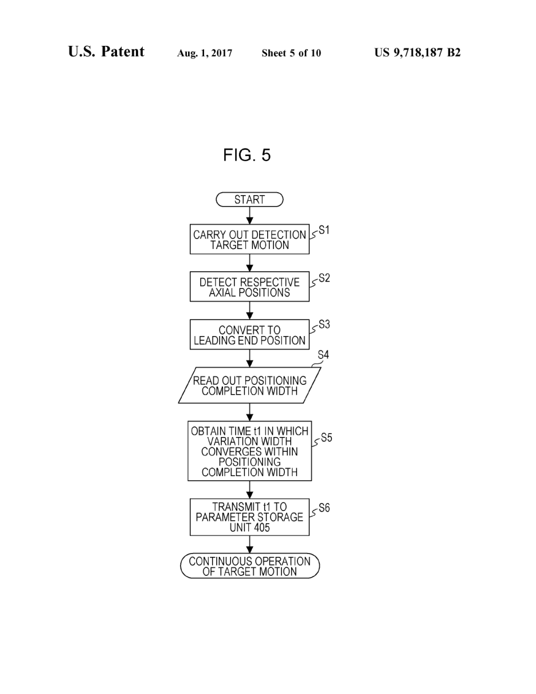
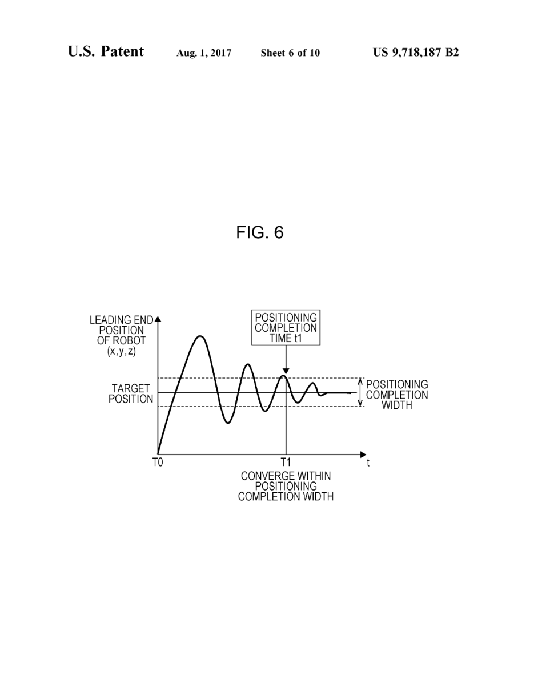
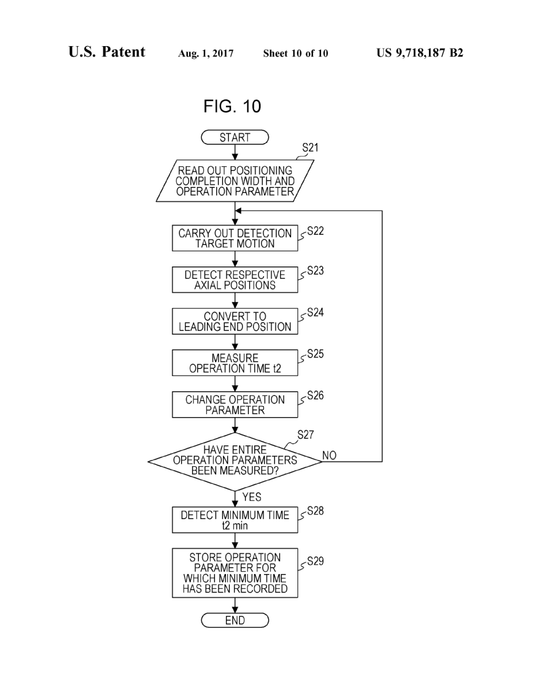

# US 9,718,187 B2 전문 번역

번역 범위: 전문 (표제면 서지, 초록, 도면 목록, 상세 설명, 청구항 14개).
원문 파일: 같은 폴더의 `US9718187B2.pdf` (22쪽, 도면 10장, 2026-11-04 patentimages에서 받음).
인용 문헌 목록(References Cited)은 서지라서 원문 그대로 두고 번역하지 않았다.

---

## 표제면

- 미국 특허 번호: US 9,718,187 B2
- 등록일: 2017년 8월 1일
- 발명 명칭: 로봇 제어 방법, 로봇 장치, 프로그램, 기록 매체, 그리고 조립 부품 제조 방법
  (Robot controlling method, robot apparatus, program, recording medium, and method for manufacturing assembly component)
- 발명자: Takahiro Ishikawa (가와사키), Tsutomu Osaka (요코하마), Shunsuke Kawamura (도리데)
- 출원인, 권리자: Canon Kabushiki Kaisha, 도쿄 (일본)
- 출원 번호: 14/733,699
- 출원일: 2015년 6월 8일
- 공개: US 2015/0360369 A1 (2015년 12월 17일)
- 우선권: 일본 특허 출원 2014-120156 (2014년 6월 11일)
- 국제 특허 분류: B25J 9/00 (2006.01), B25J 9/16 (2006.01)
- 미국 분류: CPC B25J 9/1674 (2013.01), G05B 2219/34388, G05B 2219/37297, G05B 2219/39098, Y10S 901/09, Y10S 901/23, Y10S 901/25, Y10T 29/49828, Y10T 74/20317
- 인용된 외국 문헌: JP 3-257506 A (1991년 11월)
- 심사관: Jonathan L. Sample
- 대리인: Canon U.S.A., Inc. IP Division
- 청구항 14개, 도면 10장

## 초록

입력측 엔코더가 검출한 각도가, 로봇 선단이 1차 동작의 위치 결정 완료 위치로 이동했을 때 얻어지는 목표 각도가 되도록, 각 서보모터에 되먹임 제어를 한다.
이어서 출력측 엔코더가 검출한 각도를 바탕으로 로봇 선단의 위치를 구한다.
되먹임 제어로 입력측 엔코더의 검출 각도가 목표 각도에 이른 시점부터, 계산한 로봇 선단 위치의 위치 결정 완료 위치에 대한 진동 폭이 수렴 범위 안으로 들어오는 시점까지의 시간을 구한다.
구한 이 시간을 로봇의 정지 시간으로 설정한다.

---

## 도면 목록 (원문 Brief Description of the Drawings)

- 도 1: 1차 실시예에 따른 로봇 장치의 사시도.
- 도 2: 1차 실시예 로봇 암의 관절 하나를 보인 부분 단면도.
- 도 3: 1차 실시예 로봇 장치의 제어 장치 구성을 보인 블록도.
- 도 4: 1차 실시예 로봇 장치의 제어계를 보인 기능 블록도.
- 도 5: 1차 실시예 제어 장치가 수행하는 로봇 제어 방법의 각 단계를 보인 흐름도.
- 도 6: 1차 실시예 로봇 선단의 진동 상태를 보인 그래프.
- 도 7: 2차 실시예 로봇 장치의 제어계를 보인 기능 블록도.
- 도 8: 2차 실시예 제어 장치가 수행하는 로봇 제어 방법의 각 단계를 보인 흐름도.
- 도 9: 3차 실시예 로봇 장치의 제어계를 보인 기능 블록도.
- 도 10: 3차 실시예 제어 장치가 수행하는 로봇 제어 방법의 각 단계를 보인 흐름도.

---

## 발명의 배경

### 기술 분야

본 발명은 다관절 로봇을 제어하는 로봇 제어 방법, 로봇 장치, 프로그램, 기록 매체, 그리고 조립 부품 제조 방법에 관한 것이다.

### 관련 기술 설명

여러 종류의 로봇 장치가 공장 등에서 쓰인다.
요즘은 전보다 복잡한 작업을 하기 위해 다축 다관절 로봇을 포함한 로봇 장치가 널리 쓰인다.

다관절 로봇을 생산 장치로 쓸 때, 작업 효율을 높이려면 로봇이 빠르게 움직여야 한다.
따라서 한 동작이 확실히 끝났다는 것, 다시 말해 위치 결정이 완료되었다는 것을 되도록 빨리 판정해야 한다.

로봇의 위치 결정 완료를 어떻게 판정할지에 대해 지금까지 다음 기법이 제안되었다.
예를 들어 서보모터의 위치, 속도, 토크 지령값을 바탕으로 로봇 선단 위치를 추정하고, 추정값이 미리 정한 선단 위치 허용 범위 안에 들면 위치 결정이 완료되었다고 판정한다 (일본 공개특허 3-257506 참조).

그러나 일본 공개특허 3-257506의 기법에서는, 로봇 암 선단 위치를 감속기의 입력측 값, 다시 말해 서보모터 안 회전축의 회전각을 검출하는 엔코더의 검출 각도를 바탕으로 계산해 추정한다.
즉 검출되는 것은 감속기 입력측의 각도다.
감속기는 강성이 낮고 진동하기 쉬운데, 그 감속기가 입력측과 로봇 암 선단 사이에 들어 있다.
그래서 감속기 입력측의 값만으로는 선단의 진동이 수렴했다고 보장하기 어렵다.
따라서 로봇 암 선단의 진동이 실제로는 수렴하지 않았는데도 다음으로 넘어가, 조립 작업의 정밀도가 나빠지는 경우가 있다.

한편, 일본 공개특허 3-257506에 종래 기술로 적힌 것처럼, 로봇 암이 다음 동작으로 넘어가기 전에 미리 정한 시간 동안 그냥 멈춰 있게 할 수도 있다.
그러나 그때는 정지 시간을 꽤 넉넉한 여유를 두고 잡아야 한다.
그래서 같은 조립 작업을 되풀이하는 경우에는 남는 시간(여유)이 쌓여, 로봇 암의 작업 효율이 떨어진다.

본 발명은 남아도는 정지 시간을 줄여 다관절 로봇의 작업 효율을 높이는 것을 목적으로 한다.

## 발명의 요약

본 발명의 한 측면에 따른 로봇 제어 방법은 다관절 로봇을 제어하는 로봇 제어 방법이다.
다관절 로봇의 각 관절을 구동하는 관절 구동 장치는 각각 다음을 포함한다.
서보모터, 감속기, 서보모터의 출력각을 검출하는 모터측 각도 검출기, 감속기의 출력각을 검출하는 감속기측 각도 검출기.
다관절 로봇은 1차 동작에서 2차 동작으로 넘어가기 전에 제어부에 의해 정지 시간만큼 정지된다.

이 로봇 제어 방법은 되먹임 제어 단계, 선단 위치 계산 단계, 계시 단계, 설정 단계를 포함한다.

- 되먹임 제어 단계: 각 모터측 각도 검출기가 검출한 각도가 목표 각도가 되도록 서보모터에 되먹임 제어를 한다.
- 선단 위치 계산 단계: 각 감속기측 각도 검출기가 검출한 각도를 바탕으로 다관절 로봇 선단의 위치를 구한다.
- 계시 단계: 기준 시점부터, 선단 위치 계산 단계에서 계산한 다관절 로봇 선단 위치의 위치 결정 완료 위치에 대한 진동 폭이 수렴 범위 안으로 수렴하는 시점까지의 시간을 구한다.
- 설정 단계: 계시 단계에서 구한 시간을 정지 시간으로 설정한다.

본 발명의 한 측면에 따르면, 다관절 로봇 선단의 위치를 감속기측 각도 검출기의 검출 각도로 구하고, 선단 위치가 위치 결정 완료 위치에 수렴하는 시간을 다관절 로봇의 정지 시간으로 설정한다.
이 구성으로, 설정한 정지 시간 동안 로봇을 멈춰 두면 다관절 로봇의 진동이 수렴하므로 작업 정밀도가 좋아진다.
또한 설정할 정지 시간에 큰 여유를 둘 필요가 없으므로, 기존 기법보다 정지 시간을 짧게 할 수 있고 다관절 로봇의 작업 효율이 좋아진다.

---

## 실시예 설명

### 1차 실시예

#### 장치 구성

도 1은 본 발명 1차 실시예에 따른 로봇 장치의 사시도다.

도 1에 보인 로봇 장치 500은 산업용 로봇이다.
로봇 장치 500은 로봇 100, 제어 장치 200, 교시 펜던트 300으로 이루어진다.
로봇 100은 자신이 쥔 1번 부품 W1과 2번 부품 W2를 조립하는 작업을 한다.
제어부 구실을 하는 제어 장치 200이 로봇 100을 제어한다.
교시 펜던트 300은 제어 장치 200에 연결된다.

다관절 로봇인 로봇 100은 수직 다관절 로봇 암 101과, 그 선단에 붙은 엔드 이펙터인 로봇 핸드 102를 포함한다.

로봇 100의 선단(로봇 핸드 102 또는 로봇 암 101의 선단)에 공구 중심점(TCP)을 둔다.
작업 공간에서 교시점을 지정하는 경우, 교시점은 TCP의 위치와 자세를 나타내는 파라미터로 표현한다.
형상 공간(관절 공간)에서 교시점을 지정하는 경우, 교시점은 로봇 100 각 관절의 관절각을 나타내는 파라미터로 표현한다.
형상 공간의 교시점은 순기구학 계산으로 작업 공간의 교시점으로 바꿀 수 있고, 작업 공간의 교시점은 역기구학 계산으로 형상 공간의 교시점으로 바꿀 수 있다.

로봇 암 101은 작업대에 고정된 기초부(기단 링크) 103과, 변위와 힘을 전달하는 링크 121에서 126까지를 포함한다.
기초부 103과 링크 121에서 126까지는 복수의 관절 J1에서 J6까지로 이어져 선회하거나 회전할 수 있다.
로봇 암 101은 각 관절 J1에서 J6까지를 구동하는 관절 구동 장치 110을 더 포함한다.
각 관절의 관절 구동 장치 110은 필요한 토크 크기에 맞는 출력을 내는 것으로 이루어진다.

로봇 핸드 102는 1번 부품 W1을 쥐는 복수의 파지 클로(손가락) 104, 이를 구동하는 구동부(미도시), 구동부의 회전각을 검출하는 엔코더(미도시), 회전을 파지 동작으로 바꾸는 기구(미도시)를 포함한다.
미도시 기구는 캠 기구, 링크 기구 등으로 구성할 수 있고 필요한 파지 동작에 맞춰 설계한다.
로봇 핸드 102의 구동부에 필요한 토크는 로봇 암 101 관절의 토크와 다르지만 기본 구성은 같다.
또한 로봇 핸드 102는 파지 클로 104 등에 작용하는 응력(반력)을 검출할 수 있는 힘 토크 센서(미도시)를 포함한다.

교시 펜던트 300은 제어 장치 200에 연결할 수 있고, 연결되면 로봇 암 101이나 로봇 핸드 102의 구동을 제어하는 지령을 제어 장치 200에 보낼 수 있다.

#### 관절 구동 장치

아래에서는 관절 J2의 관절 구동 장치 110을 대표로 설명한다.
나머지 관절 J1과 J3에서 J6까지의 관절 구동 장치 110은 크기와 성능이 다를 수 있으나 구성은 관절 J2와 비슷하므로 설명을 생략한다.

도 2는 로봇 암 101의 관절 J2를 보인 부분 단면도다.
관절 구동 장치 110은 전동기인 서보모터(이하 모터) 1과, 모터 1의 회전축 2의 회전 속도를 줄여 내보내는 감속기 11을 포함한다.

관절 구동 장치 110은 모터측 각도 검출기인 입력측 엔코더 10을 더 포함한다.
이것은 모터 1의 회전축 2의 회전각(출력각)을 검출한다.
또한 관절 구동 장치 110은 감속기측 각도 검출기인 출력측 엔코더 16을 포함한다.
이것은 감속기 11 출력축의 회전각(출력각)을 검출한다.

모터 1은 예를 들어 브러시리스 DC 서보모터나 AC 서보모터다.
모터 1은 회전축 2와 로터 마그넷 3으로 이루어진 회전부 4, 모터 하우징 5, 회전축 2를 자유롭게 돌 수 있게 받치는 베어링 6과 7, 회전부 4를 돌리는 고정자 코일 8을 포함한다.
베어링 6과 7은 모터 하우징 5에 있고, 고정자 코일 8은 모터 하우징 5에 붙는다.
또한 서보모터 1은 모터 커버 9로 덮인다.

입력측 엔코더 10은 광학식 또는 자기식 로터리 엔코더이고, 모터 1 회전축 2의 한쪽 끝에 붙는다.
입력측 엔코더 10은 모터 1 회전축 2의 회전에 맞춰 펄스 신호를 만들어 제어 장치 200으로 보낸다.
입력측 엔코더 10은 회전축 2에 붙지만, 대신 감속기 11의 입력축에 붙여도 된다.

출력측 엔코더 16은 광학식 또는 자기식 로터리 엔코더이고 감속기 11의 출력각을 검출한다.
1차 실시예에서 출력측 엔코더 16은 기초부 103과 링크 121이 이루는 각, 또는 이웃한 두 링크가 이루는 각을 검출한다.
관절 J2에서 출력측 엔코더 16은 링크 121과 링크 122가 이루는 각을 검출한다.
구체적으로 출력측 엔코더 16은 관절 J2의 구동(링크 121과 링크 122의 서로에 대한 움직임)에 맞춰 펄스 신호를 만들어 제어 장치 200으로 보낸다.

링크 121과 링크 122는 크로스 롤러 베어링 15로 이어져 자유롭게 돌 수 있다.
필요하면 모터 1과 입력측 엔코더 10 사이에 브레이크 유닛을 두어, 전원이 꺼졌을 때 로봇 암 101의 자세를 유지하게 할 수 있다.

1차 실시예에서 감속기 11은 작고 가벼우며 감속비가 큰 파동 기어 감속기다.
감속기 11은 모터 1의 회전축 2에 이어지고 입력축을 포함하는 웨이브 제너레이터 12와, 링크 122에 고정되고 출력축을 포함하는 서큘러 스플라인 13을 포함한다.
서큘러 스플라인 13은 링크 122에 바로 이어지지만, 서큘러 스플라인 13과 링크 122를 한 몸으로 만들어도 된다.

감속기 11은 웨이브 제너레이터 12와 서큘러 스플라인 13 사이에 있고 링크 121에 고정된 플렉스 스플라인 14를 더 포함한다.
플렉스 스플라인 14는 웨이브 제너레이터 12의 회전에 대해 감속비 N으로 속도가 줄고, 서큘러 스플라인 13에 대해 상대 회전한다.
따라서 모터 1 회전축 2의 회전수는 감속기 11에 의해 1/N로 줄고, 플렉스 스플라인 14가 고정된 링크 121에 대해 서큘러 스플라인 13이 고정된 링크 122가 돌아 관절 J2가 굽는다(회전한다).
이때 얻어지는 감속기 11 출력측의 회전각이 실제 출력각, 다시 말해 관절 J2의 각도(관절각)가 된다.

#### 제어 장치 구성

도 3은 로봇 장치 500의 제어 장치 200 구성을 보인 블록도다.
제어부 구실을 하는 제어 장치 200은 연산기(컨트롤러)인 중앙 처리 장치(CPU) 201을 포함한다.
제어 장치 200은 기억부 구실을 하는 읽기 전용 메모리(ROM) 202, 임의 접근 메모리(RAM) 203, 하드 디스크 드라이브(HDD) 204를 더 포함한다.
또한 제어 장치 200은 기록 디스크 드라이브 205, 계시부(타이머) 206, 여러 인터페이스 211에서 216까지를 포함한다.
제어 장치 200은 인터페이스 216에 연결된 서보 제어 장치 230을 더 포함한다.

ROM 202, RAM 203, HDD 204, 기록 디스크 드라이브 205, 타이머 206, 인터페이스 211에서 216까지는 버스 220으로 CPU 201에 이어진다.
ROM 202는 BIOS 같은 기본 프로그램을 담는다.
RAM 203은 CPU 201의 연산 결과 같은 여러 자료를 잠시 담는 기억 장치다.

HDD 204는 CPU 201의 연산 결과와 외부에서 얻은 여러 자료를 담는 기억 장치이고, 뒤에서 설명할 여러 연산을 CPU 201이 실행하게 하는 프로그램 240도 기록한다.
CPU 201은 HDD 204에 기록(저장)된 프로그램 240에 따라 로봇 제어 방법의 각 단계를 실행한다.

기록 디스크 드라이브 205는 기록 디스크 241에 기록된 여러 자료와 프로그램을 읽을 수 있다.
타이머 206은 CPU 201의 계시 시작 지령과 정지 지령에 따라 시간을 세고, 센 시간을 CPU 201로 내보낸다.

인터페이스 211은 사용자가 조작할 수 있는 교시 펜던트 300에 이어진다.
교시 펜던트 300은 입력된 교시점 자료(형상 공간에서 교시점을 지정한 경우에는 각 관절 J1에서 J6까지의 목표 각도)를 인터페이스 211과 버스 220을 통해 CPU 201로 보낸다.
CPU 201은 교시 펜던트 300에서 받은 교시점 자료를 HDD 204 같은 기억부에 넣는다.

인터페이스 212는 여러 영상을 보여 주는 모니터 311에 이어지고, 인터페이스 213은 다시 쓸 수 있는 비휘발성 메모리나 외장 HDD 같은 외부 기억 장치 312에 이어진다.

인터페이스 214는 입력측 엔코더 10에, 인터페이스 215는 출력측 엔코더 16에 이어진다.
입력측 엔코더 10과 출력측 엔코더 16은 위에서 말한 펄스 신호를 인터페이스 214, 215와 버스 220을 통해 CPU 201로 내보낸다.

인터페이스 216은 서보 제어 장치 230에 이어진다.
CPU 201은 교시점을 잇는 궤적을 만들고, 서보모터 1 회전축 2의 회전각을 얼마나 제어할지 나타내는 구동 지령 자료를 정해진 간격으로 버스 220과 인터페이스 216을 통해 서보 제어 장치 230으로 내보낸다.

서보 제어 장치 230은 CPU 201에서 받은 구동 지령을 바탕으로 되먹임 제어에서 서보모터 1로 내보낼 전류량을 계산하고, 서보모터 1에 전류를 공급해 로봇 암 101의 관절 J1에서 J6까지의 관절각을 제어한다.
다시 말해 CPU 201은 서보 제어 장치 230을 통해 서보모터 1로 관절 J1에서 J6까지의 구동을 제어하여, 관절 J1에서 J6까지의 각도가 목표 각도에 이르게 한다.

#### 기능 블록 (도 4)

도 4를 보며, 뒤에서 설명할 위치 결정 완료 검출 프로그램을 실행할 때 CPU 201과 HDD 204가 하는 기능을 설명한다.
도 4는 본 발명 1차 실시예에 따른 로봇 장치 500의 제어계를 보인 기능 블록도다.
프로그램 240을 실행하면 도 3의 CPU 201은 도 4에 보인 실제 출력각 계산부 401, 선단 위치 계산부 402, 위치 결정 시간 계산부 404로 동작한다.
또한 기억부 구실을 하는 HDD 204는 위치 결정 완료 판정값 저장부 403과 파라미터 저장부 405로 동작한다.
아래에서 각 부를 설명한다.

실제 출력각 계산부 401은 출력측 엔코더 16의 펄스 신호를 받아 출력각(검출 각도) θ를 계산한다.
출력각 θ는 감속기 11의 휨까지 담은 값이다.
그래서 입력측 엔코더 10으로 출력측 회전각을 계산하는 방법보다, 로봇 암 101 선단에 더 가까운 위치 정보를 얻을 수 있다.

선단 위치 계산부 402는 실제 출력각 계산부 401이 구한 값, 다시 말해 각 관절 J1에서 J6까지의 관절각으로 볼 수 있는 출력측 엔코더 16의 검출 각도를 바탕으로, 순기구학으로 로봇 100 선단(TCP)의 위치를 계산한다.

위치 결정 완료 판정값 저장부 403은 로봇 100 선단의 위치 결정이 완료되었는지 판정하는 데 쓰는 위치 결정 완료 판정값을 담는다.
이 값이 선단 위치의 허용 범위(수렴 범위)를 정한다.
사용자가 이 판정값을 미리 위치 결정 완료 판정값 저장부 403에 넣어 두는 것이 바람직하다.
판정값은 로봇 암 101의 동작 상태에 맞춰 직교 좌표계(세계 좌표계)의 x, y, z 각 축 방향마다 정하는 것이 바람직하다.
다시 말해 로봇 100 선단 위치를 직교 좌표계로 나타낼 때, 수렴 범위는 직교 좌표계의 축 방향마다 따로 정할 수 있다.

선단 위치와 각 관절각의 대응 관계를 알고 있는 경우에는, 관절각이 목표 각도에 이르도록 되먹임 제어를 해도 된다.

예를 들어 높은 동작 정밀도가 필요한 방향에만 작은 판정값을 두면, 최적의 위치 결정 완료 판정 시간을 얻을 수 있다.
판정값은 사용자가 사전 실험이나 도면에서 끌어낼 수 있다.
또는 더 간단하게, 사용 조건에 맞춘 몇 단계의 규정값을 미리 마련해 두고 그중에서 골라 쓸 수도 있다.

위치 결정 시간 계산부 404는 선단 위치 계산부 402가 구한 값과 위치 결정 완료 판정값 저장부 403에서 얻은 값을 바탕으로, 로봇 100 대상 동작의 위치 결정 시간(로봇 100이 멈춰 있는 시간)을 구한다.

파라미터 저장부 405는 위치 결정 시간 계산부 404가 구한 값을 담는다.
담긴 값은 로봇 장치 500을 연속 운전할 때 서보 제어 장치 230을 통해 해당 대상 동작의 위치 결정 완료 시간(정지 시간)으로 적용된다.

#### 문제 상황

이제 도 1처럼 로봇 100의 선단(TCP)을 교시점 P1, P2, P3 순으로 옮겨 부품 W1과 부품 W2를 조립해 조립 부품을 만드는 경우를 설명한다.
도 1에서 선단이 교시점 P1에서 교시점 P2로 가는 동작을 1차 동작, 교시점 P2에서 교시점 P3으로 가는 동작을 2차 동작이라 한다.
로봇 100이 1차 동작에서 2차 동작으로 넘어가기 전에, 제어 장치 200은 로봇 100의 진동이 수렴하도록 교시점 P2 자리에서 일정한 정지 시간 동안 로봇 100을 잠시 멈춘다.

다시 말해 제어 장치 200은 1차 동작에서 각 입력측 엔코더 10의 검출 각도가 형상 공간에서 지정한 교시점 P2(즉 각 관절 J1에서 J6까지의 목표 각도)에 이르도록 되먹임 제어를 한다.
제어 장치 200은 입력측 엔코더 10의 검출 결과를 바탕으로 되먹임 제어를 하므로, 로봇 100 선단은 출력측 엔코더 16의 검출 결과로 되먹임 제어를 할 때보다 교시점 P2에 더 빨리 닿는다.
그러나 로봇 100은 1차 동작에 따른 관성력의 영향을 받고, 교시점 P2에 닿을 때 감속기 11의 휨 등으로 진동한다.
감속기 11이 일으킨 진동을 모터 1의 각도(입력측 엔코더 10의 검출 각도)로 정확히 구하기는 어렵다.
로봇 100의 진동이 수렴하지 않은 상태에서 2차 동작이나 부품 W1과 W2를 조립해 조립 부품을 만드는 동작을 하면 조립이 실패할 수 있다.
그래서 1차 실시예에서는 로봇 100이 1차 동작을 마치고 교시점 P2에 닿은 시점부터 미리 설정한 정지 시간만큼 로봇 100을 멈춘 뒤 2차 동작을 하게 한다.
이 정지 시간의 자료는 위에서 설명한 위치 결정 시간 계산부 404에 담긴다.

#### 정지 시간 설정 절차 (도 5)

아래에서 이 정지 시간을 설정하는 동작을 설명한다.
도 5는 본 발명 1차 실시예에 따라 제어 장치 200이 수행하는 로봇 제어 방법의 각 단계를 보인 흐름도다.

(도 5 캡션 번역: 검출 대상 동작 수행 S1, 각 축 위치 검출 S2, 선단 위치로 변환 S3, 위치 결정 완료 폭 읽기 S4, 변동 폭이 위치 결정 완료 폭 안으로 수렴하는 시간 t1 구하기 S5, t1을 파라미터 저장부 405로 보내기 S6, 대상 동작 연속 운전.)

먼저 서보 제어 장치 230이 CPU 201의 지령에 따라 검출 대상 동작을 한다 (S1: 되먹임 제어 단계).
서보 제어 장치 230은 입력측 엔코더 10의 위치 정보를 되먹여 CPU 201의 지령대로 제어한다.
더 구체적으로, CPU 201의 제어 아래 서보 제어 장치 230은 각 입력측 엔코더 10의 검출 각도가, 로봇 100 선단이 1차 동작의 위치 결정 완료 위치로 이동했을 때 얻어지는 목표 각도가 되도록 각 서보모터 1에 되먹임 제어를 한다.
1차 동작의 위치 결정 완료 위치는 교시점 P2의 위치 좌표 x, y, z로 나타내며, 아래에서는 목표 위치라고도 부른다.

이어서 실제 출력각 계산부 401은 타이머 206을 켜서, S1에서 입력측 엔코더 10이 검출한 각 관절 J1에서 J6까지의 검출 각도가 목표 각도에 이른 시점부터의 시간을 센다.
그리고 정해진 시간 간격마다 출력측 엔코더 16이 검출한 각 관절 J1에서 J6까지의 검출 각도를 얻는다.
이어서 실제 출력각 계산부 401은 출력측 엔코더 16의 펄스 신호를 바탕으로 각 관절 J1에서 J6까지 감속기 11 출력축의 회전각을 정해진 시간 간격마다 계산한다 (S2).
여기서는 입력측 엔코더 10의 검출 각도가 목표 각도에 이른 시각을 기준 시점 T0으로 두고 계시 단계를 시작하는 구성을 설명하지만, 사용자가 원하는 기준 시점을 정해도 된다.
다시 말해 아래에서 설명하는 정지 시간을 설정할 때는 알맞은 기준 시점 T0을 정해야 한다.

이어서 선단 위치 계산부 402는 S2에서 얻은 각 관절 감속기 11 출력축의 회전각을 바탕으로 로봇 100 선단의 위치(TCP의 위치)를 구한다 (S3: 선단 위치 계산 단계).
선단 위치는 각 관절의 회전각을 순기구학으로 바꾸어 구할 수 있다.

도 6은 로봇 선단의 진동 상태를 보인 그래프다.
가로축은 시간 t, 세로축은 x, y, z 좌표 세 방향 중 한 방향의 로봇 선단 위치다.
S3을 거치면 도 6과 같은, 감쇠 진동을 하는 로봇 선단 위치의 자료가 정해진 시간 간격마다 만들어진다.

(도 6 캡션 번역: 세로축 로봇 선단 위치 (x, y, z), 가로축 시간 t, 가운데 수평선 목표 위치, 점선 두 줄 사이 위치 결정 완료 폭, 시작점 T0, 진동이 위치 결정 완료 폭 안으로 수렴하는 시점 T1, 그 사이 구간이 위치 결정 완료 시간 t1.)

이어서 위치 결정 시간 계산부 404는 위치 결정 완료 판정값 저장부 403에서 위치 결정 완료 판정값을 읽는다 (S4).
그리고 위치 결정 시간 계산부 404는 도 6처럼 검출 대상 동작이 닿을 x, y, z 각 좌표에서 목표 위치를 가운데 값으로 두고 그 값을 양의 방향과 음의 방향으로 나누어, 위치 결정 완료 폭(수렴 범위)을 정한다.

이어서 위치 결정 시간 계산부 404는 도 6처럼 로봇 100 선단의 진동 자료를 바탕으로, 목표 위치에 대해 진동이 위치 결정 완료 폭 안(수렴 범위 안)으로 들어오는 시간 t1을 구한다 (S5: 계시 단계).
도 6처럼, S1에서 각 입력측 엔코더 10의 검출 각도가 목표 각도(교시점 P2)에 이른 시점을 시각 T0으로 둔다.
또한 도 6처럼, S3에서 계산한 로봇 100 선단 위치의 위치 결정 완료 위치에 대한 진동 폭이 수렴 범위 안으로 수렴한 시점을 시각 T1로 둔다.
위치 결정 시간 계산부 404는 시각 T0에서 시각 T1까지의 시간 t1을 구한다.

이어서 위치 결정 시간 계산부 404는 S5에서 구한 시간 t1을 파라미터 저장부 405로 보내 담고, 그렇게 로봇 100의 정지 시간(위치 결정 완료 시간)을 설정한다 (S6: 설정 단계).

위의 S1에서 S6까지를 마쳐 정지 시간이 설정되면, 조립 부품을 만드는 단계(연속 운전)로 넘어간다.
구체적으로 로봇 100이 1번 부품 W1을 쥐고 1차 동작을 한 뒤, 미리 설정한 정지 시간 동안 멈춘다.
그 뒤 로봇 100은 2차 동작으로 1번 부품 W1과 2번 부품 W2를 조립해 조립 부품을 만든다.

위의 S1에서 S6까지는 실제 연속 운전 때(조립 작업 때) 해도 되고, 연속 운전과 따로 시험 운전 때 해도 된다.
시험 운전은 연속 운전 때와 비슷한 동작을 하는 운전이다.
연속 운전 때 하는 경우, 정지 시간이 설정된 로트의 다음 로트를 조립할 때부터 설정된 정지 시간으로 로봇 100을 제어하면 된다.

시험 운전 때 하는 경우, 로봇 100의 로봇 핸드 102가 실제 부품 W1이나 W1에 해당하는 지그를 쥐고 위의 S1에서 S6까지를 수행할 수 있다.
그렇게 로봇 핸드 102가 교시점 P2로 이동했을 때의 로봇 100 정지 시간을 설정할 수 있다.
그 뒤 연속 운전 때 설정된 정지 시간에 따라 로봇 100을 제어하면 된다.

이처럼 로봇 암 101을 교시 재생 방식으로 운전하면 동작 궤적에 재현성이 있다.
그 성질을 이용하면, 이후 운전에서 진동이 위치 결정 완료 폭 안으로 수렴하는 시간은 거의 같게 유지된다.
따라서 이 시간을 검출 대상 동작의 위치 결정 완료 시간으로 볼 수 있다.

#### 1차 실시예의 효과

지금까지 설명한 대로, 1차 실시예의 로봇 장치 500에서는 출력측 엔코더 16의 검출 각도로 로봇 100 선단의 위치를 계산한다.
그래서 선단의 진동이 수렴하는 시간 t1을 정확히 구할 수 있다.

또한 교시 재생 방식의 동작 재현성을 이용하므로, 위치 결정이 완료되었다고 판정하는 데 걸리는 시간을 줄일 수 있다.
따라서 기존 기법처럼 감속기 입력측 값에 기대는 방법과 견주어, 정밀도를 보장하면서 되도록 빨리 위치 결정을 완료하는 조건을 정확히 얻을 수 있다.

다시 말해 로봇 100을 1차 동작의 시작점인 교시점 P1에서 끝점인 교시점 P2로 옮긴 뒤 t1로 설정한 정지 시간 동안 멈추면, 로봇 100 선단의 진동이 수렴한다.
그래서 교시점 P2를 시작점으로 교시점 P3까지 가는 2차 동작이 안정된다.
따라서 부품 W1과 W2를 조립하는 작업의 정밀도가 나빠지는 것을 막을 수 있다.
이렇게 설정된 정지 시간 동안 로봇 100을 멈추면 진동이 수렴하므로 로봇 100의 작업 정밀도가 좋아진다.

또한 설정할 정지 시간에 큰 여유를 둘 필요가 없으므로, 기존 기법보다 정지 시간을 짧게 할 수 있고 로봇 100의 작업 효율이 좋아진다.

또한 수렴 범위를 x, y, z 각 축 방향마다 따로 정하고, 동작 정밀도가 필요 없는 방향의 수렴 범위는 크게 정한다.
그러면 위치 결정 완료까지 걸리는 시간(진동이 수렴하는 데 걸리는 시간, 즉 로봇 100의 정지 시간)을 줄일 수 있다.
따라서 로봇 100은 전보다 빠르게 동작할 수 있게 된다.

### 2차 실시예

이어서 본 발명 2차 실시예에 따른 로봇 장치의 로봇 제어 방법을 도 7과 도 8로 설명한다.
도 7은 2차 실시예 로봇 장치의 제어계를 보인 기능 블록도다.
도 8은 2차 실시예 제어 장치가 수행하는 로봇 제어 방법의 각 단계를 보인 흐름도다.
2차 실시예 로봇 장치의 전체 구성은 1차 실시예의 로봇 장치 500과 비슷하므로 설명을 생략하고, 다른 점을 중심으로 설명한다.
2차 실시예는 제어 장치 200의 기능, 다시 말해 프로그램 240(도 3 참조)의 내용이 1차 실시예와 다르다.

#### 경년 변화 문제

로봇 암 101을 오래 쓰면 감속기 11이나 타이밍 벨트(미도시) 같은 로봇 암 101 구성 부품의 경년 변화가 나타난다.
이 경우 진동이 수렴하는 시간이 미리 설정한 로봇 100의 정지 시간(위치 결정 완료 시간)에서 달라질 수 있다.
로봇 100의 정지 시간을 처음 설정한 대로 쓰는데 위치 결정 완료 시간이 시간이 지나며 바뀌면, 로봇 100은 동작 정밀도가 확보되지 않은 상태로 2차 동작에 들어갈 수 있다.
아래 2차 실시예에서는 위치 결정 완료 시간의 변화에 대응하는 방법을 설명한다.

#### 기능 블록 (도 7)

도 7의 각 부 가운데 도 4와 공통인 부의 설명은 생략한다.
프로그램 240을 실행하면 도 3의 CPU 201은 실제 출력각 계산부 401, 선단 위치 계산부 402, 위치 결정 시간 계산부 404, 그리고 도 7에 보인 시계열 자료 처리부 408로 동작한다.
또한 기억부 구실을 하는 HDD 204는 위치 결정 완료 판정값 저장부 403, 경년 변화 임계값 저장부 406, 시계열 자료 저장부 407로 동작한다.

경년 변화 임계값 저장부 406은, 위치 결정 시간 계산부 404가 계산한 로봇 100의 진동 수렴 시간 t1과 현재 적용 중인 위치 결정 완료 시간 사이의 어긋남에 대한 임계값을 담는다.
이 임계값으로 위치 결정 완료 시간의 경년 변화가 일어났는지 판정한다.
작업 내용이 정밀하면 이 임계값을 작게 두는 것이 바람직하다.
사용자가 이 임계값을 미리 경년 변화 임계값 저장부 406에 넣는다.

시계열 자료 저장부 407은 위치 결정 완료 시간의 경년 변화 여부를 판정하기 위해 구한 위치 결정 완료 시간을 시간순으로 담는다.
위치 결정 완료 시간을 구하는 방법은 1차 실시예와 같다.

시계열 자료 처리부 408은 시계열 자료 저장부 407에 담긴 위치 결정 완료 시간의 시계열 자료를 처리해 경년 변화가 일어났는지 판정한다.
시계열 자료는 예를 들어 이동 평균법으로 처리할 수 있다.
변화가 검출되면 서보 제어 장치 230으로 정지 지령을 보낸다.

#### 절차 (도 8)

이어서 도 8의 흐름도로 제어 장치 200의 제어 동작을 설명한다.

연속 운전에 앞서, 위치 결정 시간 계산부 404와 시계열 자료 처리부 408은 위치 결정 완료 판정값과 경년 변화 판정 임계값을 각각 위치 결정 완료 판정값 저장부 403과 경년 변화 임계값 저장부 406에서 읽는다 (S11).

서보 제어 장치 230은 CPU 201의 지령에 따라 연속 운전에서 대상 동작을 한다 (S12: 되먹임 제어 단계).
더 구체적으로, CPU 201의 제어 아래 서보 제어 장치 230은 각 입력측 엔코더 10의 검출 각도가, 로봇 100 선단이 1차 동작의 위치 결정 완료 위치로 이동했을 때 얻어지는 목표 각도가 되도록 서보모터 1에 되먹임 제어를 한다.

이어서 실제 출력각 계산부 401은 타이머 206을 켜서, S12에서 입력측 엔코더 10이 검출한 각 관절 J1에서 J6까지의 검출 각도가 목표 각도에 이른 시점부터의 시간을 센다.
그리고 정해진 시간 간격마다 출력측 엔코더 16이 검출한 각 관절의 검출 각도를 얻어, 각 관절 감속기 11 출력축의 회전각을 계산한다 (S13).

이어서 선단 위치 계산부 402는 S13에서 얻은 각 관절 감속기 11 출력축의 회전각을 바탕으로, 순기구학으로 로봇 100 선단의 위치(TCP의 위치)를 구한다 (S14: 선단 위치 계산 단계).

이어서 위치 결정 시간 계산부 404는 로봇 100 선단의 진동 자료를 바탕으로, 목표 위치에 대해 진동이 위치 결정 완료 폭 안(수렴 범위 안)으로 들어오는 시간 t1을 구한다 (S15: 계시 단계).

위의 S12에서 S15까지는 1차 실시예 도 5의 S1에서 S5까지와 비슷하다.
다시 말해 도 5의 S1에서 S5까지를 다시 수행하는 것이다.

이어서 위치 결정 시간 계산부 404는 S15에서 구한 시간 t1을 시계열 자료 저장부 407에 담는다 (S16).

이때 S15에서 구한 시간 t1이 파라미터 저장부 405(도 4 참조)에 담긴 정지 시간에서 달라졌으면, 위치 결정 시간 계산부 404는 파라미터 저장부 405에 담긴 정지 시간을 S15에서 구한 t1로 갱신한다.
다만 S15에서 구한 t1이 파라미터 저장부 405에 담긴 정지 시간에서 미리 정한 시간 이상 달라진 경우에만 갱신하게 해도 된다.

어느 쪽이든, 부품의 경년 변화로 진동 수렴 시간이 달라진 경우에 변화 뒤의 수렴 시간을 정지 시간에 적용해 운전을 이어 갈 수 있다.
따라서 로봇 100의 운전을 이어 가면서도 동작 정밀도가 확보된 상태를 유지할 수 있다.

2차 실시예에서 S16에서 시계열 자료 저장부 407에 담은 시간(위치 결정 완료 시간) t1은 경년 변화를 점검하는 데만 쓰고, 위치 결정 완료 판정에는 쓰지 않는다.
시간 t1은 로봇 100의 경년 변화에 따라 길어지는 경향이 있다.
그래서 t1을 임계값과 견주면 로봇 100이 노후했는지 판정할 수 있다.
다시 말해 t1이 임계값 이상이면 로봇 100을 이루는 부품(특히 감속기 11이나 타이밍 벨트)이 노후했다는 것을 알 수 있다.

시계열 자료 처리부 408은 S16에서 시계열 자료 저장부 407에 담은 위치 결정 완료 시간 t1의 시계열 자료를 처리해 위치 결정 완료 시간의 변화량을 계산한다.
시계열 자료 처리부 408은 로봇 100의 경년 변화로 생긴 위치 결정 완료 시간의 변화량이 S11에서 미리 읽은 임계값 이상인지 판정한다 (S17).
변화량이 임계값보다 작으면 (S17: 아니오) S12로 돌아가 S12 이후를 되풀이한다.

변화량이 임계값 이상이면 (S17: 예) 시계열 자료 처리부 408은 사용자에게 알리는 경고를 낸다 (S18: 통지 단계).
그리고 로봇 100의 운전을 멈춘다 (S19).
경고를 내는 방법으로는 교시 펜던트 300이나 모니터 311에 표시하는 것이 바람직하다.
로봇 100의 부품(특히 관절 J1에서 J6까지)의 변화로 위치 결정 완료 시간이 달라지면 로봇 100을 멈추고 사용자에게 경고한다.
그렇게 정밀도가 확보되지 않은 상태에서 로봇 100이 다음 동작으로 넘어가는 것을 막을 수 있다.

도 8의 절차는 대상 동작의 연속 운전마다 매번 할 필요는 없고, CPU 201의 성능과 계산 부하를 고려해 연속 운전 몇 번마다 한 번씩 해도 된다.

### 3차 실시예

이어서 본 발명 3차 실시예에 따른 로봇 장치의 로봇 제어 방법을 도 9와 도 10으로 설명한다.
도 9는 3차 실시예 로봇 장치의 제어계를 보인 기능 블록도다.
도 10은 3차 실시예 제어 장치가 수행하는 로봇 제어 방법의 각 단계를 보인 흐름도다.
3차 실시예 로봇 장치의 전체 구성은 1차 실시예의 로봇 장치 500과 비슷하므로 설명을 생략하고, 다른 점을 중심으로 설명한다.
3차 실시예는 제어 장치 200의 기능, 다시 말해 프로그램 240(도 3 참조)의 내용이 1차 실시예와 다르다.

#### 속도와 정착 시간의 상충

로봇 장치의 동작 효율을 높이려고 1차 동작의 속도를 올리면 위치 결정 완료 위치에서의 진동이 커진다.
이 경우 진동이 필요한 정밀도 범위 안으로 수렴하는 데 걸리는 시간이 길어진다.
다시 말해 1차 동작의 속도를 올려 아낄 수 있는 시간과, 위치 결정 완료 위치에서 진동이 멎기를 기다리는 시간은 서로 반비례 관계에 있다.

그런데 로봇의 동작 효율이 최적이 되는 1차 동작의 속도를 구하려면, 속도를 바꾸어 가며 1차 동작 시작부터 위치 결정 완료까지의 시간을 되풀이해 재야 한다.
그러면 로봇을 다루는 작업자의 부담이 커진다.
특히 생산 장치 안에 설치된 로봇은 주변 기기 때문에 계측기를 달기 어려운 경우가 많다.

그래서 3차 실시예에서는, 2차 동작에 필요한 정밀도를 만족하면서 1차 동작 시작부터 위치 결정 완료까지의 시간이 최소가 되는 1차 동작의 속도 파라미터를 구하는 방법을 설명한다.

#### 기능 블록 (도 9)

도 9의 각 부 가운데 도 4와 공통인 부의 설명은 생략한다.
프로그램 240을 실행하면 도 3의 CPU 201은 실제 출력각 계산부 401, 선단 위치 계산부 402, 동작 시간 계산부 409, 그리고 도 9에 보인 파라미터 계산부 411로 동작한다.
또한 기억부 구실을 하는 HDD 204는 위치 결정 완료 판정값 저장부 403, 경년 변화 임계값 저장부 405, 동작 파라미터 목록 저장부 410으로 동작한다.

동작 시간 계산부 409는 1차 동작의 동작 시간을 계산한다.
여기서 동작 시간은 서보 제어 장치 230이 서보모터 1에 1차 동작 지령을 내는 시점을 시작점으로, 1차 동작의 위치 결정이 완료되었다고 판정되는 시점을 끝점으로 한다.
이 동작 시간은 1차 동작 지령에 따라 동작하는 데 걸리는 시간(위에서 말한 기준 시점 앞 구간에서 잰다)과, 기준 시점 뒤 로봇 선단이 진동하는 시간의 합에 해당한다.
1차 동작의 동작 시간은 로봇 장치의 동작 시간과 안정화 시간을 함께 담으며, 짧을수록 바람직하다.

위치 결정 완료 판정 방법은 1차 실시예에서 설명한 것과 같다.

동작 파라미터 목록 저장부 410은 1차 동작의 속도 파라미터 목록을 담는다.
목록의 파라미터 하나가 파라미터 저장부 405를 통해 서보 제어 장치 230으로 보내져, 그 값으로 1차 동작을 한다.

파라미터 계산부 411은 동작 시간 계산부 409가 구한 1차 동작의 동작 시간이 최소가 되는 1차 동작의 속도 파라미터와 가속도 파라미터를 구해, 구한 값을 파라미터 저장부 405로 보낸다.

#### 절차 (도 10)

이어서 도 10의 흐름도로 제어 장치 200의 제어 동작을 설명한다.

(도 10 캡션 번역: 위치 결정 완료 폭과 동작 파라미터 읽기 S21, 검출 대상 동작 수행 S22, 각 축 위치 검출 S23, 선단 위치로 변환 S24, 동작 시간 t2 측정 S25, 동작 파라미터 변경 S26, 동작 파라미터 전부를 쟀는가 S27, 최소 시간 t2min 검출 S28, 최소 시간을 기록한 동작 파라미터 저장 S29, 종료.)

먼저 동작 시간 계산부 409는 동작 시간의 끝점을 구할 위치 결정 완료 판정값을 위치 결정 완료 판정값 저장부 403에서 읽는다.
또한 파라미터 저장부 405는 동작 파라미터 목록 저장부 410의 목록에서 첫 속도 파라미터를 읽는다.
파라미터 저장부 405는 읽은 값을 서보 제어 장치 230으로 보낸다 (S21).

서보 제어 장치 230은 CPU 201의 지령에 따라 대상 동작을 한다 (S22: 되먹임 제어 단계).
더 구체적으로, CPU 201의 제어 아래 서보 제어 장치 230은 각 입력측 엔코더 10의 검출 각도가, 로봇 100 선단이 1차 동작의 위치 결정 완료 위치로 이동했을 때 얻어지는 목표 각도가 되도록 서보모터 1에 되먹임 제어를 한다.

이어서 실제 출력각 계산부 401은 타이머 206을 켜서, S22에서 서보 제어 장치 230이 1차 동작 지령을 시작한 시각 같은 알맞은 시점부터의 시간을 센다.
이 계시는 위에서 말한, 선단 위치의 진동 폭이 수렴 범위 안으로 수렴하는 시간을 구하는 기준 시점보다 앞 구간에서 한다.
잰 시간은 1차 동작 지령에 해당하는 동작을 하는 데 걸린 시간에 해당한다.

출력측 엔코더 16이 검출한 각 관절 J1에서 J6까지의 검출 각도를 정해진 시간 간격마다 얻는다.
그리고 실제 출력각 계산부 401은 출력측 엔코더 16의 펄스 신호를 바탕으로 각 관절 감속기 11 출력축의 회전각을 정해진 시간 간격마다 계산한다 (S23).

이어서 선단 위치 계산부 402는 S23에서 얻은 회전각을 바탕으로, 순기구학으로 로봇 100 선단의 위치(TCP의 위치)를 구한다 (S24: 선단 위치 계산 단계).
따라서 위에서 말한 대로, 선단 위치와 각 관절각의 대응 관계를 알고 있는 경우에는 관절각이 목표 각도에 이르도록 서보모터 1에 되먹임 제어를 하거나, 선단 위치를 계산할 수 있다.

이어서 동작 시간 계산부 409는 S23에서 타이머 206의 계시를 시작한 시각을 시작점으로, 로봇 100 선단의 진동 자료를 바탕으로 목표 위치에 대해 진동이 위치 결정 완료 폭 안(수렴 범위 안)으로 수렴한 시각을 끝점으로 하는 시간 t2를 구한다 (S25: 계시 단계).

이어서 파라미터 저장부 405는 동작 파라미터 목록 저장부 410의 목록에서 다음 속도 파라미터를 읽어 서보 제어 장치 230으로 보낸다 (S26: 동작 파라미터 변경 단계).

이때 동작 파라미터 목록 저장부 410에 다음 값이 담겨 있으면 (S27: 아니오) S22로 돌아가 같은 동작을 되풀이한다.
다음 속도 파라미터가 없으면 (S27: 예) 앞의 속도 파라미터가 목록의 마지막 값이라고 판정하고 최소 시간 검출로 넘어간다.

파라미터 계산부 411은 여기까지 잰 동작 시간 가운데 최소 시간 t2min과 그때의 속도 파라미터를 검출한다 (S28: 최소 시간 검출 단계).

끝으로 파라미터 저장부 405는 S28에서 구한 속도 파라미터를 파라미터 계산부 411에서 읽고 (S29: 동작 파라미터 설정 단계) 처리를 마친다.
서보 제어 장치 230이 이 값을 읽어 그에 맞게 동작하면, 2차 동작에 필요한 정밀도를 만족하면서 1차 동작 시작부터 위치 결정 완료까지의 시간이 최소가 되는 조건으로 로봇을 운전할 수 있다.

본 실시예의 동작 파라미터는 속도 파라미터에 한정되지 않는다.
로봇이 멈출 때 생기는 진동에 영향을 주는 가속도 파라미터나 저크 파라미터를 더해도 된다.

### 변형과 보충

지금까지 본 발명의 실시예를 설명했으나 본 발명은 위 실시예에 한정되지 않는다.
또한 실시예에서 말한 효과는 본 발명으로 얻는 가장 알맞은 효과를 예로 든 것일 뿐, 본 발명의 효과가 거기에 한정되지는 않는다.

예를 들어 위 실시예에서는 다관절 로봇 100이 수직 다관절 로봇인 경우를 설명했으나, 다관절 로봇 100은 수평 다관절 로봇(스카라 로봇)이나 패러렐 링크 로봇이어도 된다.

또한 위 실시예의 처리 동작은 구체적으로 제어 장치 200의 CPU 201이 수행한다.
따라서 위 기능을 구현하는 프로그램을 담은 기록 매체를 제어 장치 200에 공급하고, 제어 장치 200의 컴퓨터(CPU 또는 MPU)가 기록 매체에 담긴 프로그램을 읽어 실행해 기능을 구현해도 된다.
이 경우 기록 매체에서 읽어 낸 프로그램 자체가 위 실시예의 기능을 구현하므로, 그 프로그램 자체나 프로그램을 담은 기록 매체가 본 발명을 이룬다.

또한 위 실시예에서는 컴퓨터로 읽을 수 있는 기록 매체가 HDD 204이고 프로그램 240이 HDD 204에 담긴 경우를 설명했으나, 실시예가 그 구성에 한정되지는 않는다.
프로그램 240은 컴퓨터로 읽을 수 있는 어떤 기록 매체에 담아도 된다.
예를 들어 도 3의 ROM 202, 외부 기억 장치 312, 기록 디스크 241 등을 프로그램 공급용 기록 매체로 쓸 수 있다.
기록 매체의 구체적인 예로는 플렉시블 디스크, 하드 디스크, 광 디스크, 광자기 디스크, CD-ROM, CD-R, 자기 테이프, 비휘발성 메모리 카드, ROM이 있다.
또한 위 실시예의 프로그램을 네트워크로 내려받아 컴퓨터에서 실행해도 된다.

또한 실시예는 컴퓨터가 읽어 낸 프로그램 코드를 실행해 기능이 구현되는 방식에 한정되지 않는다.
컴퓨터에서 동작하는 운영 체제(OS) 등이 프로그램 코드의 지시에 따라 실제 처리의 일부나 전부를 수행해 위 실시예의 기능이 구현되는 경우도 포함한다.

나아가 기록 매체에서 읽어 낸 프로그램 코드를, 컴퓨터에 꽂은 기능 확장 보드나 컴퓨터에 연결한 기능 확장 유닛에 있는 메모리에 써 넣어도 된다.
기능 확장 보드나 기능 확장 유닛에 있는 CPU 등이 프로그램 코드의 지시에 따라 실제 처리의 일부나 전부를 수행해 위 실시예의 기능이 구현되는 경우도 포함한다.

본 발명을 실시예로 설명했으나, 본 발명이 공개된 실시예에 한정되지 않는다는 점을 알아야 한다.
아래 청구항의 범위는 그러한 모든 변형과 균등한 구조, 기능을 담도록 가장 넓게 해석되어야 한다.

본 출원은 2014년 6월 11일 출원된 일본 특허 출원 2014-120156의 이익을 주장하며, 그 전체를 여기에 참조로 포함한다.

---

## 청구항

**청구항 1.** 다관절 로봇을 제어하는 로봇 제어 방법으로서, 상기 다관절 로봇은 각 관절을 구동하는 관절 구동 장치를 포함하고, 각 관절 구동 장치는 서보모터, 감속기, 서보모터의 출력각을 검출하는 모터측 각도 검출기, 감속기의 출력각을 검출하는 감속기측 각도 검출기를 포함하며, 상기 로봇 제어 방법은 다음을 포함한다.

- 각 모터측 각도 검출기가 검출한 각도가 목표 각도가 되도록 서보모터의 동작에 되먹임 제어를 하는 되먹임 제어 단계,
- 각 감속기측 각도 검출기가 검출한 각도를 바탕으로 다관절 로봇 선단의 위치를 구하는 선단 위치 계산 단계,
- 기준 시점부터, 선단 위치 계산 단계에서 계산한 다관절 로봇 선단 위치의 위치 결정 완료 위치에 대한 진동 폭이 수렴 범위 안으로 수렴하는 시점까지의 시간을 구하는 계시 단계,
- 계시 단계에서 구한 시간을 정지 시간으로 설정하는 설정 단계,
- 그 정지 시간 동안 다관절 로봇을 멈춘 뒤 되먹임 제어 단계로 돌아가는 제어 단계.

**청구항 2.** 청구항 1의 로봇 제어 방법으로서, 계시 단계에서 다관절 로봇 선단의 위치가 복수의 축 방향을 가진 직교 좌표계로 표현되고 그 위치가 각 축 방향 좌표로 표현되는 경우, 수렴 범위를 각 축 방향마다 따로 정한다.

**청구항 3.** 청구항 1의 로봇 제어 방법으로서, 설정 단계에서, 정지 시간이 기억부에 담겨 있고 되먹임 제어 단계, 선단 위치 계산 단계, 계시 단계를 다시 수행한 경우, 계시 단계에서 구한 시간이 기억부에 담긴 정지 시간에서 달라졌으면 기억부에 담긴 정지 시간을 계시 단계에서 구한 시간으로 갱신한다.

**청구항 4.** 청구항 1의 로봇 제어 방법으로서, 설정 단계에서, 정지 시간이 기억부에 담겨 있고 되먹임 제어 단계, 선단 위치 계산 단계, 계시 단계를 다시 수행한 경우, 계시 단계에서 구한 시간이 기억부에 담긴 정지 시간에서 미리 정한 시간 이상 달라졌으면 기억부에 담긴 정지 시간을 계시 단계에서 구한 시간으로 갱신한다.

**청구항 5.** 청구항 1의 로봇 제어 방법으로서, 다음을 더 포함한다.

- 계시 단계에서 구한 시간이 미리 정한 임계값 이상인지 판정하는 판정 단계,
- 판정 단계에서 계시 단계의 시간이 미리 정한 임계값 이상이라고 판정한 경우 경고를 내는 통지 단계.

**청구항 6.** 청구항 1의 로봇 제어 방법으로서, 다음을 더 포함한다.

- 동작 파라미터 목록에 따라 로봇 1차 동작의 동작 파라미터를 바꾸는 동작 파라미터 변경 단계,
- 1차 동작의 최소 동작 시간을 검출하는 최소 시간 검출 단계,
- 1차 동작에서 최소 시간에 해당하는 동작 파라미터를 설정하는 동작 파라미터 설정 단계.

**청구항 7.** 청구항 6의 로봇 제어 방법으로서, 계시 단계에서 다관절 로봇 선단의 위치가 직교 좌표계로 표현되는 경우 수렴 범위를 직교 좌표계의 각 축 방향마다 따로 정한다.

**청구항 8.** 다관절 로봇으로 조립 부품을 만드는 방법으로서, 상기 다관절 로봇은 각 관절을 구동하는 관절 구동 장치를 포함하고, 각 관절 구동 장치는 서보모터, 감속기, 감속기 출력측의 각도를 검출하는 검출기를 포함하며, 상기 방법은 다음을 포함한다.

- 다관절 로봇이 1번 부품을 쥐고 서보모터의 1차 동작을 하게 하는 단계,
- 각 검출기가 검출한 각도를 바탕으로 다관절 로봇 선단의 위치를 구하는 선단 위치 계산 단계,
- 선단 위치 계산 단계에서 계산한 다관절 로봇 선단의 위치가 미리 정한 범위 밖에 있으면 복수의 서보모터 가운데 적어도 하나를 멈추고, 미리 정한 범위 안에 있으면 복수의 서보모터 가운데 적어도 하나를 동작시키는 제어 단계.

**청구항 9.** 청구항 8의 방법으로서, 다관절 로봇 선단의 위치는 다관절 로봇의 각 축 방향 좌표로 표현된다.

**청구항 10.** 청구항 9의 방법으로서, 미리 정한 범위를 각 축 방향마다 따로 정한다.

**청구항 11.** 다관절 로봇을 제어하는 로봇 제어 방법으로서, 상기 다관절 로봇은 각 관절을 구동하는 관절 구동 장치를 포함하고, 각 관절 구동 장치는 서보모터, 감속기, 감속기 출력측의 각도를 검출하는 검출기를 포함하며, 상기 로봇 제어 방법은 다음을 포함한다.

- 각 검출기가 검출한 각도를 바탕으로 다관절 로봇 선단의 위치를 구하는 선단 위치 계산 단계,
- 선단 위치 계산 단계에서 계산한 다관절 로봇 선단의 위치가 미리 정한 범위 밖에 있으면 복수의 서보모터 가운데 적어도 하나를 멈추고, 미리 정한 범위 안에 있으면 복수의 서보모터 가운데 적어도 하나를 동작시키는 제어 단계.

**청구항 12.** 청구항 11의 로봇 제어 방법으로서, 다관절 로봇 선단의 위치는 다관절 로봇의 각 축 방향 좌표로 표현된다.

**청구항 13.** 청구항 12의 로봇 제어 방법으로서, 미리 정한 범위를 각 축 방향마다 따로 정한다.

**청구항 14.** 다관절 로봇을 제어하는 로봇 제어 방법으로서, 상기 다관절 로봇은 각 관절을 구동하는 관절 구동 장치를 포함하고, 각 관절 구동 장치는 서보모터, 감속기, 서보모터의 출력각을 검출하는 모터측 각도 검출기, 감속기의 출력각을 검출하는 감속기측 각도 검출기를 포함하며, 상기 로봇 제어 방법은 다음을 포함한다.

- 모터측 각도 검출기가 검출한 1번 각도가 목표 각도가 되도록 서보모터의 동작에 되먹임 제어를 하는 되먹임 제어 단계,
- 감속기측 각도 검출기의 2번 각도를 얻는 검출 단계,
- 기준 시점부터, 검출 단계의 검출값의 진동 폭이 수렴 범위 안으로 수렴하기 시작하는 시점까지의 시간을 구하는 계시 단계,
- 계시 단계에서 구한 시간을 정지 시간으로 기억하는 설정 단계,
- 기준 시점부터 정지 시간이 지난 때에 다음 동작을 시작하도록 다관절 로봇의 운전을 제어하는 제어 단계.

---

## 인용 문헌 (원문 그대로)

### Foreign Patent Documents

JP 3-257506 A 11, 1991

### U.S. Patent Documents (원문 표기 그대로)

4,260,941 A 4/1981 Engelberger B23P 21/002; 4,848,179 A 7/1989; 5,355,064 A 10/1994 Ubhayakar B25J 9/06; 5,459,659 A 10/1995 Takenaka B62D 57/032; 5,710,870 A 1/1998; 6,408,224 B1 6/2002; 8,818,557 B2 8/2014 Ohm B25J 3/04; 2005/0075755 A1 4/2005; 2005/0204850 A1 9/2005; 2005/0278888 A1 12/2005 Okamoto B25J 9/1661; 2006/0071625 A1 4/2006; 2006/0293617 A1 12/2006; 2007/0016329 A1 1/2007; 2007/0282228 A1 12/2007 Velliste A61B 5/04888; 2009/0069942 A1 3/2009; 2011/0202308 A1 8/2011 Kishida G01B 7/30; 2011/0204838 A1 8/2011; 2011/0231050 A1 9/2011; 2011/0301756 A1 12/2011 Nakasugi B25J 9/1633; 2012/0048027 A1 3/2012; 2012/0215357 A1 8/2012; 2012/0259463 A1 10/2012; 2013/0270053 A1 10/2013 Goulding B62D 57/024; 2013/0345877 A1 12/2013; 2014/0084840 A1 3/2014; 2014/0331807 A1 11/2014 Yoshiike B62D 57/032; 2015/0165620 A1 6/2015; 2015/0251312 A1 9/2015; Hashiguchi B25J 9/0087; Igarashi B25J 9/1641; Orita B25J 9/1648; Orita F16D 28/00; Kose B25J 9/1633; Osaka G05B 19/404; Kitahara B25J 9/042; Osaka B25J 13/088; Suzuki B25J 9/163; Nihei B25J 9/102; Reindle A47L 9/2842; Nakata B25J 9/1633; Einav A61H 1/0274; Herr B62D 57/032; Einav A63B 21/4021; Takahashi B25J 9/1633; Yoshino B62D 57/032

(표제면의 인용 문헌 표는 pdftotext 변환에서 이름과 번호의 줄 맞춤이 깨져 있다. 위 목록은 깨진 줄을 읽기 쉽게 모은 것이고, 정확한 대응은 PDF 표제면을 보아야 한다.)
