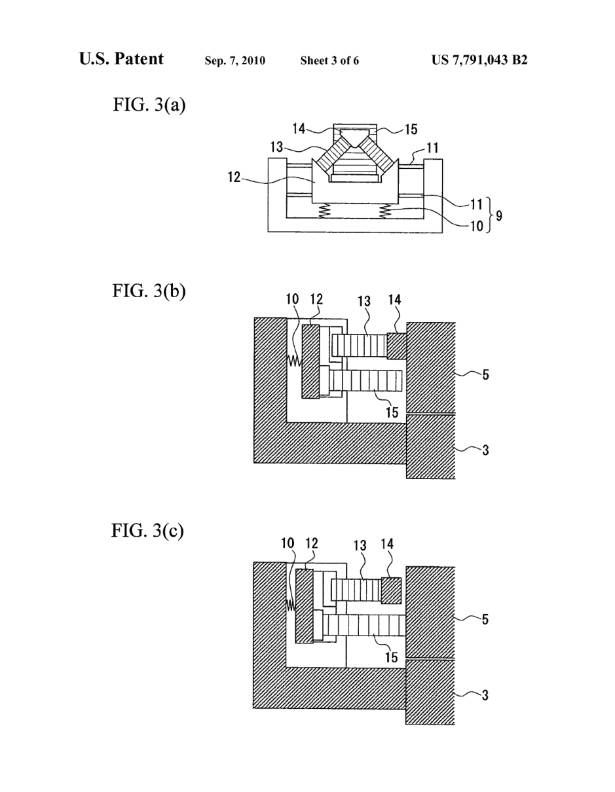
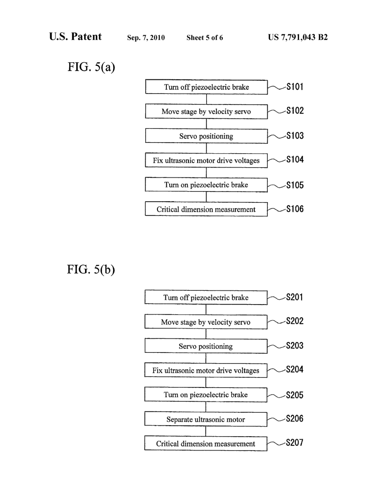
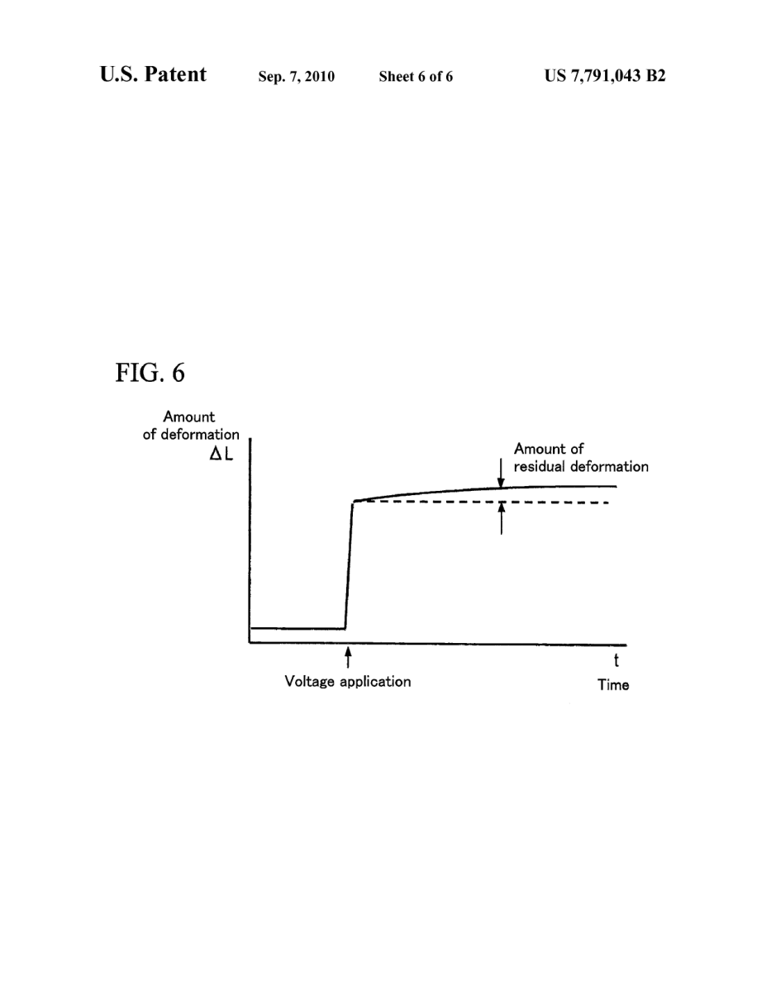

# US 7,791,043 B2 전문 번역

번역 범위: 전문 (서지, 초록, 배경, 발명의 요약, 도면 설명, 상세 설명, 결론, 청구항 12개).
원문: 같은 폴더의 `US7791043B2.pdf`. 본문 추출본은 `본문.txt`.

---

## 서지

- (12) 미국 특허
- (10) 특허번호: US 7,791,043 B2
- (45) 등록일: 2010년 9월 7일
- (54) 제목: 스테이지 기구, 그 스테이지 기구를 갖는 전자현미경, 및 스테이지 기구의 위치 결정 제어 방법
  (Stage mechanism, electron microscope having the stage mechanism and method of controlling positioning of stage mechanism)
- (75) 발명자: Eiichi Seya (히타치나카, 일본), Takashi Nagamatsu (히타치나카, 일본)
- (73) 출원인: Hitachi High-Technologies Corporation (도쿄, 일본)
- (21) 출원번호: 12/038,358
- (22) 출원일: 2008년 2월 27일
- (65) 공개: US 2008/0211349 A1, 2008년 9월 4일
- (30) 우선권: 2007년 3월 2일, 일본 2007-053271
- (51) 국제특허분류: H01J 37/20 (2006.01)
- (52) 미국분류: 250/442.11, 310/328
- (58) 조사 범위: 250/440.11, 250/442.11, 310/328
- (56) 인용 문헌
  - 미국 특허: US 5,149,967 A (1992년 9월, Omk), US 5,483,064 A * (1996년 1월, Frey 외, 250/442.11)
  - 외국 문헌: JP 3-129653 A (1991년 6월), JP 2001-196021 A (2001년 7월)
  - `*` 심사관 인용
- 주심사관: Jack I Berman
- 대리인: Crowell & Moring LLP
- 청구항 12개, 도면 6장

---

## (57) 초록

진동과 드리프트를 억제하면서 고정밀 위치 결정을 할 수 있는 전자현미경 스테이지 기구.
스테이지 구동 기구에 초음파 모터를 쓰고, 정지 강성을 높일 수 있는 고정 기구를 모터와 일체로 결합한다.
즉 고정 기구의 압전 액추에이터를 초음파 모터와 함께 예압(pre-load) 기구에 장착한 구조를 쓴다.
구동 기구가 스테이지의 가속, 감속, 위치 결정을 마친 뒤 고정 기구로 스테이지를 고정할 때,
스테이지 양쪽에 놓인 압전 액추에이터가 늘어나 스테이지를 누른다.

---

## 배경 기술

### 1. 발명의 분야

본 발명은 스테이지를 고정하는 스테이지 기구, 그 스테이지 기구를 갖는 전자현미경,
그리고 스테이지 기구의 위치 결정 제어 방법에 관한 것이다.

### 2. 배경

주사전자현미경(SEM)은 가늘게 모은 전자빔으로 시료 표면을 훑고,
시료에서 나오는 후방산란전자와 이차전자를 검출해 시료의 SEM 상을 얻는 장치다.
전자빔 같은 하전입자빔을 탐침으로 쓰는 현미경은 여러 연구 개발 분야에서 쓰였고, 제조 현장에도 쓰인다.
예를 들어 주사전자현미경으로 관찰 대상(시료)의 SEM 상을 얻는 기술은
반도체 미세 구조의 관찰과 치수 측정에 쓰이며, 반도체 제조 공정에 없어서는 안 된다.

최근 반도체 집적회로의 설계 규칙이 미세해졌다. 패턴 폭이 100 nm 이하인 경우가 꽤 많다.
미세 패턴의 치수 측정과 형상 관찰, 이물과 결함 검출을 하는 반도체 검사 측정 장치에는
측장 SEM(critical dimension SEM), SEM형 결함 검사 장치, 리뷰 SEM이 있다.

반도체 검사 측정 장치에는 높은 처리량(throughput)과 높은 정확도의 영상이 동시에 요구된다.
그래서 웨이퍼를 올리는 시료 스테이지에는 고속 이동으로 고정밀 위치 결정을 하는 것과,
정지할 때 진동과 드리프트를 억제하는 것이 함께 요구된다.

시료 스테이지의 구동 수단으로는 이송 나사(feed screw)를 쓴 구조가 많이 쓰여 왔다.
최근에는 압전 세라믹 소자의 압전 현상을 구동원으로 쓰는 선형 액추에이터인 초음파 모터를 갖는 스테이지가 제안되었다.
위치 결정 정확도를 높이고, 윤활유에서 오는 웨이퍼 화학 오염을 피하는 것이 목적이다.
그런 스테이지의 예가 JP 공개 3-129653 A (1991)에 나온 "전자현미경용 스테이지"다.

위치 결정 뒤 스테이지의 흔들림이나 미소 진동, 즉 스테이지 드리프트를 막기 위해
고정 기구를 두는 기술로는 JP 공개 2001-196021 A (특히 단락 [0031], 도 3)의 "타깃 이동 장치"가 알려져 있다.
이 예에서는 스테이지에 둔 압전 액추에이터에 양(+) 전압을 걸어 좌우로 퍼지는 변형을 일으키고,
두 기둥부 사이의 경계부를 받침점으로 삼아 브레이크 패드가 브레이크 레일을 집는 방향으로 변위하는 구조를 쓴다.

---

## 발명의 요약

### 해결하려는 문제

제조 현장의 검사와 관찰에 쓰이는 전자현미경에는 지름 300 mm 웨이퍼를 올릴 수 있고,
웨이퍼를 자르지 않고 실리콘 웨이퍼 전면을 관찰하기 위해 웨이퍼 지름보다 큰 이동 범위를 갖는 시료 스테이지가 달린다.
그러나 그렇게 큰 시료 스테이지는 무게에 비해 기계 강성을 충분히 높이기 어렵다.
그래서 기계 공진 주파수가 낮아지고, 스테이지가 밖에서 들어오는 진동을 쉽게 받는다.
일반적으로 반도체 제조 라인은 클린룸 환경이고, 공조에서 오는 약 50~200 Hz 진동 수준이 높다.
시료 스테이지의 기계 공진점이 이 범위에 있으면 영향이 매우 커서, 예를 들어 상 흐림과 치수 측정 정확도 저하가 생긴다.

또 고배율로 시료를 관찰할 때 시료 스테이지에 드리프트(정지 위치가 시간이 지나면서 조금씩 어긋나는 현상)가 있으면,
미세 패턴의 치수 측정 등을 할 때 측정 정확도가 떨어진다.

그래서 시료 스테이지에는 저진동, 저드리프트 특성이 요구된다.
더 구체적으로, 최근 반도체 검사 측정 전자현미경에 쓰이는 전자광학계의 빔 분해능이 약 1.5 nm에 이르렀으므로,
좋은 영상을 얻으려면 진동 같은 외란의 영향을 진폭으로 약 1.5 nm 이하로 줄여야 한다.
또 미세 패턴 폭 측정의 재현성은 약 0.1 nm가 요구된다.
스테이지 정지 뒤 약 0.5 nm/s 이상의 스테이지 드리프트가 있으면 측정 재현성이 떨어진다.
그래서 드리프트를 이 값 이하로 억제할 필요가 있다.

그러나 JP 공개 3-129653 A (1991)의 "전자현미경용 시료 스테이지"에는 다음 문제가 있다.
(1) 위치 결정 정지 뒤 스테이지가 조금 움직이는 드리프트, 특히 초음파 모터 특유의 압전 액추에이터 잔류 변형에서 오는 드리프트가 생긴다.
(2) 스테이지가 이송 방향으로 초음파 모터 안의 압전 액추에이터만으로 고정되므로 정지 강성이 낮고,
50~200 Hz 영역에서 스테이지의 기계 공진이 쉽게 일어난다.

또 JP 공개 2001-196021 A의 "타깃 이동 장치"에는 다음 문제가 있다.
(1) 제동 기구가 두 기둥부, 그 사이의 얇은 경계부, 그리고 홈을 여러 개 파서 만든 다른 부분으로 되어 있어
전체 강성이 낮고 관찰 중에 쉽게 진동한다.
(2) 압전 액추에이터의 변형이 경계부를 받침점으로 삼아 기둥부를 거쳐 브레이크 패드에 간접으로 전달되므로
충분한 기계 강성을 얻을 수 없고, 휨(warping)에 의한 드리프트가 쉽게 생긴다.

위 문제들을 볼 때, 본 발명의 목적은 시료 스테이지를 고정밀로 위치 결정할 수 있는 스테이지 기구,
그 스테이지 기구를 갖는 전자현미경, 그리고 스테이지 기구의 위치 결정 제어 방법을 제공하는 것이다.

### 해결 수단

위 목적을 이루기 위해, 본 발명에서는 시료 스테이지를 초음파 모터로 구동해 위치 결정하고,
원하는 위치에 놓인 뒤 스테이지를 고정할 때 스테이지를 구동하던 초음파 모터를 스테이지에서 **떼어 낸다**.
이렇게 하면 초음파 모터의 압전 액추에이터 잔류 변형에 의한 영향을 줄여
스테이지의 드리프트를 막고 고정밀 위치 결정을 할 수 있다.

더 구체적으로, 본 발명의 스테이지 기구는 테이블, 테이블이 올라가는 베이스 부재를 포함하는 스테이지,
그리고 스테이지를 구동하는 구동 유닛을 갖는다.
구동 유닛은 테이블을 구동하는 초음파 모터, 초음파 모터를 테이블에 눌러 붙이는 예압 기구,
그리고 테이블을 고정하는 고정 수단을 갖는다.
고정 수단은 초음파 모터와 일체로 움직일 수 있도록 예압 기구에 장착된다.
구동 유닛은 적어도 한 쌍이 놓여, 테이블이 그 한 쌍 사이에 끼이는 구조를 이룬다.
스테이지가 X 테이블과 Y 테이블 두 개를 가지면, 네 개(두 쌍)의 구동 유닛이 각 테이블의 옆면을 집는다.

위 고정 수단은 압전 액추에이터로 이루어진다.
위 예압 기구는 베이스 부재에 고정된 위치 결정 부재,
초음파 모터와 고정 수단이 붙는 시트 부재,
그리고 시트 부재를 위치 결정 부재 위에 탄성으로 지지하는 탄성 부재(스프링)를 갖는다.
고정 수단은 테이블을 눌러 고정하면서 동시에 초음파 모터를 테이블에서 떼어 낸다.
예를 들어 압전 액추에이터에 전압을 걸면 압전 액추에이터가 늘어나,
베이스 부재에 고정되지 않은 자유단으로 테이블을 고정하고,
시트 부재에 고정된 고정단으로 시트 부재를 밀어 초음파 모터를 테이블에서 떼어 낸다.

본 발명의 다른 스테이지 기구는 테이블을 포함하는 스테이지, 스테이지가 올라가는 베이스 부재,
스테이지를 구동하는 구동 유닛, 그리고 구동 유닛과 별개로 테이블을 고정하는 고정 수단을 갖는다.
구동 유닛은 테이블을 구동하는 초음파 모터, 초음파 모터를 테이블에 눌러 붙이는 예압 기구,
그리고 초음파 모터를 테이블에서 떼어 내는 분리 수단을 갖는다.
즉 고정 수단은 초음파 모터를 떼어 내는 일을 하지 않고,
초음파 모터는 고정 수단과 독립으로 둔 분리 수단이 떼어 낸다.
구동 유닛과 고정 수단의 묶음이 적어도 한 쌍 놓여, 테이블이 그 한 쌍 사이에 끼이는 구조를 이룬다.
스테이지가 X 테이블과 Y 테이블 두 개를 가지면,
네 개(두 쌍)의 구동 유닛과 네 개의 고정 수단이 각 테이블의 옆면을 집는다.

본 발명은 나아가 위 구성의 스테이지 기구를 갖는 전자현미경을 제공한다.

본 발명은 또 스테이지 기구의 위치 결정 제어 방법을 제공한다.
전자현미경의 제어부가 초음파 모터로 하는 스테이지의 가속, 감속, 위치 결정과,
압전 액추에이터를 쓰는 스테이지 고정 기구로 하는 스테이지 고정 동작을 제어한다.
위치 결정 제어 때, 스테이지가 위치 결정 목표 위치에 멈춘 **뒤에** 제어부가 스테이지 고정 기구를 작동시켜
초음파 모터를 피구동물에서 떼어 낸다.
다른 형태로는, 스테이지가 위치 결정 목표 위치에 멈춘 뒤 제어부가
스테이지 고정 기구와 따로 둔 모터 분리 수단을 작동시켜 초음파 모터를 피구동물에서 떼어 낼 수도 있다.

본 발명의 다른 특징은 아래 실시예와 첨부 도면에서 분명해진다.

본 발명의 스테이지 기구는 시료 스테이지의 고정밀 위치 결정을 가능하게 한다.

---

## 도면의 간단한 설명

- 도 1: 본 발명의 한 실시예에 따른 전자현미경 장치의 구성을 개략으로 나타낸 도면
- 도 2: 본 발명의 한 실시예에서 전자현미경 장치 안 스테이지의 구성을 개략으로 나타낸 도면
- 도 3(a): 본 발명 제1 실시예에 따른 스테이지 구동 유닛의 구성을 개략으로 나타낸 도면
- 도 3(b): 제1 실시예에 따른 스테이지 구동 유닛의, 스테이지를 구동할 때의 단면도
- 도 3(c): 제1 실시예에 따른 스테이지 구동 유닛의, 스테이지를 고정할 때의 단면도
- 도 4(a): 본 발명 제2 실시예에 따른 스테이지 구동 유닛의, 스테이지를 구동할 때를 개략으로 나타낸 도면
- 도 4(b): 제2 실시예에 따른 스테이지 구동 유닛의, 스테이지를 고정할 때를 개략으로 나타낸 도면
- 도 5(a): 제1 실시예에 따른 스테이지 제어의 흐름을 나타낸 도면
- 도 5(b): 제2 실시예에 따른 스테이지 제어의 흐름을 나타낸 도면
- 도 6: 압전 액추에이터의 신장량과 경과 시간의 관계의 한 예를 나타낸 그래프

---

## 상세 설명

실시예를 첨부 도면을 보며 설명한다.
다만 아래 실시예는 본 발명을 구현한 예일 뿐이고 본 발명을 한정하지 않는다.
여러 도면에 공통인 구성 요소에는 같은 참조 번호를 붙인다.

아래 실시예는 웨이퍼(시료) 표면에 만든 미세 패턴의 치수를 재는 주사전자현미경(측장 SEM)에
본 발명을 적용한 예다.
말할 것도 없이, 본 발명의 스테이지 장치는 시료를 쥔 홀더를 잡고 X 방향과 Y 방향으로 2차원 이동하는
스테이지 장치를 갖는 하전입자빔 장치 전반에 적용할 수 있다.
예를 들어 전자빔 묘화 장치, 집속이온빔(FIB) 장치, SEM이 그렇고,
빛 산란 등을 써서 이물과 결함을 검사하는 광학 검사 장치에도 적용할 수 있다.
홀더에 올리는 시료는 웨이퍼에 한정되지 않는다.

도 1은 측장 SEM의 구성을 개략으로 나타낸 도면이다.
본 발명에 따른 측장 SEM은 하전입자 광학계 1과, 아래에 설명할 스테이지가 들어 있고
웨이퍼(시료) 7이 임의의 검사 위치로 옮겨지는 시료실 2를 갖는다.
측장 SEM에서는 하전입자빔원에서 나온 하전입자빔이 웨이퍼 7 위에 가는 빔으로 모이고,
이 빔으로 웨이퍼 7을 훑고, 웨이퍼 7에서 나온 이차전자 등을 검출해 웨이퍼 7의 주사 상을 얻고,
그 주사 상 신호에서 웨이퍼에 만든 최소 30 nm 폭의 미세 패턴 치수를 구한다.

시료실 2는 진공 펌프(도 1에 없음) 등으로 약 10^-4 Pa의 진공 상태로 쓴다.
시료실 2 안의 스테이지는 웨이퍼 위 임의의 점을 전자빔이 쬐는 측장 위치로 옮겨 위치 결정하는 기구다.
스테이지는 베이스 3, X 테이블 4, Y 테이블 5, 척 기구 6을 갖는다.
X 테이블 4와 Y 테이블 5는 베이스 3 위에 놓인다. 스테이지는 X 방향과 Y 방향으로 2차원 이동한다.
X 테이블 4 위에 척 기구 6이 있다. 웨이퍼 7은 척 기구 6으로 고정된다.

위 구성은 아래 제1 실시예와 제2 실시예에 공통이다.
제1, 제2 실시예의 스테이지 기구를 아래에 자세히 설명한다.

### 제1 실시예

도 2는 본 발명 제1 실시예에 따른 스테이지 기구의 기본 구성을 나타낸 도면이다.
스테이지는 시료실 2 안에서 Y 방향으로 움직일 수 있는 Y 테이블 5와,
베이스 3 위에서 X 방향으로 움직일 수 있는 X 테이블 4로 이루어진다. 도 2에는 Y 테이블 5만 보인다.
가감속과 위치 결정을 하는 구동 기구와 스테이지를 고정하는 고정 기구를 함께 갖는 스테이지 구동 유닛 8이
X 테이블 4와 Y 테이블 5를 움직여 스테이지를 가속, 감속, 위치 결정, 정지, 고정한다.
스테이지 구동 유닛 8은 스테이지를 집도록 놓여, 가감속과 위치 결정과 고정을 안정되게 할 수 있다.

일반적으로 초음파 모터를 쓰는 스테이지 구동 기구에서는
초음파 모터를 가동부에 탄성으로 눌러 붙이는 예압 기구 9를 쓴다. 이유는 다음과 같다.
압전 액추에이터의 신축 행정은 수 마이크로미터 이하로 작은데, 스테이지 기구의 가공 정확도에는 한계가 있다.
가공 정확도 오차 때문에, 같은 이동 행정에 대해 초음파 모터가 스테이지 구동 유닛 8의 가동부에
다르게 닿을 수 있다.

본 실시예의 예압 기구 9는 두 종류의 스프링, 곧 판 스프링 11과 코일 스프링 10의 조합으로 되어 있고,
스테이지 구동 유닛 8이 올라가는 베이스 부재 12를 지지하며 누른다.
코일 스프링 10이 누르는 힘을 낸다.
판 스프링 11은 스테이지 구동 유닛 8의 회전 방향 등의 자세 변화를 막고, 이송 방향의 변위를 막는다.
스테이지 구동 유닛 8은 판 스프링 11의 누르는 힘으로 스테이지에 안정되게 눌리고,
판 스프링 11에 의해 이송 방향으로 매우 강하게 지지된다.

도 3(a)는 제1 실시예에 따른 스테이지 구동 유닛 8의 기본 구성을 나타낸 도면이다.
도 3(a)처럼, 스테이지 구동 유닛 8은 예압 기구 9(코일 스프링 10과 판 스프링 11), 베이스 부재 12,
구동 기구인 초음파 모터 13, 고정 기구인 압전 브레이크 15를 갖는다.
도 3(a)는 압전 브레이크 15가 초음파 모터 앞 끝에 붙은 드라이브 칩 14보다 앞으로 나간 상태,
즉 스테이지가 고정된 상태(제동 상태)를 그린 것이다.
또 도 3(a)는 뒤에 설명할 도 3(c)를 위에서 본 모습이다.

초음파 모터 13은 정해진 각도를 사이에 두고 고정된 압전 액추에이터 한 쌍을 갖는다.
압전 액추에이터의 앞 끝은 공통의 드라이브 칩 14에 고정된다.
한 쌍의 압전 액추에이터에 서로 역위상인 전압을 걸면,
원운동에 의해 드라이브 칩 14가 스테이지 이송 방향으로 변위한다.
서로 같은 위상의 전압을 걸면 이송 방향에 수직인 누름 방향으로 변위한다.
이 변위들을 써서 초음파 모터 13을 초음파 선형 액추에이터로 쓸 수 있다.

압전 브레이크 15는 베이스 부재 12 위에 초음파 모터 13과 나란히 놓인다.
압전 브레이크 15는 그 앞 끝의 이동 행정 중심이, 스테이지를 구동하는 동안의 드라이브 칩 14 앞 끝 위치와
대체로 일치하도록 놓인다.
이 배치로 압전 브레이크 15의 앞 끝이 드라이브 칩 14 앞 끝보다 앞으로도 뒤로도 갈 수 있다.

도 3(b)와 도 3(c)는 스테이지를 구동할 때와 고정할 때의 스테이지 구동 유닛 8 상태를 비교해 보여 준다.
도 3(b)처럼 스테이지를 구동할 때는 압전 브레이크 15가 줄어든 상태이고,
초음파 모터 13만 테이블에 닿아 구동한다.

도 3(c)처럼 스테이지를 고정할 때는 압전 브레이크 15가 늘어나 그 앞 끝이 초음파 모터 13 앞 끝보다 튀어나온다.
즉 압전 브레이크 15가 늘어나 테이블 5에 닿고, 더 늘어나 테이블 5를 누른다.
그러면 드라이브 칩 14가 테이블에서 떨어진다.
테이블 5를 더 누르면, 압전 브레이크 15의 뒤 끝 부분이 베이스 부재 12를 뒤로 민다.
예압 기구 9는 누름 방향으로 탄성 변형할 수 있으므로,
테이블 5를 고정하는 데 필요한 압력보다 높은 압력은 예압 기구 9가 흡수한다.
그 결과 압전 브레이크 15의 앞 끝만 테이블 5에 닿는다.
이렇게 초음파 모터의 드라이브 칩 14는 압전 브레이크 15에 의해 테이블에서 떨어지고,
테이블 5에 걸린 남는 압력은 예압 기구 9가 풀어 준다.
따라서 스테이지를 드리프트 없이 고정할 수 있고 고정밀로 위치 결정할 수 있다.

본 실시예를 소프트웨어 프로그램으로 실행할 때의 동작을 설명한다.
도 5(a)는 제1 실시예에 따른 스테이지 제어 동작을 설명하는 흐름도다.
흐름도의 각 단계는 따로 적지 않는 한 제어계(CPU 포함, 도면에 없음)가 실행한다.

- S101: 앞선 측장이 끝난 뒤, 고정 기구인 압전 브레이크 15에 걸던 전압을 꺼 스테이지 고정을 푼다.
- S102: 초음파 모터 13에 전압을 걸어 스테이지를 가속, 감속해 다음 측장 위치로 위치 결정한다. (속도 서보로 스테이지 이동)
- S103: 서보 위치 결정을 끝낸다.
- S104: 초음파 모터 13의 구동 전압을 고정한다.
- S105: 고정 기구인 압전 브레이크 15에 전압을 건다.
  압전 브레이크 15의 압전 액추에이터가 늘어나 테이블을 고정하고,
  초음파 모터 13의 앞 끝을 구동면에서 떼어 낸다.
- S106: 테이블이 고정되었으므로 드리프트와 진동의 영향을 받지 않고 측장을 실행한다.
  이때 압전 액추에이터의 잔류 변형이 수렴하기를 **기다릴 필요가 없다**.
  따라서 측장 처리량을 높일 수 있다.

스테이지를 고정한 뒤 초음파 모터 13은 다음 스테이지 기동 때까지 테이블에 닿지 않는다.
따라서 다음 기동 때까지의 구동 전압은 어떤 값으로 두어도 된다.

### 제2 실시예

제2 실시예의 스테이지 기구 구성에서는, 제1 실시예와 달리
압전 브레이크 15가 베이스 부재 12와 일체로 놓이지 않는다.
대신 초음파 모터를 구동면에서 떼어 내는 다른 기구를 둔다.

도 4(a)와 도 4(b)는 고정 기구인 압전 브레이크 15를 초음파 모터 13이 달린 예압 기구 9와
따로 놓은 구조를 보여 준다.
도 4(a), 도 4(b)처럼, 초음파 모터를 스테이지에서 떼어 내는 분리 기구 16을 예압 기구 9에 더 둔다.
분리 기구 16에는 압전 액추에이터를 쓴다.
다만 다른 기계 구조를 쓴 분리 기구를 대신 써도 된다.

도 4(a)처럼 스테이지를 구동할 때는 고정 기구인 압전 브레이크 15와 분리 기구 16이 들어간 상태이고,
초음파 모터 13만 테이블에 닿아 구동한다.
도 4(b)처럼 스테이지를 고정할 때는 고정 기구인 압전 브레이크 15가 늘어나 테이블에 닿아 스테이지를 고정한다.
동시에 분리 기구 16에 전압을 걸어 베이스 부재 12를 뒤로 옮긴다.
이로써 초음파 모터 13이 구동면에서 기계로 떨어져,
예압 기구 9의 작용으로 구동면에 눌리지 않게 된다.

본 실시예를 소프트웨어 프로그램으로 실행할 때의 동작을 설명한다.
도 5(b)는 제2 실시예에 따른 스테이지 제어 동작을 설명하는 흐름도다.
흐름도의 각 단계는 제어계(CPU 포함)가 실행한다.

- S201: 앞선 측장이 끝난 뒤, 고정 기구인 압전 브레이크 15에 걸던 전압을 꺼 고정을 푼다.
- S202: 초음파 모터 13에 전압을 걸어 스테이지를 가속, 감속해 다음 측장 위치로 위치 결정한다.
- S203: 서보 위치 결정을 끝낸다.
- S204: 초음파 모터 13의 구동 전압을 고정한다.
- S205: 고정 기구인 압전 브레이크 15에 전압을 건다. 압전 액추에이터가 늘어나 테이블을 고정한다.
- S206: 분리 기구 16을 작동시켜 초음파 모터 13의 앞 끝을 구동면에서 떼어 낸다.
  이 분리 동작은 초음파 모터 구동 전압을 고정한 **직후에** 실행해야 한다.
  초음파 모터 13의 드리프트 때문에 테이블 위치 결정 위치가 바뀌는 것을 피하기 위해서다.
- S207: 테이블이 고정되었으므로 드리프트와 진동의 영향을 받지 않고 측장을 실행한다.
  이때 압전 액추에이터의 잔류 변형이 수렴하기를 기다릴 필요가 없다.
  따라서 측장 처리량을 높일 수 있다.

스테이지를 고정한 뒤 초음파 모터 13은 다음 스테이지 기동 때까지 테이블에 닿지 않는다.
따라서 다음 기동 때까지의 구동 전압은 어떤 값으로 두어도 된다.

### 압전 액추에이터 잔류 변형의 영향 검토

보통의 테이블 위치 결정 등에서 초음파 모터는 고체 접촉 구조 덕분에,
위치 결정이 끝난 뒤 그대로 고정 기구로 쓸 수 있다는 장점이 있다고 여겨진다.
그래서 위치 결정 뒤 모터를 떼어 내는 사용법은 채택되지 않는다.

그러나 극미세 반도체 패턴 측정처럼 나노미터 수준의 드리프트가 중요한 분야에서는
압전 액추에이터의 잔류 변형 특성이 문제가 된다.

도 6은 본 발명에도 쓰이는 초음파 모터 13과 압전 브레이크 15의 압전 액추에이터의 일반 특성을 보여 주는 도면이다.
가로축은 경과 시간 t, 세로축은 압전 액추에이터의 변형량 ΔL이다.
그래프에는 전압 인가(voltage application) 시점에서 변형량이 계단처럼 뛴 뒤,
시간이 지나면서 조금 더 늘어나는 "잔류 변형량(amount of residual deformation)"이 표시되어 있다.

도 6에서 알 수 있듯이, 압전 액추에이터는 전압을 걸거나 빼면 늘거나 줄어드는 특성이 있다.
압전 액추에이터는 응답 속도가 매우 빨라 전압을 걸면 순간에 변형한다.
그러나 널리 알려진 대로, 그 뒤 시간이 지나면서 압전 액추에이터의 **잔류 변형**이 생긴다.
잔류 변형량은 작기는 하다.

또 초음파 모터 13은 압전 액추에이터가 누름 방향에 대해 90도가 아닌 각도를 이루도록 놓여 있으므로,
위 잔류 변형이 스테이지 구동 방향 드리프트의 원인이 될 수 있다.

압전 브레이크 15에서도 압전 소자에서 오는 잔류 변형이 생긴다.
그러나 그 잔류 변형의 방향은 스테이지 구동 방향에 수직이므로,
잔류 변형은 누르는 힘의 변화만 일으키고 그 변화는 예압 기구 9가 흡수한다.
따라서 그 잔류 변형은 스테이지 구동 방향의 드리프트에 영향을 주지 않는다.

이렇게 본 발명에 따르면 압전 액추에이터 잔류 변형에서 오는 드리프트의 영향을 받지 않는
스테이지 기구를 구현할 수 있다.

초음파 모터 13에 쓰는 압전 액추에이터의 단면적은 키울 수 없다.
압전 소자가 고속으로 응답해야 하기 때문이다.
그러나 압전 브레이크 15에 쓰는 압전 액추에이터는 응답 속도가 **약 100 ms** 정도면 되므로,
단면적을 키운 소자를 쓸 수 있다.
그 결과 초음파 모터 13만 쓰는 경우에 비해 정지 강성을 높여 스테이지의 진동 특성을 좋게 할 수 있다.
본 발명을 실제로 적용했을 때, 압전 브레이크 15를 써서
초음파 모터 13만 쓸 때 **70 Hz**이던 이송 방향 기계 공진점을 **250 Hz**까지 높일 수 있었다.
또 스테이지 정지 뒤 **1초가 지난 시점부터 스테이지 드리프트를 0.5 nm/s 이하로 억제**할 수 있었다.

각 실시예는 움직이지 않는 베이스 쪽에 둔 스테이지 구동 유닛 8이 테이블을 구동하는 구성이지만,
비슷한 구동 유닛을 움직이는 테이블 쪽에 두어 테이블과 베이스 사이에 구동력을 주거나
테이블을 고정하는 다른 스테이지 구성을 대신 써도 된다.
그 배치로도 같은 효과를 기대할 수 있고 고성능 전자현미경을 구현할 수 있다.

---

## 결론

본 발명은 보통의 전자현미경에서 스테이지를 고정하는 스테이지 기구로 쓸 수 있다.
다만 고정밀 위치 결정을 가능하게 하므로,
반도체 소자 제조 분야의 검사와 측정용 전자현미경에 쓰는 시료 스테이지 기구에 특히 알맞다.

본 발명의 스테이지 기구와 전자현미경에서는, 스테이지를 구동하는 기구 안에서
초음파 모터와 정지 강성을 높일 수 있는 고정 기구가 서로 일체로 결합된다.
즉 초음파 모터를 피구동 부재에 눌러 붙이는 예압 기구 안에
초음파 모터와 고정 기구의 압전 액추에이터를 함께 장착한 구조를 쓴다.
구동 기구가 스테이지를 가감속하고 위치 결정한 뒤 고정 기구로 스테이지를 고정할 때
고정 기구의 압전 액추에이터가 늘어나 스테이지를 누르고,
이 누름과 동시에 초음파 모터가 스테이지의 테이블(피구동 부재)에서 떨어진다.
이렇게 하여 피구동 부재가 초음파 모터를 이루는 압전 액추에이터의 잔류 변형에 영향받지 않게 되어,
드리프트가 피구동 부재로 전달되는 것을 막는다.

그 결과 스테이지가 멈췄을 때 드리프트나 진동에 의한 잡음을 억제하고 위치 결정 정확도가 높은
스테이지 기구와 전자현미경을 제공할 수 있다.
또 초음파 모터 특유의 드리프트를 억제함으로써
**스테이지의 정착(settlement)을 기다리는 시간을 줄일 수 있어** 전자현미경의 처리량을 높일 수 있다.

스테이지의 위치 결정과 정지, 그리고 가속과 감속은 초음파 모터만으로도 할 수 있다.
그러나 초음파 모터만으로 스테이지를 고정하면 다음 문제가 생긴다.
(1) 위에 설명한 압전 액추에이터 잔류 변형 문제 때문에 스테이지 구동 방향으로 초음파 모터 특유의 드리프트가 생긴다.
(2) 충분한 고정 강성을 얻을 수 없다.
본 실시예들의 배치를 쓰면 이 문제들을 풀 수 있다.

본 발명과 별개로, 초음파 모터와 따로 압전 액추에이터 등을 쓰는 방법이 보통의 고정 방법으로 생각될 수 있다.
그러나 이송 행정 전체에서 면 접촉을 고르게 하려면 예압 기구로 초음파 모터를 구동면에 탄성으로 눌러야 한다.
따라서 구동 전압으로 초음파 모터 자체를 변형시켜 드라이브 칩을 뒤로 뺀다 해도,
예압 기구의 작용으로 구동면에 눌려 있으므로 초음파 모터를 구동면에서 떼어 낼 수 없다.
그 결과 위치 결정 뒤 초음파 모터와 압전 브레이크가 동시에 스테이지에 작용하게 되고,
초음파 모터 특유의 잔류 변형에서 오는 힘이 압전 브레이크 15에 의한 고정에 거슬러
스테이지 구동 방향으로 걸려 스테이지의 미세 진동을 일으킬 수 있다.
또 서로 반대인 힘들의 작용으로 드라이브 칩과 테이블 사이에 미끄러짐이 생긴다.
그런 조건에서는 먼지 발생, 마모, 면 거칠어짐이 쉽게 일어난다.

본 발명의 제1 실시예에서는 초음파 모터와 고정 기구를 예압 기구 위에 서로 나란히 두어,
고정 기구가 작동할 때 초음파 모터를 구동면에서 떼어 낼 수 있게 한다.
따라서 위와 같은 문제가 생기지 않는다.
또 제2 실시예에서는 초음파 모터를 떼어 내는 기구를 고정 기구와 따로 두어 위 문제들을 피할 수 있다.

---

## 청구항 (한국어 번역)

1. 테이블, 테이블이 올라가는 베이스 부재를 포함하는 스테이지와, 스테이지를 구동하는 구동 유닛을 포함하는 스테이지 기구로서,
   구동 유닛은 테이블을 구동하는 초음파 모터, 초음파 모터를 테이블에 눌러 붙이는 예압 기구, 테이블을 고정하는 고정 수단을 갖고,
   고정 수단은 초음파 모터와 일체로 움직일 수 있도록 예압 기구에 장착된, 스테이지 기구.

2. 제1항에 있어서, 구동 유닛이 적어도 한 쌍 놓여 테이블이 그 한 쌍 사이에 끼이는 구조를 이루는 스테이지 기구.

3. 제1항에 있어서, 고정 수단이 압전 액추에이터로 이루어지고,
   예압 기구는 베이스 부재에 고정된 위치 결정 부재, 초음파 모터와 고정 수단이 붙는 시트 부재,
   시트 부재를 위치 결정 부재 위에 탄성으로 지지하는 탄성 부재를 가지며,
   고정 수단은 테이블을 눌러 고정하고 초음파 모터를 테이블에서 떼어 내는 스테이지 기구.

4. 제3항에 있어서, 고정 수단이 시트 부재에 고정되지 않은 자유단으로 테이블을 고정하고,
   시트 부재에 고정된 고정단으로 시트 부재를 밀어 초음파 모터를 테이블에서 떼어 내는 스테이지 기구.

5. 테이블을 포함하는 스테이지, 테이블이 올라가는 베이스 부재, 스테이지를 구동하는 구동 유닛,
   테이블을 고정하는 고정 수단을 포함하는 스테이지 기구로서,
   구동 유닛은 테이블을 구동하는 초음파 모터, 초음파 모터를 테이블에 눌러 붙이는 예압 기구,
   초음파 모터를 테이블에서 떼어 내는 분리 수단을 갖는 스테이지 기구.

6. 제5항에 있어서, 구동 유닛과 고정 수단의 묶음이 적어도 한 쌍 놓여
   테이블이 그 한 쌍 사이에 끼이는 구조를 이루는 스테이지 기구.

7. 제5항에 있어서, 고정 수단이 압전 액추에이터로 이루어지고 베이스 부재에 고정되며,
   예압 기구는 베이스 부재에 고정되고 분리 수단이 붙는 위치 결정 부재,
   초음파 모터가 붙는 시트 부재, 시트 부재를 위치 결정 부재 위에 탄성으로 지지하는 탄성 부재를 가지며,
   고정 수단은 테이블을 눌러 고정하고,
   분리 수단은 고정 수단이 테이블에 작용한 **뒤에** 초음파 모터를 테이블에서 떼어 내는 스테이지 기구.

8. 제5항에 있어서, 분리 수단이 압전 액추에이터로 이루어진 스테이지 기구.

9. 제1항에 있어서, 스테이지가 2차원 평면에서 X 방향으로 움직일 수 있는 X 테이블과
   Y 방향으로 움직일 수 있는 Y 테이블을 갖고,
   구동 유닛이 여럿 놓여, 적어도 하나가 X 테이블을, 적어도 하나가 Y 테이블을 구동해
   스테이지의 2차원 이동을 가능하게 하는 스테이지 기구.

10. 제1항의 스테이지 기구를 포함하는 전자현미경.

11. 제어부가 초음파 모터로 하는 스테이지의 가속, 감속, 위치 결정과,
    압전 액추에이터를 쓰는 스테이지 고정 기구로 하는 스테이지 고정 동작을 제어하는
    스테이지 기구의 위치 결정 제어 방법으로서,
    스테이지가 위치 결정 목표 위치에 멈춘 뒤 스테이지 고정 기구를 작동시켜
    초음파 모터를 피구동물에서 떼어 내도록 제어부를 작동시키는 것을 포함하는 방법.

12. 제어부가 초음파 모터로 하는 스테이지의 가속, 감속, 위치 결정과,
    압전 액추에이터를 쓰는 스테이지 고정 기구로 하는 스테이지 고정 동작을 제어하는
    스테이지 기구의 위치 결정 제어 방법으로서,
    스테이지가 위치 결정 목표 위치에 멈춘 뒤,
    스테이지 고정 기구와 따로 둔 모터 분리 수단을 작동시켜
    초음파 모터를 피구동물에서 떼어 내도록 제어부를 작동시키는 것을 포함하는 방법.

---

## 참고문헌 (원문 그대로)

U.S. PATENT DOCUMENTS
- 5,149,967 A   9/1992   Omk
- 5,483,064 A * 1/1996   Frey et al. ............ 250/442.11

FOREIGN PATENT DOCUMENTS
- JP 3-129653 A    6/1991
- JP 2001-196021 A 7/2001

`*` cited by examiner
