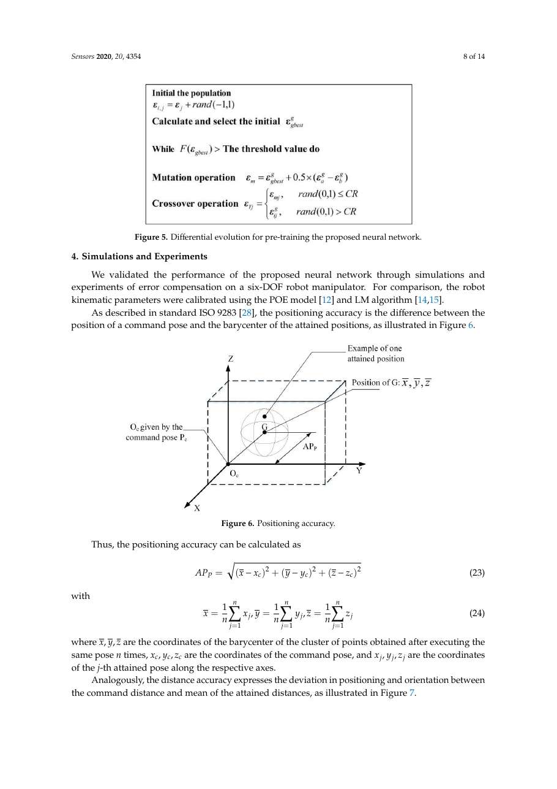
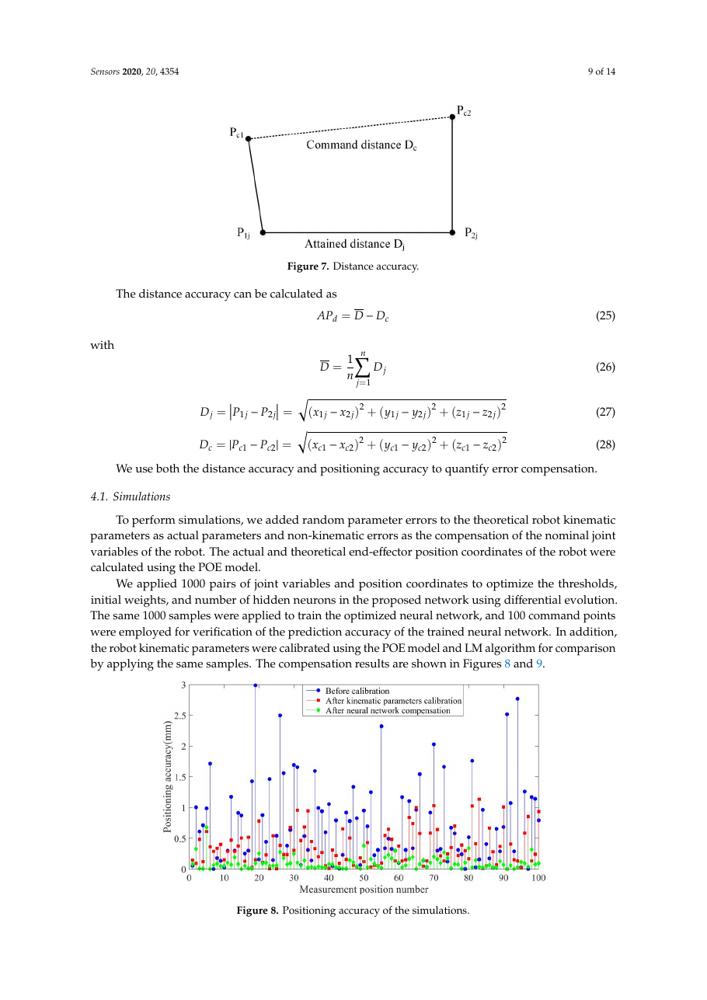
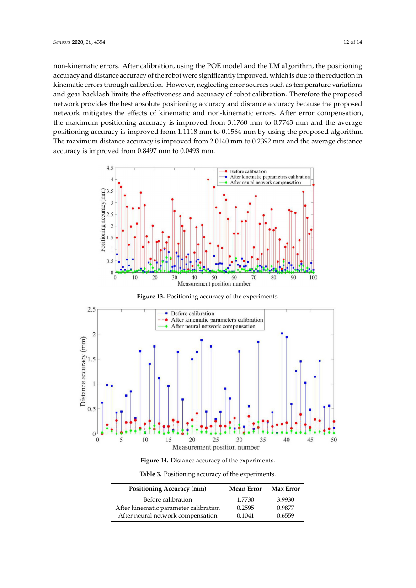

# 번역: 산업용 로봇의 절대 위치 정확도 향상

- 원제: Absolute Positioning Accuracy Improvement in an Industrial Robot
- 원문: [Jiang2020_Sensors_absolute_positioning_accuracy.pdf](Jiang2020_Sensors_absolute_positioning_accuracy.pdf) (14쪽, CC BY 4.0)
- 원문 출처: PMC 공개 자료 저장소(pmc-oa-opendata, PMC7471972.1). MDPI와 Europe PMC 직접 링크는 자동 접근 확인 화면(403)이라 쓰지 않았다.
- 번역 범위: 전문 (초록, 본문, 그림 캡션, 표, 저자 정보). 참고문헌은 원문 그대로 둔다.
- 번역 2026-11-04. 수식은 pdftotext 출력이 겹쳐 있어 원문 쪽 이미지를 보고 옮겼다.
- 역자 주는 [역자 주] 로 표시한다. 원문 안의 수치 불일치도 역자 주로 적었다.

---

저자: Yizhou Jiang, Liandong Yu (교신), Huakun Jia, Huining Zhao, Haojie Xia
소속: 허페이 공업대학 계측과학 및 광전자공학부 (중국 허페이 230009)
접수 2020년 7월 6일, 승인 2020년 7월 31일, 게재 2020년 8월 5일
Sensors 2020, 20, 4354; doi:10.3390/s20164354

## 초록

로봇의 절대 위치 정확도는 성능을 정하는 중요한 사양이다. 그러나 여러 오차 원인의 영향을 받는다.
보통의 캘리브레이션 방법은 기구학 오차만 다루고, 복잡한 비기구학 오차는 무시한다. 그래서 절대 위치 정확도가 한계에 묶인다.
절대 위치 정확도를 더 높이기 위해, 우리는 차분 진화 알고리즘으로 최적화한 인공 신경망을 제안한다.
구체적으로는 차분 진화로 신경망의 구조와 파라미터를 반복 갱신해 정확도와 효율을 함께 높인다.
그다음 학습한 신경망으로 기구학 오차와 비기구학 오차가 만든 절대 위치 편차를 보상한다.
제안한 신경망의 성능을 확인하려고 6자유도 로봇과 레이저 트래커로 시뮬레이션과 실험을 했다.
로봇의 평균 위치 정확도는 캘리브레이션 전 0.8497 mm에서 0.0490 mm로 좋아졌다.
결과는 제안한 신경망이 산업용 로봇의 절대 위치 정확도를 크게 높인다는 것을 보여 준다.

[역자 주] 초록의 0.8497 mm → 0.0490 mm는 본문 표 4에서 "거리 정확도" 평균값(0.8497 → 0.0493)이다. 위치 정확도 평균은 표 3에서 1.7730 → 0.1041 mm다.

핵심어: 절대 위치 정확도, 산업용 로봇, 신경망, 차분 진화 알고리즘

## 1. 서론

산업용 로봇은 유연한 플랫폼이고, 여러 제조 작업의 자동화에 높은 반복정밀도를 준다. 그러나 절대 위치 정확도가 낮으면 쓸 곳이 제한될 수 있다 [1].
로봇의 오차 원인은 기구학 오차와 비기구학 오차로 나뉜다 [2-4].
제작 공차와 조립 공차 때문에 실제 기구학 파라미터가 공칭값과 달라진다. 이것이 기구학 오차다 [5].
한편 비기구학 오차는 모델링이 어려워 보통 무시된다. 그러나 온도 변화, 관절과 링크의 유연성(컴플라이언스), 기어 백래시 같은 원인이 만든 비기구학 오차는 절대 위치 정확도에 상당한 영향을 준다.
따라서 기구학 오차와 비기구학 오차가 함께 만든 위치 편차를 효과적으로 보상하는 방법이 필요하다.

여러 보고에 따르면 기구학 오차가 전체 위치 오차의 약 90%를 차지한다 [6]. 그래서 기구학 캘리브레이션은 로봇의 절대 위치 정확도를 효과적으로 높인다.
이 캘리브레이션은 네 단계로 이루어진다. 모델링, 측정, 식별, 그리고 보상 또는 보정이다 [7].
따라서 기구학 모델이 로봇 캘리브레이션에서 핵심 역할을 한다. 파라미터 식별을 위해 모델은 연속성, 완전성, 최소성을 갖춰야 한다 [8].
Denavit-Hartenberg 규약은 로봇 기구학을 기술하는 데 널리 쓰인다 [9]. 그러나 이웃한 두 관절축이 평행하거나 거의 평행하면 연속이 아니어서 특이점이 생긴다.
특이점 문제를 피하려고 여러 연구가 다른 모델을 제안했다. 예를 들어 Hayati는 Denavit-Hartenberg 규약에 회전 파라미터를 하나 더해 수정 Denavit-Hartenberg 모델을 만들었다 [10].
Meng과 Zhuang이 제안한 완전하고 파라미터 연속인 모델은 완전성과 연속성을 주지만, 일부 파라미터가 중복된다 [11].
지수곱(POE, product of exponentials) 모델은 로봇 운동을 완전한 기하학적, 파라미터 형태로 나타내서 로봇 메커니즘의 기구학 해석을 크게 단순하게 만든다. POE 식은 연속성, 완전성, 최소성을 만족해 로봇 기구학 모델링에 알맞고 널리 쓰인다 [12].

로봇 캘리브레이션의 목표는 목적함수를 최적화해 정확한 기구학 파라미터를 얻는 것이다 [13].
가장 흔한 캘리브레이션 알고리즘은 최소제곱법에 기반한 Gauss-Newton과 Levenberg-Marquardt(LM) 알고리즘이다. LM은 간섭에 강하고 전역 탐색을 가능하게 한다 [14,15].
그러나 온도 변화와 기어 백래시 같은 오차 원인을 무시하면 캘리브레이션의 효과와 정확도가 제한된다.
비기구학 오차의 영향을 줄이려고 여러 보정 방법이 개발됐다.
Ma 등은 비기구학 오차의 중요성을 보이고, 개별 오차 항을 나타내는 고차 체비쇼프 다항식을 담은 오차 행렬로 이를 일반화했다 [16].
Whitney 등은 관절 엔코더 오프셋, 링크 길이, 연속한 축의 상대 방향을 파라미터로 쓰는 순방향 캘리브레이션 방법을 개발하고, 관절 백래시, 기어 전달, 컴플라이언스 오차의 영향을 실험으로 평가했다 [17].
Chen 등은 관절 유연성 오차를 파라미터로 나타내 추정해 절대 위치 정확도를 높였다.
그러나 이 방법들은 수학 모델이 복잡하고 여러 비기구학 오차를 무시해 쓸 곳이 제한된다 [18].

비기구학 오차는 모델링이 어려우므로, 인공 신경망이 절대 위치 오차를 보상하는 대안으로 쓰여 왔다 [19].
신경망을 쓰면 복잡한 모델링을 피하면서 위치 오차를 보상하고, 모든 오차 원인의 영향을 한꺼번에 고려할 수 있다.
Ding 등은 신경망과 Faugeras 비전 시스템 캘리브레이션 기법을 결합해 델타 로봇 비전 시스템을 정확히 캘리브레이션했다 [20].
Jang 등은 방사 기저 함수(RBF) 신경망으로 로봇 관절 값과 그에 대응하는 위치 오차의 관계를 근사했다 [21].
Wang 등은 오차 곡면의 국소 특징을 뽑는 신경망을 만들어 로봇 매니퓰레이터 캘리브레이션 중 위치 오차를 추정했다 [22].

신경망의 성능은 구조와 파라미터에 따라 달라진다.
신경망을 최적화하려고 Rouhani 등은 은닉 뉴런의 중심, 개수, 퍼짐을 정하는 한 번에 끝나는 경험 규칙을 도입했다 [23].
Feng 등은 진화형 입자 군집 최적화를 써서 스스로 생성되는 RBF 신경망을 만들었다 [24].
González 등은 신경망을 최적화하는 다목적 진화 알고리즘을 개발했다.
차분 진화 알고리즘은 높은 식별 정확도와 좋은 최적화 속도로 전역 최적화를 가능하게 한다 [25].
그래서 우리는 신경망의 사전 학습에 차분 진화를 써서 임계값, 초기 가중치, 은닉 뉴런 수를 최적화해 정확도와 효율을 최대로 한다.
6자유도 산업용 로봇과 기준 장비인 레이저 트래커로 시뮬레이션과 실험을 해서 제안한 신경망의 성능을 확인했다.

이 연구의 주요 기여는 다음과 같다.
(1) 기구학 오차와 비기구학 오차가 절대 위치 정확도에 주는 영향을 분석하고, 기구학 캘리브레이션의 한계를 다룬다.
(2) 절대 위치 정확도를 높이려고 차분 진화로 최적화한 신경망을 제안한다. 신경망의 임계값, 초기 가중치, 은닉 뉴런 수를 차분 진화로 최적화해 성능을 높인다. 제안한 신경망은 기구학 오차와 비기구학 오차의 영향을 줄여 로봇의 절대 위치 정확도를 높인다.
(3) 6자유도 로봇을 연구 대상으로, 레이저 트래커를 측정 장비로 실험과 시뮬레이션을 마쳤다. 제안한 신경망의 이론적 타당성과 효과를 시뮬레이션과 실험으로 확인했다.

이 논문의 나머지 구성은 다음과 같다. 2절에서 기구학 오차와 비기구학 오차가 로봇 위치 정확도에 주는 영향을 분석한다. 3절에서 차분 진화로 최적화한 신경망을 자세히 설명한다. 4절에서 절대 위치 오차 보상을 위한 시뮬레이션과 실험을 한다. 5절에서 논의와 결론을 낸다.

## 2. 기구학 오차와 비기구학 오차 분석

로봇 기구학 모델의 정확도는 로봇 캘리브레이션에 달려 있다. 우리는 그림 1의 로봇 좌표계를 놓고, POE 모델로 로봇 기구학을 기술한다 [26].

그림 1. 로봇 매니퓰레이터의 좌표계.

기저 좌표계 {s}에 대한 말단 좌표계 {t}의 자세는 다음과 같다.

식 (1):
g_st(θ) = exp(ξ̂1 θ1) exp(ξ̂2 θ2) exp(ξ̂3 θ3) exp(ξ̂4 θ4) exp(ξ̂5 θ5) exp(ξ̂6 θ6) exp(ξ̂_st)
= [ n o a r ; 0 0 0 1 ] (n, o, a는 말단의 방향 열벡터, r은 위치)

식 (1)에서 θi는 로봇 관절 변수이고, ξ̂_st는 초기 변환의 트위스트다. ξ̂i는 다음과 같이 쓴다.

식 (2): ξ̂i = [ ŵi vi ; 0 0 ]

여기서 ŵi와 vi는 다음과 같다.

식 (3): ŵi = [ 0 -w_zi w_yi ; w_zi 0 -w_xi ; -w_yi w_xi 0 ]

식 (4): vi = -wi × qi

여기서 qi = [q_xi, q_yi, q_zi]는 기저 좌표계 {s}에서 각 축 원점의 좌표다. wi = [w_xi, w_yi, w_zi]는 {s}에서 각 회전축의 방향 벡터다.
회전 관절에서 나사 운동의 지수 행렬은 다음과 같이 나타낼 수 있다.

식 (5): exp(ξ̂i θi) = [ exp(ŵi θi) , (I - exp(ŵi θi))(wi × (-wi × qi)) ; 0 , 1 ]

6자유도 직렬 로봇의 순기구학은 다음과 같다.

식 (6): f_c = g(w1, ..., w6, q1, ..., q6, θ) = exp(ξ̂1 θ1) exp(ξ̂2 θ2) ... exp(ξ̂6 θ6) exp(ξ̂_st)

로봇의 기구학 파라미터는 기계 변형, 조립 오차, 가공 오차 같은 여러 기구학 오차 때문에 보통 설계값에서 벗어난다. 그림 2와 같다.

그림 2. 링크 i의 기구학 오차 정의.

기구학 오차만 고려하면 실제 로봇 위치 f_real은 다음과 같다.

식 (7): f_real = g(w1 + Δw1, ..., w6 + Δw6, q1 + Δq1, ..., q6 + Δq6, θ)

여기서 Δqi와 Δwi는 보정해야 할 기구학 오차다. 기구학 오차의 수식은 기구학 모델링으로 얻을 수 있다.
이 오차는 로봇이 움직이든 아니든 존재한다. 따라서 캘리브레이션 방법으로 기구학 오차를 식별해 로봇의 위치 정확도를 효과적으로 높일 수 있다.

그러나 비기구학 오차는 정확도를 떨어뜨리는데도, 모델링이 어렵고 복잡해서 보통 무시된다.
위치 오차에 주는 기여가 기구학 파라미터로 표현되지 않는 모든 오차 원인을, 여기서는 비기구학 오차라고 부른다 [18].
비기구학 오차는 로봇의 자세와 동적 거동에 관련돼 정확한 수식을 얻기 어렵다. 그래서 캘리브레이션으로는 비기구학 오차의 영향을 줄일 수 없다.
영향이 큰 비기구학 오차, 예를 들어 하모닉(스트레인 웨이브) 기어와 관절 유연성에 관련된 오차는 관절의 각도 엔코더와 출력축 사이에서 생긴다. 실제 관절 회전을 계산하려면 공칭 관절 변수를 보상해야 한다.

비기구학 오차를 고려하면 실제 로봇 관절 변수는 다음과 같다.

식 (8): θi_real = θ̂i + Ci(θ̂i)

여기서 θ̂i는 공칭 관절 변수이고, Ci(θ̂i)는 비기구학 오차의 보상 인자다.
Ci(θ̂i)는 체비쇼프 다항식으로 계산할 수 있다 [16].

식 (9): Ci(θ̂i) = a0 + a1 c1(θ̂i) + ... + am cm(θ̂i)

식 (10): c0(θ̂i) = 1, c1(θ̂i) = θ̂i, c2(θ̂i) = 2θ̂i² - 1, c3(θ̂i) = 4θ̂i³ - 3θ̂i, c4(θ̂i) = 8θ̂i⁴ - 8θ̂i² + 1, ..., c(m+1)(θ̂i) = 2θ̂i cm(θ̂i) - c(m-1)(θ̂i)

[역자 주] 원문 식 (10)은 c1을 λ로 인쇄했다. 체비쇼프 다항식 정의상 c1 = θ̂i이므로 그렇게 옮겼다.

여기서 m은 체비쇼프 다항식의 차수이고, a0, a1, ..., am은 계산할 다항식 계수다.

따라서 로봇의 공칭 관절 변수와 이론 기구학 파라미터를 알면, 실제 위치는 다음과 같다.

식 (11): f_real = g(Δw1, ..., Δw6, Δq1, ..., Δq6, C1(θ̂1), ..., C6(θ̂6))

비기구학 오차가 복잡하고, 공칭 관절 변수의 보상과 로봇 자세가 서로 얽혀 있어서 로봇 위치의 실제 수식을 정하기 어렵다.
그래서 우리는 신경망으로 관절 변수에서 로봇 위치를 직접 추정한다.
이 방법은 복잡한 캘리브레이션과 모델링을 피하고, 로봇의 절대 위치 정확도를 효과적으로 높이며, 기구학 오차와 비기구학 오차의 영향을 줄인다.

## 3. 제안한 신경망

RBF 신경망과 역전파 신경망 같은 여러 신경망이 절대 위치 오차 보상에 널리 쓰였다 [19-22].
보상 결과는 신경망의 구조와 파라미터(임계값, 초기 가중치, 은닉 뉴런 수)에 달려 있다.
그래서 우리는 보상 효과를 최대로 하려고 차분 진화로 신경망의 구조와 파라미터를 최적화한다.

### 3.1. 역전파 신경망

역전파 신경망은 오차 역전파로 학습하는 인공 신경망이다. 큰 장점은 강한 선형 사상 능력과 유연한 구조다.
[역자 주] 원문은 "strong linear mapping"이라고 적었다. 시그모이드 은닉층을 쓰므로 실제로는 비선형 사상이다. 원문 표현대로 옮겼다.

그림 3은 제안한 신경망을 보여 준다. 입력층, 은닉층, 출력층으로 이루어진다.
입력층은 로봇 관절 변수를 나타내는 노드 6개이고, 출력층은 레이저 트래커로 얻은 로봇 위치 좌표를 나타내는 노드 3개다.

그림 3. 역전파 신경망의 구조.

그림 3에서 wij는 입력층 뉴런 i와 은닉층 뉴런 j 사이의 연결 가중치이고, wjk는 은닉층 뉴런 j에서 출력층 뉴런 k로 가는 가중치다. 은닉층 출력은 다음과 같다.

식 (12): Hj = G( Σ_{i=1..6} wij θi ), j = 1, 2, ..., l

여기서 l은 은닉층 노드 수이고, G는 활성화 함수로 다음과 같이 둔다.

식 (13): G(x) = 1 / (1 + e^(-x))

[역자 주] 원문 인쇄는 1/(1+e^x)로 보인다. 일반 시그모이드는 e^(-x)다.

x 성분에 대해 출력층은 다음을 준다.

식 (14): x = Σ_{j=1..l} Hj wjx

잔차는 예측값을 기대값에서 빼서 얻고, 위치 오차 값으로 볼 수 있다. 잔차 평균제곱오차는 다음과 같다.

식 (15): F = (1/m) Σ_{v=1..m} (Tv - Ov)²

여기서 m은 학습 표본 수, Ov = [xv, yv, zv]는 신경망 출력, Tv는 기대 출력이다.

잔차 평균제곱오차가 목표 학습 오차 이상이거나 반복 횟수가 한계에 닿지 않는 동안, 예측값과 기대값의 차를 줄이도록 편향과 가중치를 갱신한다. 경사 하강법으로 가중치를 다음과 같이 갱신한다.

식 (16): Δwij = -η ∂F/∂wij

식 (17): wij = Δwij + wij

그림 4는 신경망의 학습 순서도다.

그림 4. 신경망의 학습 순서도.

### 3.2. 차분 진화 최적화

차분 진화는 높은 식별 정확도와 좋은 최적화 속도로 전역 최적화를 하게 해 준다.
차분 진화는 개체군 기반의 확률적 최적화 방법으로, 여러 무작위 초기점에서 표본을 뽑아 탐색 공간을 살핀다 [27].
우리는 차분 진화로 제안한 신경망을 사전 학습해 임계값, 초기 가중치, 은닉 뉴런 수를 최적화한다.

차분 진화 알고리즘은 보통 세 요소로 이루어진다.
(1) 해 개체군의 부호화
(2) 해의 최적성을 평가하는 적합도 함수
(3) 선택, 교차, 돌연변이로 이루어진 진화 연산

개체 εi = {wi, Bi}는 서로 다른 은닉층 수, 가중치 wi, 임계값 Bi를 나타내도록 초기화한다. εi의 길이는 은닉 뉴런 수에서 다음과 같이 정해진다.

식 (18): length(εi) = n_in n_hid + n_hid + n_hid n_out + n_out

여기서 n_in, n_hid, n_out은 각각 입력층, 은닉층, 출력층의 뉴런 수다.
[역자 주] 원문은 "hidden, input, and output layers, respectively"로 순서가 뒤섞여 있다. 기호에 맞춰 옮겼다.

εi 값에 따라 신경망 성능이 달라진다. 뉴런이 적으면 정확도가 떨어지고, 많으면 학습 시간이 늘고 과적합이 생긴다.
또 초기 가중치는 신경망의 성능과 수렴 속도에 강하게 영향을 준다. 그래서 차분 진화로 학습 속도와 예측 정확도를 높일 수 있다.

차분 진화에서 돌연변이는 다음과 같다.

식 (19): ε_mi^g = ε_gbest^g + 0.5 (ε_a^g - ε_b^g)

여기서 g는 반복 횟수, ε_gbest^g는 가장 성능이 좋은 신경망 파라미터, ε_a^g와 ε_b^g는 차분 진화를 위해 개체군에서 무작위로 고른 두 입자다.
은닉 뉴런 수가 달라서 ε_gbest^g, ε_a^g, ε_b^g의 길이가 다르므로, 돌연변이를 바로 할 수 없다.
대신 돌연변이 중 벡터 길이를 같게 하는 최선 선택 방법을 쓴다. 즉 최선 개체 ε_gbest^g의 길이를 기준으로 다른 개체의 길이를 맞추고 돌연변이를 한다.
length(ε_a^g) < length(ε_gbest^g)이면 빠진 파라미터를 무작위로 채워 길이를 같게 한다.
length(ε_a^g) > length(ε_gbest^g)이면 ε_a^g의 남는 파라미터는 간섭으로 보고 돌연변이에서 뺀다.

다음으로 식 (20)의 교차로 시험 개체 εT를 만든다. CR은 [0,1] 범위의 실수 교차 확률 인자로, 시험 벡터의 파라미터가 무작위로 선택될 확률을 정한다.
CR은 보통 탐색의 수렴 속도와 강건성에 영향을 준다. 이 논문에서는 빠른 수렴을 위해 CR = 0.9로 둔다.
입자의 각 파라미터에 대해 교차는 다음과 같다.

식 (20): εT(j) = ε_mi^g(j) (rand(0,1) ≤ CR 일 때), εi^g(j) (rand(0,1) > CR 일 때), j = 1, 2, ..., n_hid

선택은 탐욕 탐색 전략으로 다음과 같다.

식 (21): εi^(g+1) = εT (F(εT) < F(εi^g) 일 때), εi^g (F(εT) > F(εi^g) 일 때)

사전 학습에서 최적화된 파라미터를 제안한 신경망에 넣는다.
사전 학습 뒤 예측값이 기대 편차에 닿지 않으면, 식 (22)로 각 입자의 은닉층 수를 갱신한다. 원하는 값을 얻을 때까지 반복한다.

식 (22): Ki = Ki - 1 (K_best < Ki 일 때), Ki + 1 (K_best ≥ Ki 일 때)

여기서 Ki는 개체 i의 은닉층 수이고, K_best는 최선 해다. 차분 진화 알고리즘은 그림 5에 있으며, 원하는 예측 오차에 닿을 때까지 진행한다.

그림 5. 제안한 신경망의 사전 학습을 위한 차분 진화.

## 4. 시뮬레이션과 실험

6자유도 로봇 매니퓰레이터의 오차 보상 시뮬레이션과 실험으로 제안한 신경망의 성능을 확인했다. 비교를 위해 POE 모델 [12]과 LM 알고리즘 [14,15]으로 로봇 기구학 파라미터를 캘리브레이션했다.

표준 ISO 9283 [28]에 따르면, 위치 정확도는 명령 자세의 위치와 도달한 위치들의 무게중심 사이의 차이다. 그림 6과 같다.

그림 6. 위치 정확도.

따라서 위치 정확도는 다음과 같이 계산한다.

식 (23): AP_P = sqrt( (x̄ - xc)² + (ȳ - yc)² + (z̄ - zc)² )

식 (24): x̄ = (1/n) Σ_{j=1..n} xj, ȳ = (1/n) Σ_{j=1..n} yj, z̄ = (1/n) Σ_{j=1..n} zj

여기서 x̄, ȳ, z̄는 같은 자세를 n번 실행해 얻은 점 무리의 무게중심 좌표다. xc, yc, zc는 명령 자세의 좌표이고, xj, yj, zj는 j번째 도달 자세의 각 축 좌표다.

마찬가지로 거리 정확도는 명령 거리와 도달 거리들의 평균 사이의 위치와 방향 편차를 나타낸다. 그림 7과 같다.

그림 7. 거리 정확도.

거리 정확도는 다음과 같이 계산한다.

식 (25): AP_d = | D̄ - Dc |

식 (26): D̄ = (1/n) Σ_{j=1..n} Dj

식 (27): Dj = | P1j - P2j | = sqrt( (x1j - x2j)² + (y1j - y2j)² + (z1j - z2j)² )

식 (28): Dc = | Pc1 - Pc2 | = sqrt( (xc1 - xc2)² + (yc1 - yc2)² + (zc1 - zc2)² )

오차 보상을 정량화하는 데 거리 정확도와 위치 정확도를 함께 쓴다.

[역자 주] 원문은 ISO 9283의 정확도(AP)만 정의하고, 같은 표준의 반복정밀도(RP)는 정의하거나 측정하지 않았다. 또 실험에서 각 점을 몇 번(n) 반복 측정했는지 적지 않았다.

### 4.1. 시뮬레이션

시뮬레이션에서는 로봇의 이론 기구학 파라미터에 무작위 파라미터 오차를 더해 실제 파라미터로 두고, 공칭 관절 변수의 보상분으로 비기구학 오차를 넣었다.
로봇의 실제 말단 위치 좌표와 이론 말단 위치 좌표는 POE 모델로 계산했다.

관절 변수와 위치 좌표 1000쌍으로 차분 진화를 돌려 제안한 신경망의 임계값, 초기 가중치, 은닉 뉴런 수를 최적화했다.
같은 1000개 표본으로 최적화된 신경망을 학습했고, 명령점 100개로 학습한 신경망의 예측 정확도를 확인했다.
또 같은 표본으로 POE 모델과 LM 알고리즘을 써서 로봇 기구학 파라미터를 캘리브레이션해 비교했다. 보상 결과는 그림 8과 9에 있다.

그림 8. 시뮬레이션의 위치 정확도.

그림 9. 시뮬레이션의 거리 정확도.

캘리브레이션 방법과 비교해, 차분 진화로 최적화한 제안 신경망이 더 좋은 보상을 준다.
제안 신경망으로 최대 거리 정확도는 3.1760 mm에서 0.7743 mm로, 평균 거리 정확도는 1.1118 mm에서 0.1564 mm로 좋아졌다.
제안 알고리즘으로 최대 위치 정확도는 3.1760 mm에서 0.7743 mm로, 평균 위치 정확도는 0.7411 mm에서 0.1007 mm로 좋아졌다.
표 1과 2에 정리한 것처럼 제안 방법이 가장 좋은 절대 위치 정확도와 거리 정확도를 낸다.

[역자 주] 본문 문장과 표가 맞지 않는다. 표 2의 거리 정확도는 1.1180 → 0.1564(평균), 3.1760 → 0.7743(최대)이다. 표 1의 위치 정확도 최대는 2.9500 → 0.6803이다. 본문은 위치 정확도 최대를 거리 정확도 최대 수치(3.1760 → 0.7743)로 적었다. 아래 표 값을 기준으로 읽는다.

표 1. 시뮬레이션의 위치 정확도.

| 위치 정확도 (mm) | 평균 오차 | 최대 오차 |
|---|---|---|
| 캘리브레이션 전 | 0.7411 | 2.9500 |
| 기구학 파라미터 캘리브레이션 후 | 0.3611 | 1.1379 |
| 신경망 보상 후 | 0.1007 | 0.6803 |

표 2. 시뮬레이션의 거리 정확도.

| 거리 정확도 (mm) | 평균 오차 | 최대 오차 |
|---|---|---|
| 캘리브레이션 전 | 1.1180 | 3.1760 |
| 기구학 파라미터 캘리브레이션 후 | 0.4461 | 1.3360 |
| 신경망 보상 후 | 0.1564 | 0.7743 |

### 4.2. 실험

캘리브레이션 시스템은 그림 10과 같다. 6자유도 직렬 로봇(Universal Robots의 Universal Robot 5), 정확도 0.005 mm/m의 레이저 트래커(Automated Precision Inc.의 API T3, 미국 메릴랜드), 그리고 짝이 되는 레이저 반사체로 이루어진다.
반사체는 로봇 말단의 정해진 자리에 고정했다.
로봇이 작업 공간 안에서 움직이는 동안, 레이저 트래커로 말단의 공간 위치 좌표를 모아 신경망의 출력으로 썼다.
또 표본점에 대응하는 관절 각도를 기록해 신경망의 입력으로 썼다.

그림 10. 실험 장치.

로봇 작업 공간에서 표본 600개를 측정해 제안 신경망의 최적화와 학습에 썼다. 같은 표본으로 POE 모델과 LM 알고리즘을 써서 기구학 파라미터도 캘리브레이션했다.
표본은 대응하는 관절 변수가 로봇 관절의 작업 범위를 덮도록 골랐다. 그림 11과 같다.
또 로봇 작업 공간에서 명령점 100개를 무작위로 골라 캘리브레이션 방법들과 제안 신경망의 정확도를 확인했다.

그림 11. 관절 공간을 덮는 각도 분포. (a) 관절 1, (b) 관절 2, (c) 관절 3, (d) 관절 4, (e) 관절 5, (f) 관절 6.

그림 12는 실험에서 고려한 로봇 기저 좌표계와 측정 좌표계를 보여 준다.
Gan 등은 쿼터니언으로 두 좌표계의 기저를 바꾸는 상대 회전 행렬과 이동 벡터를 간단하면서도 효과적으로 캘리브레이션하는 방법을 내놓았다 [29].
우리는 이 방법으로 측정 좌표계와 로봇 기저 좌표계 사이의 변환을 정했다.
레이저 트래커로 잰 기준 위치 좌표를 로봇 기저 좌표계로 나타낼 수 있다.
따라서 로봇 관절 변수와 로봇 기저 기준의 정확한 위치를 묶어 제안 신경망의 학습과 예측을 했다.

그림 12. 측정 좌표계와 로봇 기저를 고려한 실험 좌표계.

그림 13, 14와 표 3, 4는 실험 결과로, 최적화된 신경망이 위치 좌표를 정확히 예측함을 보여 준다.
캘리브레이션 전에는 최대 위치 정확도가 3.1760 mm, 최대 거리 정확도가 1.1118 mm로, 기구학 오차와 비기구학 오차의 영향을 받았다.
POE 모델과 LM 알고리즘으로 캘리브레이션한 뒤에는 로봇의 위치 정확도와 거리 정확도가 크게 좋아졌다. 이는 캘리브레이션으로 기구학 오차가 줄었기 때문이다.
그러나 온도 변화와 기어 백래시 같은 오차 원인을 무시하면 캘리브레이션의 효과와 정확도가 제한된다.
그래서 제안 신경망이 가장 좋은 절대 위치 정확도와 거리 정확도를 낸다. 제안 신경망이 기구학 오차와 비기구학 오차의 영향을 함께 줄이기 때문이다.
오차 보상 뒤, 제안 알고리즘으로 최대 위치 정확도는 3.1760 mm에서 0.7743 mm로, 평균 위치 정확도는 1.1118 mm에서 0.1564 mm로 좋아졌다.
최대 거리 정확도는 2.0140 mm에서 0.2392 mm로, 평균 거리 정확도는 0.8497 mm에서 0.0493 mm로 좋아졌다.

[역자 주] 이 절의 위치 정확도 문장(3.1760 → 0.7743, 1.1118 → 0.1564)은 시뮬레이션 거리 정확도 수치와 같다. 실험 표 3은 위치 정확도 평균 1.7730 → 0.1041 mm, 최대 3.9930 → 0.6559 mm다. 표를 기준으로 읽는다. 거리 정확도 문장은 표 4와 맞는다.

그림 13. 실험의 위치 정확도. (가로축: 측정 위치 번호 1~100. 빨강: 캘리브레이션 전, 파랑: 기구학 파라미터 캘리브레이션 후, 초록: 신경망 보상 후)

그림 14. 실험의 거리 정확도. (가로축: 측정 위치 번호 1~50. 범례는 파랑: 캘리브레이션 전, 빨강: 기구학 파라미터 캘리브레이션 후, 초록: 신경망 보상 후)

[역자 주] 그림 13과 그림 14는 범례 색이 서로 다르다. 그림 14의 거리 비교는 50쌍이다.

표 3. 실험의 위치 정확도.

| 위치 정확도 (mm) | 평균 오차 | 최대 오차 |
|---|---|---|
| 캘리브레이션 전 | 1.7730 | 3.9930 |
| 기구학 파라미터 캘리브레이션 후 | 0.2595 | 0.9877 |
| 신경망 보상 후 | 0.1041 | 0.6559 |

표 4. 실험의 거리 정확도.

| 거리 정확도 (mm) | 평균 오차 | 최대 오차 |
|---|---|---|
| 캘리브레이션 전 | 0.8497 | 2.0140 |
| 기구학 파라미터 캘리브레이션 후 | 0.1915 | 0.4113 |
| 신경망 보상 후 | 0.0493 | 0.2392 |

## 5. 논의와 결론

로봇의 절대 위치 정확도는 로봇이 널리 쓰이려면 점점 더 중요해지고 있다. 특히 오프라인 프로그래밍이 필요한 경우에 그렇다.
로봇의 오차 원인은 기구학 오차와 비기구학 오차로 나뉜다.
보통의 캘리브레이션은 기구학 오차가 위치 정확도에 주는 영향을 줄일 수 있지만, 비기구학 오차의 원인과 모델링이 복잡해서 이 오차를 보상하기는 어렵다.

우리는 로봇 매니퓰레이터의 절대 위치 정확도를 높이려고 기구학 오차와 비기구학 오차를 함께 보상하는 신경망을 적용했다.
제안 신경망은 복잡한 모델링을 피하면서 모든 오차 원인의 영향을 한꺼번에 고려할 수 있다.
신경망의 성능은 구조와 파라미터의 영향을 받으므로, 차분 진화로 제안 신경망을 최적화했다.
신경망의 임계값, 초기 가중치, 은닉 뉴런 수를 차분 진화로 최적화해 효율과 성능을 높였다.
제안 신경망으로 기구학 오차와 비기구학 오차의 영향이 줄어, 산업용 로봇의 절대 위치 정확도가 좋아졌다.

제안 방법의 이론적 타당성과 효과는 6자유도 직렬 로봇의 시뮬레이션과 실험으로 확인했고, POE 모델과 LM 알고리즘 캘리브레이션과 비교했다.
제안 신경망으로 절대 위치 정확도가 좋아졌고, 실험 결과가 신경망의 타당성과 효과를 확인해 준다.
캘리브레이션 뒤 로봇의 평균 거리 정확도는 캘리브레이션 전 0.8497 mm에서 0.04933 mm로 좋아졌다.
마찬가지로 로봇의 평균 위치 정확도는 캘리브레이션 전 3.176 mm에서 0.7743 mm로 좋아졌다.

[역자 주] 마지막 문장의 3.176 → 0.7743 mm는 표 2의 시뮬레이션 거리 정확도 "최대" 값이다. 실험 위치 정확도 평균은 표 3의 1.7730 → 0.1041 mm다.

저자 기여: Y.J.가 오차 모델을 세웠다. Y.J.와 L.Y.가 실험을 구상하고 설계했다. H.X.가 프로그램을 설계했다. H.Z.가 재료와 도구를 제공했다. H.J.가 자료를 분석했다. Y.J.와 L.Y.가 논문을 썼다. 모든 저자가 게재본을 읽고 동의했다.

연구비: 이 연구는 중국 국가자연과학기금(과제 번호 51875165, 51805039)과 111 프로젝트(과제 번호 B12019)의 지원을 받았다. 저자들은 연구팀의 다른 모든 구성원의 기여에 감사한다.

이해 충돌: 저자들은 이해 충돌이 없다고 밝힌다.

## 참고문헌 (원문 그대로)

1. Nguyen, H.N.; Zhou, J.; Kang, H.J.; Ro, Y.S. Robot geometric parameter identification with extended Kalman filtering algorithm. In Proceedings of the International Conference on Intelligent Computing 2013, Nanning, China, 28–31 July 2013; pp. 165–170.
2. Veitschegger, W.; Wu, C.H. Robot accuracy analysis based on kinematics. IEEE J. Robot. Autom. 1986, 2, 171–179.
3. Judd, R.; Knasinski, A. A technique to calibrate industrial robots with experimental verification. In Proceedings of the 1987 IEEE International Conference on Robotics and Automation, Raleigh, NC, USA, 31 March–3 April 1987; pp. 351–357.
4. Elatta, A.Y.; Li, P.G.; Fan, L.Z.; Yu, D.Y.; Luo, F. An overview of robot calibration. Inform. Technol. J. 2004, 3, 74–78.
5. Renders, J.M.; Rossignol, E.; Becquet, M. Kinematic calibration and geometrical parameter identification for robots. IEEE Trans. Rob. Autom. 1991, 7, 721–732.
6. Wu, Y.; Klimchik, A.; Caro, S.; Furet, B.; Pashkevich, A. Geometric calibration of industrial robots using enhanced partial pose measurements and design of experiments. Robot. Rob. Comput. Integr. Manuf. 2015, 35, 151–168.
7. Joubair, A.; Bonev, I.A. Kinematic calibration of a six-axis serial robot using distance and sphere constraints. Int. J. Adv. Manuf. Technol. 2015, 77, 515–523.
8. He, R.; Zhao, Y.; Yang, S.; Yang, S. Kinematic-parameter identification for serial-robot calibration based on POE formula. IEEE Trans. Robot. 2010, 26, 411–423.
9. Conte, J.; Majarena, A.C.; Aguado, S.; Acero, R.; Santolaria, J. Calibration strategies of laser trackers based on network measurements. Int. J. Adv. Manuf. Technol. 2016, 83, 1161–1170.
10. Long, P.; Khalil, W.; Caro, S. Kinematic and dynamic analysis of lower-mobility cooperative arms. Robotica 2015, 33, 1813–1834.
11. Meng, Y.; Zhuang, H. Autonomous robot calibration using vision technology. Robot. Rob. Comput. Integr. Manuf. 2007, 23, 436–446.
12. Yang, X.; Wu, L.; Li, J.; Chen, K. A minimal kinematic model for serial robot calibration using poe formula. Robot. Rob. Comput. Integr. Manuf. 2014, 30, 326–334.
13. Liu, Y.; Wu, J.; Wang, L. Parameter identification algorithm of kinematic calibration in parallel manipulators. Adv. Mech. Eng. 2016, 8, 1–16.
14. Yang, Z.; Cheon, S.U.; Yang, J. A kinematic calibration method of a 3-dof secondary mirror of the giant magellan telescope based on least square algorithm. J. Mech. Sci. Technol. 2013, 27, 3779–3786.
15. Majarena, A.C.; Santolaria, J.; Samper, D. Analysis and evaluation of objective functions in kinematic calibration of parallel mechanisms. Int. J. Adv. Manuf. Technol. 2013, 66, 751–761.
16. Ma, L.; Bazzoli, P.; Sammons, P.M.; Landers, R.G.; Bristow, D.A. Modeling and calibration of high-order joint-dependent kinematic errors for industrial robots. Robot. Rob. Comput. Integr. Manuf. 2018, 50, 153–167.
17. Whitney, D.E.; Lozinski, C.A.; Rourke, J.M. Industrial robot forward calibration method and results. J. Dyn. Sys. Meas. Control 1986, 108, 1–8.
18. Chen, J.; Chao, L.M. Positioning error analysis for robot manipulators with all rotary joints. IEEE J. Robot. Autom. 1987, 3, 539–545.
19. Nguyen, H.N.; Zhou, J.; Kang, H.J. A calibration method for enhancing robot accuracy through integration of an extended Kalman filter algorithm and an artificial neural network. Neurocomputing 2015, 151, 996–1005.
20. Ding, W.; Gu, J.; Tang, S. Development of a calibrating algorithm for Delta Robot's visual positioning based on artificial neural network. Optik 2016, 127, 9095–9104.
21. Jang, J.H.; Kim, S.H.; Kwak, Y.K. Calibration of geometric and non-geometric errors of an industrial robot. Robotica 2001, 19, 305–701.
22. Wang, D.; Bai, Y. Improving position accuracy of robot manipulators using neural networks. In Proceedings of the 2005 IEEE Instrumentationand Measurement Technology Conference, Ottawa, ON, Canada, 16–19 May 2005; pp. 1524–1526.
23. Rouhani, M.; Javan, D.S. Two fast and accurate heuristic RBF learning rules for data classification. Neural Netw. 2016, 75, 150–161.
24. Feng, H.M. Self-generation RBFNs using evolutional PSO learning. Neurocomputing 2006, 70, 241–251.
25. González, J.; Rojas, I.; Ortega, J.; Pomares, H.; Fernandez, F.J.; Díaz, A.F. Multiobjective evolutionary optimization of the size, shape, and position parameters of radial basis function networks for function approximation. IEEE Trans. Neural Netw. 2003, 14, 1478–1495.
26. He, R.; Li, X.; Shi, T. A kinematic calibration method based on the product of exponentials formula for serial robot using position measurements. Robotica 2014, 33, 1–19.
27. Noman, N.; Iba, H. Accelerating Differential Evolution Using an Adaptive Local Search. IEEE Trans. Evol. Comput. 2008, 12, 107–125.
28. ISO 9283. Manipulating Industrial Robots Performance Criteria and Related Test Methods; International Organization for Standardization: Geneva, Switzerland, 1998.
29. Gan, Y.; Dai, X. Base frame calibration for coordinated industrial robots. Rob. Autom. Syst. 2011, 59, 563–570.

© 2020 저자들. 라이선스: MDPI, 스위스 바젤. 이 논문은 Creative Commons Attribution(CC BY) 라이선스(http://creativecommons.org/licenses/by/4.0/)로 배포되는 공개 접근 논문이다.
