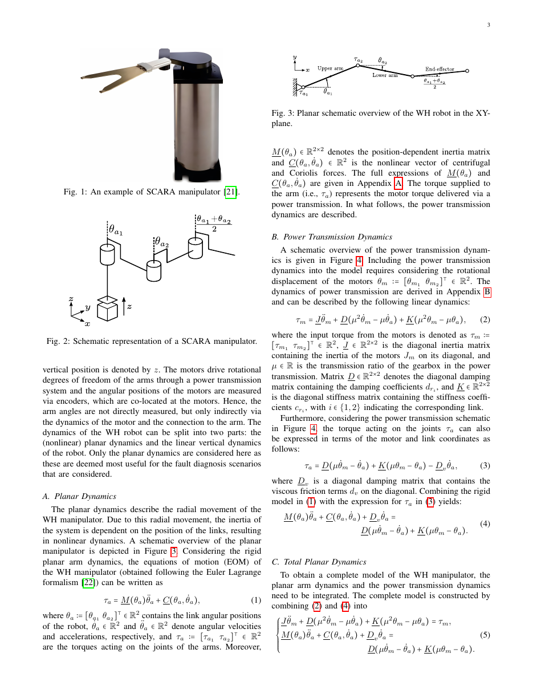
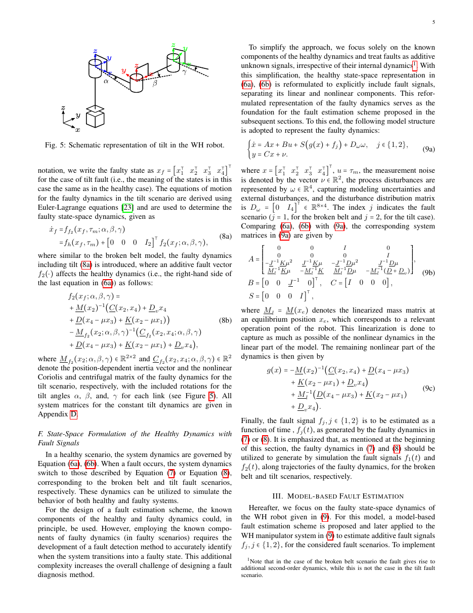
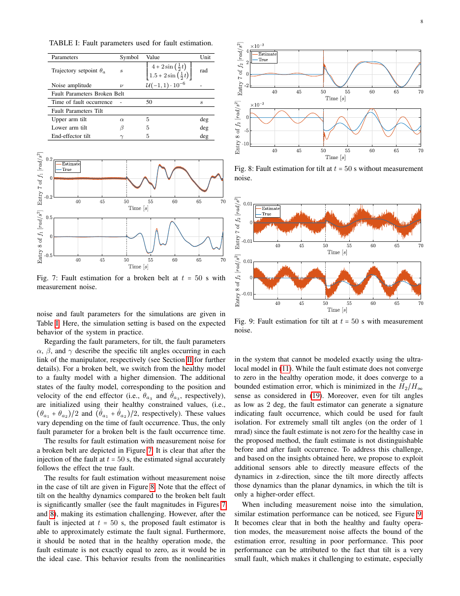
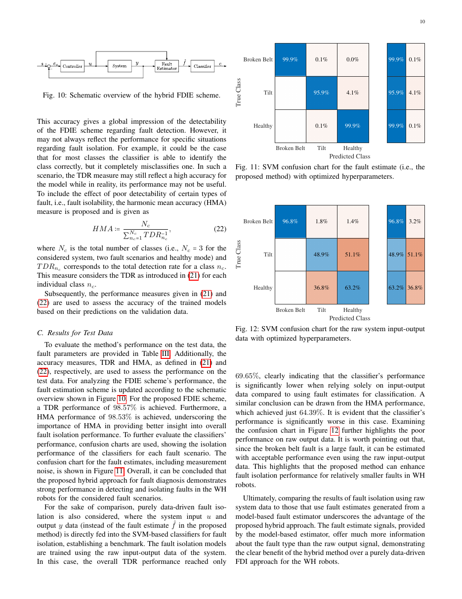

# 웨이퍼 핸들러 로봇의 모델과 데이터 결합 고장 진단: 기울기와 벨트 끊어짐 사례

번역 범위: 전문 (초록, 본문, 그림과 표 캡션, 부록). 참고문헌은 원문 그대로 둔다.
원문: [vanEsch2024_arXiv_wafer_handler_fault_diagnosis.pdf](vanEsch2024_arXiv_wafer_handler_fault_diagnosis.pdf) (arXiv:2412.09114v1 [cs.RO], 2024-12-12, 15쪽)
번역 원천: `pdftotext -layout` 추출 본문과 쪽 이미지. 수식은 읽기 쉽게 LaTeX로 옮겼다. 수식 번호는 원문을 따른다.
번역 메모: 원문의 fault는 "고장", tilt는 "기울기", broken belt는 "벨트 끊어짐", wafer handler(WH)는 "웨이퍼 핸들러(WH)"로 옮겼다.

Tim van Esch¹, Farhad Ghanipoor², Carlos Murguia²,³, Nathan van de Wouw²

- \* 제1저자와 제2저자의 기여는 같다.
- 1 ASML, Veldhoven, 네덜란드. t.vanesch@hotmail.com
- 2 Eindhoven University of Technology 기계공학과, 네덜란드. f.ghanipoor@tue.nl, c.g.murguia@tue.nl, n.v.d.wouw@tue.nl
- 3 Singapore University of Technology and Design, Engineering Systems Design, 싱가포르. murguia_rendon@sutd.edu.sg

---

## 초록

이 연구는 웨이퍼 핸들러(WH) 로봇의 한 부류에 대해, 고장 검출, 분리, 추정(FDIE)을 하는 모델과 데이터 결합(하이브리드) 방식을 제안한다. 제안 방식은 두 부분으로 되어 있다.

1. 센서 자료와 구동 자료로부터 시스템 상태와 고장이 만든 신호를 동시에 추정하는 선형 필터
2. 필터가 만든 추정값을 받아 고장 종류를 검출하고 분리하는 데이터 기반 분류기(서포트 벡터 머신, SVM)

반도체 산업에서 쓰는 WH 로봇의 두 가지 중요한 고장에 대해 효과를 보인다. 하나는 WH 로봇 아래팔의 벨트 끊어짐(갑작스러운 고장)이고, 다른 하나는 로봇 팔의 기울기(서서히 자라는 고장)다. 이 고장들이 만드는 로봇 운동 동역학의 명시적 모델을 유도하고, 현실적인 시뮬레이션 사례 연구로 진단 방식을 시험한다. 사례 연구 결과, 제안한 하이브리드 FDIE 방식은 순수 데이터 기반 방법보다 성능이 뛰어나다.

색인어: 고장 추정, 고장 분리, 비선형 시스템, 기계 학습, 분류

## I. 서론

반도체 산업에서는 리소그래피 장비에 쓰는 웨이퍼 핸들러(WH) 로봇에 고급 건전성 감시(HM) 알고리즘을 적용하는 데 관심이 크다. 이 고급 로봇은 칩 제조 공정의 여러 스테이션 사이로 웨이퍼를 옮긴다. 공정 생산성을 높이려고 높은 위치 정확도를 유지하면서 빠른 속도로 움직인다 [1]-[3]. 지금은 WH 로봇이 예상치 못하게 멈추면 리소그래피 장비를 계획에 없던 정비에 넣어야 한다. 이는 전체 제조 공정을 멈추게 하므로 시간이 많이 들고 비싸다. 이런 예상치 못한 고장을 줄이려고 고장 검출, 분리, 추정(FDIE) 기법이 점점 중요해졌다. 고장 진단을 제대로 하면 이런 장비의 신뢰성과 비용 효율을 크게 높일 수 있다. 또 고장의 심각도를 추정하고 이를 써서 로봇이 언제 고장 날지 예측할 수 있다면, 계획에 없던 정지를 (훨씬 감당하기 쉬운) 계획된 정지로 바꿀 수 있다.

이 논문은 WH 로봇의 두 중요한 고장 상황, 즉 아래팔의 벨트 끊어짐과 로봇 팔의 기울기에 대한 FDIE 문제를 다룬다. 웨이퍼 핸들러 로봇의 운동 동역학에 대한 물리 기반(오일러-라그랑주) 모델이 주어지면, 비슷한 동역학을 가진 로봇의 다른 고장 종류 [3]-[5]와 일반 동역학 시스템 [6]-[8]에 대해 모델 기반 FDIE 방법이 문헌에서 많이 연구되었다. 모델 기반 FDIE에서는 시스템의 제1원리 물리 모델로 시스템 건전성을 감시한다. 물리 기반 모델로 구동 입력과 초기 조건에 대한 시스템의 기대 거동을 예측한다. 이 예측을 (센서 측정으로 얻은) 실제 시스템 자료와 비교해 이른바 감시 잔차(측정과 모델 예측의 차)를 만든다. 잔차로 불일치를 검출하고, 이 불일치가 고장의 존재와 위치를 알려 줄 수 있다 [6]-[8].

고장은 시스템 모델의 서로 다른 항목(즉 서로 다른 식)에 영향을 줄 수 있다. 모델 기반 방법의 알려진 한계는, 동역학의 같은 항목에 영향을 주는 서로 다른 고장 종류를 구별하지 못한다는 점이다 [9]-[11]. 이 한계는 모델 기반 방법이 보통 한 고장의 항목과 연결된 신호의 효과는 보존하거나 키우고, 다른 고장의 항목과 연결된 신호의 효과는 특정 잔차에서 줄이거나 없애는 방식으로 고장을 분리하기 때문에 생긴다. 두 고장이 동역학에서 같은 항목으로 들어오면, 그 항목을 동시에 최소화하고 최대화할 수는 없다. 불행히도 이 논문에서 다루는 고장 상황(WH 로봇의 기울기와 벨트 끊어짐)은 WH 동역학에서 같은 항목을 공유한다. 그래서 기성 모델 기반 방법은 고장 분리에 적용할 수 없다 [9], [12].

모델 기반 FDIE와 달리, 데이터 기반 FDIE 방법은 데이터만으로 고장을 진단한다. 데이터 기반 방법의 강점은 시스템 동역학에 대한 모델 지식 없이도 시스템 측정에서 특징을 뽑을 수 있다는 점이다 [13]. 특징 추출로 여러 기계 학습(ML) 알고리즘을 써서 시스템 자료로부터 특정 고장을 식별할 수 있다. 데이터 기반 방법은 많은 응용에서 정확한 진단 결과를 보였다 [14]. 모델 기반 기법과 달리, 데이터 기반 방법은 고장 특징에만 의존하므로 같은 항목으로 들어오는 고장도 다룰 수 있다. 각 고장이 쓸 수 있는 신호 안에서 고유한 특징을 가지기만 하면, 이 방법은 고장을 올바르게 분류할 수 있다 [10]. 따라서 WH 로봇의 이 고장 상황에는 데이터 기반 방법이 더 알맞다.

최근에는 모델 기반과 데이터 기반 FDIE 방법을 결합하는 데 관심이 커지고 있다. 이른바 하이브리드 FDIE 접근은 두 기법의 장점을 함께 살려 새로운 고성능 FDIE 방식을 만들려 한다 [15]-[17]. 하이브리드 FDIE 방식을 만들기 위해 두 접근의 여러 요소를 다양한 방식으로 결합할 수 있다. 최신 하이브리드 FDIE 방식은 잔차 생성에 모델 기반 접근을, 특징 추출에 데이터 기반 방법을 써서 고장을 진단한다 [15]. 두 알고리즘의 정보를 분류기에 넣고, 분류기가 결정을 내리게 할 수 있다(정보 융합) [18]. 또는 모델 기반 FDIE 알고리즘과 데이터 기반 FDIE 알고리즘을 나란히 돌릴 수 있다. 두 알고리즘이 각각 FDIE 결정을 내리고, 이 결정들을 서로 비교해(결정 융합) 최종 결정을 얻는다 [19].

모델 기반 방법이 여기서 다루는 WH 로봇의 고장 상황을 분리하지 못한다는 사실에서, 우리는 모델 기반 고장 추정기와 데이터 기반 방법을 결합해 고장 분리(FI)를 가능하게 하는 새 하이브리드 방식을 제안한다. 제안한 고장 추정기는 시스템 동역학에 들어오는 고장 신호 자체를 추정하므로, 일반 잔차 생성기보다 추가 이점이 있다. 또한 제안 방법을 순수 데이터 기반 접근과 비교해, 산업용 WH 로봇 응용에서 더 나은 성능을 보인다. 이 연구는 시뮬레이션 기반 사례 연구로 평가한다. 실제 로봇에 이 고장들을 일으키려면 파괴 시험이 필요하며, 이 단계에서는 피해야 하기 때문이다.

이 논문의 주요 기여는 다음과 같다.

- (a) 웨이퍼 핸들러 로봇의 중요 고장 모델링: 로봇 팔의 기울기와 아래팔의 벨트 끊어짐이라는 두 중요한 고장을 로봇 동역학에 주는 영향으로 모델링한다.
- (b) 최적화 기반 고장 추정 방식: 제안 고장 추정기의 설계 파라미터를 계산 효율적으로 합성하는 알고리즘을 제안한다. 반정부호 계획(SDP)을 풀어, (고장과 비선형성) 모델 불일치에서 고장 추정 오차로 가는 섭동의 $H_\infty$ 노름을 최소화한다. 또한 측정 잡음에서 고장 추정 오차로 가는 $H_2$ 노름에 원하는 상한을 두면서 안정성을 보장하는 풀 수 있는 조건을 준다(정리 1). 이 설계 조건으로 성능 절충 분석을 할 수 있고, 여러 섭동에 대한 강건성이 높아진다.
- (c) 같은 항목 고장의 분리: 제안 하이브리드 방법은 데이터 기반 분류기로 고장을 분리하므로, 같은 시스템 항목에 영향을 주는 고장을 분리하지 못하는 기존 모델 기반 방법의 한계 [9], [12]를 넘는다. 분류기는 모델 기반 고장 추정기가 낸 고장 추정값의 서로 다른 거동을 구별한다. 이는 웨이퍼 핸들러 로봇 동역학의 같은 항목에 영향을 주는 기울기와 벨트 끊어짐을 분리하는 데 꼭 필요하다.
- (d) 순수 데이터 기반 방법보다 나은 성능: 위 필터가 만든 고장 추정값을 원시 입출력 자료 대신 고장 분리에 써서, 제안 하이브리드 방식이 고장 분리에서 순수 데이터 기반 방법보다 뛰어남을 보인다.

이 논문의 추정 알고리즘은 [20]의 결과 위에 있다. [20]에서 저자들은 강건 제어 도구와 극국소(ultra-local) 모델링 기법을 쓰는 비선형 동역학 시스템의 고장 추정 방식을 제시했다. [20]과 비교해 이 논문은 [20]에 없던 추정기 설계의 기술적 결과 증명을 모두 제공한다. 또한 고장 추정값을 활용한 데이터 기반 고장 분리 방법을 더한다. 모델 기반 고장 추정 방법을 통합해 새 하이브리드 FDIE 방식을 제안한다. 그리고 매우 비선형적인 동역학과 두 가지 중요한 곱셈형 고장을 가진 웨이퍼 핸들러 로봇이라는 산업 사례에서 제안 방법을 평가한다.

논문의 구성은 다음과 같다. II절은 WH 로봇의 동역학과 고장 형태를 소개한다. III절은 WH 로봇용 모델 기반 고장 추정기 설계를 다루고, 설계한 추정기의 시뮬레이션 결과를 보인다. IV절은 기계 학습 분류로 고장을 검출하고 분리한 결과를 보인다. 이 기법을 III절의 모델 기반 고장 추정기와 통합해 하이브리드 FDIE 방식을 만든다. 그 다음 넓은 범위의 고장 상황에 대해 웨이퍼 핸들러 로봇 시뮬레이션 사례로 평가한다. 또한 하이브리드 접근의 성능을 순수 데이터 기반 고장 분리와 비교한다. V절은 결론과 향후 연구 제안이다.

표기: $n\times n$ 단위 행렬은 $I_n$, 크기가 분명하면 $I$로 쓴다. 모든 원소가 0인 $n\times m$ 행렬은 $0_{n\times m}$ 또는 $0$이다. 벡터 $x$의 1차, 2차 시간 미분은 $\dot x$, $\ddot x$이고, 더 높은 차수는 $x^{(r)}$로 쓴다. 양정부호 행렬은 $X\succ0$, 양반정부호는 $X\succeq0$, 음정부호는 $X\prec0$, 음반정부호는 $X\preceq0$이다. 허수 단위는 $j^2=-1$이다. 전달 함수 $T(s)$, $s\in\mathbb{C}$에 대해 $\sigma_{\max}(T(s))$는 최대 특이값, $T^H(s)$는 에르미트 전치다. $\|x\|$는 유클리드 노름이다. $(x_1,\dots,x_n)$은 스칼라나 벡터 원소로 만든 열벡터다. $x\sim\mathcal{U}(a,b)$는 원소가 $[a,b]$ 균일 분포에서 뽑힌 벡터다. 표기를 간단히 하려고 시간 의존성은 자주 생략한다.

## II. 로봇 동역학 모델링

이 절에서는 다루는 WH 매니퓰레이터 부류의 건전한(고장 없는) 동역학을 기술한다. 대상 WH 로봇은 원통형 작업 공간을 가진 SCARA 매니퓰레이터 부류에 속한다. 그런 매니퓰레이터의 사진은 그림 1, 개략도는 그림 2에 있다. 위팔과 아래팔의 각위치는 각각 $\theta_{a1}$, $\theta_{a2}$다. 링크 사이의 물리적(홀로노믹) 구속 때문에 엔드 이펙터의 각위치는 $\theta_{a3}=(\theta_{a1}+\theta_{a2})/2$로 정해진다. 마지막으로 수직 위치는 $z$다. 모터는 동력 전달 장치를 거쳐 팔의 회전 자유도를 구동한다. 모터 각위치는 모터에 함께 달린 엔코더로 잰다. 따라서 팔 각도는 직접 재지 않고, 모터 동역학과 모터-팔 연결을 거쳐 간접적으로만 알 수 있다. WH 로봇의 동역학은 (비선형) 평면 동역학과 선형 수직 동역학 두 부분으로 나눌 수 있다. 여기서는 다루는 고장 진단 상황에 가장 유용하다고 보는 평면 동역학만 고려한다.

- 그림 1: SCARA 매니퓰레이터의 예 [21].
- 그림 2: SCARA 매니퓰레이터의 개략도.
- 그림 3: XY 평면에서 본 WH 로봇의 평면 개략도.

### A. 평면 동역학

평면 동역학은 WH 매니퓰레이터의 반경 방향 운동을 기술한다. 이 반경 방향 운동 때문에 시스템 관성이 링크 위치에 따라 달라지고, 동역학이 비선형이 된다. 평면 매니퓰레이터의 개략도는 그림 3에 있다. 강체 평면 팔 동역학을 고려하면, (오일러-라그랑주 형식 [22]으로 얻은) WH 매니퓰레이터의 운동 방정식(EOM)은 다음과 같다.

$$\tau_a = M(\theta_a)\ddot\theta_a + C(\theta_a,\dot\theta_a) \tag{1}$$

여기서 $\theta_a:=[\theta_{a1}\ \theta_{a2}]^\top\in\mathbb{R}^2$는 로봇 링크의 각위치, $\dot\theta_a$, $\ddot\theta_a$는 각속도와 각가속도, $\tau_a:=[\tau_{a1}\ \tau_{a2}]^\top$는 팔 관절에 작용하는 토크다. $M(\theta_a)\in\mathbb{R}^{2\times2}$는 위치에 따라 달라지는 관성 행렬, $C(\theta_a,\dot\theta_a)\in\mathbb{R}^2$는 원심력과 코리올리 힘의 비선형 벡터다. $M$과 $C$의 전체 식은 부록 A에 있다. 팔에 주는 토크 $\tau_a$는 동력 전달 장치를 거쳐 전달되는 모터 토크다. 아래에서 동력 전달 동역학을 기술한다.

### B. 동력 전달 동역학

동력 전달 동역학의 개략도는 그림 4에 있다. 동력 전달 동역학을 모델에 넣으려면 모터의 회전 변위 $\theta_m:=[\theta_{m1}\ \theta_{m2}]^\top\in\mathbb{R}^2$를 고려해야 한다. 동력 전달 동역학은 부록 B에서 유도하며, 다음 선형 동역학으로 쓸 수 있다.

$$\tau_m = J\ddot\theta_m + D(\mu^2\dot\theta_m-\mu\dot\theta_a) + K(\mu^2\theta_m-\mu\theta_a) \tag{2}$$

여기서 $\tau_m:=[\tau_{m1}\ \tau_{m2}]^\top$는 모터 입력 토크, $J\in\mathbb{R}^{2\times2}$는 대각에 모터 관성 $J_m$을 가진 대각 관성 행렬, $\mu\in\mathbb{R}$는 동력 전달 기어박스의 감속비다. $D$는 감쇠 계수 $d_{ri}$를 담은 대각 감쇠 행렬, $K$는 강성 계수 $c_{ri}$를 담은 대각 강성 행렬이며, $i\in\{1,2\}$는 해당 링크를 뜻한다. 그림 4의 동력 전달 개략도를 보면, 관절 토크 $\tau_a$는 모터 좌표와 링크 좌표로도 쓸 수 있다.

$$\tau_a = D(\mu\dot\theta_m-\dot\theta_a) + K(\mu\theta_m-\theta_a) - D_v\dot\theta_a \tag{3}$$

여기서 $D_v$는 대각에 점성 마찰 $d_v$를 가진 대각 감쇠 행렬이다. 강체 모델 (1)과 $\tau_a$ 식 (3)을 합치면 다음을 얻는다.

$$M(\theta_a)\ddot\theta_a + C(\theta_a,\dot\theta_a) + D_v\dot\theta_a = D(\mu\dot\theta_m-\dot\theta_a) + K(\mu\theta_m-\theta_a) \tag{4}$$

- 그림 4: 동력 전달 모델의 개략도.

### C. 전체 평면 동역학

WH 매니퓰레이터의 완전한 모델을 얻으려면 평면 팔 동역학과 동력 전달 동역학을 통합해야 한다. (2)와 (4)를 합쳐 완전한 모델을 만든다.

$$\begin{cases} J\ddot\theta_m + D(\mu^2\dot\theta_m-\mu\dot\theta_a) + K(\mu^2\theta_m-\mu\theta_a) = \tau_m,\\ M(\theta_a)\ddot\theta_a + C(\theta_a,\dot\theta_a) + D_v\dot\theta_a = D(\mu\dot\theta_m-\dot\theta_a)+K(\mu\theta_m-\theta_a). \end{cases} \tag{5}$$

이제 (5)는 입력 토크 $\tau_m$에서 모터 각위치 $\theta_m$과 링크 각위치 $\theta_a$까지의 완전한 동역학을 기술한다.

### D. 건전한 동역학의 상태 공간 표현

이 절에서는 (5)의 2차 동역학을 1차 상태 공간 시스템으로 바꾼다(이 변환은 다음 절들의 고장 추정 알고리즘에 쓰인다). 상태 벡터를 $x=[x_1^\top\ x_2^\top\ x_3^\top\ x_4^\top]^\top:=[\theta_m^\top\ \theta_a^\top\ \dot\theta_m^\top\ \dot\theta_a^\top]^\top\in\mathbb{R}^8$로 둔다. (5)에서 바로 다음 상태 공간 모델을 쓸 수 있다.

$$\dot x = f_h(x,\tau_m) \tag{6a}$$

$$f_h(x,\tau_m)=\begin{bmatrix} x_3\\ x_4\\ -J^{-1}\big(D(\mu^2x_3-\mu x_4)+K(\mu^2x_1-\mu x_2)\big)+J^{-1}\tau_m\\ -M(x_2)^{-1}\big(C(x_2,x_4)+D(x_4-\mu x_3)+K(x_2-\mu x_1)+D_vx_4\big)\end{bmatrix} \tag{6b}$$

측정 가능한 상태를 나타내는 출력 식은 다음과 같다.

$$y=Cx \tag{6c}$$

엔코더가 모터에 함께 달려 있으므로 $y$는 모터 각도 $\theta_{m1}$, $\theta_{m2}$로 이루어지고, $C:=[I_2\ \ 0]$이다.

### E. 고장 상황과 고장 모델

WH 로봇에서 실제로 마주치는 두 고장 상황을 다룬다. 첫 상황은 WH 로봇 아래팔의 벨트 끊어짐이다. 이 벨트는 모터와 관절을 잇고, 단단한 연결을 위해 장력이 걸려 있다. 벨트가 끊어지면 로봇의 수평면에 잘못된 변위가 생기고, 엔드 이펙터의 물리적 홀로노믹 구속 $\theta_{a3}=(\theta_{a1}+\theta_{a2})/2$이 더 이상 성립하지 않는다. 그래서 벨트 끊어짐 상황의 고장 거동을, 건전한 모델보다 자유도 하나($\theta_{a3}$)가 더 많은 매니퓰레이터로 모델링한다. 이 고장 상황에서 엔드 이펙터에는 외력이 작용하지 않으며, 그 움직임은 초기 조건과 다른 링크와의 동역학 결합에서 생긴다는 점이 중요하다. 이 고장 동역학의 상태 벡터를 $x_f=[x_1^\top\ x_2^\top\ x_3^\top\ x_4^\top\ x_{f1}\ x_{f2}]^\top:=[\theta_m^\top\ \theta_a^\top\ \dot\theta_m^\top\ \dot\theta_a^\top\ \theta_{a3}\ \dot\theta_{a3}]^\top\in\mathbb{R}^{10}$로 둔다. 벨트 끊어짐 상황의 고장 운동 모델은 오일러-라그랑주 방정식 [23]으로 유도할 수 있으며 다음과 같다.

$$\dot x_f=\begin{bmatrix}\dot x\\ \dot x_{f1}\\ \dot x_{f2}\end{bmatrix}=f_{f1}(x_f,\tau_m) \tag{7a}$$

$$f_{f1}(x_f,\tau_m)=\begin{bmatrix} f_h(x,\tau_m)+[0\ 0\ 0\ I_2]^\top f_1(x_f)\\ x_{f2}\\ -[0\ 0\ 1]\,M_{f1}(x_2,x_{f1})^{-1}\big(C_{f1}(x_2,x_4,x_{f1},x_{f2})+D_{f1}(x_3,x_4)+K_{f1}(x_1,x_2)+D_{vf1}(x_4)\big)\end{bmatrix} \tag{7b}$$

여기서 $M_{f1}(x_2,x_{f1})\in\mathbb{R}^{3\times3}$와 $C_{f1}(\cdot)\in\mathbb{R}^3$는 벨트 끊어짐 고장 동역학의 위치 의존 관성 행렬과 비선형 코리올리, 원심력 항이다. 또한 $D_{f1}$, $K_{f1}$, $D_{vf1}$는 확장된 감쇠, 강성, 점성 마찰 행렬이다. 읽기 쉽게 이 행렬들은 부록 C에 둔다. 또 벨트 끊어짐 고장이 로봇의 건전한 동역학에 어떻게 영향을 주는지 보려고, 고장 모델 (7a), (7b)에 덧셈형 고장 벡터 $f_1(x_f)$를 건전한 동역학(즉 (6a)의 마지막 식 오른쪽)에 넣었다. 이 벡터는 다음과 같다.

$$\begin{aligned} f_1(x_f):=\ &+M(x_2)^{-1}\big(C(x_2,x_4)+D_vx_4+D(x_4-\mu x_3)+K(x_2-\mu x_1)\big)\\ &-F\,M_{f1}(x_2,x_{f1})^{-1}\big(C_{f1}(x_2,x_4,x_{f1},x_{f2})+D_{f1}(x_3,x_4)+K_{f1}(x_1,x_2)+D_{vf1}(x_4)\big) \end{aligned} \tag{7c}$$

여기서 $F:=[I_2\ \ 0]$이다.

두 번째 고장 상황은 WH 로봇 팔의 기울기다. 기울기는 시간이 지나며 서서히 자란다. 서서히 자라는 성질 때문에 이 고장은 당장 위험하지는 않지만, 그래도 검출하는 것이 중요하다. 기울기가 너무 커지면(보통 느린 시간 척도에서 일어난다) 로봇이 고장 난다. 따라서 작은 기울기 고장을 일찍 검출할 수 있으면, 시스템이 고장 나기 전에 바로잡는 조치를 할 수 있다. 기울기는 WH 로봇의 각 팔에서 생길 수 있으며, 그림 5처럼 몸체 좌표계 y축을 중심으로 한 추가 회전으로 모델링한다. 이 거동을 담으려고 이 추가 회전을 넣어 운동 방정식을 유도하면, 기울기 각에 의존하는 새 관성 행렬과 코리올리 행렬이 나온다(기울기는 느린 시간 척도로 자라므로 고장 모델에서는 기울기 각을 상수로 가정한다). 이 모델은 기울기가 y축 회전으로 생기고, 그 다음 팔의 정상 운동인 z축 회전이 이어진다고 가정한다. 표기를 조금 남용해, 기울기 고장의 경우 고장 상태를 $x_f=[x_1^\top\ x_2^\top\ x_3^\top\ x_4^\top]^\top$로 쓴다(즉 이 경우 상태의 의미는 건전한 경우와 같다). 기울기 상황의 고장 동역학 운동 방정식은 오일러-라그랑주 방정식 [23]으로 유도하며, 고장 상태 공간 동역학은 다음과 같다.

- 그림 5: WH 로봇의 기울기 개략도.

$$\dot x_f=f_{f2}(x_f,\tau_m;\alpha,\beta,\gamma)=f_h(x_f,\tau_m)+[0\ 0\ 0\ I_2]^\top f_2(x_f;\alpha,\beta,\gamma) \tag{8a}$$

벨트 끊어짐 모델과 비슷하게, 기울기를 포함한 고장 동역학 (8a)에서는 덧셈형 고장 벡터 $f_2(\cdot)$가 건전한 동역학(즉 (6a)의 마지막 식 오른쪽)에 다음과 같이 영향을 준다.

$$\begin{aligned} f_2(x_f;\alpha,\beta,\gamma)=\ &+M(x_2)^{-1}\big(C(x_2,x_4)+D_vx_4+D(x_4-\mu x_3)+K(x_2-\mu x_1)\big)\\ &-M_{f2}(x_2;\alpha,\beta,\gamma)^{-1}\big(C_{f2}(x_2,x_4;\alpha,\beta,\gamma)+D(x_4-\mu x_3)+K(x_2-\mu x_1)+D_vx_4\big) \end{aligned} \tag{8b}$$

여기서 $M_{f2}\in\mathbb{R}^{2\times2}$와 $C_{f2}\in\mathbb{R}^2$는 기울기 상황 고장 동역학의 위치 의존 관성 행렬과 비선형 코리올리, 원심력 항이며, 각 링크의 기울기 각 $\alpha$, $\beta$, $\gamma$의 회전이 들어 있다(그림 5 참고). 상수 기울기 동역학의 모든 시스템 행렬은 부록 D에 있다.

### F. 고장 신호를 포함한 건전한 동역학의 상태 공간 표현

건전한 상황에서 시스템 동역학은 (6a), (6b)를 따른다. 고장이 생기면 시스템 동역학은 벨트 끊어짐이면 (7), 기울기면 (8)로 바뀐다. 이 동역학들로 건전한 시스템과 고장 시스템의 거동을 시뮬레이션할 수 있다.

고장 추정 방식을 설계할 때 원리적으로는 건전한 동역학과 고장 동역학의 알려진 성분을 모두 쓸 수 있다. 그러나 (고장 상황에서) 고장 동역학의 알려진 성분을 쓰려면, 시스템이 언제 고장 상태로 넘어갔는지 정확히 알아내는 고장 검출 방법이 먼저 있어야 한다. 이 추가 복잡성은 고장 진단 방법 설계를 전체적으로 더 어렵게 만든다.

접근을 단순하게 하려고, 건전한 동역학의 알려진 성분에만 집중하고 고장은 그 내부 동역학과 관계없이 덧셈형 미지 신호로 다룬다¹. 이 단순화로 건전한 상태 공간 표현 (6a), (6b)를 고장 신호를 명시적으로 포함하고 선형 성분과 비선형 성분을 나누도록 다시 쓴다. 이 고장 동역학 표현이 다음 절들에서 제안하는 고장 추정 방식의 기초가 된다. 이를 위해 고장 동역학을 다음 모델 구조로 나타낸다.

$$\begin{cases}\dot x=Ax+Bu+S(g(x)+f_j)+D_\omega\omega,\\ y=Cx+\nu,\end{cases}\qquad j\in\{1,2\} \tag{9a}$$

여기서 $x=[x_1^\top\ x_2^\top\ x_3^\top\ x_4^\top]^\top$, $u=\tau_m$이다. 측정 잡음은 벡터 $\nu\in\mathbb{R}^2$, 모델 불확실성과 외란을 담는 과정 외란은 $\omega\in\mathbb{R}^4$, 외란 분배 행렬은 $D_\omega=[0\ I_4]^\top\in\mathbb{R}^{8\times4}$다. 지수 $j$는 고장 상황을 뜻한다($j=1$은 벨트 끊어짐, $j=2$는 기울기). (6a), (6b)와 (9a)를 비교하면, (9a)의 시스템 행렬은 다음과 같다.

$$A=\begin{bmatrix}0&0&I&0\\0&0&0&I\\-J^{-1}K\mu^2&J^{-1}K\mu&-J^{-1}D\mu^2&J^{-1}D\mu\\ M_l^{-1}K\mu&-M_l^{-1}K&M_l^{-1}D\mu&-M_l^{-1}(D+D_v)\end{bmatrix},$$
$$B=[0\ 0\ J^{-1}\ 0]^\top,\quad S=[0\ 0\ 0\ I]^\top,\quad C=[I\ 0\ 0\ 0] \tag{9b}$$

여기서 $M_l=M(x_e)$는 평형 위치 $x_e$에서 선형화한 질량 행렬이고, $x_e$는 로봇의 관련 동작점이다. 이 선형화는 비선형 동역학을 가능한 한 많이 모델의 선형 부분에 담으려는 것이다. 남은 비선형 부분은 다음과 같다.

$$\begin{aligned} g(x)=\ &-M(x_2)^{-1}\big(C(x_2,x_4)+D(x_4-\mu x_3)+K(x_2-\mu x_1)+D_vx_4\big)\\ &+M_l^{-1}\big(D(x_4-\mu x_3)+K(x_2-\mu x_1)+D_vx_4\big) \end{aligned} \tag{9c}$$

마지막으로 고장 신호 $f_j$, $j\in\{1,2\}$는 (7) 또는 (8)의 고장 동역학이 만드는 시간 함수 $f_j(t)$로 추정해야 한다. 이 절 처음에 말한 대로, (7)과 (8)의 고장 동역학은 벨트 끊어짐과 기울기 상황에 대해 고장 동역학 궤적을 따라 고장 신호 $f_1(t)$, $f_2(t)$를 시뮬레이션으로 만드는 데 쓰인다.

- 각주 1: 벨트 끊어짐 상황에서는 고장이 추가 2차 동역학을 만들지만, 기울기 고장 상황에서는 그렇지 않다.

## III. 모델 기반 고장 추정

이제부터 (9)의 WH 로봇 고장 상태 공간 동역학에 집중한다. 이 모델에 대한 모델 기반 고장 추정 방식을 제안하고, 그 다음 (9)의 WH 매니퓰레이터 시스템에 적용해 두 고장 상황의 덧셈형 고장 신호 $f_j$, $j\in\{1,2\}$를 추정한다. 고장 추정 방법을 구현하려면 (9)에 대해 아래의 기술적 가정이 필요하다.

가정 1 (정칙성). 고장 추정 문제의 정칙성을 위해 기존 문헌 [24]-[26]에서 흔히 쓰는 다음 가정이 필요하다.

- 상태와 입력의 유계성: (9)의 상태 $x(t)$와 입력 $u(t)$는 임의의 유한 시간 구간에서 유계다.
- $C^r$ 고장과 비선형성: (9)의 함수 $g(x(t))+f_j(t)$, $j\in\{1,2\}$는 $t$에 대해 $r$번 미분 가능하다.
- 외란의 유계성: (9)의 외란 벡터 $\omega(t)$, $\nu(t)$는 임의의 유한 시간 구간에서 유계다. 또한 $\nu(t)$는 $t$에 대해 한 번 미분 가능하다. 즉 $\dot\nu(t)$가 있고, 임의의 유한 시간 구간에서 연속이며 유계다.

그림 III-C의 고장 추정기를 소개하기 전에, 다음 절에서 고장 추정 필터 설계에 필요한 준비 사항을 제시한다.

### A. 극국소 묶음 고장 표현

(9)에서 함수 $\xi(x(t)):=g(x(t))+f_j(t)$를 정의하고, 이를 묶음 고장(고장과 비선형 항의 합)이라 부른다. $\xi(x(t))$는 시간의 암묵 함수다. 따라서 시각 $t$에서 $\xi$의 원소별 $r$차 테일러 근사를 $\bar\xi=a_0+a_1t+\dots+a_{r-1}t^{r-1}$, $a_i\in\mathbb{R}^{n_g}$로 쓸 수 있다. 이 근사의 내부 모델은 다음 상태 공간 형태로 쓸 수 있다.

$$\begin{cases}\dot{\bar\zeta}_i=\bar\zeta_{i+1},&1\le i<r,\\ \dot{\bar\zeta}_r=0,\\ \bar\xi=\bar\zeta_1,\end{cases} \tag{10}$$

여기서 $\bar\zeta_i\in\mathbb{R}^{n_g}$다. 이 모델에서는 분명히 $\bar\xi^{(r)}=0$이지만, 실제 묶음 고장 신호 $\xi$는 그렇지 않다. 가정 1 아래에서 $\xi$의 실제 내부 상태 공간 표현은 다음과 같다.

$$\begin{cases}\dot\zeta_i=\zeta_{i+1},&1\le i<r,\\ \dot\zeta_r=\xi^{(r)},\\ \xi=\zeta_1,\end{cases} \tag{11}$$

여기서 $\zeta_i\in\mathbb{R}^{n_g}$다. 근사 모델 (10)의 정확도는 $\xi^{(r)}$이 (원소별로) 0에 가까울수록 높아진다. 다음으로 고장 추정 필터를 설계하려고, 시스템 상태 $x(t)$에 묶음 고장 내부 상태 $\zeta_i(t)$, $i\in\{1,\dots,r\}$를 덧붙인다. (9)의 시스템 동역학을 (11)로 확장한다. 그 다음 확장 시스템에 대해 모델 (10)을 써서 $x$와 $\zeta_i$를 동시에 추정하는 선형 필터(관측기)를 설계한다.

### B. 확장 동역학

위의 묶음 고장 $\xi$를 바탕으로 확장 상태 $x_a:=(x,\zeta_1,\zeta_2,\dots,\zeta_r)$를 정의하고, (9)와 (11)로 확장 동역학을 다시 쓴다.

$$\begin{cases}\dot x_a=A_ax_a+B_au+D_a\omega_a,\\ y=C_ax_a+\nu,\end{cases} \tag{12a}$$

$$A_a:=\begin{bmatrix}A&S&0\\0&0&I_{d_n}\\0&0&0\end{bmatrix},\ B_a:=\begin{bmatrix}B\\0\end{bmatrix},\ D_a:=\begin{bmatrix}D_\omega&0\\0&0\\0&I_{n_g}\end{bmatrix},\ \omega_a:=\begin{bmatrix}\omega\\ \xi^{(r)}\end{bmatrix},\ C_a:=[C\ \ 0] \tag{12b}$$

여기서 $d_n=(r-1)n_g$다.

### C. 고장 추정기

관측기 기반 방법에서 착안해, 고장 추정 필터를 다음과 같이 제안한다.

$$\dot z=Nz+Gu+Ly, \tag{13a}$$
$$\hat f=\bar C(z-Ey)-g(V_a(z-Ey)), \tag{13b}$$

필터 상태는 $z\in\mathbb{R}^{n_z}$, $n_z=n+rn_g$이고, 행렬 $\{N,G,L\}$은 다음과 같다.

$$\bar C:=[0\ \ I_{n_g}\ \ 0],\ V_a:=[I_n\ \ 0],\ N:=MA_a-KC_a,\ G:=MB_a,\ M:=I+EC_a,\ L:=K(I+C_aE)-MA_aE \tag{13c}$$

행렬 $E$와 $K$는 설계할 필터 이득이다. 고장 없는 시스템 동역학은 알려져 있다고 가정한다. 따라서 비선형 함수 $g(\cdot)$를 써서 (13b)처럼 고장 신호를 대수적으로 뽑을 수 있다. (13b)에 따라 확장 상태 $x_a$ 중 고장 신호 복원에 쓰이는 부분은 $\bar C_ax_a$이며, 여기서

$$\bar C_a:=[V_a^\top\ \ \bar C^\top]^\top \tag{14}$$

다음 절에서는 고장 추정 필터 합성 문제(즉 필터 이득 $\psi:=\{E,K\}$ 선택)를 세우려고 고장 추정기 오차 동역학을 분석한다.

### D. 고장 추정기 오차 동역학

확장 상태 추정값 $\hat x_a$를 생각하고 추정 오차를 다음과 같이 정의한다.

$$e:=\hat x_a-x_a=z-x_a-Ey=z-Mx_a-E\nu.$$

(13c)의 대수 관계를 쓰면 추정 오차 동역학은 다음과 같다.

$$\dot e=Ne-MD_a\omega_a+[K\ \ -E]\begin{bmatrix}\nu\\ \dot\nu\end{bmatrix}.$$

$\nu_a:=(\nu,\dot\nu)$, $e_d:=\bar C_ae$(여기서 $\bar C_a$는 (14)), $\bar B:=[K\ \ -E]$로 정의한다. 그러면 추정 오차 동역학은

$$\begin{cases}\dot e=Ne-MD_a\omega_a+\bar B\nu_a,\\ e_d=\bar C_ae.\end{cases} \tag{15}$$

전달 함수 행렬을 다음과 같이 정의한다.

$$T_{e_d\omega_a}(s):=-\bar C_a(sI-N)^{-1}MD_a,\qquad T_{e_d\nu_a}(s):=\bar C_a(sI-N)^{-1}\bar B, \tag{16}$$

여기서 $s\in\mathbb{C}$이고, $T_{e_d\omega_a}(s)$와 $T_{e_d\nu_a}(s)$는 각각 입력 $\omega_a$와 $\nu_a$에서 출력 $e_d$로 가는 전달 함수 행렬이다. 고장 추정에서 추정 오차 $e_d$는 특히 중요하다. 이것은 추정하려는 고장의 오차뿐 아니라, (13b)의 비선형성에 인수로 들어가는 상태 추정값의 오차도 나타내기 때문이다. 이제 (9)의 WH 시스템에 대한 고장 추정기 합성 문제를 다음과 같이 쓸 수 있다.

문제 1 (고장 추정기 합성). 입력과 출력 신호 $u(t)$, $y(t)$를 아는 (9)의 WH 고장 시스템 동역학을 생각한다. 또한 내부 묶음 고장 동역학 (11), 그 테일러 근사 (10), 확장 동역학 (12), 고장 추정기 (13), 전달 행렬 (16)을 생각한다. 가정 1 아래에서 다음을 만족하도록 필터 이득 행렬 $\psi=\{E,K\}$를 설계한다.

1. 안정성: 추정 오차 동역학 (15)가 입력 $\bar\omega_a=(\omega_a,\nu_a)$에 대해 입력-상태 안정(ISS)이다.
2. 외란 감쇠: 다음 값이 알려진 $\bar\lambda>0$로 유계다.
$$J_1(\psi):=\|T_{e_d\omega_a}\|_\infty=\sup_{\mu\in\mathbb{R}^+}\sigma_{\max}(T_{e_d\omega_a}(i\mu))\le\bar\lambda \tag{17}$$
3. 잡음 제거: 다음 값이 알려진 $\bar\gamma>0$로 유계다.
$$J_2(\psi):=\|T_{e_d\nu_a}\|_{H_2}=\sqrt{\frac{1}{2\pi}\,\mathrm{trace}\int_{-\infty}^{\infty}T_{e_d\nu_a}(i\mu)T^H_{e_d\nu_a}(i\mu)\,d\mu}\le\bar\gamma \tag{18}$$

가정 1 아래에서 문제 1의 핵심은 다음을 만족하는 고장 추정기를 찾는 것이다. 추정 오차 $e(t)$가 유계여야 한다. 외부 외란과 묶음 고장 모델 불일치에서 성능 출력 $\bar C_ae$로 가는 전달 행렬 $T_{e_d\omega_a}(s)$의 $H_\infty$ 노름이 $\bar\lambda$로 위에서 유계여야 한다. 측정 잡음에서 성능 출력으로 가는 전달 행렬 $T_{e_d\nu_a}(s)$의 $H_2$ 노름이 $\bar\gamma$로 위에서 유계여야 한다.

- 그림 6: 모델 기반 고장 추정 방식의 개략도. (원문 7쪽, 그림 파일은 넣지 않았다)

### E. 고장 추정기 합성

다음 정리에서 문제 1의 해를 반정부호 계획의 해로 준다. 목표는 $T_{e_d\nu_a}(s)$의 $H_2$ 노름에 허용 가능한 상한을 두면서 $T_{e_d\omega_a}(s)$의 $H_\infty$ 노름을 최소화하는 것이다. 또한 추정 오차 동역학의 내부 안정성을 강제하려고 입력-상태 안정(ISS) 구속을 이 계획에 더한다.

정리 1 (고장 추정기 합성). 확장 동역학 (12), (13)으로 정의한 고장 추정 필터, 해당 추정 오차 동역학 (15), 전달 함수 (16)을 생각한다. 최적 혼합 $H_2/H_\infty$ 고장 추정기의 파라미터를 설계하려면 다음 볼록 계획을 푼다.

$$\min_{P,R,Q,Z,\bar\lambda,\bar\gamma}\ \bar\lambda$$
$$\text{s.t.}\quad X+\epsilon I\preceq0,\quad \begin{bmatrix}X&Y&\bar C_a^\top\\ *&-\bar\lambda I&0\\ *&*&-\bar\lambda I\end{bmatrix}\prec0,\quad \begin{bmatrix}X&Q&-R\\ *&-\bar\gamma I&0\\ *&*&-\bar\gamma I\end{bmatrix}\prec0,$$
$$\begin{bmatrix}P&\bar C_a^\top\\ *&Z\end{bmatrix}\succ0,\ P\succ0,\ \mathrm{trace}(Z)<\bar\gamma,\ \bar\gamma\le\bar\gamma_{\max},\ \bar\lambda,\bar\gamma>0 \tag{19a}$$

여기서

$$X:=A_a^\top P+A_a^\top C_a^\top R^\top-C_a^\top Q^\top+PA_a+RC_aA_a-QC_a,\qquad Y:=-(P+RC_a)D_a \tag{19b}$$

이고, $\epsilon,\bar\gamma_{\max}>0$, (14)의 $\bar C_a$, 나머지 행렬은 (12b)에서 주어진다. 얻은 최적해를 $P^\star,R^\star,Q^\star,Z^\star,\bar\lambda^\star,\bar\gamma^\star$로 쓴다. 그러면 (13)의 추정 필터 파라미터 $\psi=\psi^\star=\{E^\star=P^{\star-1}R^\star,\ K^\star=P^{\star-1}Q^\star\}$는 다음 성질을 보장한다.

1. (15)의 추정 오차 동역학은 ISS이고, $(\omega_a,\nu_a)$에서 추정 오차로 가는 ISS 이득의 상한은 $2\|P^\star[(I+E^\star C_a)D_a\ \ -K^\star\ \ E^\star]\|\epsilon^{-1}$이다.
2. (17)의 $J_1(\cdot)$은 $\bar\lambda^\star$로 위에서 유계다. 즉 $\|T_{e_d\omega_a}\|_\infty<\bar\lambda^\star$.
3. (18)의 $J_2(\cdot)$은 $\bar\gamma^\star$로 위에서 유계다. 즉 $\|T_{e_d\nu_a}\|_{H_2}<\bar\gamma^\star$.

증명: 부록 E에 있다. ∎

### F. 고장 추정에 대한 시뮬레이션 사례 연구 결과

고장 추정기 성능은, 특정 시각에 웨이퍼 핸들러 로봇 모델에 고장을 주입하는 시뮬레이션 환경에서 평가한다. 고장 추정기를 벨트 끊어짐과 기울기 두 상황에 모두 적용한다. 고장 추정용 시뮬레이션 환경의 개략도는 그림 6에 있다. 이 그림에서 $s$는 모터 각 $\theta_{m1}$, $\theta_{m2}$에 주는 궤적 목표값, $e_s$는 목표값 오차, $u$는 부록 I의 폐루프 제어기가 주는 제어 입력, $y$는 시스템 출력, $\hat f$는 추정한 고장이다. 시뮬레이션에 쓴 측정 잡음과 고장 파라미터는 표 I에 있다. 시뮬레이션 설정은 실제 시스템의 예상 거동을 바탕으로 했다.

표 I: 고장 추정에 쓴 고장 파라미터.

| 파라미터 | 기호 | 값 | 단위 |
|---|---|---|---|
| 궤적 목표값 $\theta_a$ | $s$ | $[4+2\sin(\tfrac12 t);\ 1.5+2\sin(\tfrac12 t)]$ | rad |
| 잡음 진폭 | $\nu$ | $\mathcal{U}(-1,1)\cdot10^{-6}$ | - |
| 벨트 끊어짐 고장 파라미터: 고장 발생 시각 | - | 50 | s |
| 기울기 고장 파라미터: 위팔 기울기 | $\alpha$ | 5 | deg |
| 기울기 고장 파라미터: 아래팔 기울기 | $\beta$ | 5 | deg |
| 기울기 고장 파라미터: 엔드 이펙터 기울기 | $\gamma$ | 5 | deg |

고장 파라미터에서, 기울기의 $\alpha$, $\beta$, $\gamma$는 매니퓰레이터 각 링크에 생기는 기울기 각이다(자세한 내용은 II절). 벨트 끊어짐에서는 건전한 모델에서 차원이 더 높은 고장 모델로 바꾼다. 고장 모델의 추가 상태인 엔드 이펙터의 위치와 속도(즉 $\theta_{a3}$, $\dot\theta_{a3}$)는 건전한 구속값(즉 $(\theta_{a1}+\theta_{a2})/2$, $(\dot\theta_{a1}+\dot\theta_{a2})/2$)으로 초기화한다. 이 값은 고장 발생 시각에 따라 달라진다. 따라서 벨트 끊어짐의 고장 파라미터는 고장 발생 시각 하나뿐이다.

측정 잡음이 있는 벨트 끊어짐의 고장 추정 결과는 그림 7에 있다. $t=50$ s에 고장을 주입한 뒤, 추정 신호가 실제 고장의 효과를 정확히 따라감이 분명하다.

측정 잡음이 없는 기울기 고장 추정 결과는 그림 8에 있다. 기울기가 건전한 동역학에 주는 효과는 벨트 끊어짐보다 훨씬 작다(그림 7과 8의 고장 크기 참고). 그래서 추정이 어렵다. 그래도 $t=50$ s에 고장을 주입한 뒤, 제안 고장 추정기는 고장 신호를 대략 추정할 수 있다. 또 건전한 운전 모드에서 고장 추정값이 이상적인 경우처럼 정확히 0이 아니라는 점에 주의해야 한다. 이 거동은 (11)의 극국소 모델로 정확히 모델링할 수 없는 시스템 비선형성 때문이다. 건전한 운전 모드에서 고장 추정값이 0으로 수렴하지는 않지만, 유계인 추정 오차로 수렴하며, 그 오차는 (19)에서 고려한 $H_2/H_\infty$ 의미로 최소화된다. 더구나 기울기 각이 2 deg로 낮아도, 고장 추정기는 고장 발생을 알리는 특징을 만들 수 있고, 이를 고장 분리에 쓸 수 있다. 아주 작은 기울기 각(1 mrad 수준)에서는, 제안 방법에서 건전한 경우의 고장 추정값이 0이 아니므로, 고장 발생 전후의 고장 추정값을 구별할 수 없다. 이 어려움을 풀려고, 여기서 얻은 통찰을 바탕으로, z 방향 동역학의 효과를 직접 잴 수 있는 추가 센서를 쓰자고 제안한다. 기울기는 평면 동역학에서는 고차 효과일 뿐이지만, z 방향 동역학에는 더 직접 영향을 주기 때문이다.

- 그림 7: 측정 잡음이 있을 때 $t=50$ s 벨트 끊어짐의 고장 추정.
- 그림 8: 측정 잡음이 없을 때 $t=50$ s 기울기의 고장 추정.
- 그림 9: 측정 잡음이 있을 때 $t=50$ s 기울기의 고장 추정.

시뮬레이션에 측정 잡음을 넣으면 비슷한 추정 성능을 볼 수 있다(그림 9). 건전한 운전 모드와 고장 운전 모드 모두에서 측정 잡음이 추정 오차의 한계에 영향을 주어 성능이 나빠짐이 분명하다. 이 나쁜 성능은 기울기가 매우 작은 고장이라 추정이 어렵고, 특히 측정 잡음이 있을 때 더 어렵기 때문이다. 그러나 추정한 고장 신호는 여전히 건전한 운전 모드와 고장 운전 모드 사이에 다른 거동을 보인다. 이 차이 때문에 고장 추정값을 데이터 기반 분류기에 넣어 고장을 분리할 수 있다.

## IV. 데이터 기반 고장 검출과 분리

앞 절에서 웨이퍼 핸들러 로봇의 대표적인 두 고장 상황에 대해, 시간에 따라 변하는 고장 추정값을 내는 모델 기반 고장 추정 필터를 소개했다. 이제 남은 질문은 이 추정 고장 신호를 바탕으로 1) 고장이 생겼는지 아닌지(검출), 2) 어떤 고장이 생겼는지(분리)를 어떻게 결정하느냐다. 데이터 기반 건전성 모드 분류(고장 검출과 분리)에는 여러 분류 알고리즘을 고려할 수 있다. 시스템 모델로 건전하거나 고장 난 합성 자료를 만들었다. 이 합성 자료를 분류기에 넣으면, 분류기가 자료를 평가해 특정 부류로 배정한다. 이 절에서는 고장 분리에 서포트 벡터 머신(SVM) [27]이라는 지도 분류 방법을 쓴다.

### A. 자료 생성

고장 분리용 분류 모델을 학습하려면 먼저 여러 고장 상황의 라벨 달린 학습 자료를 모아야 한다. 이를 위해 III절의 모델 기반 고장 추정기로 고장의 합성 자료를 만든다. 실제로는 전이 학습 아이디어 [28]로 실제 시스템 자료를 써서 학습한 분류기를 미세 조정할 수 있다. 고장 자료는 모델에 고장을 주입한 시각부터 주입 뒤 30초까지 모은다. 또 고장이 조금씩 다른 형태로 생길 수 있으므로, 고장 파라미터의 여러 조합으로 고장 자료를 모은다. 마지막으로 분류기의 강건성을 높이려고 고장 자료를 만들 때 측정 잡음을 더한다. 고장 자료와 함께 건전한 자료도 만들어, 분류기가 건전한 상황과 고장 상황을 구별할 수 있게 한다.

결국 분류기 성능을 평가하려면 시험 자료가 필요하다. 이 시험 자료는 학습 자료와 다르고, 검증 자료와도 다르다. 이렇게 하면 분류기가 본 적 없는 자료를 받아 성능을 객관적으로 평가할 수 있다.

학습과 시험 자료를 만드는 데 쓴 고장 파라미터는 각각 표 II와 표 III에 있다. 벨트 끊어짐과 기울기 두 고장 모두, 표 II와 III에 나열한 파라미터의 가능한 모든 조합을 써서, 고장 분리용 분류 모델의 학습과 검증에 쓸 큰 자료 집합을 얻는다. 이는 각 고장마다 따로 한다는 점이 중요하다. 즉 벨트 끊어짐과 기울기가 동시에 생기는 상황은 이 논문에서 다루지 않는다.

표 II: 학습에 쓴 고장 파라미터.

| 파라미터 | 기호 | 값 | 단위 |
|---|---|---|---|
| 궤적 목표값 $\theta_a$ | $s$ | $[4+2\sin(\tfrac12 t);\ 1.5+2\sin(\tfrac12 t)]$ | rad |
| 잡음 진폭 | $\nu$ | $\mathcal{U}(-1,1)\cdot10^{-6}$ | - |
| 벨트 끊어짐: 고장 발생 시각 | - | 30, 35, 40, ..., 65 | s |
| 기울기: 위팔 기울기 | $\alpha$ | 2, 5 | deg |
| 기울기: 아래팔 기울기 | $\beta$ | 2, 5 | deg |
| 기울기: 엔드 이펙터 기울기 | $\gamma$ | 2, 5 | deg |

표 III: 시험에 쓴 고장 파라미터.

| 파라미터 | 기호 | 값 | 단위 |
|---|---|---|---|
| 궤적 목표값 $\theta_a$ | $s$ | $[4+2\sin(\tfrac12 t);\ 1.5+2\sin(\tfrac12 t)]$ | rad |
| 잡음 진폭 | $\nu$ | $\mathcal{U}(-1,1)\cdot10^{-6}$ | - |
| 벨트 끊어짐: 고장 발생 시각 | - | 27, 31.5, 36, ..., 58.5 | s |
| 기울기: 위팔 기울기 | $\alpha$ | 1.8, 4.5 | deg |
| 기울기: 아래팔 기울기 | $\beta$ | 1.8, 4.5 | deg |
| 기울기: 엔드 이펙터 기울기 | $\gamma$ | 1.8, 4.5 | deg |

### B. 분류 모델의 검증

분류 모델의 성능을 평가하고 방법들을 비교하려고, 학습한 모델의 정확도를 나타내는 성능 척도를 도입한다. 전체 정확도를 평가하는 간단한 출발점은 올바르게 예측한 자료점이 전체 평가 자료점에서 차지하는 비율을 계산하는 것이다. 예측한 자료점은 참 양성(TP), 참 음성(TN), 거짓 양성(FP), 거짓 음성(FN) 중 하나에 속한다. 올바른 예측은 TP나 TN에, 틀린 예측은 FP나 FN에 속한다. 여기서 양성은 시스템에 고장이 있다는 뜻이고, 음성은 시스템이 건전하다는 뜻이다. 예측이 얼마나 자주 맞는지도 흥미롭지만, 얼마나 자주 틀리는지 평가하는 것도 적어도 그만큼(더 하지는 않더라도) 중요하다. 예를 들어 고장이 있는데 건전하다고 분류하면, 고장이 진행되는 채로 운전을 계속해 시스템이 큰 손상을 입을 수 있다. 반대로 실제로는 건전한데 고장이라고 분류하면, 시스템이 쓸데없이 멈춘다. 따라서 FDIE 방식의 전체 정확도와 관련된 성능 척도가 필요하다. 이 척도를 고장 검출률(FDR)과 거짓 경보율(FAR)로 정의한다.

$$FDR:=\frac{TP}{TP+FN},\qquad FAR:=\frac{FP}{TN+FP} \tag{20}$$

전체 정확도 척도는 올바르게 예측한 자료점 수의 비율로 간단히 얻는다. 이 전체 검출률(TDR)은 다음과 같다.

$$TDR:=\frac{TP+TN}{TP+TN+FP+FN} \tag{21}$$

이 정확도는 고장 검출에 대한 FDIE 방식의 검출 능력을 전체적으로 보여 준다. 그러나 고장 분리의 특정 상황에 대한 성능은 잘 반영하지 못할 수 있다. 예를 들어 분류기가 대부분의 부류는 맞히지만 한 부류는 완전히 틀릴 수 있다. 이런 경우 TDR은 여전히 높은 정확도를 보일 수 있지만, 실제로는 쓸모없는 성능일 수 있다. 특정 고장 종류의 검출 능력이 나쁜 효과, 즉 고장 분리 능력을 반영하려고 조화 평균 정확도(HMA)를 제안한다.

$$HMA:=\frac{N_c}{\sum_{n_c=1}^{N_c}TDR_{n_c}^{-1}} \tag{22}$$

여기서 $N_c$는 전체 부류 수(이 시스템은 두 고장 상황과 건전 모드로 $N_c=3$), $TDR_{n_c}$는 부류 $n_c$의 전체 검출률이다. 이 척도는 (21)의 TDR을 각 부류별로 따진다.

그 다음 (21)과 (22)의 성능 척도로 검증 자료에 대한 학습 모델의 예측 정확도를 평가한다.

### C. 시험 자료 결과

시험 자료에 대한 방법 성능을 평가하려고 표 III의 고장 파라미터를 쓴다. 또한 (21)과 (22)에서 정의한 정확도 척도 TDR과 HMA로 시험 자료 성능을 평가한다. FDIE 방식의 성능 분석을 위해 고장 추정 방식을 그림 10의 개략도처럼 갱신한다. 제안 FDIE 방식은 TDR 98.57%를 얻는다. 또한 HMA 98.53%를 얻어, 전체 고장 분리 성능을 더 잘 보여 주는 HMA의 중요성을 강조한다. 분류기 성능을 더 평가하려고, 각 고장 상황에 대한 분류기의 분리 성능을 보여 주는 혼동표를 쓴다. 측정 잡음을 포함한 고장 추정값의 혼동표는 그림 11에 있다. 전체적으로, 제안 하이브리드 고장 진단 접근이 다룬 고장 상황에서 WH 로봇의 고장을 검출하고 분리하는 데 강한 성능을 보인다고 결론지을 수 있다.

- 그림 10: 하이브리드 FDIE 방식의 개략도.
- 그림 11: 고장 추정값(즉 제안 방법)에 대한 SVM 혼동표, 하이퍼파라미터 최적화. 행은 실제 부류, 열은 예측 부류(벨트 끊어짐, 기울기, 건전).
  - 벨트 끊어짐: 99.9%, 0.1%, 0.0% (맞음 99.9%, 틀림 0.1%)
  - 기울기: 빈칸, 95.9%, 4.1% (맞음 95.9%, 틀림 4.1%)
  - 건전: 빈칸, 0.1%, 99.9% (맞음 99.9%, 틀림 0.1%)
- 그림 12: 시스템 원시 입출력 자료에 대한 SVM 혼동표, 하이퍼파라미터 최적화.
  - 벨트 끊어짐: 96.8%, 1.8%, 1.4% (맞음 96.8%, 틀림 3.2%)
  - 기울기: 빈칸, 48.9%, 51.1% (맞음 48.9%, 틀림 51.1%)
  - 건전: 빈칸, 36.8%, 63.2% (맞음 63.2%, 틀림 36.8%)

비교를 위해 순수 데이터 기반 고장 분리도 생각한다. 여기서는 (제안 방법의 고장 추정값 $\hat f$ 대신) 시스템 입력 $u$와 출력 $y$ 자료를 SVM 분류기에 바로 넣어 고장을 분리하고, 이를 기준선으로 삼는다. 고장 분리 모델은 시스템의 원시 입출력 자료로 학습한다. 이 경우 전체 TDR은 69.65%에 그쳐, 고장 추정값을 쓸 때보다 입출력 자료만 쓸 때 분류기 성능이 크게 낮음을 분명히 보여 준다. HMA도 64.39%에 그쳐 같은 결론을 얻는다. 이 경우 분류기 성능이 크게 나쁜 것이 분명하다. 그림 12의 혼동표를 보면 원시 출력 자료에서의 나쁜 성능이 더 잘 드러난다. 벨트 끊어짐 고장은 큰 고장이므로, 원시 입출력 자료로도 받아들일 만한 성능으로 추정할 수 있다는 점은 짚어 둘 만하다. 이는 제안 방법이 WH 로봇의 비교적 작은 고장에서 고장 분리 성능을 높일 수 있음을 보여 준다.

결국 원시 시스템 자료를 쓴 고장 분리와, 모델 기반 고장 추정기가 만든 고장 추정값을 쓴 고장 분리를 비교하면 제안 하이브리드 접근의 장점이 드러난다. 모델 기반 추정기가 주는 고장 추정 신호는 원시 출력 신호보다 고장 종류에 대해 훨씬 많은 정보를 담고 있어, WH 로봇에서 하이브리드 방법이 순수 데이터 기반 FDI 접근보다 분명히 낫다는 점을 보여 준다.

## V. 결론

이 논문에서는 웨이퍼 핸들러(WH) 로봇을 위한 모델과 데이터 결합 고장 검출, 분리, 추정(FDIE) 방식을 개발했다. FDIE 알고리즘의 모델 기반 부분은 관측기 기반 고장 추정기다. 이 고장 추정기는 시스템의 입력과 측정 출력이 주어지면 고장 추정값을 낸다. 그 다음 FDIE 방식의 데이터 기반 부분이 이 고장 추정값을 쓴다. FDIE 방식의 데이터 기반 부분은 분류용 기계 학습 알고리즘이며, 여기서는 서포트 벡터 머신(SVM)을 제안했다. 이 분류기가 주어진 고장 추정값으로 고장 종류를 식별하고 분리한다. 하이브리드 FDIE 알고리즘을 반도체 제조 현장에 배치된 WH 로봇에서 생기는 두 고장 상황을 나타내는 두 사례 연구에 적용했다. 시뮬레이션 사례 연구 결과, 하이브리드 FDIE 알고리즘이 데이터만 쓰는 접근보다 뛰어났다. 향후 연구로는 추가 센서 측정을 넣어 아주 작은 기울기 각의 고장 추정을 개선할 수 있다. 이 조정은 아주 작은 기울기 각에서 고장 추정 정확도를 높일 수 있다.

## 감사의 글

이 출판물은 네덜란드 연구위원회(NWO)가 주로 지원하는 연구 프로그램 Perspectief의 Digital Twin 과제 4.3(과제 번호 P18-03)의 일부다.

## 부록

### A. 운동 방정식의 행렬 원소

(5)의 운동 방정식(EOM)을 이루는 행렬 전체를 이 절에 적는다. EOM의 상수 행렬은 다음과 같다.

$$J:=\begin{bmatrix}J_m&0\\0&J_m\end{bmatrix},\ K:=\begin{bmatrix}c_{r1}&0\\0&c_{r2}\end{bmatrix},\ D:=\begin{bmatrix}d_{r1}&0\\0&d_{r2}\end{bmatrix},\ D_v:=\begin{bmatrix}d_v&0\\0&d_v\end{bmatrix}$$

여기서 $J_m$은 모터 관성, $d_{ri}$($i\in\{1,2\}$)는 각 동력 전달 장치의 상대 감쇠, $c_{ri}$는 각 동력 전달 장치의 상대 강성, $d_v$는 로봇 팔에 작용하는 점성 마찰이다. 다음은 EOM의 비선형 항이다. 먼저 비선형 관성 행렬은

$$M(\theta_a):=\begin{bmatrix}M_{11}(\theta_a)&M_{12}(\theta_a)\\ *&M_{22}(\theta_a)\end{bmatrix},$$

$$M_{11}=m_1R_1^2+m_2L^2+m_3\Big(L^2+LR_3\cos\big(\tfrac{\theta_{a1}-\theta_{a2}}{2}\big)+\tfrac14R_3^2\Big)+J_{zz1}+\tfrac14J_{zz3},$$
$$M_{12}=m_2LR_2\cos(\theta_{a1}-\theta_{a2})+m_3\Big(L^2\cos(\theta_{a1}-\theta_{a2})+LR_3\cos\big(\tfrac{\theta_{a1}-\theta_{a2}}{2}\big)+\tfrac14R_3^2\Big)+\tfrac14J_{zz3},$$
$$M_{22}=m_2R_2^2+m_3\Big(L^2+LR_3\cos\big(\tfrac{\theta_{a1}-\theta_{a2}}{2}\big)+\tfrac14R_3^2\Big)+J_{zz2}+\tfrac14J_{zz3}.$$

여기서 $m_i$($i\in\{1,2,3\}$)는 각 링크의 질량, $J_{zzi}$는 각 링크 질량 중심에 대한 관성 모멘트, $R_i$는 각 링크 질량 중심까지의 거리, $L$은 각 링크의 길이(두 링크가 같음), $\theta_a:=[\theta_{a1}\ \theta_{a1}]^\top\in\mathbb{R}^2$는 로봇 링크 위치다(원문 표기 그대로). 비선형 코리올리, 원심력 행렬은 다음과 같다.

$$C(\theta_a,\dot\theta_a):=\begin{bmatrix}C_1(\theta_a,\dot\theta_a)\\ C_2(\theta_a,\dot\theta_a)\end{bmatrix},$$

$$\begin{aligned}C_1=&-\tfrac14m_3LR_3\sin\big(\tfrac{\theta_{a1}-\theta_{a2}}{2}\big)\dot\theta_{a1}^2\\&+\Big(m_2LR_2\sin(\theta_{a1}-\theta_{a2})+m_3L^2\sin(\theta_{a1}-\theta_{a2})+\tfrac34m_3LR_3\sin\big(\tfrac{\theta_{a1}-\theta_{a2}}{2}\big)\Big)\dot\theta_{a2}^2\\&+\tfrac12m_3LR_3\sin\big(\tfrac{\theta_{a1}-\theta_{a2}}{2}\big)\dot\theta_{a1}\dot\theta_{a2},\end{aligned}$$

$$\begin{aligned}C_2=&\ \tfrac14m_3LR_3\sin\big(\tfrac{\theta_{a1}-\theta_{a2}}{2}\big)\dot\theta_{a2}^2\\&-\Big(m_2LR_2\sin(\theta_{a1}-\theta_{a2})+m_3L^2\sin(\theta_{a1}-\theta_{a2})+\tfrac34m_3LR_3\sin\big(\tfrac{\theta_{a1}-\theta_{a2}}{2}\big)\Big)\dot\theta_{a1}^2\\&-\tfrac12m_3LR_3\sin\big(\tfrac{\theta_{a1}-\theta_{a2}}{2}\big)\dot\theta_{a1}\dot\theta_{a2}.\end{aligned}$$

시스템 파라미터 값은 기밀 유지 때문에 생략했다.

### B. 동력 전달 동역학

그림 4의 동력 전달 동역학은 다음 오일러-라그랑주 방정식으로 유도할 수 있다.

$$\frac{d}{dt}\Big(\frac{\partial T}{\partial\dot q}\Big)^\top-\frac{\partial T}{\partial q}+\frac{\partial V}{\partial q}=-\frac{\partial G}{\partial\dot q}+\tau_m \tag{23}$$

여기서 $q=\theta_m$, $T$와 $V$는 운동 에너지와 위치 에너지, $G$는 레일리 소산 함수이며 다음과 같다.

$$T=\tfrac12\dot\theta_m^\top J\dot\theta_m,\quad V=\tfrac12(\mu\theta_m-\theta_a)^\top K(\mu\theta_m-\theta_a),\quad G=\tfrac12(\mu\dot\theta_m-\dot\theta_a)^\top D(\mu\dot\theta_m-\dot\theta_a).$$

(23)의 오일러-라그랑주 방정식을 풀면 (2)의 동력 전달 동역학을 얻는다.

### C. 벨트 끊어짐 동역학

(7)의 벨트 끊어짐 고장 동역학 행렬은 다음과 같다.

$$M_{f1}(\theta_a,\theta_{a3})=\begin{bmatrix}M_{f1,11}&M_{f1,12}&M_{f1,13}\\ *&M_{f1,22}&M_{f1,23}\\ *&*&M_{f1,33}\end{bmatrix}$$

$$\begin{aligned}&M_{f1,11}=m_1R_1^2+m_2L^2+m_3L^2+J_{zz1},\quad M_{f1,12}=(m_2R_2+m_3L)L\cos(\theta_{a1}-\theta_{a2}),\\ &M_{f1,13}=m_3LR_3\cos(\theta_{a1}-\theta_{a3}),\quad M_{f1,22}=m_2R_2^2+m_3L^2+J_{zz2},\\ &M_{f1,23}=m_3LR_3\cos(\theta_{a2}-\theta_{a3}),\quad M_{f1,33}=m_3R_3^2+J_{zz3},\end{aligned}$$

$$C_{f1}=\begin{bmatrix}C_{f1,1}\\C_{f1,2}\\C_{f1,3}\end{bmatrix},$$

$$\begin{aligned}C_{f1,1}&=m_3L^2\dot\theta_{a2}^2\sin(\theta_{a1}-\theta_{a2})+m_2R_2L\dot\theta_{a2}^2\sin(\theta_{a1}-\theta_{a2})+m_3R_3L\dot\theta_{a3}^2\sin(\theta_{a1}-\theta_{a3}),\\ C_{f1,2}&=-m_3L^2\dot\theta_{a1}^2\sin(\theta_{a1}-\theta_{a2})-m_2R_2L\dot\theta_{a1}^2\sin(\theta_{a1}-\theta_{a2})+m_3R_3L\dot\theta_{a3}^2\sin(\theta_{a2}-\theta_{a3}),\\ C_{f1,3}&=-m_3R_3L\big(\dot\theta_{a1}^2\sin(\theta_{a1}-\theta_{a3})+\dot\theta_{a2}^2\sin(\theta_{a2}-\theta_{a3})\big),\end{aligned}$$

$$D_{f1}(\dot\theta_m,\dot\theta_a):=\begin{bmatrix}D(\dot\theta_a-\mu\dot\theta_m)\\0\end{bmatrix},\ K_{f1}(\theta_m,\theta_a):=\begin{bmatrix}K(\theta_a-\mu\theta_m)\\0\end{bmatrix},\ D_{vf1}(\dot\theta_a):=\begin{bmatrix}D_v\dot\theta_a\\0\end{bmatrix}.$$

### D. 기울기 동역학

(8)의 기울기 고장 동역학 행렬은 다음과 같다.

$$M_{f2}(\theta_a;\alpha,\beta,\gamma)=\begin{bmatrix}M_{f2,11}&M_{f2,12}\\ *&M_{f2,22}\end{bmatrix},$$

$$\begin{aligned}M_{f2,11}=&\ J_{zz1}+\tfrac{J_{zz3}}{4}+(m_3+m_2)L^2\cos^2\alpha+m_1R_1^2\cos^2\alpha+\tfrac{m_3R_3^2\cos^2\gamma}{4}\\&+m_3LR_3\cos\alpha\cos\gamma\cos\big(\tfrac{\theta_{a1}-\theta_{a2}}{2}\big),\\ M_{f2,12}=&\ \tfrac{J_{zz3}}{4}+\tfrac{m_3R_3^2\cos^2\gamma}{4}+m_3L^2\cos\alpha\cos\beta\cos(\theta_{a1}-\theta_{a2})\\&+\tfrac12m_3LR_3(\cos\alpha+\cos\beta)\cos\gamma\cos\big(\tfrac{\theta_{a1}-\theta_{a2}}{2}\big)+m_2LR_2\cos\alpha\cos\beta\cos(\theta_{a1}-\theta_{a2}),\\ M_{f2,22}=&\ J_{zz2}+\tfrac{J_{zz3}}{4}+m_3L^2\cos^2\beta+m_2R_2^2\cos^2\beta+\tfrac{m_3R_3^2\cos^2\gamma}{4}\\&+m_3LR_3\cos\beta\cos\gamma\cos\big(\tfrac{\theta_{a1}-\theta_{a2}}{2}\big),\end{aligned}$$

$$C_{f2}(\theta_a,\dot\theta_a;\alpha,\beta,\gamma)=\begin{bmatrix}C_{f2,1}\\C_{f2,2}\end{bmatrix},$$

$$\begin{aligned}C_{f2,1}=&-\tfrac14m_3LR_3\cos\alpha\cos\gamma\sin\big(\tfrac{\theta_{a1}-\theta_{a2}}{2}\big)\dot\theta_{a1}^2\\&+\Big(m_3L^2\sin(\theta_{a1}-\theta_{a2})\cos\alpha\cos\beta+m_2LR_2\sin(\theta_{a1}-\theta_{a2})\cos\alpha\cos\beta\\&\quad+\big(\tfrac{\cos\alpha}{4}+\tfrac{\cos\beta}{2}\big)m_3LR_3\cos\gamma\sin\big(\tfrac{\theta_{a1}-\theta_{a2}}{2}\big)\Big)\dot\theta_{a2}^2\\&+\tfrac12m_3LR_3\cos\alpha\cos\gamma\sin\big(\tfrac{\theta_{a1}-\theta_{a2}}{2}\big)\dot\theta_{a1}\dot\theta_{a2},\\ C_{f2,2}=&+\tfrac14m_3LR_3\cos\beta\cos\gamma\sin\big(\tfrac{\theta_{a1}-\theta_{a2}}{2}\big)\dot\theta_{a2}^2\\&-\Big(m_3L^2\cos\alpha\cos\beta\sin(\theta_{a1}-\theta_{a2})+m_2LR_2\cos\alpha\cos\beta\sin(\theta_{a1}-\theta_{a2})\\&\quad+\big(\tfrac{\cos\alpha}{2}+\tfrac{\cos\beta}{4}\big)m_3LR_3\cos\gamma\sin\big(\tfrac{\theta_{a1}-\theta_{a2}}{2}\big)\Big)\dot\theta_{a1}^2\\&-\tfrac12m_3LR_3\cos\beta\cos\gamma\sin\big(\tfrac{\theta_{a1}-\theta_{a2}}{2}\big)\dot\theta_{a1}\dot\theta_{a2}.\end{aligned}$$

번역 메모: $C_{f2}$ 괄호 안 $\cos\alpha$, $\cos\beta$ 계수(1/4, 1/2)는 추출 텍스트 배치가 흐려 원문 12쪽 이미지로 확인했다.

### E. 정리 1의 증명

이 정리를 증명하려고 세 명제를 준다. 각 명제는 LMI 기반 조건으로 정리의 결과 하나씩을 보장한다. 각 명제의 증명은 별도 부록에 있다. 마지막으로 이 명제들로 정리의 최적화 문제를 세운다.

먼저 입력 $(\omega_a,\nu_a)$에 대해 추정 오차 동역학 (15)의 ISS를 보장하는 LMI 기반 조건을 다음 명제로 정리한다.

명제 1 (ISS 추정 오차 동역학). 오차 동역학 (15)를 생각하고, 행렬 $P\in\mathbb{R}^{n_z\times n_z}$, $P\succ0$, $R\in\mathbb{R}^{n_z\times m}$, $Q\in\mathbb{R}^{n_z\times m}$가 어떤 주어진 $\epsilon>0$에 대해 다음 부등식을 만족한다고 하자.

$$X+\epsilon I\preceq0 \tag{24}$$

여기서 $X$는 (19b), $A_a$와 $C_a$는 (12b)에서 정의한다. 그러면 (15)의 추정 오차 동역학은 입력 $(\omega_a,\nu_a)$에 대해 ISS다. 또한 $(\omega_a,\nu_a)^\top$에서 (15)의 추정 오차 $e$로 가는 ISS 이득은 $2\|P[(I+EC_a)D_a\ \ -K\ \ E]\|\epsilon^{-1}$로 위에서 유계이며, $E=P^{-1}R$, $K=P^{-1}Q$다.

증명: 부록 F에 있다. ∎

두 번째 명제는 $\|T_{e_d\omega_a}\|_\infty<\bar\lambda$, 즉 전달 함수 $T_{e_d\omega_a}(s)$의 유한 $H_\infty$ 노름을 보장하는 LMI 기반 조건이다.

명제 2 (유한 $H_\infty$ 노름). (16)의 전달 행렬 $T_{e_d\omega_a}(s)$를 가진 추정 오차 동역학 (15)를 생각한다. 행렬 $P\succ0$, $R$, $Q$와 스칼라 $\bar\lambda>0$이 다음을 만족한다고 가정한다.

$$\begin{bmatrix}X&-(P+RC_a)D_a&\bar C_a^\top\\ *&-\bar\lambda I&0\\ *&*&-\bar\lambda I\end{bmatrix}\prec0 \tag{25}$$

여기서 $X$는 (19b), $\bar C_a$는 (14), 나머지 행렬은 (12b)에서 정의한다. 그러면 $\|T_{e_d\omega_a}\|_\infty<\bar\lambda$이다.

증명: 부록 G에 있다. ∎

세 번째 명제는 $\|T_{e_d\nu_a}\|_{H_2}<\bar\gamma$, 즉 $T_{e_d\nu_a}(s)$의 유한 $H_2$ 노름을 보장하는 LMI 기반 조건이다.

명제 3 (유한 $H_2$ 노름). (16)의 전달 행렬 $T_{e_d\nu_a}(s)$를 가진 추정 오차 동역학 (15)를 생각한다. 행렬 $P\succ0$, $R$, $Q$, $Z$와 스칼라 $\bar\gamma>0$이 다음을 만족한다고 가정한다.

$$\begin{bmatrix}X&Q&-R\\ *&-\bar\gamma I&0\\ *&*&-\bar\gamma I\end{bmatrix}\prec0,\quad \begin{bmatrix}P&\bar C_a^\top\\ *&Z\end{bmatrix}\succ0,\quad \mathrm{trace}(Z)<\bar\gamma \tag{26}$$

여기서 $X$는 (19b), $\bar C_a$는 (14)에서 정의한다. 그러면 $\|T_{e_d\nu_a}\|_{H_2}<\bar\gamma$이다.

증명: 부록 H에 있다. ∎

명제 2를 쓰면 $T_{e_d\omega_a}(s)$의 $H_\infty$ 노름을 최소화하는 반정부호 계획을 세울 수 있다. 비슷하게 명제 3을 쓰면 $T_{e_d\nu_a}(s)$의 $H_2$ 노름을 최소화하는 다른 반정부호 계획을 세울 수 있다. 그러나 두 미지 섭동($\omega_a$, $\nu_a$)이 함께 있으면 목표가 서로 충돌해 $H_\infty$ 노름과 $H_2$ 노름을 동시에 최소화할 수 없다. 측정 잡음이 추정 오차에 주는 영향을 줄이려면, 측정 변수의 작은 변화마다 반응하지 않는 비교적 느린 관측기가 필요하다. 반대로 $\omega_a$의 영향을 줄이려면 고장을 최대한 정확히 추정하려는 고이득 관측기가 좋다. 그래서 추정 성능과 잡음 민감도 사이에 절충이 있다. 이 절충을 다루려고, 같은 성능 출력 $e_d$에 대해 $H_\infty$ 노름을 최소화하고 $H_2$ 노름을 제한하는 볼록 계획을 제안한다. 또한 얻은 관측기가 유계 섭동에 대해 유계성을, 사라지는 $\omega_a$와 $\nu_a$에 대해 점근 안정을 보장하도록 (24)의 ISS LMI를 구속으로 더한다. 후자는 관측기 발산을 막는 데 꼭 필요하다. 정리 1의 증명은 위 분석과 명제 1~3에서 나온다.

### F. 명제 1의 증명

ISS 리아푸노프 함수로 ISS를 보장하는 데 다음 보조정리를 쓴다.

보조정리 1 (ISS 리아푸노프 함수 [29, Thm. 4.19]). 오차 동역학 (15)를 생각하고, $W(e)$가 다음을 만족하는 연속 미분 가능 함수라 하자.

$$\alpha_1(\|e\|)\le W(e)\le\alpha_2(\|e\|),\qquad \dot W(e)\le-W_3(e),\ \ \forall\,\|e\|\ge\chi\Big(\Big\|\begin{bmatrix}\omega_a(x,u,t)\\ \nu_a(t)\end{bmatrix}\Big\|\Big),$$

여기서 $\alpha_1(\cdot)$, $\alpha_2(\cdot)$는 $\mathcal{K}_\infty$ 부류 함수, $\chi(\cdot)$는 $\mathcal{K}$ 부류 함수, $W_3$는 연속 양정부호 함수다. 그러면 추정 오차 동역학 (15)는 이득 $\eta(\cdot)=\alpha_1^{-1}(\alpha_2(\cdot))$로 ISS다.

$W(e):=e^\top Pe$를 ISS 리아푸노프 함수 후보로 둔다. 그러면 (15)에서

$$\dot W(e)\le e^\top\Delta e-2e^\top P\bar B_a\begin{bmatrix}\omega_a(x,u,t)\\ \nu_a(t)\end{bmatrix} \tag{27}$$

여기서

$$\Delta:=N^\top P+PN,\qquad \bar B_a:=[MD_a\ \ -\bar B] \tag{28}$$

부등식 (27)에서 다음이 나온다.

$$\begin{aligned}\dot W(e)&\le-\lambda_{\min}(-\Delta)\|e\|^2+2\|e\|\|P\bar B_a\|\Big\|\begin{bmatrix}\omega_a\\ \nu_a\end{bmatrix}\Big\|\\&=-(1-\theta)\lambda_{\min}(-\Delta)\|e\|^2-\theta\lambda_{\min}(-\Delta)\|e\|^2+2\|e\|\|P\bar B_a\|\Big\|\begin{bmatrix}\omega_a\\ \nu_a\end{bmatrix}\Big\|\end{aligned} \tag{29}$$

이는 임의의 $\theta\in(0,1)$에 대해 성립한다. 따라서 (29)와 보조정리 1에 의해, $\Delta$가 음정부호이면 오차 동역학 (15)는 입력 $(\omega_a,\nu_a)$에 대해 ISS이고, 선형 ISS 이득은

$$\eta\Big(\Big\|\begin{bmatrix}\omega_a\\ \nu_a\end{bmatrix}\Big\|\Big)=\frac{2\|P\bar B_a\|}{\theta\lambda_{\min}(-\Delta)}\Big\|\begin{bmatrix}\omega_a\\ \nu_a\end{bmatrix}\Big\| \tag{30}$$

일반성을 잃지 않고, 수치 계산을 쉽게 하려고 $\Delta\prec0$ 대신 어떤 임의로 작은 주어진 $\epsilon>0$에 대해 $\Delta+\epsilon I\preceq0$을 강제한다. 이제 $\Delta$가 (19b)의 $X$와 같음을 보여, 명제에서 $X+\epsilon I\preceq0$을 강제하면 위 부등식이 성립함을 보여야 한다.

(28)의 $\Delta$와 (13c)를 쓰면, 원래 관측기 이득 $\{E,K\}$로 $\Delta$를 다음과 같이 쓸 수 있다.

$$\Delta=A_a^\top(I+EC_a)^\top P-C_a^\top KP+P(I+EC_a)A_a-PKC_a.$$

다음 변수 치환을 생각한다.

$$R:=PE,\qquad Q:=PK \tag{31}$$

위에서 전개한 $\Delta$에 (31)을 적용하면 (19b)와 같은 관계가 나온다. 따라서 $X$와 $\Delta$가 같다고 결론지을 수 있다. 분명히 $\Delta+\epsilon I\preceq0$이면 $\lambda_{\min}(-\Delta)\ge\epsilon$이다. 그러면 (30)으로 명제에 적은 ISS 이득의 상한을 결론지을 수 있다.

### G. 명제 2의 증명

먼저 $T_{e_d\omega_a}(s)$의 $H_\infty$ 노름이 유계일 필요충분조건을 담은 다음 보조정리를 소개한다.

보조정리 2 (유한 $H_\infty$ 노름 [30, Prop. 3.12]). (16)의 전달 행렬 $T_{e_d\omega_a}(s)$를 가진 추정 오차 동역학 (15)를 생각한다. $N$이 후르비츠이고, 유한한 $\bar\lambda>0$을 생각한다. 그러면 다음 두 명제는 동치다.

1. $\|T_{e_d\omega_a}\|_\infty<\bar\lambda$.
2. 다음을 만족하는 $P\in\mathbb{R}^{n_z\times n_z}$, $P\succ0$이 있다.
$$\begin{bmatrix}N^\top P+PN&-PMD_a&\bar C_a^\top\\ *&-\bar\lambda I&0\\ *&*&-\bar\lambda I\end{bmatrix}\prec0 \tag{32}$$
여기서 $\{N,M\}$은 (13c), $\bar C_a$는 (14), $D_a$는 (12b)에서 정의한다.

(31)의 변수 치환을 적용하면 (25)가 (32)와 동치임을 알 수 있고, 보조정리 2에 의해 명제의 결과를 결론지을 수 있다.

### H. 명제 3의 증명

먼저 $T_{e_d\nu_a}(s)$의 $H_2$ 노름이 유계일 필요충분조건을 담은 다음 보조정리를 소개한다.

보조정리 3 (유한 $H_2$ 노름 [30, Prop. 3.13]). (16)의 전달 행렬 $T_{e_d\nu_a}(s)$를 가진 추정 오차 동역학 (15)를 생각한다. $N$이 후르비츠이고, 유한한 $\bar\gamma>0$을 생각한다. 그러면 다음 두 명제는 동치다.

1. $\|T_{e_d\nu_a}\|_{H_2}<\bar\gamma$.
2. 다음을 만족하는 $P\succ0$과 $Z$가 있다.
$$\begin{bmatrix}N^\top P+PN&P\bar B\\ *&-\bar\gamma I\end{bmatrix}\prec0,\quad \begin{bmatrix}P&\bar C_a^\top\\ *&Z\end{bmatrix}\succ0,\quad \mathrm{trace}(Z)<\bar\gamma \tag{33}$$
여기서 $N$은 (13c), $\bar B$는 III-D절, $\bar C_a$는 (14)에서 정의한다.

(31)의 변수 치환을 적용하면 (26)이 (33)과 동치임을 알 수 있고, 보조정리 3에 의해 명제의 결과를 결론지을 수 있다.

### I. 제어기 구조

시뮬레이션 환경에서는 시뮬레이션 동안 모델이 목표값을 잘 따라가도록 폐루프 되먹임 제어기를 쓴다. 이를 위해 비례(P)와 미분(D) 제어 요소로 충분한 목표값 추종을 얻는다. PD 제어기는 다음과 같다.

$$u=\begin{bmatrix}k_{p1}&0\\0&k_{p2}\end{bmatrix}e_s+\begin{bmatrix}k_{d1}&0\\0&k_{d2}\end{bmatrix}\dot e_s \tag{34}$$

여기서 $u$는 제어기 출력, $e_s:=y-s$는 목표값 추종 오차, $k_{ps}$와 $k_{ds}$($s\in\{1,2\}$)는 비례 이득과 미분 이득이다. 제어기 파라미터는 기밀 유지 때문에 생략했다.

## 참고문헌 (원문 그대로)

[1] M. Cong, X. Yu, B. Shen, and J. Liu, “Research on a novel r-θ waferhandling robot,” in 2007 IEEE International Conference on Automation and Logistics. IEEE, 2007, pp. 597–602.
[2] M. Cong and D. Cui, “Wafer-handling robots and applications,” Recent patents on Engineering, vol. 3, no. 3, pp. 170–177, 2009.
[3] I. Lee, H. J. Park, J.-W. Jang, C.-W. Kim, and J.-H. Choi, “Systemlevel fault diagnosis for an industrial wafer transfer robot with multicomponent failure modes,” Applied Sciences, vol. 13, no. 18, p. 10243, 2023.
[4] L. M. Capisani, A. Ferrara, A. Ferreira, and L. Fridman, “Higher order sliding mode observers for actuator faults diagnosis in robot manipulators,” in 2010 IEEE International Symposium on Industrial Electronics. IEEE, 2010, pp. 2103–2108.
[5] Y. Kim, J. Park, K. Na, H. Yuan, B. D. Youn, and C.-s. Kang, “Phasebased time domain averaging (PTDA) for fault detection of a gearbox in an industrial robot using vibration signals,” Mechanical systems and signal processing, vol. 138, p. 106544, 2020.
[6] J. Chen and R. J. Patton, Robust model-based fault diagnosis for dynamic systems. Springer Science & Business Media, 2012, vol. 3.
[7] S. X. Ding, Model-based fault diagnosis techniques: design schemes, algorithms, and tools. Springer Science & Business Media, 2008.
[8] I. Hwang, S. Kim, Y. Kim, and C. E. Seah, “A survey of fault detection, isolation, and reconfiguration methods,” IEEE transactions on control systems technology, vol. 18, no. 3, pp. 636–653, 2009.
[9] Y. Cheng, R. Wang, and M. Xu, “A combined model-based and intelligent method for small fault detection and isolation of actuators,” IEEE Transactions on Industrial Electronics, vol. 63, no. 4, pp. 2403–2413, 2015.
[10] C. Van der Ploeg, M. Alirezaei, N. van de Wouw, and P. Mohajerin Esfahani, “Multiple faults estimation in dynamical systems: Tractable design and performance bounds,” IEEE Transactions on Automatic Control, vol. 67, no. 9, pp. 4916–4923, 2022.
[11] F. Ghanipoor, C. Murguia, P. Mohajerin Esfahani, and N. van de Wouw, “Robust fault estimators for nonlinear systems: An ultra-local model design,” Automatica, vol. 171, p. 111920, 2025.
[12] J. Dong, K. Pan, S. Pequito, and P. Mohajerin Esfahani, “Robust multivariate detection and estimation with fault frequency content information,” Available at arXiv:2310.04922, 2023.
[13] S. Yin, S. X. Ding, X. Xie, and H. Luo, “A review on basic data-driven approaches for industrial process monitoring,” IEEE Transactions on Industrial Electronics, vol. 61, no. 11, pp. 6418–6428, 2014.
[14] Y. Lei, B. Yang, X. Jiang, F. Jia, N. Li, and A. K. Nandi, “Applications of machine learning to machine fault diagnosis: A review and roadmap,” Mechanical Systems and Signal Processing, vol. 138, p. 106587, 2020.
[15] H. Khorasgani, A. Farahat, K. Ristovski, C. Gupta, and G. Biswas, “A framework for unifying model-based and data-driven fault diagnosis,” in PHM society conference, vol. 10, no. 1, 2018.
[16] K. Tidriri, N. Chatti, S. Verron, and T. Tiplica, “Bridging data-driven and model-based approaches for process fault diagnosis and health monitoring: A review of researches and future challenges,” Annual Reviews in Control, vol. 42, pp. 63–81, 2016.
[17] D. Jung, K. Y. Ng, E. Frisk, and M. Krysander, “A combined diagnosis system design using model-based and data-driven methods,” in 2016 3rd Conference on Control and Fault-Tolerant Systems (SysTol). IEEE, 2016, pp. 177–182.
[18] N. Sheibat-Othman, N. Laouti, J.-P. Valour, and S. Othman, “Support vector machines combined to observers for fault diagnosis in chemical reactors,” The Canadian Journal of Chemical Engineering, vol. 92, no. 4, pp. 685–695, 2014.
[19] K. Tidriri, T. Tiplica, N. Chatti, and S. Verron, “A generic framework for decision fusion in fault detection and diagnosis,” Engineering Applications of Artificial Intelligence, vol. 71, pp. 73–86, 2018.
[20] F. Ghanipoor, C. Murguia, P. Mohajerin Esfahani, and N. van de Wouw, “Linear fault estimators for nonlinear systems: An ultra-local model design,” IFAC-PapersOnLine, vol. 56, no. 2, pp. 11 693–11 698, 2023.
[21] M. T. Zhang and K. Goldberg, “Calibration of wafer handling robots: A fixturing approach,” in 2007 IEEE International Conference on Automation Science and Engineering. IEEE, 2007, pp. 255–260.
[22] A. Kraker, de and D. Campen, van, Mechanical vibrations. ShakerVerlag, 2001.
[23] J. J. Craig, Introduction to robotics. Pearson Educacion, 2006.
[24] E. D. Sontag, “Input to state stability: Basic concepts and results,” in Nonlinear and optimal control theory. Springer, 2008, pp. 163–220.
[25] C. Keliris, M. M. Polycarpou, and T. Parisini, “An integrated learning and filtering approach for fault diagnosis of a class of nonlinear dynamical systems,” IEEE Transactions on Neural Networks and Learning Systems, vol. 28, no. 4, pp. 988–1004, 2016.
[26] J. Han, X. Liu, X. Gao, and X. Wei, “Intermediate observer-based robust distributed fault estimation for nonlinear multiagent systems with directed graphs,” IEEE Transactions on Industrial Informatics, vol. 16, no. 12, pp. 7426–7436, 2019.
[27] M. P. Deisenroth, A. A. Faisal, and C. S. Ong, Mathematics for machine learning. Cambridge University Press, 2020.
[28] S. J. Pan and Q. Yang, “A survey on transfer learning,” IEEE Transactions on knowledge and data engineering, vol. 22, no. 10, pp. 1345–1359, 2009.
[29] H. K. Khalil, “Nonlinear systems third edition,” Prentice Hall, 2002.
[30] C. Scherer and S. Weiland, “Linear matrix inequalities in control,” Lecture Notes, Dutch Institute for Systems and Control, Delft, The Netherlands, vol. 3, no. 2, 2000.
