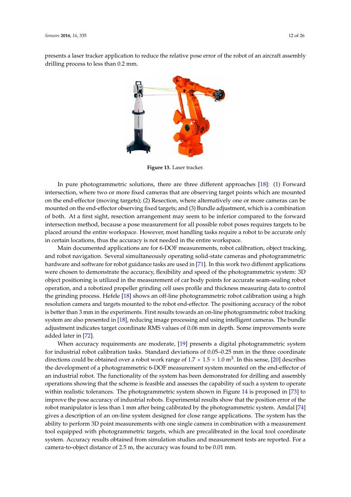
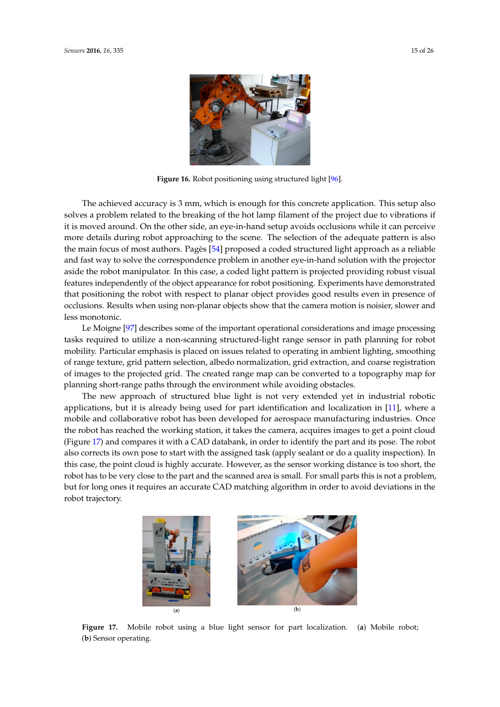
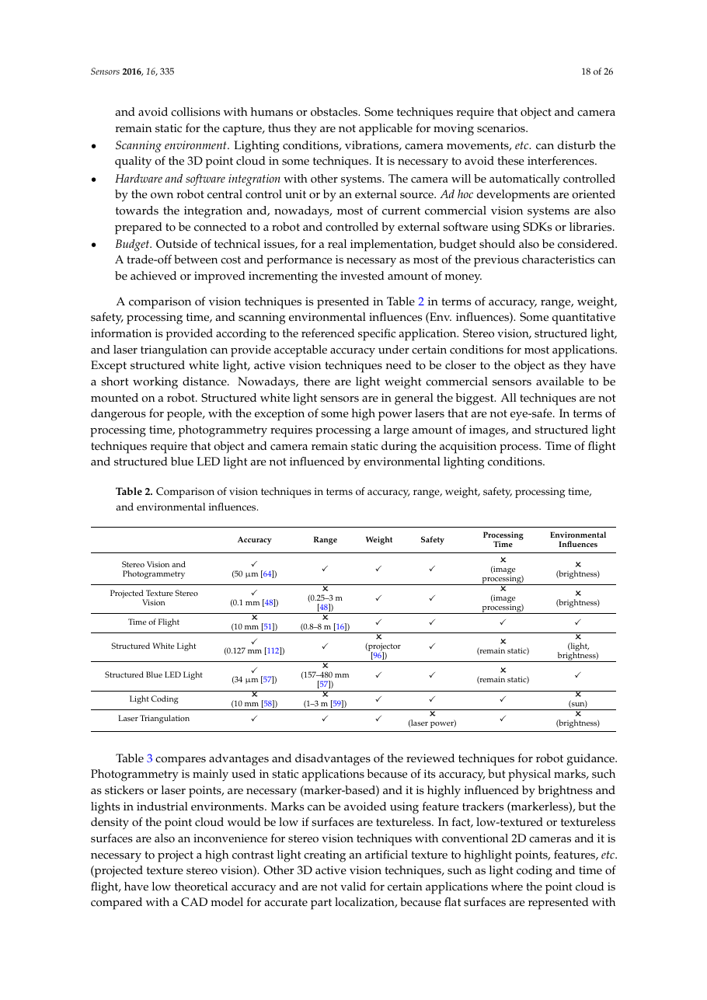

# 번역: 산업 환경에서 머신 비전 기법을 이용한 로봇 유도, 비교 리뷰

- 원제: Robot Guidance Using Machine Vision Techniques in Industrial Environments: A Comparative Review
- 원문: [Perez2016_Sensors_robot_guidance_machine_vision_review.pdf](Perez2016_Sensors_robot_guidance_machine_vision_review.pdf) (26쪽, CC BY 4.0, md5 12f6a41ecb6fbf8976130d7700c5a7e0)
- 번역 범위: 전문 (초록, 본문, 그림 캡션, 표 1~4, 감사의 글, 저자 기여, 이해 상충). 참고문헌은 원문 그대로 둔다.
- 번역 2026-11-04.
- 본문 추출 메모
  - `pdftotext -layout`으로 뽑았다. 그런데 이 PDF는 3~10, 13, 15, 16쪽에 같은 글이 두 겹으로 들어 있다(보이지 않는 글자 층이 하나 더 있음). 그래서 추출 결과의 줄이 서로 섞였다.
  - 섞인 쪽은 Europe PMC 공개 본문(JATS XML, PMC4813910)으로 문장을 맞췄다. 쪽 이미지와도 대조했다. 참고문헌은 PDF의 글자 층(`pdftotext -raw`)에서 그대로 옮겼다.
- 역자 주는 [역자 주]로 표시한다. 본문에 나오는 정확도 수치는 대부분 저자가 다른 문헌을 인용한 값이다. 이 리뷰의 저자가 직접 잰 값이 아니다.

---

저자: Luis Pérez (교신), Íñigo Rodríguez, Nuria Rodríguez, Rubén Usamentiaga, Daniel F. García
소속
- Fundación PRODINTEC (스페인 아스투리아스 히혼): Pérez, Í. Rodríguez, N. Rodríguez
- 오비에도 대학교 컴퓨터공학과 (스페인 히혼): Usamentiaga, García
- Í. Rodríguez와 N. Rodríguez는 기여도가 같다.

담당 편집자: Gonzalo Pajares Martinsanz
접수 2016년 1월 13일, 승인 2016년 2월 26일, 게재 2016년 3월 5일
Sensors 2016, 16, 335; doi:10.3390/s16030335

## 초록

미래의 공장에서는 대부분의 작업을 자율 로봇이 한다. 이런 로봇에는 시각 피드백이 필요하다. 쓰임새는 다음과 같다.
- 장애물을 피하며 작업 공간을 돌아다니기
- 사람과 협업하기
- 작업 부품을 알아보고 위치를 찾기
- 다른 센서가 주는 정보를 보완해 위치 정확도를 높이기

사진측량, 스테레오 비전, 구조광, 비행시간(ToF), 레이저 삼각측량 같은 여러 비전 기법이 산업 현장의 검사와 품질 관리에 널리 쓰인다. 이제는 로봇 유도에도 쓰인다.
어떤 비전 시스템을 쓸지는 위치를 찾거나 재야 하는 부품에 크게 달려 있다.
그래서 이 논문은 로봇 유도용 머신 비전 기법을 비교 리뷰한다.
센서의 정확도, 측정 거리, 무게, 안전, 처리 시간, 환경 영향을 분석한다.
연구자와 개발자가 앞으로의 작업에 배경 정보로 쓸 수 있다.

핵심어: 머신 비전, 3D 센서, 조작을 위한 인식, 로봇 유도, 로봇 자세, 부품 위치 결정

## 1. 서론

18세기 말 1차 산업혁명은 물과 증기로 움직이는 기계 생산 설비를 들여왔다. 그 뒤로 공장의 생산 체계는 크게 바뀌었다 [1].
20세기 초 2차 산업혁명은 전기 에너지를 바탕으로 분업에 기반한 대량 생산을 들여왔다 [2].
1970년대 초 3차 산업혁명은 전자와 정보 기술로 생산을 더 자동화했다 [3].
지금 우리는 흔히 "인더스트리 4.0"이라고 부르는 4차 산업혁명 안에 있다. 이는 사이버 물리 생산 시스템(CPS)에 기반하고, 자동화, 데이터 교환, 제조 기술을 아우른다.
사이버 물리 시스템은 물리 공정을 감시하고, 분산된 결정을 내리고, 동작을 일으킨다. 서로, 그리고 사람과 실시간으로 통신하고 협력한다.
이 덕분에 제조, 엔지니어링, 재료 사용, 공급망, 수명 주기 관리에 걸친 산업 공정이 근본적으로 좋아진다 [4].

각 혁명 안에서도 여러 이정표를 거치며 혁신 수준이 올라갔다. 예를 들어 인더스트리 4.0 안에서 로봇 기반 자동화는 자기만의 혁명을 겪었다.
- 첫째 로봇 혁명은 산업 자동화였다.
- 둘째는 안전한 자동화를 위한 감각 로봇의 도입이었다.
- 셋째는 이동형 매니퓰레이터에 의한 이동성이었다.
- 넷째이자 마지막은 지능형, 인지형 로봇 시스템이다 [5].

유럽연합 집행위원회는 Horizon 2020 작업 계획의 목표로 산업 기술의 주도권을 정했다(즉, 민관 협력 사업 "미래의 공장", PPP FoF [6]).
이를 위해서는 공정 자동화와 사고율 감소가 모두 중요하다.
전통 산업에서는 수작업 공정이 생산성과 안전을 제한했다. 자동화와 지능형 로봇은 현대 산업을 효율 쪽으로 이끈다. 그 결과 생산성이 빠르게 늘고, 재료와 에너지가 크게 절약되고, 작업 조건이 더 안전해진다.
제조업은 부를 만들고 고품질, 고숙련 일자리를 만들 큰 잠재력을 보여 준다 [7].
실제로 PPP FoF 안에서 여러 기술 기반이 정해졌다.
- 첨단 제조 공정과 기술
- 로봇을 포함한 첨단 제조 시스템용 메카트로닉스
- 정보통신기술(ICT)
- 제조 전략
- 지식 노동자
- 모델링, 시뮬레이션, 예측 방법과 도구

또한 유럽연합 집행위원회는 로봇이 유럽 경제에 중요하다고 보고 핵심 과제로 정했다. 유럽은 산업용 로봇 분야에서 공급과 사용 모두 25%가 넘는 몫을 가진 세계 선도 지역이다.
로봇 시장은 2016년까지 320억 달러에 이를 것으로 예상된다. 산업용 로봇 한 대를 운용, 유지, 정비하는 데 최소 4명이 필요하다는 예측도 있어 일자리 창출에 직접 영향을 준다 [8].
로봇은 기후 변화, 지속 가능한 교통, 저렴한 재생 에너지, 식품 안전과 보안, 고령화 같은 세계적 문제를 다루므로 사회와 생활 여건을 직접 좋게 한다.
이 분야 유럽 과제의 예로 TAPAS [9,10], VALERI [11,12], SYMBIO-TIC [13]가 있다.

비전 시스템은 산업에서 주로 검사와 품질 관리 공정에 널리 쓰인다 [14].
산업 현장에서 작업자 안전을 높이는 응용과 로봇 유도에서도 사용이 늘었다 [15].
로봇에는 머신 비전이 필요하다. 장애물을 피하며 작업 공간을 돌아다니고, 사람과 협업하고, 작업 부품을 알아보고 위치를 찾고, 위치 정확도를 높이는 등의 일을 하려면 그렇다.
목적에 따라 비전 시스템은 장면 관련(scene-related)일 수도 있고 물체 관련(object-related)일 수도 있다 [16].
- 장면 관련 작업에서는 보통 카메라를 이동 로봇에 달고 지도 작성, 위치 추정, 장애물 검출에 쓴다.
- 물체 관련 작업에서는 보통 카메라를 로봇 매니퓰레이터의 엔드 이펙터에 붙인다(아이 인 핸드, eye-in-hand 구성). 그래서 카메라 시점을 바꿔 가며 새 영상을 얻을 수 있다.

산업용 로봇은 0.1 mm의 작은 오차로 같은 위치에 반복해서 갈 수 있다. 그러나 절대 정확도는 몇 mm가 될 수 있다. 원인은 공차, 편심, 탄성, 유격, 마모, 하중, 온도, 그리고 자세를 로봇 축 각도로 바꾸는 모델 파라미터를 충분히 모르는 것이다 [17,18,19].
자동차 산업에서 스폿 용접 같은 작업의 정확도 요구는 1 mm 수준이다.
항공우주 산업은 로봇을 쓰기 어려운 환경이다. 정확도 요구가 적어도 10~20배 더 높기 때문이다 [20].
보통의 로봇은 이 정확도를 낼 수 없다.
정확도를 높이려고 광학 캘리브레이션 방법을 쓴다. 레이저 트래커 시스템, 사진측량, 여러 대의 고해상도 카메라를 쓴 비전 시스템이 그 예다. 이들로 공구 끝의 공간 위치를 검출하고 로봇 동작을 고친다.
측정 시스템과 로봇을 결합하는 것은 최적의 해법이다. 로봇의 정밀한 이동 능력은 살리고 정확도 부족은 극복하기 때문이다.
또한 작업 부품이 로봇이 예상한 위치와 조금 다르게 놓일 수 있다.
이동 로봇을 성공적으로 운행하려면 바로 주변 환경의 자세한 정보를 얻는 것이 가장 중요하다.
모은 데이터가 정확하고 충분히 자세하면 3D 외형 모델을 만들 수 있다. 그러면 개발자는 그에 맞는 정교한 운행 소프트웨어를 만들 수 있다.

[역자 주] "반복 0.1 mm, 절대 정확도 몇 mm"는 저자가 [17,18,19]를 인용한 일반론이다. 특정 로봇을 잰 값이 아니다.

이 지점에서 머신 비전 기법과 로봇은 산업 현장의 주역이 된다.
그래서 이 논문은 여러 머신 비전 기법과 로봇 유도 응용을 비교 리뷰한다. 최신 기술과 여러 접근법을 살피고 분석한다.
각 비전 기법이 알맞은지는 최종 응용에 달려 있다. 요구사항이 다음 항목에서 서로 다르기 때문이다.
- 정확도
- 센서의 측정 거리와 무게
- 작업자 안전
- 획득과 처리 시간
- 환경 조건
- 다른 시스템(주로 로봇)과의 통합
- 예산

주요 난제는 다음과 같다.
- 대응점 문제에서 질감 없는 표면
- 반사 밝기를 일으킬 수 있는 조명 조건
- 카메라 시점 때문에 생기는 가림
- 정해지지 않은 움직이는 물체 등

다른 비교 리뷰도 문헌에 있다. 그러나 상업 목적이거나, 비전 기법 하나에 집중하거나, 소프트웨어와 알고리즘에 초점을 둔다. 이들도 이 논문에서 분석한다.

이 논문의 구성은 다음과 같다. 2절은 비전 기반 3D 복원의 기초를 요약한다. 3절은 머신 비전을 쓴 로봇 유도 응용을 폭넓게 리뷰한다. 4절은 응용 요구사항에 따라 비교 분석하고 장단점을 논의한다. 마지막으로 5절에 주요 결론이 있다.

## 2. 3D 복원의 기초

3차원 인식은 로봇의 핵심 기술 가운데 하나다.
로봇 주변의 3D 시야는 일부만 알려진 환경에서 운행과 조작 작업을 완전히 자율적으로 해내는 데 결정적이다.
또한 로봇 원격 조작에는 사람이 읽을 수 있는 방식의 환경 시각화가 필요하다. 이는 직관적인 사용자 인터페이스에 중요하다.
그래서 로봇 유도용 비전 시스템은 보통 3D 정보를 얻어야 한다.

장면의 한 점이 주어지면, 영상에서 그에 대응하는 점을 수학 모델로 구할 수 있다 [21]. 이것이 정문제(direct problem)다.
이 과정은 세계 좌표계의 3D 점과 2D 영상 좌표 사이의 대응을 나타내는 파라미터 집합을 정한다. 그래서 카메라 캘리브레이션이라고도 부른다.
세계 좌표를 영상으로 보내는 원근 투영은 보통 핀홀 카메라 모델로 나타낸다 [22]. 그림 1이 이를 그림으로 보여 준다.
이 모델에서 3D 점 P의 상은 광학 중심을 지나 영상면과 만나는 광선으로 만들어진다. 그 결과가 영상면 위의 점 P'이고, 광학 중심 뒤로 거리 f(초점 거리)에 있다.

그림 1. 핀홀 카메라 모델 [23].

3D 점을 2D 영상면에 투영하는 것을 수학으로 나타내는 첫 단계는 세계 좌표계 W에서 카메라 좌표계 C로 바꾸는 것이다. 이 변환은 식 (1)과 같다.
이 식으로 점의 세계 좌표 $P_w = (x_w, y_w, z_w)^T$에서 강체 변환 $H_{w\to c}$를 써서 카메라 좌표 $P_c = (x_c, y_c, z_c)^T$를 계산한다.

$$\begin{pmatrix} P_c \\ 1 \end{pmatrix} = H_{w\to c} \begin{pmatrix} P_w \\ 1 \end{pmatrix} \quad (1)$$

동차 변환 행렬 $H_{w\to c}$는 평행 이동 3개($t_x, t_y, t_z$)와 회전 3개($\alpha, \beta, \gamma$)를 담는다.
이 여섯 파라미터를 카메라 외부 파라미터라고 한다. W에서 C로의 회전($R_{w\to c}$)과 평행 이동($t_{w\to c}$)을 나타낸다.
그래서 식 (1)은 식 (2)로도 쓸 수 있다.

$$\begin{pmatrix} x_c \\ y_c \\ z_c \\ 1 \end{pmatrix} = \begin{pmatrix} R_{w\to c} & t_{w\to c} \\ 0\ 0\ 0 & 1 \end{pmatrix} \begin{pmatrix} x_w \\ y_w \\ z_w \\ 1 \end{pmatrix} \quad (2)$$

핀홀 모델에서 카메라 좌표계 C의 점을 영상 좌표계로 투영하는 것은 식 (3)으로 계산한다.

$$\begin{pmatrix} u \\ v \end{pmatrix} = \frac{f}{z_c} \begin{pmatrix} x_c \\ y_c \end{pmatrix} \quad (3)$$

핀홀 모델은 실제 카메라 투영의 이상적인 근사일 뿐이다. 영상 장치는 어느 정도의 비선형 왜곡을 만든다 [24].
그래서 높은 정확도가 필요하면 렌즈 왜곡을 고려해야 한다 [25].
마지막 단계는 영상면 좌표계 (u, v)에서 화소 좌표계인 영상 좌표계 (r, c)로 바꾸는 것이다.
이 변환은 식 (4)로 한다. $S_x$와 $S_y$는 카메라 CCD 칩의 센서 소자 사이 가로, 세로 거리를 나타내는 배율이다. $(C_x, C_y)^T$는 광학 중심을 영상면에 수직으로 내린 점이다.
식 (4)는 캘리브레이션 행렬을 나타낸다.

$$\begin{pmatrix} r \\ c \end{pmatrix} = \begin{pmatrix} \dfrac{v}{S_y} + C_y \\[4pt] \dfrac{u}{S_x} + C_x \end{pmatrix} \quad (4)$$

장면의 점이 영상의 어디에 투영되는지는 그림 2a처럼 수학으로 계산할 수 있다.
그러나 영상의 점이 주어졌을 때 공간의 원래 점을 바로 얻을 수는 없다. 일대일 관계가 아니라 일대다 관계이기 때문이다. 그래서 역문제는 잘 정의되지 않는다 [26].
대수적으로 말하면, 3D 점을 영상으로 투영하는 것은 단사 사상이 아니다. 서로 다른 점이 같은 화소에 투영될 수 있다.
역문제를 풀어 실제로 얻는 것은 영상의 같은 화소에 나타나는 모든 점이 이루는 직선이다. 그림 2b의 투영선이 이것이다.

그림 2. 3D에서 2D로. (a) 정문제, (b) 역문제.

스테레오 비전이나 사진측량 같은 수동(passive) 기법은 주변 조명만 있으면 된다. 여러 영상에서 같은 점을 찾고 투영선의 교점을 계산해 이 문제를 푼다.
다른 기법들은 보이는 빛이나 적외선 패턴을 장면에 쏘고, 깊이 정보를 다음 중 하나로 추정한다.
- 되돌아오는 시간 (비행시간)
- 패턴의 변형 (라이트 코딩)
- 삼각법 계산 (레이저 삼각측량과 구조광)

이들은 능동(active) 비전이다.
조명 방식의 이 차이는 중요하다. 수동 비전에서는 물체에 뚜렷한 특징이 적을수록 시스템 정확도가 낮아진다. 능동 비전은 알려진 패턴으로 물체를 비추므로 그렇지 않다.
그러나 능동 비전도 측정 부정확을 낳을 수 있다. 특히 가장자리나 표면 마감이 고르지 않은 물체에서 그렇다 [27].
비접촉 측정 시스템의 주된 단점은 측정 과정 자체의 여러 외부 요인이나 물체의 광학 특성에 매우 민감하다는 점이다 [28].
수동 비전 기법은 3D 복원에 여러 대의 카메라가 필요하고, 능동 기법은 카메라 한 대만 쓴다.
그러나 뒤에서 보듯, 어떤 기법은 응용에 따라 수동일 수도 능동일 수도 있고 카메라를 한 대 또는 여러 대 쓸 수 있다. 또 어떤 기법은 실제로는 다른 기법의 발전형이나 개선형이다.
그래서 저자에 따라 문헌의 분류가 다르다. 표 1은 가능한 분류 하나를 보여 준다. 어떤 기법은 둘 이상의 묶음에 들어갈 수 있다는 점도 보여 준다.

표 1. 비전 기법 분류.

| | 카메라 한 대 | 카메라 여러 대 |
|---|---|---|
| 수동 비전 | 2D | 스테레오 비전 사진측량 |
| 능동 비전 | 비행시간 구조광 라이트 코딩 레이저 삼각측량 | 구조광 투사 질감 스테레오 비전 |

센서 기술은 많고, 각각 특정 환경이나 상황에서 고유한 장점이 있다. 아래 소절에서 여러 3D 비전 기법을 소개한다.

### 2.1. 스테레오 비전과 사진측량

사진측량은 글자 그대로 물체 사진에서 실제 치수를 재는 것이다.
일반 2D 영상에 기반한 3D 복원 기법이다. 건축 [29,30,31,32], 지형 측량 [33,34], 지질학 [35], 고고학 [36], 공학 [37,38], 제조 [39]에서 흔히 쓴다.

스테레오 비전과 사진측량 기법에서는 투영선의 교점을 계산해 3D 위치를 얻으려면 같은 점을 다른 영상에서도 찾아야 한다(그림 3).
그런데 검출을 확실히 하고 정확도를 높이려면 모든 점을 적어도 영상 세 장에서 찾을 수 있는 것이 좋다.
고른 점은 반드시 서로 대응하는 점(homologous point)이어야 한다. 다른 점이면 3D 위치가 틀린다.

그림 3. 2D에서 3D로. (a) 대응점, (b) 투영선의 교점.

스티커나 레이저 점 같은 물리 표식(그림 4)이 물체 위와 주변에 있어야 한다(많을수록 좋다). 검출을 확실히 하려면 대비가 높아야 한다.
그림 5에서는 표식을 붙인 같은 부품을 두 장 찍어 처리했다. 검출한 표식은 빨간색으로 표시했다.
카메라의 공간 위치와 캘리브레이션 파라미터를 알면, 에피폴라 기하로 표식을 짝지을 수 있다. 그런 다음 투영선과 교점을 계산해 3D 위치를 찾는다 [40].
표식을 붙인 점만 검출해 모델에 쓴다는 점에 주의한다(표식 기반 스테레오 비전).

그림 4. 표식 기반 스테레오 비전에 쓰는 물리 표식. (a) 스티커, (b) 레이저 점.

그림 5. 여러 영상에서의 표식 검출.

시간을 아끼고 공정을 자동화하려고 이런 물리 표식을 피하고 싶을 때가 있다.
특징 추적 알고리즘은 비슷하거나 연속된 영상 사이에서 물체 고유의 특징을 찾고, 뽑고, 짝짓는다. 그래서 물리 표식이 필요 없다. 그림 6에서 볼 수 있다(표식 없는 스테레오 비전).

그림 6. 특징 추적 알고리즘.

뽑는 특징은 문제나 응용 유형에 따라 다르다.
특징은 사실 영상에서 중요한 정보를 주는 관심 영역이다. 에지, 코너, 밝거나 어두운 고립점 등이다.
검출한 점은 비슷한 영상 사이의 대응점을 찾는 다음 단계에 쓸모가 있다.
특징 검출, 추출, 추적에 널리 쓰는 알고리즘으로 Canny [41], Harris [42], KLT [43], SIFT [44], SURF [45], MSER [46]이 있다.

표식 없는 스테레오 카메라 시스템은 실내외 로봇을 포함한 많은 실제 응용에 널리 쓰인다.
질감이 풍부한 장면에서는 정확한 깊이를 준다. 그러나 물체 표면에 질감이 적거나 없으면 자주 실패한다.
이때는 알려진 고정 고대비 빛을 쏘아 점, 특징, 보이지 않는 구조 등을 드러내고 인공 질감을 만들어야 한다.
그다음 반사된 빛을 스테레오 카메라로 찍고, 정합 알고리즘이 대응점을 연결해 3D 정보를 얻는다 [47].
Ensenso는 이 기법에 기반한 소형 센서 여러 계열을 개발했다 [48].

투사 질감은 보통 펄스 적외선이라 외부 광원의 영향을 받지 않는다.
모양은 십자, 원, 사각형, 점 행렬, 여러 줄, 무작위 점 행렬 등 여러 가지다.
최적의 질감, 즉 영상 사이 특징 대응을 가장 잘 주는 질감을 찾는 것은 복잡한 문제다. 투사기, 패턴, 스테레오 카메라의 특성에 영향을 받는다 [49,50].

### 2.2. 비행시간

능동 비전 기법은 그림 7처럼 보이는 빛이나 적외선 패턴을 물체에 쏘아 3D 정보를 얻는다.
비행시간(ToF) 카메라는 빛 펄스를 쓰는 거리 카메라다.
조명을 아주 짧은 시간 동안 켠다. 만들어진 빛 펄스가 장면을 비추고 물체에서 반사된다.
카메라 렌즈가 반사광을 센서면에 모은다.
거리에 따라 들어오는 빛은 지연을 겪는다. 지연은 식 (5)로 계산한다. $t_D$는 지연, $D$는 물체까지 거리, $c$는 빛의 속도다.
조명 펄스 폭이 카메라가 다룰 수 있는 최대 거리를 정한다. 그래서 조명부는 시스템의 핵심 부품이다. 이렇게 짧은 펄스는 특수한 LED나 레이저로만 만들 수 있다.

$$t_D = 2 \cdot \frac{D}{c} \quad (5)$$

그림 7. 물체에 패턴을 투사하기.

가장 흔한 센서 하나는 MESA Imaging이 개발했다 [51].
ToF 센서는 작고 가벼우며 실시간 거리 획득이 되므로 새로운 가능성과 응용을 연다. 그러나 원시 데이터의 품질은 잡음이 꽤 많고 여러 교란에 약하다.
구체적인 주요 난제는 다음과 같다 [52].
1. 다른 기법보다 낮은 해상도
2. 계통 거리 오차
3. 세기 관련 거리 오차 (입사광이 거리에 영향을 줌)
4. 주로 물체 경계에서의 깊이 불균일
5. 잘못된 거리 값을 낳는 움직임 잡상
6. 다중 반사
7. 능동 시스템의 그 밖의 일반적인 문제

### 2.3. 구조광

구조광 장비는 광원(빛 투사기)과 정보 수신기(카메라) 한두 대로 이루어진다.
구조광 기법은 크게 두 묶음이다 [53].
- 시간 다중화 기법: 이진 또는 회색조 패턴을 차례로 투사한다.
- 단일 촬영(one-shot) 기법: 패턴 하나만 투사한다.

시간 다중화 기법의 장점은 패턴 수에 제한이 없어 높은 해상도(즉 대응점 수)를 얻을 수 있다는 것이다.
그러나 주된 제약은 패턴을 투사하는 동안 물체, 투사기, 카메라가 모두 정지해 있어야 한다는 것이다.
단일 촬영 기법에서는 움직이는 카메라나 투사기도 쓸 수 있다. 부호화 방식을 패턴 하나에 담으려고, 부호화한 각 점이나 선을 주변 이웃으로 고유하게 식별한다 [54].

보통 투사광은 백색광이다. 만들기 쉽고 레이저와 달리 사람에게 위험하지 않다.
이 빛을 격자로 바꿔 얼룩말처럼 밝고 어두운 줄이나 띠를 만든다(그림 8). 이를 카메라로 찍는다.
깊이는 줄의 어긋남에서 구한다. 평면과 직선의 교점을 계산하는 삼각측량과 비슷한 기법을 쓴다 [55].

그림 8. 구조광의 대표 패턴.

구조광 투사에서 나온 비접촉 3D 디지타이징 스캐너는 점점 더 정확하고, 빠르고, 저렴해진다 [56].
최근에는 백색광 대신 청색광 기반의 새 스캐너가 나왔다.
그림 9처럼 구조 청색 LED 광 모듈과 스테레오 스캐너로 3D 점군을 만든다.
LED 모듈은 대비가 높은 패턴을 만들어 장면을 고해상도로 스캔하게 한다.
외부 광원의 영향을 받지 않고 사람에게 안전하다.
LMI Technologies의 HDI 109와 HDI 120 같은 센서는 각각 34 µm와 60 µm의 정확도를 낼 수 있다 [57].

[역자 주] [57]은 제조사 제품 웹페이지다. 독립 시험 값이 아니다.

그림 9. 청색 LED 센서 구성품.

### 2.4. 라이트 코딩

최근 라이트 코딩이라는 완전히 새로운 센서 기술이 나왔다. 다른 3D 거리 측정기 값의 아주 작은 일부 가격으로 살 수 있다.
라이트 코딩은 완전히 다른 접근을 쓴다. 광원이 계속 켜져 있어서 측정 시간을 정밀하게 맞출 필요가 크게 줄어든다.
구조광의 발전형으로 볼 수 있다.

레이저 광원이 눈에 보이지 않는 빛(대략 적외선 파장)을 낸다. 이 빛은 필터를 지나 그림 10처럼 반무작위이지만 고정된 작은 점 패턴으로 흩어진다.
반사된 패턴을 적외선 카메라로 검출하고 분석한다.
내보낸 빛 패턴, 렌즈 왜곡, 발광부와 수광부 사이 거리를 알면, 투사된 점의 모양과 크기 변형을 재서 각 점까지의 거리를 추정할 수 있다 [58].
이 기법은 PrimeSense가 개발했고, 가장 널리 퍼진 센서는 Microsoft Kinect다.

그림 10. 라이트 코딩의 투사 패턴.

라이트 코딩은 깊이 데이터를 매우 싼 값에 준다. 로봇만이 아니라 여러 분야에서 큰 혁신이다.
그러나 한계가 있다. 이 카메라는 조밀한 깊이 지도를 주지 않는다.
나오는 깊이 영상에는 센서가 문제를 겪는 영역에 해당하는 구멍이 있다. 원인은 물체의 재질(반사, 투명, 빛 흡수 등)이나 위치(범위 밖, 가림 등)다.
잡음과 낮은 해상도의 영향을 줄이려면 깊이 지도는 1~3 m 범위의 물체에만 유효하다 [59].
또한 적외선 투사기와 적외선 카메라에 기반하는데, 태양도 적외선을 내므로 햇빛이 나쁜 영향을 준다.

### 2.5. 레이저 삼각측량

레이저 삼각측량에서는 측정점, 카메라, 레이저 발광부가 삼각형을 이룬다(그림 11).
카메라와 레이저 발광부 사이 거리는 알고 있다. 레이저 발광부 쪽 꼭짓점의 각도도 알고 있다. 그래서 카메라 시야에서 레이저 점의 위치를 보면 카메라 쪽 꼭짓점의 각도를 정할 수 있다.
이 세 정보가 삼각형의 모양과 크기를 완전히 정한다. 그러면 레이저 점 쪽 꼭짓점의 위치, 즉 3D 점을 얻는다.
정확도는 CCD 센서 해상도, 렌즈 품질, 점 크기(스폿), 레이저 빔 품질, 부품 표면 상태, 그 밖의 광학 요인에 달려 있다 [60].

그림 11. 레이저 삼각측량.

레이저 비접촉 기법은 최근 몇 년 사이 크게 바뀌었다.
처음에는 센서가 고립된 점만 주었지만, 기술이 빠르게 2D 센서로 퍼졌다. 점선을 따라 재서 한 프레임에 여러 점을 모은다.
부품이 센서 아래로 움직이면(또는 반대로), 표면의 3D 모델을 만들 수 있다.
즉 앞에서 본 기법들은 한 번 찍어 3D 점군을 얻을 수 있지만, 이 기법은 부품이나 센서를 움직여야 한다. 다시 말해 부품을 스캔해야 한다.
단점으로, 레이저 출력에 따라 레이저 센서는 사람에게 위험할 수 있다. 눈에 안전하지 않다.

## 3. 산업 환경의 로봇 유도

머신 비전 기법을 쓴 로봇 유도는 어려운 문제다. 반복정밀도는 높지만 정확도는 낮은 기계 [18]에 눈을 달아 주는 일이기 때문이다. 게다가 다른 움직이는 물체나 작업자까지 있는 복잡한 산업 환경에서 해야 한다.
이 현대 기술은 완전히 새로운 가능성을 열지만, 안전 설계에서 새롭고 꽤 복잡한 과제도 만든다 [61].
질감 없는 표면, 조명 조건, 가림, 정해지지 않았거나 움직이는 물체 등은 비전 시스템이 다뤄야 할 핵심 문제다.
앞에서 보았듯, 로봇 자세 추정, 로봇 유도, 그 밖의 목적을 위한 3D 점군 획득은 여러 센서와 기법으로 할 수 있다.
어느 것이 각 응용에 가장 맞는지는 실제 필요와 요구사항에 달려 있다 [57].
많은 점의 공간 좌표를 거의 즉시 또는 몇 초 안에 얻을 수 있지만, 추가 처리가 필요하다.
점군은 전용 알고리즘으로 처리해 검출, 측정, 위치 결정할 부품의 기하 요소를 알아내야 한다.
그다음 점군의 필터링, 구조화, 대화형 분할을 해야 한다 [62].
최종 응용의 품질과 강건성은 두 과정, 즉 점군 획득과 그 뒤의 처리가 함께 정한다.

이 절에서는 여러 머신 비전 기법을 쓴 로봇 유도 접근을 리뷰한다.
뒤에서 보듯 응용은 두 방향이다.
- 장면 관련 작업: 사람 검출을 포함한 환경 복원
- 물체 관련 작업: 로봇 자세 추정, 조작이나 검사를 위한 물체 복원

그림 12는 글에서 자주 나올 로봇 용어를 보여 준다.

그림 12. 로봇 용어.

### 3.1. 스테레오 비전과 사진측량

산업용 사진측량은 여러 실무 과제를 다룬다. 지정된 정확도, 측정 속도, 자동화, 공정 통합, 가격 대비 성능, 센서 통합, 분석이 그것이다.
주요 해법은 물체 관련이다. 이산 점, 변형과 운동, 6자유도(DOF) 파라미터, 윤곽과 표면의 측정 분야다 [63].

오프라인 사진측량 시스템은 다음 분야에 있다.
- 자동차 제조: 차체 변형 측정, 협력사 부품 관리, 공구와 지그 조정 등
- 항공우주: 조립 지그의 측정과 조정, 부품 사이 정렬 등
- 풍력 발전: 변형 측정과 생산 관리
- 엔지니어링과 건설: 댐, 탱크, 플랜트 설비 측정 등

이들은 매우 정밀하고 정확한 측정을 준다(길이 측정의 절대 정확도는 2 m 물체에서 보통 약 0.05 mm [64]).
한편 온라인 시스템은 연결된 공정을 제어하도록 3D 정보를 준다. 예는 다음과 같다.
- 접촉 탐침: 손에 든 탐침 장치를 3D 공간에서 추적해 탐침 끝의 좌표를 준다.
- 로봇 캘리브레이션: 로봇 공구 중심점(TCP)을 관측해 공간 궤적을 정한다.
- 센서 내비게이션: 레이저 프로파일 센서 같은 측정 장치를 6자유도로 추적해 찍은 프로파일을 복원한다.

온라인 시스템의 정확도는 2 m 범위에서 0.2~0.5 mm 수준이다 [65]. 보통 오프라인 시스템보다 낮다.
지금 산업용 사진측량 시스템은 대부분 공간의 정지한 3D 점을 오프라인으로 재는 데 쓰인다.
오프라인에서 온라인으로 가는 것은 주로 영상 처리를 빠르게 하는 문제다. 영상 획득, 전송, 표적 식별과 측정이 처리 시간의 대부분을 차지한다.

[역자 주] [65]의 제목은 수술 내비게이션 정밀도에 관한 글이다(참고문헌 목록 참조). 산업용 온라인 사진측량 정확도의 직접 근거인지는 원문을 보지 않아 확인하지 못했다.

임의의 로봇 동작 중에 로봇 엔드 이펙터의 위치와 방향을 높은 정확도로 정하는 접근이 문헌에 여럿 있다. 사진측량을 다른 기술과 결합한 것과 순수 사진측량인 것이 있다.
레이저 추적 시스템은 레이저 간섭계와 사진측량을 결합한다 [66,67].
그림 13처럼 로봇의 엔드 이펙터(탐침)에는 카메라 촬영용 LED 기준 표적 여러 개와 레이저 추적용 역반사체가 달려 있다. 모두 국소 좌표가 캘리브레이션되어 있다.
탐침의 6자유도 자세는 레이저 트래커에 내장된 카메라로 공간 후방 교회(space resection)를 해서 잰다.
거리 정보는 간섭계 레이저 거리 측정이 주고, 각도 정보는 카메라가 탐침을 재서 준다 [68].
레이저 트래커는 로봇의 기하 파라미터와 동역학 파라미터를 식별하는 데도 쓴다. 모델 정확도를 높여 로봇 정확도를 높인다 [69].
Qu [70]는 항공기 조립 드릴링 공정에서 로봇의 상대 자세 오차를 0.2 mm 아래로 줄이는 레이저 트래커 응용을 제시한다.

그림 13. 레이저 트래커. (원문 12쪽. 그림 아래에 순수 사진측량 세 방식을 설명하는 다음 문단이 함께 보인다.)

순수 사진측량 해법에는 세 가지 접근이 있다 [18].
1. 전방 교회(forward intersection): 고정된 카메라 두 대 이상이 엔드 이펙터에 붙은 표적점(움직이는 표적)을 본다.
2. 후방 교회(resection): 반대로 카메라 한 대 이상을 엔드 이펙터에 달고 고정된 표적을 본다.
3. 번들 조정(bundle adjustment): 두 방식을 결합한다.

얼핏 보면 후방 교회 배치는 전방 교회보다 못해 보인다. 가능한 모든 로봇 자세에서 자세를 재려면 작업 공간 전체에 표적을 둬야 하기 때문이다.
그러나 대부분의 핸들링 작업에서 로봇은 특정 위치에서만 정확하면 된다. 그래서 작업 공간 전체에서 정확도가 필요하지는 않다.

문헌에 기록된 주된 응용은 6자유도 측정, 로봇 캘리브레이션, 물체 추적, 로봇 운행이다.
[71]은 로봇 유도 작업에 동시에 작동하는 고체 카메라 여러 대와 사진측량 하드웨어, 소프트웨어를 쓴다.
이 연구는 사진측량 시스템의 정확도, 유연성, 속도를 보이려고 두 응용을 골랐다.
- 3D 물체 위치 결정: 정확한 실링 로봇 작업을 위해 차체 점을 잰다.
- 로봇화한 프로펠러 연삭 셀: 프로파일과 두께 측정 데이터로 연삭 공정을 제어한다.

Hefele [18]는 고해상도 카메라와 로봇 엔드 이펙터에 단 표적으로 오프라인 사진측량 로봇 캘리브레이션을 보인다. 실험에서 로봇의 위치 정확도는 3 mm보다 좋다.
[18]은 온라인 사진측량 로봇 추적 시스템을 향한 첫 결과도 제시한다. 영상 처리를 줄이고 지능형 카메라를 쓴다.
번들 조정 결과 표적 좌표의 깊이 방향 RMS는 0.06 mm다.
이후 [72]에서 몇 가지 개선이 더해졌다.

정확도 요구가 중간 정도일 때, [19]는 산업용 로봇 캘리브레이션을 위한 디지털 사진측량 시스템을 제시한다.
1.7 × 1.5 × 1.0 m³의 로봇 작업 범위에서 세 좌표 방향으로 표준편차 0.05~0.25 mm를 얻었다.
같은 맥락에서 [20]은 산업용 로봇의 엔드 이펙터에 단 6자유도 사진측량 측정 시스템의 개발을 설명한다.
드릴링과 조립 작업에서 기능을 시연했다. 이 방식이 실현 가능하며, 이런 시스템이 현실적인 공차 안에서 작동할 수 있음을 평가한다.
그림 14의 사진측량 시스템은 산업용 로봇의 자세 정확도를 높이려고 [73]이 제안했다.
실험 결과, 사진측량 시스템으로 캘리브레이션한 뒤 로봇 매니퓰레이터의 위치 오차는 1 mm 미만이다.
Amdal [74]은 근거리 응용용 온라인 시스템을 설명한다.
이 시스템은 카메라 한 대와, 사진측량 표적이 달린 측정 도구를 함께 써서 3D 점을 잴 수 있다. 표적은 도구 국소 좌표계에서 미리 캘리브레이션되어 있다.
시뮬레이션 연구와 측정 시험의 정확도 결과를 보고한다. 카메라와 물체 사이 거리 2.5 m에서 정확도는 0.01 mm였다.

그림 14. 다중 센서 결합 측정 시스템 [73].

따라서 사진측량은 로봇 자세를 정확히 정할 수 있다 [75]. 다만 이런 측정에는 특수하고 비싼 장비가 필요하고 많은 영상 데이터를 처리해야 한다.
이런 이유로 지금 사진측량은 주로 캘리브레이션에 한정된다. 자세를 계속 추적하는 대신, 공장에서 로봇을 설치할 때 한 번만 한다.
최근과 앞으로의 개발은 더 동적인 응용, 생산 라인으로의 시스템 통합, 다중 센서 해법, 낮은 비용에 집중된다.

투사 질감 스테레오 비전 기법은 주로 빈 피킹 응용에 쓰인다 [76,77].
용기나 보관함에서 무작위로 섞인 물체를 집는 작업에는 여러 난제가 있다.
물체 하나 또는 여럿을 모양, 크기, 위치, 정렬 면에서 빠르고 확실하게 식별해야 한다(그림 15).
이 정보를 얻어 로봇 제어기에 넘겨야 한다. 충돌 없는 로봇 경로를 그때그때 만드는 데 필수다.
이것이 핸들링 공정에 로봇을 쓰는 출발점이다.

그림 15. 빈 피킹 [77].

Sturm [78]은 투사 질감 스테레오 비전 시스템으로 문과 서랍의 3D 관절 모델을 검출, 추적, 학습하는 접근을 제시한다.
로봇은 관절 물체에 대해 학습한 생성 모델로 기구 유형과 현재 상태를 추정하고, 여는 궤적을 예측할 수 있다.

### 3.2. 비행시간

ToF 센서는 로봇 응용 개발에 여러 장점이 있다. 꽤 작고 가벼우며 높은 프레임률로 실시간 3D 획득이 된다.
장면 관련 작업(보통 이동 로봇과 큰 이동)에도, 물체 관련 작업(로봇 팔이나 사람형 로봇과 작은 깊이)에도 쓰인다.
그러나 원시 데이터 품질에 잡음이 꽤 많다는 과제가 있다.
이 한계를 넘으려고 어떤 저자는 캘리브레이션으로 깊이 영상을 바로잡아 더 나은 결과를 얻는다.
다른 저자는 ToF 카메라 정보를 다른 장치로 보완한다.
- 컬러 카메라: 실제 특징을 가진 3D 점군 생성
- 회색조 카메라: 중복 스테레오
- 레이저 스캐너

장면 관련 작업 분야에서 [79]는 기본 장애물 회피와 국소 경로 계획에서 ToF 카메라의 능력을 평가하고 표준 레이저 스캐너와 비교한다.
May [80]는 환경 변화에 맞춰 여러 카메라 파라미터를 온라인으로 조정하는 새 접근을 제시한다. 이 조정 덕분에 실제(변하는) 환경과 여러 로봇 작업에서 믿을 만하게 쓸 수 있다.
[81,82]는 조건이 나쁜 평면 검출에서 3D 지도를 개선하려고 표면 법선을 쓰자고 제안한다.
[83,84] 같은 다른 연구는 반복 최근접점(ICP) 알고리즘으로 두 점군 사이 관계를 찾아 ToF의 잡음 많은 점군에 대응한다.
Arbeiter [85]는 ToF 카메라와 컬러 카메라 두 대를 결합해 이동 로봇의 환경을 복원했다. 이는 수정한 fast-SLAM 알고리즘의 입력이 된다. 이 알고리즘은 환경 지도를 그릴 수 있다.
Kuhnert와 Netramai [86,87]는 환경 복원을 위해 ToF 센서와 스테레오 시스템을 결합했다.

물체 관련 작업에서도 ToF 카메라는 물체와 표면 복원에 성공적으로 쓰였다. 이때는 거리 범위가 더 작다.
카메라 시야에 따라 여러 3D 점군을 얻어 합쳐야 한다.
실제로 가장 흔한 구성은 로봇 팔의 엔드 이펙터에 ToF 카메라를 달아 찍는 것이다.
점군 정합은 장면 모델링보다 물체 모델링에서 더 중요하다.
핸드 아이 시스템을 정밀하게 캘리브레이션해도, 로봇이 주는 이동량만으로는 보통 부족하다. 서로 다른 점군 사이 변환을 계산해야 한다.
물체 모델링과 물체 복원의 예는 [88,89,90,91]에 있다.
물체 조작에서는 모르는, 정리되지 않은 물체를 잡으려고 식별하거나 분류해야 한다. 보통 물체를 완전히 복원할 필요는 없다. 예는 [92,93,94]에 있다.

[역자 주] "핸드 아이 캘리브레이션이 정밀해도 로봇이 주는 이동량만으로는 부족하다"는 문장은, 로봇 명령 이동량을 그대로 믿지 않고 영상끼리 다시 맞춘다는 뜻이다.

끝으로 사람과 기계의 상호작용에서 ToF는 특별한 배경이 필요 없고 비침습적이다. 널리 쓰이는 특수 장갑, 인공 표식, 부착 장치 등과 다르다.
그래서 [95]가 지적하듯, 사람 행동 인식에 다른 비전 기법보다 흔히 쓰인다.
[95]는 ToF 카메라 분야의 최신 기술, 장점, 한계, 그리고 장면 관련 작업, 물체 관련 작업, 사람이 관련된 작업에서의 주요 응용을 리뷰한다.

### 3.3. 구조광

스테레오 비전으로 로봇을 위치 결정하려면 여러 시점에서 보이는 특징이 있어야 한다.
구조광은 장면과 무관한 인공 시각 특징을 주어 대응점 문제를 크게 쉽게 만든다.
로봇 유도에서 주된 불편은 센서 크기다. 투사기가 들어 있어 로봇 엔드 이펙터에 달기 어렵다.
그림 16은 카메라 한 대만 엔드 이펙터에 달고(아이 인 핸드), 고정 투사기가 작업 부품을 비추는 해법을 보여 준다 [96].

얻은 정확도는 3 mm이며, 이 구체적인 응용에는 충분하다.
이 구성은 투사기를 이리저리 움직일 때 진동으로 뜨거운 램프 필라멘트가 끊어지는 문제도 해결한다.
한편 아이 인 핸드 구성은 가림을 피하고, 로봇이 장면에 다가가는 동안 더 많은 세부를 볼 수 있다.
알맞은 패턴의 선택도 대부분 저자의 주된 관심사다.
Pagès [54]는 투사기를 로봇 매니퓰레이터 옆에 둔 또 다른 아이 인 핸드 해법에서, 대응점 문제를 믿을 만하고 빠르게 푸는 부호화 구조광 접근을 제안했다.
이 경우 부호화한 빛 패턴을 투사해, 물체 겉모습과 무관하게 로봇 위치 결정용 강건한 시각 특징을 준다.
실험에서 평면 물체에 대해 로봇을 위치 결정하면 가림이 있어도 좋은 결과를 냈다.
평면이 아닌 물체에서는 카메라 운동이 더 잡음이 많고, 느리고, 덜 단조로웠다.

그림 16. 구조광을 이용한 로봇 위치 결정 [96].
그림 17. 부품 위치 결정에 청색광 센서를 쓰는 이동 로봇. (a) 이동 로봇, (b) 작동 중인 센서.
(원문 15쪽. 두 그림이 같은 쪽에 있다.)

Le Moigne [97]는 로봇 이동의 경로 계획에 비주사형 구조광 거리 센서를 쓰는 데 필요한 주요 운용 고려 사항과 영상 처리 작업을 설명한다.
특히 다음 문제를 강조한다.
- 주변 조명 아래에서의 작동
- 거리 질감 평활화
- 격자 패턴 선택
- 반사율(albedo) 정규화
- 격자 추출
- 투사 격자에 대한 영상의 대략 정합

만든 거리 지도는 지형 지도로 바꿔, 장애물을 피하며 환경을 지나는 짧은 경로를 계획하는 데 쓸 수 있다.

구조 청색광이라는 새 접근은 아직 산업용 로봇 응용에 널리 퍼지지 않았다. 그러나 [11]에서 이미 부품 식별과 위치 결정에 쓰인다. [11]은 항공우주 제조 산업용 이동 협동 로봇을 개발했다.
로봇이 작업 위치에 도착하면 카메라를 들고 영상을 찍어 점군을 얻는다(그림 17). 이를 CAD 데이터 묶음과 비교해 부품과 그 자세를 식별한다.
로봇은 맡은 작업(실런트 도포 또는 품질 검사)을 시작하려고 자기 자세도 고친다.
이 경우 점군은 매우 정확하다.
그러나 센서 작동 거리가 너무 짧아서 로봇이 부품에 아주 가까이 가야 하고, 스캔 면적이 작다.
작은 부품이면 문제가 없다. 그러나 긴 부품이면 로봇 궤적의 어긋남을 피하려고 정확한 CAD 정합 알고리즘이 필요하다.

### 3.4. 라이트 코딩

이 기법은 요즘 비디오 게임에서 사람 추적에 흔히 쓰인다.
그 밖에 로봇을 포함한 산업 응용에도 점점 더 들어오고 있다. 다만 로봇 자세 추정의 정확도와, 사람 로봇 협업의 작업 공간 감시를 위한 안전 요구를 맞추려면 추가 노력이 필요하다.
영상과 깊이 데이터를 매우 싼 값에 준다. 로봇에 큰 혁신이지만 한계가 있다.
알고리즘은 물체 인식에 깊이 정보를 쓴다. 그러나 센서가 잡음 많은 점군을 내므로 이 정보를 개선해야 한다.
한 가지 방법은 라이트 코딩 센서와 HD 카메라를 결합해 고해상도 조밀 점군을 얻는 것이다. 이는 로봇 유도나 자세 보정에 쓸 수 있다.
[98]의 실험 결과는 이 방법이 실내외 장면 모두에서 점군 해상도를 크게 높일 수 있음을 보인다. 점군은 라이트 코딩 센서만 쓴 처음 점군보다 적어도 10배 조밀하다.

이동 로봇의 사람 검출 강건성을 크게 높이려고, [99]는 라이트 코딩 카메라를 열 센서와 결합해 이동 플랫폼 위에 달았다. 사람은 생명이 없는 물체와 구별되는 열 분포를 갖기 때문이다.
이 접근은 지도 학습으로 만든 분류기들도 결합한다.
실험 결과, 라이트 코딩 센서만 썼을 때 생기던 오탐률이 크게 줄었다.
단점으로, 산업 기계나 난방기 같은 열원 근처에서 유령 검출이 생길 수 있다.
[61]에서는 라이트 코딩 센서를 안전 인증된 3D 구역 감시 카메라와 결합한다.
Wang [100]은 감시와 충돌 검출을 위해 로봇의 가상 3D 모델을 센서 정보(작업자 영상)와 결합했다(그림 18).
3D 모델은 구조화된 작업장 환경을 나타내며 실제 동작 센서와 연결되어 실제 환경의 거동을 흉내 내도록 움직인다.
라이트 코딩 센서는 3D 모델에 없는 비구조적 외부 물체(움직이는 작업자 포함)를 더한다.

그림 18. 로봇의 3D 모델과 센서 정보 결합 [100].

라이트 코딩 센서의 흔한 문제 하나는 조밀한 깊이 지도를 주지 않는다는 것이다.
나오는 깊이 영상에는 센서가 문제를 겪는 영역에 해당하는 구멍이 있다. 원인은 물체의 재질(반사, 투명, 빛 흡수)이나 위치(범위 밖, 가림)다.

### 3.5. 레이저 삼각측량

이 기법은 부품을 집는 빈 피킹 응용에 쓰였다. 이때 부품과 그 자세를 알아봐야 한다.
3D 복원을 위해 부품을 스캔해야 하므로, [101]에서는 부품을 컨베이어 벨트 위에 두고 카메라와 레이저를 고정한다. [102]처럼 복원과 측정을 위해 카메라와 레이저를 로봇 공구에 통합하기도 한다.
실내 환경 이동 로봇용 레이저 스캔에서 여러 선 추출 알고리즘의 실험 평가가 [103,104]에 있다. 복잡도, 정확성, 정밀도 면에서 비교한다.

[105]는 유연한 센서 제어 로봇 용접 시스템의 구현을 제시한다.
기존의 비적응형 로봇 용접 시스템은 작업물이 매우 반복적이고 고정이 잘 되어 있을 때만 쓸 수 있다.
조향 가능한 원뿔형 레이저 광과 머신 비전으로 용접 이음매 위치를 감지하고, 용접 토치 앞쪽 용접 이음매의 자세한 3D 표면 형상을 정한다.
잡음 많은 영상에서 레이저 줄무늬 특징을 검출하고 인식하는 강건한 비전 처리 방식을 개발해 파이프라인 처리 구조로 구현했다.
영상으로 정한 어긋남을 로봇 경로 계획에 넣고 용접 공정 파라미터를 제어하는 방법을 제안하고 구현했다.
용접선 추적의 또 다른 예는 [106]에 있다. 용접 틈 형상이 크게 바뀌어도 만족스러운 추적 결과를 보장하는 저가 시스템을 제시한다.

[107]에서는 카메라와 레이저 줄무늬를 결합해 센서를 만든다.
위치 결정 로봇 작업을 좋은 결과, 강건성, 안정성으로 해낼 수 있다.
그러나 장면에 레이저 줄무늬를 투사하는 데 몇 가지 제약이 있다.
가장 안정적인 조건에서 로봇 작업을 하려면 캘리브레이션 때 레이저 줄무늬의 가장 유리한 위치를 골라야 한다.
Pears [108]는 근거리 이동 로봇 기동용 넓은 시야 거리 센서를 설명했다. 정확도는 1 m에서 0.15%, 2 m에서 1.3%, 2.5 m에서 3%이다. 평균 투사 출력은 0.9 mW로 눈에 안전하다.
일반적으로 로봇 응용에서는 작업자가 있을 수 있으므로 안전 문제를 고려해야 한다.
레이저 출력에 따라 센서가 안전상 사람에게 부적절할 수 있다.

[역자 주] 원문에는 "0.15% at l m"으로 되어 있다. 문맥상 1 m의 오자로 보고 옮겼다.

레이저 스캐너를 쓴 로봇 운행의 다른 연구는 [109,110,111]에 있다.
- [109]는 미리 알지 못하는 실내 환경에서 이동 로봇의 자기 위치 추정과 지도 작성 문제를 다룬다.
- [110]은 레이저 스캐너로 이동 로봇의 자세를 추적하는 방법을 제시한다.
- [111]은 새 지도 작성 방식을 제안한다. 레이저 거리 측정기를 단 이동 로봇이 선분을 지도의 기본 요소로 써서 위치를 추정하는 기법을 설명한다.

결과에 따르면 선분은 장면에 대한 상당한 기하 정보를 주며, 정확하고 빠른 위치 추정에 쓸 수 있다.

## 4. 논의

응용의 최종 목표와 로봇 유형에 따라, 가장 알맞은 비전 기법을 고르려면 여러 고려 사항과 요인을 따져야 한다.

- 점군 정렬의 정확도와 해상도. 주로 하드웨어(센서)와 소프트웨어(추출, 정합, 분할, 비교 등)가 정한다. 물체 크기와 응용 목적에 맞아야 한다.
- 센서의 측정 거리. 작동 거리는 로봇의 접근성, 센서 크기, 환경 구성이 정한다.
- 가벼운 무게. 센서를 로봇에 싣거나 엔드 이펙터에 달면, 로봇의 동역학을 온전히 유지하기 위한 최대 하중에 제한이 있다.
- 안전 문제. 로봇이 작업자 가까이에서 일할 수 있다. 그래서 사고 위험을 줄이려면 센서가 위험한 고출력 레이저를 피해야 한다.
- 처리 시간. 처리 시간은 시스템이 특정 응용에 알맞은지 정하는 데 결정적일 수 있다. 특히 안전 제약이 있는 움직이는 로봇, 즉 사람이나 장애물과의 충돌을 감지하고 피해야 하는 경우가 그렇다. 어떤 기법은 촬영 동안 물체와 카메라가 정지해 있어야 한다. 그래서 움직이는 상황에는 쓸 수 없다.
- 스캔 환경. 조명 조건, 진동, 카메라 움직임 등은 어떤 기법에서 3D 점군 품질을 흐트러뜨릴 수 있다. 이런 간섭을 피해야 한다.
- 다른 시스템과의 하드웨어, 소프트웨어 통합. 카메라는 로봇 자체의 중앙 제어 장치나 외부 장치가 자동으로 제어한다. 맞춤 개발은 통합을 지향한다. 요즘 상용 비전 시스템 대부분도 로봇에 연결되고 SDK나 라이브러리를 통해 외부 소프트웨어로 제어되도록 준비되어 있다.
- 예산. 기술 문제 밖에서, 실제 구현에는 예산도 고려해야 한다. 앞의 특성 대부분은 투자 금액을 늘려 얻거나 개선할 수 있으므로 비용과 성능 사이의 절충이 필요하다.

(원문 18쪽. 위 목록의 끝부분, 다음 문단, 표 2가 함께 보인다.)

표 2는 정확도, 측정 거리, 무게, 안전, 처리 시간, 스캔 환경 영향(Env. influences) 면에서 비전 기법을 비교한다.
참조한 특정 응용에 따라 몇 가지 정량 정보를 함께 준다.
스테레오 비전, 구조광, 레이저 삼각측량은 일정 조건에서 대부분의 응용에 받아들일 만한 정확도를 줄 수 있다.
구조 백색광을 빼면 능동 비전 기법은 작동 거리가 짧아 물체에 더 가까이 가야 한다.
요즘은 로봇에 달 수 있는 가벼운 상용 센서가 있다. 구조 백색광 센서가 대체로 가장 크다.
눈에 안전하지 않은 일부 고출력 레이저를 빼면 모든 기법이 사람에게 위험하지 않다.
처리 시간 면에서 사진측량은 많은 영상을 처리해야 하고, 구조광 기법은 획득 동안 물체와 카메라가 정지해 있어야 한다.
비행시간과 구조 청색 LED 광은 환경 조명 조건의 영향을 받지 않는다.

표 2. 정확도, 측정 거리, 무게, 안전, 처리 시간, 환경 영향 면의 비전 기법 비교. (✓ 유리, ✗ 불리. 괄호는 근거 문헌과 값)

| | 정확도 | 측정 거리 | 무게 | 안전 | 처리 시간 | 환경 영향 |
|---|---|---|---|---|---|---|
| 스테레오 비전과 사진측량 | ✓ (50 µm [64]) | ✓ | ✓ | ✓ | ✗ (영상 처리) | ✗ (반사 밝기) |
| 투사 질감 스테레오 비전 | ✓ (0.1 mm [48]) | ✗ (0.25~3 m [48]) | ✓ | ✓ | ✗ (영상 처리) | ✗ (반사 밝기) |
| 비행시간 | ✗ (10 mm [51]) | ✗ (0.8~8 m [16]) | ✓ | ✓ | ✓ | ✓ |
| 구조 백색광 | ✓ (0.127 mm [112]) | ✓ | ✗ (투사기 [96]) | ✓ | ✗ (정지 필요) | ✗ (빛, 반사 밝기) |
| 구조 청색 LED 광 | ✓ (34 µm [57]) | ✗ (157~480 mm [57]) | ✓ | ✓ | ✗ (정지 필요) | ✓ |
| 라이트 코딩 | ✗ (10 mm [58]) | ✗ (1~3 m [59]) | ✓ | ✓ | ✓ | ✗ (햇빛) |
| 레이저 삼각측량 | ✓ | ✓ | ✓ | ✗ (레이저 출력) | ✓ | ✗ (반사 밝기) |

[역자 주] "brightness"는 강한 빛이나 반사로 영상이 밝게 뜨는 문제를 뜻하는 것으로 보고 "반사 밝기"로 옮겼다.

표 3은 로봇 유도용으로 리뷰한 기법의 장단점을 비교한다.
사진측량은 정확도 때문에 주로 정지 응용에 쓰인다. 그러나 스티커나 레이저 점 같은 물리 표식이 필요하고(표식 기반), 산업 환경의 밝기와 조명에 크게 영향을 받는다.
특징 추적기를 쓰면 표식을 피할 수 있다(표식 없음). 그러나 표면에 질감이 없으면 점군 밀도가 낮아진다.
사실 질감이 적거나 없는 표면은 일반 2D 카메라를 쓴 스테레오 비전 기법에도 불편하다. 그래서 대비 높은 빛을 쏘아 인공 질감을 만들어 점, 특징 등을 드러내야 한다(투사 질감 스테레오 비전).
라이트 코딩과 비행시간 같은 다른 3D 능동 비전 기법은 이론 정확도가 낮다. 점군을 CAD 모델과 비교해 부품 위치를 정확히 정해야 하는 응용에는 맞지 않는다. 평평한 면이 꽤 큰 곡률을 가진 것처럼 나타나기 때문이다.
이 정확도 문제를 감안하면 부품 식별이나 사람과 물체 추적에는 쓸 수 있다.
레이저 기법은 한 번 찍기가 아니라 스캔하는 응용에 흔히 쓰인다. 그러나 일부 레이저 등급(고출력)은 눈에 안전하지 않아 사람에게 위험할 수 있다.
끝으로 구조광은 정확도를 준다. 그러나 때때로 주변광의 영향을 받고, 특정 색 표면에서 3D 모델을 만들기 어렵다.
주된 단점은 대부분의 상용 센서가 로봇이 들고 다니기에 꽤 크다는 것이다.
실제로 연구 개발은 센서를 작게 만들거나, 투사기와 센서를 분리해 하나만 로봇에 싣는 데 집중된다.
이런 의미에서 구조 청색 LED 광이라는 이 기법의 새 발전형은 작은 센서로 정확도를 준다.

표 3. 장점과 단점.

| | 장점 | 단점 |
|---|---|---|
| 스테레오 비전과 사진측량 | 흔히 쓰인다. 정확도. | 환경의 영향을 받는다. 물리 표식이 필요하다. 점군 밀도가 낮을 수 있다. 촬영 동안 물체와 카메라가 정지해야 한다. |
| 투사 질감 스테레오 비전 | 물리 표식이 필요 없다. | 환경의 영향을 받는다. 촬영 동안 물체와 카메라가 정지해야 한다. |
| 비행시간 | 주변광과 무관하다. 촬영 동안 물체와 카메라가 정지할 필요가 없다. | 이론 정확도가 낮다. |
| 구조 백색광 | 정확도. | 때때로 주변광의 영향을 받는다. 특정 색 표면의 3D 모델을 만들기 어렵다. 비싸다. 센서가 꽤 클 수 있다. 촬영 동안 물체와 카메라가 정지해야 한다. |
| 구조 청색 LED 광 | 정확도. 작은 센서. | 작동 거리가 짧다. 촬영 동안 물체와 카메라가 정지해야 한다. 비싸다. |
| 라이트 코딩 | 싸다. 촬영 동안 물체와 카메라가 정지할 필요가 없다. | 정확도가 낮다. 산업 수준 인증이 없다. |
| 레이저 삼각측량 | 흔히 쓰인다. 싸다(레이저에 따라, 정확도에 따라). | 레이저 출력에 따라 사람에게 위험하다. 보통 작동 거리가 짧다. 선 스캐너다. |

산업 응용은 수천 가지가 있다. 그러나 대부분 기업 기밀이라 과학 논문에 기록되거나 널리 설명되지 않는다. 그래서 이 조사에 넣을 수 없었다.
표 4는 이 논문에서 리뷰한 로봇용 비전 기법의 참고문헌을 장면 관련 작업과 물체 관련 작업으로 묶어 요약한다.
조사에 따르면 로봇에서 스테레오 비전의 주된 응용은 로봇 자세 추정과 로봇 캘리브레이션 같은 물체 관련 작업이다. 표식이 필요할 수 있고, 카메라와 물체가 정지해야 하고, 많은 정보를 처리해야 하기 때문이다.
물체와 카메라가 정지할 필요가 없는 비행시간은 주로 환경과 물체 복원, 운행, 장애물 회피, 그리고 사람 검출에 쓰인다.
라이트 코딩의 주된 응용은 사람 검출이다. 다만 산업 환경용 인증은 없다.
레이저 기반 센서는 특히 운행에 널리 쓰이고, 물체 관련 작업에도 쓰인다.

표 4. 로봇의 흔한 응용.

| | 사람 검출 (장면 관련) | 환경 복원, 운행 (장면 관련) | 물체 복원, 검사 (물체 관련) | 빈 피킹, 물체 조작 (물체 관련) | 로봇 자세, 캘리브레이션 (물체 관련) |
|---|---|---|---|---|---|
| 스테레오 비전과 사진측량 | | | [74] | | [18,19,20,67,68,69,70,71,72,73] |
| 투사 질감 스테레오 비전 | | | | [76,77,78] | |
| 비행시간 | [95] | [79,80,81,82,83,84,85,86,87] | [88,89,90,91] | [92,93,94] | |
| 구조광 | | | | | [11,54,96] |
| 라이트 코딩 | [61,98,99,100] | | | | |
| 레이저 삼각측량 | | [103,104,105,106,107,108,109,110,111] | [102] | [101] | [107] |

문헌에는 로봇 응용을 위한 머신 비전 기법의 다른 비교 리뷰도 있다.
Wilson [27]은 상업 목적의 잡지 기사에서 3D 비전 기법과 해법을 리뷰하고 응용과 제조사 목록을 준다.
[57]은 독자가 자기 과제에 맞는 3D 비전 기법을 고르도록 질문과 조언 묶음을 준다.
그 질문 가운데에는 대상 물체의 크기와 표면, 정확도 요구, 얻은 3D 데이터의 최종 용도, 예산에 관한 것이 있다.
이 분류는 이 논문 저자들이 표 2에서 제안한 분류와 꽤 비슷하다.

Foix [95]는 ToF 카메라에 집중해 장점, 한계, 응용을 설명한다. 참고문헌 68개를 장면 관련, 물체 관련, 사람 관련으로 묶는다.
ToF 카메라는 손짓 인식에 쓸 수 있어 시각 기반 사람 기계 상호작용을 깊이 다룬다.
소프트웨어 쪽으로는 [113]이 로봇 매니퓰레이터용 비전 기반 제어 알고리즘을 리뷰한다. [114]는 로봇에 쓰는 스테레오 정합 알고리즘을 속도, 정확도, 덮는 범위, 소요 시간, 시차 범위 면에서 분석한다. 실시간 응용을 위한 스테레오 정합 알고리즘의 하드웨어 구현도 논의한다.

로봇이 더 복잡하고 다양한 작업을 하려면 유연성과 정확도가 필요하다. 운행 중 정지 물체와 움직이는 물체와의 충돌 회피, 사람과의 협업, 정밀 위치 결정, 검사 등이 그렇다.
리뷰한 모든 응용에서 각 비전 시스템은 하나의 목적만 가진다.
여러 작업을 할 수 있는 단일 비전 시스템은 찾지 못했다.
여러 작업을 하는 단일 비전 시스템 대신, 목적마다 하나씩 여러 비전 시스템을 쓴다.
각 작업의 요구사항이 꽤 다르고, 각 기법마다 다루는 범위가 있어 다른 기법보다 더 알맞기 때문이다.

## 5. 결론

이 조사에서는 로봇에 쓰는 3D 비전 해법을 정리하고, 분류하고, 리뷰했다.
목적은 최신 기술과 기존 기법을 모아, 앞으로의 연구자와 개발자가 배경 정보를 갖게 하는 것이었다.
로봇 유도용 비전 기법을 정확도, 측정 거리, 무게, 안전, 처리 시간, 스캔 환경 영향 면에서 분석했다. 각 기법의 주요 장점과 단점도 제시했다.
어떤 3D 비전 시스템을 쓸지는 위치를 찾거나 재야 하는 부품에 크게 달려 있다.
비행시간 방식의 레이저 거리 측정기는 먼 물체의 위치를 찾는 데 쓸 수 있다. 스테레오 영상 시스템은 대비가 높은 물체를 찍는 데 더 알맞을 수 있다.
그런 물체가 거울처럼 반사하거나 질감이 없으면 투사 질감 기법이 더 쓸모 있을 수 있다.
이에 더해 로봇과 산업 환경 조건도 고려해야 한다.
응용마다, 로봇 유형마다 특정한 비전 해법이 필요하다. 여러 작업을 해내는 만능 비전 기법은 없다.
앞으로의 연구는 다중 작업이나 다목적 비전 시스템, 그리고 다른 센서 유형과 시스템과의 통합에 집중할 수 있다.

로봇은 인더스트리 4.0의 핵심 요소가 되었다. 새 응용의 요구사항과 기능을 이루려면 비전 시스템과 다른 센서 기술로 로봇에 유연성을 더할 수 있다.
새 작업은 점점 더 복잡해진다. 정확도를 높이고 사람과 협업해야 한다. 이는 실시간으로 결정을 내리고 동작을 일으켜야 한다는 뜻이다.
이 목표에는 시각 피드백이 핵심이고, 이것이 바로 비전 시스템이 로봇에 주는 것이다.
그래서 3D 머신 비전은 로봇의 미래다.
로봇 기술을 생산의 필수 부분으로 보는 생각은 새롭지 않지만 여전히 도전 과제다.
앞으로 로봇이 모든 생산 단계를 할 수 있을지, 또는 해야 할지는 시간보다는 돈의 문제일 것이다.

## 감사의 글

이 연구는 유럽연합 H2020 프로그램 과제 협약 637107번, SYMBIO-TIC의 지원을 받았다.

## 저자 기여

모든 저자가 이 논문의 연구에 폭넓게 기여했고 원고를 썼다.
Luis Pérez는 최신 기술을 리뷰하고, 로봇 유도용 비전 기법과 응용을 분석한 첫 원고를 썼다.
Íñigo Rodríguez와 Nuria Rodríguez는 Luis와 함께 비전 기법 분석에 참여했다.
Rubén Usamentiaga와 Daniel F. García는 투고 원고를 준비하고 심사를 거치는 동안 제안과 수정을 주었다.

## 이해 상충

저자들은 이해 상충이 없다고 밝힌다.

## 참고문헌 (원문 그대로)

1. Deane, P.M. The First Industrial Revolution; Cambridge University Press: Cambridge, UK, 1979.
2. Kanji, G.K. Total quality management: the second industrial revolution. Total Qual. Manag. Bus. Excell. 1990, 1, 3–12. [CrossRef]
3. Rifkin, J. The third industrial revolution. Eng. Technol. 2008, 3, 26–27. [CrossRef]
4. Kagermann, H.; Wahlster, W.; Helbig, J. Recommendations for Implementing the Strategic Initiative Industrie 4.0: Final Report of the Industrie 4.0 Working Group; Forschungsunion: Berlin, Germany, 2013.
5. Koeppe, R. New industrial robotics: human and robot collaboration for the factory. In Proceedings of the 2014 European Conference on Leading Enabling Technologies for Societal Challenges (LET’S 2014), Bologna, Italy, 29 September–1 October 2014.
6. European Commission. Factories of the Future in H2020. Available online: http://ec.europa.eu/research/ industrial_technologies/factories-of-the-future_en.html (accessed on 5 October 2015).
7. European Factories of the Future Research Association. Factories of the Future: Multi-Annual Roadmap for the Contractual PPP under Horizon 2020; Publications office of the European Union: Brussels, Belgium, 2013.
8. European Commission and Robotics. Available online: http://ec.europa.eu/programmes/horizon2020/ en/h2020-section/robotics (accessed on 11 October 2015).
9. TAPAS Project. Available online: http://www.tapas-project.eu (accessed on 11 October 2015). Sensors 2016, 16, 335 22 of 26
10. Bogh, S.; Schou, C.; Rühr, T.; Kogan, Y.; Dömel, A.; Brucke, M.; Eberst, C.; Tornese, R.; Sprunk, C.; Tipaldi, G.D.; Hennessy, T. Integration and assessment of multiple mobile manipulators in a real-world industrial production facility. In Proceedings of the 45th International Symposium on Robotics (ISR 2014), Munich, Germany, 2–4 June 2014; pp. 1–8.
11. VALERI Project. Available online: http://www.valeri-project.eu (accessed on 11 October 2015).
12. Zhou, K.; Ebenhofer, G.; Eitzinger, C.; Zimmermann, U.; Walter, C.; Saenz, J.; Pérez, L.; Fernández, M.A.; Navarro, J. Mobile manipulator is coming to aerospace manufacturing industry. In Proceedings of the 2014 IEEE International Symposium on Robotic and Sensors Environments (ROSE 2014), Timisoara, Romania, 16–18 October 2014; pp. 94–99.
13. SYMBIO-TIC Project. Available online: http://www.symbio-tic.eu (accessed on 11 October 2015).
14. Labudzki, R.; Legutko, S. Applications of Machine Vision. Manuf. Ind. Eng. 2011, 2, 27–29.
15. Wöhler, C. 3D Computer Vision: Efficient Methods and Applications; Springer: Dortmund, Germany, 2009.
16. Alenyà, G.; Foix, S.; Torras, C. ToF cameras for active vision in robotics. Sens. Actuators A Phys. 2014, 218, 10–22. [CrossRef]
17. Zhang, J.Y.; Zhao, C.; Zhang, D.W. Pose accuracy analysis of robot manipulators based on kinematics. Adv. Mater. Res. 2011, 201, 1867–1872. [CrossRef]
18. Hefele, J.; Brenner, C. Robot pose correction using photogrammetric tracking. In Proceedings of Intelligent Systems and Smart Manufacturing; International Society for Optics and Photonics, Boston, MA, USA, 12 February 2001; pp. 170–178.
19. Maas, H.G. Dynamic photogrammetric calibration of industrial robots. In Proceedings of Camera and System Calibration, San Diego, CA, USA, 27 July 1997.
20. Clarke, T.; Wang, X. The control of a robot end-effector using photogrammetry. Int. Arch. Photogramm. Remote Sens. 2000, 33, 137–142.
21. Salvi, J.; Armangué, X.; Batlle, J. A comparative review of camera calibrating methods with accuracy evaluation. Pattern Recognit. 2002, 35, 1617–1635. [CrossRef]
22. Faugeras, O. Three-dimensional Computer Vision: A Geometric Viewpoint; MIT Press: Massachusetts, MA, USA, 1993.
23. Usamentiaga, R.; Molleda, J.; García, D.F. Structured-light sensor using two laser stripes for 3D reconstruction without vibrations. Sensors 2014, 14, 20041–20063. [CrossRef] [PubMed]
24. Sturm, P.; Ramalingam, S.; Tardif, J.P.; Gasparini, S.; Barreto, J. Camera models and fundamental concepts used in geometric computer vision. Found. Trends Comput. Gr. Vis. 2011, 6, 1–183. [CrossRef]
25. Hanning, T. High Precision Camera Calibration; Springer: Wiesbaden, Germany, 2011.
26. Usamentiaga, R.; Molleda, J.; García, D.F.; Pérez, L.; Vecino, G. Real-time line scan extraction from infrared images using the wedge method in industrial environments. J. Electron. Imaging 2010, 19, 043017. [CrossRef]
27. Wilson, A. Choosing a 3D Vision System for Automated Robotics Applications. Vis. Syst. Des. 2014, 19. Available online: http://www.vision-systems.com/articles/print/volume-19/issue-11/features/ choosing-a-3d-vision-system-for-automated-robotics-applications.html (accessed on 11 December 2014).
28. Ramos, B.; Santos, E. Comparative study of different digitization techniques and their accuracy. Comput.-Aided Des. 2011, 43, 188–206.
29. Yilmaz, H.M.; Yakar, M.; Gilec, S.A.; Dulgerler, O.N. Importance of digital close-range photogrammetry in documentation of cultural heritage. J. Cult. Herit. 2007, 8, 428–433. [CrossRef]
30. Werner, T.; Zisserman, A. New techniques for automated architecture reconstruction from photographs. In Proceedings of the Seventh European Conference on Computer Vision (ECCV 2002), Copenhagen, Denmark, 28–31 May 2002; pp. 541–555.
31. Werner, T.; Zisserman, A. Model selection for automated architectural reconstruction from multiple views. In Proceedings of the Thirteenth British Machine Vision Conference (BMVC 2002), Cardiff, UK, 2–5 September 2002; pp. 53–62.
32. Werner, T.; Schaffalitzky, F.; Zisserman, A. Automated architecture reconstruction from close-range photogrammetry. Int. Arch. Photogramm. Remote Sens. Spat. Inf. Sci. 2002, 34, 352–359.
33. Lane, S.N.; James, T.D.; Crowell, M.D. Application of digital photogrammetry to complex topography for geomorphological research. Photogramm. Rec. 2000, 16, 793–821. [CrossRef] Sensors 2016, 16, 335 23 of 26
34. Fonstad, M.A.; Dietrich, J.T.; Corville, B.C.; Jensen, J.L.; Carbonneau, P.E. Topographic structure from motion: A new development in photogrammetric measurement. Earth Surf. Process. Landf. 2013, 38, 421–430. [CrossRef]
35. Dueholm, K.S.; Garde, A.A.; Pedersen, A.K. Preparation of accurate geological and structural maps, cross-sections or block diagrams from colour slides, using multi-model photogrammetry. J. Struct. Geol. 1993, 15, 933–937. [CrossRef]
36. Eisenbeiss, H.; Lambers, K.; Sauerbier, M.; Li, Z. Photogrammetric documentation of an archaeological site using and autonomous model helicopter. Int. Arch. Photogramm. Remote Sens. Spat. Inf. Sci. 2005, 36, 238–243.
37. Granshaw, S.I. Bundle adjustment methods in engineering photogrammetry. Photogramm. Rec. 1980, 10, 181–207. [CrossRef]
38. Fraser, C.S.; Brown, D.C. Industrial photogrammetry: New developments and recent applications. Photogramm. Rec. 1986, 12, 197–217. [CrossRef]
39. Goldan, M.; Kroon, R. As-built products modelling and reverse engineering in shipbuilding through combined digital photogrammetry and CAD/CAM technology. J. Sh. Prod. 2003, 19, 98–104.
40. Luhmann, T.; Robson, S.; Kyle, S.; Harley, I. Close Range Photogrammetry. Principles, techniques and applications; Whittles Publishing: Caithness, UK, 2006.
41. Canny, J. A computational approach to edge detection. IEEE Trans. Pattern Anal. Mach. Intell. 1986, 8, 679–698. [CrossRef] [PubMed]
42. Harris, C.; Stephens, M. A combined corner and edge detector. In Proceedings of the Alvey vision Conference, Manchester, UK, 2 September 1998.
43. Lucas, B.D.; Kanade, T. An iterative image registration technique with an application to stereo vision. In Proceedings of the Seventh International Joint Conference on Artificial Intelligence (IJCAI 1981), Vancouver, BC, Canada, 24–28 August 1981; pp. 674–679.
44. Lowe, D.G. Distinctive image features from scale-invariant keypoints. Int. J. Comput. Vis. 2004, 60, 91–110. [CrossRef]
45. Bay, H.; Ess, A.; Tuytelaars, T.; Van Gool, L. Speeded-up robust features (SURF). Comput. Vis. Image Underst. 2008, 110, 346–359. [CrossRef]
46. Kimmel, R.; Zhang, C.; Bronstein, A.; Bronstein, M. Are MSER features really interesting? IEEE Trans. Pattern Anal. Mach. Intell. 2011, 33, 2316–2320. [CrossRef] [PubMed]
47. IDS Whitepapers. Available online: https://en.ids-imaging.com/whitepaper.html (accessed on 30 July 2015).
48. Ensenso—Stereo 3D Cameras. Available online: http://www.ensenso.com (accessed on 13 December 2015).
49. Lim, J. Optimized projection pattern supplementing stereo systems. In Proceedings of the 2009 IEEE International Conference on Robotics and Automation (ICRA 2009), Kobe, Japan, 12–17 May 2009; pp. 2823–2829.
50. Konolige, K. Projected texture stereo. In Proceedings of the 2010 IEEE International Conference on Robotics and Automation (ICRA 2010), Anchorage, KY, USA, 3–7 May 2010; pp. 148–155.
51. Time of Flight-Heptagon. Available online: http://hptg.com/technology/time-of-flight/ (accessed on 13 December 2015).
52. Kolb, A.; Barth, E.; Koch, R.; Larsen, R. Time-of-flight sensors in computer graphics (state-of-the-art report). In Proceedings of Eurographics 2009-State of the Art Reports, Munich, Germany, 30 March–2 April 2009.
53. Chen, F.; Brown, G.; Song, M. Overview of three dimensional shape measurement using optical methods. Opt. Eng. 2000, 39, 10–22. [CrossRef]
54. Pagès, J.; Collewet, C.; Chaumette, F.; Salvi, J. A camera-projector system for robot positioning by visual servoing. In Proceedings of the 2006 Conference on Computer Vision and Pattern Recognition Workshop (CVPRW 2006), New York, NY, USA, 17–22 June 2006.
55. Salvi, J. An Approach to Coded Structured Light to Obtain Three Dimensional Information. Ph.D. Thesis, University of Gerona, Gerona, Spain, 1997.
56. Bernal, C.; Agustina, B.; Marín, M.M.; Camacho, A.M. Performance evaluation of optical scanner based on blue led structured light. Proc. Eng. 2013, 63, 591–598. [CrossRef]
57. LMI Technologies. Available online: http://lmi3d.com/products (accessed on 30 October 2015).
58. Viager, M. Analysis of Kinect for Mobile Robots; Individual course report; Technical University of Denmark: Kongens Lyngby, Denmark, 2011. Sensors 2016, 16, 335 24 of 26
59. Khoshelham, K.; Elberink, S.O. Accuracy and resolution of kinect depth data for indoor mapping applications. Sensors 2012, 12, 1437–1454. [CrossRef] [PubMed]
60. Mahmud, M.; Joannic, D.; Roy, M.; Isheil, A.; Fontaine, J.F. 3D part inspection path planning of a laser scanner with control on the uncertainty. Comput.-Aided Des. 2011, 43, 345–355. [CrossRef]
61. Salmi, T.; Väätäinen, O.; Malm, T.; Montonen, J.; Marstio, I. Meeting new challenges and possibilities with modern robot safety technologies. In Enabling Manufacturing Competitiveness and Economic Sustainability; Springer International Publishing: Montreal, QC, Canada, 2014; pp. 183–188.
62. Point Cloud Library (PCL). Available online: http://pointclouds.org/documentation/tutorials/ (accessed on 29 July 2015).
63. Luhmann, T. Close range photogrammetry for industrial applications. ISPRS J. Photogramm. Remote Sens. 2010, 65, 558–569. [CrossRef]
64. Rieke-Zapp, D.; Tecklenburg, W.; Peipe, J.; Hastedt, H.; Haig, C. Evaluation of the geometric stability and the accuracy potential of digital cameras-Comparing mechanical stabilisation versus parametrisation. ISPRS J. Photogramm. Remote Sens. 2009, 64, 248–258. [CrossRef]
65. Broers, H.; Jansing, N. How precise is navigation for minimally invasive surgery? Int. Orthop. 2007, 31, 39–42. [CrossRef] [PubMed]
66. Laser Tracker Systems—Leica Geosystems. Available online: http://www.leica-geosystems.com/en/ Laser-Tracker-Systems_69045.htm (accessed on 2 November 2015).
67. Shirinzadeh, B.; Teoh, P.L.; Tian, Y.; Dalvand, M.M.; Zhong, Y.; Liaw, H.C. Laser interferometry-based guidance methodology for high precision positioning of mechanisms and robots. Robotics Computer-Integrated Manuf. 2010, 26, 74–82. [CrossRef]
68. Vincze, M.; Prenninger, J.P.; Gander, H. A laser tracking system to measure position and orientation of robot end effectors under motion. Int. J. Robotics Res. 1994, 13, 305–314. [CrossRef]
69. Dumas, C.; Caro, S.; Mehdi, C.; Garnier, S.; Furet, B. Joint stiffness identification of industrial serial robots. Robotica 2012, 30, 649–659. [CrossRef]
70. Qu, W.W.; Dong, H.Y.; Ke, Y.L. Pose accuracy compensation technology in robot-aided aircraft assembly drilling process. Acta Aeronaut. Astronaut. Sinica 2011, 32, 1951–1960.
71. Leikas, E. Robot guidance with a photogrammetric 3-D measuring system. Ind. Robot 1999, 26, 105–108. [CrossRef]
72. Hefele, J.; Brenner, C. Real-time photogrammetric algorithms for robot calibration. Int. Archives Photogramm. Remote Sens. Spat. Inf. Sci. 2002, 34, 33–38.
73. Liu, B.; Zhang, F.; Qu, X. A method for improving the pose accuracy of a robot manipulator based on multi-sensor combined measurement and data fusion. Sensors. 2015, 15, 7933–7952. [CrossRef] [PubMed]
74. Amdal, K. Single camera system for close range industrial photogrammetry. Int. Archives Photogramm. Remote Sens. 1992, 29, 6–10.
75. Luhmann, T. Precision potential of photogrammetric 6DOF pose estimation with a single camera. ISPRS J. Photogramm. Remote Sens. 2009, 64, 275–284. [CrossRef]
76. IDS Case Studies. Available online: https://en.ids-imaging.com/case-studies.html (accessed on 30 July 2015).
77. Carroll, J. 3D vision system assists in robotic bin picking. Vis. Syst. Des. 2014, 19. Available online: http://www.vision-systems.com/articles/2014/08/3d-vision-system-assists-in-robotic-bin-picking.html (accessed on 29 August 2014).
78. Sturm, J.; Konolige, K.; Stachniss, C.; Burgard, W. 3D pose estimation, tracking and model learning of articulated objects from dense depth video using projected texture stereo. In Proceedings of the 2010 RGB-D: Advanced Reasoning with Depth Cameras Workshop, Zaragoza, Spain, 27 June 2010.
79. Weingarten, J.W.; Gruener, G.; Siegwart, R. A state-of-the-art 3D sensor for robot navigation. In Proceedings of the 2004 IEEE/RSJ International Conference on Intelligent Robots and Systems (IROS 2004), Sendai, Japan, 28 September–2 October 2004; pp. 2155–2160.
80. May, S.; Werner, B.; Surmann, H.; Pervolz, K. 3D time-of-flight cameras for mobile robotics. In Proceedings of the 2006 IEEE/RSJ International Conference on Intelligent Robots and Systems (IROS 2006), Beijing, China, 9–15 October 2006; pp. 790–795. Sensors 2016, 16, 335 25 of 26
81. May, S.; Droeschel, D.; Holz, D.; Wiesen, C.; Fuchs, S. 3D pose estimation and mapping with time-of-flight cameras. In Proceedings of the 2008 IEEE/RSJ International Conference on Intelligent Robots and Systems (IROS 2008), 3D Mapping Workshop, Nice, France, 22–26 September 2008.
82. Hedge, G.; Ye, C. Extraction of planar features from Swissranger SR-3000 range images by a clustering method using normalized cuts. In Proceedings of the 2009 IEEE/RSJ International Conference on Intelligent Robots and Systems (IROS 2009), St. Louis, MO, USA, 10–15 October 2009; pp. 4034–4039.
83. Ohno, K.; Nomura, T.; Tadokoro, S. Real-time robot trajectory estimation and 3D map construction using 3D camera. In Proceedings of the 2006 IEEE/RSJ International Conference on Intelligent Robots and Systems (IROS 2006), Beijing, China, 9–15 October 2006; pp. 5279–5285.
84. Stipes, J.A.; Cole, J.G.P.; Humphreys, J. 4D scan registration with the SR-3000 LIDAR. In Proceedings of the 2008 International Conference on Robotics and Automation (ICRA 2008), Pasadena, CA, USA, 19–23 May 2008; pp. 2988–2993.
85. Arbeiter, G.; Fischer, J.; Verl, A. 3-D-Environment reconstruction for mobile robots using fast-SLAM and feature extraction. In Proceedings of the Forty-first International Symposium on Robotics (ISR 2010), Munich, Germany, 7–9 June 2010.
86. Kuhnert, K.D.; Stommel, M. Fusion of stereo-camera and PMD-camera data for realtime suited precise 3D environment reconstruction. In Proceedings of the 2006 IEEE/RSJ International Conference on Intelligent Robots and Systems (IROS 2006), Beijing, China, 9–15 October 2006; pp. 4780–4785.
87. Netramai, C.; Oleksandr, M.; Joochim, C.; Roth, H. Motion estimation of a mobile robot using different types of 3D sensors. In Proceedings of the Fourth International Conference on Autonomic and Autonomous Systems (ICAS 2008), Gosier, France, 16–21 March 2008; pp. 148–153.
88. Dellen, B.; Alenyà, G.; Foix, S.; Torras, C. 3D object reconstruction from swissranger sensors data using a spring-mass model. In Proceedings of the Fourth International Conference on Computer Vision Theory Applications, Lisbon, Portugal, 5–8 February 2009; pp. 368–372.
89. Foix, S.; Alenyà, G.; Andrade-Cetto, J.; Torras, C. Object modelling using a ToF camera under an uncertainty reduction approach. In Proceedings of the 2010 IEEE International Conference on Robotics Automation (ICRA 2010), Anchorage, KY, USA, 3–7 May 2010; pp. 1306–1312.
90. Haddadin, S.; Suppa, M.; Fuchs, S.; Bodenmüller, T.; Albu-Schäffer, A.; Hirzinger, G. Towards the robotic co-worker. Robotics Res. 2011, 70, 261–282.
91. Fuchs, S.; May, S. Calibration and registration for precise surface reconstruction with time of flight cameras. Int. J. Intell. Syst. Technol. Appl. 2008, 5, 274–284. [CrossRef]
92. Kuehnle, J.U.; Xue, Z.; Stotz, M.; Zoellner, J.M.; Verl, A.; Dillmann, R. Grasping in depth maps of time-of-flight cameras. In Proceedings of the 2008 IEEE International Workshop on Robotic and Sensors Environments (ROSE 2008), Ottawa, ON, Canada, 17–18 October 2008; pp. 132–137.
93. Saxena, A.; Wong, L.; Ng, A.Y. Learning grasp strategies with partial shape information. In Proceedings of the Twenty-third AAAI Conference on Artificial Intelligence, Chicago, IL, USA, 13–17 July 2008; pp. 1491–1494.
94. Maldonado, A.; Klank, U.; Beetz, M. Robotic grasping of unmodeled objects using time-of-flight range data and finger torque information. In Proceedings of the 2010 IEEE/RSJ International Conference on Intelligent Robots and Systems (IROS 2010), Taipei, Taiwan, 18–22 October 2010; pp. 2586–2591.
95. Foix, S.; Alenyà, G.; Torras, C. Exploitation of Time-of-Flight (ToF) Cameras; Technical Report; CSIC-UPC: Barcelona, Spain; December; 2010.
96. Claes, K.; Bruyninckx, H. Robot positioning using structured light patterns suitable for self calibration and 3D tracking. In Proceedings of the Thirteenth International Conference on Advanced Robotics, Daegu, Korea (South), 22–25 August 2007.
97. Le Moigne, J.J.; Waxman, A.M. Structured light patterns for robot mobility. J. Robotics Autom. 1988, 4, 541–548. [CrossRef]
98. Patra, S.; Bhowmick, B.; Banerjee, S.; Kalra, P. High resolution point cloud generation from kinect and HD cameras using graph cut. In Proceedings of the 2012 International Joint Conference on Computer Vision, Imaging and Computer Graphics Theory and Applications (VISAPP 2012), Rome, Italy, 24–26 February 2012.
99. Susperregi, L.; Sierra, B.; Castrillón, M.; Lorenzo, J.; Martínez-Otzeta, J.M.; Lazkano, E. On the use of a low-cost thermal sensor to improve kinect people detection in a mobile robot. Sensors. 2013, 13, 14687–14713. [CrossRef] [PubMed] Sensors 2016, 16, 335 26 of 26
100. Wang, L.; Schmidt, B.; Nee, A.Y.C. Vision-guided active collision avoidance for human-robot collaborations. Manuf. Lett. 2013, 1, 5–8. [CrossRef]
101. FlexSort Project. Available online: http://www.prodintec.es/prodintec/g_noticias?accion=detalleNoticia&id =159 (accessed on 15 November 2015).
102. Brosed, F.J.; Santolaria, J.; Aguilar, J.J.; Guillomía, D. Laser triangulation sensor and six axes anthropomorphic robot manipulator modelling for the measurement of complex geometry products. Robot. Comput.-Integr. Manuf. 2012, 2, 660–671. [CrossRef]
103. Nguyen, V.; Martinelli, A.; Tomatis, N.; Siegwart, R. A comparison of line extraction algorithms using 2D laser rangefinder for indoor mobile robotics. In Proceedings of the 2005 IEEE/RSJ International Conference on Intelligent Robots and Systems (IROS 2005), Edmonton, AB, Canada, 2–6 August 2005; pp. 1929–1934.
104. Borges, G.A.; Aldon, M.J. line extraction in 2D range images for mobile robotics. J. Intell. Robotic Syst. 2004, 40, 267–297. [CrossRef]
105. Agapakis, J.E.; Katz, J.M.; Friedman, J.M.; Epstein, G.N. Vision-aided robotic welding: An approach and a flexible implementation. Int. J. Robotics Res. 1990, 9, 17–34. [CrossRef]
106. Fernández, A.; Acevedo, R.G.; Alvarez, E.A.; López, A.C.; García, D.F.; Usamentiaga, R.; Sánchez, J. Low-cost system for weld tracking based on artificial vision. IEEE Trans. Ind. Appl. 2011, 47, 1159–1167. [CrossRef]
107. Khadraoui, D.; Motyl, G.; Martinet, P.; Gallice, J.; Chaumette, F. Visual servoing in robotics scheme using a camera/laser-stripe sensor. In Proceedings of the 1996 IEEE International Conference on Robotics and Automation (ICRA 1996), Minneapolis, MN, USA, 22–28 April 1996; pp. 743–750.
108. Pears, N.; Probert, P. An optical range sensor for mobile robot guidance. In Proceedings of the 1993 IEEE International Conference on Robotics and Automation (ICRA 1993), Atlanta, GA, USA, 2–6 May 1993; pp. 659–664.
109. Einsele, T. Real-time self-localization in unknown indoor environments using a panorama laser range finder. In Proceedings of the 1997 IEEE/RSJ International Conference on Intelligent Robots and Systems (IROS 1997), Grenoble, France, 11 September 1997; pp. 697–702.
110. Jensfelt, P.; Christensen, H. Laser based position acquisition and tracking in an indoor environment. In Proceedings of the 1998 International Symposium on Robotics and Automation (ISRA 1998), Leuven, Belgium, 20 May 1998.
111. Zhang, L.; Ghosh, B.K. Line segment based map building and localization using 2D laser rangefinder. In Proceedings of the 2000 IEEE International Conference on Robotics and Automation (ICRA 2000), San Francisco, CA, USA, 24–28 April 2000; pp. 2538–2543.
112. Gühring, J. Dense 3D surface acquisition by structured light using off-the-shelf components. In Proceedings of Videometrics and Optical Methods for 3D Shape Measurement, San Jose, CA, USA, 20 January 2001. SPIE: 2001.
113. Hashimoto, K. A Review on vision-based control of robot manipulators. Adv. Robotics 2003, 17, 969–991.
114. Lazaros, N.; Sirakoulis, G.C.; Gasteratos, A. review of stereo vision algorithms: from software to hardware. Int. J. Optomechatronics 2008, 2, 435–462. [CrossRef]
