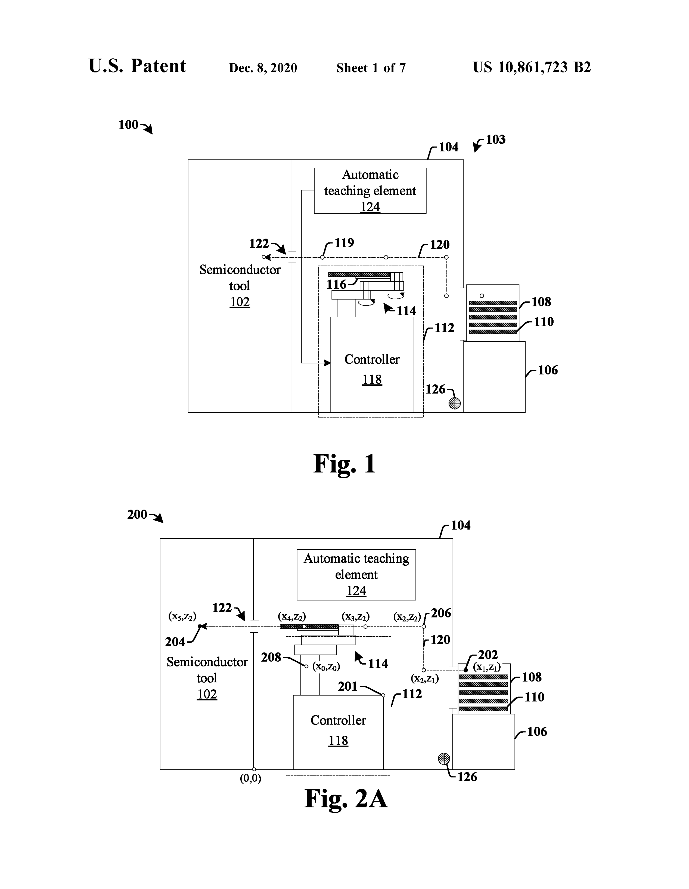
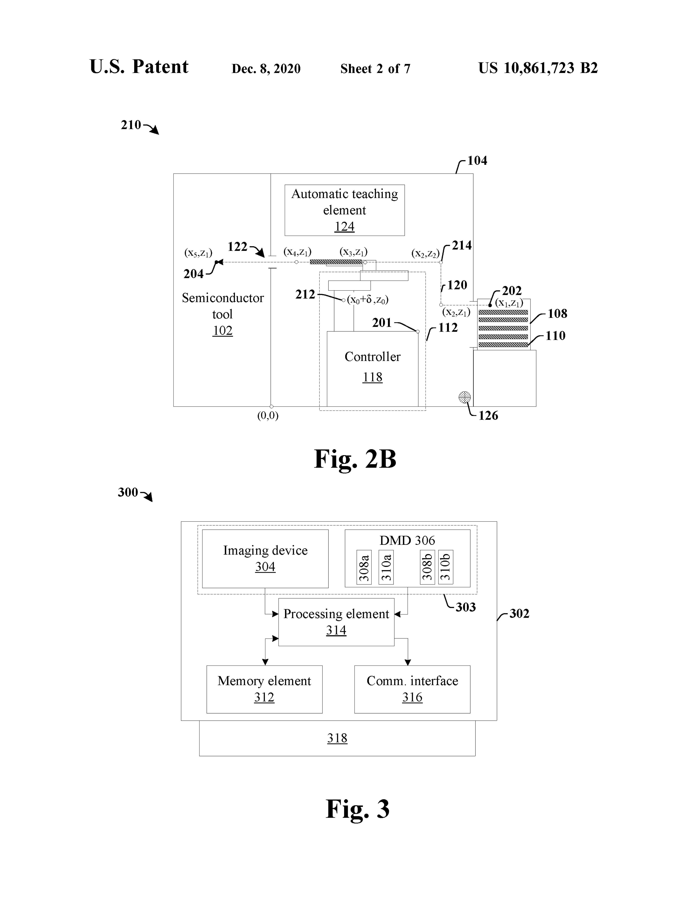
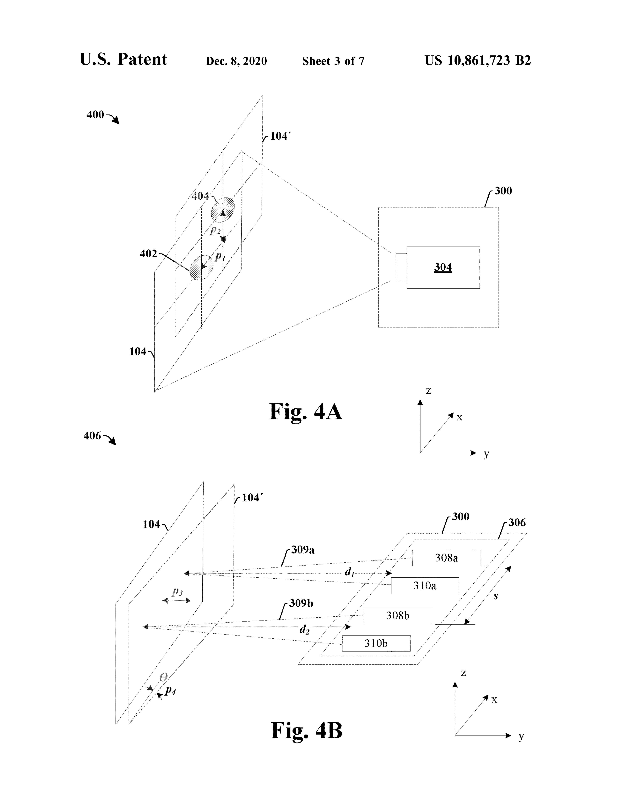

# 번역: EFEM 로봇 자동 티칭 방법

- 원제: EFEM Robot Auto Teaching Methodology
- 원문: [US10861723B2.pdf](US10861723B2.pdf) (19쪽, 도면 7장. 미국 특허청 공보 PDF, md5 d8c210f30deb5d42c9d8161b6cb620db)
- 원문 출처: 미국 특허청 공보 PDF(image-ppubs.uspto.gov). Google Patents는 자동 접근에 503을 돌려줘 쓰지 않았다(조사방법론 5절). 우회하지 않았다.
- 번역 범위: 전문. 서지면, 배경, 도면의 간단한 설명, 상세한 설명, 청구항 1~20. 앞면의 인용 문헌 목록은 원문 그대로 둔다.
- 번역 방법: 공보 PDF는 글자 층이 없는 스캔이라 pdftotext 출력이 비었다. 150 dpi로 쪽 이미지를 만든 뒤 tesseract(eng)로 글자를 읽고 번역했다. 아래 첨자(x0, z1 등)는 OCR이 흐려서 도면과 문맥으로 맞췄다.
- 번역 2026-11-04. 역자 주는 [역자 주]로 표시한다.

---

## 서지 (공보 1면)

- (10) 특허번호: US 10,861,723 B2
- (45) 등록일: 2020년 12월 8일
- (54) 명칭: EFEM 로봇 자동 티칭 방법 (EFEM ROBOT AUTO TEACHING METHODOLOGY)
- (71) 출원인, (73) 권리자: Taiwan Semiconductor Manufacturing Co., Ltd., 대만 신주
- (72) 발명자: Chien-Fa Lee (신주), Hsu-Shui Liu (핑전), Jiun-Rong Pai (주베이), Shou-Wen Kuo (신주)
- (*) 존속기간 조정: 35 U.S.C. 154(b)에 따라 333일 연장
- (21) 출원번호: 15/822,865
- (22) 출원일: 2017년 11월 27일
- (65) 공개: US 2019/0051546 A1, 2019년 2월 14일
- (60) 관련 미국 출원: 가출원 62/542,468, 2017년 8월 8일
- (51) 국제특허분류: H01L 21/67, H01L 21/677, H01L 21/68, H01L 21/687
- (52) CPC: H01L 21/67201, H01L 21/67259, H01L 21/67766, H01L 21/67775, H01L 21/681, H01L 21/68707
- (58) 검색 분야: USPC 700/245-264
- 심사관: Jonathan L Sample. 대리인: Eschweiler & Potashnik, LLC
- 청구항 20개, 도면 7장

## 요약 (57)

이 개시는 EFEM 로봇의 위치 변화를 반영하도록 EFEM을 자동으로 다시 프로그래밍하는 방법에 관한 것이다.
일부 실시예에서 이 방법은 EFEM 챔버 안에서 EFEM 로봇의 초기 위치를 정하는 것으로 수행된다.
초기 위치의 EFEM 로봇은 첫 번째 여러 단계를 따라 움직인다. 이 단계들은 초기 위치를 기준으로 정의되고, 제1 위치와 제2 위치 사이의 경로를 따라 이어진다.
위치 파라미터를 구한다. 위치 파라미터는 초기 위치와, 초기 위치와 다른 EFEM 로봇의 새 위치 사이의 변화를 나타낸다.
위치 파라미터를 바탕으로 두 번째 여러 단계를 정한다.
새 위치의 EFEM 로봇은 두 번째 여러 단계를 따라 움직인다. 이 단계들은 새 위치를 기준으로 정의되고, 제1 위치와 제2 위치 사이의 같은 경로를 따라 이어진다.

## 인용 문헌 (원문 그대로, OCR)

U.S. PATENT DOCUMENTS
5,483,138 A * 1/1996 Shmookler, H01L 21/681
5,742,393 A * 4/1998 Landau, H01L 21/681
6,198,976 B1 * 3/2001 Sundar, H01L 21/681
6,353,312 B1 * 3/2002 Farnworth, G01R 31/2851
6,401,554 B1 * 6/2002 Mort(OCR), H01L 21/681
6,428,673 B1 * 8/2002 Ritzdorf, C25D 21/12
6,453,214 B1 * 9/2002 Bacchi, H01L 21/...
6,902,054 B?(OCR 판독 불확실) 12/2002 Mooring, G05B ...
6,629,053 B1 * 9/2003 Mooring, G05B 19/401
6,856,863 B1 * 2/2005 Sundar, B25J 9/1692
7,066,707 B1 * 6/2006 Bonora, H01L 21/67766
7,604,449 B1 * 10/2009 Kaveh, H01L 21/67201
2002/0068992 A1 * 6/2002 Hime(OCR), H01L 21/68707
2003/0060922 A1 * 3/2003 Schauer, B23Q 3/186
2003/0154002 A1 * 8/2003 Lappen, H01L 21/67775
2003/0202092 A1 * 10/2003 Sadighi, B25J 9/1697
2004/0151574 A1 * 8/2004 Lu, H01L 21/681
2006/0130750 A1 * 6/2006 Ishikawa, H01L 21/67173
2009/0062959 A1 * 3/2009 Sakhare, G01B 11/03
2009/0118862 A1 * 5/2009 Genetti(OCR), B25J 9/1694
2009/0279989 A1 * 11/2009 Wong, H01L 21/68
2012/0002216 A1 * 1/2012 Shibata, H01L 21/681
2013/0325179 A1 * 12/2013 Liao, H01L 21/67259
2014/0072397 A1 * 3/2014 Mooring, H01L 21/67161
2015/0179491 A1 * 6/2015 Katsuda, H01L 21/67742
2015/0253765 A1 * 9/2015 Katsuda, H01L 21/67766
2016/0133502 A1 * 5/2016 Won, H01L 21/68707
2017/0113344 A1 * 4/2017 Schonberg, B25J 9/163
2017/0170044 A1 * 6/2017 Okabe, H01L 21/67393
2017/0190053 A1 * 7/2017 Xu, B25J 11/095
2017/0194183 A1 * 7/2017 Xu, H01L 21/68707
2017/0194187 A1 * 7/2017 Xu, H01L 21/67265
2018/0012789 A1 * 1/2018 Handa, B25J 13/088
2019/0051546 A1 * 2/2019 Lee, H01L 21/67775
FOREIGN PATENT DOCUMENTS
JP H11243131 A 9/1999
JP 3208467 B2 9/2001
OTHER PUBLICATIONS
FALA Technologies. "Introduction to EFEM." Retrieved online on Jul. 31, 2017 from http://www.falatech.com/page.asp?pageid=45.
* cited by examiner

[역자 주] 2쪽 인용 목록은 스캔 품질이 낮아 일부 분류 기호가 잘렸다(... 표시). 번호, 연월, 이름은 OCR로 읽은 값이며 (OCR) 표시한 항목은 철자를 확인하지 못했다.

---

## 관련 출원

이 출원은 2017년 8월 8일 출원한 미국 가출원 62/542,468의 우선권을 주장한다. 그 내용 전체를 여기에 참조로 포함한다.

## 배경

반도체 제조 공장(FAB)은 집적 칩을 만드는 공장이다.
집적 칩은 반도체 웨이퍼에 여러 제조 공정(예: 식각, 패터닝, 증착, 이온 주입)을 가해 만든다. 이 공정으로 웨이퍼 위와 안에 수백만에서 수십억 개의 반도체 소자를 만든다.

이런 공정 동안 집적 칩과 바깥 세계의 접촉을 최소로 줄인다. 집적 칩에 닿는 오염물을 줄여 수율을 높이기 위해서다.
예를 들어 집적 칩은 오염 입자(예: 먼지)가 적은 클린룸에서 만든다.
또 공정 중 사람이 집적 칩에 닿는 일을 줄이려고 웨이퍼 이송 로봇을 쓴다. 이 로봇은 반도체 기판을 한 곳에서 다른 곳으로 옮긴다(예: 웨이퍼 카세트와 공정 장비 사이).

## 도면의 간단한 설명

이 개시의 내용은 아래 상세한 설명을 도면과 함께 읽으면 가장 잘 이해된다. 업계 관행에 따라 여러 부분은 축척대로 그리지 않았다. 설명을 분명히 하려고 크기를 임의로 키우거나 줄였을 수 있다.

- 그림 1: EFEM 로봇을 가진 장비 전단 모듈(EFEM)을 포함하는 반도체 처리 시스템의 블록도. 일부 실시예의 단면도.
- 그림 2A, 2B: EFEM 로봇의 위치를 바꾸는 사건이 일어나기 전과 후, 그림 1 시스템의 동작을 보여 주는 블록도.
- 그림 3: EFEM 로봇의 위치를 나타내는 위치 파라미터를 구하는 자동 티칭 요소의 블록도.
- 그림 4A, 4B: 그림 3의 자동 티칭 요소로 EFEM 로봇의 위치 파라미터를 구하는 적용 예.
- 그림 5A, 5B: 자동 티칭 요소를 EFEM 로봇의 여러 위치에 둔 EFEM 예.
- 그림 6: 여러 로드 포트와 여러 반도체 장비를 가진 EFEM 안의 EFEM 로봇을 보여 주는 추가 실시예의 평면도.
- 그림 7: EFEM 로봇의 위치 변화를 반영하는 이동 명령 집합을 만드는 방법의 흐름도.
- 그림 8A~8D: 휴대용 자동 티칭 요소로 EFEM 로봇을 자동으로 다시 프로그래밍해 위치 변화를 반영하는 방법의 블록도.
- 그림 9: 휴대용 자동 티칭 요소로 EFEM 로봇을 자동으로 다시 프로그래밍하는 방법의 흐름도.

## 상세한 설명

[역자 주] 원문 첫 두 문단은 미국 특허에 흔한 일반 문구다(여러 실시예와 예시를 든다, 첫 특징이 둘째 특징 위에 있다는 말은 직접 닿는 경우와 사이에 다른 특징이 있는 경우를 모두 포함한다, 같은 도면 부호를 되풀이할 수 있다, "아래", "위" 같은 공간 용어는 도면 방향을 기준으로 하며 장치를 90도 등으로 돌려 놓아도 그에 맞게 해석한다). 내용상 의미가 없어 이렇게 줄여 옮긴다.

### 문제 (배경 이어서)

집적 칩의 오염을 막으려고 반도체 처리 시스템 안에서 기판 이송 로봇으로 반도체 기판을 옮기는 일이 많다.
흔한 기판 이송 로봇 하나가 장비 전단 모듈(EFEM) 로봇이다.
EFEM 로봇은 EFEM 안에 있고, 반도체 기판이나 포토마스크를 반도체 처리 시스템 안에서 옮긴다.
예를 들어 EFEM 로봇은 보관 캐리어(예: 포드 카세트, FOUP)와 여러 공정 장비, 계측 장비, 시험 장비 사이에서 반도체 기판을 옮긴다.
**EFEM 로봇은 보통 FAB의 장비마다 하나씩 설치된다. 그래서 큰 FAB에서는 EFEM 로봇이 수백 대(예: 500대 이상)에 이를 수 있다.**

**시간이 지나면 EFEM 로봇은 믿을 만한 동작을 유지하려고 예방 정비를 받는다. 제대로 동작하지 않으면 수리도 받는다. 예방 정비와 수리는 EFEM 챔버 안에서 EFEM 로봇의 위치를 바꿀 수 있다.**
EFEM 로봇의 움직임은 EFEM 로봇의 위치를 기준으로 고정되어 있다. 그래서 이런 위치 변화는 기판을 옮기는 경로도 바꾸고, 기판 손상으로 이어질 수 있다.
이 손상을 피하려면 위치가 바뀐 뒤 EFEM 로봇을 다시 프로그래밍해야 한다.
다시 프로그래밍하는 과정은 보통 엔지니어가 EFEM 로봇을 조작해 기판을 천천히 움직이면서, 로봇 경로를 정하는 새 이동 명령을 찾는 일이다.
그러나 FAB 안 수백 대의 EFEM 로봇을 다시 프로그래밍하는 일은 비용이 크다.
**예를 들어 다시 프로그래밍에는 상당한 시간(예: 대당 두 시간 이상)과 한 명 이상의 엔지니어가 든다.** 또 사람의 실수가 끼어 반도체 기판을 손상시킬 수 있다.

### 개요

이 개시는 일부 실시예에서 EFEM 로봇의 위치 변화를 반영하도록 EFEM 로봇을 자동으로 다시 프로그래밍하는 방법과 그 장치에 관한 것이다.
방법은 EFEM 로봇의 초기 위치를 정하는 것을 포함한다.
초기 위치에 있을 때 EFEM 로봇은 초기 이동 명령 집합에 따라 동작한다. 이 명령은 초기 위치를 기준으로 고정된 첫 번째 여러 단계를 정의한다. 첫 번째 여러 단계는 EFEM 로봇을 제1 위치와 제2 위치 사이의 경로를 따라 움직인다.
EFEM 로봇의 위치가 바뀐 뒤 위치 파라미터를 구한다. 위치 파라미터는 초기 위치와, 그와 다른 새 위치 사이의 변화를 나타낸다.
위치 파라미터로 새 이동 명령 집합을 만든다. 새 명령은 새 위치를 기준으로 고정된 두 번째 여러 단계를 정의한다.
EFEM 로봇은 새 이동 명령 집합에 따라 제1 위치와 제2 위치 사이의 경로를 따라 움직인다.
위치 파라미터로 새 이동 명령을 만들면, 사람이 다시 프로그래밍하지 않고도 EFEM 로봇의 위치 변화(초기 위치와 새 위치의 차이)를 반영할 수 있다. 시간을 아끼고 기판 손상을 피한다.

### 그림 1

그림 1은 EFEM 로봇을 포함하는 반도체 처리 시스템 100의 블록도를 단면으로 보여 준다.

*도면 1장: 그림 1(시스템 블록도)과 그림 2A(사건 전 동작). 고정 기준점 (0,0), 초기 위치 (X0, Z0), 정렬 마크 126이 보인다.*

반도체 처리 시스템 100은 EFEM(장비 전단 모듈) 103에 연결된 반도체 장비 102를 가진다.
반도체 장비 102는 기판에 작업을 한다. 여러 실시예에서 반도체 장비 102는 제조 작업(예: 식각, 패터닝)을 하는 공정 장비(예: 식각 장비, 노광 장비), 계측을 하는 계측 장비, 시험을 하는 시험 장비일 수 있다.
EFEM 103은 EFEM 챔버 104와 EFEM 로봇 112를 가진다. EFEM 챔버 104는 반도체 장비 102와 통하는 닫힌 하우징이다.
EFEM 챔버 104는 로드 포트 106에 연결된다. 로드 포트는 기판 110을 하나 이상 담은 캐리어 108을 받는다.
여러 실시예에서 캐리어 108은 FOUP(전면 개방 통합 포드), 웨이퍼 카세트 등일 수 있다. 일부 실시예에서 기판 110은 반도체 웨이퍼(예: 200 mm, 300 mm, 450 mm 웨이퍼)다.

EFEM 로봇 112는 EFEM 챔버 104 안에 있다. EFEM 로봇 112는 기판 하나를 잡는 기판 받침 요소 116(예: 웨이퍼 블레이드)을 가진 로봇 팔 114를 포함한다.
로봇 팔 114는 제어기 118에 연결되고, 제어기는 EFEM 챔버 104 안에서 로봇 팔 114의 움직임을 제어한다.
제어기 118은 기판 받침 요소 116을 일련의 단계 119를 따라 움직인다. 이 단계들은 제1 위치와 제2 위치 사이의 경로 120을 정의한다.
일부 실시예에서 경로 120은 캐리어 108과 반도체 장비 102의 입구 122 사이에 이어진다.
**일련의 단계 119는 EFEM 로봇 112를 기준으로 고정되어 있다. 그래서 EFEM 로봇 112의 위치가 바뀌면 단계 119가 정의하는 경로 120도 바뀐다.**
일부 실시예에서 단계 119는 제어기 118이 로봇 팔 114를 움직이게 하는 일련의 이동 명령으로 정의된다.

자동 티칭 요소 124도 EFEM 챔버 104 안에 있다. 자동 티칭 요소 124는 센서를 하나 이상 가진다. 센서는 초기 위치와 새 위치 사이의 EFEM 로봇 112 위치 변화를 나타내는 위치 파라미터를 구한다.
일부 실시예에서 위치 파라미터는 EFEM 로봇 112의 같은 부품 위치가, EFEM 챔버 104에 붙은 정렬 마크 126의 위치에 대해 얼마나 바뀌었는지를 구해 위치 변화를 나타낸다.

위치 파라미터로 경로 120을 정의하는 단계 119를 고친다. 이렇게 EFEM 로봇 112의 위치 변화(예: 충돌, 예방 정비로 생긴 변화)를 반영한다.
예를 들어 단계 119를 정의하는 일련의 이동 명령을 위치 파라미터로 고쳐 위치 변화를 반영한다.
위치 파라미터로 단계 119를 고치면, 사람이 다시 프로그래밍할 때 드는 시간과 제품 손상 위험 없이 EFEM 로봇 112를 자동으로 다시 프로그래밍할 수 있다.

### 그림 2A, 2B

그림 2A, 2B는 EFEM 로봇의 위치를 바꾸는 사건이 일어나기 전과 후, 반도체 처리 시스템 100의 동작을 보여 준다.

그림 2A의 블록도 200은 EFEM 로봇 112의 위치를 바꾸는 사건(예: 충돌, 지진, 예방 정비)이 일어나기 전의 동작이다.
동작 중 EFEM 로봇 112는 기판 110(예: 반도체 웨이퍼)을 제1 위치 202와 제2 위치 204 사이의 경로 120을 따라 옮긴다. 두 위치는 EFEM 챔버 104에 묶인 고정 기준점 (0, 0)을 기준으로 고정되어 있다.

일부 실시예에서 EFEM 로봇 112는 초기 이동 명령에 따라 기판 110을 옮긴다. 이 명령은 EFEM 로봇 112의 로봇 팔 114를 첫 번째 여러 단계 206을 따라 움직인다. 이 단계들은 EFEM 로봇 112 위의 위치 201을 기준으로 고정되어 있다.
예를 들어 EFEM 로봇 112의 초기 위치 208이 고정 기준점 (0,0)에 대해 (x0, z0)이면, 초기 이동 명령은 로봇 팔 114를 초기 위치 (x0, z0)에 대해 고정된 첫 번째 여러 단계 206을 따라 움직인다.
일부 실시예에서 첫 번째 단계 중 하나에서 EFEM 로봇 112는 제1 위치 (x1, z1)에서 기판 110을 받는다. 다음 단계에서 기판 110을 제2 위치 (x2, z2)로 옮긴다.
제1 위치 (x1, z1)는 초기 위치 208 (x0, z0)에서 첫 거리 (x1-x0, z1-z0)만큼 떨어져 있다. 제2 위치 (x2, z2)는 둘째 거리 (x2-x0, z2-z0)만큼 떨어져 있다.
일부 실시예에서 첫 번째 여러 단계 206은 기판 110을 제1 위치 202 (x1, z1)의 캐리어 108에서 제2 위치 204 (x2, z2)의 반도체 장비 102 입구 122까지, 기판을 손상(예: 긁힘)시키지 않고 경로 120을 따라 옮긴다.

*도면 2장: 그림 2B(사건 후, 새 위치 (x0+δ, z0)와 두 번째 단계 214)와 그림 3(자동 티칭 요소 300의 구성: 영상 장치 304, 거리 측정 장치 306, 메모리 312, 처리 요소 314, 통신 인터페이스 316, 결합 요소 318).*

그림 2B의 블록도 210은 사건으로 EFEM 로봇 112의 위치가 초기 위치 (x0, z0)에서 새 위치 (x0+δ, z0)로 바뀐 뒤를 보여 준다.
초기 이동 명령은 여전히 로봇 팔 114를, EFEM 로봇 112 위 위치 201에 대해 고정된 첫 번째 단계 206을 따라 움직인다.
그러나 EFEM 로봇 112의 위치가 바뀌었기 때문에, 초기 이동 명령은 더 이상 기판 110을 제1 위치 202 (x1, z1)와 제2 위치 204 (x2, z2) 사이의 경로 120을 따라 옮기지 못한다.
EFEM 로봇 112가 새 위치 212 (x0+δ, z0)에 있으면, 초기 이동 명령은 기판 110을 (x1+δ, z1)과 (x2+δ, z2) 사이의 경로로 옮긴다. 그래서 기판 이동에 오차가 생긴다.
이 오차는 기판 110에 비싼 손상(예: 폐기)을 일으킬 수 있다.

이 오차를 반영하려고 자동 티칭 요소 124는 EFEM 로봇 112의 초기 위치(그림 2A의 208)와 새 위치 212 사이 변화를 나타내는 위치 파라미터를 구한다.
자동 티칭 요소 124는 또 위치 파라미터로 새 이동 명령을 만든다. 일부 실시예에서 자동 티칭 요소 124는 초기 위치(그림 2A의 208)도 함께 써서 새 이동 명령을 만든다.
새 이동 명령은 EFEM 112의 위치 변화를 반영해, EFEM 로봇 112 위의 점 201과 각 단계 사이의 간격(거리)을 바꾼다.

일부 실시예에서 초기 이동 명령은 첫 번째 여러 단계 206을 정의한다. 이 단계들은 초기 위치 208 (x0, z0)의 점 201에서 첫 번째 여러 거리만큼 떨어져 있다.
새 이동 명령은 두 번째 여러 단계 214를 정의한다. 이 단계들은 새 위치 (x0+δ, z0)의 점 201에서, 첫 번째와 다른 두 번째 여러 거리만큼 떨어져 있다.
점 201과 단계 사이 간격이 바뀌어서, 두 번째 단계 214는 기판 110을 손상 없이 경로 120을 따라 옮긴다.
예를 들어 두 번째 단계 중 첫 단계에서 EFEM 로봇 112는 제1 위치 202 (x1, z1)에서 기판 110을 받는다. 제1 위치 202 (x1, z1)는 새 위치 212 (x0+δ, z0)에서 (x1-(x0+δ), z1-z0) = (x1-x0-δ, z1-z0)만큼 떨어져 있다.
두 번째 단계 중 다음 단계에서 EFEM 로봇 112는 기판 110을 제2 위치 204 (x2, z2)로 옮긴다. 제2 위치 204는 새 위치 212 (x0+δ, z0)에서 (x2-(x0+δ), z2-z0) = (x2-x0-δ, z2-z0)만큼 떨어져 있다.

이렇게 자동 티칭 요소 124로 EFEM 로봇 112의 위치 변화를 구하면, 자동 티칭 요소 124는 새 이동 명령 집합을 자동으로(즉 손으로 조정하지 않고) 만든다. 이 명령은 EFEM 로봇 112의 위치를 바꾸는 사건 동안 생길 수 있는 변화를 반영하도록 로봇의 동작을 바꾼다.

### 그림 3

그림 3은 EFEM 로봇의 위치를 나타내는 위치 파라미터를 구하는 자동 티칭 요소 300(예: 자동 티칭 요소 124에 해당)의 블록도다.

자동 티칭 요소 300은 위치 측정 유닛 303을 둘러싼 하우징 302를 가진다. 위치 측정 유닛 303은 EFEM 챔버(예: 그림 1의 104) 안의 여러 위치에서 EFEM 로봇(예: 그림 1의 112)의 위치를 나타내는 측정을 한다.
이 측정으로 EFEM 챔버 안 EFEM 로봇의 초기 위치와, 초기 위치와 새 위치 사이 변화를 나타내는 위치 파라미터를 구한다.

일부 실시예에서 위치 측정 유닛 303은 영상 장치 304와 거리 측정 장치 306을 가진다.
영상 장치 304는 EFEM 챔버 안 EFEM 로봇의 여러 위치에서 EFEM 챔버에 해당하는 영상을 하나 이상 찍는다.
영상에서 제1 위치 파라미터 p1과 제2 위치 파라미터 p2를 구한다. p1은 제1 방향(예: x 좌표)의 위치 변화, p2는 제2 방향(예: z 좌표)의 위치 변화를 나타낸다. 제1 방향과 제2 방향은 서로 수직이다.

거리 측정 장치 306은 EFEM 챔버 안 EFEM 로봇의 여러 위치에서 거리 측정 장치 306과 EFEM 챔버 사이 거리를 하나 이상 잰다.
이 거리에서 제3 위치 파라미터 p3를 구한다. p3는 제1, 제2 방향 모두에 수직인 제3 방향(예: y 좌표)의 위치 변화를 나타낸다.
일부 실시예에서는 같은 거리에서 EFEM 로봇의 방향(자세) 변화를 나타내는 제4 위치 파라미터 p4도 구한다.
다른 실시예에서는 거리 측정 장치 306과 별도인 방향 측정 장치(도시하지 않음)를 하우징 302 안에 둔다.

일부 실시예에서 영상 장치 304는 CCD(전하 결합 소자) 카메라다.
일부 실시예에서 거리 측정 장치 306은 레이저 한 쌍 308a, 308b와 그에 딸린 센서 310a, 310b로 이루어진다.
제1 레이저 308a와 제2 레이저 308b는 제3 방향으로 레이저 빔을 낸다. 두 레이저는 제1 방향이나 제2 방향으로 떨어져 있다.

일부 실시예에서 자동 티칭 요소 300은 메모리 요소 312와 처리 요소 314를 더 가진다.
메모리 요소 312는 EFEM 로봇의 위치를 나타내는 자료를 저장한다. 일부 실시예에서 초기 위치나 새 위치 자료를 저장한다.
여러 실시예에서 메모리 요소 312는 휘발성 메모리(예: SRAM, DRAM)나 비휘발성 메모리(예: 플래시)다.

처리 요소 314는 영상 장치 304의 영상, 거리 측정 장치 306의 거리, 메모리 요소 312의 초기 위치 자료를 받는다.
이 영상, 거리, 자료로 위치 파라미터 p1~p4를 구한다.
또 위치 파라미터 p1~p4로 새 이동 명령 집합을 만든다. 새 이동 명령은 EFEM 로봇의 위치 변화를 반영하도록 로봇의 동작을 바꾼다.
일부 실시예에서는 초기 이동 명령을 위치 파라미터로 고쳐 새 명령을 만든다. 다른 실시예에서는 초기 위치와 위치 파라미터로 새 명령을 만든다.

새 이동 명령 집합은 제1 위치(예: 그림 1의 캐리어 108)와 제2 위치(예: 그림 1 반도체 장비 102의 입구 122) 사이 경로를 정의하는 새 여러 단계를 나타낸다.
일부 실시예에서 새 명령은 통신 인터페이스 316을 거쳐 EFEM 로봇의 움직임을 제어하는 제어기(예: 그림 1의 제어기 118)로 전달된다.
다른 실시예에서는 통신 인터페이스 316을 거쳐 제어기와 연결되는 티칭 펜던트로 전달된다.
일부 실시예에서 통신 인터페이스 316은 자료를 무선으로 보내는 송수신기를 가진 무선 인터페이스다.
일부 실시예에서 자동 티칭 요소 300은 하우징 302를 EFEM 챔버 표면에 붙이는 결합 요소 318을 더 가진다.

그림 3의 자동 티칭 요소 300은 위치 파라미터와 이동 명령을 만드는 처리 요소 314를 가진 것으로 설명했다. 그러나 다른 실시예에서는 자동 티칭 요소 300 밖의 처리 요소가 위치 파라미터와 이동 명령을 구할 수 있다.
예를 들어 일부 대안 실시예에서 자동 티칭 요소 300은 영상과 거리를 티칭 펜던트나 제어기에 넘기고, 펜던트나 제어기가 새 이동 명령을 구한다.
이 경우 티칭 펜던트나 제어기는 EFEM 로봇의 초기 위치 자료를 저장하는 메모리 요소를 가진다.

### 그림 4A, 4B

그림 4A, 4B의 그림 400, 406은 그림 3의 자동 티칭 요소로 EFEM 로봇의 위치 파라미터를 구하는 적용 예다.

*도면 3장: 그림 4A(초기 위치 영상의 정렬 마크 402와 새 위치 영상의 정렬 마크 404를 비교해 p1, p2를 구함)와 그림 4B(간격 s로 떨어진 두 레이저의 거리 d1, d2로 p3와 방향 p4(θ)를 구함).*

그림 400(그림 4A)처럼 자동 티칭 요소 300은 EFEM 챔버 104의 영상을 찍는 영상 장치 304를 가진다.
일부 실시예에서 영상 장치 304는 정렬 마크가 있는 EFEM 챔버 104 표면에 수직인 방향에서 영상을 찍는다. 그래서 x 방향과 z 방향으로 펼쳐진 평면 안에서 정렬 마크를 정면(top-view)으로 본다.
이 정면 영상에서, EFEM 로봇이 초기 위치에 있을 때(EFEM 챔버 104에 대해) 정렬 마크 402의 위치를 보여 주는 영상과, 새 위치에 있을 때(EFEM 챔버 104'에 대해) 정렬 마크 404를 보여 주는 영상을 비교한다.
이 비교로 x 방향의 위치 변화를 나타내는 제1 위치 파라미터 p1과, z 방향의 위치 변화를 나타내는 제2 위치 파라미터 p2를 구한다.

그림 406(그림 4B)처럼 자동 티칭 요소 300은 y 방향의 거리 d1, d2를 재는 거리 측정 장치 306을 더 가진다.
EFEM 로봇이 초기 위치에 있을 때(EFEM 챔버 104에 대해) 자동 티칭 요소 300과 EFEM 챔버 104 사이 거리를, 새 위치에 있을 때(EFEM 챔버 104'에 대해) 거리와 비교한다. 이 비교로 y 방향의 위치 변화를 나타내는 제3 위치 파라미터 p3를 구한다.

일부 실시예에서 거리 측정 장치 306은 간격 s만큼 떨어진 제1 레이저 308a와 제2 레이저 308b를 가진다.
제1 레이저 308a는 EFEM 로봇이 제1 위치에 있을 때 EFEM 챔버 104에 닿는 제1 레이저 빔 309a를 낸다. 빔은 EFEM 챔버 104에서 반사되어 제1 센서 310a로 가고, 제1 센서는 EFEM 챔버 104까지의 제1 거리 d1을 구한다.
제2 레이저 308b는 EFEM 로봇이 제2 위치에 있을 때 EFEM 챔버 104에 닿는 제2 레이저 빔 309b를 낸다. 빔은 반사되어 제2 센서 310b로 가고, 제2 센서는 제2 거리 d2를 구한다.

또 제1 거리 d1과 제2 거리 d2의 차이는 EFEM 로봇이 회전했다는 뜻이다(EFEM 챔버의 상대 방향 θ로 표시).
그래서 일부 실시예에서 EFEM 로봇의 방향 θ를 d1과 d2의 함수로 계산한다.
예를 들어 d1과 d2가 같으면 EFEM 로봇의 방향은 θ = 0°다. d1과 d2의 차이가 간격 s와 같으면 θ = 45°다.
일부 실시예에서 방향 θ는 tan⁻¹((d1-d2)/s)와 같다.

[역자 주] OCR은 "tan⁻¹(d1-d2/s)"로 읽혔다. 바로 앞 예시(차이가 s이면 45°)와 맞추면 괄호는 ((d1-d2)/s)다.

### 그림 5A, 5B

여러 실시예에서 자동 티칭 요소는 EFEM 챔버 안이나 EFEM 로봇 위의 여러 곳에 둘 수 있다. 그림 5A, 5B는 EFEM 로봇 위에 자동 티칭 요소를 두는 위치의 예다. 그림의 위치는 한정이 아니라 많은 가능한 위치 중 예일 뿐이다.

그림 5A, 5B는 자동 티칭 요소를 EFEM 로봇 위에 둔 반도체 처리 시스템 500의 실시예다.
반도체 처리 시스템 500은 EFEM 챔버 104 안의 EFEM 로봇 112를 가진다. EFEM 로봇 112는 제어기 118에 연결된 로봇 팔 114를 가진다.
로봇 팔 114는 여러 축 506a~506c를 중심으로 움직이는 여러 팔 마디 504a~504c를 가진다. 예를 들어 제1 팔 마디 504a는 제1 축 506a를 따라, 제2 팔 마디 504b는 제1 축에서 떨어진 제2 축 506b를 따라 움직인다.
팔 마디 504a~504c는 z 방향으로 움직이는 베이스 502에 연결된다.

정렬 마크 126은 EFEM 챔버 104의 안쪽 면에 있다. 여러 실시예에서 정렬 마크는 EFEM 챔버 104의 바닥, 옆벽, 천장에 둘 수 있다.
[역자 주] 원문은 이 문장의 주어를 "automatic teaching element 124"로 적었다. 앞 문장(정렬 마크 126)과 다음 문장(티칭 요소는 로봇 위에서 마크를 바라본다)을 보면 정렬 마크의 위치를 말하는 문장으로 읽는 것이 자연스럽다. 원문 표기는 그대로 남긴다: "the automatic teaching element 124 may be located along a floor, a sidewall, or a ceiling of the EFEM chamber 104."
자동 티칭 요소 124는 EFEM 로봇 112 위에 있고 EFEM 챔버 104의 정렬 마크 126을 바라본다.
여러 실시예에서 자동 티칭 요소 124는 EFEM 로봇 112의 여러 곳에 둘 수 있다. 예를 들어 그림 5A의 일부 실시예에서는 EFEM 로봇 112의 기판 받침 요소 116(예: 웨이퍼 블레이드) 위에 둔다.
그림 5B의 다른 실시예에서는 EFEM 로봇 112의 팔 마디 504a~504c 중 하나 위에 둔다.
또 다른 실시예(도시하지 않음)에서는 EFEM 로봇 112의 제어기 118 위에 둔다.

### 그림 6

그림 1~5B는 자동 티칭 요소가 기판 경로 하나의 이동 명령을 고치는 것으로 설명했다. 그러나 자동 티칭 요소는 한 EFEM 챔버 안의 여러 경로의 이동 명령을 고칠 수 있다.
예를 들어 그림 6은 EFEM 로봇이 서로 다른 반도체 장비와 로드 포트 사이의 여러 경로로 기판을 옮기는 추가 실시예의 평면도다.

반도체 처리 시스템 600은 EFEM 챔버 104에 연결된 여러 반도체 장비 102a~102b를 가진다. EFEM 챔버 104는 여러 로드 포트 106a~106c를 가지고, 각 로드 포트는 기판 110을 담은 캐리어 108a~108c 하나를 받는다.
EFEM 로봇 112는 EFEM 챔버 104 안에 있다. EFEM 로봇 112는 캐리어 108a~108c와 반도체 장비 102a~102b 사이의 서로 다른 경로 120a~120c로 기판 110을 옮긴다.
예를 들어 제1 캐리어 108a와 제1 반도체 장비 102a 사이의 제1 경로 120a, 제2 캐리어 108b와 제1 반도체 장비 102a 사이의 제2 경로 120b, 제3 캐리어 108c와 제2 반도체 장비 102b 사이의 제3 경로 120c로 옮긴다.

서로 다른 경로 120a~120c는 서로 다른 이동 명령 집합으로 정의된다. 제1 경로 120a는 제1 명령 집합, 제2 경로 120b는 그와 다른 제2 명령 집합, 제3 경로 120c는 그 둘과 다른 제3 명령 집합으로 정의된다.
각 명령 집합은 EFEM 로봇 112의 위치를 기준으로 고정된 일련의 단계를 정의한다.

자동 티칭 요소 124는 EFEM 로봇 112의 위치 변화를 나타내는 위치 파라미터를 구한다.
위치 파라미터로 경로 120을 정의하는 제1 명령 집합을 고쳐 EFEM 로봇 112의 위치 변화(예: 충돌, 예방 정비로 생긴 변화)를 반영한다.
**같은 위치 파라미터로 제2 경로 120b의 제2 명령 집합과 제3 경로 120c의 제3 명령 집합도 고쳐 위치 변화를 반영한다.**

### 그림 7

그림 7은 EFEM 로봇의 위치 변화를 반영하는 이동 명령 집합을 만드는 방법 700의 흐름도다.

개시한 방법(예: 방법 700, 900)은 일련의 동작이나 사건으로 그리고 설명했다. 그러나 그 순서를 한정으로 해석하지 않는다. 예를 들어 일부 동작은 다른 순서로, 또는 여기서 그리거나 설명하지 않은 다른 동작과 동시에 일어날 수 있다. 또 그린 동작이 모두 필요하지는 않다. 여기 그린 동작 하나를 여러 개의 별도 동작이나 단계로 나눠 할 수도 있다.

702에서 EFEM 로봇의 초기 위치를 정한다. 초기 위치는 초기 이동 명령 집합에 대응한다. 이 명령은 제1 위치와 제2 위치 사이 경로를 정의하는 첫 번째 여러 단계에 대응하고, 이 단계들은 초기 위치를 기준으로 고정되어 있다. 그림 2A는 동작 702에 따른 이런 초기 위치를 보여 준다.

704에서 위치 파라미터를 구한다. 위치 파라미터는 EFEM 로봇의 초기 위치와 새 위치 사이 위치 변화를 나타낸다. 그림 2A, 2B는 초기 위치와 새 위치의 차이를 보여 준다.
일부 실시예에서 새 위치 파라미터는 동작 706~710으로 구한다.

706에서 정렬 마크 오프셋(즉 초기 위치에 대응하는 정렬 마크와 새 위치에 대응하는 정렬 마크 사이 오프셋)으로 제1, 제2 위치 파라미터를 구한다. 일부 실시예에서 제1, 제2 위치 파라미터는 x 방향과 z 방향의 위치 변화를 나타낸다. 그림 4A가 동작 706의 예다.

708에서 여러 거리 오프셋(즉 초기 위치에 대응하는 거리와 새 위치에 대응하는 거리 사이 오프셋)으로 제3 위치 파라미터를 구한다. 일부 실시예에서 제3 위치 파라미터는 y 방향의 위치 변화를 나타낸다. 그림 4B가 동작 708의 예다.

710에서 여러 거리 오프셋으로 제4 위치 파라미터의 차이를 구한다. 일부 실시예에서 제4 위치 파라미터는 EFEM 로봇의 방향 변화를 나타낸다. 그림 4B가 동작 710의 예다.

712에서 위치 파라미터로 두 번째 여러 단계를 정한다. 일부 실시예에서는 초기 위치도 함께 쓴다. 두 번째 여러 단계는 제1 위치와 제2 위치 사이 경로를 따라 이어지고, 새 위치를 기준으로 고정된다. 그림 2B가 동작 712의 예다.

[역자 주] 도면 5장의 그림 7 흐름도 상자에는 702, 704, 706, 712가 보이고, 708과 710은 OCR에서 상자 글이 빠졌다(본문 설명으로 채웠다). 같은 쪽 위의 그림 6은 여러 로드 포트(106a~106c)와 장비(102a~102b), 경로(120a~120c)를 그린 평면도다.

일부 실시예에서 개시한 자동 티칭 요소는 서로 다른 EFEM 사이로 옮길 수 있는 휴대용 장치다. 이 경우 자동 티칭 요소로 여러 EFEM 안의 여러 EFEM 로봇을 다시 프로그래밍할 수 있다.
**일부 실시예에서 자동 티칭 요소로 서로 다른 EFEM 안의 서로 다른 종류의 EFEM 로봇(예: 다른 제조사가 만든 로봇)을 다시 프로그래밍할 수 있다.** 자동 티칭 요소가 구한 위치 파라미터로 다시 프로그래밍하므로, 종류가 다른 로봇도 추가 노력 없이 다시 프로그래밍할 수 있다.

### 그림 8A~8D

그림 8A~8D는 휴대용 자동 티칭 요소로 EFEM 로봇의 위치 변화를 반영하는 방법의 블록도다.

그림 8A는 제1 시간대(제1, 제2 시각, 즉 t1-t2) 동안 반도체 처리 시스템의 단면도 800이다.
단면도 800처럼 제1 시각 t1에 자동 티칭 요소 124를 EFEM 챔버 104 안 EFEM 로봇 112의 제1 위치 802에 놓는다. 제2 시각 t2에 자동 티칭 요소 124를 동작시켜 EFEM 챔버 104에 묶인 고정 기준점(예: (0, 0))에 대한 EFEM 로봇 112의 초기 위치 208 (x1, 0)을 구한다.

그림 8B는 제2 시간대(제3, 제4 시각, 즉 t3-t4)의 단면도 804다.
제3 시각 t3에 자동 티칭 요소 124를 EFEM 챔버 104에서 꺼낸다. 이어서 제4 시각 t4에 EFEM 로봇 112를 동작시켜 캐리어 108 안의 제1 위치 202와 반도체 장비 102 안의 제2 위치 204 사이 경로 120을 따라 움직인다. 경로 120은 EFEM 로봇 112의 초기 위치 208 (x1, 0)을 기준으로 고정된 첫 번째 여러 단계 206으로 정의된다.

그림 8C는 제3 시간대(제5, 제6, 제7 시각, 즉 t5-t7)의 단면도 806이다.
EFEM 로봇 112가 초기 위치 208 (x1, 0)에서 새 위치 212 (x1+δ, 0)로 옮겨진 뒤, 제5 시각 t5에 자동 티칭 요소 124를 EFEM 로봇 112의 같은 제1 위치 802에 놓는다.
제6 시각 t6에 자동 티칭 요소 124를 동작시켜 고정 기준점(예: (0, 0))에 대한 EFEM 로봇 112의 새 위치 (x1+δ, 0)을 구한다.
이어서 자동 티칭 요소 124는 초기 위치 (x1, 0)과 새 위치 (x1+δ, 0)으로 EFEM 로봇 112의 위치 변화를 나타내는 위치 파라미터를 구한다.
제7 시각 t7에 위치 파라미터로 새 이동 명령 집합을 만들고, 이를 EFEM 로봇 112에 준다.

그림 8D는 제4 시간대(제8, 제9 시각, 즉 t8-t9)의 단면도 808이다.
제8 시각 t8에 자동 티칭 요소 124를 EFEM 챔버 104에서 꺼낸다. 이어서 제9 시각 t9에 EFEM 로봇 112를 새 이동 명령 집합에 따라 경로 120을 따라 움직인다. 경로 120은 EFEM 로봇 112의 새 위치 (x1+δ, 0)를 기준으로 고정된 두 번째 여러 단계 214로 정의되고, 캐리어 108과 반도체 장비 102 사이에 이어진다.

[역자 주] 그림 8의 초기 위치 표기는 OCR과 도면 모두 첨자가 흐리다. 도면 6장의 축 표기 "(x1, 0)", "(x1+δ, 0)"에 맞췄다. 그림 2의 (x0, z0)와 표기가 다르다.

### 그림 9

그림 9는 자동 티칭 요소로 EFEM 로봇을 자동으로 다시 프로그래밍해 위치 변화를 반영하는 방법 900의 흐름도다.

902에서 EFEM 챔버 안 EFEM 로봇 위에 자동 티칭 요소를 놓는다. 일부 실시예에서는 EFEM 로봇의 제1 위치에 놓는다. 그림 8A가 동작 902의 예다.

904에서 자동 티칭 요소를 동작시켜 EFEM 챔버 안 EFEM 로봇의 초기 위치를 잰다. 초기 위치에서 EFEM 로봇은 초기 위치를 기준으로 고정되고 제1 위치와 제2 위치 사이 경로를 따라 이어지는 첫 번째 여러 단계를 따라 움직이도록 설정되어 있다.

906에서 자동 티칭 요소를 EFEM 챔버에서 꺼낸다. 그림 8B가 동작 906의 예다.
[역자 주] 원문은 여기와 916에서 "alignment chamber"라고 적었다. 문맥상 EFEM 챔버를 말한다.

908에서 EFEM 로봇을 초기 이동 명령 집합에 따라 동작시켜, 초기 위치를 기준으로 고정되고 제1, 제2 위치 사이에 이어지는 첫 번째 여러 단계를 따라 움직인다. 그림 8B가 동작 908의 예다.

910에서 초기 이동 명령으로 EFEM 로봇을 동작시킨 뒤, 자동 티칭 요소를 EFEM 로봇 위에 놓는다. 일부 실시예에서는 EFEM 로봇의 같은 제1 위치에 놓는다. 그림 8C가 동작 910의 예다.

912에서 자동 티칭 요소를 동작시켜 EFEM 로봇의 초기 위치와 새 위치의 차이를 나타내는 위치 파라미터를 구한다.

914에서 위치 파라미터로 새 이동 명령 집합을 만든다. 일부 실시예에서는 초기 위치도 함께 쓴다. 새 이동 명령 집합은 새 위치 파라미터를 기준으로 제1, 제2 위치 사이 경로 안의 두 번째 여러 단계를 정의한다.

916에서 자동 티칭 요소를 EFEM 챔버에서 꺼낸다. 그림 8C가 동작 916의 예다.

918에서 EFEM 로봇을 새 이동 명령 집합에 따라 동작시켜, 새 위치를 기준으로 고정되고 제1, 제2 위치 사이에 이어지는 두 번째 여러 단계를 따라 움직인다. 그림 8D가 동작 918의 예다.

방법 900은 EFEM 로봇 하나를 다시 프로그래밍하는 것으로 설명했다. 그러나 같은 티칭 장치(예: 휴대용 유닛)로 서로 다른 EFEM의 서로 다른 EFEM 로봇을 자동으로 다시 프로그래밍할 수 있다.
예를 들어 여섯 번째 시각에 EFEM 챔버에서 자동 티칭 요소를 꺼낸 뒤, 다른 EFEM 챔버에 놓아 그 안의 다른 EFEM 로봇의 위치를 구할 수 있다.

### 실시예 정리

따라서 여러 실시예에서 이 개시는 EFEM 로봇의 위치 변화를 반영하도록 EFEM 로봇을 자동으로 프로그래밍하는 방법과 그 장치에 관한 것이다.

일부 실시예에서 이 개시는 EFEM 로봇을 프로그래밍하는 방법에 관한 것이다. 방법은 다음을 포함한다.
EFEM 챔버 안 EFEM 로봇의 초기 위치를 정한다. 초기 위치의 EFEM 로봇은 초기 위치를 기준으로 정의되고 제1, 제2 위치 사이 경로를 따라 이어지는 첫 번째 여러 단계를 따라 움직인다.
초기 위치와, 그와 다른 EFEM 챔버 안 새 위치 사이 변화를 나타내는 위치 파라미터를 구한다.
위치 파라미터로 두 번째 여러 단계를 정한다. 새 위치의 EFEM 로봇은 새 위치를 기준으로 정의되고 같은 경로를 따라 이어지는 두 번째 여러 단계를 따라 움직인다.
일부 실시예에서 위치 파라미터는 다음을 포함한다.
- 제1 방향의 초기 위치와 새 위치 차이를 나타내는 제1 위치 파라미터
- 제1 방향에 수직인 제2 방향의 차이를 나타내는 제2 위치 파라미터
- 제1, 제2 방향에 모두 수직인 제3 방향의 차이를 나타내는 제3 위치 파라미터
- 초기 위치와 새 위치 사이 EFEM 로봇의 방향 변화를 나타내는 제4 위치 파라미터

일부 실시예에서 제1, 제2 위치 파라미터는 EFEM 챔버에 붙은 정렬 마크의 초기 위치와 새 위치 사이 오프셋으로 구한다. 정렬 마크는 제1 방향과 제2 방향으로 펼쳐진 평면에 놓인다.
일부 실시예에서 정렬 마크 오프셋은 초기 위치에 대응하는 정렬 마크의 첫 영상과 새 위치에 대응하는 둘째 영상을 비교해 구한다.
일부 실시예에서 위치 파라미터 하나 이상은 레이저 하나 이상으로 구한, 초기 위치와 새 위치 사이 제3 방향의 거리 오프셋이다.
일부 실시예에서 위치 파라미터 하나 이상은 제1 레이저로 잰 제1 거리와 제2 레이저로 잰 제2 거리의 함수로 계산한다.
일부 실시예에서 위치 파라미터 하나 이상은 제1 레이저로 잰 제1 거리와 제2 레이저로 잰 제2 거리의 함수로 계산한 EFEM 로봇의 방향이다.
일부 실시예에서 EFEM 로봇은 첫 번째 여러 단계를 따라 움직이게 하는 초기 이동 명령 집합에 따라 동작한다.
일부 실시예에서 방법은 위치 파라미터로 새 이동 명령 집합을 만드는 것을 더 포함하고, EFEM 로봇은 새 명령에 따라 두 번째 여러 단계를 따라 움직인다.
일부 실시예에서 방법은 새 이동 명령 집합을 EFEM 로봇을 동작시키는 제어기에 주는 것을 더 포함한다.
일부 실시예에서 방법은 위치 파라미터를 구하는 자동 티칭 요소를 EFEM 챔버 안에 놓고, EFEM 챔버에 연결된 반도체 장비로 기판에 제조 공정을 하기 전에 자동 티칭 요소를 EFEM 챔버에서 꺼내는 것을 더 포함한다.
일부 실시예에서 방법은 EFEM 챔버에서 자동 티칭 요소를 꺼낸 뒤 다른 EFEM 챔버에 놓아, 그 안의 다른 EFEM 로봇의 위치를 구하는 것을 더 포함한다.
일부 실시예에서 첫 번째 여러 단계는 EFEM 로봇 위의 한 점에서 첫 번째 여러 거리만큼 떨어져 있고, 두 번째 여러 단계는 같은 점에서 첫 번째와 다른 두 번째 여러 거리만큼 떨어져 있다.

다른 실시예에서 이 개시는 EFEM 로봇을 프로그래밍하는 방법에 관한 것이다. 방법은 다음을 포함한다.
EFEM 로봇의 초기 위치를 정한다. 초기 위치의 EFEM 로봇은 초기 이동 명령 집합에 따라, 초기 위치를 기준으로 정의되고 제1, 제2 위치 사이에 이어지는 첫 번째 여러 단계를 따라 움직인다.
초기 위치와 그와 다른 새 위치 사이 변화를 나타내는 위치 파라미터를 구한다.
위치 파라미터로 새 이동 명령 집합을 만든다. 새 위치의 EFEM 로봇은 새 명령에 따라, 새 위치를 기준으로 정의되고 제1, 제2 위치 사이에 이어지는 두 번째 여러 단계를 따라 움직인다.
일부 실시예에서 첫 번째 단계와 초기 위치 사이 거리는 두 번째 단계와 새 위치 사이 거리와 다르다.

또 다른 실시예에서 이 개시는 EFEM 로봇 자동 티칭 요소에 관한 것이다. 자동 티칭 요소는 다음을 포함한다.
EFEM 챔버 안 EFEM 로봇의 초기 위치와, 그와 다른 새 위치를 구하는 위치 측정 유닛.
초기 위치와 새 위치의 차이를 나타내는 위치 파라미터를 구하고, 위치 파라미터로 EFEM 로봇을 제1, 제2 위치 사이 경로로 움직이는 두 번째 여러 단계를 구하는 처리 요소.
일부 실시예에서 EFEM 로봇은 초기 위치를 기준으로 고정되고 같은 경로를 따라 이어지는 첫 번째 여러 단계를 따라 움직인다.
일부 실시예에서 첫 번째 여러 단계는 EFEM 로봇 위 한 점에서 첫 번째 여러 거리만큼, 두 번째 여러 단계는 같은 점에서 다른 두 번째 여러 거리만큼 떨어져 있다.
일부 실시예에서 처리 요소는 위치 파라미터로 경로를 나타내는 새 이동 명령 집합을 더 구한다.
일부 실시예에서 자동 티칭 요소는 새 이동 명령 집합을 EFEM 로봇에 주어 동작을 바꾸는 통신 인터페이스를 더 가진다.

또 다른 실시예에서 이 개시는 EFEM 로봇을 프로그래밍하는 방법에 관한 것이다. 방법은 다음을 포함한다.
제1 시각에 자동 티칭 요소를 EFEM 챔버 안에 놓는다.
제1 시각 뒤 제2 시각에 자동 티칭 요소를 동작시켜 EFEM 챔버 안 EFEM 로봇의 초기 위치를 잰다.
제2 시각 뒤 제3 시각에 자동 티칭 요소를 EFEM 챔버에서 꺼낸다.
제3 시각 뒤 제4 시각에 자동 티칭 요소를 EFEM 챔버 안에 다시 놓는다.
제4 시각 뒤 제5 시각에 자동 티칭 요소를 동작시켜, EFEM 챔버 안 EFEM 로봇의 초기 위치와 새 위치 차이를 나타내는 위치 파라미터를 잰다.
위치 파라미터로 두 번째 여러 단계를 정한다. EFEM 로봇은 제1, 제2 위치 사이 경로를 따라 이어지는 두 번째 여러 단계를 따라 움직인다.
일부 실시예에서 방법은 제1 시각에 자동 티칭 요소를 EFEM 챔버 안 제1 위치에 놓고, 제4 시각에도 같은 제1 위치에 놓는 것을 더 포함한다.
일부 실시예에서 방법은 EFEM 챔버에서 자동 티칭 요소를 꺼낸 뒤 다른 EFEM 챔버에 놓아 그 안의 다른 EFEM 로봇 위치를 구하는 것을 더 포함한다.
일부 실시예에서 EFEM 로봇은 제3 시각과 제4 시각 사이에 같은 경로를 따라 이어지는 첫 번째 여러 단계를 따라 움직이고, 첫 번째 단계와 초기 위치 사이 거리는 두 번째 단계와 새 위치 사이 거리와 다르다.
일부 실시예에서 EFEM 로봇은 제3 시각과 제4 시각 사이에 초기 이동 명령 집합에 따라 첫 번째 여러 단계를 따라 움직인다.
일부 실시예에서 방법은 위치 파라미터로 새 이동 명령 집합을 만들고, 제5 시각 뒤 EFEM 로봇이 새 명령에 따라 두 번째 여러 단계를 따라 움직이는 것을 더 포함한다.
일부 실시예에서 제1 위치는 기판을 하나 이상 담는 캐리어 안이고, 제2 위치는 반도체 장비 안이다.

또 다른 실시예에서 이 개시는 EFEM 로봇 자동 티칭 요소에 관한 것이다. 자동 티칭 요소는 다음을 포함한다.
EFEM 챔버 안 EFEM 로봇의 초기 위치 자료를 저장하는 메모리 요소.
EFEM 챔버 안에서 초기 위치와 다른 EFEM 로봇의 새 위치를 나타내는 측정을 하는 위치 측정 유닛.
초기 위치 자료와 측정으로 EFEM 로봇의 경로를 나타내는 새 이동 명령 집합을 구하는 처리 요소.
일부 실시예에서 자동 티칭 요소는 위치 측정 유닛, 메모리 요소, 처리 요소를 둘러싸는 하우징을 더 가진다.
일부 실시예에서 하우징에 고정되어 하우징을 EFEM 로봇 표면에 붙이는 결합 요소를 더 가진다.
일부 실시예에서 새 이동 명령 집합을 EFEM 로봇 팔의 움직임을 제어하는 제어기나, 제어기와 통하는 티칭 펜던트에 주는 통신 인터페이스를 더 가진다.
일부 실시예에서 위치 측정 유닛은 EFEM 챔버의 정렬 마크 영상을 찍는 영상 장치와, 자동 티칭 요소와 EFEM 챔버 사이 제1 거리와 제2 거리를 재는 거리 측정 장치를 가진다.
일부 실시예에서 영상 장치는 CCD 카메라다.
일부 실시예에서 거리 측정 장치는 레이저를 하나 이상 가진다.
일부 실시예에서 거리 측정 장치는 다음을 가진다.
- 제3 방향으로 제1 레이저 빔을 내는 제1 레이저
- 제3 방향으로 제2 레이저 빔을 내고, 제1 레이저와 제1 방향이나 제2 방향으로 0이 아닌 간격만큼 떨어진 제2 레이저
- EFEM 챔버에서 반사된 제1 빔을 받아 제1 레이저와 EFEM 챔버 사이 제1 거리를 구하는 제1 센서
- EFEM 챔버에서 반사된 제2 빔을 받아 제2 레이저와 EFEM 챔버 사이 제2 거리를 구하는 제2 센서

또 다른 실시예에서 이 개시는 EFEM 로봇 자동 티칭 요소에 관한 것이다. 자동 티칭 요소는 다음을 포함한다.
EFEM 로봇(112)이 초기 위치와 새 위치에 있을 때 EFEM 챔버의 정렬 마크 영상을 찍는 영상 장치. 영상은 제1 방향의 위치 변화를 나타내는 제1 위치 파라미터와 제2 방향의 위치 변화를 나타내는 제2 위치 파라미터에 대응한다.
초기 위치와 새 위치에서 거리 측정 장치와 EFEM 챔버 사이 거리를 재는 거리 측정 장치. 거리는 제3 방향의 위치 변화를 나타내는 제3 위치 파라미터와 방향 변화를 나타내는 제4 위치 파라미터에 대응한다.
일부 실시예에서 자동 티칭 요소는 영상 장치의 영상과 거리 측정 장치의 제1, 제2 거리를 받는 처리 요소를 더 가진다. 처리 요소는 영상으로 제1, 제2 위치 파라미터를, 제1, 제2 거리로 제3, 제4 위치 파라미터를 구한다.
일부 실시예에서 처리 요소는 제1~제4 위치 파라미터로, EFEM 로봇이 제1 위치와 제2 위치 사이를 움직이는 경로를 나타내는 새 이동 명령 집합을 구한다.
일부 실시예에서 자동 티칭 요소는 EFEM 로봇의 초기 위치 자료를 저장하는 메모리 요소를 더 가지고, 제1 위치 파라미터는 초기 위치와 새 위치 사이 제1 위치 변화를 나타낸다.
일부 실시예에서 거리 측정 장치는 다음을 가진다.
- 제3 방향으로 제1 레이저 빔을 내는 제1 레이저
- 제3 방향으로 제2 레이저 빔을 내고, 제1 레이저와 제1 방향이나 제2 방향으로 0이 아닌 간격만큼 떨어진 제2 레이저
- EFEM 챔버에서 반사된 제1 빔을 받아 제1 거리를 구하는 제1 센서
- EFEM 챔버에서 반사된 제2 빔을 받아 제2 거리를 구하는 제2 센서. 제1 센서와 제2 센서는 제1 방향이나 제2 방향으로 떨어져 있다.

앞의 내용은 여러 실시예의 특징을 요약해, 이 분야 기술자가 이 개시의 여러 측면을 더 잘 이해하도록 한 것이다.
이 분야 기술자는 이 개시를 바탕으로 여기 소개한 실시예와 같은 목적을 이루고 같은 장점을 얻는 다른 공정과 구조를 쉽게 설계하거나 고칠 수 있음을 알 것이다.
또 그런 동등한 구성은 이 개시의 정신과 범위를 벗어나지 않으며, 그 정신과 범위를 벗어나지 않고 여러 변경, 대체, 개조를 할 수 있음을 알 것이다.

## 청구항

1. EFEM 로봇을 프로그래밍하는 방법으로서, 다음을 포함한다.
   - EFEM 챔버 안 EFEM 로봇의 초기 위치를 정한다.
   - 초기 위치의 EFEM 로봇을 동작시켜 제1 기판을 첫 번째 여러 단계를 따라 옮긴다. 이 단계들은 초기 위치를 기준으로 정의되고 제1 위치와 제2 위치 사이 경로를 따라 이어진다.
   - 초기 위치와, 그와 다른 EFEM 챔버 안 EFEM 로봇의 새 위치 사이 변화를 나타내는 위치 파라미터를 구한다.
   - 위치 파라미터로 두 번째 여러 단계를 정한다.
   - 새 위치의 EFEM 로봇을 동작시켜 제2 기판을 두 번째 여러 단계를 따라 옮긴다. 이 단계들은 새 위치를 기준으로 정의되고 제1 위치와 제2 위치 사이 같은 경로를 따라 이어진다.

2. 청구항 1의 방법에서 위치 파라미터는 다음을 포함한다.
   - 제1 방향의 초기 위치와 새 위치 차이를 나타내는 제1 위치 파라미터
   - 제1 방향에 수직인 제2 방향의 차이를 나타내는 제2 위치 파라미터
   - 제1, 제2 방향에 모두 수직인 제3 방향의 차이를 나타내는 제3 위치 파라미터
   - 초기 위치와 새 위치 사이 EFEM 로봇의 방향 변화를 나타내는 제4 위치 파라미터

3. 청구항 2의 방법에서 위치 파라미터를 구하는 것은, EFEM 챔버에 붙은 정렬 마크의 초기 위치와 새 위치 사이 오프셋으로 제1, 제2 위치 파라미터를 구하는 것을 포함한다. 정렬 마크는 제1 방향과 제2 방향으로 펼쳐진 평면에 놓인다.

4. 청구항 3의 방법에서 정렬 마크 오프셋은 초기 위치에 대응하는 정렬 마크의 첫 영상과 새 위치에 대응하는 둘째 영상을 비교해 구한다.

5. 청구항 3의 방법에서 위치 파라미터 하나 이상은 레이저 하나 이상으로 구한, 초기 위치와 새 위치 사이 제3 방향의 거리 오프셋이다.

6. 청구항 1의 방법에서 위치 파라미터 하나 이상은 제1 레이저로 잰 제1 거리와 제2 레이저로 잰 제2 거리의 함수로 계산한다.

7. 청구항 1의 방법에서 위치 파라미터 하나 이상은 제1 레이저로 잰 제1 거리와 제2 레이저로 잰 제2 거리의 함수로 계산한 EFEM 로봇의 방향이다.

8. 청구항 1의 방법에서 EFEM 로봇은 첫 번째 여러 단계를 따라 움직이게 하는 초기 이동 명령 집합에 따라 동작한다.

9. 청구항 8의 방법은, 위치 파라미터로 새 이동 명령 집합을 만드는 것을 더 포함한다. EFEM 로봇은 새 명령에 따라 두 번째 여러 단계를 따라 움직인다.

10. 청구항 9의 방법은, 새 이동 명령 집합을 제어기에 주는 것을 더 포함한다. 제어기는 새 명령에 따라 EFEM 로봇을 두 번째 여러 단계를 따라 움직인다.

11. 청구항 1의 방법은 다음을 더 포함한다.
    - 위치 파라미터를 구하는 자동 티칭 요소를 EFEM 챔버 안에 놓는다.
    - EFEM 챔버에 연결된 반도체 장비로 제2 기판에 제조 공정을 하기 전에, 자동 티칭 요소를 EFEM 챔버에서 꺼낸다.

12. 청구항 11의 방법은, EFEM 챔버에서 꺼낸 자동 티칭 요소를 다른 EFEM 챔버 안에 놓는 것을 더 포함한다. 자동 티칭 요소는 그 챔버 안 다른 EFEM 로봇의 위치를 구한다.

13. 청구항 1의 방법에서
    - 첫 번째 여러 단계는 EFEM 로봇 위의 한 점에서 첫 번째 여러 거리만큼 떨어져 있고,
    - 두 번째 여러 단계는 같은 점에서 첫 번째와 다른 두 번째 여러 거리만큼 떨어져 있다.

14. EFEM 로봇을 프로그래밍하는 방법으로서, 다음을 포함한다.
    - EFEM 로봇 베이스의 초기 위치를 정한다. 베이스가 초기 위치에 있을 때 EFEM 로봇은 초기 이동 명령 집합에 따라 동작하고, 이 명령은 로봇을 초기 위치 기준으로 정의되고 제1, 제2 위치 사이에 이어지는 첫 번째 여러 단계를 따라 움직인다.
    - 초기 위치와, 그와 다른 EFEM 로봇 베이스의 새 위치 사이 변화를 나타내는 위치 파라미터를 구한다.
    - 위치 파라미터로 새 이동 명령 집합을 만든다. 베이스가 새 위치에 있을 때 EFEM 로봇은 새 명령에 따라 동작하고, 이 명령은 로봇을 새 위치 기준으로 정의되고 제1, 제2 위치 사이에 이어지는 두 번째 여러 단계를 따라 움직인다.

15. 청구항 14의 방법은, EFEM 챔버에 붙은 정렬 마크의 오프셋으로 위치 파라미터를 구하는 것을 더 포함한다. EFEM 로봇은 EFEM 챔버 안에 있다.

16. EFEM(장비 전단 모듈) 자동 티칭 요소로서, 다음을 포함한다.
    - EFEM 챔버 안 EFEM 로봇 베이스의 초기 위치와, 그와 다른 베이스의 새 위치를 구하는 위치 측정 유닛.
    - 초기 위치와 새 위치의 차이를 나타내는 위치 파라미터를 구하고, 위치 파라미터로 EFEM 로봇을 제1, 제2 위치 사이 경로로 움직이는 두 번째 여러 단계를 구하는 처리 요소.

17. 청구항 16의 자동 티칭 요소에서 EFEM 로봇은 초기 위치를 기준으로 고정되고 같은 경로를 따라 이어지는 첫 번째 여러 단계를 따라 움직인다.

18. 청구항 16의 자동 티칭 요소에서
    - EFEM 로봇은 여러 회전축을 중심으로 도는 여러 마디를 가지고,
    - EFEM 로봇의 베이스는 가장 아래 회전축보다 아래에 있다.

19. 청구항 16의 자동 티칭 요소에서 처리 요소는 EFEM 챔버에 붙은 정렬 마크의 오프셋으로 위치 파라미터를 더 구한다.

20. 청구항 19의 자동 티칭 요소는, 새 이동 명령 집합을 EFEM 로봇에 주어 동작을 바꾸는 통신 인터페이스를 더 가진다.
