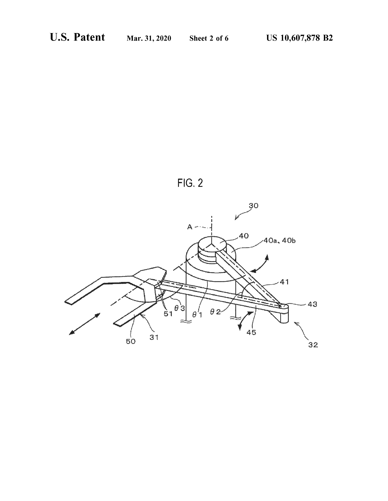
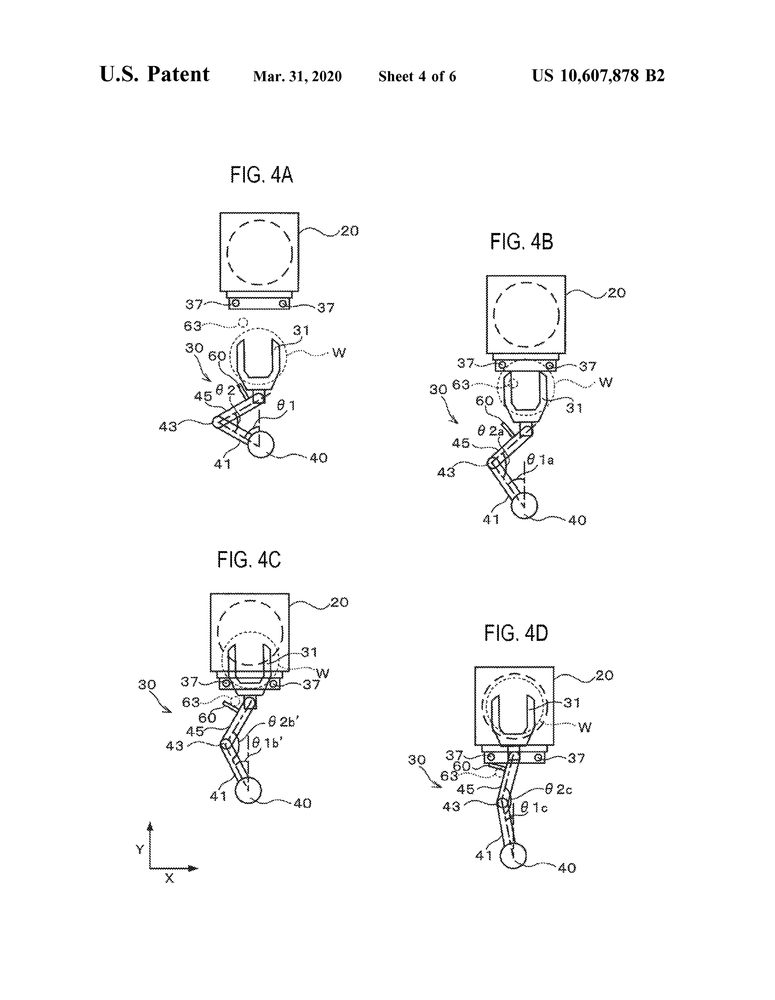
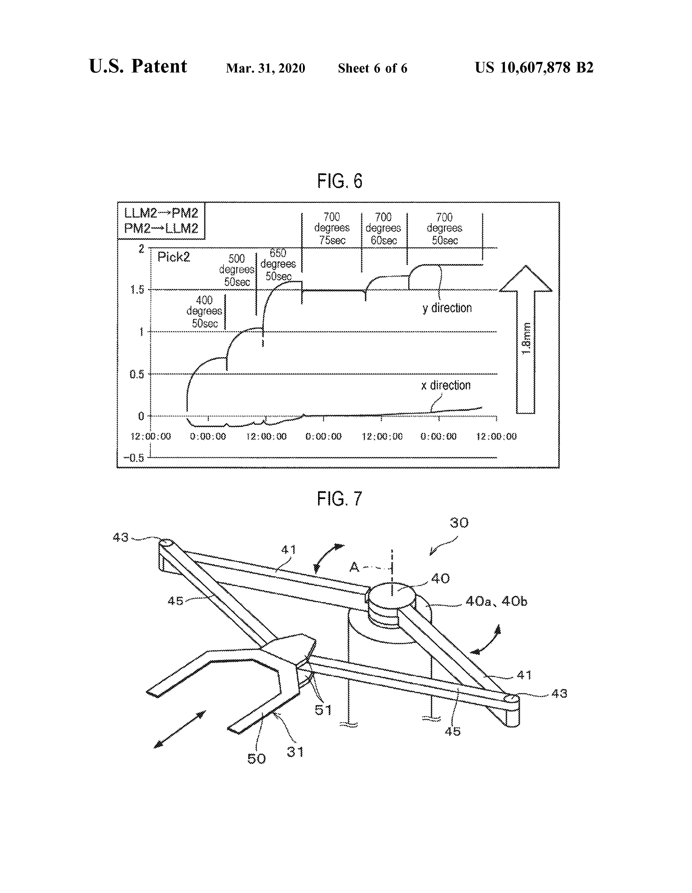

# US 10,607,878 B2 반송 장치 및 보정 방법 (번역)

번역 범위: 전문 (서지, 초록, 본문, 도면 설명, 실시예, 청구항 1~5).
원문: 같은 폴더의 `US10607878B2.pdf` (USPTO 공보, 13쪽, 이미지 PDF).
본문 추출: PDF에 글자층이 없어 `pdftotext -layout` 결과가 비었다. 그래서 쪽 이미지를 tesseract로 OCR해 읽었다. OCR이 틀린 기호(θ1, θ2 등)는 도면과 문맥으로 바로잡았다.
번역 메모: 원문 표현을 그대로 옮겼다. 원문 자체가 앞뒤가 맞지 않는 곳은 [역주]로 표시했다.

---

## 서지

- (10) 특허번호: US 10,607,878 B2
- (45) 등록일: 2020년 3월 31일
- (54) 명칭: 반송 장치 및 보정 방법 (TRANSFER DEVICE AND CORRECTION METHOD)
- (71) 출원인, (73) 권리자: Tokyo Electron Limited, 도쿄(JP)
- (72) 발명자: Hiromitsu Sakaue, 니라사키(JP)
  Seiji Ishibashi, 니라사키(JP)
- (*) 존속기간 조정: 35 U.S.C. 154(b)에 따라 351일 연장
- (21) 출원번호: 15/364,910
- (22) 출원일: 2016년 11월 30일
- (65) 공개: US 2017/0162421 A1, 2017년 6월 8일
- (30) 우선권: 일본 2015-236793, 2015년 12월 3일
- (51) 국제분류: H01L 21/687, H01L 21/68, H01L 21/677 (모두 2006.01)
- (52) CPC: H01L 21/68707, H01L 21/67706, H01L 21/67742, H01L 21/67748, H01L 21/68
- (56) 인용 문헌
  - US 2013/0180448 A1 (2013-07, Sakaue), 심사관 인용
  - JP 11-254359 A (1999-09)
  - JP 2003-303754 A (2003-10)
  - JP 2008-218903 A (2008-09)
  - JP 2010-56161 A (2010-03)
- 심사관: Anthony Ho
- 대리인: Nath, Goldberg & Meyer, Jerald L. Meyer
- 청구항 5개, 도면 6장

## (57) 초록

반송 장치는 다음을 포함한다.

- 회전 구동 기구. 제1 직선 암과 제2 직선 암을 회전 구동해 유지부를 대기 위치와 반송 위치 사이에서 움직인다.
- 회전각 검출 기구. 제1 직선 암과 제2 직선 암의 회전각을 검출한다.
- 위치 검출 센서. 제2 직선 암의 위치를 검출한다.
- 계산부. 제1, 제2 직선 암의 회전각으로 유지부의 위치를 계산한다.
- 제어부. 유지부의 위치 정보와 제2 직선 암의 위치 정보를 비교한다. 두 정보의 차이에 따라 대상물을 옮기는 반송 위치를 보정한다.

---

## 관련 출원

이 출원은 2015년 12월 3일 일본 특허청에 낸 일본 특허출원 2015-236793의 이익을 주장한다. 그 내용 전체를 여기에 참조로 넣는다.

## 기술 분야

이 개시는 반도체 웨이퍼, 액정용 기판, 유기 EL 소자 같은 대상물을 처리실로 옮기는 반송 장치와, 반송 위치를 보정하는 방법에 관한 것이다.

## 배경

반도체 소자나 액정 패널을 만들 때는 성막, 식각, 산화 같은 여러 공정을 처리 용기 안에서 대상물(반도체 기판이나 액정용 기판. 이하 "웨이퍼")에 한다. 대상물을 처리 용기에 넣고 뺄 때는 대상물을 잡는 유지부가 달린 반송 장치를 흔히 쓴다. 여러 반송 장치 가운데, 단일 관절이나 다관절 암을 펴고 접어 유지부를 왕복시키는 방식이 널리 쓰인다.

유지부가 달린 반송 장치로 대상물을 처리 용기 안의 원하는 자리에 맞춰 놓기 위해 여러 정렬 기술이 나왔다. 한 예로, 반도체 웨이퍼의 중심 위치를 구해 재치대의 정해진 자리에 놓는 기술이 있다. 이 기술은 센서 두 개로 웨이퍼 중심을 늘 정확히 구해, 중심을 구하는 정확도를 높인다.

그러나 이 기술은 웨이퍼를 잡는 유지부를 받치는 반송 암의 열팽창 때문에 생기는 어긋남과, 그 어긋남을 보정하는 기술을 다루지 않는다. 일반적으로 반도체 기판에 성막, 식각 같은 공정을 할 때 처리 용기 안은 예를 들어 700도 C의 고온으로 유지된다. 또 처리 용기는 늘 일정한 온도가 아니며, 처리를 시작하면서 온도가 올라가고 시간에 따라 바뀔 수 있다.

웨이퍼를 잡는 유지부를 받치는 반송 암은 시간에 따라 온도가 바뀌거나 고온 환경에 노출된다. 그래서 반송 암은 열팽창과 수축을 되풀이한다. 따라서 처리 용기 안에 대상물(피처리체)을 놓을 때는, 그때그때의 온도 상태에 맞는 반송 암이나 유지부의 정확한 위치 정보를 얻어 정렬해야 한다. 특히 반송 암은 무게를 줄이고 범용성을 갖추려고 보통 알루미늄으로 만든다. 그래서 반송 암의 열팽창 계수가 SUS 등으로 만든 유지부보다 크다. 이 때문에 정렬할 때 반송 암의 늘어남이나 변형을 고려하는 것이 중요하다.

즉, 처리 용기 안이나 근처에서 온도가 오르내리는 속도는 환경에 따라 시간마다 다르다. 그래서 환경에 따른 늘어남이나 변형이 반송 암에 생길 수 있다. 따라서 처리 용기 근처에서, 대상물을 놓기 직전에, 반송 암의 위치 정보를 되도록 많이 얻어야 한다. 이 점에서 종래 기술은 유지부가 처리 용기에 들어갈 때 처리 용기 입구 근처에서 목표인 유지부의 위치 정보를 검출해 이 요구에 대응한다. 그러나 종래 기술은 유지부가 처리 용기에 들어가는 시점(반송 암이 완전히 펴지기 직전 상태)에서 반송 암의 모양을 고려해 반송 암의 위치를 검출하거나 측정하지 않는다.

## 요약 (Summary)

이 개시의 일부 실시예는 대상물을 옮기는 반송 장치를 제공한다. 이 장치는 열팽창, 열수축, 시간에 따른 온도 변화로 생기는 변형 같은 조건 때문에 반송 암의 모양이 바뀌는 것을 고려해 반송 암의 위치 정보를 얻을 수 있다. 그래서 종래 장치보다 높은 정밀도로 대상물을 정확한 반송 위치에 놓을 수 있다.

한 실시예에 따르면, 대상물을 잡는 유지부, 한쪽 끝이 유지부에 연결된 제2 직선 암, 관절부를 통해 제2 직선 암의 다른 끝에 연결된 제1 직선 암을 포함하는 반송 장치가 제공된다. 이 반송 장치는 다음을 포함한다.

- 제1, 제2 직선 암을 회전 구동해 유지부를 대기 위치와 반송 위치 사이에서 움직이는 회전 구동 기구
- 제1, 제2 직선 암의 회전각을 검출하는 회전각 검출 기구
- 제2 직선 암의 위치를 검출하는 위치 검출 센서
- 회전각 검출 기구가 검출한 제1, 제2 직선 암의 회전각으로 유지부의 위치를 계산하는 계산부
- 계산부가 계산한 유지부의 위치 정보와 위치 검출 센서가 검출한 제2 직선 암의 위치 정보를 비교하고, 그 차이에 따라 대상물을 옮기는 반송 위치를 보정하게 하는 제어부

[역주] 원문 요약절은 "be collected"로 쓰였으나 청구항 1은 "be corrected"다. 오타로 보고 "보정"으로 옮겼다.

다른 실시예에 따르면, 위와 같은 반송 장치에서 대상물을 옮기는 반송 위치를 보정하는 방법이 제공된다. 이 보정 방법은 다음을 포함한다.

- 제1, 제2 직선 암의 회전각으로 유지부의 위치를 계산한다.
- 제2 직선 암의 위치를 검출하는 위치 검출 센서로 제2 직선 암의 위치를 검출한다.
- 회전각으로 계산한 유지부의 위치 정보와 위치 검출 센서로 검출한 제2 직선 암의 위치 정보를 비교하고, 그 차이에 따라 대상물을 옮기는 반송 위치를 보정한다.

## 도면의 간단한 설명

첨부 도면은 명세서의 일부이며, 위의 일반 설명과 아래 실시예 상세 설명과 함께 이 개시의 원리를 설명한다.

- 도 1: 이 개시의 실시예에 따른 반송 장치를 적용한 기판 처리 시스템의 구성을 보여 주는 개략 평면도
- 도 2: 웨이퍼 반송 장치의 개략 사시도
- 도 3A~3C: 종래 웨이퍼 반송 장치의 동작을 보여 주는 개략 평면도
- 도 4A~4D: 이 개시의 실시예에 따른 웨이퍼 반송 장치의 동작을 보여 주는 개략 평면도
- 도 5A, 5B: 암 기구의 동작 상태를 보여 주는 개략 설명도
- 도 6: 로드록실과 처리실 사이를 왕복한 암 기구 Pick2의 선단 늘어남 양을 평가한 결과 그래프
- 도 7: 프로그레그(frog-leg)형이라 부르는 구성의 암 기구 개략 설명도

## 상세한 설명

이제 여러 실시예를 자세히 설명한다. 그 예는 첨부 도면에 있다. 아래 설명에서는 이 개시를 충분히 이해하도록 구체적인 내용을 많이 적는다. 그러나 이 분야의 통상의 기술자라면 이런 구체 내용 없이도 이 개시를 실시할 수 있다. 다른 경우에는 여러 실시예의 요지를 흐리지 않도록 잘 알려진 방법, 절차, 시스템, 구성 요소를 자세히 설명하지 않았다. 또 명세서와 도면에서 기능 구성이 사실상 같은 구성 요소에는 같은 부호를 붙이고 반복 설명을 생략한다.

### 기판 처리 시스템 (도 1)

도 1은 이 개시의 실시예에 따른 반송 장치를 적용한 기판 처리 시스템 1의 구성을 보여 주는 개략 평면도다. 기판 처리 시스템 1은 카세트 C 단위로 웨이퍼 W를 시스템에 넣고 빼는 카세트 스테이션 2와, 대상물(예: 웨이퍼 W)을 처리하는 처리 스테이션 3을 포함한다. 카세트 스테이션 2와 처리 스테이션 3은 로드록실 4를 통해 하나로 연결된다.

카세트 스테이션 2는 카세트 재치부 10과, 그 옆에 있는 반송실 11을 포함한다. 카세트 재치부 10에는 웨이퍼 W를 여러 장 담을 수 있는 카세트 C를 여러 개(예: 세 개) X 방향(도 1의 좌우 방향)으로 한 줄로 놓을 수 있다. 반송실 11에는 웨이퍼 반송 암 12가 있다. 웨이퍼 반송 암 12는 위아래와 좌우로 움직이고 수직축 둘레(도 1의 θ 방향)로 돌 수 있으며, 카세트 재치부 10의 카세트 C와 로드록실 4 사이에서 웨이퍼 W를 옮긴다. 반송실 11의 음의 X 방향 끝에는 각 웨이퍼 W의 노치 등을 인식해 웨이퍼를 위치 맞추는 정렬 장치 12가 있다.

[역주] 원문은 반송 암과 정렬 장치에 모두 부호 12를 붙였다. 원문 그대로 옮겼다.

처리 스테이션 3은 웨이퍼 W를 처리하는 여러 처리실 20과, 다각형(도 1의 예에서는 팔각형) 진공 반송실 21을 포함한다. 처리실 20은 진공 반송실 21을 둘러싸며 놓인다. 로드록실 4도 진공 반송실 21에 연결된다.

진공 반송실 21에는 대상물(피반송물)인 웨이퍼 W를 옮기는 웨이퍼 반송 장치 30이 있다. 웨이퍼 반송 장치 30은 웨이퍼 W를 잡는 유지부인 포크 31과, 선회하고 신축하는 단일 관절 암 기구 32를 포함한다. 이 구성으로 웨이퍼 반송 장치 30은 로드록실 4, 진공 반송실 21, 처리실 20 사이에서 웨이퍼 W를 옮긴다. 도 1에는 진공 반송실 21 가운데에 암 기구 32가 하나만 있지만, 여러 개를 둘 수도 있다.

진공 반송실 21에는 처리실 20과의 경계마다 웨이퍼 W를 넣고 빼는 반송구 35가 있다. 각 처리실 20을 향한 반송구 35의 양쪽에는 웨이퍼 W의 통과를 감지하는 센서 37이 여러 개 있다. 예를 들어 반송구 35마다 위쪽(두 곳)에 센서 37 한 쌍을 둔다. 이 센서 37로, 포크 31에 실린 웨이퍼 W를 처리실 20에 넣을 때 웨이퍼 W가 지나가기 시작한 시각과 다 지나간 시각을 감지한다. 이렇게 감지한 위치 정보를 바탕으로 웨이퍼 W를 처리실 20 안의 정해진 자리에 놓는다.

### 웨이퍼 반송 장치 (도 2)

*도면 2쪽 (Sheet 2 of 6). 도 2: 웨이퍼 반송 장치 30의 개략 사시도. 중앙 허브 40, 모터 40a, 40b, 제1 직선 암 41, 관절부 43, 제2 직선 암 45, 포크 31(본체 50, 지지판 51), 각도 θ1, θ2, θ3.*

다음으로 암 기구 32를 포함한 웨이퍼 반송 장치 30의 자세한 구성을 도 2로 설명한다. 도 2는 웨이퍼 반송 장치 30의 개략 사시도다. 도 2처럼 웨이퍼 반송 장치 30은 중앙 허브 40의 중심 A를 회전축으로 도는 제1 직선 암 41과, 제1 직선 암 41의 앞끝에 있는 관절부 43을 통해 연결된 제2 직선 암 45를 포함한다.

또 모터 40a, 40b가 회전 부재(도시하지 않음)를 통해 중앙 허브 40에 연결된다. 제1 직선 암 41은 모터 40a의 동작으로 중심 A를 회전축으로 돈다. 제1 직선 암 41의 회전각을 θ1이라 한다(이하 "제1 직선 암 41의 회전각 θ1"). 한편 모터 40b의 동작으로 암 기구 32 전체가 중심 A를 회전축으로 돈다.

제2 직선 암 45는 관절부 43을 중심축으로 돈다. 제2 직선 암 45의 앞끝에 포크 31이 있다. 관절부 43에서 제1 직선 암 41과 제2 직선 암 45가 이루는 각을 θ2라 하면(이하 "제2 직선 암 45의 회전각 θ2"), θ2는 제1 직선 암 41의 회전각 θ1과 연동해 바뀐다. 구체적으로 θ1이 줄면 θ2가 늘고, θ1이 늘면 θ2가 준다. 또 제2 직선 암 45와 포크 31이 이루는 각 θ3(뒤에 설명할 지지판 51의 연결 각)은 암 기구 32가 펴질수록 커진다. 이 θ1~θ3을 알맞게 조정하면, 암 기구 32 앞끝의 포크 31을 중앙 허브 40과 각 처리실 20 사이에서 중심 A로부터 반지름 방향으로 거의 직선으로 움직일 수 있다.

암 기구 32는 제1 직선 암 41과 제2 직선 암 45의 끝을 이어 관절부 43을 꼭짓점으로 하는 이등변삼각형이 무너지지 않는 조건에서, 벨트, 링크, 기어 같은 기구(모두 도시하지 않음)를 알맞게 써서 펴고 접는다. 그래서 암 기구 32는 정해진 반송 위치를 향해 거의 직선으로 펴지고 접힌다. 즉 중앙 허브 40과 모터 40a가 제1, 제2 직선 암 41, 45를 돌려 포크 31을 대기 위치에서 반송 위치로 옮긴다.

유지부인 포크 31은 거의 U자 모양의 본체부 50과, 본체부 50을 받치는 지지판 51을 포함한다. 본체부 50은 예를 들어 볼트(도시하지 않음) 같은 체결 부재로 지지판 51에 연결된다. 포크 31은 지지판 51을 통해 연결 각 θ3을 알맞게 바꿀 수 있도록 제2 직선 암 45의 앞끝에 달린다.

### 종래 방식의 동작 (도 3A~3C)

다음으로 위와 같이 구성한 웨이퍼 반송 장치 30의 동작과, 이를 이용한 종래의 위치 정보 획득 방법을 도 3A~3C로 설명한다. 도 3A~3C는 종래 웨이퍼 반송 장치 30의 동작을 보여 주는 개략 평면도로, 웨이퍼 W를 처리실 20에 넣을 때의 동작이다. 도 3A는 웨이퍼 W를 옮기기 전, 도 3B는 웨이퍼 W를 처리실 20에 넣는 중, 도 3C는 넣은 뒤 상태다. 웨이퍼 W는 도 3A에서 도 3C 순서로 옮겨진다.

먼저 도 3A처럼, 로드록실 4에서 꺼낸 웨이퍼 W가 웨이퍼 반송 장치 30의 유지부인 포크 31에 실려 대기한다. 앞에서처럼 제1 직선 암 41의 회전각을 θ1, 제2 직선 암 45의 회전각을 θ2라 할 때의 포크 31 위치를 대기 위치로 정의한다. 이 대기 상태(도 3A)에서 제1 직선 암 41의 회전각 θ1을 줄이고 제2 직선 암 45의 회전각 θ2를 늘린다. 이렇게 포크 31에 실린 웨이퍼 W가 도 3의 Y 방향(처리실 20을 향한 직선 방향)으로 옮겨진다.

이어 도 3B처럼, 웨이퍼 W를 처리실 20의 반송구에 있는 센서 37이 감지하는 자리까지 옮긴다. 이 감지로 웨이퍼 W의 위치 정보를 얻는다. 이때 제1 직선 암 41의 회전각을 θ1a(<θ1), 제2 직선 암 45의 회전각을 θ2a(>θ2)로 정의한다.

그 뒤 도 3C처럼, 웨이퍼 반송 장치 30의 유지부(포크 31)를 최종 반송 위치까지 옮겨 웨이퍼 W를 처리실 20 안의 정해진 자리에 놓는다. 이때 제1 직선 암 41의 회전각을 θ1b(<θ1a), 제2 직선 암 45의 회전각을 θ2b(>θ2a)로 정의한다.

이처럼 도 3A~3C의 종래 반송 방법은, 센서 37이 웨이퍼 W를 처음 감지할 때 얻은 위치 정보와 웨이퍼 W가 센서 37의 감지 범위를 벗어날 때 얻은 위치 정보로 웨이퍼 W를 정렬하고, 처리실 20 안의 정해진 자리에 놓는다. 얻은 위치 정보가 제어부(도시하지 않음)로 가면, 제어부는 모터 40a에 동작 신호를 보내 모터 40a를 움직인다. 모터 40a가 움직이면 제1 직선 암 41과 제2 직선 암 45가 돌며 움직인다. 이렇게 웨이퍼 W가 정렬된다.

여기서 제1, 제2 암 41, 45의 회전각은 회전각 검출 기구(도시하지 않음)가 일정한 시점에 검출한다. 회전각 검출 기구가 검출한 암 회전각과 센서 37이 웨이퍼 W를 감지했을 때의 값 사이의 관계를 계산부(도시하지 않음)가 계산해 웨이퍼 W의 위치 정보를 얻는다.

종래 웨이퍼 반송 장치 30의 동작과 위치 정보 획득을 도 3A~3C로 설명했다. 이렇게 구성한 센서 37로 웨이퍼 W의 위치 정보를 얻는 경우, 포크 31이 처리실 20 안에 들어간 뒤 단계(즉 반송 암이 완전히 펴지기 직전 상태)에서 각 암이 늘어나거나 변형되는 모양 변화는 위치 정보를 얻는 과정에 반영되지 않는다. 반송 암(제1 직선 암 41과 제2 직선 암 45)이 완전히 펴지기 직전 상태에서는 반송 암의 늘어남이나 변형이 Y 방향(처리실 20을 향한 직선 방향)으로 크게 나타난다. 이를 고려해 발명자들은 웨이퍼를 정해진 자리에 놓는 정확도를 더 높이도록, 이 개시의 실시예에 따른 웨이퍼 반송 장치 30의 제어 방법을 만들었다. 다음으로 이 실시예의 제어 방법을 도 4A~4D로 설명한다.

### 실시예의 동작 (도 4A~4D)

*도면 4쪽 (Sheet 4 of 6). 도 4A~4D: 실시예의 웨이퍼 반송 장치 동작. 4A 반송 전 대기, 4B 반송구 센서 37이 웨이퍼를 감지하기 시작, 4C 웨이퍼가 처리실에 들어간 직후 킥커 센서 63이 킥커 부재 60을 감지하기 시작, 4D 놓기 직전 킥커 감지 완료. 오른쪽 아래 화살표가 X, Y 방향.*

도 4A~4D는 이 개시의 실시예에 따른 웨이퍼 반송 장치 30의 동작을 보여 주는 개략 평면도로, 웨이퍼 W를 처리실 20에 옮길 때의 동작이다. 도 4A는 웨이퍼 W를 옮기기 전, 도 4B는 웨이퍼 W를 처리실 20에 넣는 중, 도 4C는 웨이퍼 W를 처리실 20에 넣은 직후, 도 4D는 웨이퍼 W를 놓기 직전 상태다. 웨이퍼 W는 도 4A에서 도 4D 순서로 옮겨진다.

이 실시예의 웨이퍼 반송 장치 30은 기본 구성이 도 2, 도 3A~3C로 설명한 것과 같다. 다른 점은 다음 두 가지다.

- 제2 직선 암 45에 길이 방향으로 킥커(kicker) 부재 60을 단다.
- 웨이퍼 반송 장치 30이 움직이는 동안, 웨이퍼 W가 처리실 20에 들어간 뒤 킥커 부재 60의 위치를 검출하는 킥커 센서 63을 둔다.

즉 킥커 부재 60과 킥커 센서 63이 제2 직선 암 45의 위치 검출 센서 역할을 한다.

먼저 도 4A처럼, 로드록실 4에서 꺼낸 웨이퍼 W가 웨이퍼 반송 장치 30의 유지부인 포크 31에 실린다. 이때 제1 직선 암 41의 회전각은 θ1, 제2 직선 암 45의 회전각은 θ2이고, 이 상태의 포크 31 위치를 대기 위치로 정의한다. 이 대기 상태(도 4A)에서 제1 직선 암 41의 회전각 θ1을 줄이고 제2 직선 암 45의 회전각 θ2를 늘린다. 그래서 포크 31에 실린 웨이퍼 W가 도 4C의 Y 방향(처리실 20을 향한 직선 방향)으로 옮겨진다.

이어 도 4B처럼, 웨이퍼를 처리실 20의 반송구 35에 있는 센서 37이 감지하는 자리까지 옮긴다. 이 감지로 웨이퍼 W의 위치 정보 획득이 시작된다. 이때 제1 직선 암 41의 회전각을 θ1a(<θ1), 제2 직선 암 45의 회전각을 θ2a(>θ2)로 정의한다.

그 뒤 도 4C처럼, 웨이퍼 W가 처리실 20에 들어간 직후 센서 37의 웨이퍼 W 감지가 끝난다. 즉 센서 37로 하던 웨이퍼 W 위치 정보 획득이 끝난다. 또 웨이퍼 W가 처리실 20에 들어간 뒤 킥커 센서 63의 킥커 부재 60 검출이 시작된다. 이때 제1 직선 암 41의 회전각을 θ1b'(<θ1a), 제2 직선 암 45의 회전각을 θ2b'(>θ2a)로 정의한다.

이어 도 4D처럼, 킥커 센서 63의 킥커 부재 60 검출이 끝나고, 그 검출 결과로 웨이퍼 W의 위치 정보를 얻는다. 얻은 위치 정보로 웨이퍼 W를 정렬한다. 웨이퍼 반송 장치 30의 유지부(포크 31)를 최종 반송 위치까지 옮겨 웨이퍼 W를 처리실 20 안의 정해진 자리에 놓는다. 이때 제1 직선 암 41의 회전각을 θ1c(<θ1b'), 제2 직선 암 45의 회전각을 θ2c(>θ2b')로 정의한다.

또 얻은 위치 정보가 제어부(도시하지 않음)로 가면, 제어부는 모터 40a, 40b에 동작 신호를 보내 두 모터를 움직인다. 모터 40a, 40b가 움직이면 제1 직선 암 41, 제2 직선 암 45, 암 기구 32가 하나로 돌며 움직인다. 이렇게 웨이퍼 W가 정렬된다.

여기서 제1, 제2 암 41, 45의 회전각은 회전각 검출 기구(도시하지 않음)가 일정한 시점에 검출한다. 센서 37의 웨이퍼 W 감지가 끝날 때까지는, 회전각 검출 기구가 검출한 제1, 제2 암 41, 45의 회전각과 센서 37이 웨이퍼 W를 감지했을 때의 값 사이의 관계를 계산부(도시하지 않음)가 계산해 웨이퍼 W의 위치 정보를 얻는다.

한편 제2 직선 암 45의 위치 검출 센서 역할을 하는 킥커 부재 60과 킥커 센서 63으로, 센서 37의 감지가 끝난 뒤에도 웨이퍼 W의 위치 정보를 얻는다. 회전각 검출 기구와 센서 37로 얻은 웨이퍼 W의 위치 정보를, 킥커 부재 60과 킥커 센서 63(제2 직선 암 45의 위치 검출 센서)으로 얻은 웨이퍼 W의 위치 정보와 비교해 차이를 계산한다. 그 차이로 제어부(도시하지 않음)가 웨이퍼 W의 위치를 보정해 최종 재치 위치를 정한다. 그래서 웨이퍼 W를 정해진 자리에 높은 정밀도로 놓을 수 있다.

일부 실시예에서는, 웨이퍼 W를 옮기는 도중(도 4) 제2 직선 암 45가 정속으로 움직이는 구간과 감속하는 구간에서 킥커 센서 63이 킥커 부재 60을 감지하도록, 킥커 부재 60의 설치 위치와 킥커 부재 60과 킥커 센서 63의 위치 관계를 정할 수 있다.

[역주] 원문 이 문단에 "킥커 부재 62"라는 부호가 한 번 나온다. 문맥상 60의 오기로 보았다.

### 정속 구간과 감속 구간 (도 5A, 5B)

여기서 암 기구 32(특히 제2 직선 암 45)의 동작에서 정속 구간과 감속 구간을 구체적으로 정의한다. 도 5A, 5B는 암 기구 32의 동작 상태를 보여 주는 개략 설명도다. 구체적으로 도 5A, 5B는 암 기구 32의 중심 위치를 0 mm로 볼 때 900~1,000 mm 떨어진 범위로 정한 반송 위치(웨이퍼 W를 넘겨주는 자리)에서의 동작 상태다. 도 5A, 5B에서 암 기구 32가 움직일 때 선회 반경 안의 웨이퍼 W 중심 위치(암 대기 위치)는 약 310 mm로 정했다. 실제로 웨이퍼 W의 반송은 310 mm 근처에서 시작한다. 웨이퍼 W는 넘겨주는 반송 위치까지 옮겨진다. 도 5에는 암 기구 32의 동작 예로 두 경우를 보였다.

- 도 5A: 동작 중간점 605 mm, 반송 위치 900 mm
- 도 5B: 동작 중간점 655 mm, 반송 위치 1,000 mm

또 도 5A, 5B는 암 기구 32가 움직일 때 암 속도의 예도 그래프로 보인다. 도 5A 그래프는 중간점 605 mm, 반송 위치 900 mm인 삼각형 동작 패턴(실선)의 속도 변화다. 도 5B 그래프는 중간점 655 mm, 반송 위치 1,000 mm인 삼각형 동작 패턴(파선)의 속도 변화와, 중간점이 655 mm 근처이고 반송 위치가 1,000 mm인 사다리꼴 동작 패턴(1점 쇄선)의 속도 변화를 함께 보인다.

*도 5A, 5B (도면 5쪽, 그림 파일은 넣지 않음): 가로축 "Amount of Stroke (mm)" (행정량), 0~1000 mm. 위는 암 자세 개략, 아래는 행정량에 따른 속도 곡선.*

일반적으로 암 기구 32는 삼각형 동작 패턴, 사다리꼴 동작 패턴, 스플라인 동작 패턴으로 움직인다고 알려져 있다. 도 5A, 5B 그래프처럼 암 기구 32는 기본적으로 중간점(605~655 mm 범위)에서 최고 속도로 움직이고, 중간점을 지난 직후 정속 구간이나 감속 구간에 들어간다. 여기서 "정속 구간"은 도 5B의 사다리꼴 동작 패턴처럼 암 기구 32가 최고 속도를 유지하며 계속 움직이는 구간이다. 정속 구간이 있으면 그 뒤가 감속 구간이 된다. 정속 구간이나 감속 구간은 웨이퍼 W를 옮기는 도중 중간점을 지난 구간에 해당한다. 이런 구간에서 킥커 센서 63이 킥커 부재 60을 감지하게 하면, 암 기구 32가 어느 정도 펴진 자리에서도 웨이퍼 W의 위치 정보를 얻을 수 있다.

### 효과

도 4A~4D로 설명했듯이, 이 실시예의 기술은 센서 37로 얻은 위치 정보와 킥커 부재 60과 킥커 센서 63으로 얻은 위치 정보로 웨이퍼 W의 위치를 보정한다. 이때 킥커 부재 60과 킥커 센서 63으로 하는 위치 정보 획득은 웨이퍼 W를 원래 놓을 자리에 더 가까운 곳에서 한다. 즉 제1 직선 암 41과 제2 직선 암 45가 Y 방향으로 완전히 펴지기 직전에 위치 정보를 얻어 보정할 수 있다. 그래서 종래 기술보다 높은 정밀도로 웨이퍼 W를 정확한 자리에 놓을 수 있다. 특히 제1 직선 암 41과 제2 직선 암 45는 온도가 오르내리면 Y 방향으로 크게 늘어나고 변형된다. 이런 늘어남과 변형을 고려해 웨이퍼 W의 위치 정보를 얻고 보정하므로, 매우 높은 정밀도로 웨이퍼 W를 정확한 자리에 놓을 수 있다.

또 일반적으로 이 실시예의 웨이퍼 반송 장치 30을 적용한 기판 처리 시스템 1은 대상물(웨이퍼 W) 여러 장을 계속 처리한다. 예를 들어 기판 처리 시스템 1이 웨이퍼 W를 약 6~7시간 계속 처리하면, 제1 직선 암 41과 제2 직선 암 45의 온도는 시간에 따라 바뀌다가 일정 시간이 지나면 정상 상태가 된다. 이때 제1, 제2 직선 암 41, 45의 온도가 시간에 따라 바뀌는 단계에서도, 온도 변화에 따른 암의 늘어남과 변형을 고려해 웨이퍼 W의 위치 정보를 늘 얻고 보정할 수 있다. 그래서 처리 상태나 경과 처리 시간과 상관없이 웨이퍼 W를 늘 정확한 자리에 높은 정밀도로 놓을 수 있다.

### 암 온도 변화와 늘어남 평가 (도 6)

다음으로 이 실시예의 기판 처리 시스템 1에서 반송 장치 30의 암 온도 변화와 그에 따른 늘어남, 변형을 살펴본다.

*도면 6쪽 (Sheet 6 of 6). 위: 도 6, 아래: 도 7.
도 6: Pick2(포크 31에 해당) 선단의 늘어남 양(세로축, mm, -0.5~2). 가로축은 시각(12:00:00, 0:00:00이 번갈아 표시, 약 2일). 경로 LLM2→PM2, PM2→LLM2. 위쪽 띠는 처리실 설정 온도와 처리 시간 구간: 400도 50초, 500도 50초, 650도 50초, 700도 75초, 700도 60초, 700도 50초. "y direction" 곡선은 계단 모양으로 오르며 끝에서 약 1.8 mm(오른쪽 화살표 "1.8mm"). "x direction" 곡선은 0 근처에서 끝에 약 0.1 mm.
도 7: 프로그레그형 암 기구. 제1 직선 암 41 한 쌍, 제2 직선 암 45 한 쌍, 관절부 43, 중앙 허브 40, 모터 40a, 40b, 포크 31(본체 50, 지지판 51).*

[역주] 도 6의 숫자(1.8 mm, 0.1 mm 등)는 본문이 아니라 그래프 눈금과 화살표에서 읽은 값이다.

도 6은 이 실시예의 기판 처리 시스템 1에서, 처리된 웨이퍼 W를 잡은 암 기구 32(Pick2: 이 실시예의 포크 31에 해당하는 부품 이름)를 로드록실 4와 처리실 20 사이에서 왕복시키고, 암 기구 32 선단의 늘어남 양을 평가한 결과 그래프다. 도 6에서 y 방향은 반송 방향(중심 A로부터 반지름 방향), x 방향은 반송 방향에 직교하는 방향이다. 도 6의 평가는 처리실 20의 설정 온도 400~700도 C, 처리실 20의 처리 시간 50~75초 범위의 조건에서 했다.

도 6에서 보듯, 웨이퍼 W 반송을 되풀이할수록 암 기구 32 선단의 늘어남 양은 주로 y 방향으로 커진다. 또 반송과 왕복 동작을 되풀이하면서 선단의 늘어남 양이 시간에 따라 바뀐다. 따라서 처리 상태나 경과 처리 시간과 상관없이 웨이퍼 W를 늘 정확한 자리에 높은 정밀도로 놓으려면, 위에서 설명한 것처럼 암의 늘어남과 변형을 고려해 위치 정보를 얻고 보정하는 것이 중요하다.

### 변형 예

위에서 이 개시의 실시예 하나를 설명했지만, 이 개시는 그에 한정되지 않는다. 이 분야의 기술자라면 첨부한 청구범위의 사상 안에서 여러 수정이나 변경을 생각할 수 있으며, 그런 수정과 변경도 이 개시의 기술 범위에 속한다.

예를 들어 위 실시예에서는 킥커 부재 60을 제2 직선 암 45에 길이 방향으로 달고 킥커 센서 63이 이를 감지하는 구성을 보였지만, 이 개시는 그에 한정되지 않는다. 즉 제1 직선 암 41과 제2 직선 암 45가 Y 방향으로 완전히 펴지기 직전에 웨이퍼의 위치 정보를 얻고 보정할 수 있으면 특별히 제한하지 않는다. 킥커 부재 60의 모양이나 구성도 특별히 제한하지 않는다. 일부 실시예에서는 킥커 부재 60을 다는 대신, 제2 직선 암 45를 노치 모양(잘린 부분) 같은 감지 가능한 모양으로 만들 수 있다. 이때는 그 잘린 부분을 감지하는 센서(킥커 센서 63에 해당)를 둔다.

또 위 실시예에서는 킥커 센서 63을 따로 두는 구성을 설명했지만, 처리실 20의 반송구 35에 있는 센서 37을 킥커 센서 63으로 쓸 수 있다. 그러면 킥커 센서 63을 새로 달 필요가 없다. 또 제1 직선 암 41과 제2 직선 암 45가 Y 방향으로 완전히 펴지기 직전에 센서 37이 감지할 수 있으면, 킥커 부재 60의 설치와 구성은 특별히 제한하지 않는다.

또 위 실시예에서는 암 기구 32의 구성 예로 제1, 제2 직선 암 41, 45와 포크 31을 가진 선회, 신축형 단일 관절 구성을 설명했지만, 이 개시의 적용은 그에 한정되지 않는다. 일부 실시예에서는 도 7처럼 제1 직선 암 41 한 쌍과 제2 직선 암 45 한 쌍을 가진, 프로그레그형이라 부르는 암 기구에 적용할 수 있다. 다만 이 경우 제2 직선 암 45 한 쌍 각각에, 제1 직선 암 41과 제2 직선 암 45가 Y 방향으로 완전히 펴지기 직전에 감지 동작을 하는 킥커 부재에 해당하는 구성이나 센서가 필요하다.

## 실시예 (Example)

도 1, 도 2처럼 구성한 기판 처리 시스템 1에서, 이 개시의 예로 다음을 했다.

- 도 3의 종래 보정 방법과 도 4의 이 개시의 보정 방법을 각각 적용했다.
- 조건은 승온 조건(시간에 따라 온도가 오르는 조건)과 실온 조건(온도가 일정한 조건) 두 가지다.
- 암 기구로 웨이퍼 W를 되풀이해 옮겨 놓고, 그 상태에서 웨이퍼 W의 어긋남 양을 쟀다.

결과는 다음과 같다.

| 조건 | 종래 보정 방법 | 이 개시의 보정 방법 |
|---|---|---|
| 승온 조건 | 0.91 mm | 0.21 mm |
| 실온 조건 | 0.35 mm | 0.29 mm |

승온 조건과 실온 조건 모두에서, 이 개시의 보정 방법의 어긋남 양이 종래 보정 방법보다 작았다. 따라서 이 측정은 웨이퍼 W 정렬이 높은 정밀도로 이루어짐을 보여 준다. 또 승온 조건에서는 종래 보정 방법과 이 개시의 보정 방법의 어긋남 양 차이가 작게 생긴 반면, 실온 조건에서는 두 방법의 어긋남 양 차이가 크게 생겼다. 따라서 이 개시의 보정 방법은 시간에 따라 온도가 바뀌는 승온 조건이나 그와 비슷한 강온 조건에서 더 효과가 있다.

[역주] 위 문단의 "승온에서 차이가 작고, 실온에서 차이가 크다"는 표의 수치(승온 0.70 mm 차이, 실온 0.06 mm 차이)와 반대다. 원문 그대로 옮겼다. 결론 문장(승온 조건에서 더 효과가 있다)은 수치와 맞는다. 원문의 "작다"와 "크다"가 서로 바뀐 오기로 보인다.

이 개시는 대상물, 특히 반도체 웨이퍼, 액정용 기판, 유기 EL 소자 같은 피처리물을 처리실로 옮기는 반송 장치와, 반송 위치를 보정하는 방법에 적용할 수 있다.

일부 실시예의 이 개시에 따르면, 대상물을 옮기는 반송 장치에서 열팽창, 열수축, 시간에 따른 온도 변화로 생기는 변형 같은 반송 암의 모양 변화를 고려해 반송 암의 위치 정보를 얻을 수 있다. 그래서 종래 반송 장치보다 높은 정밀도로 대상물을 정확한 반송 위치에 놓을 수 있다.

일부 실시예를 설명했지만, 이 실시예들은 예로 든 것일 뿐이며 개시의 범위를 한정하려는 것이 아니다. 여기서 설명한 실시예는 다른 여러 형태로 구현할 수 있다. 또 개시의 사상을 벗어나지 않는 범위에서 실시예의 형태를 여러 가지로 생략, 대체, 변경할 수 있다. 첨부한 청구범위와 그 균등물은 개시의 범위와 사상에 속하는 그런 형태나 수정을 포함하려는 것이다.

## 청구항

**1.** 대상물을 잡도록 구성된 유지부, 한쪽 끝이 유지부에 연결된 제2 직선 암, 관절부를 통해 제2 직선 암의 다른 끝에 연결된 제1 직선 암을 포함하는 반송 장치로서, 다음을 포함하는 반송 장치.

- 제1 직선 암과 제2 직선 암을 회전 구동해 유지부를 대기 위치와 반송 위치 사이에서 움직이도록 구성된 회전 구동 기구
- 제1 직선 암과 제2 직선 암의 회전각을 검출하도록 구성된 회전각 검출 기구
- 제2 직선 암의 위치를 검출하도록 구성된 위치 검출 센서
- 회전각 검출 기구가 검출한 제1, 제2 직선 암의 회전각으로 유지부의 위치를 계산하도록 구성된 계산부
- 계산부가 계산한 유지부의 위치 정보와 위치 검출 센서가 검출한 제2 직선 암의 위치 정보를 비교하고, 유지부의 위치 정보와 제2 직선 암의 위치 정보의 차이에 따라 대상물을 옮기는 반송 위치를 보정하게 하도록 구성된 제어부

**2.** 청구항 1에 있어서, 제2 직선 암의 위치를 검출하도록 구성된 위치 검출 센서는, 제2 직선 암의 길이 방향으로 제2 직선 암에 단 킥커 부재와, 킥커 부재를 검출하도록 구성된 킥커 센서를 포함하는 반송 장치.

**3.** 청구항 2에 있어서, 킥커 센서의 킥커 부재 검출은, 제2 직선 암을 회전 구동할 때 제2 직선 암이 정속으로 움직이는 구간이나 감속하는 구간에서만 하는 반송 장치.

**4.** 청구항 1에 있어서, 제2 직선 암의 위치를 검출하도록 구성된 위치 검출 센서는, 제2 직선 암의 길이 방향으로 제2 직선 암에 만든 잘린 부분(cut-away portion)과, 그 잘린 부분을 검출하도록 구성된 센서를 포함하는 반송 장치.

**5.** 청구항 1에 있어서, 제1 직선 암과 제2 직선 암은 각각 쌍으로 된 암으로 설치되는 반송 장치.

## 인용 문헌 (원문 그대로)

U.S. PATENT DOCUMENTS
2013/0180448 A1* 7/2013 Sakaue ............. H01L 21/67739 118/696

FOREIGN PATENT DOCUMENTS
JP 11-254359 A 9/1999
JP 2003303754 A 10/2003
JP 2008-218903 A 9/2008
JP 201056161 A 3/2010

* cited by examiner
