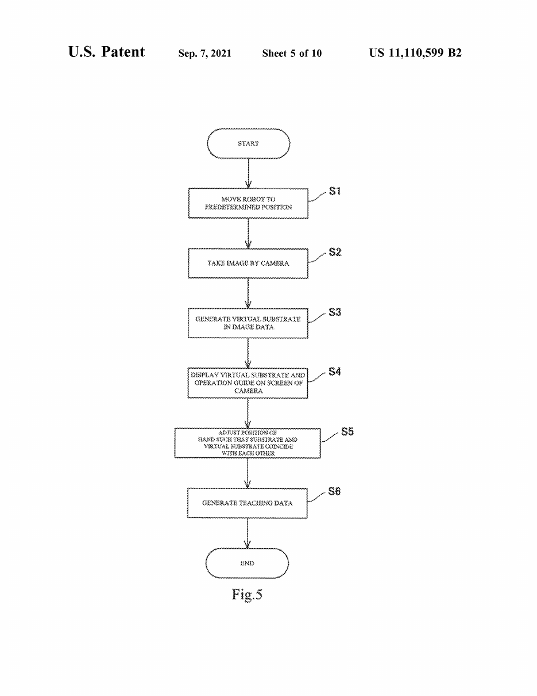
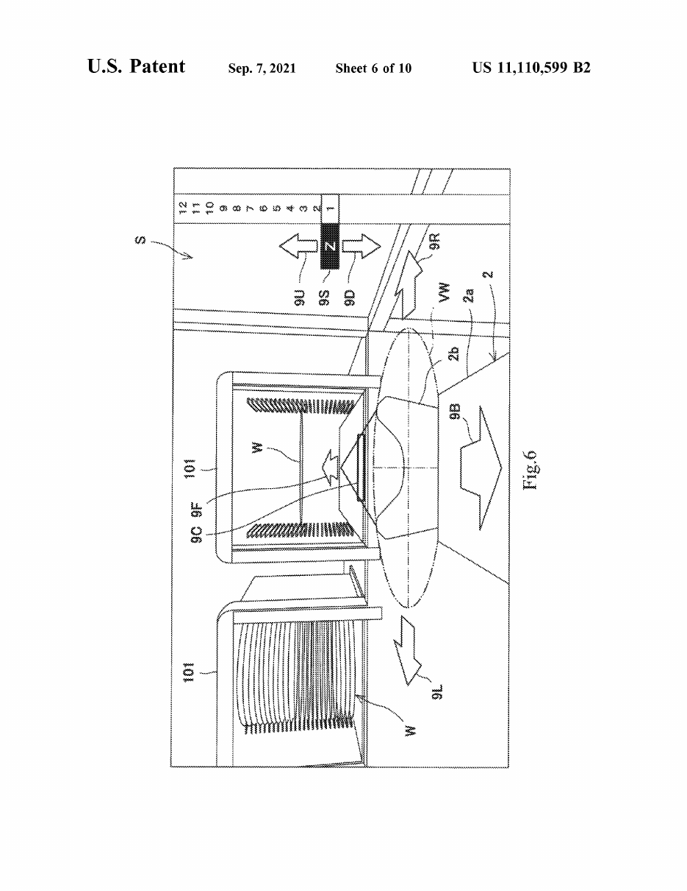
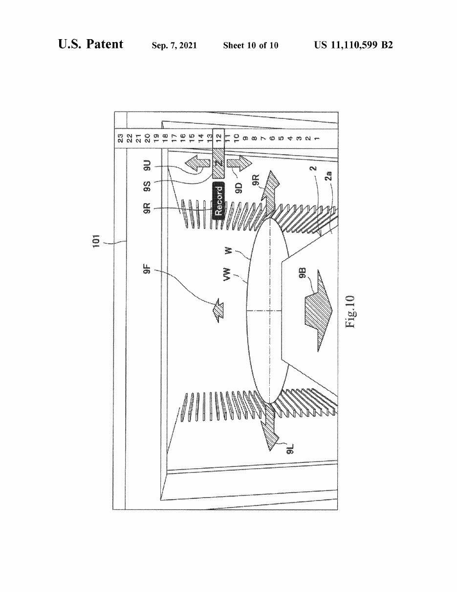

# US 11,110,599 B2 번역: 로봇, 로봇의 제어 장치, 로봇 위치 티칭 방법

번역 범위: 전문 (서지면, 초록, 명세서 본문, 도면 설명, 청구항 1~20). 인용 문헌은 원문 그대로 둔다.
원문: 같은 폴더의 `US11110599B2_GooglePatents.pdf` (Google Patents 공보, 20쪽, 텍스트 층 있음). 같은 공보의 USPTO 이미지판 `US11110599B2.pdf`도 있다(텍스트 층 없음).
번역 근거: Google Patents 본문 텍스트와 PDF 텍스트를 대조했다. 2026-11-04.

## 서지 사항 (공보 1면)

- (12) 미국 특허, (10) 특허 번호 US 11,110,599 B2, (45) 등록일 2021-09-07 (\*표시: 존속기간 조정과 터미널 디스클레이머 대상)
- (54) 발명의 명칭: ROBOT, CONTROL DEVICE OF ROBOT, AND METHOD OF TEACHING POSITION OF ROBOT
- (71) 출원인, (73) 권리자: KAWASAKI JUKOGYO KABUSHIKI KAISHA, Kobe (JP)
- (72) 발명자: Hirohiko Goto (Akashi), Tetsuya Yoshida (Kakogawa), Haruhiko Tan (Kobe), Kazuo Fujimori (Akashi), Katsuhiro Yamashita (Kakogawa), Masahiko Sumitomo (Kakogawa)
- (\*) 주의: 35 U.S.C. 154(b)에 따라 존속기간이 328일 연장 또는 조정됨. 터미널 디스클레이머 대상.
- (21) 출원 번호 16/337,584
- (22) PCT 출원일 2017-09-26, (86) PCT 번호 PCT/JP2017/034696, §371(c)(1),(2) 날짜 2019-03-28
- (87) PCT 공개 번호 WO2018/062156, 공개일 2018-04-05
- (65) 선공개: US 2020/0030973 A1, 2020-01-30
- (30) 우선권: 2016-09-28 (JP) JP2016-189149
- (51) Int. Cl.: B25J 9/16 (2006.01), H01L 21/687 (2006.01)
- (52) CPC: B25J 9/1612, B25J 9/1697, H01L 21/68707
- (58) 분류 검색: USPC 700/245-264
- 심사관: Jonathan L Sample. 대리인: Oliff PLC
- 청구항 20개, 도면 10장

### (56) 인용 문헌 (원문 그대로)

```
U.S. PATENT DOCUMENTS
4,871,252 A *    10/1989 Beni          G01B 9/021
10,978,330 B2 *   4/2021 Yin           H01L 21/68707
2002/0068992 A1 * 6/2002 Hine          H01L 21/68707
2004/0202362 A1 * 10/2004 Ishikawa     B25J 9/1692
2006/0106497 A1 * 5/2006 Ishikawa      H01L 21/67259
2013/0226335 A1 * 8/2013 Kraus         H01L 21/681
2013/0310977 A1 * 11/2013 Tsusaka      B25J 9/163
2014/0195052 A1 * 7/2014 Tsusaka       A61B 34/76
2014/0365011 A1 * 12/2014 Hosek        B25J 9/1682
2016/0129586 A1 * 5/2016 Moura         H01L 21/67742
2017/0018446 A1 * 1/2017 Yin           H01L 21/68707
2019/0344446 A1 * 11/2019 Goto         B25J 9/1697
FOREIGN PATENT DOCUMENTS
JP 2007-088110 A  4/2007
* cited by examiner
```

## 초록

로봇의 제어 장치는 다음을 포함한다.

- 카메라가 찍은 영상 데이터를 얻는 영상 데이터 취득부. 영상 데이터에는 티칭 기판과 핸드의 기판 놓는 부분이 들어 있다. 티칭 기판은 티칭 대상으로 기판 목표 위치에 놓여 있다.
- 영상 데이터 안에서 핸드의 기판 놓는 부분에 가상으로 놓인 가상 기판의 정보를 만드는 가상 기판 정보 생성부.
- 입력을 받아 그에 맞는 조작 정보를 만드는 조작부.
- 티칭 기판의 영상과 가상 기판의 영상을 화면에 보여 주는 화면 표시부.
- 조작 정보에 따라 로봇 암의 동작을 제어하는 로봇 동작 제어부.
- 가상 기판이 티칭 기판과 일치했을 때의 핸드 위치를 티칭 데이터로 저장하는 티칭 데이터 기록부.

## 기술 분야

본 발명은 로봇, 로봇의 제어 장치, 로봇의 위치를 티칭하는 방법에 관한 것이다.

## 배경 기술

반도체 장치와 액정 장치 분야에서는 장치가 복잡해지고 운반물이 커지면서 로봇 티칭이 점점 어려워지고 있다. 로봇에 올바른 위치를 가르치는 일은 로봇의 신뢰성에 매우 중요하다. 이런 상황에서 작업자의 숙련 부족으로 생기는 티칭 오차는 심각한 문제다.

기존에는 작업자가 로봇을 보면서 휴대용 티칭 조작 단말(티칭 펜던트)로 로봇을 원격 조작해 동작을 가르쳤다. 예를 들어 특허문헌 1은 다음 티칭 방법을 개시한다.

- 작업자가 티칭 박스로 기판 반송 로봇을 조금씩(인칭) 움직인다.
- 핸드 끝에 단 카메라가 찍은 영상을 모니터로 확인하면서, 핸드 부재의 진행 방향 위치를 최적 위치로 맞춘다.

### 인용 목록

특허문헌

- PTL 1: Japanese Laid-Open Patent Application Publication No. 2007-88110

## 발명의 요약

### 기술적 과제

그러나 기존 방법처럼 로봇을 원격 조작하면, 작업자는 반도체 장치 안의 로봇을 장치 밖에서만 볼 수 있다. 그래서 로봇과 목표 위치 사이 거리를 확인하려면 비스듬한 방향이나 바로 위에서 장치를 들여다봐야 한다. 이 작업은 번거롭다. 또 PTL 1처럼 모니터로 카메라 영상만 확인하는 방법으로는, 작업자의 티칭 숙련이 부족하면 티칭 오차가 생길 수 있다.

본 발명은 이 문제를 풀려고 만들었다. 목적은 작업자의 숙련이 부족해도 로봇에 핸드 위치를 쉽고 정확하게 가르치는 것이다.

### 과제의 해결 수단

위 문제를 풀기 위해, 본 발명의 한 측면에 따른 로봇은 기판을 놓아야 할 기판 목표 위치까지 기판을 나르는 로봇이며 다음을 포함한다.

- 로봇 암
- 로봇 암 끝에 단 핸드
- 핸드의 기판 놓는 부분이 아닌 곳에 고정해 단 카메라. 기판 놓는 부분(기판이 놓이는 곳)을 찍는다.
- 카메라가 찍은 영상 데이터를 얻는 영상 데이터 취득부. 영상 데이터에는 티칭 기판과 핸드의 기판 놓는 부분이 들어 있다. 티칭 기판은 티칭 대상으로 기판 목표 위치에 놓여 있다.
- 영상 데이터 안에서 핸드의 기판 놓는 부분에 가상으로 놓인 가상 기판의 정보를 만드는 가상 기판 정보 생성부
- 입력을 받아 그에 맞는 조작 정보를 만드는 조작부
- 티칭 기판의 영상과 가상 기판의 영상을 화면에 보여 주는 화면 표시부
- 조작부가 만든 조작 정보에 따라 로봇 암의 동작을 제어하는 로봇 동작 제어부
- 가상 기판이 티칭 기판과 일치했을 때의 핸드 위치를 티칭 데이터로 저장하는 티칭 데이터 기록부

이 구성에 따르면, 핸드의 기판 놓는 부분에 만든 가상 기판이, 기판 목표 위치에 티칭 대상으로 놓인 티칭 기판과 함께 화면 표시부에 의해 화면에 나타난다. 그래서 작업자는 화면을 보면서 가상 기판이 티칭 기판과 일치하도록 조작부를 움직여 로봇 암을 제어할 수 있다. 이때의 핸드 위치를 티칭 데이터로 저장하면, 목표 위치에 대응하는 핸드 위치를 로봇에 가르칠 수 있다. 이로써 작업자의 숙련이 부족해도 핸드 위치를 쉽고 정확하게 가르칠 수 있다. 여기서 "핸드 위치를 티칭 데이터로 저장한다"는, 핸드 위치를 예를 들어 로봇 제어기가 재현할 수 있는 동작 프로그램 같은 정보로 저장(등록)한다는 뜻이다. 카메라는 핸드의 기부(밑동)에 고정해 달아도 된다.

로봇은 카메라 영상 데이터로부터 기판 놓는 부분에서 티칭 기판까지의 거리 정보를 계산하는 거리 정보 계산부를 더 포함할 수 있다. 이때 화면 표시부는, 기판 놓는 부분에서 티칭 기판까지의 거리 정보를 바탕으로, 가상 기판이 티칭 기판과 일치하도록 핸드 위치를 안내하는 조작 가이드를 화면에 보여 준다.

이 구성에 따르면, 가상 기판이 티칭 기판과 일치하도록 핸드 위치를 안내하는 조작 가이드가 화면에 나오므로 작업자가 쉽게 조작할 수 있다.

거리 정보 계산부는, 가상 기판 영상과 티칭 기판 영상 사이의 패턴 매칭으로 기판 놓는 부분에서 티칭 기판까지의 거리 정보를 계산할 수 있다.

조작 가이드는 다음을 포함할 수 있다.

- 핸드 위치를 위아래 방향으로 안내하는 상하 가이드부
- 핸드 위치를 좌우 방향으로 안내하는 좌우 가이드부
- 핸드 위치를 앞뒤 방향으로 안내하는 전후 가이드부

이 구성에 따르면, 작업자는 핸드 위치를 상하, 전후, 좌우로 더 쉽게 조작할 수 있다.

화면 표시부는 터치 패널을 포함할 수 있다. 작업자가 화면의 상하 가이드부, 좌우 가이드부, 전후 가이드부를 손으로 눌러 핸드 위치를 상하, 좌우, 전후로 입력한다.

이 구성에 따르면, 작업자는 화면의 각 가이드부를 눌러 핸드 위치를 입력할 수 있으므로 쉽게 조작할 수 있다.

로봇은 다음처럼 구성할 수 있다.

- 핸드가 가상 기판이 티칭 기판과 일치하는 방향을 향하면, 조작 가이드를 제1 색으로 표시한다.
- 핸드가 그 방향을 향하지 않으면, 조작 가이드를 다른 색으로 표시한다.

이 구성에 따르면, 작업자는 화면의 색으로 티칭 상태가 맞는지 판단할 수 있으므로 핸드 위치를 더 쉽게 조작할 수 있다.

조작부와 표시부는 휴대용 조작 단말에 실을 수 있다.

본 발명의 다른 측면에 따른 로봇의 제어 장치는 다음 로봇을 위한 제어 장치다. 로봇은 로봇 암, 로봇 암 끝에 단 핸드, 핸드의 기판 놓는 부분이 아닌 곳에 고정해 달아 기판 놓는 부분(기판이 놓이는 곳)을 찍는 카메라를 포함하고, 기판을 놓아야 할 기판 목표 위치까지 기판을 나른다. 제어 장치는 다음을 포함한다.

- 카메라 영상 데이터를 얻는 영상 데이터 취득부 (티칭 기판과 핸드의 기판 놓는 부분을 포함하며, 티칭 기판은 티칭 대상으로 기판 목표 위치에 놓여 있음)
- 영상 데이터 안에서 핸드의 기판 놓는 부분에 가상으로 놓인 가상 기판의 정보를 만드는 가상 기판 정보 생성부
- 입력을 받아 그에 맞는 조작 정보를 만드는 조작부
- 티칭 기판의 영상과 가상 기판의 영상을 화면에 보여 주는 화면 표시부
- 조작 정보에 따라 로봇 암의 동작을 제어하는 로봇 동작 제어부
- 가상 기판이 티칭 기판과 일치했을 때의 핸드 위치를 티칭 데이터로 저장하는 티칭 데이터 기록부

본 발명의 또 다른 측면에 따른 로봇 위치 티칭 방법은, 기판을 놓아야 할 기판 목표 위치까지 기판을 나르는 로봇의 핸드 위치를 가르치는 방법이며 다음 단계를 포함한다.

1. 기판 목표 위치에 티칭 대상으로 티칭 기판을 놓는다.
2. 핸드의 기판 놓는 부분(기판이 놓이는 곳)을 찍도록, 핸드의 기판 놓는 부분이 아닌 곳에 카메라를 고정해 단다.
3. 카메라가 티칭 기판과 핸드의 기판 놓는 부분을 찍을 수 있는 미리 정한 위치로 로봇을 옮긴다.
4. 카메라로 티칭 기판과 핸드의 기판 놓는 부분을 찍는다.
5. 카메라 영상 데이터 안에서 핸드의 기판 놓는 부분에 가상으로 놓인 가상 기판의 정보를 만든다.
6. 조작부가 입력을 받아 그에 맞는 조작 정보를 만든다.
7. 화면 표시부가 티칭 기판의 영상과 가상 기판의 영상을 화면에 보여 준다.
8. 조작 정보에 따라 로봇 암의 동작을 제어한다.
9. 가상 기판이 티칭 기판과 일치했을 때의 핸드 위치를 티칭 데이터로 저장부에 저장한다.

### 발명의 효과

본 발명의 목적은 작업자의 숙련이 부족해도 로봇에 핸드 위치를 쉽고 정확하게 가르치는 것이다.

## 도면의 간단한 설명

- 도 1은 본 발명의 실시예에 따른 로봇을 포함하는 반도체 처리 설비의 구성을 개략적으로 보인 사시도다.
- 도 2는 로봇과 FOUP의 구성을 개략적으로 보인 평면도다.
- 도 3은 로봇 내부 기구의 구성을 개략적으로 보인 그림이다.
- 도 4는 로봇 제어 장치의 구성을 보인 블록도다.
- 도 5는 로봇 동작의 한 예를 보인 흐름도다.
- 도 6은 카메라가 찍은 영상의 첫째 예다.
- 도 7은 카메라가 찍은 영상의 둘째 예다.
- 도 8은 카메라가 찍은 영상의 셋째 예다.
- 도 9는 카메라가 찍은 영상의 넷째 예다.
- 도 10은 카메라가 찍은 영상의 다섯째 예다.

## 실시 형태의 설명

본 발명의 실시예를 도면을 참조해 설명한다. 이하에서 같거나 대응하는 구성 요소에는 같은 부호를 쓰고, 같은 설명은 되풀이하지 않는다.

### 실시예

#### 반도체 처리 설비

도 1은 본 발명의 실시예에 따른 로봇을 포함하는 반도체 처리 설비를 보인 사시도다. 반도체 처리 설비 100은 반도체 웨이퍼를 처리하는 설비다. 반도체 웨이퍼의 예로는 실리콘 웨이퍼, 사파이어(단결정 알루미나) 웨이퍼, 그 밖의 여러 웨이퍼가 있다. 또 유리 웨이퍼의 예로는 FPD(평판 디스플레이) 유리 기판과 MEMS(미세 전자 기계 시스템) 유리 기판이 있다. 반도체 처리 설비 100은 예를 들어 SEMI(Semiconductor Equipment and Materials International) 표준에 맞춰 구성된다. 이 경우 아래에서 말하는 FOUP 101은 SEMI 표준 사양을 따른다. 반도체 처리 설비 100은 SEMI 표준에 맞추지 않고 구성할 수도 있다.

처리 전후의 반도체 웨이퍼(이하 간단히 "기판"이라고도 함) W는 FOUP(Front Opening Unified Pod) 101이라는 용기에 담긴다. FOUP 101은 국소 청정 기술과 관련된, 청정 환경의 미니 인바이런먼트 기판 용기다. 여러 장의 기판 W가 FOUP 101 세 개에 담긴다. 기판 W는 FOUP 101 안에 수평으로 담기고, 상하 방향 Z로 일정 간격을 두고 늘어선다. 각 FOUP 101은 받침 102 위에 대략 상자 모양으로 놓이고 한쪽이 열려 있다. 반도체 처리 설비 100은 기판 W를 처리하는 기판 처리 장치 110을 포함한다. 기판 W 처리의 예로는 열처리, 불순물 도입 처리, 박막 형성 처리, 리소그래피 처리, 세정 처리, 평탄화 처리 같은 공정 처리가 있다. 기판 W는 로봇 1에 의해 FOUP 101과 기판 처리 장치 110 사이를 오간다.

#### 로봇

도 2는 본 발명의 실시예에 따른 로봇과, 기판을 담은 FOUP의 구성을 개략적으로 보인 평면도다. FOUP 101은 X-Y 단면으로 그렸다. 도 2처럼 FOUP 101은 서로 마주 보는 한 쌍의 측벽 101a와, 측벽 101a에 마련된 여러 쌍의 기판 지지부 101d를 포함한다. 기판 지지부 101d는 기판 W의 끝부분을 받쳐서 각 기판 W가 수평 자세를 취하고 상하로 간격을 두고 늘어서게 한다. FOUP 101의 앞면은 열린 앞면 개구 101e를 이룬다.

로봇 1은 앞면 개구 101e를 통해 FOUP 101에서 기판 W를 꺼내고 넣는다. 구체적으로 로봇 1은 기판 W를 놓아야 할 기판 목표 위치 T까지 기판 W를 나르는 로봇이다. 로봇 1은 로봇 암 4와, 로봇 암 4 끝에 단 핸드 2를 포함한다. 로봇 1은 핸드 2로 FOUP 101에서 기판 W를 꺼내고 FOUP 101에 기판 W를 넣는다. 도 2처럼, 예를 들어 기판 지지부 101d가 받친 기판 W가 티칭 대상이고, 수직 방향에서 본 기판 W의 중심이 기판 목표 위치 T다. 다만 본 실시예는 이에 한정되지 않는다. 목표 위치 T는 다음처럼 정해진다. 아래에서 말하는 로봇 1의 제어부가, 티칭 기판 W와 아래에서 말하는 가상 기판이 서로 일치했을 때의 핸드 위치를 티칭 데이터로 저장한다. 이로써 로봇 1은 FOUP 101에서 기판 W를 꺼내고 FOUP 101에 기판 W를 넣을 수 있다. 로봇 1의 핸드 2의 기부 쪽에 있는 손목(기부) 2a에 카메라 3을 고정한다. 본 실시예에서 카메라 3은 핸드 2의 블레이드 2b를 고정해서 찍을 수 있도록 손목 2a에 달지만, 블레이드 2b를 뺀 다른 부분에 고정해 달아도 된다. 카메라 3은 CCD(전하 결합 소자) 카메라, CMOS(상보형 금속 산화막 반도체) 카메라 등으로 이루어진다. 블레이드 2b는 핸드 2의 "기판 놓는 부분"에 해당하며 기판 W가 놓이는 부분이다.

이하에서, 아래에서 말하는 로봇 1의 회전축 L1이 뻗는 방향을 Z 방향 또는 상하 방향이라 한다. Z 방향에 수직인 방향을 X 방향 또는 좌우 방향이라 한다. Z 방향과 X 방향에 모두 수직인 방향을 Y 방향 또는 전후 방향이라 한다. 본 실시예에서 X 방향은 로봇 1에서 FOUP 101로 가는 방향과 그 반대 방향으로 정한다.

도 3은 로봇 1 내부 기구의 구성을 개략적으로 보인 그림이다. 도 3처럼 로봇 1은 베이스 10, 로봇 암 4, 핸드 2, 핸드 2에 단 카메라 3, 로봇 1의 동작을 제어하는 제어 장치 7을 포함한다. 로봇 암 4는 하부 암 20과 상부 암 30으로 이루어진다.

베이스 10은 예를 들어 속이 빈 원통 부재다. 베이스 10 안에 하부 암 구동부 15와 제어 장치 7이 있고, 하부 암 구동부 15는 서보 모터와 하부 암 선회 주구동 기어 16을 포함한다.

로봇 1은 승강 기구(도시하지 않음)를 포함한다. 예를 들어 승강 기구는 공지의 볼나사 기구(도시하지 않음)와, 볼나사 기구를 구동하는 엔코더 달린 서보 모터(도시하지 않음)를 포함한다. 볼나사 기구는 하부 암 회전축 21과 하부 암 구동부 15가 달린 가동체(도시하지 않음)를 Z 방향으로 올리고 내린다. 이로써 하부 암 20, 상부 암 30, 핸드 2가 한 몸으로 Z 방향으로 오르내린다. 그래서 핸드 2는 올린 위치와 내린 위치 사이를 오르내릴 수 있다. 내린 위치의 높이는 FOUP 101의 받침 102 높이보다 낮게 정한다. 올린 위치의 높이는 가장 위쪽 기판 지지부 101d 높이보다 높게 정한다.

하부 암 20은 예를 들어 속이 빈 판 부재이고, 평면에서 보면 대략 띠 모양이다. 도 3처럼 하부 암 20은 하부 암 기부의 바닥면에서 아래로 튀어나온 하부 암 회전축 21을 포함한다. 하부 암 회전축 21은 Z 방향으로 뻗은 회전축 L1을 중심으로 돌 수 있게 베이스 10에 달린다. 그래서 하부 암 20은 X-Y 평면에서 선회한다. 본 실시예에서 회전축 L1은 X-Y 평면의 기준점 O가 된다.

하부 암 회전축 21의 아래 끝에는 하부 암 선회 종동 기어 22를 고정한다. 하부 암 선회 종동 기어 22는 베이스 10의 하부 암 선회 주구동 기어 16과 같은 높이에 있고, 이 기어와 맞물린다. 하부 암 20 안에는 서보 모터를 포함하는 상부 암 구동부 25가 있다. 상부 암 구동부 25는 상부 암 선회 주구동 기어 26을 포함한다.

베이스 10에 대한 하부 암 20의 회전축 L1 둘레 각도 위치는 하부 암 구동부 15 서보 모터의 엔코더로 검출한다.

상부 암 30은 예를 들어 속이 빈 판 부재이고, 평면에서 보면 대략 띠 모양이다. 도 3처럼 상부 암 30은 상부 암 기부의 바닥면에서 아래로 튀어나온 상부 암 회전축 31을 포함한다. 상부 암 회전축 31은 회전축 L1과 나란한 회전축 L2를 중심으로 돌 수 있게 하부 암 20에 달린다. 그래서 상부 암 30은 X-Y 평면에서 선회한다.

상부 암 회전축 31의 아래 끝에는 상부 암 선회 종동 기어 32를 고정한다. 상부 암 선회 종동 기어 32는 하부 암 20의 상부 암 선회 주구동 기어 26과 같은 높이에 있고, 이 기어와 맞물린다. 상부 암 30 안에는 서보 모터를 포함하는 핸드 구동부 35가 있다. 핸드 구동부 35는 핸드 선회 주구동 기어 36을 포함한다.

하부 암 20에 대한 상부 암 30의 회전축 L2 둘레 각도 위치는 상부 암 구동부 25 서보 모터의 엔코더로 검출한다.

핸드 2는 핸드 2의 기부 쪽에 있는 손목 2a와, 핸드 2의 끝 쪽에 있는 블레이드 2b를 포함한다. 손목 2a와 블레이드 2b는 이어져 있다.

손목 2a는 손목 2a 기부의 바닥면에서 아래로 튀어나온 핸드 회전축 41을 포함한다. 핸드 회전축 41은 회전축 L1, L2와 나란한 회전축 L3을 중심으로 돌 수 있게 핸드 2에 달린다. 그래서 핸드 2는 X-Y 평면에서 선회한다.

핸드 회전축 41의 아래 끝에는 핸드 선회 종동 기어 42를 고정한다. 핸드 선회 종동 기어 42는 핸드 선회 주구동 기어 36과 같은 높이에 있고, 이 기어와 맞물린다.

상부 암 30에 대한 핸드 2의 회전축 L3 둘레 각도 위치는 핸드 구동부 35 서보 모터의 엔코더로 검출한다.

하부 암 구동부 15와 상부 암 구동부 25가 암 구동부를 이룬다. 암 구동부는 하부 암 20과 상부 암 30을 구동해 핸드 2를 X-Y 평면에서 움직인다.

손목 2a는 손목 2a 기부의 윗면에 단 카메라 3을 포함한다. 카메라 3은 기판 W가 놓이는 블레이드 2b를 찍을 수 있는 방향으로 단다. 블레이드 2b는 예를 들어 얇은 판 모양이다. 블레이드 2b의 윗면이 핸드 2의 "기판 놓는 부분"에 해당하고, 기판 W는 블레이드 2b에 얹힌다. 카메라 3은 핸드 2의 블레이드 2b의 회전축 L3 위에 단다.

#### 제어 장치

도 4는 로봇 1의 제어 장치 7 구성을 보인 블록도다. 예를 들어 제어 장치 7은 다음을 포함한다.

- CPU 같은 연산부를 포함하는 제어부 70
- 서보 제어부 71
- ROM, RAM 같은 메모리를 포함하는 저장부 72
- 인터페이스부(도시하지 않음)

제어 장치 7은 집중 제어를 하는 단일 제어 장치일 수도 있고, 서로 협력해 분산 제어를 하는 여러 제어 장치일 수도 있다. 본 실시예에서 제어 장치 7은 인터페이스부(도시하지 않음)를 통해 휴대용 조작 단말(이하 "티칭 펜던트"라고도 함) 8에 연결된다. 티칭 펜던트 8은 조작부 8b와 표시부 8a를 포함한다. 티칭 펜던트 8은 케이블로 연결되어 반도체 처리 설비 100(도 1 참조) 밖에 놓인다. 조작부 8b는 티칭 모드에서 로봇 1을 움직이는 조작 키와, 티칭의 시작, 종료, 정지, 기록을 지시하는 조작 키를 포함한다. 제어 장치 7은 조작부 8b를 통해 조작 정보와 여러 지령을 받고, 여러 지령값, 계산 결과, 카메라 3의 영상 등을 표시부 8a에 내보낸다. 작업자는 반도체 처리 설비 100 밖에서 티칭 펜던트 8로 로봇 1을 원격 조작해 티칭 작업을 한다.

제어부 70은 카메라 제어부 73, 거리 정보 계산부 74, 가상 기판 정보 생성부 75, 제어 지령 생성부 76, 티칭 데이터 기록부 77을 포함한다. 이 기능부(73~77)는 제어부 70이 저장부 72에 저장된 정해진 제어 프로그램을 실행할 때 구현되는 기능 블록이다.

카메라 제어부 73은 인터페이스부(도시하지 않음)를 통해 카메라 3을 제어한다. 구체적으로 카메라 제어부 73은 카메라 3에 촬영 지령을 내보낸다. 카메라 제어부 73은 촬영 시점을 조정하거나 카메라 3의 위치와 자세를 바꿀 수 있다. 본 실시예에서 카메라 3의 위치와 자세는 핸드 2의 블레이드 2b를 찍을 수 있게 정한다. 카메라 제어부 73은 카메라 3이 찍은 카메라 영상을 얻어 저장부 72에 저장한다.

거리 정보 계산부 74는 카메라 3이 찍은 카메라 영상을 바탕으로, 핸드 2의 블레이드 2b(기판 놓는 부분)에서 티칭 대상인 기판 W까지의 거리 정보를 계산한다. 구체적으로 거리 정보 계산부 74는 저장부 72에 저장된 카메라 영상을 바탕으로 거리 정보를 계산한다.

가상 기판 정보 생성부 75는 영상 데이터 안에서 핸드 2의 블레이드 2b에 가상으로 놓인 가상 기판 VW의 정보를 만든다. 가상 기판 VW를 만드는 데 필요한 정보는 미리 저장부 72에 저장해 둔다. 만든 가상 기판 VW의 정보는, 가상 기판 VW가 핸드 2의 블레이드 2b에 놓인 모습으로 표시부 8a의 화면에 나타난다.

제어 지령 생성부 76은 작업자의 입력에 따라 조작부 8b가 만든 조작 정보를 바탕으로 로봇 암 4의 동작을 제어한다. 구체적으로 제어 지령 생성부 76은 조작 정보를 바탕으로 구동부 15, 25, 35, 19의 서보 모터 위치 지령값을 만든다. 제어 지령 생성부 76은 만든 위치 지령값과 엔코더 검출값(실제값)의 차이로 속도 지령값을 만든다. 그다음 만든 속도 지령값과 현재 속도값의 차이로 토크 지령값(전류 지령값)을 만들고, 만든 전류 지령값과 전류 센서 검출값(실제값)의 차이로 제어 지령을 만든다. 이렇게 제어 지령 생성부 76은 만든 제어 지령을 서보 제어부 71에 내보낸다.

서보 제어부 71은 받은 제어 지령을 바탕으로 전류를 만들어 구동부 15, 25, 35, 19의 서보 모터에 공급해 로봇 1을 움직인다. 서보 제어부 71은 하부 암 구동부 15를 제어해 하부 암 20을 X-Y 평면에서 선회시키고, 상부 암 구동부 25를 제어해 상부 암 30을 X-Y 평면에서 선회시킨다. 또 서보 제어부 71은 핸드 구동부 35를 제어해 핸드 2를 X-Y 평면에서 선회시킨다. 서보 제어부 71은 승강 기구 구동부 19를 제어해 하부 암 20, 상부 암 30, 핸드 2를 한 몸으로 Z 방향으로 올리고 내린다.

티칭 데이터 기록부 77은, 티칭 대상인 기판 W 표면의 좌표와 가상 기판 VW 표면의 좌표가 서로 일치했을 때의 핸드 2 위치를 티칭 데이터로 저장부 72에 저장한다. 본 실시예에서 티칭 데이터 기록부 77은 구동부 15, 25, 35, 19의 서보 모터 위치 지령값을 티칭 데이터로 저장부 72에 저장한다.

저장부 72는 정해진 동작 프로그램을 저장하고, 제어부 70은 이 동작 프로그램을 읽어 실행해 로봇 1의 동작을 제어한다. 정해진 동작 프로그램은 로봇 1의 핸드 2를 정해진 위치로 옮기는 지령이다. 앞서 말한 대로, 저장부 72는 가상 기판 VW를 만들기 위한 정보로 기판 W의 모양, 지름, 재질, 무게 같은 여러 정보를 저장한다.

#### 동작 예

다음으로, 티칭 대상인 기판 W의 목표 위치 T를 로봇 1에 가르칠 때의 로봇 1 동작 예를 설명한다. 도 5는 로봇 1 동작의 한 예를 보인 흐름도다. 도 6~10은 카메라 3이 찍은 영상이다. 본 실시예의 티칭 대상은, 로봇 1에서 볼 때 오른쪽에 있는 FOUP 101의 위에서 열네 번째 단에 놓인 기판 W에 대응하는 핸드 2의 위치다. 이 기판 W의 중심이 목표 위치 T와 일치한다. 이하 티칭 대상인 기판을 티칭 기판 W라 한다.



*도 5. 로봇 동작의 한 예를 보인 흐름도 (시작, S1 로봇을 미리 정한 위치로 이동, S2 카메라로 촬영, S3 영상 데이터 안에 가상 기판 생성, S4 카메라 화면에 가상 기판과 조작 가이드 표시, S5 기판과 가상 기판이 일치하도록 핸드 위치 조정, S6 티칭 데이터 생성, 끝).*

먼저 제어부 70은 로봇 1을 초기 위치로 옮긴다(도 5의 단계 S1). 구체적으로 제어 지령 생성부 76은 로봇의 동작 프로그램에 따라 구동부 15, 25, 35, 19의 서보 모터 위치 지령값을 만들고 제어 지령을 내보낸다. 서보 제어부 71은 받은 제어 지령을 바탕으로 구동부 15, 25, 35, 19를 제어해 로봇 1을 초기 위치로 옮긴다. 초기 위치는 카메라 3이 티칭 기판 W와 핸드 2의 블레이드 2b를 포함하는 공간 S를 찍을 수 있는 위치다. 본 실시예에서는 초기 위치까지의 경로를 동작 프로그램으로 미리 저장부 72에 저장해 둔다. 다만 티칭 펜던트 8의 조작부 8b를 조작해 얻은 조작 정보로 로봇 1을 초기 위치로 옮겨도 된다.

다음으로 카메라 3은 기판 W와 핸드 2의 블레이드 2b를 포함하는 공간 S를 찍는다(도 5의 단계 S2). 카메라 제어부 73은 카메라 3이 찍은 카메라 영상을 저장부 72에 저장한다.

다음으로 가상 기판 정보 생성부 75는, 저장부 72에 미리 저장된 기판 W의 모양 같은 정보를 바탕으로, 영상 데이터 안에서 핸드 2의 블레이드 2b에 가상으로 놓인 가상 기판 VW의 정보를 만든다(도 5의 단계 S3). 이때 거리 정보 계산부 74는 카메라 3이 찍은 카메라 영상을 바탕으로 핸드 2의 블레이드 2b(기판 놓는 부분)에서 티칭 기판 W까지의 거리 정보를 계산한다. 본 실시예에서 거리 정보 계산부 74는 가상 기판 VW 영상과 티칭 기판 W 영상 사이의 패턴 매칭으로 블레이드 2b에서 티칭 기판 W까지의 거리 정보를 계산한다.

다음으로 표시부 8a는 카메라 3이 찍은 촬영 공간 S의 영상을 보여 준다(도 5의 단계 S4). 도 6은 표시부 8a에 나온 카메라 영상이다. 도 6처럼 화면에는 FOUP 101에 담긴 티칭 기판 W, 핸드 2의 블레이드 2b에 가상으로 놓인 가상 기판 VW, 조작 가이드 9가 나온다. 제어부 70은, 블레이드 2b에서 티칭 기판 W까지의 거리 정보를 바탕으로 가상 기판 VW가 티칭 기판 W와 일치하도록 핸드 2 위치를 안내하려고, 표시부 8a를 통해 조작 가이드 9를 화면에 보여 준다.



*도 6. 카메라가 찍은 영상의 첫째 예 (초기 위치. 티칭 기판 W, 블레이드 2b 위의 가상 기판 VW, 조작 가이드 9U, 9D, 9S, 9L, 9R, 9F, 9B, 9C가 보인다. 오른쪽 끝 Z 눈금은 1~12).*

조작 가이드 9는 위쪽 가이드부 9U, 아래쪽 가이드부 9D, 왼쪽 가이드부 9L, 오른쪽 가이드부 9R, 앞쪽 가이드부 9F, 뒤쪽 가이드부 9B, 상하 표시부 9S, 중앙 가이드부 9C를 포함한다. 위쪽 가이드부 9U와 아래쪽 가이드부 9D는 화면 오른쪽 끝에 나오며 핸드 2 위치를 위와 아래로 안내한다. 위쪽 가이드부 9U는 위를 향한 화살표로, 아래쪽 가이드부 9D는 아래를 향한 화살표로 나타낸다.

왼쪽 가이드부 9L과 오른쪽 가이드부 9R은 화면 가운데의 블레이드 2b 위 가상 기판 VW의 왼쪽과 오른쪽에 나오며, 핸드 2 위치를 좌우로 안내한다. 왼쪽 가이드부 9L은 왼쪽을 향한 화살표로, 오른쪽 가이드부 9R은 오른쪽을 향한 화살표로 나타낸다.

앞쪽 가이드부 9F와 뒤쪽 가이드부 9B는 화면 가운데의 블레이드 2b 위 가상 기판 VW의 앞쪽과 뒤쪽에 나오며, 핸드 2 위치를 앞뒤로 안내한다. 앞쪽 가이드부 9F는 앞을 향한 화살표로, 뒤쪽 가이드부 9B는 뒤를 향한 화살표로 나타낸다. 상하 표시부 9S는 화면 오른쪽 끝의 위쪽 가이드부 9U와 아래쪽 가이드부 9D 사이에 나오며 핸드 2의 현재 상하(Z) 위치를 보여 준다. 중앙 가이드부 9C는 핸드 2의 중심축을 지나는 직사각형이며, 화면 가운데의 블레이드 2b 위 가상 기판 VW와 앞쪽 가이드부 9F 사이에 나온다.

핸드가 올바른 방향을 향하면 조작 가이드 9는 예를 들어 초록색(도면에서는 빗금)으로 나온다. 핸드가 올바른 방향을 향하지 않으면 조작 가이드 9는 빨간색(도면에서는 검정)으로 나온다. 여기서 올바른 방향은 가상 기판 VW가 티칭 기판 W와 일치하게 되는 방향이다.

다음으로 작업자는 조작부 8b를 조작해 가상 기판 VW가 티칭 기판 W와 일치하도록 핸드 2 위치를 맞춘다(도 5의 단계 S5). 도 6처럼 초기 위치에서는 화면 오른쪽 끝의 상하 표시부 9S가 빨간색이다. 여기서 핸드 2의 상하(Z) 현재값은 최솟값(1)이다. 그래서 작업자는 먼저 핸드 2의 상하 위치를 조작한다. 작업자는 화면 오른쪽 끝의 위쪽 가이드부 9U, 아래쪽 가이드부 9D, 상하 표시부 9S를 따라 조작부 8b를 조작한다. 조작부 8b가 만든 조작 정보에 따라, 제어부 70은 가상 기판 VW의 높이가 티칭 기판 W의 높이와 일치하도록 로봇 암 4의 동작을 제어한다. 도 7은 핸드 2의 상하 위치를 올바른 위치로 맞췄을 때의 카메라 영상이다. 도 7처럼 위쪽 가이드부 9U, 아래쪽 가이드부 9D, 상하 표시부 9S의 표시 색이 초록색(빗금)으로 바뀌었다. 이로써 작업자는 가상 기판 VW의 높이가 티칭 기판 W의 높이와 일치했음을 알 수 있다.

다음으로 작업자는 핸드 2의 좌우 위치를 조작한다. 작업자는 화면 가운데 가상 기판 VW의 왼쪽과 오른쪽에 나온 왼쪽 가이드부 9L과 오른쪽 가이드부 9R을 따라 조작부 8b를 조작한다. 조작부 8b가 만든 조작 정보에 따라, 제어부 70은 가상 기판 VW의 좌우 위치가 티칭 기판 W의 좌우 위치와 일치하도록 로봇 암 4의 동작을 제어한다. 도 8은 핸드 2의 좌우 위치를 올바른 위치로 맞췄을 때의 카메라 영상이다. 도 8처럼 왼쪽 가이드부 9L과 오른쪽 가이드부 9R의 표시 색이 초록색(빗금)으로 바뀌었다. 한편 화면 가운데 가상 기판 VW의 앞쪽과 뒤쪽에 나온 앞쪽 가이드부 9F와 뒤쪽 가이드부 9B는 빨간색(검정)이다. 이로써 작업자는 다음을 알 수 있다.

- 가상 기판 VW의 좌우 위치는 티칭 기판 W의 좌우 위치와 일치했다.
- 가상 기판 VW의 전후 위치는 아직 티칭 기판 W의 전후 위치와 일치하지 않았다.

마지막으로 작업자는 핸드 2의 전후 위치를 조작한다. 작업자는 화면 가운데 가상 기판 VW의 앞쪽과 뒤쪽에 나온 앞쪽 가이드부 9F와 뒤쪽 가이드부 9B를 따라 조작부 8b를 조작한다. 이때 작업자는 화면에 나온 가상 기판 VW의 중심이 직사각형 중앙 가이드부 9C의 중심에 가까워지도록 조작부 8b를 조작한다. 조작부 8b가 만든 조작 정보에 따라, 제어부 70은 가상 기판 VW의 전후 위치가 티칭 기판 W의 전후 위치와 일치하도록 로봇 암 4의 동작을 제어한다. 도 9는 핸드 2를 전후로 맞추는 조작 도중의 카메라 영상이다. 도 9처럼 핸드 2가 앞쪽으로 움직이는 중이지만 앞쪽 가이드부 9F와 뒤쪽 가이드부 9B는 아직 빨간색(검정)이다. 그래서 작업자는 가상 기판 VW가 아직 올바른 위치에 있지 않음을 알고, 가상 기판 VW의 중심이 직사각형 중앙 가이드부 9C의 중심에 가까워지도록 조작부 8b로 앞쪽 조작을 계속한다. 도 10은 핸드 2의 전후 위치를 올바른 위치로 맞췄을 때의 카메라 영상이다. 도 10처럼 앞쪽 가이드부 9F와 뒤쪽 가이드부 9B의 표시 색이 빨간색(검정)에서 초록색(빗금)으로 바뀌었으므로, 작업자는 핸드 2가 티칭 기판 W의 위치에 맞춰졌음을 알 수 있다. 색을 바꾸는 대신 가상 기판 VW를 깜박이게 해도 된다. 도 6~10처럼 화면에는 티칭 기판 W의 바깥 가장자리 일부만 보이고 티칭 기판 전체는 보이지 않는다. 그래도 조작 가이드 9를 따라 가상 기판 VW를 티칭 기판 W와 일치시킬 수 있다. 제어부 70은 가상 기판 VW가 티칭 기판 W와 일치했다고 판단하면 표시부 8a에 "Record"라는 글자를 빨간색으로 띄운다. 그러면 작업자는 조작부 8b의 기록 버튼을 누른다.



*도 10. 카메라가 찍은 영상의 다섯째 예 (전후 위치까지 맞춘 상태. 가이드가 초록색(빗금)으로 바뀌고 "Record"가 나온다).*

마지막으로 티칭 데이터 기록부 77은 가상 기판 VW가 티칭 기판 W와 일치했을 때의 핸드 2 위치를 티칭 데이터로 저장부 72에 저장한다(도 5의 단계 S6). 여기서 "핸드 2 위치를 티칭 데이터로 저장한다"는, 핸드 2 위치를 제어 장치 7이 재현할 수 있는 동작 프로그램 같은 정보로 저장(등록)한다는 뜻이다. 본 실시예에서 티칭 데이터 기록부 77은 구동부 15, 25, 35, 19의 서보 모터 위치 지령값을 티칭 데이터로 저장부 72에 저장한다.

따라서 본 실시예에 따르면, 핸드 2의 블레이드 2b에 만든 가상 기판 VW가, 목표 위치 T에 놓인 티칭 기판 W와 함께 표시부 8a에 의해 화면에 나타난다(예를 들어 도 6 참조). 그래서 작업자는 화면을 보면서 가상 기판 VW가 티칭 기판 W와 일치하도록 조작부 8b를 조작해 로봇 암 4의 동작을 제어할 수 있다. 이때의 핸드 2 위치를 티칭 데이터로 저장하면 목표 위치 T에 대응하는 핸드 2 위치를 로봇 1에 가르칠 수 있다. 이로써 작업자의 숙련이 부족해도 핸드 위치를 쉽고 정확하게 가르칠 수 있다.

가상 기판 VW가 티칭 기판 W와 일치하도록 핸드 2 위치를 안내하는 조작 가이드 9가 화면에 나오므로, 작업자는 조작 가이드 9를 쉽게 조작할 수 있다.

또 조작 가이드 9는 위쪽 가이드부 9U, 아래쪽 가이드부 9D, 왼쪽 가이드부 9L, 오른쪽 가이드부 9R, 앞쪽 가이드부 9F, 뒤쪽 가이드부 9B, 상하 표시부 9S, 중앙 가이드부 9C를 포함하므로, 작업자는 핸드 2 위치를 상하, 전후, 좌우로 더 쉽게 조작할 수 있다.

표시부 8a에 터치 패널 기능을 줄 수 있다. 작업자는 화면의 위쪽 가이드부 9U, 아래쪽 가이드부 9D, 왼쪽 가이드부 9L, 오른쪽 가이드부 9R, 앞쪽 가이드부 9F, 뒤쪽 가이드부 9B를 눌러 핸드 2 위치를 상하, 좌우, 전후로 입력할 수 있다. 이로써 작업자는 화면의 각 가이드부를 눌러 핸드 2 위치를 입력할 수 있으므로 쉽게 조작할 수 있다. 또 조작 가이드 9에 핸드의 회전 방향 위치를 안내하는 가이드부를 넣을 수 있고, 회전 방향 위치를 터치 패널로 입력할 수도 있다.

핸드 2가 가상 기판 VW가 티칭 기판 W와 일치하는 방향을 향하면 조작 가이드 9는 초록색으로 나온다. 그 방향을 향하지 않으면 조작 가이드 9는 빨간색으로 나온다. 그래서 작업자는 화면의 색으로 티칭 상태가 맞는지 판단할 수 있다. 따라서 작업자는 핸드 2 위치를 더 쉽게 조작할 수 있다. 티칭 상태가 맞는지를 알리는 표시 색은 다른 색이어도 된다. 또 티칭 상태를 소리로 알리거나, 티칭 완료 정도를 파형이나 게이지로 보여 줘도 된다.

### 다른 실시예

본 실시예에서 거리 정보 계산부 74는 가상 기판 VW 영상과 티칭 기판 W 영상 사이의 패턴 매칭으로 블레이드 2b에서 티칭 기판 W까지의 거리 정보를 계산한다. 다만 본 실시예는 이에 한정되지 않는다. 대상물(티칭 기판 W)까지의 거리 정보는 공지의 방법으로 계산해도 된다. 예를 들어 카메라 3의 렌즈에 색 필터를 달고, 대상물까지의 거리에 따라 찍힌 영상에 생기는 흐림과 색 어긋남을 영상 분석해 대상물까지의 거리 정보를 얻을 수 있다.

본 실시예에서는 실제 반도체 웨이퍼를 티칭 기판 W로 쓴다. 다만 실제 기판과 모양이 같은 모의 기판을 써도 된다.

본 실시예에서 카메라 3은 핸드 2의 손목 2a에 고정해 단다. 다만 카메라 3은 떼었다 붙일 수 있게 해도 된다. 이 경우 카메라 3은 티칭하는 동안 달고, 로봇 1이 반복 모드로 동작할 때는 떼어도 된다.

본 실시예에서 카메라 3을 여러 대 둘 수 있고, 3차원 카메라를 쓸 수도 있다. 3차원 카메라는 서로 다른 방향에서 대상물을 동시에 찍어 시차를 만들고, 이로써 대상물까지의 거리 정보를 얻는다. 3차원 카메라는 정해진 좌표계에서 대상물 표면의 좌표 데이터를 만들 수 있다. 3차원 카메라는 스테레오 카메라의 한 종류다. 3차원 카메라는 정해진 거리만큼 떨어진 한 쌍의 카메라를 포함하고, 각 카메라는 촬상 소자를 갖는다. 3차원 카메라는 거리 정보뿐 아니라 대상물의 색 정보(RGB 등)도 얻을 수 있다. 또 3차원 카메라는 레이저를 쏘고 반사 위치와 반사 시간으로 반사점까지의 거리 정보를 얻을 수도 있다.

앞의 설명으로부터 본 발명의 많은 변형과 다른 실시예가 당업자에게 분명하다. 따라서 앞의 설명은 예시로만 해석해야 하며, 당업자에게 본 발명을 실시하는 최선의 형태를 가르치려는 목적으로 제공한 것이다. 구조와 기능의 세부는 본 발명의 범위 안에서 실질적으로 바꿀 수 있다.

## 산업상 이용 가능성

본 발명은 기판을 나르는 로봇의 핸드 위치를 티칭할 때 유용하다.

## 부호의 설명

| 부호 | 이름 |
|---|---|
| 1 | 로봇 |
| 2 | 핸드 |
| 2a | 손목 |
| 2b | 블레이드 (기판 놓는 부분) |
| 3 | 카메라 |
| 4 | 로봇 암 |
| 7 | 제어 장치 (로봇 제어기) |
| 8 | 휴대용 조작 단말 (티칭 펜던트) |
| 8a | 표시부 |
| 8b | 조작부 |
| 9 | 조작 가이드 |
| 10 | 베이스 |
| 20 | 하부 암 |
| 30 | 상부 암 |
| 70 | 제어부 |
| 71 | 서보 제어부 |
| 72 | 저장부 |
| 73 | 카메라 제어부 (영상 데이터 취득부) |
| 74 | 거리 정보 계산부 |
| 75 | 가상 기판 정보 생성부 |
| 76 | 제어 지령 생성부 |
| 77 | 티칭 데이터 기록부 |
| 100 | 반도체 처리 설비 |
| 101 | FOUP |
| 102 | 받침 (FOUP) |
| 110 | 기판 처리 장치 |
| S | 촬영 공간 |
| VW | 가상 기판 |
| W | 기판 |

## 청구항 (20개)

청구된 발명은 다음과 같다.

**1.** 기판을 놓아야 할 기판 목표 위치까지 기판을 나르도록 구성된 로봇으로서, 다음을 포함하는 로봇:
- 로봇 암;
- 로봇 암 끝에 단 핸드;
- 핸드의 기판 놓는 부분이 아닌 곳에 고정해 달아 기판 놓는 부분을 찍는 카메라 (기판은 기판 놓는 부분에 놓임);
- 카메라가 찍은 영상 데이터를 얻도록 구성된 영상 데이터 취득부 (영상 데이터는 티칭 기판과 핸드의 기판 놓는 부분을 포함하고, 티칭 기판은 티칭 대상으로 기판 목표 위치에 놓임);
- 영상 데이터 안에서 핸드의 기판 놓는 부분에 가상으로 놓인 가상 기판의 정보를 만들도록 구성된 가상 기판 정보 생성부;
- 입력을 받아 그에 맞는 조작 정보를 만들도록 구성된 조작부;
- 티칭 기판의 영상과 가상 기판의 영상을 화면에 보여 주도록 구성된 화면 표시부;
- 조작부가 만든 조작 정보에 따라 로봇 암의 동작을 제어하도록 구성된 로봇 동작 제어부; 및
- 가상 기판이 티칭 기판과 일치했을 때의 핸드 위치를 티칭 데이터로 저장하도록 구성된 티칭 데이터 기록부.

**2.** 청구항 1에 있어서, 카메라는 핸드의 기부에 고정해 단 로봇.

**3.** 청구항 1에 있어서, 카메라 영상 데이터로부터 기판 놓는 부분에서 티칭 기판까지의 거리 정보를 계산하도록 구성된 거리 정보 계산부를 더 포함하고, 화면 표시부는, 기판 놓는 부분에서 티칭 기판까지의 거리 정보를 바탕으로, 가상 기판이 티칭 기판과 일치하도록 핸드 위치를 안내하는 조작 가이드를 화면에 보여 주는 로봇.

**4.** 청구항 3에 있어서, 거리 정보 계산부는 가상 기판 영상과 티칭 기판 영상 사이의 패턴 매칭으로 기판 놓는 부분에서 티칭 기판까지의 거리 정보를 계산하는 로봇.

**5.** 청구항 3에 있어서, 조작 가이드는 다음을 포함하는 로봇:
- 핸드 위치를 상하 방향으로 안내하도록 구성된 상하 가이드부;
- 핸드 위치를 좌우 방향으로 안내하도록 구성된 좌우 가이드부; 및
- 핸드 위치를 전후 방향으로 안내하도록 구성된 전후 가이드부.

**6.** 청구항 5에 있어서, 화면 표시부는 터치 패널을 포함하고, 작업자가 화면의 상하 가이드부, 좌우 가이드부 또는 전후 가이드부를 눌러 핸드 위치를 상하, 좌우 또는 전후 방향으로 입력하도록 구성된 로봇.

**7.** 청구항 3에 있어서,
- 핸드가 가상 기판이 티칭 기판과 일치하는 방향을 향하면 조작 가이드를 제1 색으로 표시하고;
- 핸드가 그 방향을 향하지 않으면 조작 가이드를 다른 색으로 표시하는 로봇.

**8.** 청구항 1에 있어서, 조작부와 표시부는 휴대용 조작 단말에 실린 로봇.

**9.** 로봇의 제어 장치로서,
로봇은 로봇 암; 로봇 암 끝에 단 핸드; 및 핸드의 기판 놓는 부분이 아닌 곳에 고정해 달아 기판 놓는 부분을 찍는 카메라(기판은 기판 놓는 부분에 놓임)를 포함하고, 로봇은 기판을 놓아야 할 기판 목표 위치까지 기판을 나르며,
제어 장치는 다음을 포함하는 제어 장치:
- 카메라가 찍은 영상 데이터를 얻도록 구성된 영상 데이터 취득부 (영상 데이터는 티칭 기판과 핸드의 기판 놓는 부분을 포함하고, 티칭 기판은 티칭 대상으로 기판 목표 위치에 놓임);
- 영상 데이터 안에서 핸드의 기판 놓는 부분에 가상으로 놓인 가상 기판의 정보를 만들도록 구성된 가상 기판 정보 생성부;
- 입력을 받아 그에 맞는 조작 정보를 만들도록 구성된 조작부;
- 티칭 기판의 영상과 가상 기판의 영상을 화면에 보여 주도록 구성된 화면 표시부;
- 조작 정보에 따라 로봇 암의 동작을 제어하도록 구성된 로봇 동작 제어부; 및
- 가상 기판이 티칭 기판과 일치했을 때의 핸드 위치를 티칭 데이터로 저장하도록 구성된 티칭 데이터 기록부.

**10.** 기판을 놓아야 할 기판 목표 위치까지 기판을 나르도록 구성된 로봇의 핸드 위치를 티칭하는 방법으로서, 다음 단계를 포함하는 방법:
- 기판 목표 위치에 티칭 대상으로 티칭 기판을 놓는 단계;
- 핸드의 기판 놓는 부분(기판이 놓이는 곳)을 찍도록, 핸드의 기판 놓는 부분이 아닌 곳에 카메라를 고정해 다는 단계;
- 카메라가 티칭 기판과 핸드의 기판 놓는 부분을 찍을 수 있는 미리 정한 위치로 로봇을 옮기는 단계;
- 카메라로 티칭 기판과 핸드의 기판 놓는 부분을 찍는 단계;
- 카메라가 찍은 영상 데이터 안에서 핸드의 기판 놓는 부분에 가상으로 놓인 가상 기판의 정보를 만드는 단계;
- 조작부가 입력을 받아 그에 맞는 조작 정보를 만드는 단계;
- 화면 표시부가 티칭 기판의 영상과 가상 기판의 영상을 화면에 보여 주는 단계;
- 조작 정보에 따라 로봇 암의 동작을 제어하는 단계; 및
- 가상 기판이 티칭 기판과 일치했을 때의 핸드 위치를 티칭 데이터로 저장부에 저장하는 단계.

**11.** 청구항 4에 있어서, 조작 가이드는 다음을 포함하는 로봇:
- 핸드 위치를 상하 방향으로 안내하도록 구성된 상하 가이드부;
- 핸드 위치를 좌우 방향으로 안내하도록 구성된 좌우 가이드부; 및
- 핸드 위치를 전후 방향으로 안내하도록 구성된 전후 가이드부.

**12.** 청구항 4에 있어서, 핸드가 가상 기판이 티칭 기판과 일치하는 방향을 향하면 조작 가이드를 제1 색으로 표시하고, 그 방향을 향하지 않으면 조작 가이드를 다른 색으로 표시하는 로봇.

**13.** 청구항 5에 있어서, 핸드가 가상 기판이 티칭 기판과 일치하는 방향을 향하면 조작 가이드를 제1 색으로 표시하고, 그 방향을 향하지 않으면 조작 가이드를 다른 색으로 표시하는 로봇.

**14.** 청구항 6에 있어서, 핸드가 가상 기판이 티칭 기판과 일치하는 방향을 향하면 조작 가이드를 제1 색으로 표시하고, 그 방향을 향하지 않으면 조작 가이드를 다른 색으로 표시하는 로봇.

**15.** 청구항 2에 있어서, 조작부와 표시부는 휴대용 조작 단말에 실린 로봇.

**16.** 청구항 3에 있어서, 조작부와 표시부는 휴대용 조작 단말에 실린 로봇.

**17.** 청구항 4에 있어서, 조작부와 표시부는 휴대용 조작 단말에 실린 로봇.

**18.** 청구항 5에 있어서, 조작부와 표시부는 휴대용 조작 단말에 실린 로봇.

**19.** 청구항 6에 있어서, 조작부와 표시부는 휴대용 조작 단말에 실린 로봇.

**20.** 청구항 7에 있어서, 조작부와 표시부는 휴대용 조작 단말에 실린 로봇.
