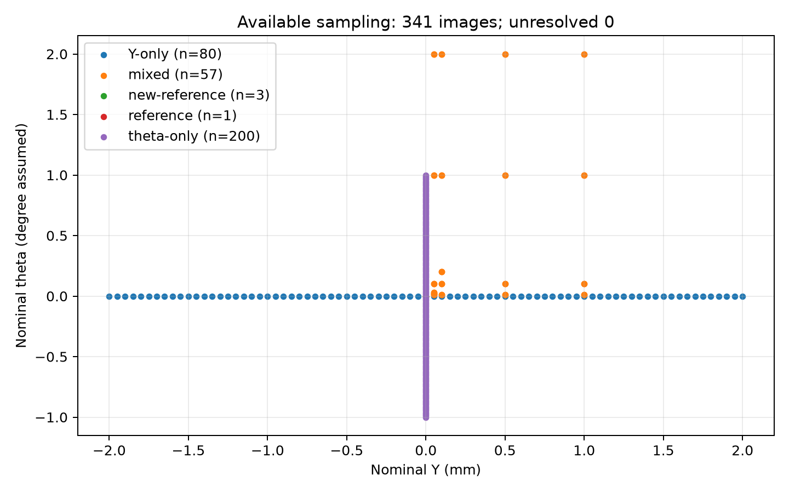
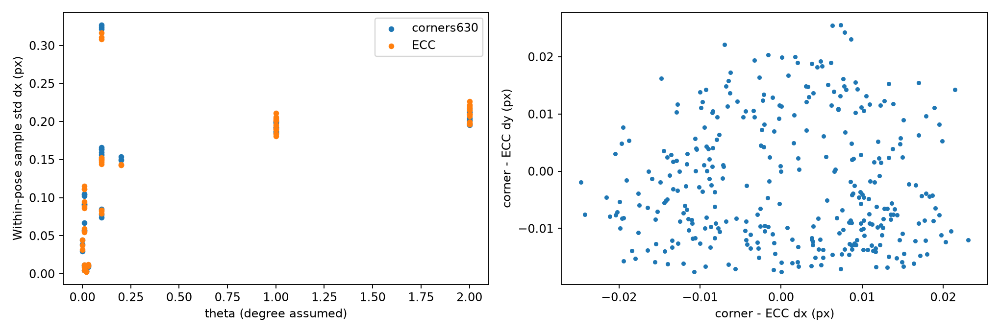
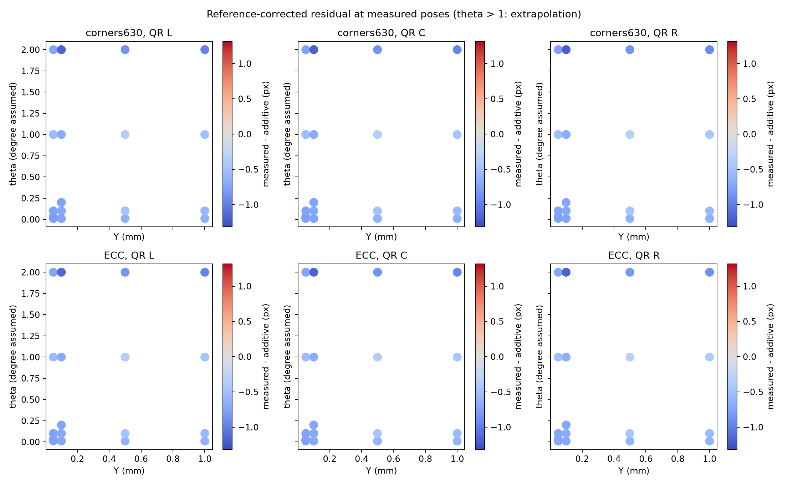
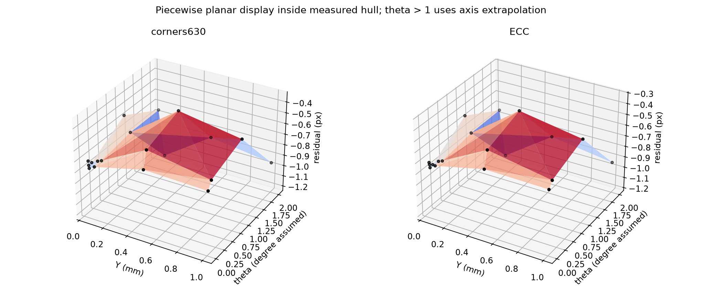
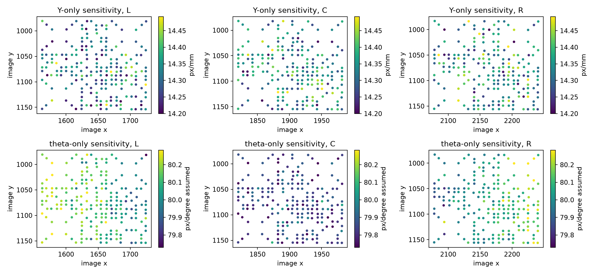

# 새 Y–theta 혼합 데이터 전수 분석

2026-10-20. **새 60장과 기존 281장, 총 341장을 전수 계측했다.**
원본 SHA256은 최초 조사와 최종 조사에서 모두 같다. smoothing/denoising을 적용하지 않았다.
Ytheta 교차항은 학습 오차를 조금 줄였지만 좌표 단위 보류 오차를 키웠다.
따라서 현재 residual을 순수한 기구 coupling으로 확정할 수 없다.
새 촬영의 반복 편차·세션 offset·기존 축 범위 밖 외삽을 함께 고려해야 한다.
명시한 벽면 법선 회전축 물리모델도 관측을 충분히 설명하지 못했다.

## 1. 실제 데이터 구성과 좌표

기존 center 1, Y 80, Theta 200에 새 기준 3, 혼합 19좌표×3=57장이 추가됐다.
모든 영상은 3840×2160 RGB BMP이다. 촬영 순서는 확정하지 않았다.
괄호 (1)/(2)/(3)은 반복 **파일 식별자**로만 사용하며 시간 순서로 단정하지 않는다.

| Y (mm) | theta (degree 가정) | 좌표 수 | 장수 |
| --- | --- | --- | --- |
| 0.05 | 0.01, 0.02, 0.03, 0.1, 1, 2 | 6 | 18 |
| 0.1 | 0.01, 0.1, 0.2, 1, 2 | 5 | 15 |
| 0.5 | 0.01, 0.1, 1, 2 | 4 | 12 |
| 1.0 | 0.01, 0.1, 1, 2 | 4 | 12 |

새 기준 sidecar 평균은 Y=-1.300, T=-1.669999이다.
이 값을 뺀 Y_Actual/T_Actual과 파일명 명목 좌표의 최대 차이는 각각
8.33e-17 mm, 1e-06 T 단위다.
sidecar는 장비 기록값이며 독립 외부 실측 정답이라고 인증하지 않는다.
θ는 PPT와 마찬가지로 degree를 가정했다. 이전 세션의 절대 축 기록은 없다.
Y±0.05~±2.00, θ±0.01~±1.00의 기존 십자 데이터에 양의 혼합 영역만 추가됐다.
θ=2.00의 4좌표/12장은 θ 단독 기준 범위 밖이다.



## 2. 계측 방법과 PPT 재현 범위

첨부 `SEMES_01_데이터EDA_정리본_v4.pptx` 24장을 읽고 4/5/17쪽 방법을 기준으로 삼았다.
기존 기능 브랜치 ae9a3de의 QR 후보 생성·정밀화·검증 코드와 논문 문서도 먼저 조사했다.
기존 C++은 X 교점 중심이며 decoder/plate에 Gaussian 경로가 있으므로 이번 무필터 계측에 그대로 사용하지 않았다.

원본 center를 raw crop으로 디코딩하고, payload별 버전1 QR의 오류정정 수준/마스크/인코딩을
열거하여 모듈을 재생성했다. 흰 바깥 영역을 포함한 2×2 모듈 경계의 L 모서리를 채택했다.
PPT와 동일하게 **755점 중 대각선 125점 제외, L212/C210/R208=630점**이다.
모든 영상에서 동일 ID 630점을 보존했다. 총 **214,830개** 위치를 측정했다.

각 점은 원본 정수 픽셀의 9×9/11×11 창에서 Gaussian 경계 확률, 위치 x/y, 광학 PSF σ,
명암 gain/offset을 nonlinear least squares로 적합했다. 광학 blur의 모델링은 입력 영상을 흐리는 작업과 다르다.
국소 경계 방향은 QR affine 기하로 고정한다. 비직교 Gaussian convolution의 완전한 논문 재현은 아니며
분리 가능한 quadrant 근사다. PPT의 원래 분석 소스가 첨부되지 않아 같은 수치 결과를 보장하지 않는다.
위치는 각 축 ±3.6px, σ=0.18~2.6px 제약이다. 수렴·RMSE≤15·대비≥45·위치/σ 비경계·
두 창 위치차≤0.65px를 진단 마스크로 기록했다. 마스크 통과율은 **60.16%**이다.
주 집계는 PPT처럼 통과 마스크와 무관한 고정 630점이다. 불확실 점을 삭제해 residual을 줄이지 않았다.
PPT의 center 진단 통과 597/755와 이번 마스크 결과는 구현·점 집합이 달라 직접 비교할 수 없다.

ECC는 center의 L/C/R별 204×216 raw 패치를 ±300px 가로/±120px 세로에서 탐색하고
affine 정합했다. 패치 bounds와 affine 계수를 모두 저장했다. 가로 범위 확대는 θ=2 촬영을 포함하기 위함이다.
기준점은 PPT의 정수 중심 근사값이며 라벨 경계를 새로 실측한 것은 아니다.
`gaussFiltSize=1`로 기본 5×5 Gaussian을 사용하지 않았다. 영상 이동의 수치 보간은 정합 과정에만 사용한다.

ECC **1,023/1,023 성공**, correlation 최저 **0.983467**,
중앙값 **0.992297**이다.
PPT의 0.996/0.999는 전처리·패치·대상 세션이 다른 결과이므로 동일 기준으로 간주하지 않는다.
이미지별 3QR 평균 dx의 두 방법 차이는 RMS **0.011221px**,
최대 절댓값 **0.024667px**이다.
방법 간 일치는 절대 측정 오차나 두 방법이 공유하는 편향을 인증하지 않는다.



## 3. 기준점 offset와 공통 변동

새 기준 3장의 ECC 평균은 기존 center 대비 다음과 같다. 이 offset의 raw 값도 그대로 보존했다.

| QR | 새 기준 - 기존 center dx (px) | dy (px) |
| --- | --- | --- |
| C | -0.26318 | 0.44415 |
| L | -0.28934 | 0.44460 |
| R | -0.24528 | 0.44485 |

이전 축 trial은 파일명에서 6개 후보 그룹을 정의하고 선형/2차 회귀 절편을 함께 저장했다.
trial 절편은 명령 0에서의 **외삽된 모델 절편**이며 실제 원점 복귀 측정값이 아니다.
`axis_fits_and_offsets.csv`와 각 영상의 `axis_raw_model_residuals.csv`를 참조한다.

새 혼합 19좌표의 각 3회 반복에서 점별 좌표 평균을 빼고 모든 630점의 공통 성분을 구했다.
공통 dx residual RMS는 **0.135712px**,
이를 뺀 개별 점 dx residual RMS는 **0.072769px**다.
이 값은 평균 제거된 residual의 RMS이며 불편 표준편차가 아니다. 반복수가 3이면 단순 iid 가정의
표준편차 환산 계수는 sqrt(3/2)이지만, 반복 파일 식별자별 공통 패턴이 있어 iid 잡음으로 단정하지 않는다.
파일 (2)의 평균 반복 residual이 약 +0.142px, (1)은 -0.106px, (3)은 -0.037px이고
두 계측 방법에서 거의 같다. 원인을 기구/조명/정합 중 하나로 분리할 정보는 없다.
QR 내 수백 점 평균으로 이 공통 성분을 없앨 수 없다.

## 4. Additive residual과 coupling

`additive_residuals.csv`에는 두 정의를 나란히 보존한다.

1. **raw residual**: 기존 center 기준 관측 − [기존 Y 단독 관측 + 기존 θ 단독 관측].
   실제 축 표본은 선형 보간한다. θ=2에서는 축 표본이 없으므로 raw additive를 NaN으로 둔다.
2. **reference-corrected residual**: (관측 − 새 기준 3장 평균) −
   [Y 축 trial 절편을 제외한 2차 곡선 + θ 축 trial 절편을 제외한 2차 곡선].
   positive 축만 사용하고 각 Y trial 절편은 따로 적합한다. θ=2만 외삽 flag가 붙는다.
   새 기준 offset 제거는 따로 기록된 좌표 기준 변환이며 raw residual을 덮어쓰지 않는다.

주어진 혼합 pose에서 reference-corrected dx residual 분포는 다음과 같다.
세션 차이와 축 모델 오차를 포함하며, 아래 값 자체가 순수 coupling의 크기는 아니다.

| 방법 | 축 외삽 | 개별 QR/frame 최소 (px) | 최대 (px) | 평균 (px) |
| --- | --- | --- | --- | --- |
| ECC | False | -0.9018 | -0.0875 | -0.6248 |
| ECC | True | -1.3351 | -0.4771 | -0.9230 |
| corners630 | False | -0.9192 | -0.1270 | -0.6398 |
| corners630 | True | -1.3527 | -0.4989 | -0.9410 |




표면은 **측정한 19좌표 사이 삼각형의 선형 표시**이다. 미촬영 위치를 새 관측처럼 취급하지 않는다.
`additive_point_residuals.csv.gz`는 630점 각각에 같은 기준을 적용한 raw 측정·예측·offset·residual을 보존한다.

2차 additive (1,Y,theta,Y²,theta²)와 여기에 Ytheta를 추가한 모델을 비교했다.
새 혼합 데이터의 19개 **좌표 단위 leave-one-coordinate-out**을 사용하며, 같은 pose의 반복 3장은
항상 같은 쪽에 둔다. 먼저 좌표별 반복 평균을 계산하여 같은 pose가 학습/보류에 함께 들어가는 누출을 막았다.
아래 계수 단위는 px/(mm·degree 가정)이다. jackknife SE는 좌표를 하나씩 제외했을 때의 민감도 진단이며
독립·동일분포 측정 잡음이나 인과적 유의성을 보장하지 않는다.

| 방법 | QR | 교차항 | 학습 RMSE (px) | 좌표 LOCO RMSE (px) | Ytheta 계수 | jackknife SE |
| --- | --- | --- | --- | --- | --- | --- |
| ECC | C | False | 0.0909 | 0.1313 | 0.0000 | - |
| ECC | C | True | 0.0885 | 0.1486 | -0.0711 | 0.1593 |
| ECC | L | False | 0.0896 | 0.1298 | 0.0000 | - |
| ECC | L | True | 0.0857 | 0.1433 | -0.0899 | 0.1528 |
| ECC | R | False | 0.0905 | 0.1302 | 0.0000 | - |
| ECC | R | True | 0.0899 | 0.1514 | -0.0346 | 0.1629 |
| corners630 | C | False | 0.0905 | 0.1307 | 0.0000 | - |
| corners630 | C | True | 0.0885 | 0.1486 | -0.0654 | 0.1592 |
| corners630 | L | False | 0.0913 | 0.1323 | 0.0000 | - |
| corners630 | L | True | 0.0873 | 0.1464 | -0.0922 | 0.1568 |
| corners630 | R | False | 0.0907 | 0.1304 | 0.0000 | - |
| corners630 | R | True | 0.0902 | 0.1516 | -0.0331 | 0.1625 |

**모든 QR와 두 계측에서 교차항 추가 후 보류 dx 오차가 커진다.**
교차계수의 부호/값을 장비의 확정 coupling 계수로 배포하지 않는다.
기존 세션의 단독 축 모델이 새 세션의 혼합 운동을 그대로 설명하지 못하는 것은 관측되지만,
이를 교차항으로 설명하는 편이 일반화에 유리하다는 증거는 없다.
음의 혼합 영역과 θ=2 단독 기준 촬영이 없어 그 영역은 검증되지 않았다.

## 5. Local Jacobian과 점 위치 민감도

혼합 좌표에서 같은 θ의 Y 이웃, 같은 Y의 θ 이웃을 이용해 dx/dY,dy/dY,dx/dtheta,dy/dtheta를 계산했다.
`local_jacobian_qr.csv`, `local_jacobian_points.csv.gz`에는 **구간 양 끝값**이 포함된다.
불규칙·성긴 표본이므로 정확한 점 미분이 아니라 유한 구간 secant이다. 특히 theta 0.1→1.0,
1.0→2.0의 넓은 구간을 국소 미분으로 과해석하지 않는다. 반복 3장 평균을 사용한다.
`point_axis_sensitivity.csv`는 이전 축 자료의 선형/2차 계수와 원본 점 위치를 보존한다.
QR L/C/R 차이는 동일 표와 잔차 그림에서 비교할 수 있다.



## 6. 요청한 축 정의의 강체운동+투영 모델

벽 평면 nᵀX=d, Y 방향 aᵀn=0, 회전축 n으로 두었다.
거리 스케일 d=1로 정하고 R=Rodrigues(n·theta), C=aY+(I−R)p,
H=K Rᵀ(I−C nᵀ)K⁻¹로 기준 광선을 투영했다. 카메라 뒤쪽 회전중심 p의 법선 성분은
**(I−R)(p+λn)=(I−R)p** 때문에 관측에서 소거된다.
따라서 뒤쪽 깊이 p·n은 적합하지 않았고 실제 거리 d도 단독 복원했다고 주장하지 않는다.
적합 대상은 벽면 법선 기울기2, 접선 Y 방향각1, Y이동/d1, 접선 회전중심/d2의 6개 조합이다.
주점 (1920,1080), 정사각 픽셀, 왜곡 없음은 가정이다.
f=2000/4500/8000px를 profile하고 log(f) 자유 적합도 진단했다.

새 기준 대비 ECC QR 중심 이동과 sidecar 상대 좌표를 사용했다.
19좌표 중 고정 규칙으로 14좌표 학습/5좌표 보류했다. 동일 분할의 empirical 모델도 비교했다.
아래 RMSE는 dx/dy를 함께 집계한 값이므로 앞의 dx-only LOCO 표와 직접 비교하지 않는다.

| 모델 | 학습 xy RMSE (px) | 보류 xy RMSE (px) |
| --- | --- | --- |
| 물리 f=2000 | 0.9523 | 1.8740 |
| 물리 f=4500 | 0.9447 | 1.8577 |
| 물리 f=8000 | 0.9438 | 1.8568 |
| 물리 f=20000 (적합) | 0.9433 | 1.8557 |
| quadratic_additive | 0.0355 | 0.2161 |
| quadratic_interaction | 0.0347 | 0.2378 |

모든 focal profile에서 법선 기울기 파라미터가 지정 경계에 걸리고,
자유 초점거리도 상한 20000px에 걸렸다. 자유 적합 Jacobian 조건수는 약
2.56e+05이다.
**이 물리모델을 유효 보정 모델로 채택하지 않는다.** 실제 회전축/운동 순서, 벽 기울기,
렌즈 보정과 회전중심의 추가 정보가 필요하다. 경계에 걸린 해를 얻었다는 이유만으로
축 정의를 임의로 바꾸거나 focal/거리/회전중심의 절대값을 보고하지 않는다.
제약과 가정하에서의 실패 결과까지 `physics.json`, `physics_raw_residuals.csv`에 보존했다.

## 7. 산출물, 검증, 재현

모든 단계는 저장소 루트에서 실행한다. 요구 라이브러리는 `tool/offaxis/requirements.txt`에 있다.

```powershell
python -m pip install -r tool/offaxis/requirements.txt
python tool/offaxis/inventory.py --root "data/SSAFY Test Image Set" --output docs/offaxis-eda
python tool/offaxis/extract.py --root "data/SSAFY Test Image Set" --output docs/offaxis-eda/raw --workers 4
python tool/offaxis/analyze.py --output docs/offaxis-eda
python tool/offaxis/physics.py --output docs/offaxis-eda
python -m unittest discover -s tool/offaxis -p "test_*.py" -v
python tool/offaxis/report.py --output docs/offaxis-eda
```

계측은 4프로세스/각 OpenCV1스레드에서 약 324초가 소요됐다.
CSV gzip은 표준 CSV 압축이며 pandas.read_csv로 바로 읽을 수 있다.
`point_displacements.csv.gz`는 모든 원본 fitting x/y·진단·변위·명목값·실제 기록값을 포함한다.
`raw/points.csv`도 로컬에 보존되며 Git에는 동일 정보의 압축 계측 CSV를 기록한다.
`raw/reference.json`, `raw/ecc.csv`, `raw/extraction.json`으로 템플릿/ID/transform/설정을 추적한다.
`frame_displacements.csv`, `qr_displacements.csv`는 이미지/QR별 변위,
`repeat_raw_point_residuals.csv.gz`는 반복 residual의 공통·개별 분해이다.
결과를 예쁘게 만들기 위한 시계열 smoothing이나 residual 사후 필터는 없다.

4개 수치 검증(밝기 모델 미분·좌표 parser·ECC 좌표/부호·3D 투영)과 전수 결과 검사
7개를 통과했다. 데이터 수, 고정 ID, 유한 좌표, ECC 성공, 원본 해시 보존,
중복 ID 없음, 실행 소스 해시 일치를 확인했다. 이것은 장비 절대 정확도 인증이 아니다.

Git 규칙은 작업 전에 읽었다. 문서의 develop은 없고 실제 통합/원격 기본 브랜치가 dev여서
dev에서 `feature/offaxis-eda`를 생성했다. 조사 대상 기능 브랜치 운영 소스는 이 브랜치에
임의로 합치지 않았다. 의미별 로컬 중간 커밋을 수행했으며 push는 수행하지 않았다.

참고: [Fourier 교점 논문](https://www.tnt.uni-hannover.de/papers/data/1335/main.pdf),
[OpenCV ECC API](https://docs.opencv.org/doc/doxygen/html/dc/d6b/group__video__track.html).
Fourier의 X 교점 대칭성 목적함수는 이번 L 모서리에 그대로 사용하지 않았다.
