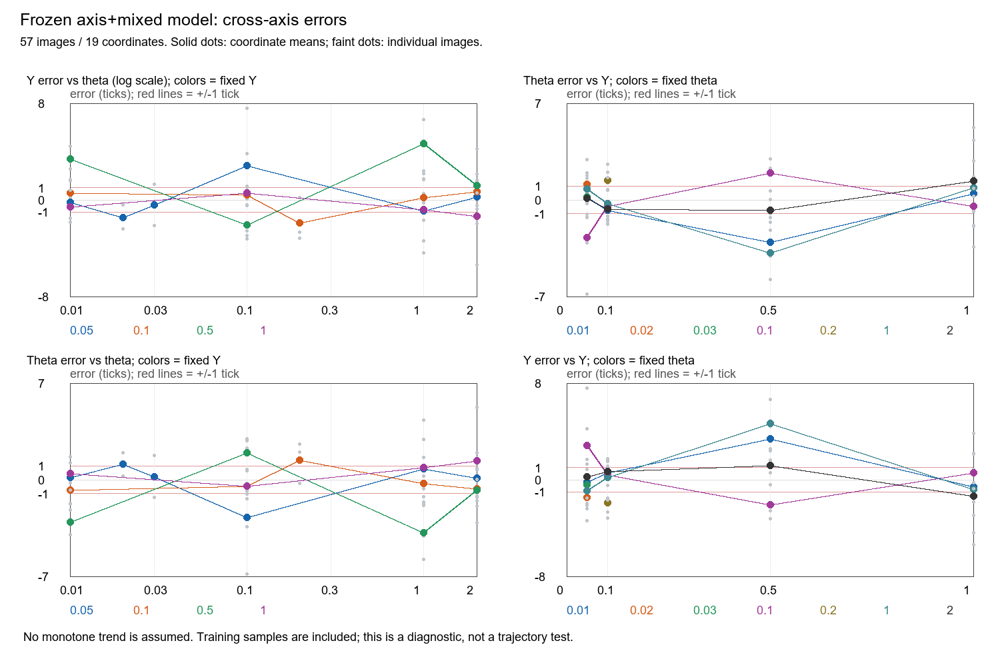

# 기존 저장 모델의 혼합 위치 오차와 축 접근성

2026-10-26. 목표는 5~10회 내 원점 도달, 최대 20회이다. 새 좌표 추정기를 학습하지 않았다.

## 결론

확인 가능한 저장 모델에서는 혼합 위치에서 한 축을 보정하면 대체로 축까지의 거리가 감소한다. 따라서 ‘축에 접근한 후 정확한 축 전용 추정기로 원점 보정’은 시험할 가치가 있다. 다만 이번 자료로 실제 5~10회 성공률이나 수렴을 인증할 수 없다. 특히 사용자가 직접 확인한 고정밀 축 모델의 구현/계수를 찾지 못했으므로, 아래 수치를 그 모델의 성능이라고 해석하지 않는다.

## 자료와 모델 범위

- 원본: `data/SSAFY Test Image Set`. 기존 inventory에 있는 341장 모두 SHA256 일치를 확인했다. 이미지를 다시 계측하지 않고 일치하는 원본에서 만든 기존 계측을 재사용했다.
- 혼합 자료: 양의 19좌표 × 3장 = 57장. Y=0.05~1 mm, θ=0.01~2°. 축 전용 θ 자료는 ±1°까지이므로 θ=2° 12장은 별도 외삽 표시한다. 신규 기준은 center1이다.
- 주 분석: `refit-axis-split/model.json`의 고정 6채널 모델. 기존 축 학습자료와 혼합 51장을 함께 학습했고, 혼합 (0.1,0.1), (0.5,1)의 6장만 보류했다. 저장 계수로 재예측해 저장 예측과 최대 1e-9 이내 일치를 확인했다. 57장 전체 결과는 학습자료를 포함한다.
- 보조 분석: 기존 Corners630 혼합 전용 고정 모델, GN 혼합 전용 고정 모델, 저장된 19좌표 보류 예측. 보류 예측은 좌표마다 다른 학습 모델의 출력이므로 하나의 고정 제어기로 취급하지 않는다.
- 로컬 `origin/chore/hw-merge` ef01a82의 `alignment()`는 y=t=0을 반환하는 placeholder다. 원격 최신 확인은 DNS 해석 실패로 불가했다. 다른 로컬 추정 브랜치의 순차/Fourier 실험도 확인했으나 요청한 한 틱 축 모델과 동일하다고 판단할 근거는 없다. 사용자가 본 축 정확도를 부정하는 결과가 아니다.
- 틱 정의: 기존 분석에 저장된 Y=0.05 mm, θ=0.01°. 파일명 명령값을 평가 기준으로 사용하며 독립 실측값은 아니다.

## 상대 축에 따른 오차

주 모델의 57장 전체 Y RMSE는 0.127020 mm(2.540틱), θ RMSE는 0.022695°(2.270틱)이다. 혼합 보류 6장에서는 각각 0.177275 mm, 0.030473°이다.

두 축 오차의 상관계수는 **-0.9944**다. 원점을 지나는 오차 관계는 대략 `error_Y ≈ -5.566 × error_theta`이며 단위는 mm/degree다. 두 추정값이 독립적으로 흔들리는 것이 아니라 한 축 오차가 다른 축 오차로 바뀌는 양상이다. 이것만으로 물리적 coupling이나 원인을 확정하지 않는다.

같은 Y에서 θ를 바꿀 때, 같은 θ에서 Y를 바꿀 때 모두 오차 부호가 바뀌며 단순 단조 추세가 없다. 예를 들어 Y=0.05에서 θ=0.01,0.02,0.03,0.1,1,2° 순서의 평균 Y 오차는 -0.0109,-0.0725,-0.0211,+0.1419,-0.0444,+0.0123 mm이다.

| 고정 Y | θ | 평균 Y 오차 mm | 평균 θ 오차 ° | 반복 Y 표본 SD mm | 반복 θ 표본 SD ° |
|---:|---:|---:|---:|---:|---:|
| 0.05 | 0.01 | -0.010885 | +0.001603 | 0.024417 | 0.003787 |
| 0.05 | 0.10 | +0.141927 | -0.027170 | 0.205705 | 0.035826 |
| 0.50 | 0.01 | +0.170091 | -0.030487 | 0.048154 | 0.008996 |
| 0.50 | 0.10 | -0.103503 | +0.019551 | 0.072853 | 0.011923 |
| 0.50 | 1.00 | +0.232247 | -0.038206 | 0.105709 | 0.021014 |

좌표별 반복 평균 오차 RMS도 Y=0.087212 mm, θ=0.015271°로 한 틱보다 크다. 반복 평균 제거 성분은 전체 제곱오차의 약 53%(Y),55%(θ)를 차지한다. 세 장은 시간순 제어 궤적이 아니며 이 성분을 독립 백색잡음이라고 가정하지 않았다.



전체 19좌표의 평균 오차에 `e=c+Bq`를 기술적으로 적합했다. q,e는 각각 틱 단위다. 새 추정기로 사용하지 않는다.

```text
c = [ 0.258723, -0.385201 ] ticks
B = [ -0.008745   0.001040 ]
    [  0.017058   0.000549 ]
```

이 전역 직선의 교차항은 작지만, 좌표 하나씩 제외해 오차 표면을 설명할 때 RMS가 Y=1.945틱, θ=1.698틱이다. 잔여 변동이 크므로 `a*b`가 작다는 이유로 빠른 수렴을 선언할 수 없다. 자체 축 기울기와 절편도 무시할 수 없고, 양의 넓은 영역 전역 적합은 원점 근처 미분이 아니다. `cross_axis_secants.csv`는 같은 고정축에서 인접 좌표 사이 실제 오차 변화량을 보존하며, 불규칙하고 넓은 구간의 secant를 국소 미분으로 해석하지 않는다.

## 보정 1회의 축 접근성

실제 장비에 이동 명령을 보내지 않았다. 독립적이고 정확한 가산 이동 `q_next=q-command`를 가정해 첫 보정 결과만 계산했다. 예를 들어 Y에 -predicted_Y를 명령하면 보정 후 Y=-error_Y다. 기존 정답은 사후 평가에만 사용하고, 명령 선택에는 예측값만 사용한다.

축까지의 거리는 `d=min(|Y|/0.05, |theta|/0.01)`로 정의한다. d≤1은 축 주변 한 틱 띠이며 **정확한 축 도착이나 축 전용 모델의 유효 영역을 의미하지 않는다**. 57장 중 27장은 시작부터 이 띠에 있어, 나머지 30장만 따로 집계했다.

| 주 모델 보정 방식 | 처음 띠 밖인 장수 | 축까지 거리 감소 | 한 틱 띠 진입 |
|---|---:|---:|---:|
| Y만 보정하여 θ축 접근 | 30 | 28 | 10 |
| θ만 보정하여 Y축 접근 | 30 | 29 | 10 |
| 예측 틱 거리가 작은 축만 보정 | 30 | 28 | 10 |
| 두 축 동시 보정 | 30 | 29 | 10 |

30장은 10개 좌표의 반복이므로 30개 독립 위치의 성공률로 읽지 않는다. 방향성은 좋지만 어느 정책이 우월한지 입증하기에는 부족하다. 특히 ‘예측상 가까운 축’ 선택이 고정 축 보정보다 유리하다는 근거는 없다. 고정 축으로 접근하는 간단한 정책을 첫 실험 기준으로 삼을 수 있다.

이 중 학습에서 보류한 혼합 자료는 두 좌표뿐이다. 전체 비율에는 학습자료가 포함되며 GN/코너 보류 예측의 보조 결과는 별도 CSV에서 확인할 수 있다. 실제 기구 간섭, 백래시, 명령 양자화, 이동 후 관측 변화는 이 산술 계산에 들어 있지 않다.

## 5~10회 목표에 대한 판단

첫 이동의 축 접근 가능성은 관측되지만 반복 수렴은 미확인이다. 첫 보정 후 도착할 음수 영역, 신규 세션의 축 주변, 원점 근처에서 찍은 후속 이미지가 없기 때문이다. 동일 오차를 매회 재사용하거나 미촬영 위치를 보간해서 5/10/20회 성공률로 표시하지 않았다.

다음 장비 시험은 고정 축 접근을 기본으로, 매 이동 후 재촬영하여 축 접근 여부를 판단하고 축 모델이 유효한 띠에서 기존 고정밀 모델로 전환하는 방식이 적절하다. 축 모델 전환은 그 모델의 영상 잔차/유효 영역으로 판정해야 하며, 현재 혼합 모델의 작은 출력만으로 판정하면 오차가 가려질 수 있다. 처음부터 띠 안에 있는 시작점의 유지 성능도 별도로 봐야 한다.

같은 혼합 시작점들에서 5회/10회/20회 이내 원점 도달, 축 진입까지 횟수, 축 진입 후 원점까지 횟수, 정체/진동을 기록하면 목적에 맞는 검증이 된다. 사용자 확인 모델이 확보되면 이번과 동일한 오차·첫 이동 분석을 그 모델로 교체해서 수행할 수 있다.

## 산출물과 재현

- `predictions.csv`: 고정 모델 및 저장 보류 예측, 실제 명령 좌표, 오차, 학습/보류 구분.
- `coordinate_errors.csv`: 모든 좌표 평균 오차와 반복 표본 SD.
- `cross_axis_secants.csv`: 고정 축별 인접 좌표의 오차 변화.
- `ideal_one_command.csv`, `ideal_one_command_summary.csv`: 이상적인 첫 이동의 명령과 축 거리.
- `error_surface_diagnostics.json`: 기술적 오차 표면, 잔여 오차, 수렴으로 해석할 수 없는 전역 선형화 진단.
- `verified_images.csv`, `manifest.json`: 341장 원본 해시 검증, 계측/모델/분석 코드 해시와 가정.

저장소 루트에서 numpy,pandas,Pillow가 있는 Python으로 `tool/offaxis/axis_approach.py` 실행. 원본 영상, 기존 계측, 기존 모델은 수정하지 않았다. 커밋과 push는 하지 않았다.
