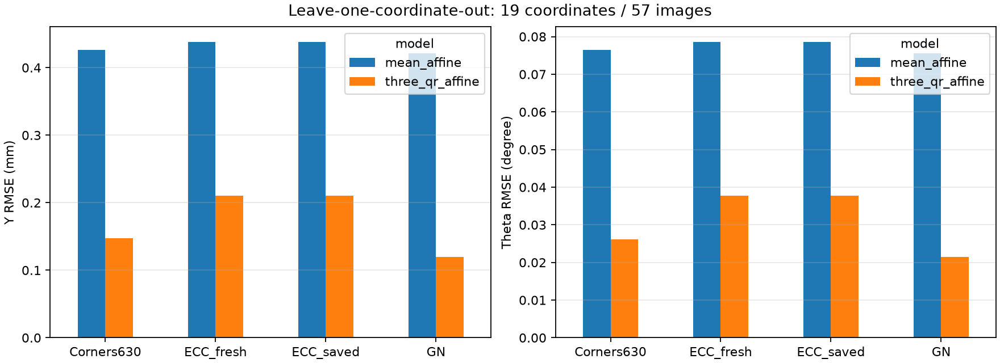

# ECC 목적함수 + Gauss–Newton 실험

2026-10-22 실행. 신규 혼합축 57장(19좌표 × 3회), 신규 기준 3장, 각 영상의 L/C/R QR 패치 180개를 처리했다. 원본 영상과 기존 결과는 변경하지 않았으며 Git 커밋은 하지 않았다.

## 방법

기준 영상은 기존 ECC와 동일한 `center.bmp`이다. QR별 204×216 패치와 ±300px/±120px 정규화 상관 탐색으로 초기 평행이동을 구한다. 명령 좌표는 영상 정합에 사용하지 않는다. 정합 후 각 QR 중심 변위에서 `기준 위치/center1.bmp`의 변위를 빼 신규 세션 기준을 맞춘다.

잔차는 `r = normalize(I(W(p))) - normalize(T)`이며 normalize는 평균 제거 후 L2 norm 정규화다. 따라서 `0.5*r.T*r = 1 - correlation`이다. 내부 5px 경계를 제외한 고정 픽셀 집합을 모든 반복에서 유지한다. 영상은 평활화하지 않는다. bilinear 보간의 구간별 정확한 미분에 평균·norm의 미분을 포함한다. 좌표를 QR 중심과 반폭/반높이로 정규화한 6변수 affine 모델이다. 파라미터 p0/p3는 QR 중심의 x/y 변위(px)다.

`(J.T*J + lambda*diag(J.T*J))*step = -J.T*r`를 풀고, 비용이 감소하는 step만 채택한다. 최대 80회, 파라미터 변화 1e-5px 미만 또는 비용 개선 1e-12 미만이면 종료한다. 이는 정규화 잔차에 적용한 damped Gauss–Newton이며 원 논문의 ECC 전용 업데이트와 동일한 구현이라는 뜻은 아니다.

비교군은 기존 저장 ECC, 현재 환경에서 재실행한 OpenCV affine ECC(Gaussian kernel=1, 최대 100회, epsilon=1e-7), 기존 고정 630점의 QR별 평균 변위다. OpenCV 재실행도 같은 정수 초기 이동을 사용한다. 기존 구현은 crop 경계 및 보간/미분 처리가 다르므로 아래 차이를 최적화 알고리즘 하나의 효과로 단정할 수 없다. ECC warp와 GN warp의 최종 상관계수는 동일한 내부 픽셀과 bilinear sampler로도 재평가했다.

## 좌표 예측 결과

각 QR의 dx/dy 6채널에서 Y(mm), theta(degree)를 예측하는 절편 포함 affine 보정을 동일하게 사용했다. 전체 좌표 하나의 반복 3장을 함께 보류하는 19-fold 평가이며 입력 정규화와 보정 계수는 매 fold 학습분만으로 추정했다. 기준 영상 3장은 보정 학습과 오차 집계에서 제외했다.

| 계측 | Y RMSE (mm) | theta RMSE (°) | Y 최대 절대 오차 (mm) | theta 최대 절대 오차 (°) |
|---|---:|---:|---:|---:|
| Gauss–Newton | 0.119883 | 0.021430 | 0.338483 | 0.061606 |
| OpenCV ECC 재실행 | 0.210587 | 0.037714 | 0.526023 | 0.095106 |
| 기존 저장 ECC | 0.210587 | 0.037714 | 0.526023 | 0.095106 |
| 기존 630점 | 0.147747 | 0.026187 | 0.400196 | 0.069205 |

GN은 현재 ECC 대비 두 축 RMSE가 약 43% 낮고, 630점 대비 Y 약 19%, theta 약 18% 낮다. QR 3개를 먼저 평균한 2채널 보정에서는 GN도 Y 0.421269mm, theta 0.075555°로 악화된다. 현재 자료에서는 QR 간 공간 차이를 보존하는 것이 중요하다.



## 수치 검증 및 실행 상태

- 정규화 잔차 Jacobian과 중앙 유한차분의 상대 오차: 3.46e-9.
- 알려진 affine 변형 및 gain=1.3/offset=17 합성 입력 복원: 최대 파라미터 오차 3.39e-14px. 동일 보간 모델을 사용한 수치 검증이며 실제 센서 정확도 주장이 아니다.
- 180/180 패치가 step/cost 기준으로 종료, 최대 반복 도달·stalled 없음. 모든 기록에서 비용 단조 감소.
- 반복 수 중앙값 5회, 최대 16회. 최종 correlation 최솟값 0.985983.
- 동일 픽셀/보간으로 재평가한 correlation은 GN이 ECC보다 180/180 패치에서 높음. 이것만으로 물리 좌표 정확도가 보장되지는 않는다.
- 패치당 GN 최적화 중앙값 약 43ms, ECC 실행 및 공통영역 재평가 약 13ms. 정수 탐색과 파일 읽기는 제외했으며 엄격한 속도 벤치마크는 아니다.

## 해석 범위

정답은 파일명에 기록된 명령 좌표이며 독립 실측값이 아니다. 같은 기존 19좌표를 이용한 탐색적 비교로서 새로운 촬영 세션의 독립 시험 성능이 아니다. 영상 정합은 center.bmp를 재사용하고 center1 기준 변위를 사용한다. 실제 신규 세션 보정·일반화, 원점/음수/미촬영 조합의 정확도는 미검증이다. 이 결과는 영상 변위 추정 개선 실험이며 기구학 모델을 직접 Gauss–Newton으로 역산한 실험은 아니다.

## 산출물과 재현

- `measurements.csv`: 180개 패치의 GN 파라미터, 수렴 상태, 공통영역 상관계수, 재실행 ECC 변위.
- `comparison.csv`: 4계측 × 2보정 모델의 좌표 보류 성능.
- `coordinate_holdout.csv`: 영상별 보류 예측과 오차.
- `models.json`: 전체 학습 모델 및 별도 기준 영상 예측. 입력은 L_dx,L_dy,C_dx,C_dy,R_dx,R_dy 순서이며 center1 변위를 차감한다. mean 모델은 세 QR을 균등 평균한다.
- `manifest.json`: 입력/코드 SHA256, 라이브러리 버전, 수치 검증 및 실행 상태.

저장소 루트에서 numpy, pandas, opencv-python-headless, matplotlib 설치 환경으로 실행:

```powershell
python tool/offaxis/ecc_gauss_newton.py
python tool/offaxis/ecc_gauss_newton.py --check-only
```

`refit_model.py`의 fit/predict를 재사용한다. 현재 해당 파일은 기존 미커밋 파일이므로 실험 코드를 다른 환경으로 복사할 때 함께 가져가야 한다. 실행 환경에서는 Python 3.12 번들 런타임과 프로젝트의 `.analysis_packages`를 사용했다.
