# QR 플레이트·특징점 검출 안정성 검증

> 이 문서는 재시도 기반 구현의 검증 이력입니다. 현재 고정 파이프라인은 [후속 검증](qr-fixed-pipeline.md)을 참고하세요.

검증일: 2026-10-19. 대상: `data/SSAFY Test Image Set`의 281장(center 1, Theta 200, Y 80). Windows / OpenCV 3.4.15 / C++17. 원본 이미지는 수정하지 않았다.

## 현재 판정

**최종 알고리즘은 이 데이터셋의 281장 모두에서 플레이트 검출, QR 3개 디코딩, 모델 대응 및 특징점 품질 검사를 통과했다.** 그러나 데이터셋 내 성공률이며 다른 촬영 조건에 대한 보장이나 0.05mm·0.01도 측정 정확도 인증이 아니다. 성공한 대응점으로 Gauss–Newton 추정을 개발할 수 있는 입력은 확보했다. 평균 이동 제거 후 점별 국소 요동이 남으므로 정밀도 평가는 해당 추정기와 반복 촬영에서 계속해야 한다.

파일명 라벨은 명령/메타데이터다. 복귀 과정의 오프셋이 포함될 수 있어 실측 정답으로 취급하지 않았다. 플레이트 정정 치수는 66×11mm, QR 간격은 5mm이지만 QR 치수/간격 정의가 불확실하므로 이 보고서는 영상 픽셀 단위로 평가한다.

## 변경 이력과 전수 검증

| 방식 | 플레이트 | QR 3개 모두 유효 | 기존 성공 240장의 새 실패 |
|---|---:|---:|---:|
| 기존 가로선 >180px | 279/281 | 240/281 (85.4%) | 기준 |
| >100px 일괄 적용: 미채택 실험 | 281/281 | 247/281 (87.9%) | 14장 |
| >180px 우선, 실패 시 >100px 재시도 | 281/281 | 242/281 (86.1%) | 0장 |
| 위 방식 + 디코딩 전용 Gaussian 재시도: 최종 | 281/281 | 281/281 (100%) | 0장 |

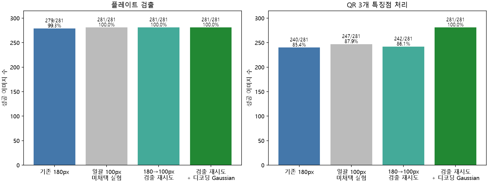

가로선 길이는 3840px 폭 기준이며 입력 폭에 비례한다. 기존 사각형 크기·에지 지지도·명암 점수 검사는 유지했다. 일괄 완화는 기존 성공 결과를 바꾸므로 채택하지 않았다. 최종 외곽 탐색은 엄격 조건에서 유효 후보를 찾지 못한 경우에만 짧은 선을 사용한다.

검출 재시도만 적용했을 때 기존 성공 240장은 성공을 유지하고, 공통 특징점 좌표 차이 최댓값은 0px였다. `T+0.86.bmp`, `T-0.53.bmp` 두 장만 새로 복구됐다. 이는 해당 검증 데이터에서의 회귀 검사 결과이며 모든 입력의 동일성을 보장하는 것은 아니다.

## 실패 두 장의 원인과 복구

기존 실패 영상은 `Theta/T+0.86.bmp`, `Theta/T-0.53.bmp`다. 영상에 플레이트가 없었던 것이 아니라 아래쪽 외곽 직선 조각이 180px 조건에서 제외돼 유효 사각형 조합을 찾지 못했다. 아래는 100px 재시도로 복구한 빨간 외곽선이다. 좌우 금속 외곽 오차는 남아 있으며 이 외곽을 정밀 mm 측정 기준으로 쓰지 않는다.

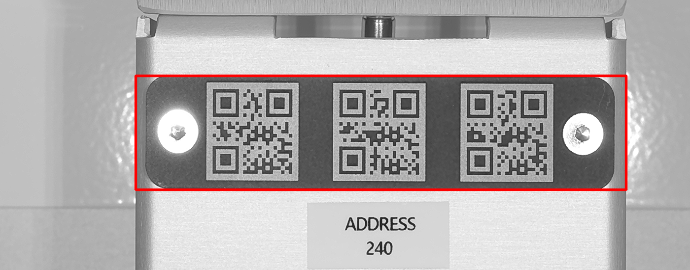
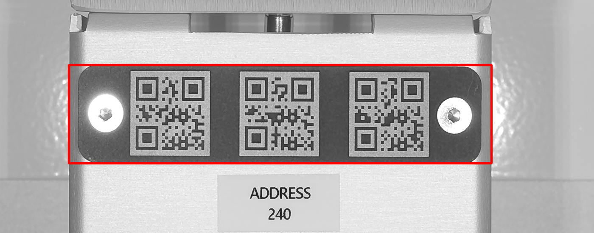

## 일괄 완화에서 새로 실패한 14장

`T+0.10`, `T+0.11`, `T+0.21`, `T+0.67`, `T+0.73`, `T+0.85`, `T+0.87`, `T-0.01`, `T-0.08`, `T-0.33`, `T-0.87`, `Y+1.75`, `Y-1.00`, `Y-1.20`이다.

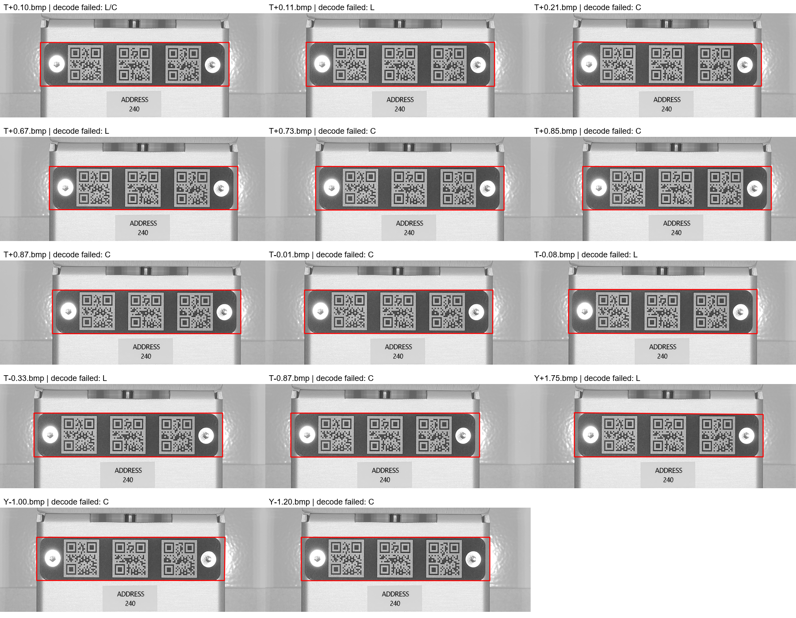

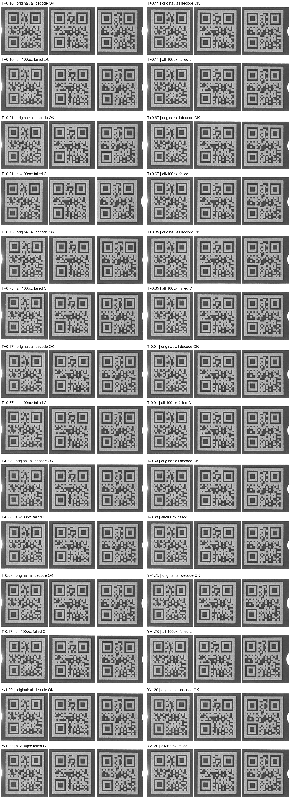

ROI를 눈으로 비교하면 대표 영상에서 QR 패턴이 잘린 모습은 보이지 않는다. 외곽 후보의 미세한 변화는 원근 보정 좌표·보간값·디코더 입력을 바꾼다. 디코딩 실패를 단순 ROI 잘림으로 단정하지 않는다. 디코더 검출/이진화 민감도와 입력 변화의 영향을 분리한 추가 실험은 남아 있다. 최종 검출 재시도 방식은 이 14장에 기존 조건을 유지하며, 일괄 완화로 바꾸지 않는다.

## 디코딩에만 Gaussian을 사용하는 이유와 범위

Gaussian 저역통과 필터는 국소 밝기 요동과 고주파 잔무늬를 줄이지만 경계도 흐리게 한다. 노이즈를 줄여 QR 이진화와 패턴 검출을 도울 수 있으나 강한 필터는 모듈 경계를 훼손한다. 일반적인 원리는 [OpenCV 공식 설명](https://docs.opencv.org/3.4.20/d4/d13/tutorial_py_filtering.html)을 참고한다. 이번 세트에서 성능이 개선됐다는 사실이 실제 노이즈 원인까지 특정한 것은 아니다.

기존 decode/확대/흰 테두리/라벨 재시도 모두 실패할 때만 ROI의 별도 복사본에 3×3, sigma=0.6, 이어서 0.9를 시도한다. 각 경우 원 크기 및 3배 확대+흰 테두리를 시험한다. 최초 성공한 내용을 사용한 뒤 재생성 모듈과 관측 모듈의 일치도를 다시 검사한다.

**원본 source 영상은 필터링하지 않는다. cornerSubPix, 코너 강도 및 사분면 대비는 계속 원본 그레이스케일에서 계산한다.** 기존 플레이트 Canny 전처리는 변경하지 않았다. Gaussian 성공 시 별도의 `_06_gaussian_input_L/C/R.png` 시각화를 제공하고 사용 여부/sigma를 결과에 기록한다.

최종 실행에서 41개 QR 슬롯이 Gaussian 경로로 성공했다(L 9, C 32). 최종 payload는 모든 프레임에서 L=FP11L, C=FP11C, R=FP11R이었다. 이전 비Gaussian 전수 실행의 decode 실패 슬롯 수 40과 이 값은 같지 않다. 실행 경로/내부 상태와 초기 검출 결과가 달라질 수 있어 bitwise 재현성을 전제로 해석하지 않았다. Gaussian 추가 전 유효 프레임과 비교한 공통 특징점 좌표 최대 차이는 약 0.413px였으며, 성공한 프레임의 좌표가 전부 그대로라고 주장하지 않는다. 필터를 정밀화 영상에 적용하지 않아도 decode 초기 외곽은 달라질 수 있다.

## 최종 검출 안정성

- 플레이트 281/281, QR 슬롯 843/843, 세 QR 모두 유효한 프레임 281/281.
- Theta 200/200, Y 80/80, center 1/1.
- QR별 채택점 중앙값 L 42, C 32, R 38개. 최소 L 35, C 26, R 30개.
- 기준 영상의 111개 점 중 현재 영상에도 공통 채택된 점: 최소 89, 중앙값 103, 최대 111개.

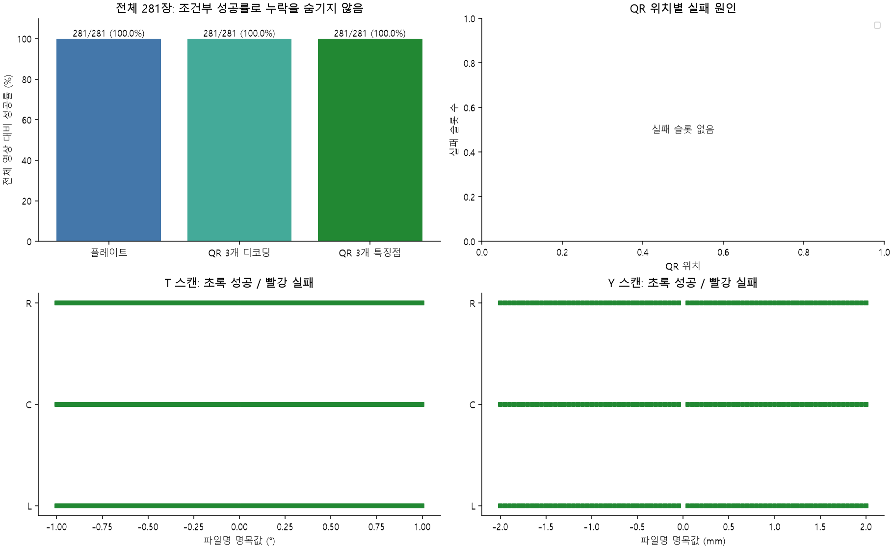
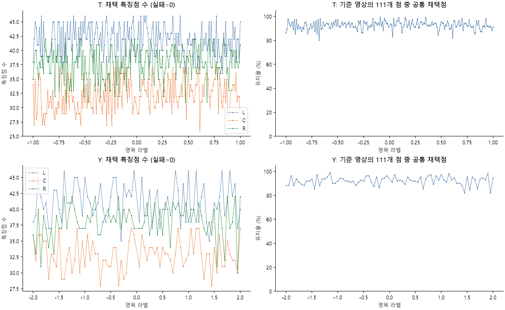
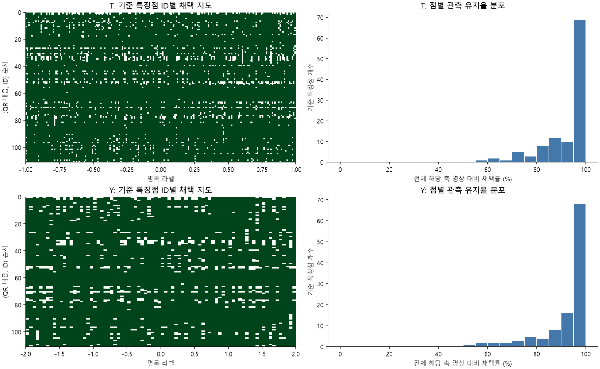

점 배열 인덱스가 아닌 `(QR 내용, 모듈 기반 ID)`로 대응한다. 후속 평균 이동 제거 및 최적화에서는 비교 영상들의 공통 채택점 교집합을 사용해야 한다. 누락된 점을 0벡터로 채우지 않는다.

## 품질 지표와 상대 변형 안정성

채택점 재투영 잔차의 중앙값은 약 0.366px, 95% 분위는 0.791px다. 초기점→정밀화 이동량 중앙값은 0.704px다. 채택 조건 자체가 이 품질값에 의존하므로 이는 독립적인 정확도 검증이 아니다.

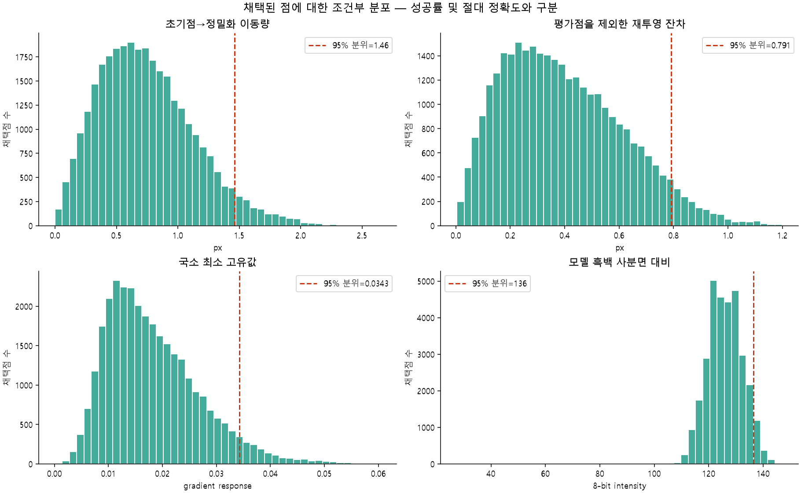

수축·팽창·회전을 지우지 않기 위해 기준→현재 변위에서 공통 이동 평균만 제거했다. 강체 회전/affine 성분은 제거하지 않았다. 비교마다 동일한 ID 집합을 사용했다. 세 인접 영상에서 공통으로 채택된 같은 점의 2차 차분을 계산하고, 그 차분의 평균을 제거한 2D 벡터 RMS를 √6으로 나눠 국소 요동 지표로 삼았다. 최소 24개 점 및 QR 세 개에 걸친 분포를 요구했다. 명목 간격이 빠진 비교와 양음 분기를 가로지르는 비교는 제외했다.

| 최종 축 | 유효 삼중항 | 국소 요동 지표 중앙값 |
|---|---:|---:|
| T | 196 | 0.279px |
| Y | 76 | 0.220px |

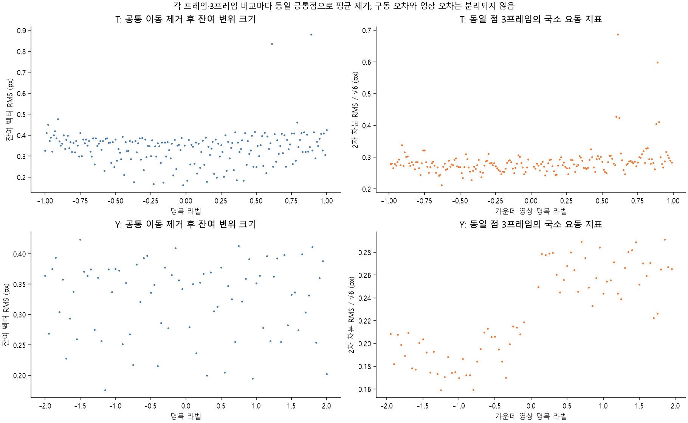
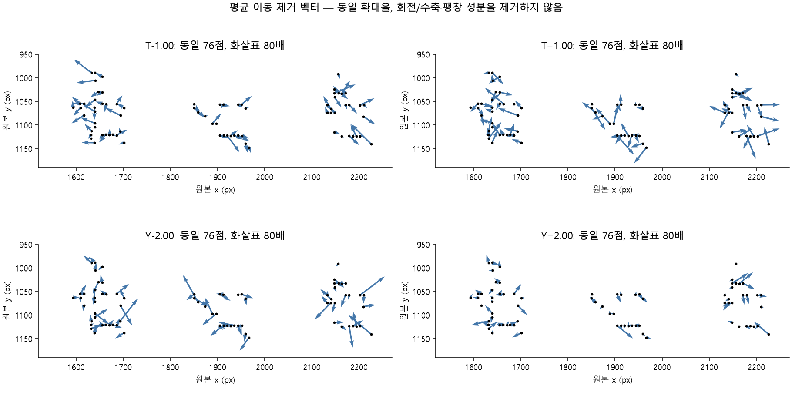

이 값은 점별 국소 변동 지표로서 Gauss–Newton 최종 추정값의 오차가 아니다. 실제 구동/복귀 오차, 비선형 움직임, 특징점 편향, 영상 노이즈가 섞여 있다. 독립·정상 잡음과 국소 선형 움직임 가정이 있어야 반복 노이즈와 연결되며, 정지 반복 촬영이 없어서 순수 반복정밀도를 분리할 수 없다. RMS만으로 미소 변형의 방향 일관성이나 최종 θ 감도를 판정하지 않았다.

**판정: 이 세트의 검출 누락은 해소됐고 후속 최적화 입력을 공급할 수 있다. 그러나 0.05mm/0.01도 목표는 검출 성공률로 보장되지 않는다.** 다음 검증은 고정된 공통 점 집합을 사용한 Gauss–Newton 추정의 반복성·민감도, 정지 반복 촬영, 독립 실측 이동 비교다.

## 병렬 처리와 재현

CPU 4개 독립 프로세스, 각 프로세스 OpenCV 내부 스레드 1개로 전수 처리했다. 최종 281장의 수집 시간은 약 38.5초(빌드/그래프 제외)였다. Gaussian 추가 전 병렬/순차 실행을 비교했을 때 상태와 공통 좌표가 동일했으며, Gaussian 추가 전후 좌표는 앞서 설명한 대로 달라질 수 있다.

- [재현 방법](qr-stability/scripts/README.md)
- [최종 집계](qr-stability/data/final/stability_summary.json)
- [최종 프레임 결과](qr-stability/data/final/frames.csv)
- [최종 QR별 상태·Gaussian 사용 여부](qr-stability/data/final/qr_status.csv)
- [전체 특징점 좌표와 품질값](qr-stability/data/final/points.csv)
- [국소 요동 원자료](qr-stability/data/final/relative_local_variation.csv)
- [소스 버전·해시](qr-stability/manifest.json)

baseline, all100-experiment, plate-fallback, final 폴더에 단계별 집계를 보존했다. 원본 BMP와 실행 바이너리, 임시 결과는 보고서 커밋에 포함하지 않는다. 유효 외곽을 모두 정답 주석과 대조한 검출 정확도 평가는 수행하지 않았으며, 현재 성공은 파이프라인의 조건 통과를 뜻한다.
