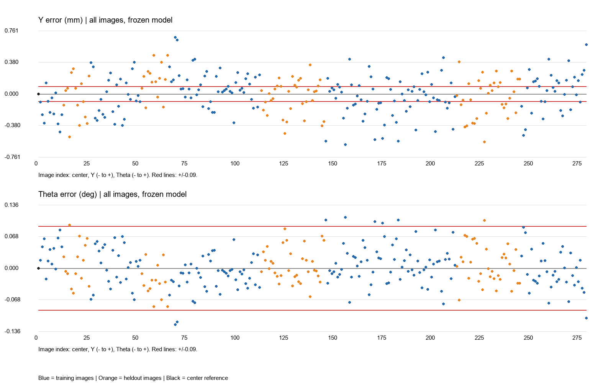

# 전체 사진 오차 그래프

281장 전체를4프로세스(프로세스당 OpenCV1스레드)로 새 Fourier 추출하고, 기존 blocked/1차 순차 모델을 고정한 채4개 스레드로 추론했다. 전체 소요 약37.7초(그래프 저장 제외). 재학습/파라미터 조정 없음.



[파일명·추정값을 점 위에서 확인하는 HTML](all_image_errors.html) · [사진별 CSV](all_predictions.csv)

파랑=학습186장, 주황=보류94장, 검정=center1장. 가로축은 center→Y값 오름차순→theta값 오름차순으로 정렬한 사진 인덱스다. 위는 Y오차(mm), 아래는 theta오차(deg), 빨간 선은 각각±0.09다. 오차는 추정값−파일명 라벨이다. Y영상의 theta라벨=0, theta영상의 Y라벨=0, center는둘다0으로 해석했다.

| 구분 | 장수 | Y RMSE mm | θ RMSE deg | Y 최대절대오차 mm | θ 최대절대오차 deg | 동시 허용오차 통과 |
|---|---:|---:|---:|---:|---:|---:|
| 전체(기준 제외) | 280 | 0.235618 | 0.042186 | 0.679331 | 0.121456 | 85/280 |
| 학습 | 186 | 0.238670 | 0.042825 | 0.679331 | 0.121456 | 59/186 |
| 보류 | 94 | 0.229458 | 0.040893 | 0.576440 | 0.102532 | 26/94 |
| 기준 | 1 | 0.000000 | 0.000000 | 0.000000 | 0.000000 | 1/1 |

전체 수치는 학습 사진을 포함하므로 일반화 성능으로 해석하지 않는다. 보류94장의 결과는 직전 재평가와1e-10 이내로 일치하는지 자동 검산했다. center는 좌표 기준이므로 오차0을 일반 성능에 포함하지 않는다.

파일명은 이번 요청에 따라 임시 정답으로 취급했으며 독립 실측 정답이 아니다. 파일명에서 얻은 촬영 세션을 이용하여 기존 모델의 세션 보정값을 적용했다. 보정 계수는 고정돼 있고 각 사진의 명목 이동량을 추정기에 정답으로 넣지 않았다. 미지 세션의 영점/실제 혼합 운동 성능은 이 그래프로 확인되지 않는다.

```powershell
python tool/sequential/plot_all_frames.py --repo .
```

의존성: numpy,pandas,Pillow와 빌드된 tool/qr-subpixel/build/Release/validate.exe. 원시 worker CSV와 로그는 Git제외 docs/validation-runs/all-image-errors에 보존한다. 모델해시는 summary.json에 기록했다. Jira Task27(3SP),Epic2/Story9,활성 sprint59016.
