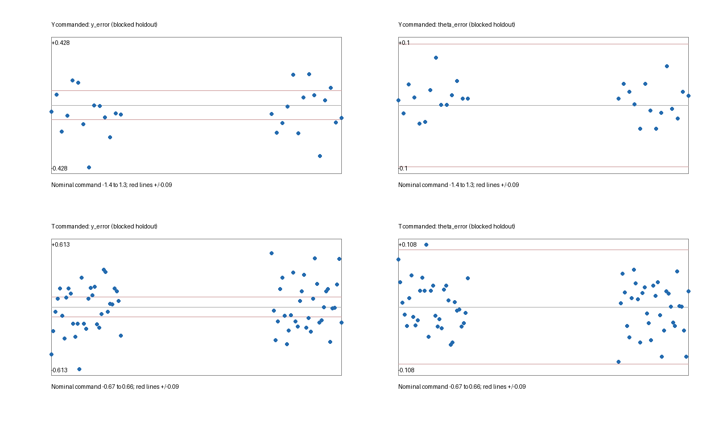

# Y·θ 직접 정합과 공동 추정 평가

검증일 2026-10-19. 기존 BMP 281장만 사용했다. 원본 영상 수정 없음. 결과는 명목 구동값 대비 보류 예측이며 실측 정확도 또는 실제 혼합 운동 인증이 아니다.

## 결론

원근 ECC 정합은 기존 코너 기반 탐색 대비 분리 오차를 줄일 가능성을 보였지만 Y 0.09mm / theta 0.09deg의 동시 허용 오차를 안정적으로 충족하지 못했다. 운영 alignment()에 이 추정값을 자동 연결하지 않았다. QR 검출/직접 정합 성공, 수치 수렴, 물리 정확도는 서로 다른 판정이다.

## 실행 및 모델

- OpenCV 3.4.15 Release. 4프로세스, 각 OpenCV 1스레드. affine/homography 각각 281장, 총 562회. 수집 시간 167.2초(분석/빌드 제외).
- 두 방법 모두 281/281 상태 검사 통과. center 자기 정합 최대 변위는 manifest.json에 기록했다.
- 기준 QR 3개 내부의 고정 가상 격자 총45점에 측정 warp를 적용했다. 이 점들은 상관된 변환 표본이며 45개 독립 측정으로 취급하지 않는다.
- 6개 세션 후보: Y± 0.10계열/0.05 시작계열, T±. 매3번째 보류는 96장, 중앙 연속1/3 보류는94장. 세션은 파일명 계열/기존 수정시각의 단서이며 촬영 로그로 확정되지 않았다.
- 세션 기준 차이는 학습 데이터에서만 보정하고 보류 영상에서 다시 맞추지 않았다. 보류 평가에서 세션을 알고 있으므로 미지 세션의 절대 영점 추정보다 유리한 조건이다. 추정기는 어느 축이 움직였는지 강제로 제한하지 않는다.
- physical: 명목 K 고정, 깊이/벽 기울기/세션별 2D 영상 절편 적합. physical_pivot: 수평/깊이 회전축 lever 두 값 추가. D 생략, 주점 영상 중심 고정. y=[-2,2],theta=[-1,1]은 연구 데이터 범위다.
- direct: y,t,y²,t² 변위 모델과 점별 세션 절편. 물리 모델보다 자유도가 크다. y*t 항은 단독 축 자료에서 식별되지 않아 넣지 않았다. 합성 일반화가 보장되는 모델은 아니다.

## 주요 보류 결과

| 정합/모델/분할 | 실제 명목 축 | n | Y RMSE mm | theta RMSE deg | 두 축 허용오차 이내 |
|---|---|---:|---:|---:|---:|
| homography/direct_0_interleaved | T | 68 | 0.1878 | 0.0337 | 20/68 |
| homography/direct_0_interleaved | Y | 28 | 0.1919 | 0.0343 | 10/28 |
| homography/direct_0_blocked | T | 66 | 0.2147 | 0.0383 | 18/66 |
| homography/direct_0_blocked | Y | 28 | 0.1451 | 0.0259 | 14/28 |
| homography/physical_4285_blocked | T | 66 | 0.4842 | 0.0915 | 10/66 |
| homography/physical_4285_blocked | Y | 28 | 0.2575 | 0.0495 | 6/28 |
| homography/physical_pivot_4285_blocked | T | 66 | 0.5181 | 0.0925 | 9/66 |
| homography/physical_pivot_4285_blocked | Y | 28 | 0.2807 | 0.0502 | 7/28 |
| affine/direct_0_blocked | T | 66 | 0.7759 | 0.1386 | 10/66 |
| affine/direct_0_blocked | Y | 28 | 0.6285 | 0.1122 | 1/28 |

전체20모델×축 결과와 수렴/경계/조건수는 comparison.csv 참조. 허용오차 이내 집계는 수치 오차만의 집계이며 수렴 여부와 별도로 표시한다. 선택한 direct blocked 결과는 두 축 동시 통과 32/94장(약34.0%). 보류 집합을 보고 선택한 탐색 결과이므로 독립 최종시험 성능으로 해석하지 않는다.



## 회전축과 카메라 파라미터의 모호성

homography/blocked에서 회전축을 추가하면 학습 좌표 잔차가 약1.15px에서0.076px로 감소했다. 그러나 공동 추정 정확도는 충분히 좋아지지 않았다. fx=4017.86 후보는 깊이279.52mm/깊이방향 lever40.64mm, fx=4285.71 후보는 깊이298.16mm/lever22.06mm로 서로 다른 기하를 적합하면서 비슷한 잔차를 냈다. 이것은 계수 상호 보상의 실제 사례이며 이 수치를 실물 회전축 위치로 확정하면 안 된다.
두 후보의 혼합 y/theta 예측 차이는 mixed_model_disagreement.json에 기록했다. 실제 혼합 영상이 없으므로 어느 예측이 옳은지는 평가하지 않았다. 명목 WD/센서 제원 및 현재 축 범위만으로 전체 K,D,기구 파라미터가 유일하게 결정된다고 주장하지 않는다.

## 통합 원본 픽셀 잔차 비교

physical_pivot_4285/interleaved 보류 목록의 각 세션 첫/중간/마지막을 명목 위치순으로 고른18장. ECC에서 얻은 y/theta로 초기화하고 cubic 보간·밝기/대비 제거를 사용했다. 무조건0 초기화는 QR 반복 패턴의 국소 최솟값에 취약하므로 지원되는 정밀 초기화를 사용했다.

| 실제 명목 축 | n | Y RMSE mm | theta RMSE deg | 두 축 통과 | 수렴 |
|---|---:|---:|---:|---:|---:|
| T | 6 | 0.8825 | 0.1575 | 1/6 | 6 |
| Y | 12 | 0.5322 | 0.0947 | 0/12 | 11 |

현재 물리 모델로는 통합 픽셀 잔차도 성능을 개선하지 못했다. 픽셀 수를 늘리는 것만으로 기하 불일치/두 축 상관/보간 편향이 해결되지 않으며 낮은 밝기 잔차가 정확한 y/theta를 뜻하지 않는다. 이 부분집합은 전수 결과로 일반화하지 않는다.

## 검증과 실제 사용 제한

- Release main/ytheta_collect 빌드, 기존 center 검출 회귀, 두 직접정합의 전수 상태를 확인했다.
- 7개 단위시험: 독립 3D 회전행렬 투영, 해석/수치 Jacobian, 혼합16조합 무잡음 복원, 회전축 lever 검산, 입력/세션 거부, cubic 보간의 ramp 재현과 경계 거부. 실제 광학 영상의 subpixel 편향 인증은 아니다.
- 원본 특징점의 평균 제거 RMS 약0.28px는 실제 운동·편향·검출 변동의 혼합이며 순수 잡음 바닥이 아니다.
- 추가 촬영 없이 수행했다. 정지 반복성, 실제 혼합 운동, 독립 실측 정확도, 새로운 세션 영점은 검증되지 않았다. 평면 치수/QR 배치 도면 불확실성이 있어 QR 간격을 임의로 실측 좌표로 고정하지 않았다.
- 실사용 알고리즘은 아직 목표 미달이다. experimental_model.json은 재현 가능한 연구 모델이며 운영 보정파일로 승인된 것이 아니다. alignment()는 계속 NaN을 반환한다.

## 재현

상위 README.md 명령으로 수집/적합 후 다음을 실행한다. Python numpy,pandas,Pillow가 필요하다.

```powershell
python tool/ytheta/evaluate_photometric.py --repo . --output docs/validation-runs/ytheta
python tool/ytheta/render_ytheta_report.py --repo . --data docs/validation-runs/ytheta --output docs/y-theta/results
```

작업: Epic S15P31A507-2 / Story S15P31A507-9 / Task S15P31A507-20(3SP), -21(8SP), -22(5SP). 활성 sprint59016. 앞선 push244a6eb,7fde0be. 최종 평가 커밋은 Task22에 기록한다.
