# 부록 A. 단계별 사진과 상태 사례

[경고 모음](all_warning.png) | [실패 모음](all_fail.png) | [정상 사례](ok/OK.png)

**목차**

| 번호 | 제목 |
|---|---|
| 1 | 단계별 그림 |
| 1-1 | 입력 사진 |
| 1-2 | 회색으로 변환 |
| 1-3 | QR 위치 찾기 |
| 1-4 | QR 띠 탐색 |
| 1-5 | 큰 이동 |
| 1-6 | QR 하나가 망가진 경우 |
| 1-7 | 나사 위치 찾기 |
| 1-8 | Y와 T 계산 |
| 1-9 | 영점 빼기 |
| 1-10 | 결과 점검 |
| 1-11 | 출력 |
| 2 | 정상과 경고, 실패 사례 |
| 2-1 | OK |
| 2-2 | W_COARSE |
| 2-3 | W_OUT_OF_RANGE |
| 2-4 | W_SCREW_MISSING |
| 2-5 | W_VALUES_DISAGREE |
| 2-6 | W_ZERO_RESET |
| 2-7 | E_PHOTO |
| 2-8 | E_QR_NOT_FOUND |
| 2-9 | E_REFERENCE |
| 2-10 | E_ZERO |
| 2-11 | W_VALUES_DISAGREE |
| 3 | 이전 탐색 방식의 그림 (2026-11-15 까지) |

| 순서 | 그림 |
|---|---|
| 입력과 변환 | [입력 사진](step/01.png), [회색 영상](step/02.png) |
| 위치 찾기 | [QR 탐색](step/03.png), [나사 탐색](step/04.png) |
| QR 띠 탐색 | [보통 사진](step/03_band.png), [큰 이동](step/03_band_shift.png), [QR 하나가 망가진 경우](step/03_band_glare.png) |
| 계산 | [Y, T 계산](step/05.png), [영점 차감](step/06.png) |
| 판정과 출력 | [결과 점검](step/07.png), [출력](step/08.png) |

실촬영 719장(10월 14일, 20일, 29일, 11월 9일)을 모델 기본 상태에서 측정했다. 694장은 대표 코드가 비어 있었고 25장은 `W_OUT_OF_RANGE`를 반환했다. 10월 20일 Y +0.05 mm, T +2.00도 사진은 영점 차감 전 T +2.020127도로 상한 +1.01252도를 넘었다. 이 사진은 판이 오른쪽으로 약 161 px 움직였지만 QR 띠에서 봉우리 3개를 한 번에 찾는다.

재현용 그림의 원본 명령값은 편집 전 파일의 명령이다. 측정 칸에는 편집 후 이미지에 대해 함수에서 돌려준 값을 표시한다. 명령 0 사진이 확인되지 않아 10월 20일과 29일은 촬영일별 근접 명령 사진 5장의 (측정 − 명령) 평균으로 영점을 추정했다. 근거 사진과 영점은 [zeros.tsv](zeros.tsv), 함수별 판정과 반환값은 [cases.tsv](cases.tsv)에 있다.

| 사례 | 관찰 결과 |
|---|---|
| [나사 일부 미검출](warning/W_SCREW_MISSING.png) | 나사 2 제거 후 나사 1, 3, 4 사용 |
| [대략값](warning/W_COARSE.png) | 오른쪽 나사 2, 4 제거 후 왼쪽 나사 1, 3 사용 |
| [QR 검출 실패](fail/E_QR_NOT_FOUND.png) | QR 2 위치 반사광으로 QR 띠의 봉우리가 2개. 이웃 QR 을 대신 잡지 않고 실패 |
| [일치 점검 경고](warning/W_VALUES_DISAGREE.png), [실패 설정](fail/W_VALUES_DISAGREE.png) | 나사 4 주변을 3 px 옮긴 후 점검값 55.222908, 한계 5.1954382. 가장 크게 벗어난 비교 항목은 QR이었다 |
| [입력 규격 실패](fail/E_PHOTO.png) | 1920×1080 영상 입력 |
| [영점 설정 실패](fail/E_ZERO.png) | 오른쪽 나사 제거 사진을 영점 설정에 입력. 기존 영점 유지 |
| [기준 갱신 실패](fail/E_REFERENCE.png) | QR 영역 반사광 사진을 기준 갱신에 입력. 기존 기준 유지 |
| [영점 재설정](warning/W_ZERO_RESET.png) | 아래로 60 px 이동한 사진을 기준 갱신에 입력. 이전 기준에서 측정이 성립하지 않아 새 기준 사진을 영점으로 설정 |

| 사진 장면 없이 설명하는 상태 | 발생 조건 |
|---|---|
| `E_NOT_INITIALIZED` | 초기화 성공 전에 측정, 영점 설정, 기준 갱신을 호출 |
| `E_SETTINGS` | 설정 파일을 읽을 수 없거나 나사 설정이 유효하지 않음 |
| `E_DATA` | 초기화에 필요한 모델 데이터를 읽거나 검증하지 못함 |
| `E_INTERNAL` | 측정, 영점 설정, 기준 갱신 중 예외 발생 |

Windows에서 패키지 루트 기준으로 `build/Release/make_figures.exe`를 실행하면 그림과 사례 표를 다시 만든다. 실촬영 사진이 다른 경로에 있으면 인자로 모델 폴더, 실촬영 폴더, 출력 폴더를 차례로 넘긴다.

## 1. 단계별 그림

### 1-1. 입력 사진

### 1-2. 회색으로 변환

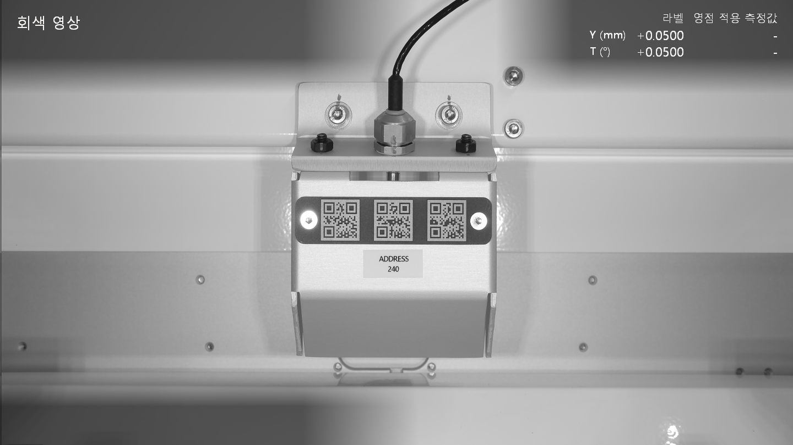

### 1-3. QR 위치 찾기

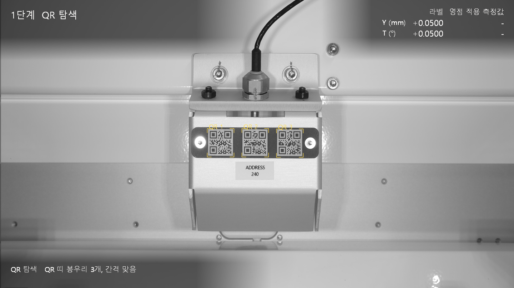

### 1-4. QR 띠 탐색

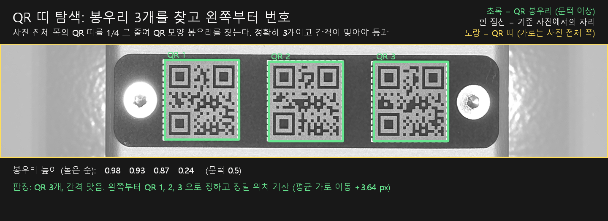

### 1-5. 큰 이동

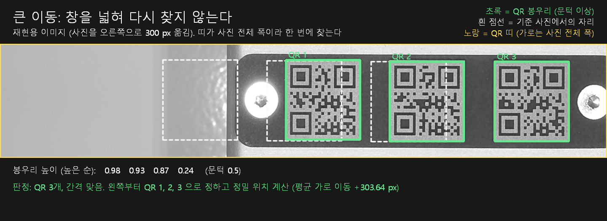

### 1-6. QR 하나가 망가진 경우

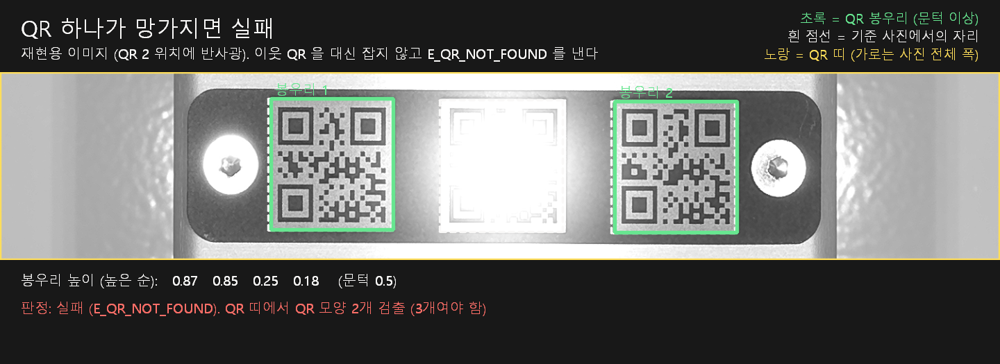

### 1-7. 나사 위치 찾기

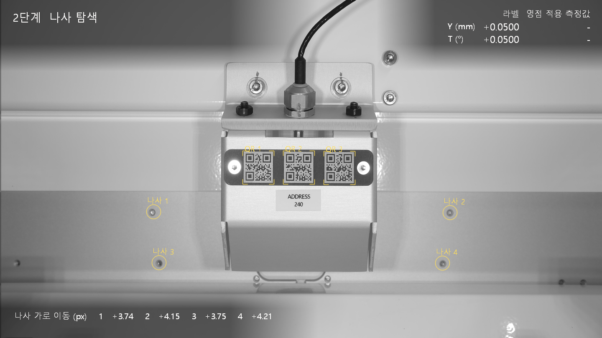

### 1-8. Y와 T 계산

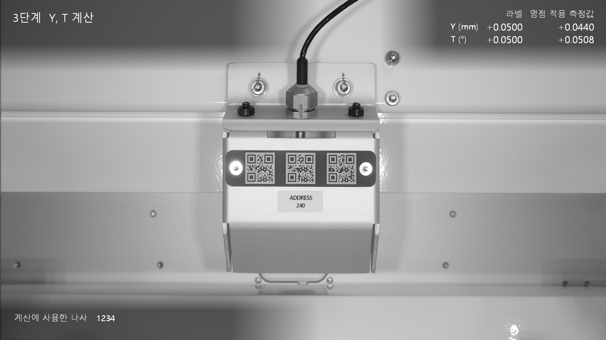

### 1-9. 영점 빼기

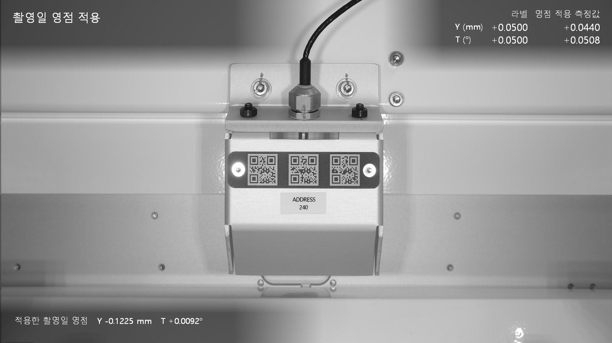

### 1-10. 결과 점검

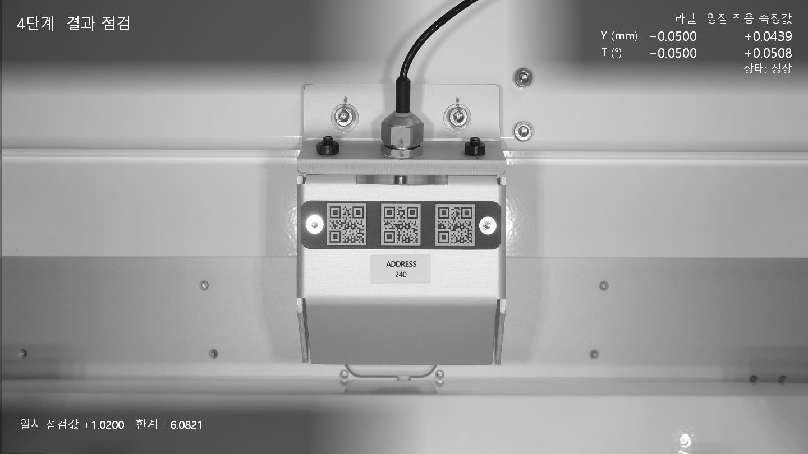

### 1-11. 출력

## 2. 정상과 경고, 실패 사례

사진을 바꿔 재현한 사례 포함. 조건과 결과는 위 표 참고.

### 2-1. OK

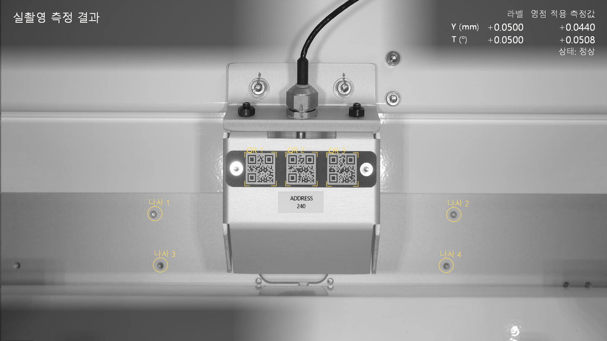

### 2-2. W_COARSE

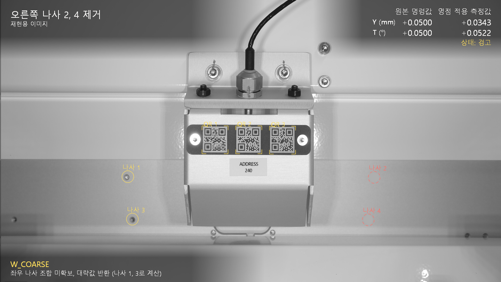

### 2-3. W_OUT_OF_RANGE

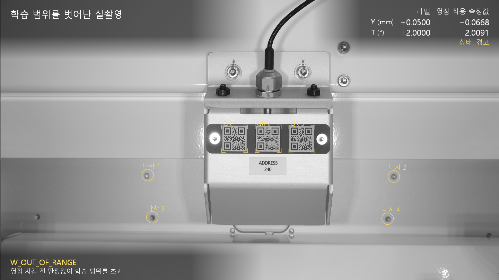

### 2-4. W_SCREW_MISSING

### 2-5. W_VALUES_DISAGREE

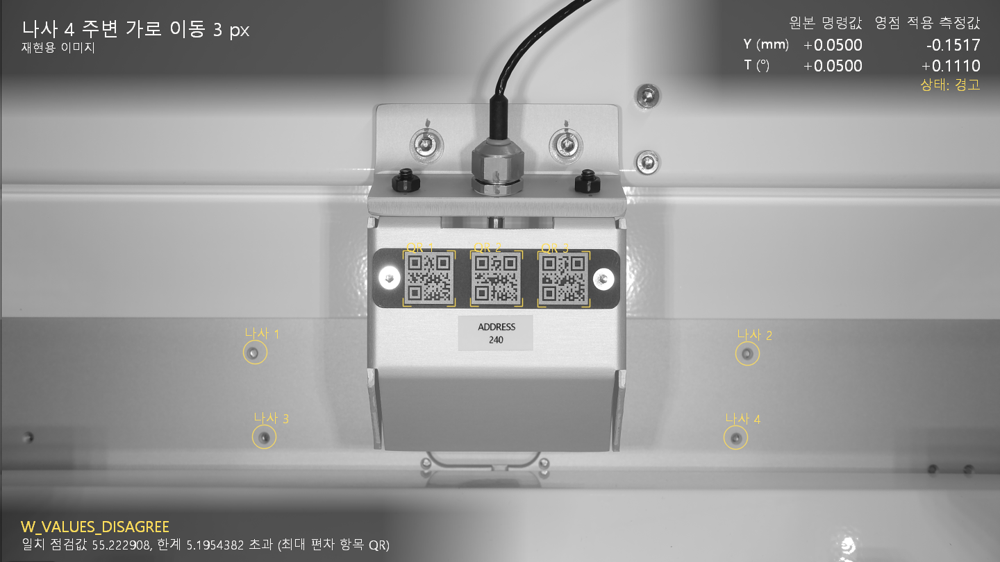

### 2-6. W_ZERO_RESET

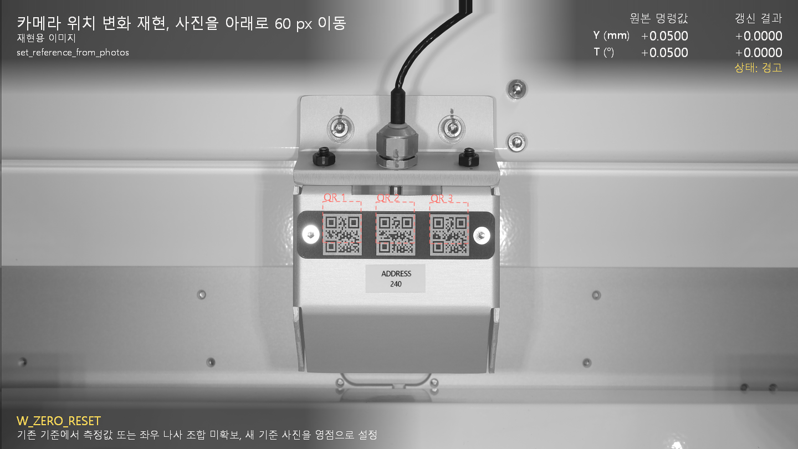

### 2-7. E_PHOTO

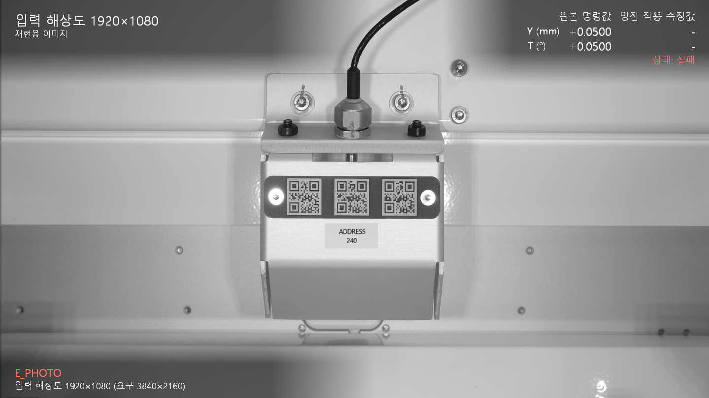

### 2-8. E_QR_NOT_FOUND

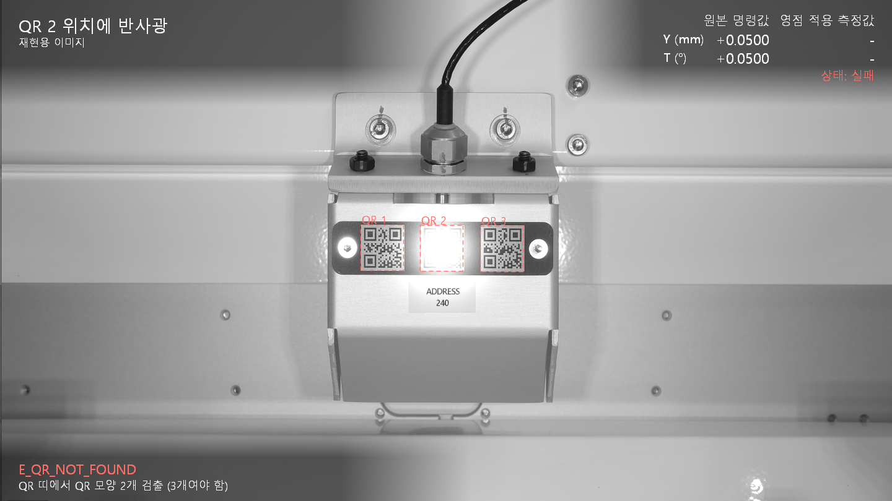

### 2-9. E_REFERENCE

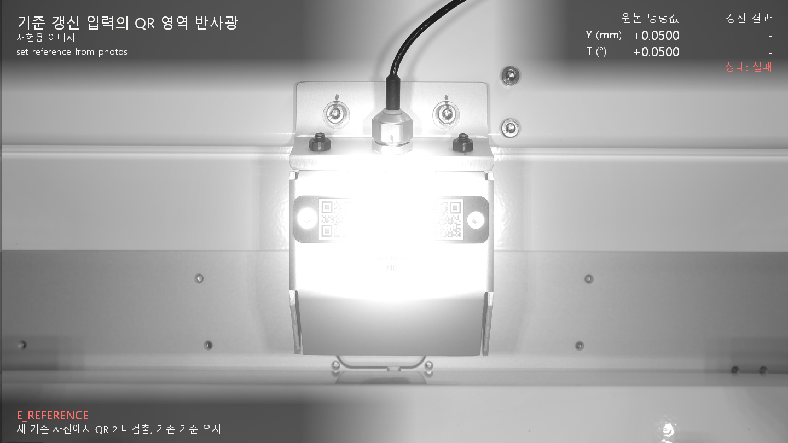

### 2-10. E_ZERO

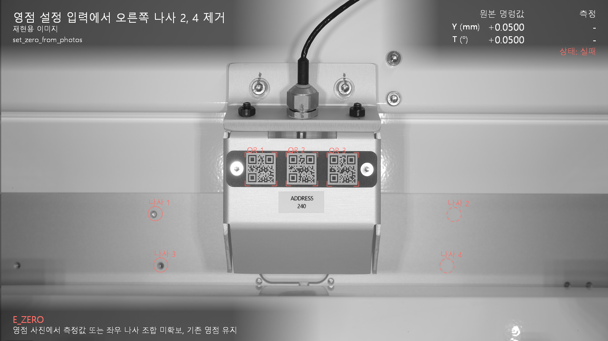

### 2-11. W_VALUES_DISAGREE

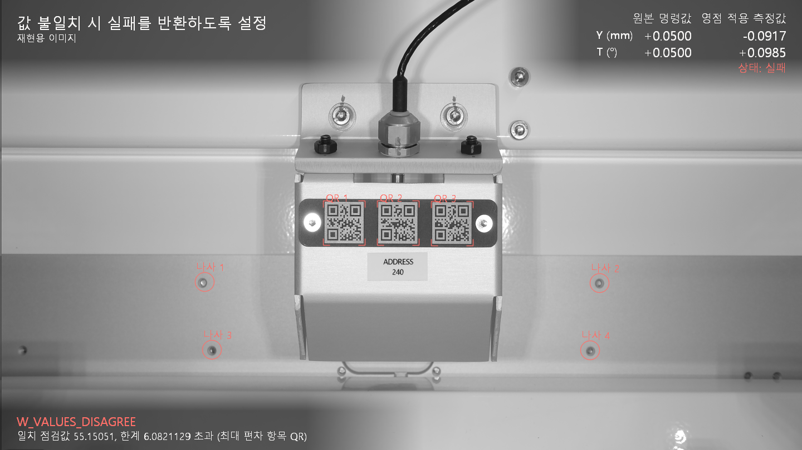

## 3. 이전 탐색 방식의 그림 (2026-11-15 까지)

1단계 QR 탐색을 QR 띠 봉우리 방식으로 바꾸기 전의 그림이다. 이전 방식은 QR 마다 좁은 창(±110 px)에서 찾고, 못 찾으면 ±250 px, 사진 전체 폭으로 넓혔다. 아래 알림 코드는 지금 패키지에서 나오지 않는다. 바꾼 이유는 [5-1 QR](../05_구현_방법/5-1_QR.md) 2-6, [9-8](../09_추가_논의/9-8_QR_띠_봉우리_탐색으로_전환.md) 에 있다. 이 그림들은 `make_figures` 가 다시 만들지 않는다.

| 그림 | 내용 |
|---|---|
| [좁은 창 ±110 px](step/03_narrow.png) | QR 마다 기준 자리 양옆 110 px, 위아래 22 px 안에서 찾던 창 |
| [넓은 창 ±250 px](step/03_wide.png) | 좁은 창에서 3개를 다 못 찾았을 때 쓰던 창 |
| [N_WIDE_SEARCH](warning/N_WIDE_SEARCH.png) | 넓은 창에서 찾았을 때의 참고 알림 |
| [W_FAR](warning/W_FAR.png) | 사진 전체 폭에서 찾았을 때의 경고 |
| [W_QR_PARTIAL](warning/W_QR_PARTIAL.png) | QR 을 1 ~ 2개만 찾고 그 평균으로 계산했을 때의 경고 |
