# 적용 환경과 카메라가 보는 화면

이 알고리즘(사진 한 장으로 판의 Y, T 어긋남을 재는 위치 보정)이 SEMES 설비의 어디에 들어갈 수 있는지, 그곳에서 카메라 화면이 어떻게 달라질 수 있는지 정리했다. 후보 환경 10곳의 화면과 화면 변화 33가지는 실제 기준 사진을 바꿔 만들었고, 각 화면에서 지금 알고리즘이 어떻게 반응하는지 직접 쟀다. QR 내용, QR 크기, 카메라 거리가 바뀌는 새 설치 27가지도 시험했다. 마지막에 우리 장비(SSAFY 시험 장비)로 실제 검증하는 단계를 제안한다.

---

## 1. 요약

| 시험 | 결과 |
|---|---|
| 후보 환경 10곳 (4절) | 1곳(J) 정확도 그대로, **9곳은 허용오차를 넘었지만 모두 경고**했다 |
| 화면 변화 33가지 (6절) | 15가지 정확도 그대로, **18가지는 틀렸지만 모두 경고나 실패**로 알렸다 |
| 알리지 않고 틀림 | **0가지** (43개 화면 모두) |
| 새 설치 27가지 (5절) | 지금 기준을 그대로 쓰면 27가지 중 1가지만 정상. **새로 등록하면** 거리가 같을 때 9가지 모두 예제 5장 통과(오차 Y 0.004 mm 이하). 거리가 2% 다르면 T 가 2% 크거나 작게 읽혀 T ±1도 사진 2장이 탈락 |
| 가장 약한 곳 | ① 카메라와 판 사이 거리, 카메라 회전 같은 설치 변화 ② QR 하나가 가려지면 옆 QR 자리에 잘못 맞음 ③ 흐림, 깜빡임, 김서림, 열에서 나사를 놓쳐 대략값만 냄 |
| 개발할 것 | 새 설치 등록 도구(QR, 나사 위치 자동 찾기 + 알려진 이동 2번으로 배율 맞추기), 세 QR 간격 검사, 흐린 화면 나사 맞춤 (7절) |
| 다음 단계 | 우리 장비로 같은 변화를 실제로 만들어 합성 결과와 비교 (8절) |

합성 화면은 판이 움직이지 않은 기준 사진을 바꾼 것이다. 그래서 출력이 변했다면 그 변화 전부가 "화면 변화 때문에 틀린 값"이다. 실제 촬영 결과는 아니므로 8절의 실측으로 확인해야 한다.

**표 읽는 법** (4~6절 공통)

| 항목 | 뜻 |
|---|---|
| 변화량 Y / T | 판이 움직이지 않았는데 출력이 바뀐 양 (mm / 도). 0 이 이상적이다 |
| 판정 ○ | 허용오차(Y 0.045 mm, T 0.01도) 안 |
| 판정 △ | 허용오차를 넘었지만 경고나 실패로 알림 |
| 판정 × | 알리지 않고 틀림 (이번 시험에서는 없었다) |
| 상태 코드 | 뜻과 다음 할 일은 README 5절 |

---

## 2. 전제: 지금 알고리즘이 보는 것

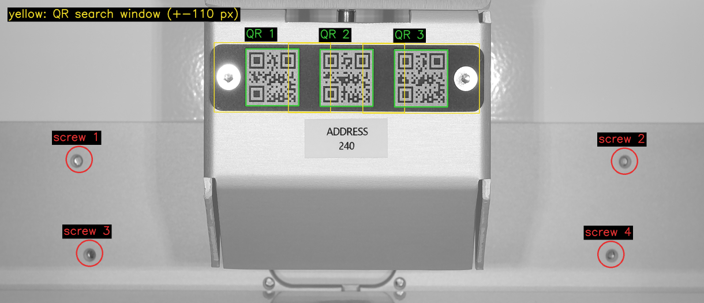

| 항목 | 지금 |
|---|---|
| 입력 | 3840×2160, 8비트 사진 한 장 |
| 보는 것 | 판 위의 QR 3개(가로 이동)와 둘레 나사 4개(가로 이동) |
| 출력 | Y (mm), T (도), 상태 (정상, 경고, 실패) |
| 원리 | T 는 QR 과 나사를 같이 움직이고, Y 는 다르게 움직인다 (1 mm 에 QR 약 14 px, 나사 약 11 px) |
| 카메라 | 판에서 약 315 mm, 초점거리 약 4,500 px (사진만으로 추정한 값) |
| 지금 장면 | "ADDRESS 240" 표가 붙은 판. 주소로 위치를 구분하는 반송 설비의 포트로 보인다 (추정) |

---

## 3. SEMES 의 사업과 설비

채용 직무 설명(2026 하반기)과 공개 자료로 정리했다. 설비 이름과 세부 사양은 확인이 필요하다.

| 분야 (배치 부서) | 주요 공정, 설비 | 위치를 맞춰야 하는 순간 |
|---|---|---|
| Photo (트랙) | 코터, 디벨로퍼, 베이크(UV Bake 포함), EEW(웨이퍼 가장자리 노광) | 로봇이 웨이퍼를 스핀 척, 베이크 판에 내려놓을 때 |
| Clean | 매엽 세정, 약액 공급, 보울과 척 | 로봇이 웨이퍼를 세정 챔버 척에 놓을 때, 노즐 위치 |
| Etch | 플라즈마 챔버(진공), 가스 공급 | 진공 반송 로봇이 챔버에 웨이퍼를 넣을 때 (창 너머로 봄) |
| HB (본딩) | HBM TC 본더 등 차세대 패키징, 정밀 척과 헤드, 갠트리 | 다이와 헤드를 맞출 때, 본딩 정밀도(Bonding Accuracy) |
| Test/Package | 프로버(고온, 저온 척), 핸들러, 소잉 | 웨이퍼 스테이지 정렬, 패키지 반송 |
| Display | 포토, 잉크젯, 대형 유리 반송 스테이지 | 큰 유리판을 스테이지에 맞출 때 |
| 자동화 | OHT, 스토커, 타워 리프트, AMR, FOUP 반송 | 반송 장치가 포트(로드 포트, 선반)에 FOUP 을 올리고 내릴 때 |
| 공통 (기구설계) | 웨이퍼, FOUP 핸들링 로봇, MI(계측 검사) 광학계 정렬 | 로봇 티칭, 광학계 정렬 |

**특허에서 본 것**: 공개 특허 검색 결과에서 SEMES 출원으로 표시된 것 가운데 웨이퍼 이송 로봇의 자동 티칭 방법(KR100931857B1, KR101478230B1, KR101842114B1), 이송 로봇 자동 티칭 장치(KR101964964B1), 로봇 정렬용 티칭 지그(KR20130037344A)가 있다. 청구항은 확인하지 못했다. 로봇이 정해진 자리에 정확히 가도록 위치를 맞추는 일(티칭, 정렬)이 여러 설비에 공통으로 있다는 뜻이고, 이 알고리즘이 들어갈 자리도 여기다.

---

## 4. 적용 후보 환경

알고리즘이 필요로 하는 것은 **카메라 한 대와, 판 위의 정해진 무늬(QR, 나사 같은 기준 표식)** 뿐이다. 그래서 "로봇이나 반송 장치가 정해진 자리에 왔는지 확인하는 모든 곳"이 후보다.

### 4-1. 환경마다 맞출 것과 생길 화면 변화

아래 변화 크기는 일반적인 설비 조건으로 잡은 추정이고, SEMES 확인이 필요하다.

| 환경 | 무엇을 맞추나 | 생길 수 있는 화면 변화 (6절 번호) | 변화 크기 (추정) |
|---|---|---|---|
| **A. OHT 포트 티칭** (자동화) | 호이스트가 로드 포트 위에서 앞뒤(Y), 돌아감(T) | 포트마다 높이 차이로 거리 변화(01~03), 포트마다 QR 내용과 주소 다름(11, 12), 멈출 때 흔들림(25, 26), 천장 조명 차이(16~19), 먼지(30) | 거리 수 mm, 흔들림 수 px |
| **B. 스토커, 타워 리프트 선반** (자동화) | 선반마다 FOUP 놓는 자리 | 선반마다 주소, 배경 다름(11, 15), 거리 변화(01~03), 조명 차이 | 선반 수백 개, 모두 다른 QR |
| **C. AMR 도킹** (자동화) | 설비 앞 정지 위치와 방향 | 바닥 기울기로 카메라 회전, 원근(04~06), 큰 위치 오차(07, 08), 사람이나 물체 가림(34) | 회전 0.1~1도, 위치 수 cm |
| **D. EFEM, 로드 포트 웨이퍼 로봇** (공통) | 로봇 손이 FOUP, 정렬기에 가는 자리 | 반짝이는 금속 반사(20, 21), 로봇 팔 가림(34), 가까운 거리로 작은 배율 변화도 큼(01) | 거리 1~2 mm 가 0.5% 이상 |
| **E. Photo 트랙** | 스핀 척, 베이크 판 위 웨이퍼 | 노란 조명(18), 뜨거운 판 위 아지랑이(27), 약액 안개(28), 깜빡임(22) | 베이크 판 수십~수백 도 |
| **F. Clean 매엽 세정** | 세정 챔버 척, 노즐 | 약액, 물방울(29), 김(28), 보울 반사(20) | 창, 렌즈에 방울 |
| **G. Etch 플라즈마 챔버** | 진공 반송 로봇이 놓는 자리 | 진공 창 이중 반사와 플라즈마 빛(31), 창 너머 초점(23, 24), 창에 쌓이는 막(28), 렌즈 왜곡(10) | 창 두께로 초점과 배율 변화 |
| **H. Test 프로버** | 고온, 저온 척 위 웨이퍼 정렬 | 저온에서 결로(28), 고온에서 아지랑이(27), 스테이지 진동(25, 26) | 척 영하~고온 |
| **I. HB 본딩** | 다이와 헤드, 갠트리 위치 | 고배율이라 거리 변화에 민감(01), 거울 같은 면 반사(17, 20), 고온 헤드(27) | 정밀도 요구가 가장 높음 |
| **J. Display 스테이지** | 큰 유리판 정렬 | 투명하고 반사되는 유리(17, 20), 긴 이동으로 큰 위치 오차, 넓은 조명 차이(19) | 판이 크고 이동이 김 |

### 4-2. 환경마다 카메라가 볼 화면

환경마다 위 표의 화면 변화를 한 장에 겹치고, 그 환경을 알아볼 수 있게 레일, 선반, 웨이퍼 같은 물체를 판 아래 몸체와 위쪽 빈 곳에 그렸다. 물체는 QR, 나사 탐색 창 밖에 그려 측정에 끼어들지 않게 했다. 그림 아래 줄이 겹친 화면 변화다.

| 환경 | 카메라 화면 | 상태 | 변화량 Y / T | 판정 | 주된 원인 (추정) |
|---|---|---|---|---|---|
| A. OHT 포트 | 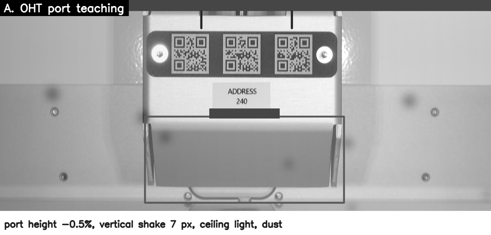 | 경고 `W_VALUES_DISAGREE` | −0.070 / −0.003 | △ | 포트 높이 차이(거리 −0.5%) |
| B. 스토커 선반 | 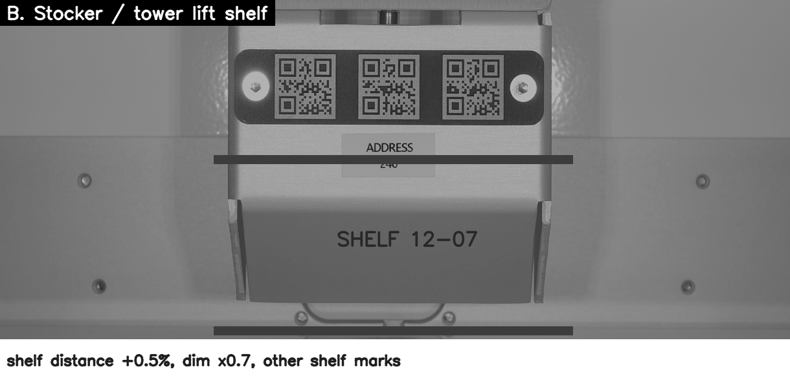 | 경고 `W_VALUES_DISAGREE` | +0.067 / +0.004 | △ | 선반 거리 차이(+0.5%) |
| C. AMR 도킹 | 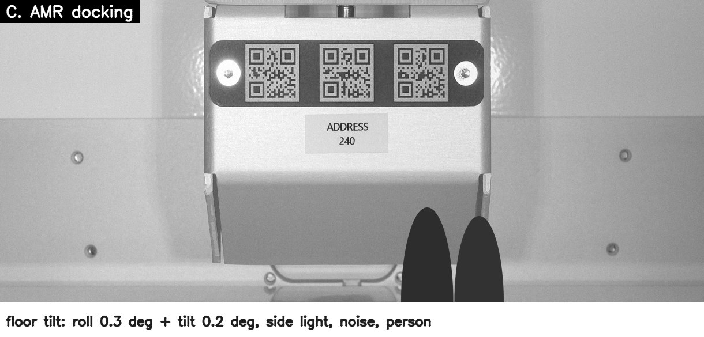 | 경고 `W_VALUES_DISAGREE` | −0.792 / +0.150 | △ | 바닥 기울기로 카메라 0.3도 회전 |
| D. EFEM 로봇 | 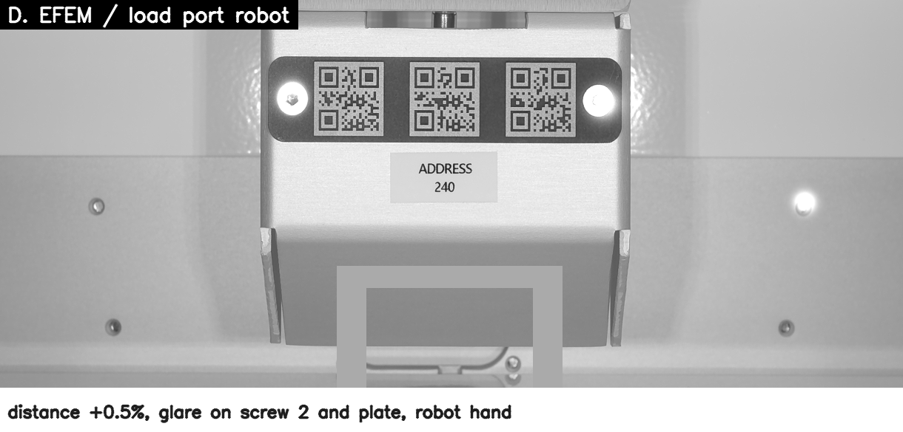 | 경고 `W_VALUES_DISAGREE` | +0.113 / 0.000 | △ | 거리 +0.5%, 나사 반사 |
| E. Photo 트랙 | 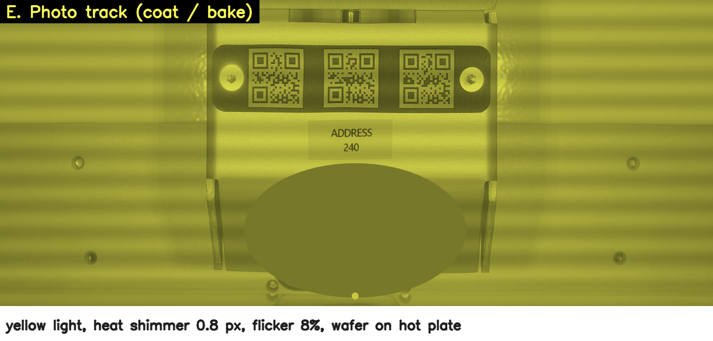 | 경고 `W_COARSE` | −0.052 / +0.019 | △ | 아지랑이, 깜빡임으로 나사를 놓침 |
| F. Clean 세정 | 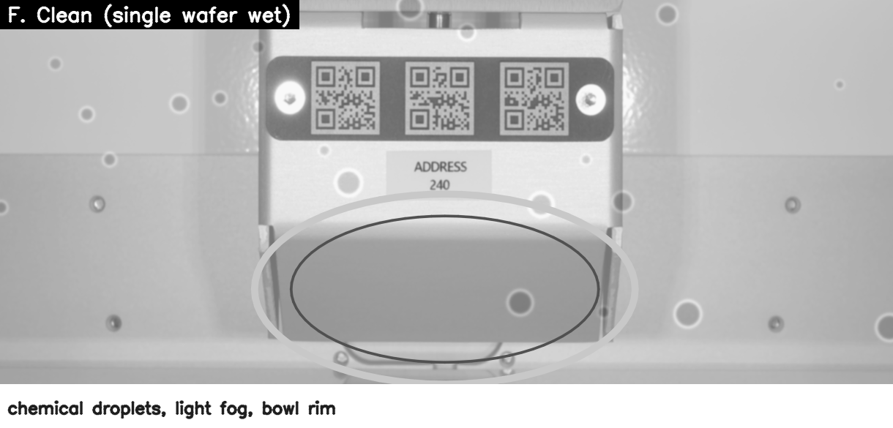 | 경고 `W_COARSE` | +0.098 / −0.016 | △ | 김서림으로 나사를 놓침 |
| G. Etch 챔버 창 | 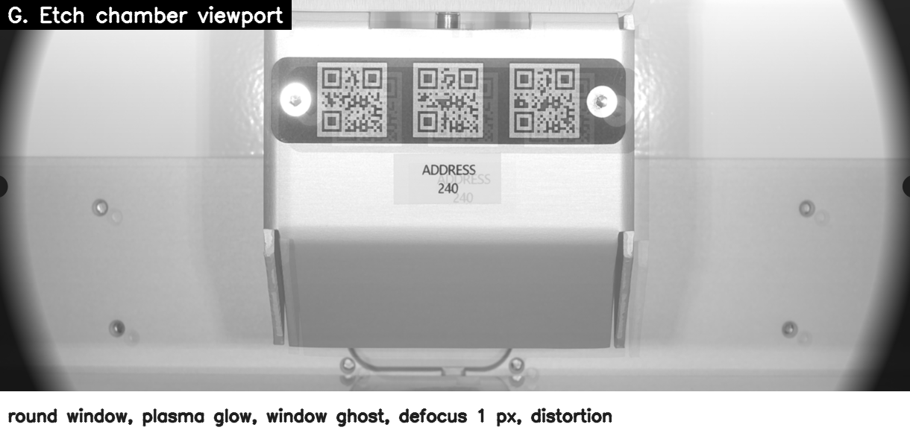 | 경고 `W_VALUES_DISAGREE` | −0.087 / +0.001 | △ | 창 왜곡, 이중 상 |
| H. Test 프로버 | 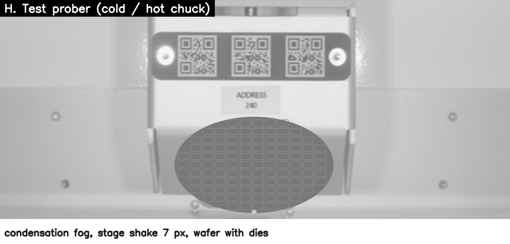 | 경고 `W_COARSE` | +0.137 / −0.023 | △ | 결로, 흔들림으로 나사를 놓침 |
| I. HB 본딩 | 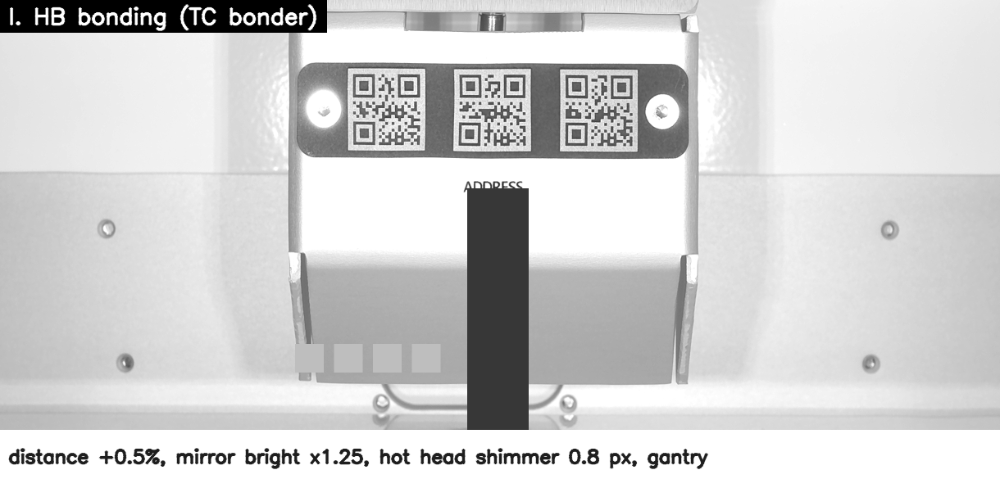 | 경고 `W_VALUES_DISAGREE` | +0.309 / −0.030 | △ | 고온 헤드 아지랑이, 거리 +0.5% |
| J. Display 스테이지 | 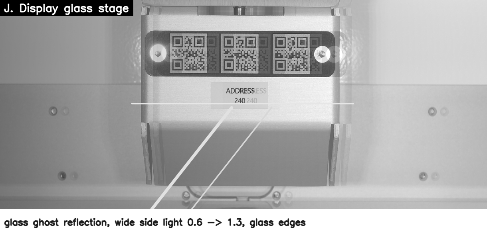 | 정상 | −0.030 / +0.004 | ○ | 유리 이중 상, 넓은 조명 차이 (영향 작음) |

10곳 한눈에 보기:

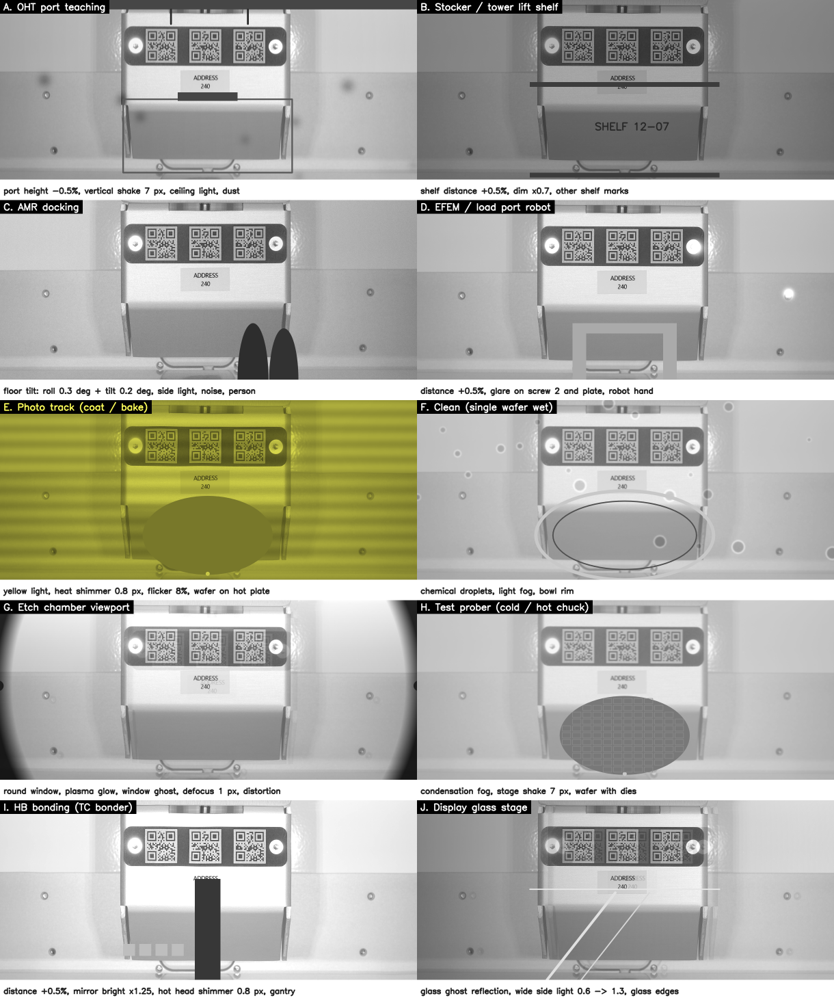

**알게 된 것**
- 9곳은 허용오차를 넘었다. 9곳 모두 경고를 냈고, 알리지 않고 틀린 곳은 없다.
- 원인은 두 갈래다.
  - **거리, 회전 같은 설치 차이** (A, B, C, D, I): 포트, 선반마다 새로 등록하고 매일 영점을 잡으면 상당 부분 없어진다 (5절).
  - **열, 김, 흔들림으로 나사를 놓침** (E, F, H, I): 나사 맞춤 개선과 설비 쪽 대책(창 히터, 퍼지, 여러 장 평균)이 필요하다 (7절).
- 주된 원인은 겹친 변화 중 6절에서 가장 큰 영향을 보인 것으로 추정했다. 하나씩 떼어 재지는 않았다.

---

## 5. QR 내용, QR 크기, 카메라 거리가 바뀌는 새 설치

포트, 선반마다 주소가 다르면 **QR 내용**이 다르다. 설비마다 표식을 새로 붙이면 **QR 인쇄 크기**가 다를 수 있다. 카메라 고정대가 다르면 **카메라와 판 사이 거리**가 다르다. 세 가지가 함께 바뀌는 경우를 시험했다.

**바꾼 것**

| 항목 | 경우 | 만드는 법 |
|---|---|---|
| QR 내용 | 그대로 / 1개 다름 / 3개 모두 다름 | QR 안쪽 칸을 무작위 무늬로 (위치 사각형 3개는 남김) |
| QR 인쇄 크기 | 0.8배 / 1.0배 / 1.2배 | QR 마다 자기 가운데 둘레로 키우거나 줄임 |
| 카메라 거리 | 2% 멀어짐 / 그대로 / 2% 가까워짐 | 사진 전체를 가운데 둘레로 0.98, 1.00, 1.02배 (약 6 mm) |

| 화면 예 | |
|---|---|
| 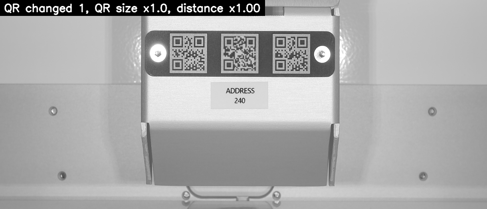 QR 1개 내용 다름 | 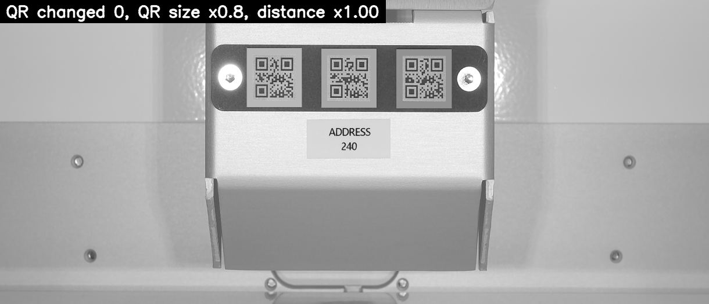 QR 0.8배 |
| 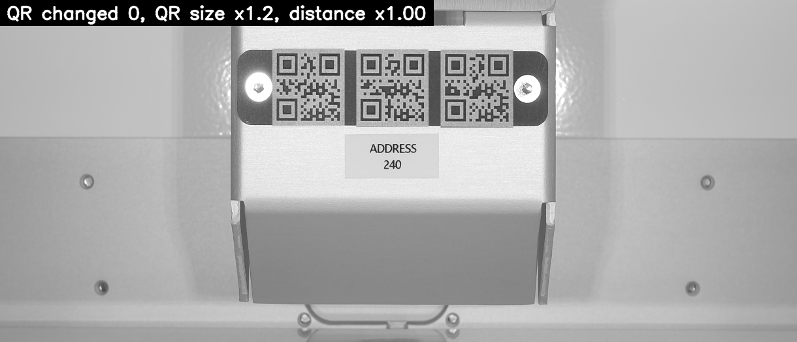 QR 1.2배 | 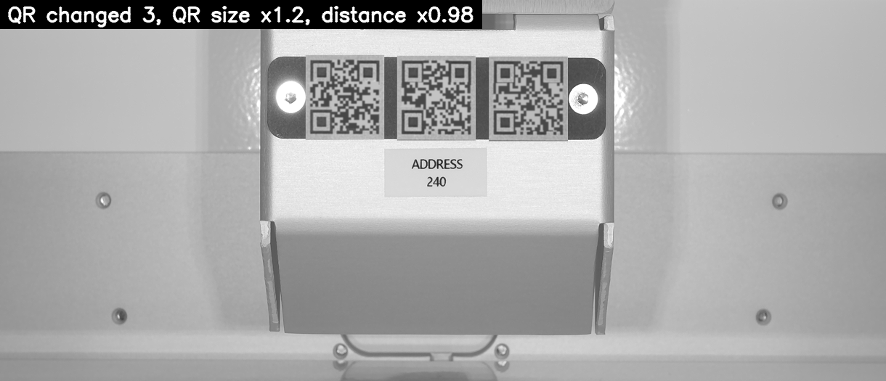 QR 3개 다름 + 1.2배 + 2% 멀어짐 |

**두 가지로 쟀다**
- **(가) 그대로 쓰면**: 지금 기준 사진, 위치, 계수를 그대로 쓰고 바뀐 기준 화면을 잰다.
- **(나) 새로 등록하면**: 바뀐 화면을 새 기준 사진으로 삼고 QR, 나사 위치를 새로 적은 뒤, 같은 변화를 준 예제 사진 5장(Y ±2 mm, T ±1도 포함, 정답을 앎)을 잰다. 계수(px → mm)는 바꾸지 않는다.

**(가) 그대로 쓰면** (거리 그대로일 때)

| QR 내용 \ QR 크기 | 0.8배 | 1.0배 | 1.2배 |
|---|---|---|---|
| 그대로 | 실패 `E_QR_NOT_FOUND` | 정상 | 실패 `E_QR_NOT_FOUND` |
| 1개 다름 | 실패 | 경고 `W_VALUES_DISAGREE` (옆 QR 에 잘못 맞음) | 실패 |
| 3개 다름 | 실패 | 실패 | 실패 |

거리가 2% 다르면 내용, 크기가 그대로여도 경고(`W_VALUES_DISAGREE`)가 나고, QR 1개만 다르면 경고(`W_QR_PARTIAL`), 나머지는 실패다. 27가지 중 정상은 아무것도 안 바뀐 1가지뿐이다. **지금 기준은 그 판, 그 QR, 그 거리에만 맞는다.**

**(나) 새로 등록하면** (예제 사진 5장 중 통과 수, 최대 오차)

| 거리 | QR 내용, 크기 9가지 | 최대 오차 |
|---|---|---|
| 그대로 | **9가지 모두 5/5 통과** | Y 0.004 mm, T 0.0005도 |
| 2% 멀어짐 | 9가지 모두 3/5 (T ±1도 사진 2장 탈락) | Y 0.038~0.041 mm, T 0.020도 |
| 2% 가까워짐 | 9가지 모두 3/5 (T ±1도 사진 2장 탈락) | Y 0.042~0.044 mm, T 0.020도 |

**알게 된 것**
1. **QR 내용과 크기는 등록만 다시 하면 된다.** 측정은 "기준 사진에서 얼마나 움직였나"만 보기 때문에 무늬가 무엇이든, 크기가 얼마든 상관없다.
2. **거리는 등록만으로 안 된다.** 거리가 2% 바뀌면 px 당 mm 가 2% 바뀌어, 큰 자세일수록 그만큼 틀린다 (T 1도 → 0.02도). 계수의 배율을 맞춰야 한다.
3. **지금 함수로는 새 설치를 등록할 수 없다.** `set_reference_from_photos` 는 옛 QR 무늬를 새 사진에서 찾아 위치를 옮기는 함수라, QR 내용이나 크기가 바뀌면 찾지 못한다(`E_REFERENCE`).

**그래서 필요한 것: 새 설치 등록 도구** (개발 제안)

| 단계 | 하는 일 |
|---|---|
| 1. 기준 사진 | 판을 명령 0 에 두고 5~10장 찍어 평균 |
| 2. 위치 찾기 | QR 3개(QR 위치 사각형으로 찾기)와 나사 4개(둥근 테두리로 찾기)를 자동으로 찾아 `reference.json` 작성 |
| 3. 배율 맞추기 | 로봇을 알려진 만큼 두 번 움직여(예: Y +1 mm, T +0.5도) 찍고, 계수의 배율을 그 설치에 맞춤 |
| 4. 확인 | 알려진 자세 몇 개에서 허용오차 안인지 확인, 결과를 등록 기록에 남김 |

포트, 선반이 수백 개라면 이 도구를 반송 장치가 돌며 자동으로 돌리게 할 수 있다.

---

## 6. 화면 변화와 지금 알고리즘의 반응

화면 변화를 하나씩 따로 준 33가지다. 4절의 환경 화면은 이것들을 겹친 것이다.

- 각 그림은 판 둘레를 잘라 절반 크기로 줄인 것이다. 33가지를 한 장으로 본 그림은 아래.
- 번호 09 는 판을 크게 옮긴 경우였는데, 판이 실제로 움직인 것이라 "화면 변화로 틀린 값"과 같은 기준으로 셀 수 없어 뺐다. 큰 이동은 README 7절에 따로 있다.

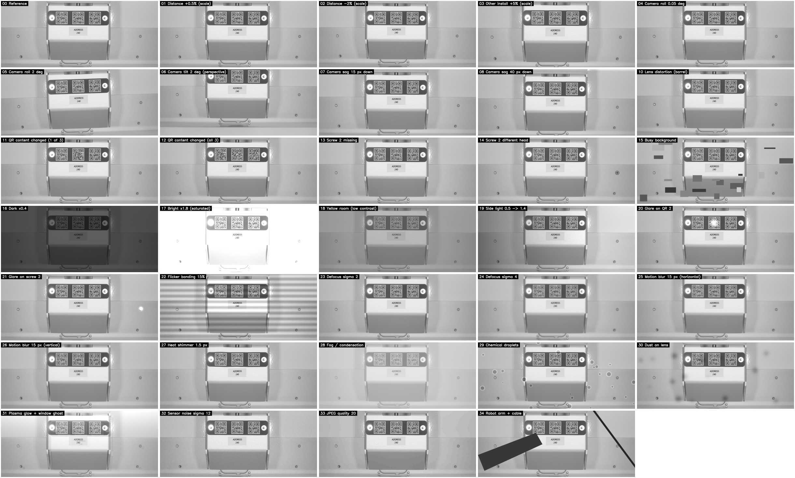

### 6-1. 설치와 기하 (카메라 위치, 거리, 렌즈)

| 번호 | 화면 | 어디서 생기나 | 상태 | 변화량 Y / T | 판정 |
|---|---|---|---|---|---|
| 01 |  거리 +0.5% (약 1.5 mm 가까워짐) | 포트마다 높이 차이, 고정대 처짐 | 경고 `W_VALUES_DISAGREE` | +0.066 / +0.004 | △ |
| 02 | 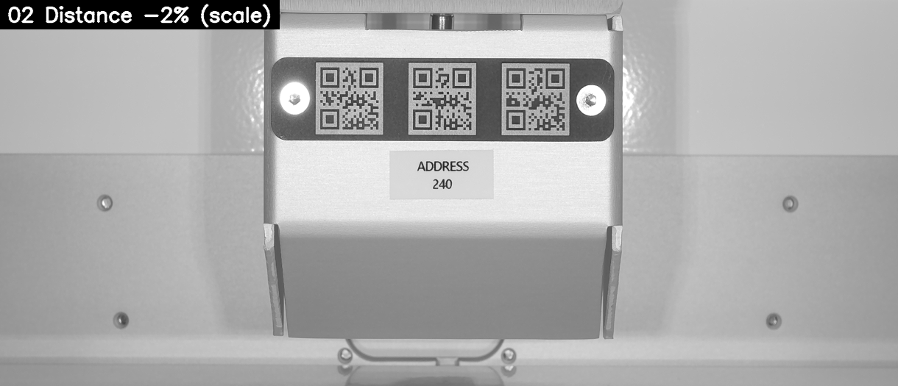 거리 −2% (약 6 mm 멀어짐) | 다른 포트, 다른 선반 | 경고 `W_VALUES_DISAGREE` | −0.267 / −0.016 | △ |
| 03 | 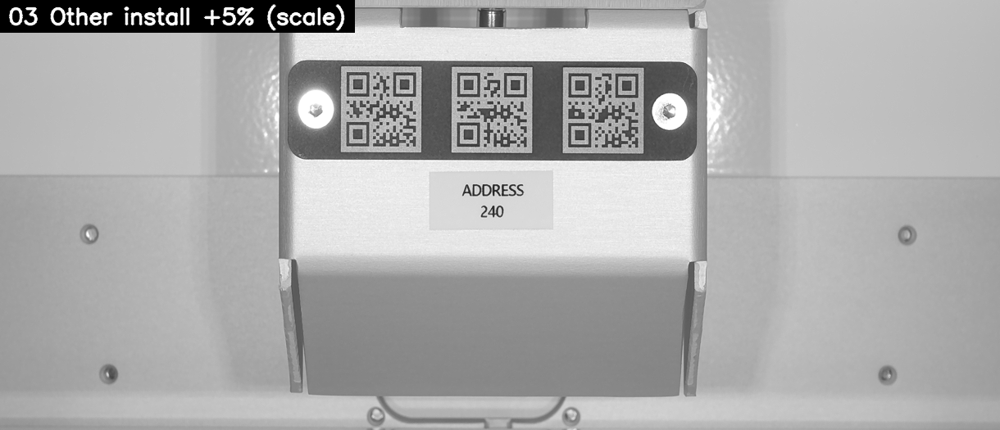 거리 +5% (다른 설치) | 다른 설비에 옮겨 설치 | 실패 `E_QR_NOT_FOUND` | - | △ |
| 04 | 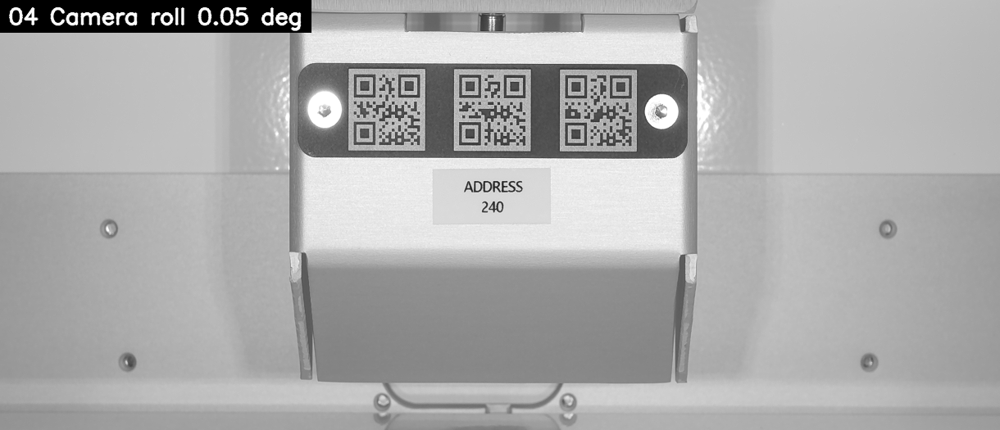 카메라 0.05도 돌아감 | 고정 나사 풀림, 충격 | 경고 `W_VALUES_DISAGREE` | −0.132 / +0.025 | △ |
| 05 | 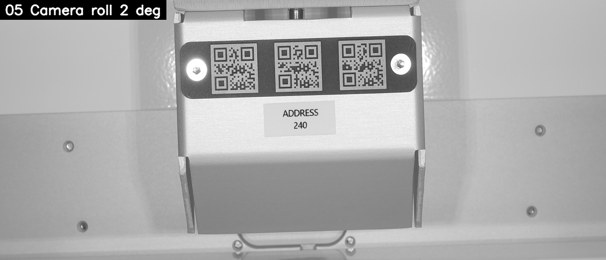 카메라 2도 돌아감 | AMR 바닥 기울기, 잘못 설치 | 경고 `W_VALUES_DISAGREE` | −5.2 / +1.0 | △ |
| 06 | 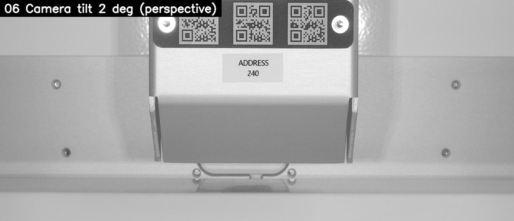 카메라 2도 위아래로 기울어짐 (원근) | 고정대 변형, AMR | 실패 `E_QR_NOT_FOUND` | - | △ |
| 07 |  카메라 15 px 처짐 | 고정대 처짐 | 정상 | 0.000 / 0.000 | ○ |
| 08 | 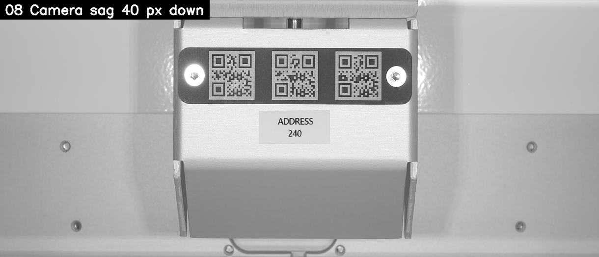 카메라 40 px 처짐 | 고정대 크게 처짐 | 실패 `E_QR_NOT_FOUND` | - | △ |
| 10 | 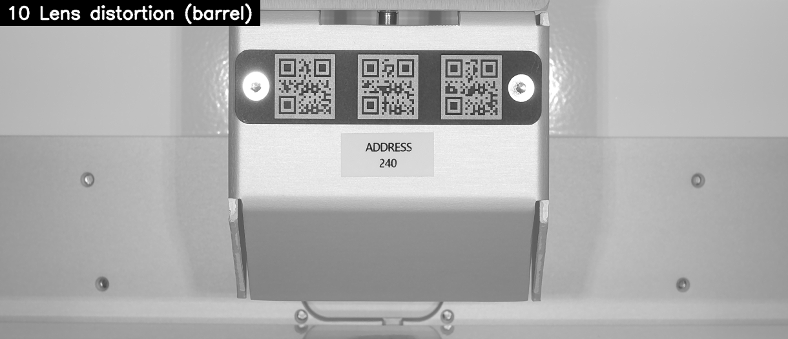 렌즈 왜곡 (술통형) | 다른 렌즈, 진공 창 | 경고 `W_VALUES_DISAGREE` | −0.159 / +0.001 | △ |

**알게 된 것**: 거리가 0.5% (약 1.5 mm)만 바뀌어도 Y 가 0.066 mm 틀어진다. 카메라가 0.05도만 돌아도 Y 0.13 mm 다. 다행히 값 일치 점검이 모두 잡아 경고했다. 세로 처짐은 20 px 까지 영향이 없도록 만들어 두었다.

### 6-2. 대상물 (QR, 나사, 주변)

| 번호 | 화면 | 어디서 생기나 | 상태 | 변화량 Y / T | 판정 |
|---|---|---|---|---|---|
| 11 | 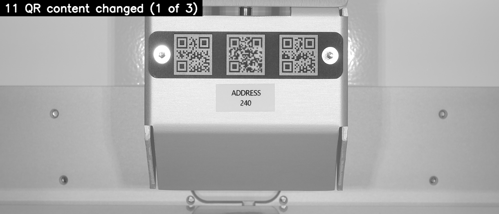 QR 1개의 내용이 다름 | 포트, 선반마다 주소가 다름 | 경고 `W_VALUES_DISAGREE` | −26.2 / +3.6 | △ |
| 12 | 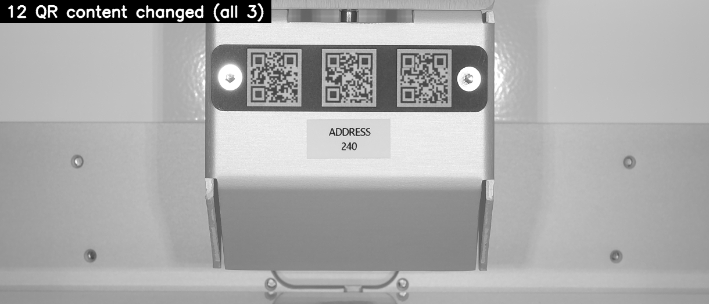 QR 3개 모두 내용이 다름 | 다른 포트에서 같은 계수를 씀 | 실패 `E_QR_NOT_FOUND` | - | △ |
| 13 | 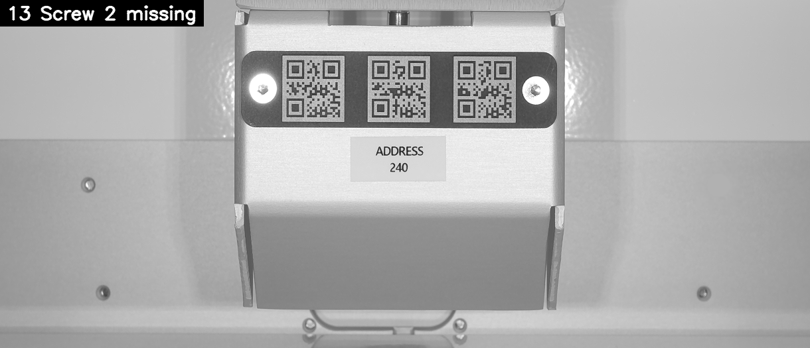 나사 2 가 없음 | 정비 후 빠짐 | 경고 `W_SCREW_MISSING` | +0.001 / 0.000 | ○ |
| 14 | 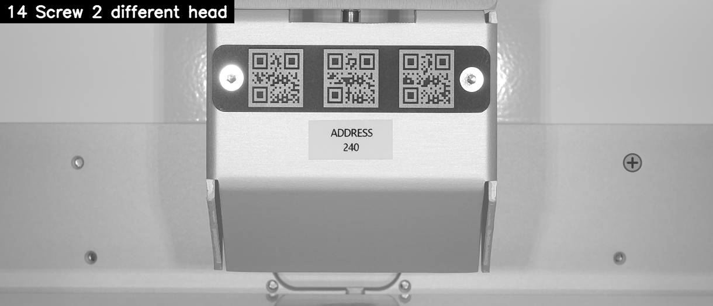 나사 2 의 머리 모양이 다름 | 다른 부품으로 교체 | 경고 `W_SCREW_MISSING` | +0.001 / 0.000 | ○ |
| 15 | 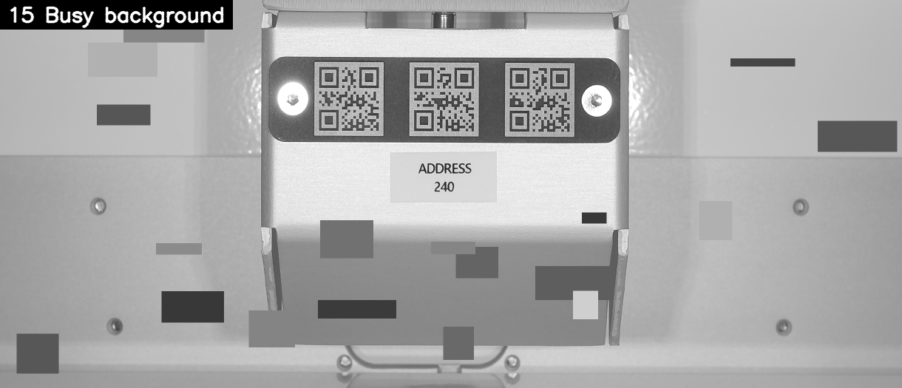 주변이 지저분함 (다른 물체, 표) | 설비마다 다른 배경 | 정상 | 0.000 / 0.000 | ○ |

**알게 된 것**

- **QR 하나가 다른 무늬가 되면 옆 QR 자리에 잘못 맞는다** (11). QR 3개가 약 257 px 간격으로 늘어서 있어서, 무늬가 비슷한 옆 QR 을 자기로 착각한다. 값이 26 mm 나 틀렸지만 값 일치 점검이 경고했다.
- 이 상태는 경고가 아니라 실패로 알려야 한다. 세 QR 의 이동량이 서로 257 px 씩 어긋나는지 보는 검사를 넣으면 막을 수 있다.
- 지금 기준은 이 QR 무늬로 찍은 기준 사진에 묶여 있다. 포트마다 QR 이 다르다면 포트마다 새로 등록해야 한다 (5절).

### 6-3. 조명

| 번호 | 화면 | 어디서 생기나 | 상태 | 변화량 Y / T | 판정 |
|---|---|---|---|---|---|
| 16 | 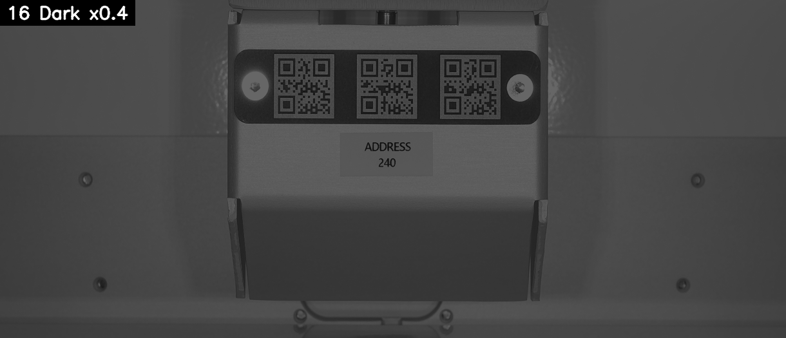 어두움 (×0.4) | 조명 고장, 그늘 | 정상 | −0.002 / 0.000 | ○ |
| 17 | 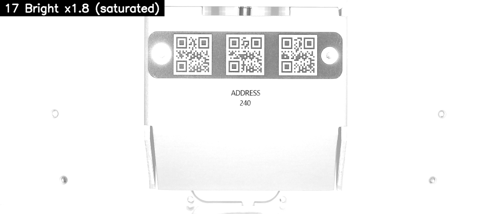 밝아서 하얗게 날아감 (×1.8) | 자동 노출 실패, 강한 빛 | 경고 `W_VALUES_DISAGREE` | −0.060 / +0.013 | △ |
| 18 | 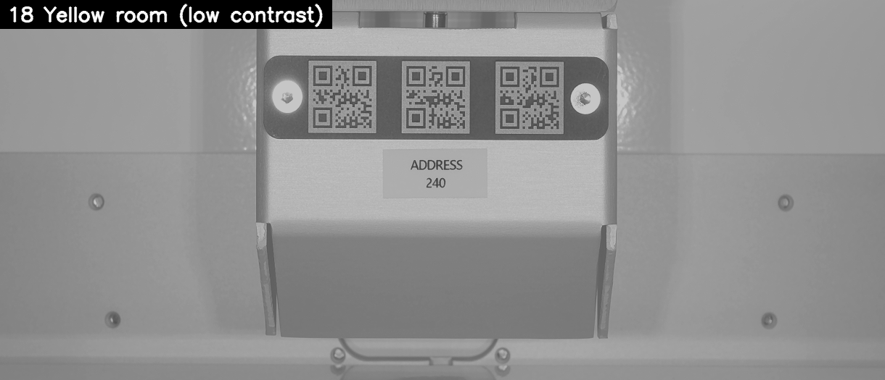 노란 조명 (대비 낮음) | Photo 공정 구역 | 정상 | +0.003 / 0.000 | ○ |
| 19 | 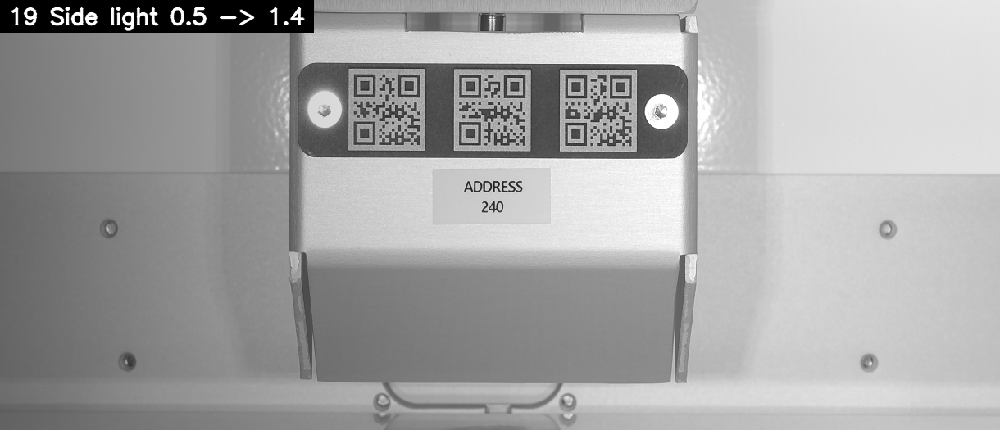 한쪽만 밝음 | 창문, 옆 설비 조명 | 정상 | −0.004 / +0.001 | ○ |
| 20 | 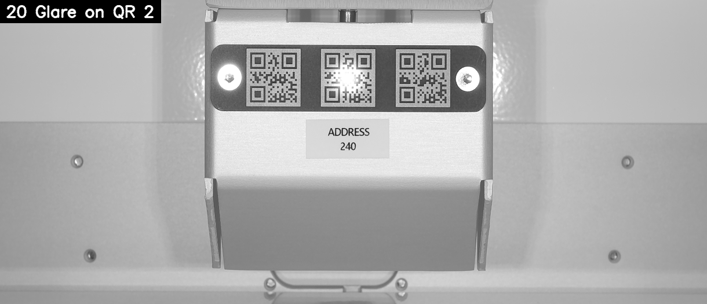 QR 2 에 반사광 | 금속판, 비닐 덮개 | 경고 `W_VALUES_DISAGREE` | −26.2 / +3.6 | △ |
| 21 | 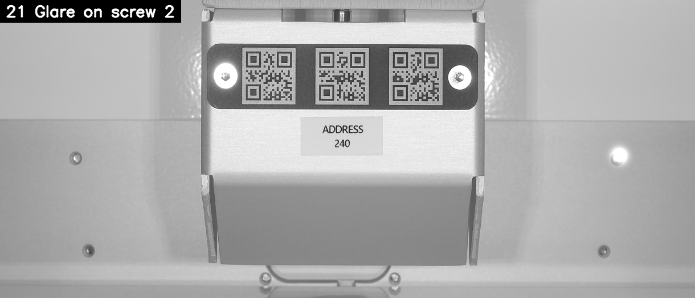 나사 2 에 반사광 | 반짝이는 나사 머리 | 경고 `W_SCREW_MISSING` | +0.001 / 0.000 | ○ |
| 22 |  형광등 깜빡임 줄무늬 (15%) | 롤링 셔터 카메라 + 교류 조명 | 경고 `W_COARSE` | −0.052 / +0.011 | △ |

**알게 된 것**: 고른 밝기 변화(어두움, 노란 조명, 한쪽 조명)에는 강하다. 약한 곳은 두 가지다. QR 반사(20)는 QR 내용이 바뀐 경우(11)와 같은 "옆 QR 에 잘못 맞음"이다. 줄무늬(22)가 생기면 나사를 놓쳐 대략값만 낸다.

### 6-4. 공정 환경 (흐림, 열, 김, 오염, 창)

| 번호 | 화면 | 어디서 생기나 | 상태 | 변화량 Y / T | 판정 |
|---|---|---|---|---|---|
| 23 | 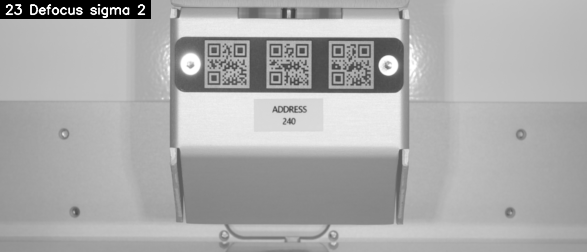 초점 흐림 (σ 2 px) | 진공 창 너머, 거리 변화 | 경고 `W_COARSE` | −0.052 / +0.011 | △ |
| 24 |  초점 흐림 (σ 4 px) | 초점 풀림 | 경고 `W_COARSE` | −0.052 / +0.011 | △ |
| 25 |  가로로 흔들림 (15 px) | OHT, 로봇이 멈추는 중 | 경고 `W_VALUES_DISAGREE` | −0.033 / +0.009 | ○ |
| 26 | 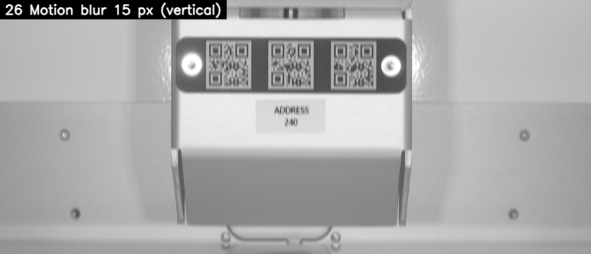 세로로 흔들림 (15 px) | 호이스트 오르내림 | 정상 | −0.020 / +0.004 | ○ |
| 27 | 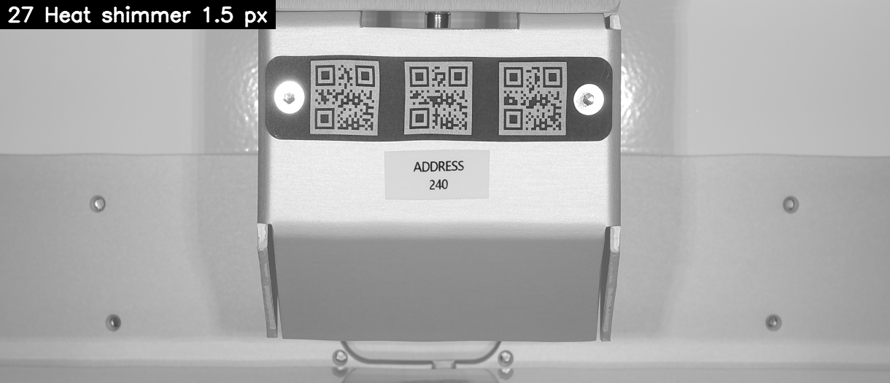 아지랑이 (1.5 px 흔들림) | 베이크 판, 고온 척, 본딩 헤드 | 경고 `W_VALUES_DISAGREE` | +0.150 / −0.022 | △ |
| 28 | 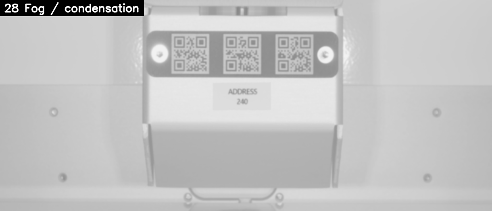 김서림, 결로 | 저온 척, 세정 챔버 | 경고 `W_COARSE` | −0.052 / +0.011 | △ |
| 29 |  약액, 물방울 | 세정, 약액 공급 | 정상 | 0.000 / 0.000 | ○ |
| 30 |  렌즈 먼지 | 오래 쓴 카메라 | 정상 | +0.003 / 0.000 | ○ |
| 31 | 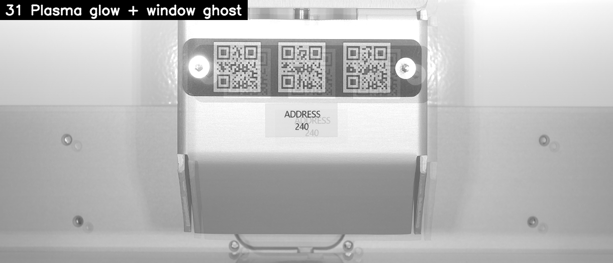 플라즈마 빛 + 창 이중 반사 | Etch 챔버 창 | 정상 | −0.003 / 0.000 | ○ |
| 32 |  센서 잡음 (σ 12) | 어두워서 이득을 올림 | 정상 | +0.005 / −0.001 | ○ |
| 33 |  사진 압축 (JPEG 20) | 네트워크로 보낼 때 | 정상 | +0.007 / 0.000 | ○ |

**알게 된 것**

- 흐림, 김서림, 깜빡임(22, 23, 24, 28)은 모두 같은 숫자다. 나사를 하나도 찾지 못해 QR 만으로 대략값을 냈기 때문이다. 나사를 다듬는 단계가 선명한 기준 사진과 비교하기 때문에, 화면이 흐리면 맞춤이 끝나지 않는 것으로 보인다 (원인은 8절 실측에서 확인).
- 아지랑이(27)는 위치를 1~2 px 씩 무작위로 흔들어 Y 가 0.15 mm 틀어진다. 경고는 했다. 열원 근처에서는 여러 장을 찍어 평균하는 것이 필요하다.
- 방울, 먼지, 플라즈마 빛, 잡음, 압축에는 강하다.

### 6-5. 가림

| 번호 | 화면 | 어디서 생기나 | 상태 | 변화량 Y / T | 판정 |
|---|---|---|---|---|---|
| 34 | 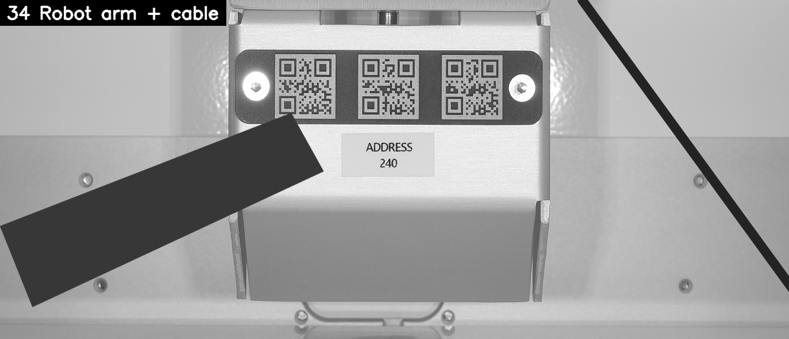 로봇 팔과 케이블이 가림 | 로봇 팔, 케이블, 사람 손 | 경고 `W_COARSE` | +0.074 / −0.012 | △ |

나사 한쪽이 가려져 좌우 나사를 다 쓰지 못하자 대략값을 내고 경고했다. 판 쪽으로 다시 옮겨 재면 된다.

---

## 7. 정리: 강한 곳, 약한 곳, 대응

| 구분 | 내용 | 대응 |
|---|---|---|
| 강한 곳 | 고른 밝기 변화, 노란 조명, 방울, 먼지, 잡음, 압축, 배경 변화, 나사 하나 빠짐, 세로 처짐 20 px | 지금 그대로 |
| 약한 곳 1: 설치 변화 | 거리 0.5%, 회전 0.05도에도 허용오차를 넘음 | 값 일치 점검이 잡음. 매일 영점 잡기, 설치를 바꾸면 기준 다시 잡기 (`docs/4_영점잡기.md`). 카메라 고정 강성 확보 |
| 약한 곳 2: QR 이 바뀌거나 가려짐 | 옆 QR 자리에 잘못 맞아 큰 오차 (경고는 함) | **세 QR 간격 검사로 실패 처리**(코드 개선). 포트마다 다른 QR 이면 포트마다 새로 등록 (5절) |
| 약한 곳 3: 흐림, 김서림, 깜빡임 | 나사를 놓쳐 대략값 | 흐린 화면에서도 나사를 잡도록 정밀 맞춤 전에 같은 정도로 흐려 맞추기(코드 개선). 노출 시간을 조명 주기에 맞추기, 창 히터와 퍼지(설비) |
| 약한 곳 4: 아지랑이 | 무작위 흔들림으로 Y 0.15 mm | 여러 장 평균, 열원과 카메라 사이 공기 흐름 차단(설비) |
| 약한 곳 5: 새 설치 (QR 내용, 크기, 거리) | 지금 기준을 그대로 쓰면 27가지 중 26가지가 경고나 실패. 거리 2% 차이는 등록만으로 해결되지 않음 (T 2% 비례 오차) | **새 설치 등록 도구** (5절): 위치 자동 찾기 + 알려진 이동 2번으로 배율 맞추기 |

"알리지 않고 틀린" 경우가 0 이라는 것이 가장 중요한 결과다. 틀릴 때는 언제나 경고나 실패가 나와서, 설비가 멈추거나 다시 재도록 할 수 있다.

**개발 우선순위 (제안)**

| 순위 | 할 일 | 막는 것 | 위치 |
|---|---|---|---|
| 1 | 새 설치 등록 도구 | 포트, 선반, 설비마다 다른 QR, 크기, 거리 | 새 도구 + `set_reference_from_photos` 확장 |
| 2 | 세 QR 간격 검사 (어긋나면 실패) | QR 가림, 반사 때 옆 QR 에 잘못 맞음 | `src/steps/01_find_qr.cpp` |
| 3 | 흐린 화면 나사 맞춤 | 흐림, 김서림, 깜빡임, 열에서 나사를 놓침 | `src/steps/02_find_screws.cpp` |
| 4 | 여러 장 평균 측정 | 아지랑이, 흔들림 | 공개 함수 추가 |

---

## 8. 우리 장비(SSAFY 시험 장비)로 검증하는 단계

합성 화면은 실제와 다를 수 있다. 우리 장비는 같은 종류의 판과 카메라가 있고, 이미 Y, T 격자로 여러 날 찍은 사진(정방향 1,959장, 역순을 더해 3,638장)이 있다. 그래서 같은 변화를 실제로 만들어 확인할 수 있다.

### 8-1. 순서

| 단계 | 할 일 | 결과물 |
|---|---|---|
| 0. 기준 | 변화 없이 센터와 Y, T 격자 몇 자세를 찍는다. 그날 영점을 잡는다 | 기준 오차, 기준 경고율 |
| 1. 하나씩 바꾸기 | 아래 표의 변화를 하나씩 만들고, 같은 자세에서 다시 찍는다 | 변화마다 오차, 상태 |
| 2. 합성과 비교 | 4, 5, 6절의 합성 결과와 실제 결과를 나란히 놓는다 | 합성이 맞는 변화, 틀린 변화 |
| 3. 개선 확인 | 7절의 개발 항목(새 설치 등록, QR 간격 검사, 흐린 화면 나사 맞춤)을 넣고 1단계를 다시 | 개선 전후 비교 |
| 4. 보고 | 변화마다 "정상으로 버팀 / 경고 / 실패 / 알리지 않고 틀림" 비율 | SEMES 공유 자료 |

### 8-2. 우리 장비에서 만들 수 있는 변화

| 합성 번호 | 실제로 만드는 법 | 크기 | 자세 수 × 반복 |
|---|---|---|---|
| 01~03 | 카메라 고정대에 얇은 판(0.5, 1, 2, 5 mm)을 끼워 거리 바꾸기 | 0.2~1.6% | 5 × 5 |
| 04, 05 | 카메라 고정대를 돌려 고정 (각도기, 수준기) | 0.05~2도 | 5 × 5 |
| 07, 08 | 고정대 높이를 내림 | 10~50 px | 5 × 5 |
| 11, 12 | 다른 내용의 QR 을 같은 크기로 인쇄해 덮어 붙임 | 1개, 3개 | 5 × 5 |
| 5절 | 다른 내용, 다른 크기(0.8, 1.2배)의 QR 을 인쇄해 붙이고, 카메라 거리를 바꾼 뒤 **새로 등록**하고 격자 자세를 잰다 | 내용 3 × 크기 3 × 거리 3 중 대표 9가지 | 9자세 × 3 |
| 13, 14 | 나사를 빼거나 다른 머리 모양으로 교체 | 1개 | 5 × 5 |
| 16~19 | 조명 밝기 조절, 옆에서 스탠드 조명, 노란 필름 | ×0.4~1.8 | 5 × 5 |
| 20, 21 | 손전등으로 QR, 나사에 반사 | 1곳 | 5 × 5 |
| 22 | 교류 조명 + 짧은 노출 시간 | 줄무늬 보일 때까지 | 5 × 5 |
| 23, 24 | 초점 링을 조금 돌림 | 2단계 | 5 × 5 |
| 25, 26 | 판이 멈추기 전 움직이는 중에 촬영 | 2단계 | 5 × 5 |
| 27 | 판 아래에 작은 열원(안전 거리 확보) | 1단계 | 5 × 10 (여러 장 평균 효과도 확인) |
| 28 | 차가운 투명 덮개를 렌즈 앞에 (입김) | 1단계 | 5 × 5 |
| 29, 30 | 투명 덮개에 물방울, 가루 | 2단계 | 5 × 5 |
| 34 | 판 앞에 막대, 케이블을 걸침 | 나사 1~2개 가림 | 5 × 5 |

자세 5가지는 센터와 Y ±1 mm, T ±0.5도 근처로 한다. 반복 5번은 같은 자세에서 연달아 찍은 것이다.

### 8-3. 판정 기준

| 지표 | 기준 |
|---|---|
| 알리지 않고 틀린 비율 | 0% 를 목표로 한다. 하나라도 나오면 그 변화를 우선 고친다 |
| 정상일 때의 오차 | 허용오차(Y 0.045 mm, T 0.01도) 안 |
| 괜한 경고 | 변화 없는 기준 사진에서 1% 이하 |
| 합성과 실제의 차이 | 변화마다 상태(정상, 경고, 실패)가 같은지, 오차 크기가 비슷한지 |

### 8-4. 일정 (제안)

| 기간 | 할 일 |
|---|---|
| 1일 | 0단계, 설치 변화(01~08) |
| 1일 | 대상물, 조명(11~22), 새 설치(5절: 다른 QR 인쇄, 거리 바꿔 등록) |
| 1일 | 공정 환경 흉내, 가림(23~34) |
| 2~3일 | 코드 개선과 다시 재기, 보고 |

---

## 9. SEMES 와 논의할 것

1. **어느 설비부터 적용하나**: 4절 A~J 중 실제 대상. 그곳의 카메라 거리, 렌즈, 조명, 온도 범위
2. **QR 이 포트마다 다른가**: 다르면 포트마다 기준을 잡을지, QR 내용과 상관없는 표식을 쓸지
3. **카메라가 고정인가, 움직이는 장치에 달렸나**: 반송 장치에 달렸다면 멈춘 뒤 몇 ms 뒤에 찍을 수 있는지(흔들림)
4. **환경 조건**: 노란 조명 구역인지, 열원과 거리, 진공 창 너머인지, 결로 가능성
5. **실패와 경고 때 설비 동작**: 멈춤, 다시 재기 횟수, 사람 호출
6. **실제 사진 자료**: 대상 설비에서 정상, 이상 조건 사진을 받을 수 있는지

---

## 10. 한계

- 4, 5, 6절은 기준 사진(과 예제 사진)을 바꾼 합성 화면이다. 실제 촬영, 실제 설비 결과가 아니다.
- 변화 크기는 일반적인 조건으로 잡은 추정이다. SEMES 설비의 실제 범위는 확인하지 못했다.
- QR 내용 변화는 QR 비슷한 무작위 무늬로 흉내 냈다. 실제 QR 과 칸 배치가 다르다.
- 5절 (나)는 움직인 예제 사진의 QR 자리에 "바뀐 기준 화면을 QR 이동만큼 옮긴 것"을 붙였다. 판이 그대로 평행이동했다고 본 것이라 실제보다 좋게 나올 수 있다. 8절 실측으로 확인해야 한다.
- 4절의 설비, 공정 설명은 채용 직무 설명과 공개 자료에 기댄 것이고, 특허는 목록에서 출원인만 확인했다.

**화면을 만든 코드** (C++, OpenCV. 화면 바꾸는 함수는 `tools/environment/scene_effects.cpp` 에 모음)

| 절 | 코드 | 실행 | 결과 표 |
|---|---|---|---|
| 4-2 | `tools/environment/make_site_images.cpp` | `build/Release/make_site_images data/model <출력 폴더>` | `images/site_results.tsv` |
| 5 | `tools/environment/check_new_installation.cpp` | `build/Release/check_new_installation data/model data/sample/list.tsv data/sample/expected.tsv <작업 폴더> <출력 폴더>` | `images/installation_results.tsv` |
| 6 | `tools/environment/make_environment_images.cpp` | `build/Release/make_environment_images data/model <출력 폴더>` | `images/results.tsv` |

## 참고 자료

- SEMES 2026 하반기 신입사원 채용 직무 설명서 (기구설계, SW 설계, 전장설계, 공정개발)
- 장비 분류 목록: [Abachy, SEMES Co., Ltd.](https://abachy.com/catalog/semiconductor-equipment/wafer-manufacturing-equipment/inspection-and-metrology-equipment/wafer-sorter/semes-co-ltd), [Komachine](https://www.komachine.com/en/companies/system-engineering-mega-solution), [moov, SEMES](https://moov.co/marketplace/all-equipment/semes)
- 특허 검색: [KR101725406B1 이송 로봇의 오토 티칭 시스템 (인용 목록에서 SEMES 출원 확인)](https://patents.google.com/patent/KR101725406B1/ko), [KR101467551B1 반도체 웨이퍼 티칭 지그](https://patents.google.com/patent/KR101467551B1/ko), [EP1606837A1 (관련 문헌에 KR101964964B1, SEMES)](https://patents.google.com/patent/EP1606837A1/en)
