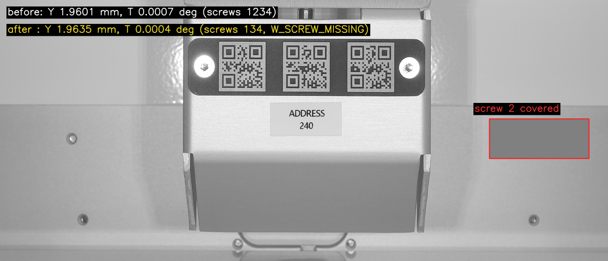

# 3. 강건성: 무슨 일이 생기면 어떻게 되고, 어떻게 대처하나

카메라가 처지고, 빛이 바뀌고, QR 과 나사가 가려지거나 흔들리는 일은 현장에서 늘 생긴다. 이 문서는 세 가지에 답한다.

1. 어떤 상황에서 정확도와 속도가 떨어지나
2. 그때 어떻게 대처하나
3. 이미 조치한 것은 무엇이고, 아직 안 한 것은 무엇인가

숫자는 다른 문서와 실험에서 그대로 가져왔다. 자세한 표와 그림은 각 줄의 근거 문서에 있다.

---

## 1. 읽는 법

**조치 열**

| 표시 | 뜻 |
|---|---|
| 버팀 | 코드가 그대로 견딘다. 값이 허용오차(Y 0.045 mm, T 0.01도) 안이다 |
| 알림 | 값이 틀리거나 못 재지만, 경고나 실패로 알린다. 다음 할 일은 [README 5절](../../README.md) |
| 운영 | 코드로는 못 막는다. 사람이 영점이나 기준을 다시 잡아야 한다 |
| **안 함** | 아직 대책이 없거나 확인하지 못했다 |

**근거 열**

| 표시 | 뜻 |
|---|---|
| 사진 | 받은 사진 702장이나 우리 장비 사진으로 잰 것 |
| 합성 | 사진을 일부러 바꿔서(옮기기, 흐리기, 가리기) 잰 것. 실제 현장과 다를 수 있다 |
| 계산 | 사진 결과로 계산한 것. 로봇을 실제로 움직이지 않았다 |
| 없음 | 확인하지 못했다 |

---

## 2. 한눈에 보기

나사 일부 가림: 남은 나사로 계산 후 경고. 모든 가림에서 값이 나오는 것은 아님.

| 상황 | 정확도 | 속도 | 지금 상태 |
|---|---|---|---|
| 카메라가 위아래로 처짐 | 20 px 까지 그대로, 그 이상은 못 잼 | 그대로 | 버팀 + 알림 |
| 카메라가 돌거나 옆으로 밀림, 거리가 바뀜 | 아주 작은 변화에도 허용오차를 넘음 | 그대로 | 알림 + 운영 (영점 다시 잡기) |
| 빛이 고르게 밝아지거나 어두워짐 | 그대로 | 그대로 | 버팀 |
| 하얗게 날아감, 깜빡임 줄무늬 | 틀림 | 느려질 수 있음 | 알림 |
| 나사 하나가 가려지거나 빠짐 | 거의 그대로 (Y 0.007 mm 차이) | 느려질 수 있음 | 버팀 + 알림 |
| QR 하나가 가려지거나 반사됨 | 크게 틀릴 수 있음 (옆 QR 에 잘못 맞음) | 느려짐 | 알림. **실패 처리는 안 함** |
| 흐림, 김서림 | 나사를 놓쳐 대략값 | 느려질 수 있음 | 알림. **개선은 안 함** |
| 흔들림, 아지랑이 | 틀림 (아지랑이 Y 0.15 mm) | 그대로 | 알림. **여러 장 평균은 안 함** |
| 판이 멀리 가 있음 | 멀수록 T 가 비례해서 틀림 | 느려짐 | 알림 + 다시 재기. **실제 시험은 안 함** |
| 날이 바뀜 (로봇 0 이 달라짐) | 영점을 안 잡으면 0 ~ 70% | 그대로 | 운영 (매일 영점). **자동 감지는 안 함** |
| 판을 다시 조립함 | 알림 없이 틀림 | 그대로 | 운영뿐. **코드로 못 막음** |
| 카메라가 RGB 순서로 사진을 줌 | 알림 없이 틀림 | 그대로 | 문서 주의뿐. **코드로 못 막음** |

가장 중요한 원칙은 **"틀릴 때는 알린다"** 이다. 합성 화면 43가지에서 알림 없이 틀린 경우는 0 이었다. 알림 없이 틀리는 것으로 지금 알고 있는 경우는 맨 아래 두 줄과 거친 노이즈(3-2)다.

---

## 3. 상황마다: 정확도

### 3-1. 카메라 (처짐, 회전, 거리, 초점)

| 상황 | 생기는 일 | 대처 | 조치 | 근거 |
|---|---|---|---|---|
| 위아래로 20 px 까지 처짐 | 값이 그대로다 (차이 0.00001 mm) | 없음 | 버팀 | 합성 |
| 위아래로 21 px 넘게 처짐 | QR 을 못 찾는다 (`E_QR_NOT_FOUND`). 틀린 값은 내지 않는다 | `set_reference_from_photos` 로 기준을 다시 잡는다. 40 px 처진 뒤 다시 잡으면 처음 값과 Y 0.004 mm, T 0.0004도 차이 | 알림 + 운영 | 합성 |
| 0.05도 돌아감 | Y 가 0.13 ~ 0.27 mm 틀어진다. 모든 사진이 같은 양만큼 틀린다 | 영점을 다시 잡으면 탈락 0 | 알림 (`W_VALUES_DISAGREE`) + 운영 | 합성 |
| 옆으로 2 px 밀림 | T 가 0.025도 틀어진다. 모든 사진이 같은 양만큼 | 영점을 다시 잡으면 탈락 0 | 운영 | 합성 |
| 거리가 0.2 ~ 0.5% 바뀜 (화면 전체가 커지거나 작아짐) | Y 가 0.04 ~ 0.07 mm 틀어진다 | 영점을 다시 잡으면 센터 근처는 맞는다. 먼 자세는 그 비율만큼 계속 틀린다 | 알림 (`W_VALUES_DISAGREE`) + 운영 | 합성 |
| 거리가 2% 바뀜 | Y 0.27 mm, T 0.016도. 기준을 새로 잡아도 T 1도에서 0.02도 틀린다 | 계수의 배율을 그 설치에 맞춰야 한다 | 알림. 배율 맞추기는 **안 함** | 합성 |
| 거리가 5% 바뀜, 2도 기울어짐 | QR 을 못 찾는다 (`E_QR_NOT_FOUND`) | 새 설치로 보고 기준과 계수를 다시 만든다 | 알림. 등록 도구는 **안 함** | 합성 |
| 렌즈 왜곡이 달라짐 | Y 0.16 mm | 위와 같다 | 알림 (`W_VALUES_DISAGREE`) | 합성 |
| 초점이 조금 흐려짐 (σ1 px) | 영향이 작다 | 없음 | 버팀 | 합성 |
| 초점이 많이 흐려짐 (σ2 px 이상) | 나사를 놓쳐 QR 만으로 대략값을 낸다 (`W_COARSE`, Y 0.05 mm, T 0.011도) | 초점을 다시 맞춘다 | 알림. 흐린 화면에서 나사 잡기는 **안 함** | 합성 |

- 카메라가 조금만 돌거나 밀려도 값이 크게 틀어지는 이유: Y 는 "QR 과 나사가 얼마나 다르게 움직였나"로 재는데, 카메라가 돌면 화면 위쪽(QR)과 아래쪽(나사)이 서로 다르게 밀린다.
- 대신 이런 변화는 모든 사진에 똑같이 붙는다. 그래서 **영점을 다시 잡으면 없어진다.**
- 세로로 처지는 것에 강한 이유: 세로 이동을 계산에 쓰지 않도록 만들었다.

### 3-2. 빛

| 상황 | 생기는 일 | 대처 | 조치 | 근거 |
|---|---|---|---|---|
| 어두워짐 (×0.4 ~ ×0.6), 밝기 ±40 | 영향이 작다 (Y 0.002 mm) | 없음 | 버팀 | 합성 |
| 노란 조명, 한쪽만 밝음 | 영향이 작다 (Y 0.004 mm 이하) | 없음 | 버팀 | 합성 |
| 하얗게 날아감 (×1.4 ~ ×1.8) | Y 0.05 ~ 0.06 mm, T 0.008 ~ 0.013도. 모든 사진이 비슷하게 틀린다 | 노출을 낮춘다. 그 조명으로 계속 쓸 거면 영점을 다시 잡는다 | 알림 (`W_VALUES_DISAGREE`) + 운영 | 합성 |
| 나사에 반사광 | 그 나사를 빼고 나머지로 계산한다 (Y 0.001 mm) | 반사를 없앤다 | 버팀 + 알림 (`W_SCREW_MISSING`) | 합성 |
| QR 에 반사광 | 3-3 의 "QR 하나가 가려짐"과 같다 | | | |
| 형광등 깜빡임 줄무늬 | 나사를 놓쳐 대략값 (`W_COARSE`) | 노출 시간을 조명 주기에 맞춘다 (설비) | 알림 | 합성 |
| 약한 노이즈 (σ3) | 영향이 작다 | 없음 | 버팀 | 합성 |
| 거친 노이즈 (σ8) | 702장 중 8장이 허용오차 밖. 사진마다 달라서 영점으로 못 고친다 | 이득을 낮추고 조명을 밝힌다. 여러 장을 평균한다 | 값 일치 점검이 잡는지 **확인 안 함** | 합성 |
| 하루 안에 조명이 바뀜 | 아침에 잡은 영점이 그 변화를 모른다 | 조명을 건드리면 영점을 다시 잡는다 | 운영. 자동 감지는 **안 함** | 없음 |

- 밝기에 강한 이유: QR 과 나사를 "닮은 정도(NCC)"로 찾는다. NCC 는 밝기의 크기와 더하기가 바뀌어도 값이 같다. 나사를 다듬을 때도 매번 밝기 배율과 더하기를 맞춘다.

### 3-3. QR 과 나사 (가림, 빠짐, 크기, 내용)

| 상황 | 생기는 일 | 대처 | 조치 | 근거 |
|---|---|---|---|---|
| 나사 하나가 가려지거나 빠짐, 머리 모양이 바뀜 | 나머지 3개로 계산한다. 가리기 전과 Y 0.007 mm, T 0.0006도 차이 | 그 값으로 보정해도 된다. 다음 측정 전에 나사를 확인한다 | 버팀 + 알림 (`W_SCREW_MISSING`) | 합성 |
| 나사가 한쪽(왼쪽이나 오른쪽)에만 남음 | 대략값이다. 한쪽 나사만 쓴 식은 560장 중 128 ~ 170장이 허용오차 밖 | 그 값으로 센터 쪽으로 옮긴 뒤 다시 잰다 | 알림 (`W_COARSE`) | 사진 |
| 나사가 가려졌는데 엉뚱한 곳에 맞음 | 점검이 없으면 Y 가 최대 3 mm 틀린다 | 그 값으로 보정하지 않는다. 가림을 치우고 다시 잰다 | 알림 (`W_VALUES_DISAGREE`). Y 0.1 mm 넘게 틀린 경우는 모두 잡았다. 그 아래는 못 잡을 수 있다 | 합성 (우리 장비 사진) |
| 다른 나사를 잘못 잡음 | 나사 이동이 QR 이동과 100 px 넘게 다르면 버린다 | 없음 | 버팀 | 사진 |
| QR 이 1/4 가려짐 | 영향이 작다 | 없음 | 버팀 | 합성 |
| QR 하나가 절반 넘게 가려지거나 반사됨, 내용이 바뀜 | 그 QR 이 **옆 QR 자리에 잘못 맞을 수 있다.** 그러면 값이 26 mm 까지 틀린다 | 그 값으로 보정하지 않는다. 가림과 반사를 치우고 다시 잰다 | 알림 (`W_VALUES_DISAGREE`, `W_QR_PARTIAL`). 실패로 막는 검사는 **안 함** | 합성 |
| QR 3개가 모두 안 보임 | 못 잰다 | 멈춘다 | 알림 (`E_QR_NOT_FOUND`) | 합성 |
| QR 인쇄 크기가 0.8배, 1.2배로 바뀜 | QR 을 못 찾는다 (`E_QR_NOT_FOUND`). 기준을 새로 등록하면 통과 (Y 0.004 mm 이하) | 새 QR 로 기준 사진과 위치를 다시 만든다 | 알림. 등록 도구는 **안 함** | 합성 |
| 주변에 다른 물체, 표가 있음 | 영향이 없다 | 없음 | 버팀 | 합성 |
| 물방울, 렌즈 먼지 | 영향이 작다 (Y 0.003 mm 이하) | 없음 | 버팀 | 합성 |
| **QR 판과 나사 사이가 통째로 밀림 (판을 다시 조립함)** | **알림 없이 틀린다.** 0.1 px 밀리면 Y 약 0.03 mm | 판을 손댄 뒤에는 반드시 영점을 다시 잡는다 | 운영뿐. 코드로 **못 막음** | 합성 |

- QR 이 옆 QR 에 잘못 맞는 이유: QR 3개가 약 257 px 간격으로 늘어서 있고 무늬가 비슷하다. 좁은 창(±110 px)과 넓은 창(±250 px)에서 못 찾으면 사진 전체 폭을 찾는데, 이때 옆 QR 이 걸린다.
- 막는 방법은 정해져 있다. 세 QR 의 이동량이 서로 257 px 씩 어긋나는지 보는 검사를 넣으면 실패로 처리할 수 있다 (5절 3번).

### 3-4. 흔들림과 공기 (움직이는 중 촬영, 열, 김)

| 상황 | 생기는 일 | 대처 | 조치 | 근거 |
|---|---|---|---|---|
| 세로로 흔들림 (15 px 번짐) | Y 0.020 mm, T 0.004도. 허용오차 안 | 없음 | 버팀 | 합성 |
| 가로로 흔들림 (15 px 번짐) | Y 0.033 mm, T 0.009도. 허용오차 끝에 걸린다 | 판이 멈춘 뒤 찍는다 | 알림 (`W_VALUES_DISAGREE`) | 합성 |
| 아지랑이 (뜨거운 판 위, 1.5 px 흔들림) | Y 0.15 mm, T 0.022도. 사진마다 다르게 틀린다 | 여러 장을 찍어 평균한다. 열원과 카메라 사이 공기 흐름을 막는다 (설비) | 알림 (`W_VALUES_DISAGREE`). 여러 장 평균 함수는 **안 함** | 합성 |
| 김서림, 결로 | 나사를 놓쳐 대략값 (`W_COARSE`) | 창 히터, 퍼지 (설비) | 알림. 흐린 화면에서 나사 잡기는 **안 함** | 합성 |

### 3-5. 판의 자세 (멀리 감, 학습 범위 밖)

| 상황 | 생기는 일 | 대처 | 조치 | 근거 |
|---|---|---|---|---|
| QR 이 110 px 넘게 움직임 | 넓은 창(±250 px)으로 다시 찾는다. 정확도는 같다 | 없음 | 버팀 (`N_WIDE_SEARCH` 참고 알림) | 합성 |
| QR 이 250 px 넘게 움직임 | 사진 전체 폭에서 찾는다. ±600 px 까지 값을 낸다 | 그 값으로 옮긴 뒤 다시 잰다 | 알림 (`W_FAR`) | 합성 |
| QR 이 1000 ~ 2000 px 움직임 | 대략값 (T 가 3 ~ 8% 틀림) | 그 값으로 옮긴 뒤 다시 잰다 | 알림 | 합성 |
| QR 이 사진 밖으로 나감 (2300 px) | 못 잰다 | 멈춘다. 판을 되돌리는 방법은 기업 측과 정한다 | 알림 (`E_QR_NOT_FOUND`) | 합성 |
| 나사가 사진 밖으로 나감 | 남은 나사로 계산한다. 한쪽만 남으면 대략값 | 그 값으로 옮긴 뒤 다시 잰다 | 알림 (`W_SCREW_MISSING`, `W_COARSE`) | 합성 |
| 학습 범위(Y ±2 mm, T ±1도) 밖 | Y 는 비례 오차 0.3%. T 2도 사진 12장은 66.7% 통과 (T 오차 평균 +0.010도) | 그 값으로 옮긴 뒤 다시 잰다 | 알림 (`W_OUT_OF_RANGE`) | 사진 |
| 처음 보는 날의 먼 자세 (\|T\| 0.6 ~ 1.0도) | 92.8% 통과. 날마다 T 가 −0.72 ~ +0.58% 비례해서 틀린다 | **두 번 보정**: 한 번 재서 옮긴 뒤 센터 근처에서 다시 잰다. 계산으로는 100% | 방법은 정함. 실제 로봇 시험은 **안 함** | 계산 |

- 먼 자세에서 T 가 틀리는 것은 정해진 곡선이 아니라 **날마다 달라지는 비례 오차**다. 그래서 2차식, 3차식을 넣어도 못 고치고, 범위 밖에서는 오히려 나빠졌다 (T 2도 통과율 66.7% → 0 ~ 16.7%).
- 비례 오차는 센터에 가까울수록 작아진다. T 1도에서 0.7% 틀리면 0.007도인데, 그만큼 옮긴 뒤 다시 재면 0.007도의 0.7% 만 틀린다.
- 자세한 비교는 [추가_논의/먼_자세의_T_오차.md](../추가_논의/먼_자세의_T_오차.md).
- **큰 자세의 실제 사진은 없다.** 위의 "합성"은 사진을 통째로 옆으로 옮긴 것이라, 실제로 크게 돌았을 때의 렌즈 가장자리 왜곡과 원근 변화는 들어 있지 않다.

### 3-6. 날이 바뀜 (로봇 0, 영점)

| 상황 | 생기는 일 | 대처 | 조치 | 근거 |
|---|---|---|---|---|
| 날이 바뀜 | 로봇의 "명령 0" 자리가 날마다 Y 0.04 ~ 0.13 mm 다르다. 영점을 안 잡으면 통과율 0 ~ 70.7% | 매일 명령 0 사진 5 ~ 10장으로 `set_zero_from_photos`. 통과율 84.4 ~ 100% | 운영 | 사진 |
| 영점을 1장으로 잡음 | 운이 나쁘면 그날 전체가 치우친다 (가장 나쁜 경우 61.3%) | 5 ~ 10장을 쓴다 | 운영 | 사진 |
| 명령값을 모르는 "센터 사진"으로 영점을 잡음 | 그 사진이 명령 0 과 다른 만큼 치우친다 (약 73%) | 로봇 명령값과 함께 기록된 사진만 쓴다 | 운영 | 사진 |
| 하루 안에 영점이 바뀜 (카메라를 건드림, 장비 리셋) | 그 뒤 모든 값이 치우친다 | 모든 사진에서 `W_VALUES_DISAGREE` 가 나면 영점을 다시 잡는다 | 알림 (크게 바뀐 경우). 영점 변화 감지 경고는 **안 함** | 사진 (우리 장비) |
| 처음 보는 날 (그날 영점이 정확히 잡혔다고 보고 채점) | 98.2% 통과 (회차 4개 중 3개는 99 ~ 100%, 하나는 93%) | 없음 | 버팀 | 사진 |

- 영점 잡는 법은 [step0 준비와 영점](../구현_방법/step0_준비와_영점.md).
- 영점 변화는 감지할 수 있을 것으로 본다. 우리 장비를 리셋했을 때 QR 세로 이동이 평소 0.1 px 에서 13.5 px 로 뛰었다. 다만 얼마나 바뀌었는지 맞히지는 못했다 ([추가_논의/영점_자동_보정.md](../추가_논의/영점_자동_보정.md)).

### 3-7. 사진과 프로그램

| 상황 | 생기는 일 | 대처 | 조치 | 근거 |
|---|---|---|---|---|
| 사진 크기가 3840×2160 이 아님, 8비트가 아님 | 못 잰다 | 카메라 설정을 확인한다 | 알림 (`E_PHOTO`) | 코드 |
| **컬러 사진이 RGB 순서로 들어옴** | **알림 없이 틀린다.** 회색으로 바꾼 밝기가 달라진다 | 회색(1채널)으로 바꿔서 넣는다 | 문서 주의뿐 ([README 9-1](../../README.md)). 코드로 **못 막음** | 코드 |
| 사진을 압축해서 보냄 (JPEG 20) | 영향이 작다 (Y 0.007 mm) | 없음 | 버팀 | 합성 |
| 프로그램을 다시 켬 | 영점과 다시 잡은 기준이 사라진다 | 영점을 다시 잡거나, 적어 둔 값을 `set_zero_value` 로 넣는다 | 운영. 상태를 파일로 저장하는 기능은 **안 함** | 코드 |
| 설정, 모델 파일이 없거나 잘못됨 | 시작하지 못한다 | 받은 폴더를 영문 경로에 그대로 다시 복사한다 | 알림 (`E_SETTINGS`, `E_DATA`) | 코드 |
| 코드 안에서 예상 못 한 오류 | 프로그램이 죽지 않고 실패로 돌려준다 | 로그와 그 사진을 보내 준다 | 알림 (`E_INTERNAL`) | 코드 |

---

## 4. 상황마다: 속도

기준: 사진 한 장 **1스레드 19.2 ms, 4스레드 9.6 ms** (노트북, 받은 사진 715장 가운뎃값, 사진 읽기 제외). 715장은 모두 가장 빠른 길(좁은 창)로 끝난 사진이다. 자세한 표는 [2. 속도](2_속도.md).

| 상황 | 느려지는 이유 | 얼마나 | 대처 | 조치 |
|---|---|---|---|---|
| QR 이 110 px 넘게 움직임 | 좁은 창에서 못 찾고 넓은 창으로 다시 찾는다 | 약 6 ms 더 | 한 번 보정하면 다음부터는 좁은 창으로 끝난다 | 평소에는 좁은 창만 쓰도록 만들었다 (늘 넓게 찾는 것보다 사진마다 2.3 ms 빠름) |
| QR 이 250 px 넘게 움직임, QR 하나가 가려짐 | 사진 전체 폭을 찾는다 (창 세 가지를 차례로) | **재지 않음** | 위와 같다 | **안 함** |
| QR 을 끝내 못 찾음 (실패) | 창 세 가지를 모두 찾은 뒤에야 실패한다 | **재지 않음.** 가장 느린 길로 본다 | 부르는 쪽에서 시간 한도를 둔다 | **안 함** |
| 나사가 QR 이 움직인 자리 근처에 없음 (가림, 반사) | 나사 주변 ±60 px 에서 못 찾으면 ±260 px 를 찾는다 | 개발 때 넓게만 찾던 방식은 좁게 먼저 찾는 방식의 약 6배였다 (32.8 ms 대 5.7 ms) | 가림을 치운다 | 평소에는 좁게 먼저 찾도록 만들었다 |
| 흐림, 가림으로 나사 맞춤이 오래 걸림 | 나사 다듬기를 여러 번 되풀이한다 | 되풀이 한도가 있다 (밝기 50번, 테두리 200번). 한도까지 간 시간은 **재지 않음** | | 한도는 넣었다. 가장 느린 경우의 시간 측정은 **안 함** |
| 스레드 수가 맞지 않음 | QR 3개와 나사 4개를 동시에 찾는다 | 1스레드 19.2 ms, 4스레드 9.6 ms. 22스레드에서는 오히려 느려졌다 | `cv::setNumThreads(4)` 근처로 정한다 | 버팀 |
| 사진 파일을 읽음 | 사진 한 장이 24 MB 다 | 약 160 ms (가운뎃값). 측정 자체보다 훨씬 길다 | 카메라에서 메모리로 바로 받는다 | 쟀다 ([2. 속도](2_속도.md)) |
| 첫 호출, `initialize` | 기준 사진과 계수를 읽고 준비한다 | 156.9 ms (한 번) | 프로그램을 시작할 때 한 번만 부른다 | 쟀다 ([2. 속도](2_속도.md)) |
| 경고가 나서 다시 잼, 먼 자세에서 두 번 보정 | 촬영 1번, 측정 1번, 로봇 이동 1번이 더 든다 | 측정은 19.2 ms. 촬영과 이동 시간은 우리가 모른다 | 첫 측정이 \|T\| 0.5도 이하면 한 번으로 끝낸다 | 방법은 정함. 실제 시간 측정은 **안 함** |
| 아지랑이, 노이즈로 여러 장을 평균함 | 장 수만큼 촬영이 는다 | 장 수 × 촬영 시간 | 필요한 곳에서만 쓴다 | **안 함** |
| 영점 잡기 | 5 ~ 10장을 찍어 평균한다 | **재지 않음** | 하루 한 번이다 | **안 함** |

- 정상인 사진의 속도는 쟀지만, **경고와 실패가 나는 사진의 속도는 재지 않았다.** 기업 측의 속도 기준이 "가장 느린 경우"를 본다면 이것부터 재야 한다 (5절 8번).
- 정확도와 속도를 맞바꾼 결정은 [구현 방법 step1](../구현_방법/step1_QR.md)에 있다. 예: QR 을 536점으로 하나씩 추적하면 약 23 ms, 흐린 뒤 NCC 는 약 5 ms 이고 정확도는 같다.

---

## 5. 이미 조치한 것과 아직 안 한 것

### 이미 조치한 것

| 조치 | 막는 것 | 위치 |
|---|---|---|
| 세로 이동을 계산에 쓰지 않는다 | 카메라 처짐, 촬영 날마다 다른 세로 어긋남 (처음 보는 날 64% → 98 ~ 99%) | `src/steps/03_compute_yt` |
| QR 을 흐린 뒤 NCC 로 찾는다 | 밝기 변화, 약한 흐림, 소수 px 치우침 | `src/steps/01_find_qr` |
| 나사를 다듬을 때 밝기 배율과 더하기를 매번 맞춘다 | 조명 변화 | `src/steps/02_find_screws` |
| 탐색 창을 좁게 → 넓게 → 전체 폭으로 넓힌다 | 판이 멀리 간 경우. 평소 속도는 그대로 | `src/steps/01_find_qr` |
| 나사 조합 16가지마다 계수를 따로 둔다 | 나사가 가려지거나 빠진 경우 | `data/model/coefficients/` |
| 나사 이동이 QR 이동과 100 px 넘게 다르면 버린다 | 옆 나사를 잘못 잡는 경우 | `src/steps/02_find_screws` |
| 값 일치 점검 (QR 과 나사 값이 서로 맞는지) | 나사 가림, 카메라 회전, 거리 변화로 틀린 값. 정상 사진의 괜한 경고는 받은 사진 702장에서 0 | `src/steps/04_check_result` |
| 학습 범위 점검 | 범위 밖 자세를 정밀값으로 믿는 것 | `src/steps/04_check_result` |
| 영점 다시 잡기 | 날마다 다른 로봇 0, 화면 전체의 치우침 | `set_zero_from_photos` |
| 기준 다시 잡기 (기존 기준으로 정밀 측정 가능 시 영점 유지) | 화면이 많이 밀려 QR 을 못 찾는 경우 | `set_reference_from_photos` |
| 정상, 경고, 실패와 코드, 다음 할 일 | 틀린 값을 모르고 쓰는 것 | [README 5절](../../README.md) |
| 측정 중 잡은 `std::exception` 을 실패 결과로 반환 | 측정 오류 전달. 모든 호출의 예외 방지는 아님 | `src/alignment.cpp` |
| 강한 회귀(Huber)로 학습한다 | 이상한 사진 몇 장에 계수가 끌려가는 것 | `tools/train/fit_coefficients` |
| 먼 자세의 T 오차 대책을 비교해서 정했다 (두 번 보정) | 날마다 다른 비례 오차 | [추가_논의/먼_자세의_T_오차.md](../추가_논의/먼_자세의_T_오차.md) |

### 아직 안 한 것

위에서부터 급한 순서다. 순서는 제안이다.

| 순위 | 할 일 | 안 하면 생기는 일 | 필요한 것 |
|---|---|---|---|
| 1 | **실제 로봇으로 정렬을 반복하는 시험** (재고, 옮기고, 다시 재기) | 두 번 보정의 100% 는 계산일 뿐이다. 로봇이 작은 이동을 정확히 못 하면 달라진다 | 우리 장비. 측정 코드는 그대로 |
| 2 | **큰 자세의 실제 사진으로 확인** (Y ±7 mm, T ±2도) | 범위 밖의 숫자가 모두 합성이나 계산이다. 실제로 QR 을 찾는지, 나사가 화면 밖으로 나가는지 모른다 | 우리 장비 촬영 |
| 3 | 세 QR 간격 검사 (어긋나면 실패) | QR 하나가 가려지면 26 mm 틀린 값을 경고와 함께 낸다. 실패로 막아야 한다 | `src/steps/01_find_qr` 수정 |
| 4 | 흐린 화면에서 나사 잡기 | 흐림, 김서림, 깜빡임에서 대략값만 낸다 | `src/steps/02_find_screws` 수정. 계수는 그대로일 것으로 보지만 확인이 필요하다 |
| 5 | 여러 장 평균 측정 | 아지랑이, 흔들림, 거친 노이즈에서 사진마다 다르게 틀린다 | 공개 함수 추가 |
| 6 | 영점 변화 감지 경고 | 하루 안에 카메라가 밀려도 작은 변화는 모르고 계속 쓴다 | 경고 기준과 괜한 경고율 측정 |
| 7 | 새 설치 등록 도구, 그날의 배율 맞추기 | QR 내용, QR 크기, 카메라 거리가 다른 곳에는 쓸 수 없다. 거리가 2% 다르면 T 가 2% 틀린다 | 새 도구. 로봇을 알려진 만큼 두 번 움직여 배율을 맞춘다 |
| 8 | 가장 느린 경우의 속도 측정 (경고, 실패, 사진 전체 폭 탐색) | 기업 측 속도 기준을 넘는지 모른다. 정상 사진과 사진 읽기 시간은 쟀다 ([2. 속도](2_속도.md)) | `tools/evaluate/measure_speed` 에 느린 경우의 사진을 넣어 측정 |
| 9 | 영점과 기준을 파일로 저장 | 프로그램을 다시 켤 때마다 다시 잡아야 한다 | `src/alignment.cpp` 에 저장, 읽기 함수 |
| 10 | 합성 결과를 실제로 확인 | 3절의 "합성" 줄이 실제와 다를 수 있다 | 우리 장비에서 같은 변화를 만들어 비교 ([추가_논의/적용_환경과_카메라_화면.md](../추가_논의/적용_환경과_카메라_화면.md) 8절) |

**코드로 막을 방법이 지금 없는 것** (운영으로만 막는다)

| 상황 | 이유 | 지킬 것 |
|---|---|---|
| 판을 다시 조립해 QR 판과 나사 사이가 밀림 | 사진만으로는 판이 움직인 것과 구별할 수 없다 | 판을 손댄 뒤에는 영점을 다시 잡는다 |
| 로봇의 명령 0 자리가 날마다 다름 | 판이 실제로 다른 자리에 놓인 것이라 사진에 흔적이 없다 | 매일 영점을 잡는다 |
| 카메라가 RGB 순서로 사진을 줌 | 사진만 보고 채널 순서를 알 수 없다 | 회색(1채널)으로 넣는다 |

---

## 6. 운영 수칙 (이것만 지키면 되는 것)

| 때 | 할 일 |
|---|---|
| 매일 작업을 시작할 때 | 로봇을 명령 0 으로 보내 5 ~ 10장을 찍고 `set_zero_from_photos` |
| 카메라, 조명, 판을 손댄 뒤 | 영점을 다시 잡는다 |
| 프로그램을 다시 켠 뒤 | 영점을 다시 잡거나 `set_zero_value` 로 적어 둔 값을 넣는다 |
| `E_QR_NOT_FOUND` 가 계속 날 때 | 판이 보이는지 확인한다. 보이는데도 나면 `set_reference_from_photos` 로 기준을 다시 잡고 영점도 다시 잡는다 |
| 모든 사진에서 `W_VALUES_DISAGREE` 가 날 때 | 영점을 다시 잡는다 |
| 한 사진에서만 `W_VALUES_DISAGREE` 가 날 때 | 그 값으로 보정하지 않는다. 가림, 반사, 이물을 확인하고 다시 잰다 |
| `W_COARSE`, `W_FAR`, `W_OUT_OF_RANGE` 가 날 때 | 그 값으로 옮긴 뒤 다시 잰다. 경고가 없어질 때까지 되풀이한다 (횟수 한도를 둔다) |
| 첫 측정이 \|T\| 0.5도를 넘을 때 | 옮긴 뒤 한 번 더 잰다 |
| 사진을 찍을 때 | 판이 멈춘 뒤 찍는다. 회색 3840×2160, 8비트로 넣는다 |

---

## 7. 한계

- 3절과 4절의 "합성" 줄은 사진을 일부러 바꾼 것이다. 실제 초점 흐림, 고르지 않은 조명, 실제 아지랑이와는 모양이 다르다.
- 합성 화면의 대부분은 판이 움직이지 않은 기준 사진 한 장을 바꾼 것이다. 판이 움직인 자세에서 같은 변화가 겹치면 결과가 다를 수 있다.
- 여러 변화가 한꺼번에 생기는 경우는 후보 환경 10곳으로만 봤다. 하나씩 떼어 재지는 않았다.
- 변화의 크기(몇 px, 몇 %)는 우리가 정한 것이다. 기업 측 설비에서 실제로 얼마나 생기는지는 모른다.
- 실제 로봇으로 정렬을 반복한 적이 없다.
- 정답은 로봇 명령값에서 만든 것이다. 따로 잰 정답이 아니다.

## 근거 문서

| 내용 | 문서 |
|---|---|
| 상태 코드마다의 조건, 위험, 다음 할 일 | [README 5절](../../README.md) |
| 왜 이렇게 만들었나 (단계마다) | [구현_방법/](../구현_방법/) |
| 영점 | [step0 준비와 영점](../구현_방법/step0_준비와_영점.md) |
| 화면 변화 33가지, 후보 환경 10곳, 새 설치 27가지 | [추가_논의/적용_환경과_카메라_화면.md](../추가_논의/적용_환경과_카메라_화면.md) |
| 먼 자세의 T 오차, 두 번 보정 | [추가_논의/먼_자세의_T_오차.md](../추가_논의/먼_자세의_T_오차.md) |
| 영점 자동 보정, 영점 변화 감지 | [추가_논의/영점_자동_보정.md](../추가_논의/영점_자동_보정.md) |
