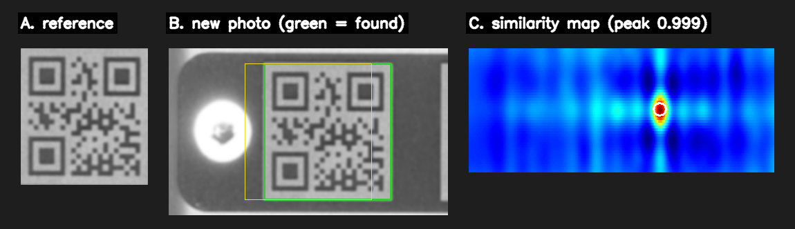
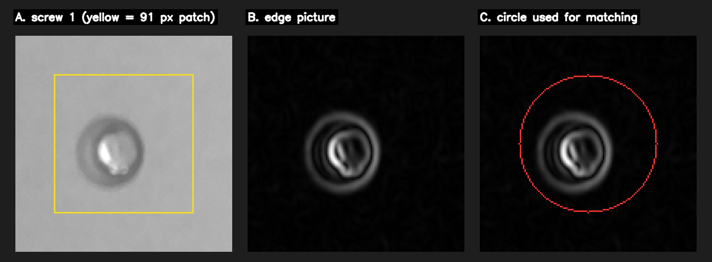

# 4. 부품별 정밀도 (QR, 나사, 바)

최종 값(Y, T)은 QR 과 나사를 얼마나 정밀하게 재느냐에 달려 있다. 그래서 부품마다 따로 "얼마나 잘 찾고, 얼마나 정밀한가"를 정리했다.

여기 숫자는 개발하면서 잰 것을 모은 것이다. **부품마다 같은 방법으로 한 번에 재는 도구는 아직 만들지 않았다.** 그래서 재지 않은 칸이 있고, 그 칸은 "재지 않았다"고 적었다.

---

## 1. 무엇을 재나

| 지표 | 뜻 | 왜 보나 |
|---|---|---|
| 찾는 비율 | 사진에서 그 부품을 찾은 비율 | 못 찾으면 값이 없다 |
| 위치 흔들림 | 같은 조건에서 잰 값이 흔들리는 정도 (px) | 이 흔들림이 그대로 Y, T 의 흔들림이 된다 |
| 소수 위치 치우침 | 실제 위치의 소수 부분에 따라 값이 한쪽으로 쏠리는 정도 (px) | 평균을 내도 없어지지 않는 오차다 |
| 감도 | 판이 1 mm, 1도 움직일 때 몇 px 움직이나 | Y 는 QR 과 나사의 감도 차이로 잰다 |
| 상황이 나빠질 때 | 흐림, 밝기, 노이즈, 가림에서 어떻게 되나 | 현장에서 버티는지 |

Y 1 mm 는 QR 과 나사의 차이로 약 3 px 다. 그래서 **부품 위치가 0.02 px 흔들리면 Y 가 약 0.006 mm 흔들린다.** 허용오차가 0.045 mm 이므로 부품은 0.1 px 보다 훨씬 정밀해야 한다.

---

## 2. QR

기준 조각, 찾은 위치, 닮은 정도 순서.

방법: 흐리게 한 뒤(σ 2 px) 조각을 맞추고 포물선으로 소수 px ([구현 방법 step 1](../구현_방법/step1_QR.md))

| 지표 | 결과 | 조건 |
|---|---|---|
| 찾는 비율 | 100% (못 찾은 사진 0장) | 받은 사진 715장 |
| 좁은 창에서 끝난 비율 | 100% | 받은 사진 702장 |
| 위치 흔들림 | 재지 않았다 (같은 자세를 여러 번 찍은 사진으로 따로 재지 않음) | |
| 소수 위치 치우침 | 0.003 px (흐리기 전에는 0.061 px) | 점 536개를 추적한 결과와 비교, 받은 사진 702장 |
| 감도 | Y 1 mm 에 약 14 px, T 1도에 약 80 px | |
| 밝기 ×0.6, 밝기 ±40 | 영향 작음 | 합성 |
| 흐림 σ 1 px | 영향 작음 | 합성 |
| 흐림 σ 2 px | 702장 중 212장 못 잼, 27장 틀림 (영점을 잡으면 0장) | 합성 |
| 거친 노이즈 | 약 1% 가 허용오차 밖 | 합성 |
| QR 1/4 가림 | 영향 작음 | 합성 |
| QR 절반 넘게 가림 | 옆 QR 자리에 잘못 맞을 수 있음 (경고는 남) | 합성 |

**방법끼리 비교** (11월, 받은 사진 702장)

| 방법 | 허용오차 밖 (560장, 10번 평균) | 소수 위치 치우침 | 시간 |
|---|---|---|---|
| 점 536개 추적 | 0.1장 | (비교 기준) | 약 23 ms |
| 조각 맞춤 + 포물선 | 2.6장 | 0.061 px | 약 5 ms |
| 조각 맞춤 + 가우스 곡선 | 1.9장 | 0.042 px | |
| 조각 맞춤 + 5점 2차식 | 16.8장 | 0.131 px | |
| 흐림 σ 1 + 포물선 | 0.1장 | 0.015 px | 약 5 ms |
| **흐림 σ 2 + 포물선 (지금)** | 0.2장 | 0.003 px | 약 5 ms |

---

## 3. 나사

사진 조각, 테두리, 비교 영역 순서.

방법: 조각으로 대략 찾기 → 밝기로 다듬기 → 테두리 그림으로 정밀 맞춤 ([구현 방법 step 2](../구현_방법/step2_나사.md))

| 지표 | 결과 | 조건 |
|---|---|---|
| 찾는 비율 | 100% (못 찾은 사진 0장) | 받은 사진 715장 |
| 위치 흔들림 | 0.012 px (밝기 조각으로 맞추면 0.019 px) | 받은 사진 702장, 나사끼리 비교 |
| 소수 위치 치우침 | 재지 않았다 | |
| 감도 | Y 1 mm 에 약 11 px, T 1도에 약 81 px | |
| 밝기 ×0.6, 밝기 ±40 | 영향 작음 | 합성 |
| 나사 하나를 통째로 가림 | 그 나사를 빼고 계산. Y 0.007 mm 차이 | 합성 |
| 나사에 반사광 | 그 나사를 빼고 계산. Y 0.001 mm 차이 | 합성 |
| **나사 하나를 반쯤 가림** | 416장은 그 나사를 뺌. **641장은 틀린 값** (Y 가 2.5 mm 까지). 값 일치 점검이 500장에서 경고하고, Y 0.1 mm 넘게 틀린 경우는 모두 경고 | 우리 시험 장비 사진, 합성 |
| 흐림 σ 2 px 이상 | 나사를 놓쳐 QR 만으로 대략값 | 합성 |

**방법끼리 비교** (11월, 받은 사진 702장)

| 방법 | 위치 흔들림 | 허용오차 밖 (10번 평균) |
|---|---|---|
| 밝기 조각 맞춤 | 0.019 px | 2.3장 |
| **테두리 그림 맞춤 (지금)** | 0.012 px | 0장 |
| 위상 상관 (밝기) | 0.065 px 이상 | 12.2장 |
| 위상 상관 (테두리) | | 28.8장 |
| OpenCV 의 ECC 함수 그대로 | | 0.50장 (직접 계산하면 0.10장) |

**나사 조합** (11월, 받은 사진 702장)

| 쓰는 나사 | 허용오차 밖 (560장, 10번 평균) |
|---|---|
| 4개 | 0.2장 |
| 3개 | 1.1 ~ 2.0장 |
| 한쪽 2개 | 127.9 ~ 136.1장 |
| 1개 | 145 ~ 170장 |

---

## 4. 바 (가로 막대)

지금 계산에는 쓰지 않는다. 넣어도 정확도가 같았기 때문이다 ([구현 방법 step 3](../구현_방법/step3_YT계산.md) 2-2). 시험한 결과만 적는다.

방법: 바를 64 px 칸으로 나눠 밝기 단면을 맞추고, 칸들의 위치로 기울기를 구함

| 지표 | 결과 | 조건 |
|---|---|---|
| 찾는 비율 | 100% (48칸 모두) | 받은 사진 575장 |
| 찾는 비율 | 1장 실패 | 우리 시험 장비 사진, 첫째 날 |
| 찾는 비율 | **1698장 모두 실패** (바가 탐색 범위 ±11.5 px 를 벗어남) | 우리 시험 장비 사진, 둘째 날 |
| 칸 하나의 오차: 노이즈 | 0.31 ~ 0.70 px | 합성 |
| 칸 하나의 오차: 한쪽만 밝음 | 0.57 px | 합성 |
| 바의 세로 위치 | 변화의 85 ~ 90% 가 촬영한 날의 차이 | 받은 사진 702장 |
| 바의 기울기 | 날의 차이가 거의 없음 | 같음 |

**바를 넣었을 때** (11월, 받은 사진 702장)

| 구성 | 허용오차 밖 | 처음 보는 날 |
|---|---|---|
| QR + 나사 + 바 기울기 | 0.1장 | 98.8% |
| QR + 나사 (지금) | 0.0 ~ 0.2장 | 98.2% |

---

## 5. 한계

- 부품마다 같은 방법으로 한 번에 재는 도구가 없다. 위 숫자는 서로 다른 때, 서로 다른 구성에서 잰 것이다.
- 재지 않은 것: QR 과 나사의 "같은 자세를 여러 번 찍었을 때의 흔들림", 나사의 소수 위치 치우침, 기준 사진을 정해진 만큼 옮긴 합성 사진에서의 치우침 곡선.
- 반쯤 가려진 나사가 왜 "찾았다"는 기준을 통과하는지는 분석하지 않았다.
- 가림, 흐림, 노이즈는 사진을 일부러 바꾼 것이다. 실제 현장과는 다를 수 있다.
