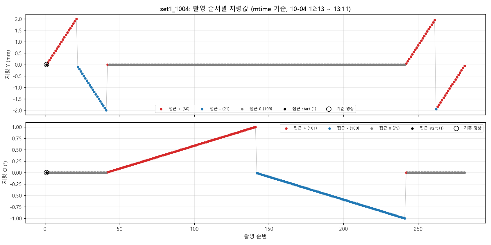
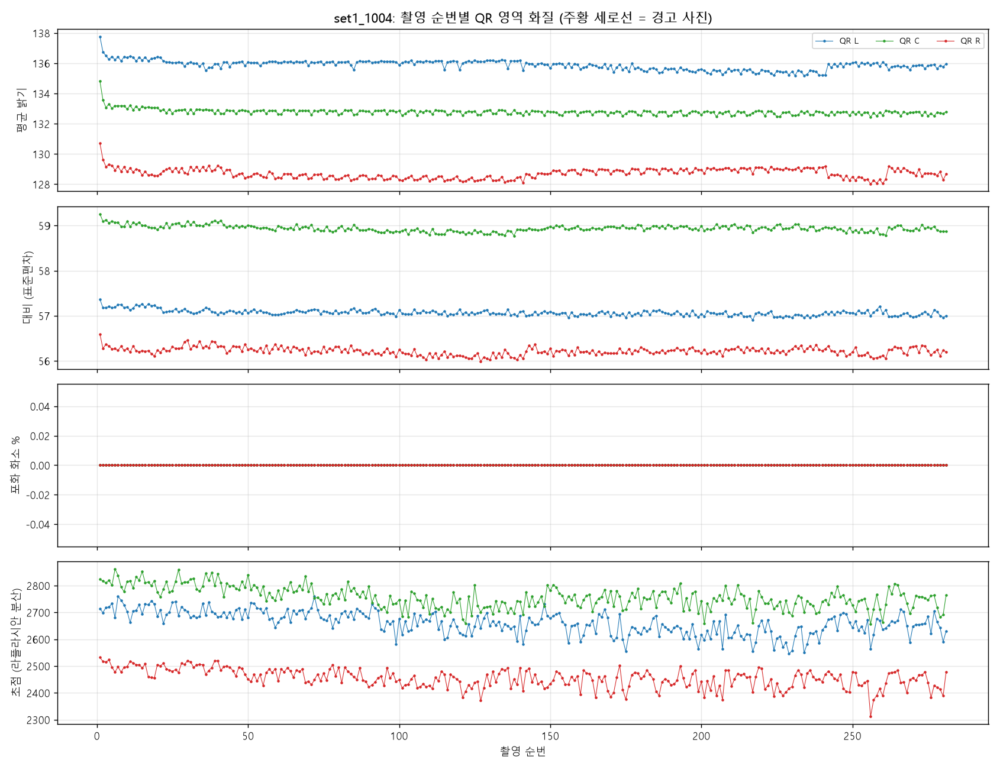
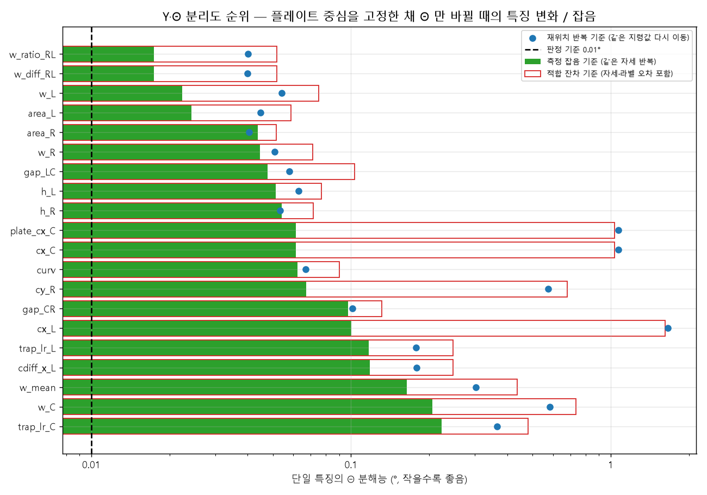
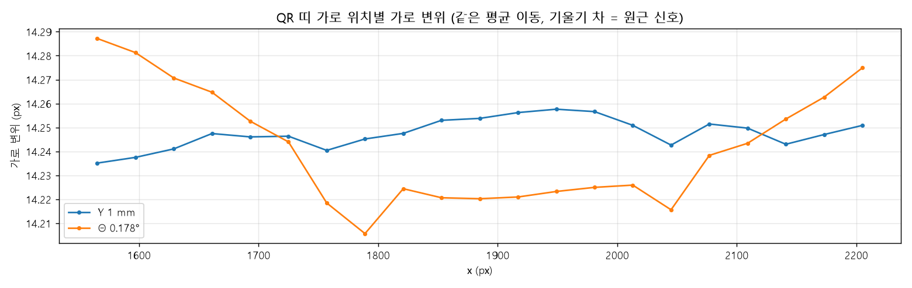
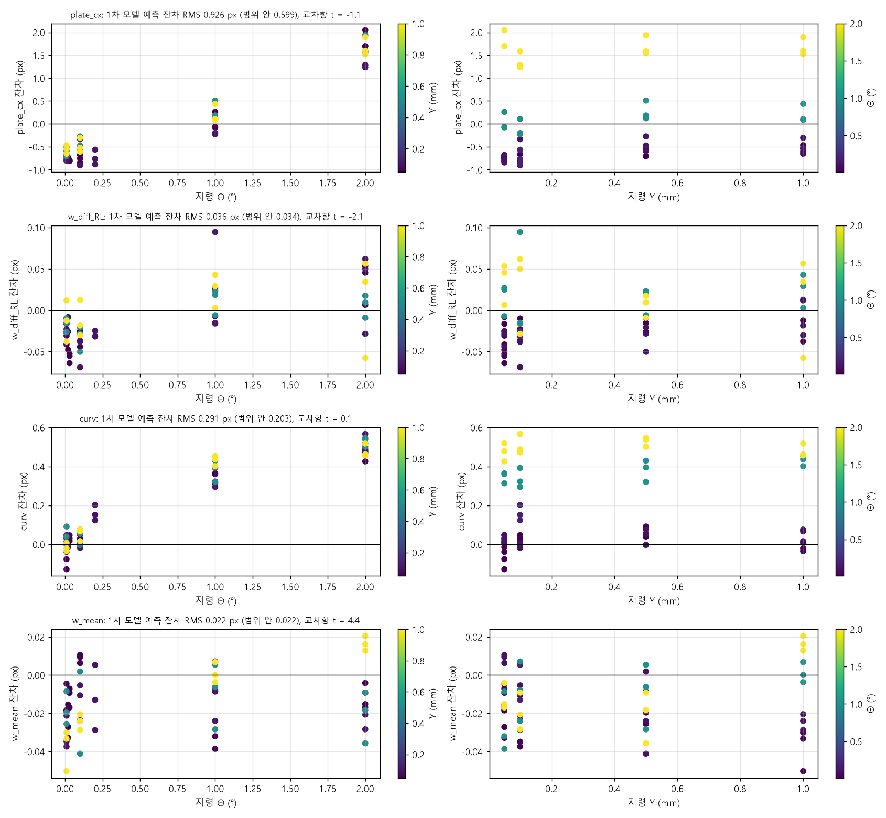
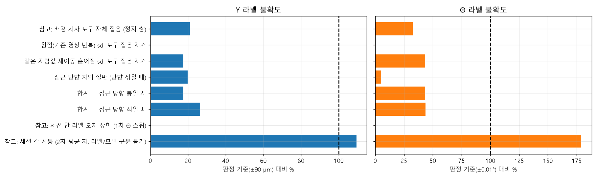

# QR Y·Θ 분리 — 1·2차 데이터 EDA 보고서

- 작성일: 2026-10-26 (같은 날 개정 — 아래 "개정 내용")
- 계획: [`EDA_PLAN.md`](EDA_PLAN.md) Stage 0~5
- 툴: [`eda_tool/`](eda_tool/README.md) (Python, `qr_eda.py --all` 한 줄로 재현)
- 데이터: `data/img/1st` (1차, 281장), `data/img/2nd` (2차, 60장)
- 판정 기준: 사진마다 **Θ ±0.01°, Y ±90 µm**
- 그림 위주 요약본: `eda_results/EDA_보고서.pdf`, 누적 표: `eda_results/summary_all_sets.csv`

### 개정 내용 (2026-10-26, 사용자 확인 사실 반영)

| 확인된 사실 | 보고서에 반영한 내용 |
|---|---|
| 카메라는 로봇암 위, 알고리즘은 **Y·Θ 만** 맞추면 됨 (Z·X 는 이후 QR 기반 자동) | 평가 대상을 Y·Θ 로 한정 |
| **최대 20회 점진 보정** 허용 | 결론을 "한 번에 절대값 맞추기" → "목표 근처에서 정밀하게 재기" 로 바꿈 (6절) |
| 2차 `.txt` = **모터 인코더 값**, 1차 라벨은 **잘못 준 것으로 추정** | 정답 기준을 2차 인코더 값으로 바꿈. 인코더 값이 0.01 단위로 반올림된 것을 새로 확인 (1.1절) |
| 1·2차 사이 **장비 조정 없음** | "회전축·카메라 설치가 바뀌었을 가능성" 해석 **철회**, 세트 간 감도 차이를 같은 선형 모델로 다시 비교 (4.2절) |
| **장비 자체 오차는 고려 안 함**, 촬영은 이동→정지→촬영 | 재위치 흩어짐·백래시를 평가 대상에서 제외 (5절) |
| **제원**: 플레이트 66×15 mm, QR 13×13 mm, 간격 5 mm, 카메라–플레이트 385 mm | 제원과 측정값 대조 절 추가 (3.6절) |

---

## 0. 한눈에 보기

| 단계 | 핵심 결론 |
|---|---|
| Stage 0 데이터 | 341장 모두 해석, 중복·누락 0. **촬영 시각 = 파일 수정일시**. 1차 Y 스윕은 **두 번에 나눠 촬영**(0.1 mm 배수 → 50분 뒤 나머지). 2차 인코더 값은 **0.01 단위로 반올림**되어 있고 같은 자세 3장이 같은 값 |
| Stage 1 화질 | 재촬영이 필요한 사진 **없음**. 정지 상태 연속 촬영 잡음 σ ≈ 0.70 (밝기 단위). 1·2차 화질 차이는 작음 |
| Stage 2 Y vs Θ | **가장 좋은 단서는 좌·우 QR 가로 폭 차(R−L)**: Θ 1° 당 +0.659 px, Y 1 mm 당 −0.026 px. 핀홀 모델 예측(0.615 px/°)과 7 % 차이로 **원근 효과임이 제원으로 확인**됨. 정지 상태 측정 잡음 기준 Θ 분해능: 단서 하나 **0.0175°**, 여러 단서 결합 **약 0.009°** |
| Stage 3 2차 세트 | 같은 선형 모델로 비교하면 플레이트 중심의 Θ 감도는 1·2차가 **0.5 %**, 폭 차 감도는 **6 %** 차이. 장비 조정이 없었으므로 기하 변화 해석은 철회 — 원인은 1차 라벨 오류 또는 2차 세트 설계(Θ ≥ 0, 57장)로 인한 적합 불안정으로 추정 |
| Stage 4 라벨 | 2차 인코더 값을 정답으로 쓰되 **반올림 ±0.005° (σ 약 0.003°)** 가 판정 기준(0.01°)과 같은 크기. 재위치·백래시는 장비 오차라 평가 대상에서 제외 |
| Stage 5 툴 | 새 세트 폴더 + `set.yaml` 만 넣고 한 줄 실행 → 표·그림·영상·PDF. 캐시로 새 사진만 계산 |

**종합 (개정)**

- QR 만으로 Y·Θ 를 가르는 단서(좌·우 폭 차, U 자 변위장)는 **물리적으로 확인**되었습니다. 제원으로 계산한 원근 효과와 실측이 7 % 안에서 맞습니다.
- 장비 오차를 고려하지 않고 **20회 점진 보정**을 허용하면, 최종 정확도를 정하는 것은 **목표 근처에서의 측정 반복성**입니다. 멈춘 상태 측정 잡음만 보면 단서를 합쳐 Θ 약 0.009°(한 장, 낙관 추정)로 **0.01° 에 근접**하고, 한 번 멈출 때 여러 장을 평균하면 더 줄어들 것으로 예상합니다 (미검증).
- 반면 **정답(인코더 값)이 0.01 단위로 반올림**되어 있어, 지금 데이터로는 0.01° 달성 여부를 **검증할 수 없습니다**. 더 촘촘한 인코더 기록이나 목표 영상 기준의 수렴 평가가 필요합니다.

---

## 1. 데이터 (Stage 0)

### 1.1 구성

| 세트 | 촬영 | 장수 | 지령값 | 기준 영상 |
|---|---|---|---|---|
| set1_1004 | 10/04 12:13 ~ 13:11 (58분, 중앙 간격 4초) | 281 | Y −2.00 ~ +2.00 mm (0.05 간격, 80장) 또는 Θ −1.00 ~ +1.00° (0.01 간격, 200장), 한 축씩 | center.bmp 1장 |
| set2_1015 | 10/15 19:33 ~ 22:21 (168분, 중앙 간격 34초) | 60 | Y {0.05, 0.10, 0.50, 1.00} × Θ {0.01 ~ 2.00} 동시 이동 19조합 × 3장 | center1~3 (19:33, 19:43, **21:54**) |

- 해상도 3840 × 2160, 24-bit RGB BMP (세 채널 동일한 회색), EXIF 없음. 해시 중복 0.
- **1차 세트 라벨**: `.txt` 가 없어 파일 이름의 지령값만 있습니다. 사용자 확인에 따르면 1차 라벨은 **인코더 값을 잘못 준 것으로 추정**되므로, 1차 세트는 감도 학습에는 쓰되 **정확도 평가의 정답으로는 쓰지 않습니다**.
- **2차 세트 라벨**: `.txt` 는 **모터 인코더 값**(절대 좌표 `Y_Actual`, `T_Actual`)입니다. 기준 위치 좌표(Y −1.300 mm, Θ −1.670°)를 빼면 폴더 이름의 지령값과 57장 모두 정확히 일치합니다.
  - 인코더 값은 **모두 0.01 단위**입니다 (Y 0.01 mm = 10 µm, Θ 0.01°). 실제 위치가 반올림 구간 안 어디든 같은 값이 나오므로 **±0.005° (균등 분포 σ 약 0.003°), Y ±5 µm** 의 불확도를 가집니다.
  - 같은 지령값 3장은 txt 값이 모두 같습니다. 영상으로는 2번째 장이 조금 다른 자세로 찍힌 경우가 많아(Stage 1·4), 그 차이는 인코더 기록에 나타나지 않습니다.
- 파일 이름 규칙은 `eda_results/set_yaml_draft/1st.yaml`, `2nd.yaml` 에 기록했습니다.

### 1.2 촬영 시각과 순서

- **생성일시**: 모든 파일이 10/20 14:01 같은 초 → 복사 시각이라 사용 불가.
- **수정일시**: 파일마다 다르고 간격이 규칙적 → 촬영 시각으로 채택.
- 촬영은 **이동 → 정지 → 촬영** 을 반복했습니다 (사용자 확인).

**1차 세트 촬영 순서**
1. center → Y +0.1 ~ +2.0 (0.1 mm 배수) → Y −0.1 ~ −2.0
2. Θ +0.01 ~ +1.00 → Θ −0.01 ~ −1.00
3. 약 50분 뒤 Y +0.05 ~ +1.95 (나머지 값) → Y −1.95 ~ −0.05

기존 실험들의 "값 순서로 짝수 번째 = 학습, 홀수 번째 = 검증" 분할은 Y 스윕에서 **첫 묶음 = 학습, 두 번째 묶음 = 검증**과 같습니다 (시간이 50분 떨어진 검증).

영상: `eda_results/videos/set1_1004_shooting.mp4`, `set2_1015_shooting.mp4` (+ GIF, `_realtime.mp4`)

---

## 2. 화질과 환경 (Stage 1)

| 항목 | 1차 | 2차 |
|---|---|---|
| 영상 평균 밝기 (중앙값) | 171.6 | 170.4 |
| QR L / C / R 평균 밝기 | 136.0 / 132.8 / 128.7 | 134.9 / 131.8 / 127.7 |
| 가운데 QR 초점 (라플라시안 분산) | 2757 | 2585 (−6 %) |
| QR 영역 포화 화소 | 0 % | 0 % |
| 화질 경고 사진 | 0 | 0 |

- **재촬영 필요 사진 없음**. 경고 기준은 세트 내 중앙값 ± 3 MAD **와** 실무 최소 편차(밝기·대비 2 %, 초점·잡음 10 %)를 함께 넘는 경우입니다.
- **밝기 추이**: Θ 스윕 동안 왼쪽 QR 은 어두워지고 오른쪽 QR 은 밝아집니다 (조명 각도). 밝기는 Θ 에 따라 바뀌므로 **단서로 쓰면 안 되고**, 측정은 밝기 변화에 둔감해야 합니다.
- **촬영 잡음**: 장비가 움직이지 않은 연속 촬영 쌍의 차영상으로 구한 평탄 영역 잡음 σ ≈ **0.70**, QR 띠 σ ≈ 1.43 (밝기 단위).
- **반사**: QR 옆 나사 머리가 사진의 40~50 % 에서 포화됩니다. QR 안은 포화 없음. 이 반사 때문에 Y ≤ −1.15 mm 에서 기존 검출(닫기 9×9)이 왼쪽 QR 을 놓쳤고, 닫기 5×5 로 341장 모두 검출했습니다.

---

## 3. Y 이동 vs Θ 회전 (Stage 2, 1차 세트)

### 3.1 측정

- QR 3개의 밝은 사각형 변을 가로지르는 밝기 단면 120개에서 서브픽셀 경계를 찾고, 변마다 직선을 맞춘 뒤 교점으로 꼭짓점 12개를 구했습니다 (341장 모두 성공).
- **꼭짓점 정밀도**: 장비가 움직이지 않은 연속 촬영에서 꼭짓점 차이 std ≈ 0.04 px → 한 꼭짓점 σ ≈ **0.03 px (약 2 µm)**.
- Center 정의 (C-1, `center/center_definition.json`): QR 중심 = 대각선 교점, 플레이트 중심 = QR 3개 중심 평균. 정의를 바꿔도 Θ 스윕 잔차(약 0.17 px)는 같아 **잔차는 정의가 아니라 자세(라벨)에서 옴**.

### 3.2 감도 (1차 세트)

| | 값 |
|---|---|
| 플레이트 중심 x 감도 | Y **14.25 px/mm**, Θ **80.06 px/°** (R² 0.9999) |
| 같은 화면 이동 | Y 1 mm ↔ Θ **0.178°** |

1차 라벨이 잘못되었을 수 있으므로 이 감도는 **2차 세트(인코더 값)로 다시 확인한 값**과 함께 봐야 합니다 (4.2절: Θ 감도 80.43 px/°, 0.5 % 차이).

### 3.3 Y·Θ 를 가르는 단서 (분리도 순위, `tables/separability.csv`)

플레이트 중심을 고정한 채 Θ 만 바뀔 때 특징이 얼마나 변하는지(신호)와 잡음을 비교했습니다.

| 순위 | 특징 | Θ 1° 당 | Y 1 mm 당 | Θ 0.01° 신호 | Θ 분해능: 측정 잡음 | (참고) 재위치 | (참고) 적합 잔차 |
|---|---|---|---|---|---|---|---|
| 1 | 가로 폭 비 R/L | +0.0035 | −0.0001 | — | 0.0174° | 0.0402° | 0.0518° |
| 2 | **가로 폭 차 R−L** | **+0.659 px** | −0.026 px | 0.0080 px | **0.0175°** | 0.0400° | 0.0518° |
| 3 | 왼쪽 QR 폭 | −0.334 px | +0.019 px | 0.0044 px | 0.0224° | 0.0540° | 0.0752° |
| 4 | 왼쪽 QR 면적 | −97.8 px² | +5.3 px² | 1.27 px² | 0.0243° | 0.0449° | 0.0586° |
| 6 | 오른쪽 QR 폭 | +0.325 px | −0.007 px | 0.0036 px | 0.0446° | 0.0509° | 0.0711° |

- **측정 잡음** = 장비가 움직이지 않은 연속 촬영 6쌍. 장비 오차를 고려하지 않으므로 **이 열이 평가 기준**입니다.
- (참고) **재위치** = 같은 지령값을 다시 이동해 찍은 38쌍 — 장비 재위치 흩어짐이 섞인 값. (참고) **적합 잔차** = 스윕을 2차식으로 맞춘 잔차 — 1차 라벨 오차가 섞인 값.
- 왼쪽 QR 은 Θ 에 따라 좁아지고 오른쪽 QR 은 넓어집니다. 1차 Gabor 실험의 배율(QR 폭 환산 −0.34, +0.31 px/°)과 **독립된 방법으로 일치**합니다.
- **여러 단서 결합** (대각 잡음 가정, 낙관적): Θ σ **0.0094°**, 이때 Y σ 약 53 µm (측정 잡음 기준).

### 3.4 변위장 — Θ 는 U 자, Y 는 평평

QR 띠를 64 px 패치로 나눠 기준 영상 대비 이동을 구하고 지령값에 대해 회귀했습니다. 같은 평균 이동(Y 1 mm ↔ Θ 0.178°)에서

- **Θ**: 가로 위치에 따라 이동이 **U 자**로 달라집니다 (가장자리가 가운데보다 약 0.06 px 더 이동) — 팬 회전의 원근 효과.
- **Y**: 거의 평평합니다 (약 0.02 px 이내).
- 0.01° 로 환산하면 이 차이는 **약 0.003 px** 입니다. U 자의 기울기가 왼쪽 QR 축소·오른쪽 QR 확대(폭 차 단서)로 나타납니다.

- 위상 상관(OpenCV) 서브픽셀 값에 치우침이 있어(0.30 px → 0.254 px) 변위장은 정성 비교용입니다.

### 3.5 선형성

- 플레이트 중심: Y·Θ 모두 R² > 0.9998. Θ 스윕 잔차는 이웃 사진끼리 상관 0.94 (매끄러운 계통 곡선 — 1차 라벨 오차일 수 있음), Y 스윕 잔차는 두 촬영 묶음 간 차이 약 0.19 px ≈ 13 µm.
- 폭 차 R−L 은 Θ 에 대해 R² 0.989, Y 에는 R² 0.33 (거의 반응 없음).

### 3.6 제원과 측정값 대조 (개정 추가)

| 항목 | 제원 | 측정 (1차 center.bmp) | 판정 |
|---|---|---|---|
| QR 중심 간격 | 18 mm | 258.1 px → 14.34 px/mm | 일치 |
| QR 가로 | 13 mm | 187.4 px → 14.41 px/mm | 일치 (0.5 %) |
| Y 1 mm 당 화면 이동 | — | 14.25 px/mm | 위 두 값과 1 % 이내 |
| QR 세로 | 13 mm | 199.5 px → 약 13.9 mm | **7 % 큼** |
| 초점거리 | — | 14.25 px/mm × 385 mm ≈ **5486 px** | — |

- **원근 단서의 물리 검증**: 초점거리 5486 px 와 QR 위치로 핀홀 모델을 계산하면, 카메라가 Θ 1° 돌 때 좌·우 QR 폭 비 변화는 **0.00328**, 폭 차는 **0.615 px** 입니다. 실측은 0.00353 (1차), 0.659 px (1차) / 0.698 px (2차, 같은 선형 모델) 로 **7~14 % 안에서 맞습니다**. 폭 차 단서는 측정 잡음이 아니라 실제 원근 효과입니다.
- **QR 세로 7 % 차이**: 현재 꼭짓점은 어두운 플레이트 위 **밝은 사각형 경계**입니다. 가로는 제원과 맞고 세로만 크므로, 밝은 영역이 QR 코드보다 위아래로 넓을 가능성이 있습니다 (확인 필요). QR 위치 검출 패턴 기준 꼭짓점으로 바꾸면 제원과 정확히 맞출 수 있습니다.
- **Θ 회전축**: 카메라가 제자리에서 돌면 Θ 1° 당 5486 × tan1° ≈ 95.8 px 이동해야 하지만 실측은 80.1 px (0.836배)입니다. 회전하면서 카메라 위치도 옆으로 움직인다는 뜻이며, 단순 모델로는 회전축이 카메라에서 플레이트 쪽 약 63 mm 에 있는 셈입니다 (추정, 실제 Θ 축 위치로 확인 필요).

영상: `videos/set1_1004_sync_Y.mp4`, `set1_1004_sync_T.mp4` (꼭짓점·중심 겹침 + 특징 그래프 동기화)

---

## 4. 2차 세트 — 혼합 이동 (Stage 3)

### 4.1 1차 범위 밖

2차 57장 중 **Θ = 2.00° 12장(21 %)** 이 1차 학습 범위(±1°) 밖입니다. Y 는 모두 범위 안 (0.05 ~ 1.00 mm).

### 4.2 1·2차 감도 비교 (개정)

1·2차 사이 장비 조정이 없었으므로, 처음 보고서의 "회전축·카메라 설치가 바뀌었을 가능성" 해석은 **철회**합니다. 같은 선형 모델(`f = c + aY·Y + aT·Θ`)로 두 세트를 다시 비교했습니다.

| 특징 | 1차 Θ 감도 (파일 이름 라벨) | 2차 Θ 감도 (인코더 라벨) | 차이 |
|---|---|---|---|
| 플레이트 중심 x | 80.06 px/° | 80.43 px/° | **+0.5 %** |
| 폭 차 R−L | 0.659 px/° | 0.698 px/° | **+6 %** |
| (참고) 핀홀 모델 예측 폭 차 | 0.615 px/° | — | — |

- 플레이트 중심 감도는 0.5 % 만 다르므로, 1차 Θ 라벨이 **전체적으로 배율이 틀린 것은 아닙니다**.
- 폭 차 감도의 6 % 차이 원인은 확정하지 못했습니다. 후보는 (a) 1차 라벨의 국소 오차, (b) 2차 세트가 Θ ≥ 0, Y 0.05~1 mm, 57장뿐이라 생기는 적합 불안정, (c) Y·Θ 교차 효과입니다.
- 처음 보고서의 "폭 차 +12 %, 곡률 3배, 사다리꼴 부호 반전" 은 2차 세트에 **Θ² 항을 함께 맞춘** 결과입니다. Θ 가 0 이상만 있어 Θ 와 Θ² 계수가 서로 섞이므로 **불안정한 값**으로 보고, 근거로 쓰지 않습니다. 곡률·사다리꼴은 같은 선형 모델로 다시 비교해야 합니다 (미완료).
- **Θ² 외삽 금지**: 플레이트 중심 x 를 1차 Θ² 항(−0.39 px/deg²)으로 Θ 2° 까지 외삽하면 +1.6 px 어긋납니다.

### 4.3 세트별 원점 (C-2, `center/center_by_set.csv`)

| | 1차 center | 2차 center1~3 평균 | 차이 |
|---|---|---|---|
| 플레이트 중심 x | 1901.30 px | 1901.08 px | −0.22 px (Y 환산 −15 µm 또는 Θ 환산 −0.003°) |
| 플레이트 중심 y | 1068.39 px | 1068.85 px | +0.46 px |
| QR 폭 평균 (배율) | 187.367 px | 187.416 px | +263 ppm |
| 영상 밝기 | 173.7 | 170.7 | −3.0 |

- center1~3 반복: 플레이트 중심 x sd 0.041 px (Y 2.9 µm / Θ 0.0005°).
- 2차 세션 동안 QR 폭이 촬영 순서대로 커집니다 (+160 → +287 → +342 ppm, 1차 대비). 폭 차 R−L 은 그대로 (0.96 px).
- **점진 보정 관점**: 보정 목표를 **같은 세션에서 찍은 목표(center) 영상**으로 잡으면, 날짜 간 원점·배율 차이는 비교 과정에서 상쇄됩니다.

영상: `videos/set2_1015_sync.mp4`

---

## 5. 라벨(정답) 신뢰도 (Stage 4, 개정)

### 5.1 정답으로 쓸 수 있는 것

| 세트 | 라벨 | 정답으로 사용 | 불확도 |
|---|---|---|---|
| 1차 | 파일 이름 지령값 | **평가에는 사용하지 않음** (인코더 값을 잘못 준 것으로 추정) | — |
| 2차 | 모터 인코더 값 (txt) | **사용** | 0.01 단위 반올림: Θ ±0.005° (σ 약 0.003°), Y ±5 µm |

인코더 반올림 불확도(Θ 약 0.003°)는 판정 기준 0.01° 의 약 30 % 입니다. 이 정답으로는 "0.01° 안에 들어왔다" 를 판정할 수 있지만, 0.01° 근처의 미세한 성능 차이는 가를 수 없습니다.

### 5.2 장비 오차 (평가 대상에서 제외, 참고 기록)

배경 시차 추정(`Hypothesis_2/Center_check`, 벽 나사 깊이 차로 Y·Θ 분리)으로 확인한 장비 쪽 흩어짐입니다. 사용자 확인에 따라 **장비 오차는 고려하지 않으므로** 판정에 넣지 않습니다.

| 성분 | Y | Θ |
|---|---|---|
| 배경 시차 도구 자체 잡음 (정지 쌍) | 18.9 µm | 0.0033° |
| 같은 지령값 재이동 흩어짐 (도구 잡음 제거) | 15.8 µm | 0.0043° |
| 접근 방향 차 (Y 스윕 이중차분) | −35 ± 23 µm (유의 수준 미달) | 0.001 ± 0.004° |

- 2차 세트에서 2번째 장이 Θ +0.0025° 쪽으로 치우친 것(Stage 1 의 "2번째 장 약 +0.3 px 이동")은 인코더 반올림(0.01°) 안의 움직임이라 txt 에 나타나지 않습니다.
- 처음 보고서의 "라벨 불확도 Θ 0.0043° (기준의 43 %)" 는 이 장비 재위치 흩어짐이므로 **철회**합니다.
- 2차 세트의 배경 시차 대비 평균 차(Y +98 µm, Θ −0.018°)는 배경 시차 모델이 1차 라벨로 학습된 탓일 가능성이 큽니다 (추정).

---

## 6. 결론과 권고 (개정)

### 6.1 결론

1. **단서는 물리적으로 확인되었다.** Θ 는 원근 때문에 좌·우 QR 의 가로 폭을 반대로 바꾸고(R−L 폭 차, 1차 0.659 / 2차 0.698 px/°), Y 는 거의 바꾸지 않습니다. 제원으로 계산한 핀홀 모델 예측(0.615 px/°)과 7~14 % 안에서 맞습니다.
2. **점진 보정에서는 목표 근처의 측정 반복성이 핵심이다.** 20회 반복을 허용하므로 감도 오차(수 %)는 수렴 속도만 늦춥니다. 목표 영상과 같은 세션에서 비교하면 날짜 간 원점 차이도 상쇄됩니다. 멈춘 상태 측정 잡음 기준으로 단서 하나 0.0175°, 여러 단서 약 0.009° 입니다 (한 장, 낙관 추정). 이때 Y 는 약 53 µm 로 기준(±90 µm) 안입니다.
3. **정답의 해상도가 기준과 같다.** 2차 인코더 값은 0.01 단위라 ±0.005° 반올림이 있습니다. 1차 라벨은 평가에 쓸 수 없습니다.

### 6.2 권고 (우선순위)

1. **점진 보정 시뮬레이션** (새 데이터 없이 가능): 2차 세트 인코더 값을 정답으로 "측정 → 보정" 을 20회 반복해, 수렴 비율·필요 횟수·한 자세에서 평균할 장수를 구합니다.
2. **제원 기반 물리 모델**: QR 크기·간격·카메라 거리(385 mm)로 Y·Θ 를 직접 계산하는 모델을 만들어, 1차 라벨 없이 쓸 수 있는지 확인합니다. 꼭짓점은 QR 위치 검출 패턴 기준으로 바꿔 세로 7 % 차이를 없앱니다.
3. **추가 데이터 요청**: (a) 목표 근처(Y ±0.1 mm, Θ ±0.05° 정도) 사진, (b) 같은 자세에서 멈춘 채 연속 여러 장 — 측정 반복성과 다장 평균 효과를 직접 확인, (c) 가능하면 인코더 값을 0.001 단위로 기록.
4. **Θ 회전축 위치 확인**: 로봇 Θ 축이 카메라에서 어디에 있는지 알면 물리 모델이 정확해집니다 (현재 추정 약 63 mm).

---

## 7. 한계

- 측정 잡음(정지 쌍) 추정은 **6쌍**으로 했습니다. 순위는 바뀌지 않지만 값의 불확도는 큽니다.
- 다장 평균으로 잡음이 √N 배 줄어드는지는 확인하지 않았습니다 (정지 상태 연속 촬영이 3장 이하).
- 2차 세트는 Y 0.05 ~ 1.00 mm, Θ 0 이상만 있어 교차항·음수 쪽은 확인하지 못했습니다. 곡률·사다리꼴 단서의 1·2차 비교는 같은 선형 모델로 다시 해야 합니다.
- 결합 분해능은 특징 간 상관을 무시한 낙관 값입니다.
- 변위장은 OpenCV 위상 상관의 서브픽셀 치우침 때문에 정성 비교입니다.
- 툴이 자동으로 만드는 표·그림(`eda_results/`)은 처음 분석 기준이며, 이 개정에서 다시 계산한 값(4.2절 선형 비교, 1.1절 인코더 해상도, 3.6절 제원 대조)은 이 문서에만 있습니다.

---

## 8. 검증 절차와 수정 이력

각 단계가 끝날 때 결과를 확인한 뒤 다음 단계로 넘어갔습니다.

| 단계 | 확인한 것 | 발견·수정 |
|---|---|---|
| 0 | 341장 해석, 기대 지령값과 누락·초과 0, txt 와 폴더 이름 일치, 시각 통계, 타임라인 그림 | pandas 3 의 datetime 단위 때문에 시각 통계가 틀린 것을 발견 → 초 단위 변환으로 수정 |
| 1 | 341장 화질 값, 경고 목록, 잡음·반사 그림 | QR 검출 11장 실패(나사 반사 붙음) → 닫기 5×5 로 수정. 3 MAD 만으로 과다 경고 → 실무 최소 편차 추가 |
| 2 | 꼭짓점 341/341, 정지 쌍 꼭짓점 정밀도, 감도의 기존 결과 일치, 분리도 표 | numpy 2 의 2차원 cross 미지원 수정. OpenCV 5 위상 상관이 창 함수 인자에서 0 을 돌려주는 문제 → 창 함수 제거. 재위치 잡음(38쌍) 열 추가 |
| 3 | 1차·2차 감도 비교, 원점 표, 범위 밖 비율 | 단계별 실행 시 앞 단계 기록이 지워지는 문제 → 실행 기록 누적 저장 |
| 4 | 라벨 이중차분, 재이동 흩어짐 | −1.95 mm 가 다른 접근 방향으로 섞인 것을 발견 → 의도한 방향만 사용. 배경 시차 도구 자체 잡음을 정지 쌍으로 분리해 차감 |
| 5 | `--all` 재현(약 2분, 수치 동일), 새 세트 시험 | 결과 폴더를 바꾸면 set.yaml 초안을 못 찾는 문제 → 초안 위치 고정. 합성 영상(1 px 이동)의 플레이트 중심 차 0.9999 px 확인 |
| 개정 | 사용자 확인 사실 반영 | 장비 변화 해석 철회, 1·2차 감도를 같은 선형 모델로 재비교(폭 차 12 % → 6 %), 인코더 0.01 단위 반올림 확인, 장비 오차 제외, 제원 대조 추가 |

---

## 9. 산출물

| 위치 | 내용 |
|---|---|
| `eda_results/tables/` | catalog, inventory_summary, quality, noise_repeats, reflection_summary, features, linearity, separability, patch_flow, superposition(+residuals), drift, label_check, label_within_session, label_uncertainty |
| `eda_results/center/` | center_definition.json, center_by_image.csv, center_by_set.csv |
| `eda_results/figures/` | 단계별 그림 29개 |
| `eda_results/videos/` | 촬영 과정(A-1), 화질 경고판, 동기화판(A-2) — GIF·MP4·실시간 비율 MP4 |
| `eda_results/summary_all_sets.csv` | 세트당 1행 누적 요약 |
| `eda_results/EDA_보고서.pdf` | 그림 위주 요약 (첫 장 미리보기 `EDA_보고서_요약.png`, 처음 분석 기준) |
| `eda_results/set_yaml_draft/` | 1·2차 세트 set.yaml 초안 |

재현: `src\KSH\EDA` 에서 `.venv\Scripts\python eda_tool\qr_eda.py --all` (준비는 [`eda_tool/README.md`](eda_tool/README.md)).
