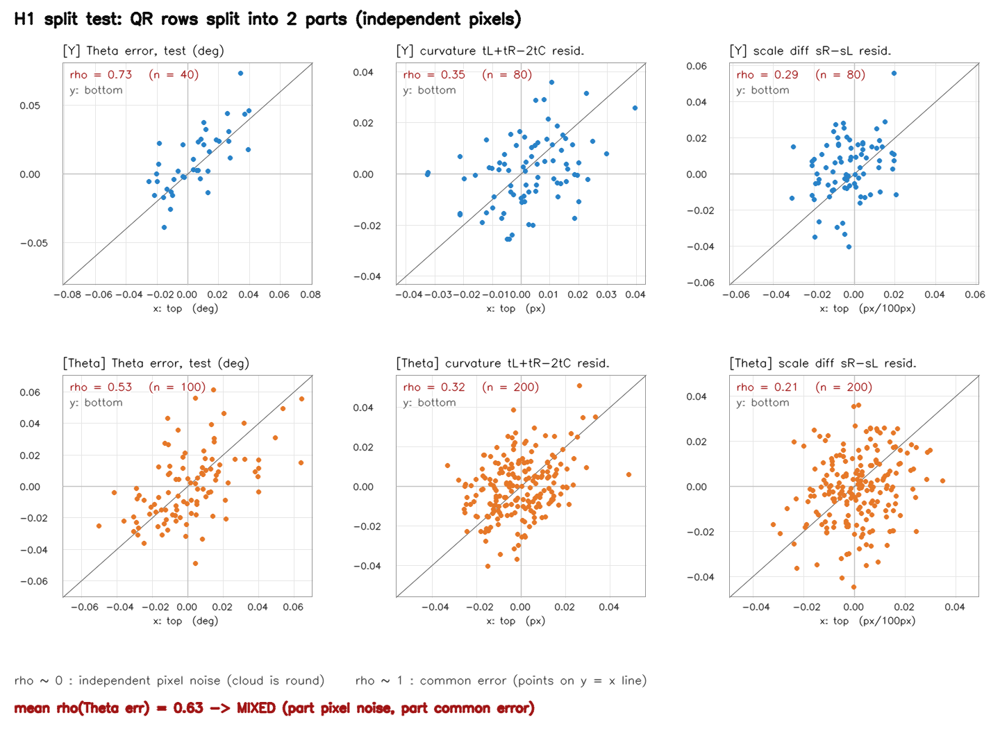
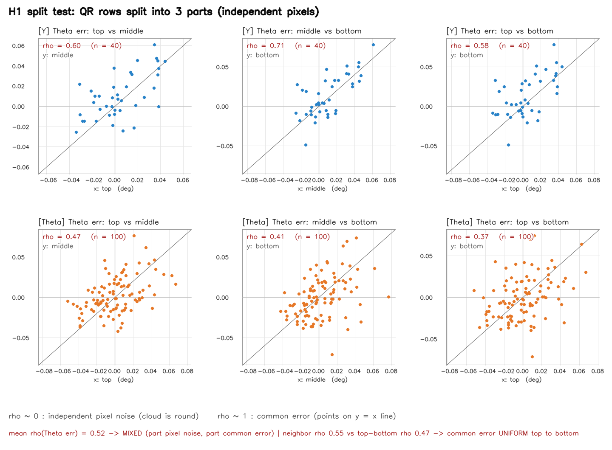

# Gabor 2차 시도 — 공통 Θ 오차 진단 (가설 H1 : QR 행 분할 시험)

- 작성일: 2026-10-20
- 이전 단계
  - [`../Gabor_1st/`](../Gabor_1st/위상기반_YΘ분리_실험결과.md) — 위상(Gabor) 기반 2변수 [Y, Θ] 분리
  - [`../Gabor_1st_3var/`](../Gabor_1st_3var/공통배율_3변수_분석결과.md) — 3변수 [Y, Θ, 공통 배율] 검증 (효과 없음, 기각)
- 이번 단계의 질문: **지금 남은 Θ 오차(약 0.019°)는 알고리즘으로 줄일 수 있는 화소 잡음인가, 사진 전체에 공통인 오차인가?**

---

## 1. 요약

| 항목 | 결과 |
|---|---|
| 판정 | **공통 오차가 우세** (분할 조각끼리 Θ 오차 상관 ρ = 0.37 ~ 0.73) |
| 공통 성분 크기 | **약 0.016°** (2분할 0.016 ~ 0.017°, 3분할 0.015 ~ 0.020°) |
| 위아래 분포 | 3분할에서 이웃 조각 ρ 0.55, 상–하 ρ 0.47 → **세로로 거의 고름** |
| 원인 후보에서 제외 | 1 px 주기 보간 편향, 느린 드리프트, 로봇 회전축 기준의 실제 Θ 오차 |
| 의미 | Gabor 측정을 아무리 정밀하게 해도 Θ 는 약 0.016° 아래로 내려가기 어려움 |

- 새 요구사항(사진마다 Θ 오차 ±0.01° 이내)은 **현재 카메라·마커 구성에서 알고리즘만으로 달성하기 어렵다**는 근거가 되는 결과입니다.
- 현재 ±0.01° 통과율: Y 스윕 32%, Θ 스윕 42% (최대 오차 0.058°).
- 공통 오차의 정체(진동, 판의 미세 자세 변화, 정답값 오차)는 **같은 자세 반복 촬영**이 있어야 가릴 수 있습니다.

---

## 2. 무엇을 했나

### 2.1 실험 아이디어

같은 사진에서 QR 영역의 **행을 나눠 서로 다른 화소로 두 번(또는 세 번) 측정**합니다. 측정 방법(Gabor 위상 → QR 별 이동 t·배율 s → GLS 로 Y·Θ)은 1차와 똑같고, **쓰는 화소만 다릅니다.**

```
   2분할 (--h1)              3분할 (--h1-3)
 ┌──────────────┐         ┌──────────────┐
 │  위  0~73행   │ → ①     │  상  0~36행   │ → ①
 ├──────────────┤         ├──────────────┤
 │▒▒ 비움 36행 ▒▒│         │▒▒ 비움 36행 ▒▒│
 ├──────────────┤         ├──────────────┤
 │ 아래 110~183행 │ → ②     │  중 73~109행  │ → ②
 └──────────────┘         ├──────────────┤
                          │▒▒ 비움 36행 ▒▒│
                          ├──────────────┤
                          │  하 146~182행 │ → ③
                          └──────────────┘
   (QR 영역 높이 184행, 가운데 QR 기준)
```

- **경계마다 36행(±18행)을 비운 이유:** Gabor 필터의 세로 σ 가 6행이라 한 화소의 응답은 위아래 약 18행(3σ)의 밝기를 함께 봅니다. 이만큼 비워야 조각끼리 화소를 하나도 공유하지 않습니다.
- 조각마다 **보정 모델을 따로 학습**(짝수 번째 사진)하고, 학습에 쓰지 않은 홀수 번째 사진으로 Θ·Y 오차를 구합니다.

### 2.2 판정 기준

| 오차의 원인 | 조각끼리 오차 | 상관 ρ | 대응 |
|---|---|---|---|
| 화소 잡음 (화소마다 제각각) | 따로 놂 | ≈ 0 | 측정기 개선·화소 추가로 줄어듦 |
| 사진 전체에 공통인 원인 (흔들림, 진동, 정답값 오차 등) | 같이 움직임 | ≈ 1 | 알고리즘으로 못 줄임 |

3분할에서는 하나를 더 봅니다. **이웃 조각 ρ 와 상–하 ρ 가 비슷하면** 공통 오차가 세로로 고른 것이고, **상–하 ρ 가 뚜렷이 작으면** 위아래로 변하는 성분(판의 앞뒤 숙임 등, 추정)이 있는 것입니다.

### 2.3 근거

특정 논문의 절차가 아니라, **분할 반분 신뢰도(split-half reliability)** 원리 — 같은 대상을 독립적인 두 측정으로 재서 상관을 보는 방법 — 를 이 문제에 맞게 응용한 **자체 설계 진단 시험**입니다. 반복 촬영 사진이 없어서, 사진 한 장 안에서 화소를 나눠 독립 측정을 만들었습니다.

---

## 3. 결과

조건: 교보재 사진 281장 (center 1, Y ±2 mm 80장, Θ ±1° 200장), 검증 = 홀수 번째 140장, 2변수 모델.
실행 환경: Linux, OpenCV 4.6, g++ -O2 (QR 띠만 잘라낸 사진, 가로 좌표는 원본과 동일). Windows / OpenCV 3.4.15 빌드는 아직 확인하지 않았습니다.

### 3.1 2분할 (위·아래, 각 74행) — `graph/h1_split/`

| | Y 스윕 (n = 40) | Θ 스윕 (n = 100) |
|---|---|---|
| Θ RMS : 전체 / 위 / 아래 | 0.0202 / 0.0188 / 0.0243° | 0.0184 / 0.0218 / 0.0223° |
| 위·아래 평균의 Θ RMS (서로 독립이었다면) | 0.0202° (0.0154°) | 0.0193° (0.0156°) |
| **위–아래 Θ 오차 상관 ρ** | **0.73** | **0.53** |
| 공통 성분 √cov | 0.0171° | 0.0160° |
| 단서별 ρ : 곡률 κ = tL+tR−2tC / 배율 차 Δs = sR−sL | 0.35 / 0.29 | 0.32 / 0.21 |
| Y RMS : 전체 / 위 / 아래 | 111.7 / 104.9 / 135.1 µm | 102.1 / 122.0 / 123.1 µm |



### 3.2 3분할 (상·중·하, 각 37행) — `graph/h1_split3/`

| | Y 스윕 (n = 40) | Θ 스윕 (n = 100) |
|---|---|---|
| Θ RMS : 전체 / 상 / 중 / 하 | 0.0202 / 0.0224 / 0.0241 / 0.0290° | 0.0184 / 0.0242 / 0.0226 / 0.0259° |
| 세 조각 평균의 Θ RMS (서로 독립이었다면) | 0.0222° (0.0146°) | 0.0189° (0.0140°) |
| **Θ 오차 ρ : 상–중 / 중–하 / 상–하** | **0.60 / 0.71 / 0.58** | **0.47 / 0.41 / 0.37** |
| 공통 성분 √cov : 상–중 / 중–하 / 상–하 | 0.0170 / 0.0200 / 0.0181° | 0.0160 / 0.0154 / 0.0151° |
| Y RMS : 전체 / 상 / 중 / 하 | 111.7 / 124.0 / 132.5 / 160.9 µm | 102.1 / 134.5 / 127.2 / 143.8 µm |



### 3.3 추가로 확인한 것 (2분할 결과 CSV 오프라인 분석)

| 확인 | 결과 | 해석 |
|---|---|---|
| 공통 Θ 오차 vs 서브픽셀 위치(1 px 주기) | 설명력 R² 0.06 ~ 0.11 (우연 수준) | 보간 편향 아님 |
| 공통 Θ 오차의 연속 사진 간 상관 | 0.08 ~ 0.19 | 느린 드리프트 아님, 사진마다 무작위 |
| 공통 Θ 오차 vs 중앙 QR 이동 tC 잔차 | 기울기 ±1 px/° (실제 Θ 라면 약 80 px/°) | 로봇 회전축 기준의 실제 Θ 오차 아님 |
| 위 κ ↔ 아래 Δs 교차 상관 | 0.40 ~ 0.60 | 서로 다른 단서끼리도 겹침 → "원근이 실제로 조금 바뀐" 형태 |

---

## 4. 해석

1. **공통 오차는 실재합니다.** 조각이 작아질수록 화소 잡음은 커지는데(조각별 RMS 증가), 공통 성분은 2분할과 3분할에서 거의 같은 약 0.016° 입니다. 쓰는 화소 수와 관계없이 남는 성분입니다.
2. **세로로 고르게 퍼져 있습니다.** 이웃 조각 ρ(평균 0.55)와 상–하 ρ(0.47)의 차이가 작아, 판이 앞뒤로 숙여지는 흔들림보다는 **사진 전체가 한꺼번에 받는 영향**(판의 좌우 미세 회전, 진동, 정답값 오차 등)일 가능성이 큽니다(추정).
3. **아래쪽 화소의 품질이 일관되게 낮습니다.** 하 조각의 Θ RMS 가 가장 큽니다(Y 스윕 0.029°). 조명·초점이 위아래로 고르지 않을 수 있어, 화소 가중치를 정할 때 참고할 만합니다.
4. **알고리즘 개선의 상한:** Θ 오차 약 0.019° 중 약 0.016° 가 공통 성분이므로, 측정기(IC-GN, 먼 랜드마크, 세로 방향 단서 등)를 완벽하게 해도 Θ 개선은 최대 약 10 ~ 15% 입니다.

### 한계

- 조각들은 화소는 다르지만 **거친 단계의 정수 이동값, 노출·전체 조명, 같은 가로 위치의 렌즈 왜곡**을 공유합니다. 따라서 "공통"에는 이런 영상 전체 효과도 섞여 있을 수 있습니다.
- 진단 시험일 뿐 정밀도를 높이는 방법은 아닙니다 (조각 평균 ≈ 기존 전체 측정).
- 공통 오차의 정체는 이 방법으로 더 가를 수 없습니다.

---

## 5. 다음 단계

1. **SEMES 에 같은 자세 반복 촬영 요청** (3 ~ 5개 자세 × 각 20장, 정지 직후 ~ 2초 시간차 촬영)
   - 반복 촬영 사이에서도 흔들림 → 진동 → 정지 후 대기·여러 장 평균으로 해결
   - 자세마다 고정 → 판의 실제 자세 오차 → 외부 측정기로 정답값 재확보 필요
2. **물리(핀홀) 모델 (가설 H2)** — Θ² 비선형과 ±2° 외삽 대응. 결과와 관계없이 필요
3. 0.01° 요구 대응을 위한 **구성 변경 검토** — 두 번째 시점(카메라·거울), 마커 간격 확대

---

## 6. 코드 (`code/`)

1차(`Gabor_1st_3var`) 대비 변경 사항:

| 파일 | 변경 |
|---|---|
| `h1_split.hpp/.cpp` (신규) | 분할 시험 `h1::runSplitTest(ref, imgDir, outDir, nParts, gui)` — 2분할·3분할 공용. 조각별 측정·학습·추정, 조각 쌍별 상관·공통 성분, 단서(κ, Δs) 잔차 상관, CSV·요약·산점도 출력 |
| `phase_align.hpp/.cpp` | `PhaseParams::rowSplit`·`rowPart` 추가 — QR 행을 같은 높이의 N 조각으로 나누고 경계마다 2·halfY 행을 비움. 유효 화소 비율은 사용한 행 기준. **`useMagnification` 기본값 false (2변수)** 로 변경 |
| `phase_plot.hpp/.cpp` | `pp::makeDir()` 추가 — `results/…` 처럼 여러 단계 폴더를 만듦 |
| `main.cpp` | 실행 인수 `--h1`(2분할), `--h1-3`(3분할) 추가. 결과 폴더를 `results/` 아래로 정리 |
| `alignment.hpp/.cpp` | 변경 없음 |

### 실행

`img/` (center.bmp, Y/, Theta/) 가 있는 폴더에서 실행합니다. Release 빌드 권장.

| 인수 | 동작 | 출력 |
|---|---|---|
| (없음) | 기본 실행 (2변수 학습·검증·그래프) | `results/1st_stage/`, `phase_calib.yml` |
| `--h1` | 2분할 시험 | `results/h1_split/` |
| `--h1-3` | 3분할 시험 | `results/h1_split3/` |
| `--no-gui` | 창 없이 파일만 저장 | |

## 7. 결과 파일 (`graph/`)

| 경로 | 내용 |
|---|---|
| `h1_split/h1_split.png` | 2분할 — Θ 오차·곡률 κ·배율 차 Δs 의 위 vs 아래 산점도 (Y 스윕 / Θ 스윕) |
| `h1_split/h1_split_summary.txt` | 2분할 수치 요약 |
| `h1_split/h1_split_results.csv` | 사진별 특징 6개·추정 Y·Θ (전체 / 위 / 아래) |
| `h1_split3/h1_split.png` | 3분할 — Θ 오차 상–중, 중–하, 상–하 산점도 |
| `h1_split3/h1_split_summary.txt` | 3분할 수치 요약 |
| `h1_split3/h1_split_results.csv` | 사진별 특징·추정 (전체 / 상 / 중 / 하) |
| `phase_calib.yml` | 2변수 보정 모델 (전체 행 기준, `alignment()` 용) |
