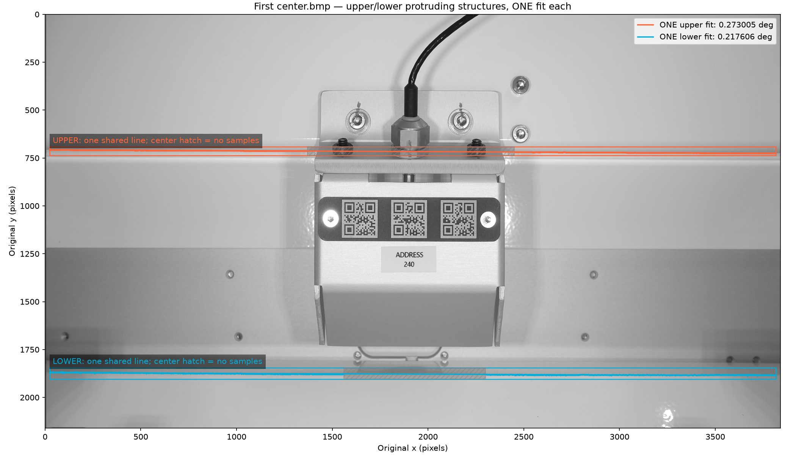
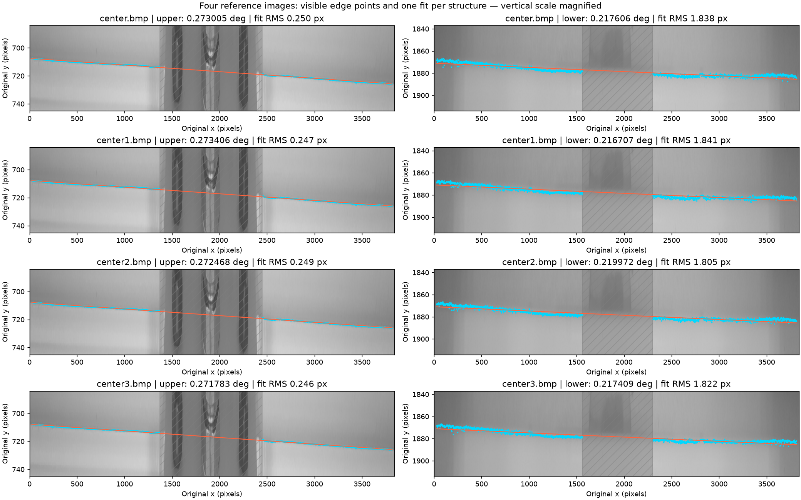

# 기준 이미지 4장: 상단·하단 외부 구조물 전체 기울기 재측정

사용자 표시를 구조물 식별용으로 해석해, 상단 구조물 전체에 직선 하나, 하단 구조물 전체에 직선 하나를 맞췄습니다. 좌우 각도를 별도로 구해 평균내지 않았습니다. 중앙 장착물에 가려진 부분은 점 추출에서 제외하고, 양옆의 원본 경계점들을 한꺼번에 Huber 직선 맞춤에 넣었습니다.

경계 측정은 기존 Gaussian 평활 → 밝기 증가 경계 탐색 → 흐린 계단 모형의 서브픽셀 맞춤 방법을 유지했습니다. 상단·하단 각각 동일한 밝기 경계선을 추적했습니다. 네 장에 동일한 탐색 범위와 가림 마스크를 사용했습니다.

**아래는 영상 속 선의 각도입니다. 로봇 θ나 보정 명령으로 환산하지 않았습니다.**

| 기준 이미지 | 상단 전체 각도(°) | 하단 전체 각도(°) | 상단: 1차 대비 차이(°) | 하단: 1차 대비 차이(°) |
|---|---:|---:|---:|---:|
| first / center.bmp | 0.273005 | 0.217606 | +0.000000 | +0.000000 |
| second / center1.bmp | 0.273406 | 0.216707 | +0.000401 | -0.000899 |
| second / center2.bmp | 0.272468 | 0.219972 | -0.000537 | +0.002367 |
| second / center3.bmp | 0.271783 | 0.217409 | -0.001222 | -0.000197 |

## 네 장의 최대−최소 차이

- 상단: **0.001623°**, 최대 center1.bmp, 최소 center3.bmp
- 하단: **0.003266°**, 최대 center2.bmp, 최소 center1.bmp

## 실제 사용 영역

- x=24~3816px의 넓은 띠를 사용했습니다. 2픽셀 간격으로 경계점을 추출했습니다.
- 상단 경계 탐색 y=692~736px, 중앙 x=1370~2450px는 장착물 가림 때문에 제외했습니다.
- 하단 경계 탐색 y=1845~1905px, 중앙 x=1560~2300px는 하단 장착물/반사부 가림 때문에 제외했습니다.
- 범위는 첫 기준 사진의 구조물 위치를 보고 정했으며, 네 장의 결과 차이를 줄이도록 변경하지 않았습니다.
- 마스크 양쪽 점은 **공통 기울기와 공통 절편을 갖는 하나의 직선**으로 맞췄습니다.

## 재현과 한계

- 실행 환경: Python / OpenCV 5.0.0. 기존 경계 측정 함수를 그대로 재사용했습니다.
- 이전 좌우 ROI에 같은 함수를 적용한 8개 비교에서 기존 C++ 각도와의 최대 차이는 5.55111512313e-17°입니다. 따라서 환경 변경으로 인한 차이와 영역 통합의 차이를 구분할 수 있습니다.
- 모든 원본 이미지의 실행 전후 해시를 확인했습니다. 현재 C++ 알고리즘과 설정은 변경하지 않았습니다.
- 이 비교는 기준 사진 네 장의 측정값 비교이며, 허용오차 합격·통계적 동등성·실장비 보정 성능을 검증한 것이 아닙니다.
- 전체 직선은 보이는 경계의 대표 기울기입니다. 곡률·반사·부분적인 경계 형태는 직선 잔차로 남을 수 있습니다.
- 새 상단/하단 기울기를 로봇 θ로 바꾸려면 그 특징에 대한 변화율이 필요합니다. 기존 좌우 선의 환산 계수를 적용하지 않았습니다.
- full_width_results.json에 기울기 dy/dx, 절편, 잔차, 점 수, 6개 이미지 쌍의 차이를 저장했습니다. 각 NPZ 파일에는 실제 사용한 경계점 전체가 있습니다.
- 재현: python measure_full_width.py
