# 기준 이미지 4장: 외부 구조물·QR 직선 추출 (108 조합)

생성: 2026-10-30T10:26:01. 상호작용 열람은 `report.html`을 브라우저로 여세요.

> 모든 각도는 영상 속 선의 각도(원본 픽셀, +x 오른쪽, +y 아래, atan2(dy,dx), [-90°,90°))입니다. 로봇 θ·보정치·mm로 환산하지 않았습니다. 소수 자릿수는 정확도 보장이 아닙니다. 통계적 균일성 합격, Y·θ 분리 성공, ±0.005° 정렬 성공, 최적 방법 확정을 주장하지 않습니다.

## 1. 개요

| ID | 경로 | SHA-256 | manifest 일치 / 실행 후 |
|---|---|---|---|
| R01 | `C:\Users\SSAFY\Desktop\[기업연계_세메스] 교보재\[기업연계_세메스] 교보재\SSAFY Test Image Set\center.bmp` | `01a69df6771b840d2fcf9cf727760592b5fb199c12277bfc173af514e26fd685` | 일치 / 변경 없음 |
| R02 | `C:\Users\SSAFY\Desktop\LSJ_Private\자율PJT\analysis\second_data_inspection\extracted\일부 데이터 추출\기준 위치\center1.bmp` | `e50e9579a787bf1dfa2f82b6f5efa6036026c6195986d7855ce2989e9d890c6c` | 일치 / 변경 없음 |
| R03 | `C:\Users\SSAFY\Desktop\LSJ_Private\자율PJT\analysis\second_data_inspection\extracted\일부 데이터 추출\기준 위치\center2.bmp` | `abdf70712c40e5103e4a1d37dfec692cdeee360f0fff11dea5f466ce0fb6fe4d` | 일치 / 변경 없음 |
| R04 | `C:\Users\SSAFY\Desktop\LSJ_Private\자율PJT\analysis\second_data_inspection\extracted\일부 데이터 추출\기준 위치\center3.bmp` | `7f98694dfe72563e36371c255b3211f409def1d3f0f410e2945acbfbc7225f19` | 일치 / 변경 없음 |

- 실행 환경: Windows x64, C++17, MSVC v141(_MSC_FULL_VER 191627054), CMake(VS 18 2026 생성기, v141), OpenCV 3.4.15. 측정 수치는 전부 C++ 실행 결과입니다. Python(OpenCV 5.0.0)은 그림·보고서에만 사용했습니다.
- 21개 방법 모두 구현·빌드·실행. 216개 주 선 슬롯: 성공 209, 실패 7.
- 432개 조합: complete 348, partial 84, failed 0.

### 실패 슬롯

| 측정 ID | 범주 | 사유 |
|---|---|---|
| R01_E04_lower_structure | 검출 실패 | LSD: no segment passed angle/band/visibility/polarity filters; excluded:angle=7 excluded:occluded_outside_x_or_short=14 |
| R01_E08_lower_structure | 피팅 실패(지지점 부족·합의선 없음) | too few points for fit: 26 < 50 |
| R02_E04_lower_structure | 검출 실패 | LSD: no segment passed angle/band/visibility/polarity filters; excluded:angle=11 excluded:occluded_outside_x_or_short=10 |
| R02_E08_lower_structure | 피팅 실패(지지점 부족·합의선 없음) | too few points for fit: 24 < 50 |
| R03_E04_lower_structure | 검출 실패 | LSD: no segment passed angle/band/visibility/polarity filters; excluded:angle=8 excluded:occluded_outside_x_or_short=10 |
| R03_E08_lower_structure | 피팅 실패(지지점 부족·합의선 없음) | too few points for fit: 24 < 50 |
| R04_E04_lower_structure | 검출 실패 | LSD: no segment passed angle/band/visibility/polarity filters; excluded:angle=9 excluded:occluded_outside_x_or_short=9 |

## 2. 측정 대상

- 상단 구조물 1개(upper_structure): x 24~3816, 탐색 y 692~736, 가림 x 1370~2450 제외. 하단 구조물 1개(lower_structure): x 24~3816, 탐색 y 1845~1905, 가림 x 1560~2300 제외. 주 선은 y 증가 방향 어두움→밝음 경계. 양쪽 가시 구간 점을 하나의 직선으로 맞춤(좌우 평균 없음).
- QR L/C/R: 기존 ROI 유지. Q01~Q11 = 바깥 흰 테두리 상단 경계(탐색 y 958~978). Q12 = 위쪽 두 파인더 중심 연결선(다른 특징).

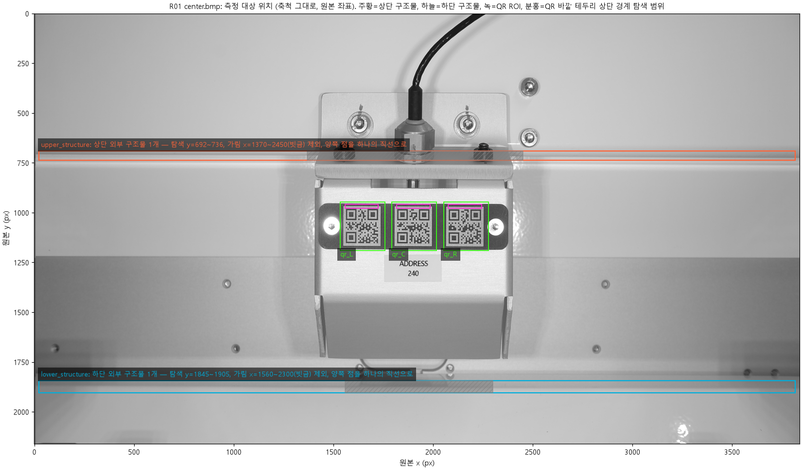

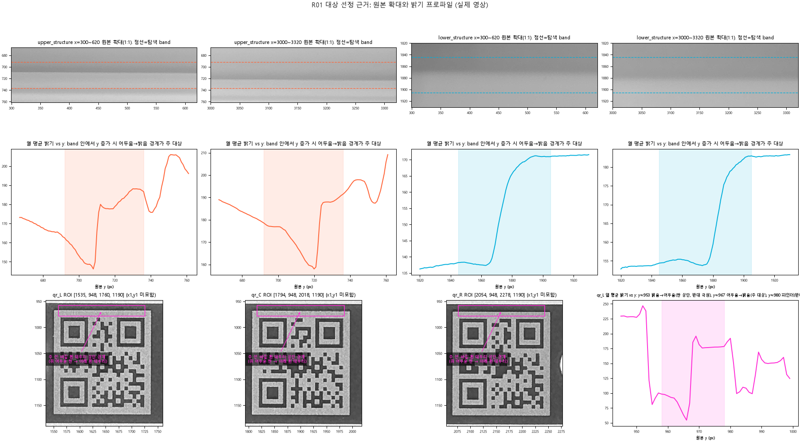

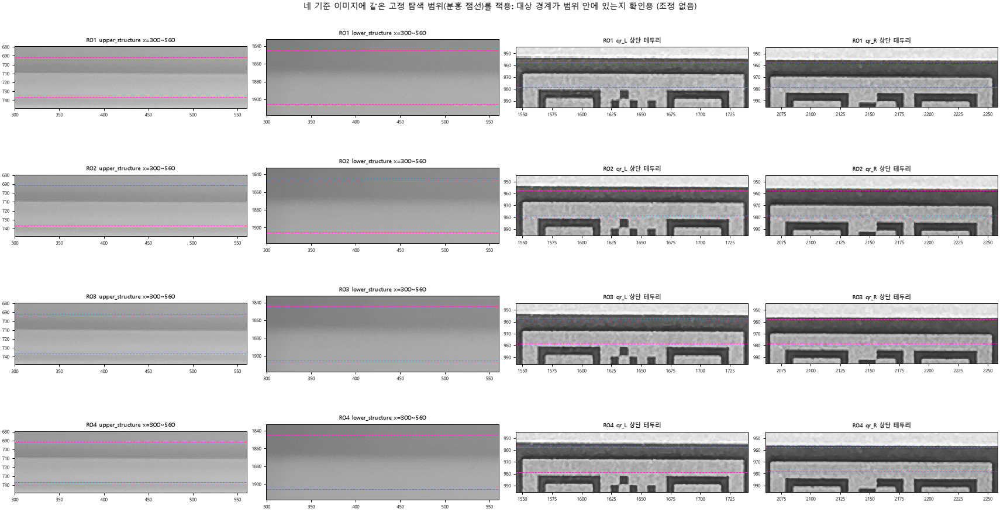

## 3. 방법별 추출 과정 (R01 그림, 나머지는 figures/methods/<ID>_<R0n>.png)

### E01 · 밝기 프로파일 모델 피팅(Gaussian 미분 프로파일)

S01 III.B의 Gaussian 피팅 단계를 구현했습니다. 거친 경계는 논문의 ISODATA·골격화 대신 band 안 열별 극성 Sobel 최대값을 씁니다. 기존 Python ERF(흐린 계단) 방식은 σ=1 평활 밝기에 누적정규 계단을 맞추는 것으로, 이번 E01/Q01(평활 없는 Sobel 미분에 Gaussian)과 다른 모델입니다.

- 근거: S01 · 외부 코드: 없음(직접 구현)
- 변경점: 논문의 ISODATA 임계+골격화 거친 경계 대신 band 안 열별 극성 Sobel 최대값을 거친 경계로 사용. Gaussian 피팅·Nelder–Mead·초기값(A=최대, μ=중심, σ=이웃 크기)은 논문 III.B를 따름. 3차 스플라인 연결은 구현하지 않고 직선 피팅으로 대체. 기존 ERF(흐린 계단) 코드와의 차이: ERF는 σ=1 평활 밝기에 누적정규 계단을, 여기서는 평활 없는 Sobel 미분에 Gaussian을 맞춤.

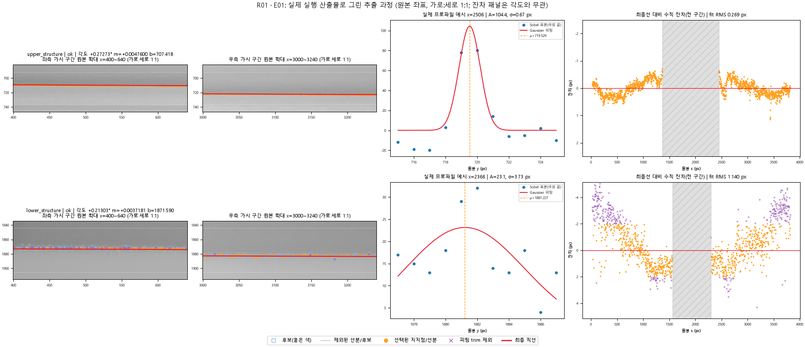

### E02 · Canny–Devernay 서브픽셀 경계점

저자 C 코드 devernay()가 Canny 비최대 억제 화소마다 Devernay 2차 보간 보정을 적용한 서브픽셀 점을 냅니다. 그림 3열은 그 점과 가장 가까운 정수 화소(반올림)를 함께 보여 줍니다. 정수 맵을 그대로 쓰지 않았습니다.

- 근거: S02 · 외부 코드: third_party/devernay_1.0 (수정 없음)
- 변경점: 검출기 코드는 그대로. 후보 선별(극성·가로 경계·열 구간별 최강점)과 직선 피팅은 이번 도구에서 추가.

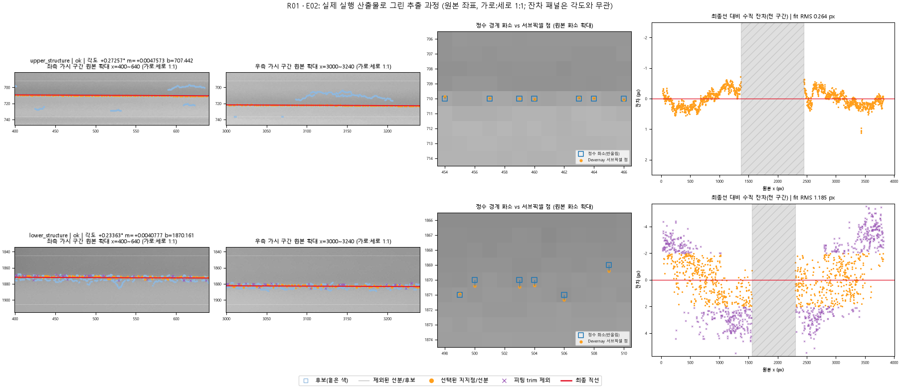

### E03 · Canny → 허프 변환 → 재피팅

Canny 화소 중 대상 극성·band·가림 밖 화소만 표준 허프에 투표시키고, 최다 득표이면서 band 안에 있는 선을 고른 뒤 그 선 주변 Canny 정수 화소로 재피팅합니다. 허프 θ는 법선 각도입니다. 투표 맵은 OpenCV가 내보내지 않아 저장하지 않았고, 반환된 후보선의 득표만 저장했습니다.

- 근거: S03 · 외부 코드: OpenCV 3.4.15 Canny/HoughLines
- 변경점: 투표 화소를 극성·band·가림 마스크로 제한, θ 범위 제한, 선택 선 주변 Canny 화소 재피팅은 이번 도구에서 추가.

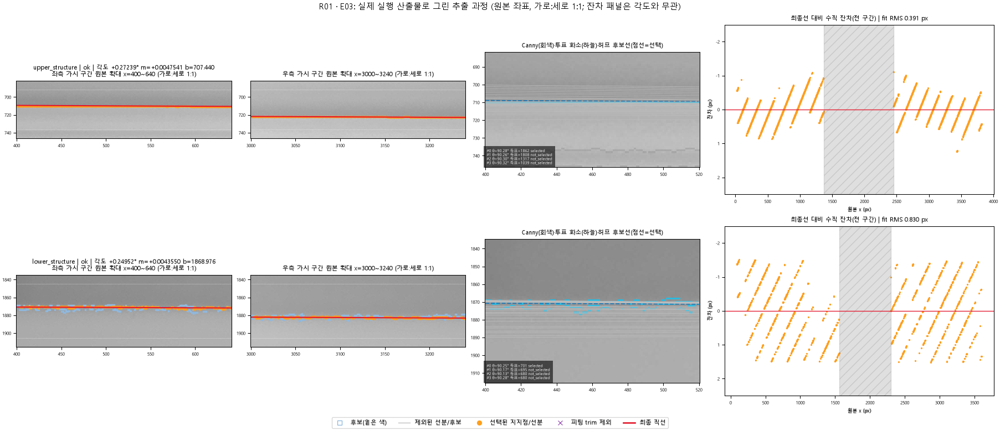

### E04 · LSD

저자 LSD 1.6을 scale=1.0으로 실행합니다(재표본화 금지). 지지 영역(reg_img)을 저장해 선택 선분의 실제 지지 화소 잔차를 진단값으로 따로 기록합니다.

- 근거: S04 · 외부 코드: third_party/lsd_1.6 (수정 없음)
- 변경점: scale = 1.0(저자 기본값 0.8; 재표본화 금지 요구 때문). 선분 선택·통합은 공통 규칙.

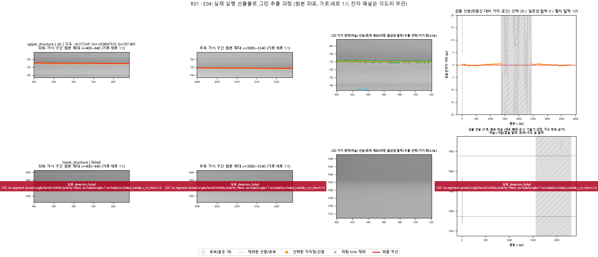

### E05 · Zernike 모멘트(ramp edge)

S05 식 31·41·42·25를 그대로 구현했습니다. 7×7 창, k_edge=1.80, 흐림 σ는 계측하지 않은 설정값(external 1.5px, QR 1.0px)입니다. 하단 구조물처럼 전이 폭이 창보다 넓은 경계에서는 모델 가정이 맞지 않을 수 있습니다.

- 근거: S05 · 외부 코드: 없음(직접 구현)
- 변경점: 논문 식을 직접 구현(저자 코드 없음). 마스크는 64×64 부표본 수치적분으로 생성, 모멘트 계산 전 창 평균을 뺌(상수 밝기 성분 제거). 흐림 σ는 계측하지 않은 설정값(external 1.5 px, QR 1.0 px). 초기점은 σ=1 평활 세로 경사 최대 화소.

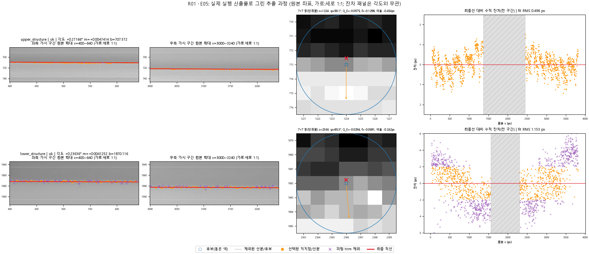

### E06 · PAE(부분 면적 효과)

PAE 2차 기본형을 3×9 창으로 직접 유도·구현했습니다. 원 논문 본문을 확인하지 못했고 평활·floating 변형을 넣지 않았으므로 원 논문 그대로의 재현이 아닙니다.

- 근거: S06 · 외부 코드: 없음(직접 구현)
- 변경점: 2차 기본형을 창 높이 9(m=4)로 일반화해 직접 유도·구현. A/B는 창 맨 위·아래 행 3화소 평균(Method.md의 모서리 3화소 추정과 다름). 평활 변형·floating window·기울기>1 경우는 구현하지 않음. 원 논문 본문을 확인하지 못했으므로 원 논문 그대로의 재현이 아님.

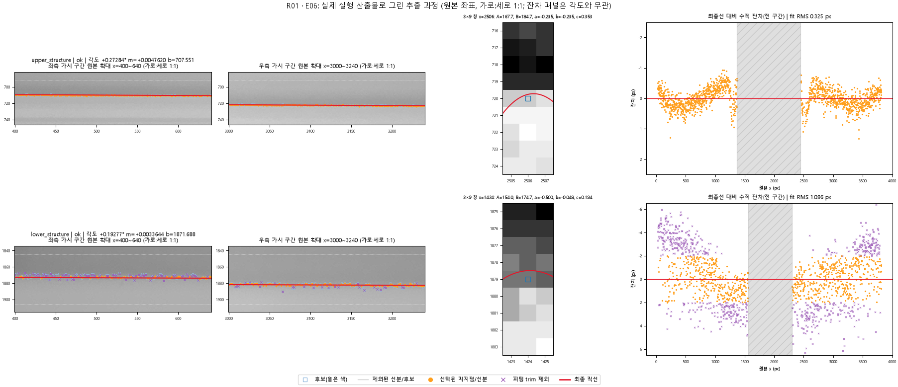

### E07 · EDLines

저자 ED_Lib의 ED+EDLines를 그대로 호출합니다. 선분별 지지 화소는 ED 체인 구간으로 재구성했습니다.

- 근거: S07 · 외부 코드: third_party/ED_Lib (EDLines.h에 getLineSegments() 접근자 1개 추가)
- 변경점: external은 ED 경사/앵커 임계 36/8 → 12/2. 지지 픽셀은 ED 체인 구간으로 재구성(공선 병합 시 일부 누락 가능).

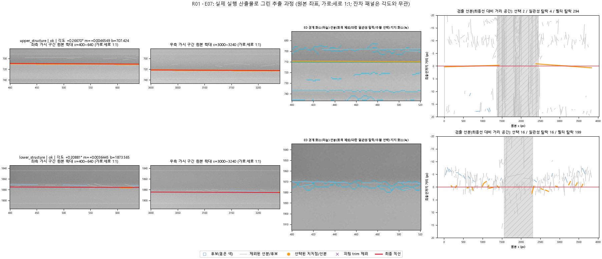

### E08 · FLD(Fast Line Detector)

opencv_contrib 3.4 FastLineDetector 검출 코드를 ximgproc 없이 이식했습니다. 각 선분의 fitLine 지지 체인 화소를 함께 받습니다.

- 근거: S08 · 외부 코드: third_party/fld_port (ximgproc 인터페이스·매크로 제거, 지지 픽셀 출력 추가)
- 변경점: 검출 계산 코드는 그대로. precomp.hpp·CV_INSTRUMENT_REGION·CV_OVERRIDE·추상 인터페이스·export 제거. external Canny 50/50 → 10/20.

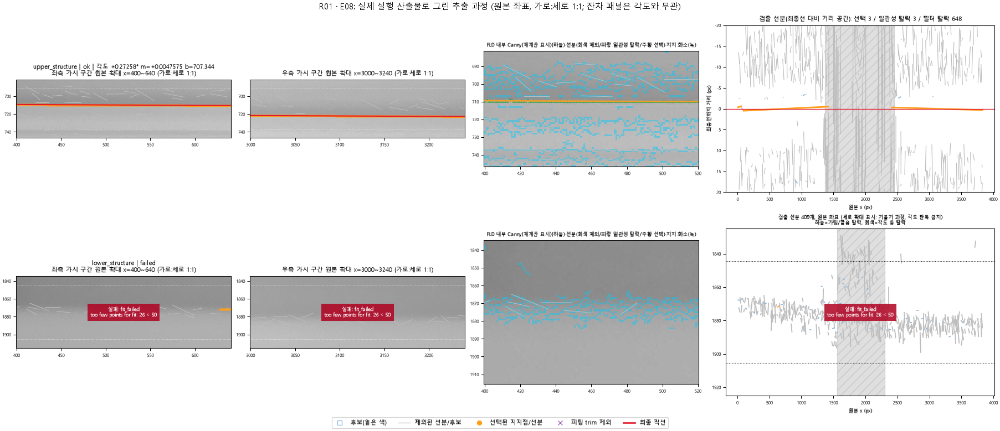

### E09 · ELSED

저자 ELSED C++ 코어를 그대로 호출합니다. 반환 선분별 픽셀을 보관하도록 5줄을 추가했습니다.

- 근거: S09 · 외부 코드: third_party/ELSED (반환 선분별 픽셀 보관·접근자 추가)
- 변경점: external 경사/앵커 임계 30/8 → 10/4. _USE_MATH_DEFINES로 MSVC M_PI 정의.

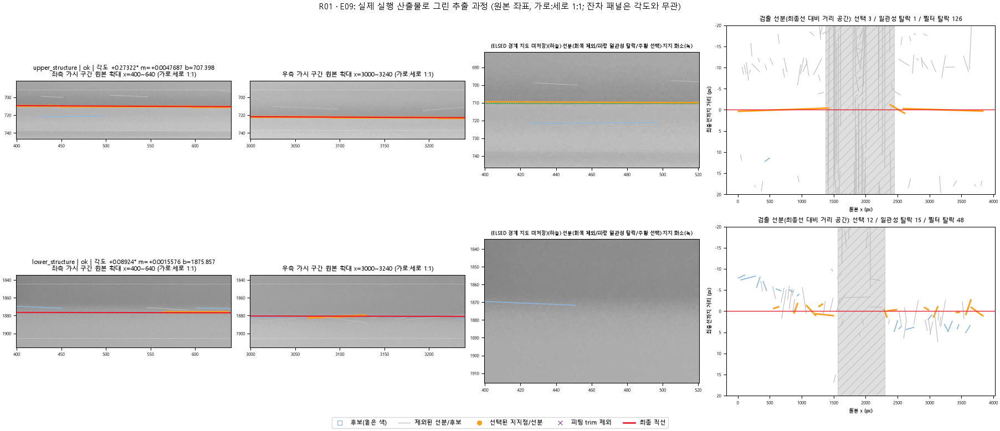

### Q01 · 밝기 프로파일 모델 피팅(Gaussian 미분 프로파일)

S01 III.B의 Gaussian 피팅 단계를 구현했습니다. 거친 경계는 논문의 ISODATA·골격화 대신 band 안 열별 극성 Sobel 최대값을 씁니다. 기존 Python ERF(흐린 계단) 방식은 σ=1 평활 밝기에 누적정규 계단을 맞추는 것으로, 이번 E01/Q01(평활 없는 Sobel 미분에 Gaussian)과 다른 모델입니다.

- 근거: S01 · 외부 코드: 없음(직접 구현)
- 변경점: 논문의 ISODATA 임계+골격화 거친 경계 대신 band 안 열별 극성 Sobel 최대값을 거친 경계로 사용. Gaussian 피팅·Nelder–Mead·초기값(A=최대, μ=중심, σ=이웃 크기)은 논문 III.B를 따름. 3차 스플라인 연결은 구현하지 않고 직선 피팅으로 대체. 기존 ERF(흐린 계단) 코드와의 차이: ERF는 σ=1 평활 밝기에 누적정규 계단을, 여기서는 평활 없는 Sobel 미분에 Gaussian을 맞춤.

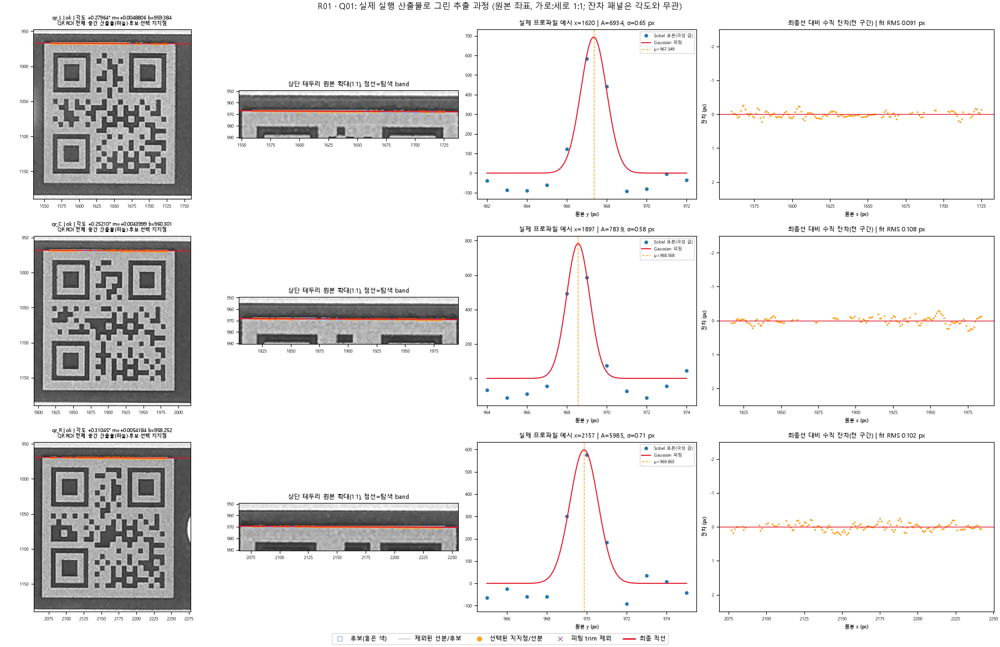

### Q02 · Canny–Devernay 서브픽셀 경계점

저자 C 코드 devernay()가 Canny 비최대 억제 화소마다 Devernay 2차 보간 보정을 적용한 서브픽셀 점을 냅니다. 그림 3열은 그 점과 가장 가까운 정수 화소(반올림)를 함께 보여 줍니다. 정수 맵을 그대로 쓰지 않았습니다.

- 근거: S02 · 외부 코드: third_party/devernay_1.0 (수정 없음)
- 변경점: 검출기 코드는 그대로. 후보 선별(극성·가로 경계·열 구간별 최강점)과 직선 피팅은 이번 도구에서 추가.

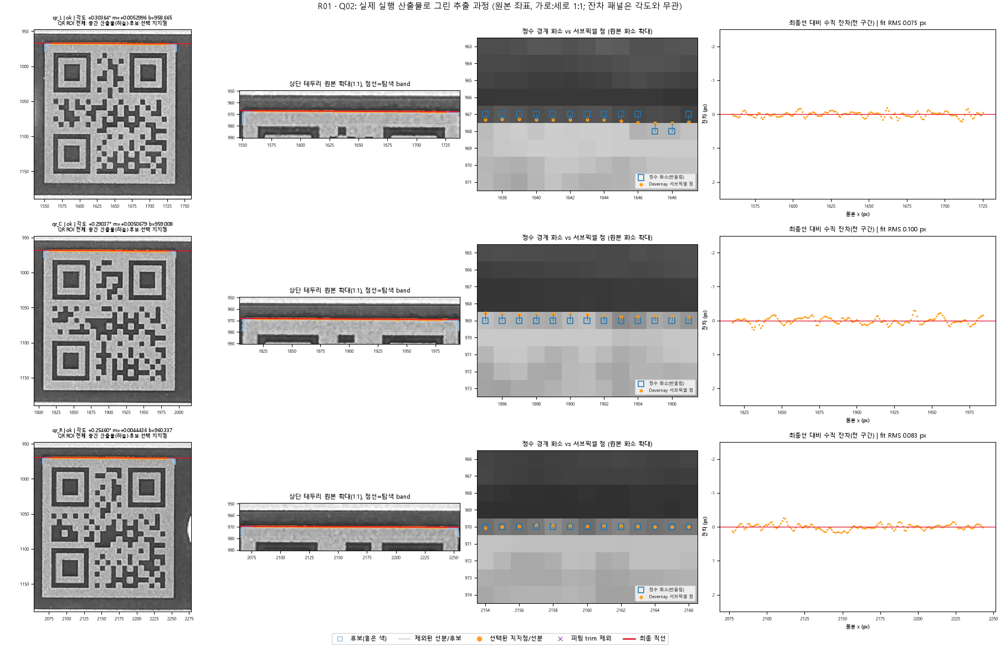

### Q03 · Canny → 허프 변환 → 재피팅

Canny 화소 중 대상 극성·band·가림 밖 화소만 표준 허프에 투표시키고, 최다 득표이면서 band 안에 있는 선을 고른 뒤 그 선 주변 Canny 정수 화소로 재피팅합니다. 허프 θ는 법선 각도입니다. 투표 맵은 OpenCV가 내보내지 않아 저장하지 않았고, 반환된 후보선의 득표만 저장했습니다.

- 근거: S03 · 외부 코드: OpenCV 3.4.15 Canny/HoughLines
- 변경점: 투표 화소를 극성·band·가림 마스크로 제한, θ 범위 제한, 선택 선 주변 Canny 화소 재피팅은 이번 도구에서 추가.

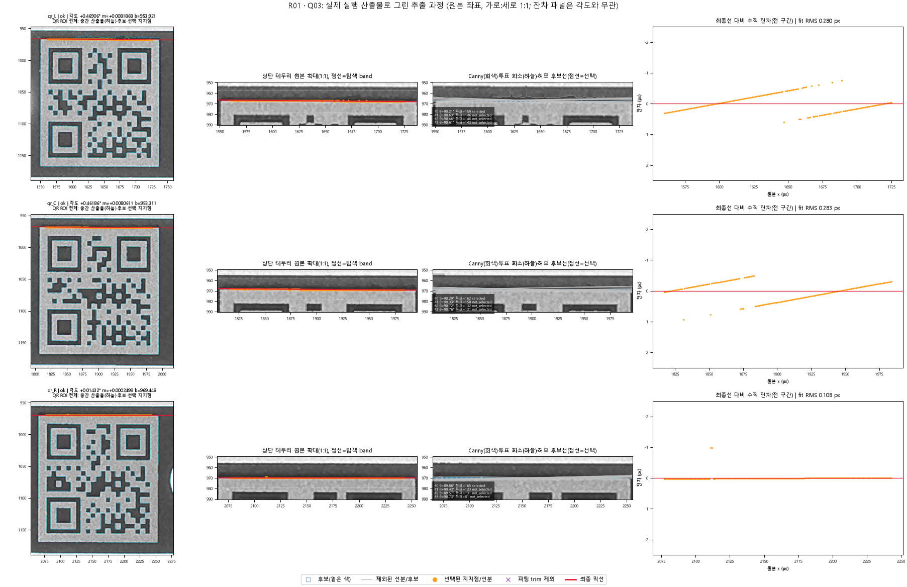

### Q04 · LSD

저자 LSD 1.6을 scale=1.0으로 실행합니다(재표본화 금지). 지지 영역(reg_img)을 저장해 선택 선분의 실제 지지 화소 잔차를 진단값으로 따로 기록합니다.

- 근거: S04 · 외부 코드: third_party/lsd_1.6 (수정 없음)
- 변경점: scale = 1.0(저자 기본값 0.8; 재표본화 금지 요구 때문). 선분 선택·통합은 공통 규칙.

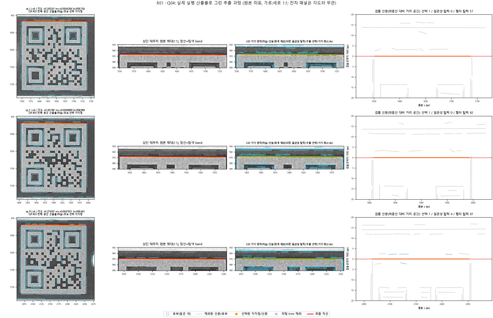

### Q05 · Zernike 모멘트(ramp edge)

S05 식 31·41·42·25를 그대로 구현했습니다. 7×7 창, k_edge=1.80, 흐림 σ는 계측하지 않은 설정값(external 1.5px, QR 1.0px)입니다. 하단 구조물처럼 전이 폭이 창보다 넓은 경계에서는 모델 가정이 맞지 않을 수 있습니다.

- 근거: S05 · 외부 코드: 없음(직접 구현)
- 변경점: 논문 식을 직접 구현(저자 코드 없음). 마스크는 64×64 부표본 수치적분으로 생성, 모멘트 계산 전 창 평균을 뺌(상수 밝기 성분 제거). 흐림 σ는 계측하지 않은 설정값(external 1.5 px, QR 1.0 px). 초기점은 σ=1 평활 세로 경사 최대 화소.

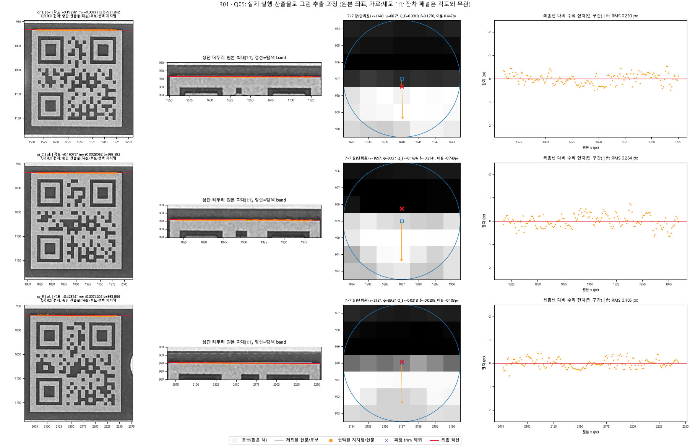

### Q06 · PAE(부분 면적 효과)

PAE 2차 기본형을 3×9 창으로 직접 유도·구현했습니다. 원 논문 본문을 확인하지 못했고 평활·floating 변형을 넣지 않았으므로 원 논문 그대로의 재현이 아닙니다.

- 근거: S06 · 외부 코드: 없음(직접 구현)
- 변경점: 2차 기본형을 창 높이 9(m=4)로 일반화해 직접 유도·구현. A/B는 창 맨 위·아래 행 3화소 평균(Method.md의 모서리 3화소 추정과 다름). 평활 변형·floating window·기울기>1 경우는 구현하지 않음. 원 논문 본문을 확인하지 못했으므로 원 논문 그대로의 재현이 아님.

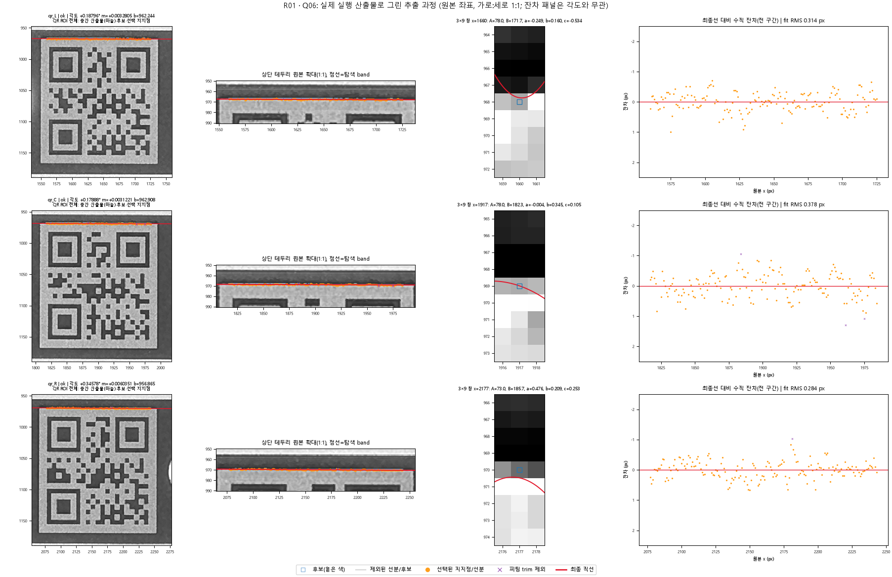

### Q07 · EDLines

저자 ED_Lib의 ED+EDLines를 그대로 호출합니다. 선분별 지지 화소는 ED 체인 구간으로 재구성했습니다.

- 근거: S07 · 외부 코드: third_party/ED_Lib (EDLines.h에 getLineSegments() 접근자 1개 추가)
- 변경점: external은 ED 경사/앵커 임계 36/8 → 12/2. 지지 픽셀은 ED 체인 구간으로 재구성(공선 병합 시 일부 누락 가능).

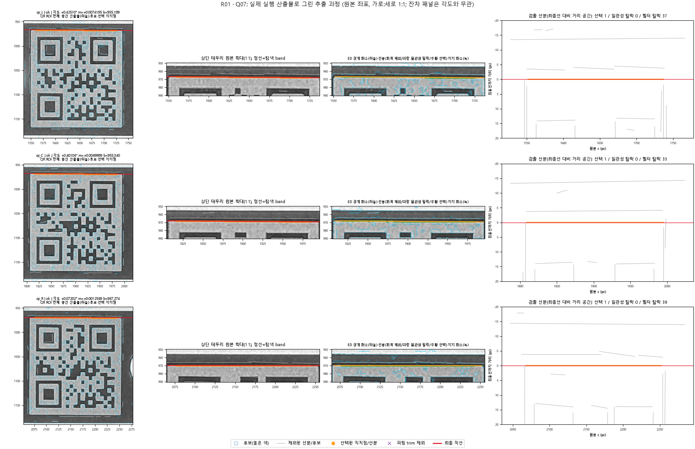

### Q08 · FLD(Fast Line Detector)

opencv_contrib 3.4 FastLineDetector 검출 코드를 ximgproc 없이 이식했습니다. 각 선분의 fitLine 지지 체인 화소를 함께 받습니다.

- 근거: S08 · 외부 코드: third_party/fld_port (ximgproc 인터페이스·매크로 제거, 지지 픽셀 출력 추가)
- 변경점: 검출 계산 코드는 그대로. precomp.hpp·CV_INSTRUMENT_REGION·CV_OVERRIDE·추상 인터페이스·export 제거. external Canny 50/50 → 10/20.

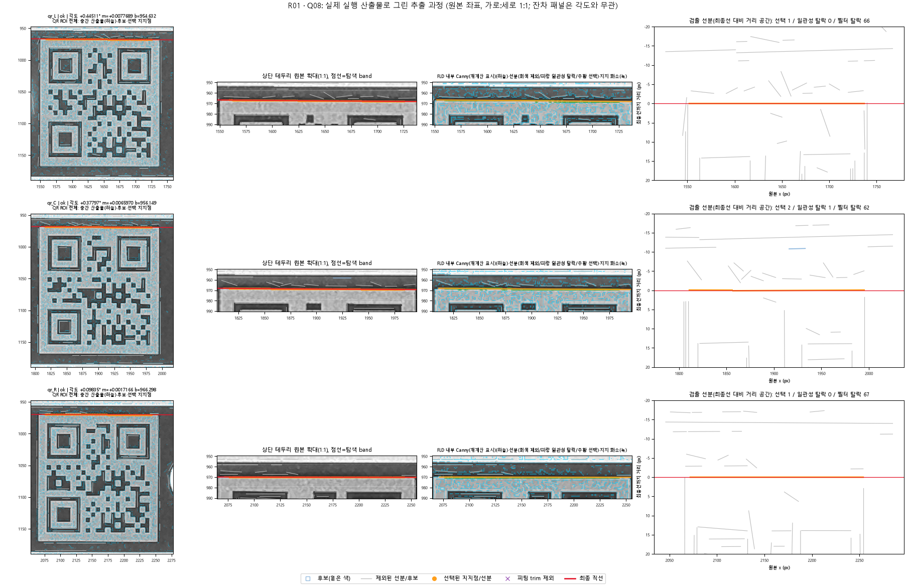

### Q09 · ELSED

저자 ELSED C++ 코어를 그대로 호출합니다. 반환 선분별 픽셀을 보관하도록 5줄을 추가했습니다.

- 근거: S09 · 외부 코드: third_party/ELSED (반환 선분별 픽셀 보관·접근자 추가)
- 변경점: external 경사/앵커 임계 30/8 → 10/4. _USE_MATH_DEFINES로 MSVC M_PI 정의.

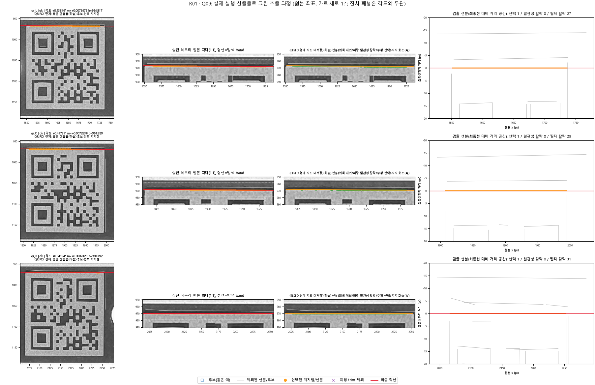

### Q10 · 이진화 → 윤곽선 → 상단 변 윤곽점 피팅

Otsu 이진화 → 외곽 윤곽 → 4꼭짓점 근사 → 위 두 꼭짓점 사이 윤곽점(양 끝 8% 제외)에 공통 피팅합니다. 윤곽점은 정수 화소입니다.

- 근거: S10 · 외부 코드: OpenCV 3.4.15
- 변경점: 이번 도구에서 설계. 윤곽점은 정수 픽셀.

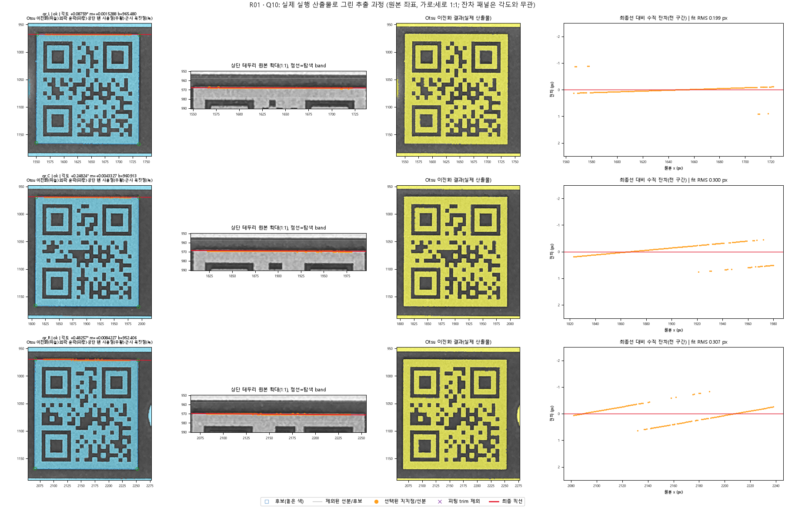

### Q11 · 사각 테두리 코너 검출 → cornerSubPix → 상단 두 코너 연결

Shi-Tomasi 코너 후보 중 사분면 밝기 패턴(좌상: 오른쪽 아래만 밝음, 우상: 왼쪽 아래만 밝음)을 만족하는 가장 위쪽 코너를 바깥 테두리 코너로 식별하고 cornerSubPix로 정밀화한 뒤 연결합니다. 두 점 연결이라 fit RMS는 null입니다.

- 근거: S03 · 외부 코드: OpenCV 3.4.15 goodFeaturesToTrack/cornerSubPix
- 변경점: 사분면 밝기 패턴으로 바깥 테두리 코너를 식별하는 규칙은 이번 도구에서 설계.

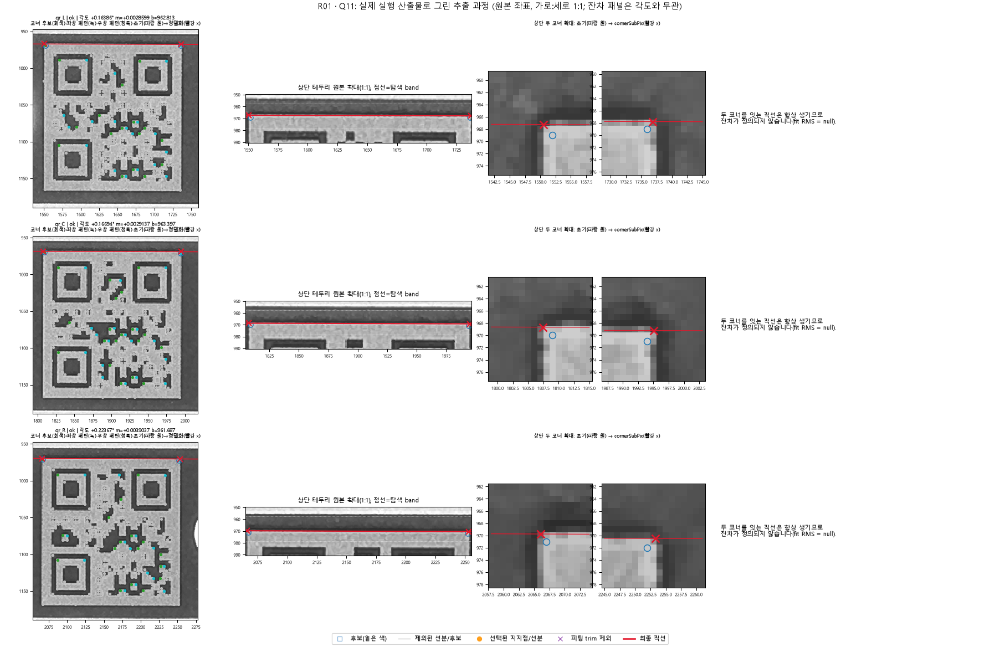

### Q12 · 파인더 검출 → 코너 정밀화·중심 → 위쪽 두 중심 연결

기존 measure_finders.py를 C++로 이식했습니다. 파인더 외곽 사각형 대각선 교점(중심) A·B를 연결한 방향선이며, 바깥 테두리 상단 경계와 다른 특징입니다.

- 근거: S10, S03 · 외부 코드: OpenCV 3.4.15
- 변경점: 기존 Python measure_finders.py와 같은 정의·설정을 C++로 이식.

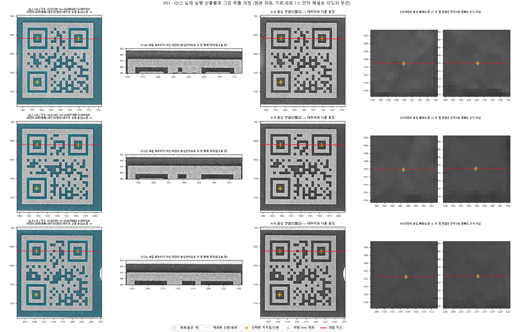

## 4. 108개 조합

`report.html` 4장에서 기준 이미지·외부 방법·QR 방법을 골라 선을 겹쳐 보고, 확대·선 숨기기·네 장 나란히 비교가 가능합니다. 조합-측정 ID 참조는 `results/combinations.json`에 있습니다.

## 5. 영상 각도 표 (°)

### 외부 구조물

| 방법 | 상단 구조물 R01 | 상단 구조물 R02 | 상단 구조물 R03 | 상단 구조물 R04 | 하단 구조물 R01 | 하단 구조물 R02 | 하단 구조물 R03 | 하단 구조물 R04 |
|---|---:|---:|---:|---:|---:|---:|---:|---:|
| E01 | +0.2727 | +0.2732 | +0.2723 | +0.2715 | +0.2130 | +0.2193 | +0.2091 | +0.2221 |
| E02 | +0.2726 | +0.2730 | +0.2720 | +0.2713 | +0.2336 | +0.2125 | +0.2181 | +0.2376 |
| E03 | +0.2724 | +0.2725 | +0.2718 | +0.2707 | +0.2495 | +0.1487 | +0.1493 | +0.1340 |
| E04 | +0.2723 | +0.2726 | +0.2719 | +0.2713 | 실패(검출 실패) | 실패(검출 실패) | 실패(검출 실패) | 실패(검출 실패) |
| E05 | +0.2717 | +0.2724 | +0.2716 | +0.2722 | +0.2364 | +0.2071 | +0.2257 | +0.2324 |
| E06 | +0.2728 | +0.2734 | +0.2728 | +0.2722 | +0.1928 | +0.2070 | +0.2051 | +0.2151 |
| E07 | +0.2667 | +0.2731 | +0.2723 | +0.2708 | +0.2088 | +0.2867 | +0.1288 | +0.3310 |
| E08 | +0.2726 | +0.2735 | +0.2720 | +0.2708 | 실패(피팅 실패(지지점 부족·합의선 없음)) | 실패(피팅 실패(지지점 부족·합의선 없음)) | 실패(피팅 실패(지지점 부족·합의선 없음)) | +0.2545 |
| E09 | +0.2732 | +0.2730 | +0.2722 | +0.2706 | +0.0892 | +0.2786 | +0.1842 | +0.2893 |

### QR

| 방법 | QR L R01 | QR L R02 | QR L R03 | QR L R04 | QR C R01 | QR C R02 | QR C R03 | QR C R04 | QR R R01 | QR R R02 | QR R R03 | QR R R04 |
|---|---:|---:|---:|---:|---:|---:|---:|---:|---:|---:|---:|---:|
| Q01 | +0.2796 | +0.2696 | +0.2838 | +0.3074 | +0.2521 | +0.3493 | +0.3497 | +0.3472 | +0.3104 | +0.2485 | +0.2283 | +0.2021 |
| Q02 | +0.3036 | +0.2750 | +0.2720 | +0.2713 | +0.2904 | +0.2791 | +0.2803 | +0.2773 | +0.2546 | +0.2636 | +0.2601 | +0.2617 |
| Q03 | +0.4691 | +0.3093 | +0.2278 | +0.1485 | +0.4619 | +0.0167 | +0.0083 | +0.0000 | +0.0143 | +0.3866 | +0.4066 | +0.4522 |
| Q04 | +0.2652 | +0.2783 | +0.2781 | +0.2855 | +0.2916 | +0.2629 | +0.2576 | +0.2512 | +0.2746 | +0.2586 | +0.2588 | +0.2639 |
| Q05 | +0.1926 | +0.2336 | +0.2862 | +0.3544 | +0.1607 | +0.4449 | +0.4403 | +0.4085 | +0.4251 | +0.1620 | +0.1524 | +0.1133 |
| Q06 | +0.1880 | +0.2591 | +0.2842 | +0.3088 | +0.1789 | +0.3515 | +0.3403 | +0.3363 | +0.3458 | +0.3132 | +0.3264 | +0.3162 |
| Q07 | +0.4251 | +0.2630 | +0.1911 | +0.1305 | +0.4011 | +0.0795 | +0.0734 | +0.1751 | +0.0720 | +0.3981 | +0.3756 | +0.4183 |
| Q08 | +0.4451 | +0.2351 | +0.2032 | +0.1519 | +0.3780 | +0.0794 | +0.0955 | +0.1409 | +0.0984 | +0.3740 | +0.3858 | +0.4231 |
| Q09 | +0.4382 | +0.2804 | +0.2046 | +0.1069 | +0.4173 | +0.0487 | +0.0621 | +0.1430 | +0.0419 | +0.3985 | +0.4054 | +0.4040 |
| Q10 | +0.0876 | +0.4374 | +0.4595 | +0.4751 | +0.2482 | +0.5129 | +0.4952 | +0.4280 | +0.4826 | +0.0282 | +0.0167 | +0.0085 |
| Q11 | +0.1639 | +0.2665 | +0.2853 | +0.2911 | +0.1669 | +0.1620 | +0.1247 | +0.1437 | +0.2237 | +0.1184 | +0.1208 | +0.1614 |
| Q12 (파인더 중심선, 다른 특징) | +0.4723 | +0.3947 | +0.4134 | +0.3364 | +0.4125 | +0.3216 | +0.3916 | +0.3783 | +0.4474 | +0.2228 | +0.2217 | +0.2437 |

## 6. 해석 범위와 관찰

- 실패 7슬롯은 모두 하단 구조물(E04 4장, E08 3장)입니다. 다른 방법으로 대체하지 않았습니다.
- 하단 경계는 약한 넓은 전이이며 잔차에 체계적 휨이 보입니다. 원인은 미확인입니다.
- QR 상단 경계는 약 166 px로 짧아 1 px 세로 차이가 약 0.35°입니다. 정수 화소 지지 방법은 양자화 영향이 큽니다(예: R04 Q03 qr_C = 0°).
- 두 점 연결(Q11, Q12)과 단일 선분 표본의 잔차 0은 정확도 근거가 아니므로 fit RMS를 null로 두었습니다.
- 네 기준 이미지는 서로 다른 촬영이므로 장 사이 차이를 측정 오차로 해석할 수 없습니다. Y·θ 이동 반응 검증이 아닙니다.

## 7. 재현·검증

- `python tools/run_pipeline.py` → `python -I tools/make_figures.py` → `python tools/make_report.py`
- 자체 시험 11/11 PASS, 재실행 수치 동일, 단독 실행=전체 실행 동일, 원본 해시 변경 없음.

## 부록. 근거 자료 및 구현 출처

### S01 · Gaussian-Based Approach to Subpixel Detection of Blurred and Unsharp Edges

- 저자·연도: Anna Fabijańska · 2014
- DOI: 10.15439/2014F136
- 링크: https://annals-csis.org/proceedings/2014/drp/136.html https://annals-csis.org/proceedings/2014/pliks/136.pdf
- 코드 버전/commit: — · 라이선스: —
- 사용 방법 ID: E01, Q01
- 뒷받침하는 내용: Sobel 경사 표본에 Gaussian A·exp(-(x-μ)²/2σ²)를 맞춰 μ를 서브픽셀 경계로 쓰는 방식(식 7, III.B).
- 직접 확인 범위: 원문 PDF 본문 III장(A 거친 경계, B Gaussian 피팅·Nelder–Mead·초기값) 텍스트 확인. 실험 절은 읽지 않음.

### S02 · A Sub-Pixel Edge Detector: an Implementation of the Canny/Devernay Algorithm

- 저자·연도: Rafael Grompone von Gioi, Gregory Randall · 2017
- DOI: 10.5201/ipol.2017.216
- 링크: https://www.ipol.im/pub/art/2017/216/
- 코드 버전/commit: https://www.ipol.im/pub/art/2017/216/devernay_1.0.zip (version 1.0, October 10, 2017) · 라이선스: AGPL-3.0-or-later (devernay.c/devernay.h 머리말, COPYING)
- 사용 방법 ID: E02, Q02
- 뒷받침하는 내용: Canny 비최대 억제 화소에 Devernay 2차 보간 보정(offset ∈ [-0.5, 0.5])을 적용한 서브픽셀 경계점 생성.
- 직접 확인 범위: 저자 소스 devernay.c(경사 계산·Devernay 보정·연결·히스테리시스)와 README 확인. IPOL 논문 본문은 읽지 않음.

### S03 · OpenCV 3.4 Feature Detection (Canny, HoughLines, cornerSubPix, goodFeaturesToTrack)

- 저자·연도: OpenCV · —
- DOI: —
- 링크: https://docs.opencv.org/3.4/dd/d1a/group__imgproc__feature.html
- 코드 버전/commit: 로컬 C:\Users\SSAFY\opencv\build (OpenCV 3.4.15, opencv_world3415) · 라이선스: OpenCV 3.4: 3-clause BSD
- 사용 방법 ID: E03, Q11, Q12, Q03
- 뒷받침하는 내용: 표준 허프의 θ는 직선 법선의 각도(영상 선 각도 = θ-90°), 득표순 출력, cornerSubPix 반복 정밀화 입출력.
- 직접 확인 범위: 로컬 3.4.15 imgproc.hpp의 HoughLines 선언·설명(Vec3f 득표 출력, min/max_theta) 확인. 온라인 문서 페이지는 이번에 열람하지 않음.

### S04 · LSD: a Line Segment Detector

- 저자·연도: Rafael Grompone von Gioi, Jérémie Jakubowicz, Jean-Michel Morel, Gregory Randall · 2012
- DOI: 10.5201/ipol.2012.gjmr-lsd
- 링크: https://www.ipol.im/pub/art/2012/gjmr-lsd/ https://docs.opencv.org/3.4/db/d73/classcv_1_1LineSegmentDetector.html
- 코드 버전/commit: https://www.ipol.im/pub/art/2012/gjmr-lsd/lsd_1.6.zip (lsd 1.6) · 라이선스: AGPL-3.0-or-later (lsd.c 머리말, COPYING)
- 사용 방법 ID: E04, Q04
- 뒷받침하는 내용: 선분 검출과 선분 지지 영역(reg_img) 출력, 출력 좌표 원점이 픽셀 (0,0) 중심이라는 정의.
- 직접 확인 범위: 저자 소스 lsd.h/lsd.c의 LineSegmentDetection 인터페이스·reg_img 출력·좌표 0.5 보정 주석 확인. 논문 본문은 읽지 않음. OpenCV 내장 LSD는 사용하지 않음.

### S05 · Subpixel Localization of Isolated Edges and Streaks in Digital Images

- 저자·연도: Devin T. Renshaw, John A. Christian · 2020
- DOI: 10.3390/jimaging6050033
- 링크: https://www.mdpi.com/2313-433X/6/5/33 https://pmc.ncbi.nlm.nih.gov/articles/PMC8321028/ https://www.ebi.ac.uk/europepmc/webservices/rest/PMC8321028/fullTextXML
- 코드 버전/commit: — · 라이선스: —
- 사용 방법 ID: E05, Q05
- 뒷받침하는 내용: ramp edge 모델의 A11/A20 비 Q_E, 폭 w 보정 거리 식 41, k_edge = 1.80, 서브픽셀 위치 식 25.
- 직접 확인 범위: Europe PMC 전문 XML로 2장(식 1 좌표 정규화), 3.4절(마스크 M11·M20, 식 19~23), 4.1(식 31), 4.2(식 33~42), 식 25 확인. 참고문헌 15의 마스크 수치는 확인하지 않아 마스크는 직접 수치적분.

### S06 · Accurate subpixel edge location based on partial area effect

- 저자·연도: A. Trujillo-Pino, K. Krissian, M. Alemán-Flores, D. Santana-Cedrés · 2013
- DOI: 10.1016/j.imavis.2012.10.005
- 링크: https://accedacris.ulpgc.es/handle/10553/43474?mode=simple https://github.com/juanse77/EdgeLocator
- 코드 버전/commit: EdgeLocator commit 537db170ce64a3cc7e27c26381cebcb507c1f1ec (설명 문서만 참고, 코드 미사용) · 라이선스: EdgeLocator: 저장소에 라이선스 표시 없음 → 코드 재사용하지 않음
- 사용 방법 ID: E06, Q06
- 뒷받침하는 내용: 열 합 S_L, S_M, S_R과 곡선 y = a + bx + cx²의 면적 관계에서 a, b, c를 닫힌 식으로 구하는 PAE 기본형.
- 직접 확인 범위: 원 논문 본문은 접근하지 않음(미확인). EdgeLocator 저장소 Method.md(구현자의 방법 설명: 3x5 1차·2차 모델 식, A/B 추정, 경계 화소 조건, 평활·floating 변형) 확인. 2차 모델 열 합 식은 직접 다시 유도해 Method.md 식과 같음을 확인.

### S07 · EDLines: A real-time line segment detector with a false detection control

- 저자·연도: Cuneyt Akinlar, Cihan Topal · 2011
- DOI: 10.1016/j.patrec.2011.06.001
- 링크: https://github.com/CihanTopal/ED_Lib
- 코드 버전/commit: ED_Lib commit 69b8d081bd6d28192d816ec0ed02aff9186d73c1 · 라이선스: MIT (ED_Lib LICENSE)
- 사용 방법 ID: E07, Q07
- 뒷받침하는 내용: ED 경계 화소 연결 → 선 분할·병합·NFA 검증으로 선분 생성.
- 직접 확인 범위: 저자 코드 ED.h/EDLines.h/EDLines.cpp 생성자·선분 구조체 확인. 논문 본문은 읽지 않음.

### S08 · OpenCV contrib ximgproc FastLineDetector

- 저자·연도: OpenCV contrib · —
- DOI: —
- 링크: https://docs.opencv.org/3.4.8/df/ded/group__ximgproc__fast__line__detector.html https://docs.opencv.org/3.4.3/df/d4c/classcv_1_1ximgproc_1_1FastLineDetector.html https://github.com/opencv/opencv_contrib/blob/3.4/modules/ximgproc/src/fast_line_detector.cpp
- 코드 버전/commit: opencv_contrib 3.4 branch; fast_line_detector.cpp 최종 변경 commit 8a33d68eac40487e7857c47aecd85222d642969b (다운로드 시점 branch head ae9a95ecdd8b4014a45b38c5576adf73c5d96f35) · 라이선스: 3-clause BSD (opencv_contrib 3.4 LICENSE)
- 사용 방법 ID: E08, Q08
- 뒷받침하는 내용: Canny 화소 연결 체인을 길이·거리 임계로 직선 분할하고 fitLine으로 선분을 만드는 절차.
- 직접 확인 범위: 소스 전체(lineDetection, extractSegments, additionalOperationsOnSegment) 확인. 온라인 문서 페이지는 이번에 열람하지 않음. 원 논문은 확인하지 않음.

### S09 · ELSED: Enhanced Line SEgment Drawing

- 저자·연도: Iago Suárez, José M. Buenaposada, Luis Baumela · 2022
- DOI: 10.1016/j.patcog.2022.108619
- 링크: https://github.com/iago-suarez/ELSED https://github.com/iago-suarez/ELSED/blob/main/CMakeLists.txt
- 코드 버전/commit: ELSED commit 1878213b2f5f06a9261d8b1838f53d48e5fd128d · 라이선스: Apache-2.0 (ELSED LICENSE)
- 사용 방법 ID: E09, Q09
- 뒷받침하는 내용: 경사 기반 앵커에서 선분을 그리며 확장(Edge Drawing)하고 접합부 건너뛰기·검증하는 선분 검출.
- 직접 확인 범위: 저자 코드 ELSED.h(파라미터 기본값)·ELSED.cpp(처리 순서·선분 검증)·CMakeLists 확인. 논문 본문은 읽지 않음. Python 바인딩·pybind11 미사용.

### S10 · OpenCV 3.4 Structural Analysis and Shape Descriptors (findContours, approxPolyDP, fitLine) + 기존 파인더 측정 코드

- 저자·연도: OpenCV; 기존 로컬 분석 · —
- DOI: —
- 링크: https://docs.opencv.org/3.4/d3/dc0/group__imgproc__shape.html analysis/reference_qr_finder_20261029/measure_finders.py
- 코드 버전/commit: 로컬 OpenCV 3.4.15; 기존 Python 코드(OpenCV 5.0.0에서 실행됨) · 라이선스: OpenCV 3-clause BSD
- 사용 방법 ID: Q10, Q12
- 뒷받침하는 내용: Q10 윤곽·다각형 근사, Q12 중첩 윤곽 파인더 식별·대각선 교점 중심·A-B 연결 정의. 두 중심 연결선이 로봇 θ를 나타낸다는 검증 근거는 아님.
- 직접 확인 범위: 기존 measure_finders.py 전체를 읽고 같은 정의·설정으로 C++ 이식. OpenCV 온라인 문서는 이번에 열람하지 않음.

### X01 · nlohmann/json

- 저자·연도: Niels Lohmann · —
- DOI: —
- 링크: https://github.com/nlohmann/json/releases/tag/v3.11.3
- 코드 버전/commit: v3.11.3 single header json.hpp (sha256 9bea4c8066ef4a1c206b2be5a36302f8926f7fdc6087af5d20b417d0cf103ea6) · 라이선스: MIT
- 사용 방법 ID: (공통 입출력)
- 뒷받침하는 내용: 검출 알고리즘과 무관.
- 직접 확인 범위: 설정·결과 JSON 입출력에만 사용.

### 방법 ID별 연결

| 방법 | 자료 | 우리 구현에서의 변경 |
|---|---|---|
| E01 | S01 | 논문의 ISODATA 임계+골격화 거친 경계 대신 band 안 열별 극성 Sobel 최대값을 거친 경계로 사용. Gaussian 피팅·Nelder–Mead·초기값(A=최대, μ=중심, σ=이웃 크기)은 논문 III.B를 따름. 3차 스플라인 연결은 구현하지 않고 직선 피팅으로 대체. 기존 ERF(흐린 계단) 코드와의 차이: ERF는 σ=1 평활 밝기에 누적정규 계단을, 여기서는 평활 없는 Sobel 미분에 Gaussian을 맞춤. |
| E02 | S02 | 검출기 코드는 그대로. 후보 선별(극성·가로 경계·열 구간별 최강점)과 직선 피팅은 이번 도구에서 추가. |
| E03 | S03 | 투표 화소를 극성·band·가림 마스크로 제한, θ 범위 제한, 선택 선 주변 Canny 화소 재피팅은 이번 도구에서 추가. |
| E04 | S04 | scale = 1.0(저자 기본값 0.8; 재표본화 금지 요구 때문). 선분 선택·통합은 공통 규칙. |
| E05 | S05 | 논문 식을 직접 구현(저자 코드 없음). 마스크는 64×64 부표본 수치적분으로 생성, 모멘트 계산 전 창 평균을 뺌(상수 밝기 성분 제거). 흐림 σ는 계측하지 않은 설정값(external 1.5 px, QR 1.0 px). 초기점은 σ=1 평활 세로 경사 최대 화소. |
| E06 | S06 | 2차 기본형을 창 높이 9(m=4)로 일반화해 직접 유도·구현. A/B는 창 맨 위·아래 행 3화소 평균(Method.md의 모서리 3화소 추정과 다름). 평활 변형·floating window·기울기>1 경우는 구현하지 않음. 원 논문 본문을 확인하지 못했으므로 원 논문 그대로의 재현이 아님. |
| E07 | S07 | external은 ED 경사/앵커 임계 36/8 → 12/2. 지지 픽셀은 ED 체인 구간으로 재구성(공선 병합 시 일부 누락 가능). |
| E08 | S08 | 검출 계산 코드는 그대로. precomp.hpp·CV_INSTRUMENT_REGION·CV_OVERRIDE·추상 인터페이스·export 제거. external Canny 50/50 → 10/20. |
| E09 | S09 | external 경사/앵커 임계 30/8 → 10/4. _USE_MATH_DEFINES로 MSVC M_PI 정의. |
| Q01 | S01 | 논문의 ISODATA 임계+골격화 거친 경계 대신 band 안 열별 극성 Sobel 최대값을 거친 경계로 사용. Gaussian 피팅·Nelder–Mead·초기값(A=최대, μ=중심, σ=이웃 크기)은 논문 III.B를 따름. 3차 스플라인 연결은 구현하지 않고 직선 피팅으로 대체. 기존 ERF(흐린 계단) 코드와의 차이: ERF는 σ=1 평활 밝기에 누적정규 계단을, 여기서는 평활 없는 Sobel 미분에 Gaussian을 맞춤. |
| Q02 | S02 | 검출기 코드는 그대로. 후보 선별(극성·가로 경계·열 구간별 최강점)과 직선 피팅은 이번 도구에서 추가. |
| Q03 | S03 | 투표 화소를 극성·band·가림 마스크로 제한, θ 범위 제한, 선택 선 주변 Canny 화소 재피팅은 이번 도구에서 추가. |
| Q04 | S04 | scale = 1.0(저자 기본값 0.8; 재표본화 금지 요구 때문). 선분 선택·통합은 공통 규칙. |
| Q05 | S05 | 논문 식을 직접 구현(저자 코드 없음). 마스크는 64×64 부표본 수치적분으로 생성, 모멘트 계산 전 창 평균을 뺌(상수 밝기 성분 제거). 흐림 σ는 계측하지 않은 설정값(external 1.5 px, QR 1.0 px). 초기점은 σ=1 평활 세로 경사 최대 화소. |
| Q06 | S06 | 2차 기본형을 창 높이 9(m=4)로 일반화해 직접 유도·구현. A/B는 창 맨 위·아래 행 3화소 평균(Method.md의 모서리 3화소 추정과 다름). 평활 변형·floating window·기울기>1 경우는 구현하지 않음. 원 논문 본문을 확인하지 못했으므로 원 논문 그대로의 재현이 아님. |
| Q07 | S07 | external은 ED 경사/앵커 임계 36/8 → 12/2. 지지 픽셀은 ED 체인 구간으로 재구성(공선 병합 시 일부 누락 가능). |
| Q08 | S08 | 검출 계산 코드는 그대로. precomp.hpp·CV_INSTRUMENT_REGION·CV_OVERRIDE·추상 인터페이스·export 제거. external Canny 50/50 → 10/20. |
| Q09 | S09 | external 경사/앵커 임계 30/8 → 10/4. _USE_MATH_DEFINES로 MSVC M_PI 정의. |
| Q10 | S10 | 이번 도구에서 설계. 윤곽점은 정수 픽셀. |
| Q11 | S03 | 사분면 밝기 패턴으로 바깥 테두리 코너를 식별하는 규칙은 이번 도구에서 설계. |
| Q12 | S10, S03 | 기존 Python measure_finders.py와 같은 정의·설정을 C++로 이식. |
